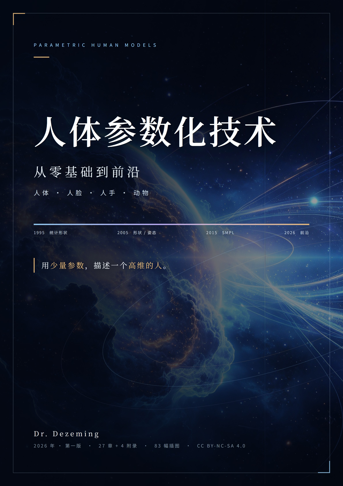

# 人体参数化技术

> 从零基础到前沿：人体 · 人脸 · 人手 · 动物

一本书讲清楚「参数化人体」这件事：**如何用几十个参数，描述一个高维的人**。从 1995 年的主动形状模型一路讲到 2026 年的扩散模型与视觉基础模型，人体、人脸、人手、动物四条主线共用同一套数学——平均形状 + 形变基 + 骨架蒙皮。

作者：**Dr. Dezeming**　·　2026 年 · 第一版

> 📖 **在线阅读（网页版）**：<https://ai-crystal.github.io/Human-body-Param/>
>
> 章节直达链接：`https://ai-crystal.github.io/Human-body-Param/#/book/chapters/ch07`

[开始阅读](book/chapters/ch01.md)　·　<a href="output/parametric-human-models.pdf" target="_blank" rel="noopener">下载 PDF</a>

## 这本书写给谁

- 刚进实验室、被导师丢了一篇 SMPL 论文的学生：第 1–6 章把线代、概率、PCA、蒙皮从“一列数”讲起，不需要先修课。
- 做游戏 / 影视 / 数字人的工程师：第 7–14 章讲清 SMPL 的每个矩阵、单图与视频重建、着装与动作生成，能判断一个方案的上限。
- 想快速建立全局视野的研究者：第 15–27 章按“问题 → 旧方法 → 局限 → 新方法”梳理人脸、人手、动物与生成模型，并给出精读路线。

## 全书结构

| 篇 | 内容 | 章 |
|---|---|---|
| 第一篇 地基 | 向量与最小二乘、概率与 PCA、三维表示、LBS、ASM → 3DMM | 1–6 |
| 第二篇 人体 | SCAPE、SMPL 逐项拆公式、SMPL 家族、单图/视频重建、数据集、着装与神经渲染、动作生成 | 7–14 |
| 第三篇 人脸 | 3DMM 深入与 Basel Face Model、FLAME、高保真细节、驱动与神经头像 | 15–18 |
| 第四篇 人手 | 手部解剖与 MANO、单手重建、手物交互与接触 | 19–21 |
| 第五篇 动物 | SMAL 与玩具扫描、动物重建四代方法、鸟类/鱼类与跨物种生成 | 22–24 |
| 第六篇 前沿与实战 | 扩散与基础模型、可运行的 PCA/LBS/拟合 demo、研究脉络 | 25–27 |

附录：数学补充、术语中英对照、论文时间线、参考文献（按正文首次引用编号）。

## 阅读方式

- **在线**：左侧目录按篇分组，每章一个独立链接，可直接分享 `#/book/chapters/ch07` 这样的地址。
- **下载**：整本 PDF 见 <a href="output/parametric-human-models.pdf" target="_blank" rel="noopener">output/parametric-human-models.pdf</a>。
- 所有插图都是程序生成的矢量风格示意图，源图在 `book/images/`，绘图代码在 `book/code/`，可以改参数重画。

## 约定

- 向量加粗、矩阵大写加粗、标量斜体；角度默认弧度。
- 公式按章编号，例如“式 (3.8)”指第 3 章第 8 个公式。
- 引用用方括号数字 `[12]`，对应附录 D。

## 许可

本书文字与插图采用 **CC BY-NC-SA 4.0**（署名—非商业性使用—相同方式共享）许可发布。书中不包含任何受限的 SMPL / MANO / FLAME 模型文件；提及的论文版权归原作者与出版方所有。

发现错漏欢迎提交 Issue。
