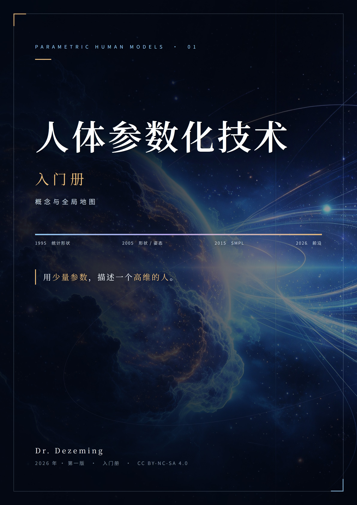
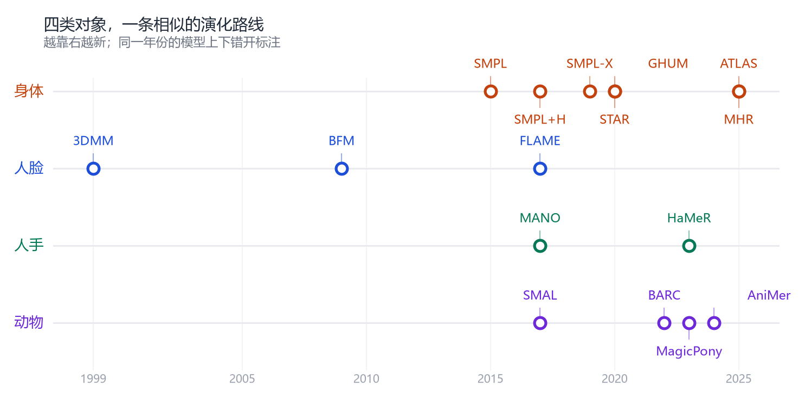

# 人体参数化技术

> 一套六册的中文书：**用几十个参数，描述一个高维的人**。

从 1995 年的主动形状模型一路讲到 2025 年的 ATLAS / MHR 与扩散模型。人体、人脸、人手、动物四条主线共用同一套数学——平均形状 + 形变基 + 骨架蒙皮。

作者：**Dr. Dezeming**　·　2026 年 · 第一版

> 📖 **在线阅读**：<https://ai-crystal.github.io/Human-body-Param/>
>
> 单册直达：`https://ai-crystal.github.io/Human-body-Param/#/books/intro/chapters/ch01`

## 六册一览

| 册 | 内容 | 章 | 页数 | 在线阅读 | PDF |
|---|---|---|---|---|---|
| **入门册** | 只讲概念：参数化在做什么、参数从哪来、人怎么动、怎么从照片反推 | 5 | 35 | [阅读](books/intro/chapters/ch01.md) | <a href="output/php-intro.pdf" target="_blank" rel="noopener">下载</a> |
| **数学册** | 向量与矩阵 · 最小二乘 · 概率与 PCA/SVD · 三维表示与旋转 · LBS 与 DQS · 统计形状模型 · 李群与位姿优化 | 7 | 99 | [阅读](books/math/chapters/ch01.md) | <a href="output/php-math.pdf" target="_blank" rel="noopener">下载</a> |
| **人体册** | SCAPE · SMPL 逐项拆公式 · SMPL 家族（STAR / ATLAS / MHR）· SMPL 的训练与评估 | 4 | 52 | [阅读](books/body/chapters/ch01.md) | <a href="output/php-body.pdf" target="_blank" rel="noopener">下载</a> |
| **重建册** | 优化法与回归法 · 视频与多人 · 数据集与评估 · 着装与神经渲染 · 动作生成 | 5 | 45 | [阅读](books/recon/chapters/ch01.md) | <a href="output/php-recon.pdf" target="_blank" rel="noopener">下载</a> |
| **脸手册** | 3DMM 与 BFM · FLAME · 高保真细节 · 驱动与头像 · MANO · 单手重建 · 手物交互 | 7 | 69 | [阅读](books/face-hand/chapters/ch01.md) | <a href="output/php-face-hand.pdf" target="_blank" rel="noopener">下载</a> |
| **前沿册** | SMAL 与动物重建 · 跨物种 · 扩散与 3DGS · 人体基础模型 · 研究脉络 | 5 | 49 | [阅读](books/frontier/chapters/ch01.md) | <a href="output/php-frontier.pdf" target="_blank" rel="noopener">下载</a> |

共 349 页，合计约 21 MB。

## 怎么读

- **完全新手**：从入门册读起，一小时读完，再挑一个专业篇。
- **有图形/视觉基础**：直接看数学册第 2 章（PCA）与人体册第 2 章（SMPL 公式）。
- **只做人脸或人手**：脸手册第 1 章、第 5 章分别是两个入口。
- **只做动物**：前沿册第 1 章起。

<figure class="fig">

<figcaption><b>六册的分工与依赖</b>　实线是建议顺序，虚线是可选的捷径。</figcaption>
</figure>

## 这套书的特点

- 公式全部用 KaTeX 排版，网页上可以直接读，也可以下载 PDF。
- 每张插图都是程序生成的，代码在 `books/<册>/code/`，可以改参数重画。
- 每个模型不只讲“它怎么工作”，也讲“它在什么情况下会坏”。
- 四条主线（人体、人脸、人手、动物）共用一套符号与术语，跨册阅读不用重新适应。

## 约定

- 向量加粗、矩阵大写加粗、标量斜体；角度默认弧度。
- 公式按章编号，例如“式 (3.8)”指第 3 章第 8 个公式。
- 引用用方括号数字，对应各册末尾的参考文献。
- 跨册引用写作《数学册》第 5 章，册名与本系列一致。

## 许可

本书文字与插图采用 **CC BY-NC-SA 4.0**（署名—非商业性使用—相同方式共享）许可发布。书中不包含任何受限的 SMPL / MANO / FLAME 模型文件；提及的论文版权归原作者与出版方所有。

发现错漏欢迎提交 Issue。
