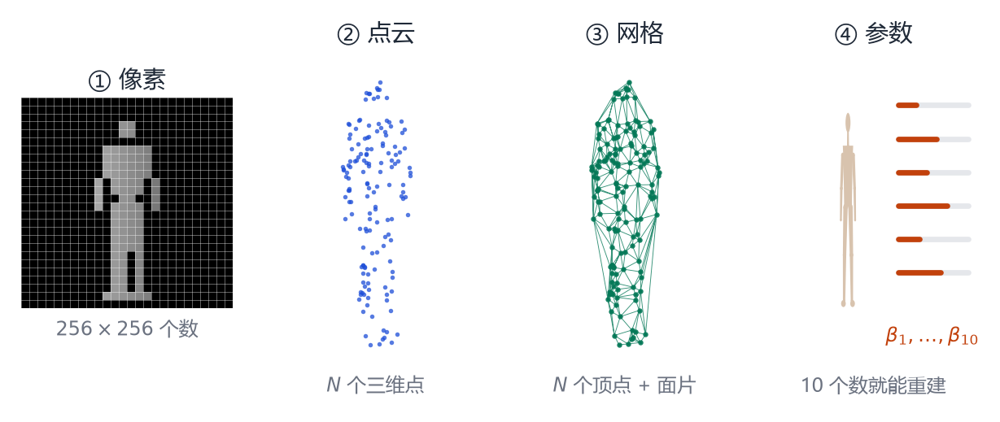
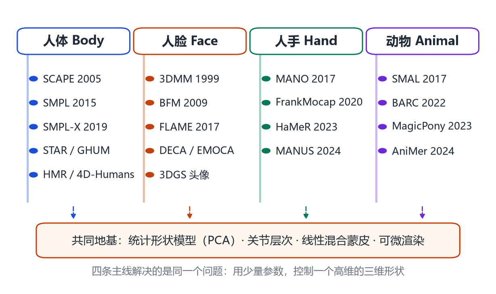
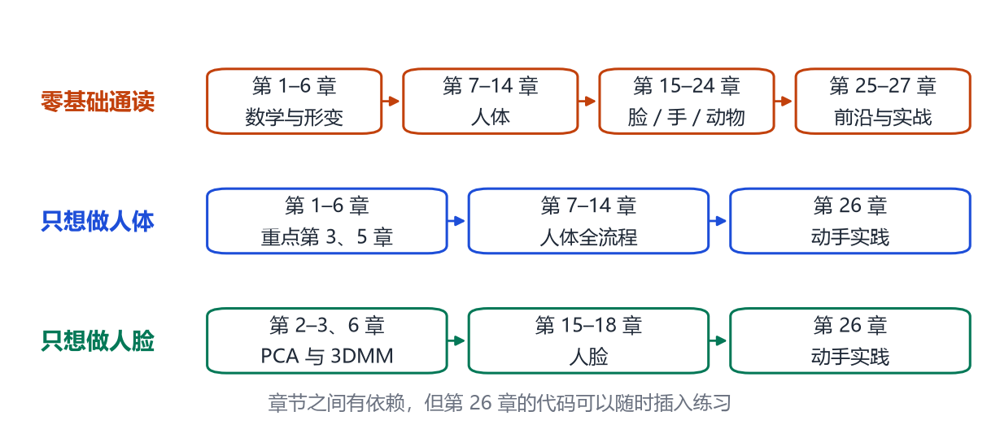

# 第 1 章 什么是「参数化人体」

> **本章导读**：这一章不写公式，只回答三个问题：为什么计算机需要一个“人体模型”？“参数化”到底是什么意思？人体、人脸、人手、动物这四条看似不同的路线，为什么能装进同一本书？读完这一章，你会得到一张全局地图，后面的章节都是在往地图上填细节。

## 1.1 一个看似简单的问题

请先看一个任务：给你一张普通的生活照，要求你算出照片里这个人的身高、肩宽、腿长，并且让他在电脑里做一个“转身”的动作。

对人来说，这件事平平无奇；对计算机来说，它几乎无从下手。因为照片在计算机眼里只是一个 $1920\times1080$ 的数字表格，每个格子记录红绿蓝三个亮度值。它既不知道什么是“人”，也不知道什么是“肩膀”。

更麻烦的是“转身”。如果照片里只有正面，背面长什么样？计算机没有见过，只能猜。而一个真实的 3D 扫描仪可以扫出背面，却要几十万元，还得让人站进一个布满相机的棚子里。

于是研究者换了一个思路：**与其每次从零重建一个人，不如事先学好“人”这件事，把它压缩成一组可以调节的旋钮。** 这就是参数化人体（parametric human model）的核心思想。

## 1.2 计算机眼里的“人”：四种表示

<figure class="fig">

<figcaption><b>图 1-1</b>　同一个人的四种表示。从左到右，自由度越来越低，可控性越来越强：像素有几十万个数，点云有几千个点，网格有固定的顶点与面片，而参数模型只需要十几个数。</figcaption>
</figure>

图 1-1 展示了四种常见表示，我们逐一来看。

**第一种是像素。** 一张 $256\times256$ 的灰度图有 65536 个数。它能很好地“看”，却不方便“改”：想让人长高 5 厘米，应该改哪些像素？没人说得清。

**第二种是点云。** 用深度相机或激光扫描，可以得到人体表面的一堆三维点，每个点有 $(x,y,z)$ 三个坐标。点云很忠实，但它没有“表面”的概念：点与点之间没有连接关系，也就无法直接计算面积、法线，更不能驱动动画。

**第三种是网格（mesh）。** 把点用三角形连接起来，就得到一张“皮”。网格的顶点数 $N$ 通常是固定的（SMPL 是 6890 个），每个顶点有三维坐标，可以整体做变换、做变形。这是目前工业界最通用的表示：游戏、影视、VR 都用网格。

**第四种是参数。** 图 1-1 最右边只画了 10 根小滑块。滑动它们，人体的高矮、胖瘦、肩宽、腿长会一起变化。10 个数当然不可能精确描述一个人的每一个细节，但它抓住了**主要矛盾**：绝大多数人的身材差异，可以被少数几个方向解释。

从 65536 个数，到 6890 个顶点，再到 10 个参数——这条“降维”的路，就是本书要讲的故事。

## 1.3 “参数”到底是什么

先抛开人体，看一个更简单的例子。

假设你要描述一个圆。你可以列出圆周上 1000 个点的坐标，也可以只写三个数：圆心横坐标、圆心纵坐标、半径。后一种写法就是“参数化”：用少数几个有明确含义的量，生成任意多的点。

人体当然不是圆。人的形状太复杂，找不到一个像“半径”那样简单的几何量。但研究者发现了一件重要的事：

> **如果把很多很多人的三维扫描对齐、叠放在一起，那么“人与人之间的差异”其实集中在一个很小的子空间里。**

这句话是整本书的技术核心，值得慢慢解释。

想象你收集了 1000 个成年人的三维网格，每个网格都有 6890 个顶点，于是每个人可以写成一个长度为 $6890\times3=20670$ 的向量。1000 个人就是 1000 个 20670 维的向量。听起来维度高得吓人，但它们并不是杂乱无章的：身高、胖瘦、骨架比例这些因素彼此关联，导致这 1000 个向量其实挤在一个低维的“薄片”上。

这个“薄片”，数学上叫**子空间**。找到它的方法叫**主成分分析**（Principal Component Analysis, PCA），我们会在第 3 章用整整一章，从“平均数”开始讲起，保证你不需要任何线代基础也能懂。

找到子空间之后，每个人就可以写成：

$$
\mathbf{x} \approx \boldsymbol{\mu} + b_1\mathbf{p}_1 + b_2\mathbf{p}_2 + \cdots + b_{10}\mathbf{p}_{10},
\tag{1.1}
$$

其中 $\boldsymbol{\mu}$ 是“平均人”，$\mathbf{p}_1,\dots,\mathbf{p}_{10}$ 是十个“变化方向”（第一主成分、第二主成分……），$b_1,\dots,b_{10}$ 是每个人在这十个方向上的“刻度”。这十个 $b$ 就是图 1-1 里的滑块。

顺便说一句：式 (1.1) 里的加号是**向量加法**，$b_1\mathbf{p}_1$ 是**数乘向量**。如果你现在还不知道这两个词，完全没关系，第 2 章会从“一列数”讲起。

## 1.4 参数化带来的四件事

为什么大家非要费劲做这件事？因为一旦有了参数，四类原本很难的任务会突然变简单。

**第一，压缩。** 一个原始扫描动辄几十 MB，而一组参数只有几十个浮点数，几百字节。传输、存储、做数据集都方便得多。

**第二，可控。** 想让人物“长高一点”“壮一点”“笑一下”，只需要改对应的参数，而不是去手工雕刻几千个顶点。动画师、游戏策划、医生都能用。

**第三，可反演。** 这是最关键的一点。给定一张照片，我们可以反过来问：**哪一组参数，渲染出来最像这张照片？** 于是问题变成了一个优化问题：

$$
\min_{\boldsymbol{\beta},\boldsymbol{\theta}}\ \big\|\,\text{Render}(\text{Model}(\boldsymbol{\beta},\boldsymbol{\theta}))-\text{Image}\,\big\|^2 .
\tag{1.2}
$$

只要模型可微、渲染可微，就能用梯度下降求解。2015 年之后的单图人体重建（HMR、SMPLify）、人脸重建（DECA、EMOCA），本质上都在解式 (1.2) 的各种变体。

**第四，可生成。** 有了低维参数空间，就可以在这个空间里采样、插值、做统计，甚至训练扩散模型。今天文生 3D 人体、动作生成、数字人直播，底层几乎都站着一个参数化模型。

## 1.5 四条主线，一个地基

<figure class="fig">

<figcaption><b>图 1-2</b>　本书的四条技术主线。它们看起来分属不同应用，但共享同一套地基：用 PCA 建立形状空间、用关节层次描述姿态、用线性混合蒙皮把两者合起来、用可微渲染把模型和图像连起来。</figcaption>
</figure>

本书讲四个对象：**人体、人脸、人手、动物**。它们各自有一批代表性模型：

- 人体：SCAPE（2005）→ SMPL（2015）→ SMPL-X（2019）→ STAR / GHUM → 单图与视频重建；
- 人脸：3DMM（1999）→ Basel Face Model（2009）→ FLAME（2017）→ DECA / EMOCA → 神经头像；
- 人手：MANO（2017）→ FrankMocap（2020）→ HaMeR（2023）→ 手物交互；
- 动物：SMAL（2017）→ SMALST / BARC → MagicPony（2023）→ AniMer（2024）。

如果你只记住一件事，请记住：**它们不是四套互不相干的技术，而是同一套数学在四种对象上的四次落地。** 人脸多了表情 blendshape，手多了 21 个关节的精细骨架，动物多了跨物种的形状对应，但“平均形状 + 形变基 + 骨架蒙皮”的骨架没有变。

这也解释了本书的编排：先用六章把地基打牢，再分别进入四条主线，最后在“前沿”一篇把它们重新汇合。

## 1.6 一条简短的历史线

参数化人体的历史，可以粗略分成四段。

**第一段：统计形状的诞生（1990s）。** Cootes 等人提出主动形状模型（ASM），第一次用 PCA 描述一组轮廓的形状变化 [@cootes1995asm]；Blanz 与 Vetter 在 1999 年把同样的思想搬到三维人脸，做出 3D 形变模型（3DMM）[@blanz1999morphable]。这两项工作确立了“平均形状 + 主成分”的范式。

**第二段：把形状和姿态分开（2005–2015）。** Allen 等人建立了人体形状空间 [@allen2003space]，Anguelov 等人的 SCAPE 第一次把“体型”和“姿势”拆成两套参数 [@anguelov2005scape]，并用三角变形处理关节处的皮肤褶皱。十年后，SMPL 用更简洁的线性混合蒙皮取代 SCAPE 的复杂变形，把模型做到了实时、可微、工业可用 [@loper2015smpl]。

**第三段：从模型到图像（2016–2020）。** SMPLify 用 2D 关节点反推 3D 人体 [@bogo2016smplify]，HMR 用神经网络直接回归参数 [@kanazawa2018hmr]，SPIN 把两者结合 [@kolotouros2019spin]。人脸有 DECA，手有 FrankMocap，动物有 SMALST [@zuffi2021smalst]。参数化模型从“表示工具”变成了“视觉系统的输出层”。

**第四段：神经化与生成化（2020 至今）。** NeRF、3D Gaussian Splatting 把外观细节推到照片级；扩散模型让“用文字生成人体/动作”成为可能；视觉基础模型（SAM、DINOv2、深度大模型）又反过来提升了参数估计的鲁棒性。参数化模型没有被取代，反而成了神经渲染的“骨架”和生成模型的“接口”。

这条线在每一篇里都会重新展开，这里你只需要有一个时间感。

## 1.7 这本书怎么读

<figure class="fig">

<figcaption><b>图 1-3</b>　三条推荐阅读路线。第一次接触这个领域，建议按第一条走；已经有明确目标，可以走第二或第三条，遇到缺的数学再回补。</figcaption>
</figure>

全书共 27 章，分六篇：

- **第一篇（第 1–6 章）地基**：向量与矩阵、概率与 PCA、三维表示与旋转、骨架与蒙皮、统计形状模型。这一篇是“必须”，但可以跳读：如果你已经会 PCA，直接看第 3 章的“几何直觉”一节即可。
- **第二篇（第 7–14 章）人体**：SCAPE、SMPL、SMPL 家族、单图/视频重建、数据集、着装与神经渲染、动作生成。这是全书的主干。
- **第三篇（第 15–18 章）人脸**：3DMM 深入、FLAME、高保真细节、人脸驱动。
- **第四篇（第 19–21 章）人手**：手部解剖与 MANO、单手重建、手物交互。
- **第五篇（第 22–24 章）动物**：SMAL、动物重建、跨物种扩展。
- **第六篇（第 25–27 章）前沿与实战**：生成式人体、亲手跑代码、研究脉络与未来。

每一章的开头都有“本章导读”，结尾有“本章小结”和几道思考题。思考题不需要写代码，但如果你能用自己的话回答，说明这一章真的读懂了。

## 本章小结

- 参数化人体用少量参数描述高维的三维形状，核心是“平均形状 + 若干形变方向”的线性模型。
- 它带来四个能力：压缩、可控、可反演（从图像推参数）、可生成。
- 人体、人脸、人手、动物共享同一套地基：PCA 形状空间、关节层次、线性混合蒙皮、可微渲染。
- 技术史可以分成统计形状、形状/姿态分离、模型与图像结合、神经化与生成化四段。

## 思考题

1. 如果一个模型只有 3 个形状参数，它能描述哪些差异？会丢失哪些差异？
2. 为什么“可微”对从图像反推参数如此重要？如果一个环节不可微，还有什么办法？
3. 人脸和人手都比人体小得多，为什么反而需要更多参数？
