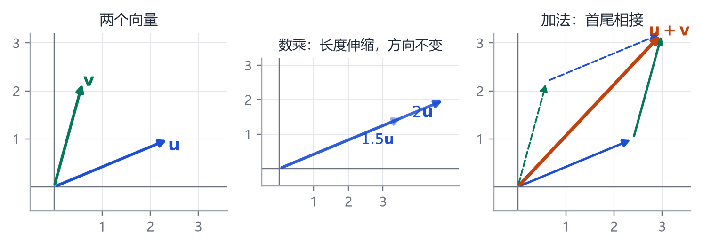
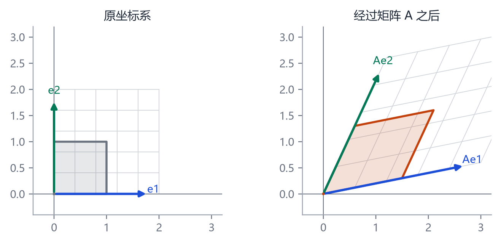
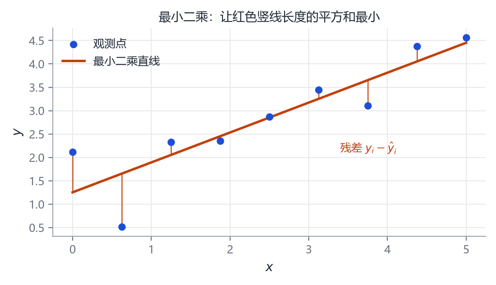

# 第 2 章 数学工具箱（一）：向量、矩阵与最小二乘

> **本章导读**：这一章只做一件事——把“一个三维人体”翻译成一列数字，再讲清楚对这列数字做加、乘、投影、拟合分别意味着什么。你不需要学过线性代数，只要会加减乘除。读完后，你应该能看懂 $S=\bar S+B\beta$ 这种写法，并理解为什么“拟合”最后会变成一个求最小值的问题。

## 2.1 为什么人体可以用一列数字表示

一个三角形有三个顶点，每个顶点有 $x,y,z$ 三个坐标，一共 9 个数。我们可以把它写成：

$$
\mathbf{x}=(x_1,y_1,z_1,\ x_2,y_2,z_2,\ x_3,y_3,z_3).
\tag{2.1}
$$

这就是一个**向量**：把若干个数按顺序排成一列。人体网格有 6890 个顶点，就对应 $6890\times3=20670$ 个数，写成向量就是 20670 维。维度高不代表概念难，它只是“很长的一列数”。

这里有一个非常重要的约定：**顶点的编号顺序必须固定**。第 100 号顶点在每个人身上都必须对应“左手腕内侧”这同一个位置，否则把它们相减没有意义。后面讲的所有模型，都建立在“所有网格已经对齐、顶点一一对应”这个前提上。

## 2.2 向量：箭头与一列数

<figure class="fig">

<figcaption><b>图 2-1</b>　向量的三种基本操作。向量既可以看成一列数，也可以看成从原点出发的箭头；两种看法在计算时等价。</figcaption>
</figure>

### 2.2.1 加法与数乘

两个向量相加，就是对应位置相加：

$$
(1,2)+(3,-1)=(4,1).
$$

几何上，这就是把第二个箭头的起点移到第一个箭头的终点，然后从原点连到新的终点（图 2-1 右）。

数乘更简单：一个数 $k$ 乘向量，就是把每个分量都乘 $k$：

$$
2\cdot(1,2)=(2,4).
$$

几何上，方向不变，长度变成原来的 $k$ 倍；$k<0$ 时方向反过来。

**这两个操作合起来叫“线性组合”**：$a\mathbf{u}+b\mathbf{v}$。整本书里所有“平均形状 + 若干形变方向”的模型，本质上都是线性组合。

### 2.2.2 点积：投影与相似度

两个向量的点积定义为对应分量相乘再相加：

$$
\mathbf{u}\cdot\mathbf{v}=u_1v_1+u_2v_2+\cdots+u_dv_d.
\tag{2.2}
$$

例如 $(1,2)\cdot(3,1)=1\times3+2\times1=5$。

点积有一个几何解释，这是理解 PCA 的关键：

$$
\mathbf{u}\cdot\mathbf{v}=\|\mathbf{u}\|\,\|\mathbf{v}\|\cos\theta,
\tag{2.3}
$$

其中 $\|\mathbf{u}\|=\sqrt{\mathbf{u}\cdot\mathbf{u}}$ 是长度，$\theta$ 是夹角。于是：

- 点积为 0 → 两向量垂直（正交）；
- 点积为正 → 方向大致相同；
- 点积为负 → 方向大致相反。

如果 $\|\mathbf{v}\|=1$，那么 $\mathbf{u}\cdot\mathbf{v}$ 恰好等于 $\mathbf{u}$ 在 $\mathbf{v}$ 方向上的**投影长度**。把一个向量投影到某个方向上，就是丢掉其他方向的信息，只保留这个方向上的分量。PCA 做的事情，就是找一组“最好的方向”，然后把高维数据投影上去。

### 2.2.3 距离

两个向量的欧氏距离是

$$
\|\mathbf{u}-\mathbf{v}\|=\sqrt{\sum_i (u_i-v_i)^2}.
\tag{2.4}
$$

它衡量两个形状有多不一样：把两个人体网格展平成向量，算距离，就得到一个“形状差异”的数值。后面评估重建精度时常用的 MPVE、PVE，本质上就是这个距离的平均。

## 2.3 矩阵：一台变形机器

<figure class="fig">

<figcaption><b>图 2-2</b>　矩阵乘法的几何意义。左图是原来的单位正方形与坐标轴；右图是经过矩阵 $A$ 变换后的结果。整个平面被“拉伸、旋转、错切”，网格线仍然是直线，这就是“线性变换”。</figcaption>
</figure>

### 2.3.1 矩阵乘向量

一个 $m\times n$ 的矩阵就是一个 $m$ 行 $n$ 列的数表。矩阵乘向量，得到另一个向量：

$$
\begin{bmatrix}2&1\\0&3\end{bmatrix}
\begin{bmatrix}1\\2\end{bmatrix}
=
\begin{bmatrix}2\times1+1\times2\\0\times1+3\times2\end{bmatrix}
=
\begin{bmatrix}4\\6\end{bmatrix}.
\tag{2.5}
$$

计算规则是“行乘列”：结果的第 $i$ 个数，等于矩阵第 $i$ 行与向量做点积。

但更有用的看法是**列的组合**：

$$
\begin{bmatrix}2&1\\0&3\end{bmatrix}
\begin{bmatrix}1\\2\end{bmatrix}
=
1\cdot\begin{bmatrix}2\\0\end{bmatrix}
+2\cdot\begin{bmatrix}0\\3\end{bmatrix}.
\tag{2.6}
$$

也就是说，矩阵的每一列都是一个“基方向”，向量里的每个数告诉你“这个方向要走多远”。这正是参数化模型的写法：$B\beta$ 就是“用 $\beta$ 的每一维去组合 $B$ 的每一列”。

### 2.3.2 矩阵乘矩阵：复合变换

如果先做变换 $A$，再做变换 $B$，合起来就是 $BA$（注意顺序：右边的先作用）。矩阵乘法不满足交换律，$AB\neq BA$，因为“先旋转再平移”和“先平移再旋转”结果不同。

在人体模型里，每个关节的变换都是一个 $4\times4$ 矩阵，它同时包含旋转和平移；一长串父子关节的变换相乘，就得到从局部坐标到世界坐标的完整变换。第 4、5 章会详细讲。

### 2.3.3 转置、单位矩阵、逆矩阵

- **转置** $\mathbf{A}^\top$：把行和列互换。$(m\times n)$ 变 $(n\times m)$。
- **单位矩阵** $\mathbf{I}$：对角线上全是 1，其余是 0；它乘任何向量都不改变向量。
- **逆矩阵** $\mathbf{A}^{-1}$：满足 $\mathbf{A}^{-1}\mathbf{A}=\mathbf{I}$。只有方阵、且行列式不为 0 时才存在。

逆矩阵的几何意义是“撤销变换”。但实际计算中我们很少真的去求逆：数值上不稳定，通常用解方程或最小二乘代替。

### 2.3.4 秩与“信息量”

矩阵的**秩**（rank）可以理解成“变换后还剩几个独立方向”。一个 $3\times3$ 矩阵如果秩是 2，它会把整个三维空间压扁成一个平面，很多不同的输入会得到同一个输出，变换就不可逆了。

PCA 里，协方差矩阵的秩最多是 $n-1$（$n$ 是样本数）。这解释了一个常见现象：**1000 个样本最多只能张成 999 维**，哪怕原始数据有 20670 维。数据本身的“有效维度”远小于表面维度，这正是降维能成立的根本原因。

## 2.4 把“求解”变成“找最小”

### 2.4.1 方程无解时怎么办

假设你有 5 个观测点，想用一条直线 $y=a+bx$ 去拟合。每个点都给你一个方程：

$$
\begin{cases}
a+bx_1=y_1,\\
\ \vdots\\
a+bx_5=y_5.
\end{cases}
\tag{2.7}
$$

5 个方程、2 个未知数，一般无解——因为点不会恰好共线。写成矩阵形式就是 $\mathbf{A}\mathbf{w}=\mathbf{y}$，其中 $\mathbf{A}$ 是 $5\times2$，$\mathbf{w}=(a,b)^\top$。

既然无解，就退一步：找一个 $\mathbf{w}$，让左右两边“尽量接近”。衡量接近程度最常用的方式是**残差平方和**：

$$
L(\mathbf{w})=\sum_{i=1}^{5}\big(y_i-(a+bx_i)\big)^2=\|\mathbf{A}\mathbf{w}-\mathbf{y}\|^2.
\tag{2.8}
$$

这就是**最小二乘**（least squares）。

<figure class="fig">

<figcaption><b>图 2-3</b>　最小二乘的几何直觉。每个红竖线是一个残差；我们要找一条直线，让所有红竖线长度的平方和最小。注意是“平方和”，不是“绝对值和”，后者在 0 点不可导，不便于优化。</figcaption>
</figure>

### 2.4.2 怎么求最小值

对 $L$ 关于 $\mathbf{w}$ 求导并令其为 0，可以得到**正规方程**：

$$
\mathbf{A}^\top\mathbf{A}\,\mathbf{w}=\mathbf{A}^\top\mathbf{y}.
\tag{2.9}
$$

如果 $\mathbf{A}^\top\mathbf{A}$ 可逆，解就是

$$
\mathbf{w}=(\mathbf{A}^\top\mathbf{A})^{-1}\mathbf{A}^\top\mathbf{y}.
\tag{2.10}
$$

这个式子值得多看一眼：$\mathbf{A}^\top\mathbf{y}$ 把观测投影到参数空间，$(\mathbf{A}^\top\mathbf{A})^{-1}$ 再做一次校正。伪逆 $\mathbf{A}^{+}=(\mathbf{A}^\top\mathbf{A})^{-1}\mathbf{A}^\top$ 就是“当方程无解时，给出最佳折中”的工具。

在 Python 里，你几乎不会手写这个公式，一行代码就够了：

```python
import numpy as np
w, *_ = np.linalg.lstsq(A, y, rcond=None)
```

但你必须知道它在做什么：**最小二乘把“解方程”换成了“最小化误差”，这是所有模型拟合、神经网络训练的共同起点。**

### 2.4.3 加一点约束：正则化

最小二乘有一个隐患：如果某些方向几乎没有数据，$\mathbf{A}^\top\mathbf{A}$ 接近奇异，解会爆炸。解决办法是加一个“惩罚项”，让参数不要太大：

$$
L(\mathbf{w})=\|\mathbf{A}\mathbf{w}-\mathbf{y}\|^2+\lambda\|\mathbf{w}\|^2.
\tag{2.11}
$$

这叫**岭回归**（ridge regression），解变成

$$
\mathbf{w}=(\mathbf{A}^\top\mathbf{A}+\lambda\mathbf{I})^{-1}\mathbf{A}^\top\mathbf{y}.
\tag{2.12}
$$

在人体重建里，这一项无处不在：$\lambda_\beta\|\boldsymbol{\beta}\|^2$ 防止形状参数跑到不合理的区域，$\lambda_\theta\|\boldsymbol{\theta}-\boldsymbol{\theta}_0\|^2$ 让姿态不要扭曲。第 10 章会看到它的具体形式。

## 2.5 矩阵分解：把复杂变换拆成简单部分

后面会反复用到两种分解，这里先建立直觉。

**特征分解**（eigendecomposition）：对方阵 $\mathbf{C}$，找一组方向 $\mathbf{p}_i$ 和对应的数 $\lambda_i$，使得

$$
\mathbf{C}\mathbf{p}_i=\lambda_i\mathbf{p}_i.
\tag{2.13}
$$

意思是：矩阵作用在 $\mathbf{p}_i$ 上，只改变长度（乘 $\lambda_i$），不改变方向。这样的方向叫**特征向量**，$\lambda_i$ 叫**特征值**。如果 $\mathbf{C}$ 是协方差矩阵，特征值就是“这个方向上的方差”。

**奇异值分解**（Singular Value Decomposition, SVD）：对任意矩阵 $\mathbf{X}$（不必是方阵），都可以写成

$$
\mathbf{X}=\mathbf{U}\mathbf{S}\mathbf{V}^\top,
\tag{2.14}
$$

其中 $\mathbf{U},\mathbf{V}$ 的列互相正交，$\mathbf{S}$ 是对角矩阵，对角线上的数叫奇异值。SVD 是 PCA 的数值实现方式，第 3 章会用它避免显式构造巨大的协方差矩阵。

## 2.6 这一章在整本书里的位置

你现在已经具备了三样工具：

1. 用向量表示形状；
2. 用矩阵表示变换与线性组合；
3. 用最小二乘把“拟合”变成“最小化”。

第 3 章会用这三样工具回答一个问题：**给定一大堆人体，如何自动找到那组“最好的方向”？** 答案就是 PCA。第 5 章会把矩阵变换用在骨架上，得到线性混合蒙皮。第 8 章的 SMPL，本质上就是“PCA 形状空间 + 骨架变换 + 最小二乘拟合”的组合。

## 本章小结

- 形状可以展平成向量，前提是所有网格顶点一一对应。
- 矩阵乘向量是“列的线性组合”；矩阵乘矩阵是“变换的复合”。
- 点积衡量投影与相似度；正交方向互不影响。
- 方程无解时，最小二乘给出残差平方和最小的折中解；加正则项可以防止过拟合。
- 特征分解找“不被矩阵转向的方向”，SVD 把任意矩阵拆成旋转—缩放—旋转。

## 思考题

1. 一个 $2\times2$ 矩阵把单位正方形变成面积为 3 的平行四边形，它的行列式是多少？
2. 为什么最小二乘用平方而不是绝对值？提示：从求导和异常值两个角度想。
3. 如果两个人体网格的顶点顺序不一致，直接相减会发生什么？可以怎样补救？
