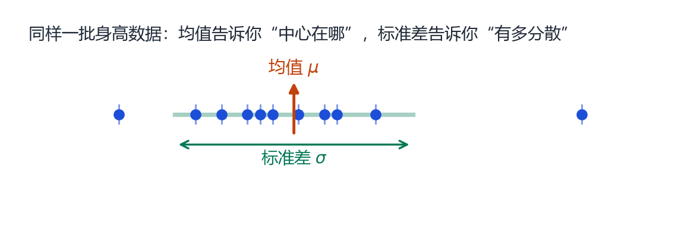
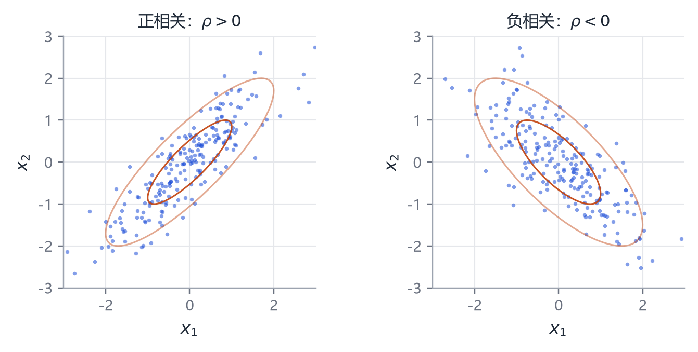
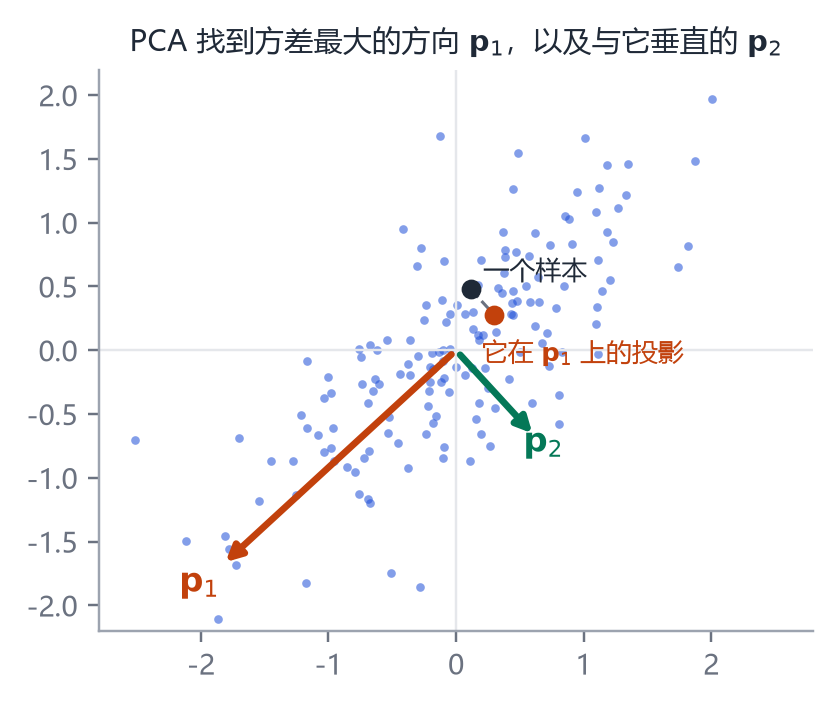
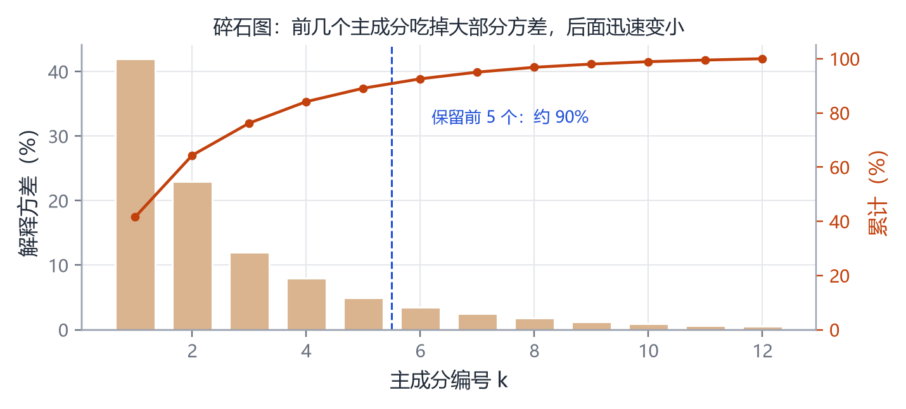
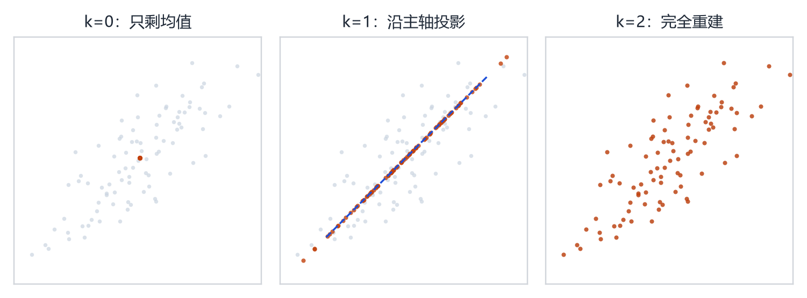
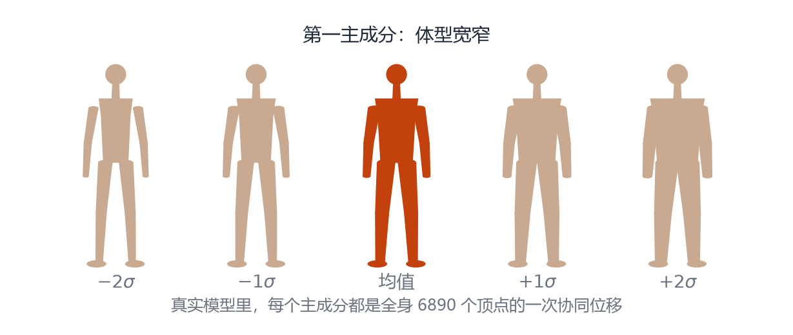

# 第 3 章 数学工具箱（二）：概率、协方差与 PCA

> **本章导读**：这是全书最重要的一章。PCA 是 3DMM、SMPL、FLAME、MANO、SMAL 共同的心脏，但它经常被一句“降维”带过。本章从“平均身高”讲起，一步一步搭出协方差矩阵、特征向量和投影公式，并用 5 个二维点手算一遍。读完这一章，你应该能自己写出 20 行 PCA 代码，并解释每一步在做什么。

## 3.1 从一个“平均人”说起

假设你量了 5 个人的身高：170、175、180、165、185 厘米。你大概会立刻说出“平均 175”。这个“平均”就是**均值**（mean）：

$$
\mu=\frac{1}{n}\sum_{i=1}^{n}x_i.
\tag{3.1}
$$

但只报均值会丢掉信息。170 和 180 的平均是 175，175 和 175 的平均也是 175，可这两组人显然不一样。于是我们需要第二个数，描述“数据离均值有多远”。最自然的想法是把每个偏差加起来，但正负会抵消（$(-5)+5=0$），所以改成平方后再平均：

$$
\sigma^2=\frac{1}{n}\sum_{i=1}^{n}(x_i-\mu)^2.
\tag{3.2}
$$

这叫**方差**（variance），它的平方根 $\sigma$ 叫**标准差**（standard deviation）。方差越大，数据越分散。

<figure class="fig">

<figcaption><b>图 3-1</b>　一维数据的均值与标准差。蓝点是观测值，橙色箭头指向均值，绿色线段是 $\pm1$ 个标准差的范围。绝大多数观测会落在这个范围内（高斯分布下约 68%）。</figcaption>
</figure>

注意图 3-1 里最左和最右各有一个“离群点”。它们会把均值往自己那边拉，也会显著增大方差。真实的人体扫描数据里同样有离群样本（扫描失败、姿势不对、穿帮），所以做 PCA 之前通常要先清洗数据。

## 3.2 两个变量：协方差

人体不只有身高。假设我们同时记录身高 $x_1$ 和肩宽 $x_2$。这两个量往往一起变大：高的人通常肩也宽。怎么用数字描述“一起变”？

仿照方差的思路，把两个变量的偏差乘起来再平均：

$$
\mathrm{Cov}(x_1,x_2)=\frac{1}{n-1}\sum_{i=1}^{n}(x_{1i}-\mu_1)(x_{2i}-\mu_2).
\tag{3.3}
$$

这个量叫**协方差**（covariance）。它的符号很有信息量：

- 如果 $x_1$ 高于均值时 $x_2$ 也倾向于高于均值，乘积为正，协方差为正；
- 如果一个大另一个就小，乘积为负，协方差为负；
- 如果两者无关，正负相互抵消，协方差接近 0。

<figure class="fig">

<figcaption><b>图 3-2</b>　协方差的几何样子。左图正相关，点云沿右上方向拉长；右图负相关，沿右下方向拉长。橙色椭圆是高斯分布的 $1\sigma$ 与 $2\sigma$ 等高线，它的倾斜方向由协方差决定。</figcaption>
</figure>

把协方差除以两个标准差的乘积，就得到**相关系数** $\rho\in[-1,1]$。它去掉了量纲，只保留“线性相关程度”。$\rho=1$ 表示完全正相关，$\rho=0$ 表示没有线性关系（注意：不一定独立）。

### 3.2.1 协方差矩阵

当变量有 $d$ 个时，两两之间都有一个协方差，把它们排成一个 $d\times d$ 的表：

$$
\mathbf{C}=
\begin{bmatrix}
\mathrm{Cov}(x_1,x_1) & \mathrm{Cov}(x_1,x_2) & \cdots & \mathrm{Cov}(x_1,x_d)\\
\mathrm{Cov}(x_2,x_1) & \mathrm{Cov}(x_2,x_2) & \cdots & \mathrm{Cov}(x_2,x_d)\\
\vdots & \vdots & \ddots & \vdots\\
\mathrm{Cov}(x_d,x_1) & \mathrm{Cov}(x_d,x_2) & \cdots & \mathrm{Cov}(x_d,x_d)
\end{bmatrix}.
\tag{3.4}
$$

对角线是每个变量自己的方差，非对角线是两两协方差。这个矩阵是对称的（$\mathbf{C}^\top=\mathbf{C}$），而且“半正定”——这两个性质保证了它一定能做特征分解，且特征值非负。

写成矩阵形式更紧凑。设 $\tilde{\mathbf{X}}$ 是中心化后的数据矩阵（每一行是一个样本，每一列是一个变量，且每列均值为 0），那么

$$
\mathbf{C}=\frac{1}{n-1}\tilde{\mathbf{X}}^\top\tilde{\mathbf{X}}.
\tag{3.5}
$$

这个式子是 PCA 计算的起点，值得记住：**协方差矩阵 = 中心化数据的内积，再除以样本数减一。**

## 3.3 高斯分布：为什么数据像一团椭圆云

如果一维数据的直方图中间高、两边低，我们常用**高斯分布**（正态分布）描述它：

$$
p(x)=\frac{1}{\sqrt{2\pi\sigma^2}}\exp\left(-\frac{(x-\mu)^2}{2\sigma^2}\right).
\tag{3.6}
$$

不用被公式吓到，它只说了三件事：以 $\mu$ 为中心；$\sigma$ 越大越胖；离中心越远，概率按指数的平方下降。

推广到 $d$ 维，高斯分布由均值向量 $\boldsymbol{\mu}$ 和协方差矩阵 $\mathbf{C}$ 完全确定：

$$
p(\mathbf{x})=\frac{1}{(2\pi)^{d/2}|\mathbf{C}|^{1/2}}
\exp\left(-\frac12(\mathbf{x}-\boldsymbol{\mu})^\top\mathbf{C}^{-1}(\mathbf{x}-\boldsymbol{\mu})\right).
\tag{3.7}
$$

指数里的 $(\mathbf{x}-\boldsymbol{\mu})^\top\mathbf{C}^{-1}(\mathbf{x}-\boldsymbol{\mu})$ 是一个“马氏距离”的平方：它不仅看离中心多远，还看方向——在方差大的方向上，同样的距离“更正常”。

令这个二次型等于常数，画出来的等高线就是椭圆。椭圆的长轴方向，正是协方差矩阵特征值最大的特征向量方向（图 3-2 的橙色椭圆）。**这就是 PCA 的几何根源**：数据云最长的那个方向，就是第一主成分。

## 3.4 PCA 五步法（手算一遍）

下面用 5 个二维点走完整流程。点集是：

$$
(1,1),\ (2,2),\ (3,2),\ (4,4),\ (5,4).
$$

**第一步：求均值。**

$$
\mu_1=\frac{1+2+3+4+5}{5}=3,\qquad
\mu_2=\frac{1+2+2+4+4}{5}=2.6.
$$

**第二步：中心化。** 每个点减去均值：

$$
(-2,-1.6),\ (-1,-0.6),\ (0,-0.6),\ (1,1.4),\ (2,1.4).
$$

**第三步：算协方差矩阵。** 用式 (3.5)：

$$
\mathbf{C}=\frac{1}{4}
\begin{bmatrix}
4+1+0+1+4 & 3.2+0.6+0+1.4+2.8\\
3.2+0.6+0+1.4+2.8 & 2.56+0.36+0.36+1.96+1.96
\end{bmatrix}
=
\begin{bmatrix}
2.5 & 2.0\\
2.0 & 1.8
\end{bmatrix}.
$$

**第四步：特征分解。** 解 $\det(\mathbf{C}-\lambda\mathbf{I})=0$：

$$
(2.5-\lambda)(1.8-\lambda)-4=0
\ \Longrightarrow\
\lambda^2-4.3\lambda+0.5=0.
$$

得到 $\lambda_1\approx4.181$，$\lambda_2\approx0.119$。对应的单位特征向量是

$$
\mathbf{p}_1\approx(0.766,\ 0.643)^\top,\qquad
\mathbf{p}_2\approx(-0.643,\ 0.766)^\top.
$$

$\mathbf{p}_1$ 指向右上，正是点云拉长的方向；$\mathbf{p}_2$ 与它垂直。两个特征值加起来 $4.3$ 正好等于矩阵的迹（对角线之和），也就是总方差。

**第五步：投影与重建。** 取第一个主成分，任意点 $\mathbf{x}$ 的编码是

$$
b_1=\mathbf{p}_1^\top(\mathbf{x}-\boldsymbol{\mu}),
\tag{3.8}
$$

重建是

$$
\hat{\mathbf{x}}=\boldsymbol{\mu}+b_1\mathbf{p}_1.
\tag{3.9}
$$

以 $(4,4)$ 为例，中心化后是 $(1,1.4)$，$b_1=0.766\times1+0.643\times1.4\approx1.667$，重建得到 $(4.28,3.67)$，与原点相差约 $(0.28,-0.33)$。这点误差就是“只用一个方向”所丢掉的细节。

<figure class="fig">

<figcaption><b>图 3-3</b>　PCA 的几何操作。橙色箭头 $\mathbf{p}_1$ 是方差最大的方向，绿色箭头 $\mathbf{p}_2$ 与它垂直。任意样本（黑点）投影到 $\mathbf{p}_1$ 上，得到一个一维坐标 $b_1$；只用 $b_1$ 就能近似原来的二维点。</figcaption>
</figure>

把上面的流程写成代码，只有十几行：

```python
import numpy as np

def pca(X, k):
    mu = X.mean(axis=0)          # 1. 均值
    Xc = X - mu                  # 2. 中心化
    C = Xc.T @ Xc / (len(X) - 1) # 3. 协方差矩阵
    w, V = np.linalg.eigh(C)     # 4. 特征分解（升序）
    idx = np.argsort(w)[::-1]
    w, V = w[idx], V[:, idx]
    P = V[:, :k]                 # 前 k 个主成分
    B = Xc @ P                   # 5. 编码
    Xr = mu + B @ P.T            #    重建
    return mu, P, w, B, Xr
```

## 3.5 特征向量为什么是“方差最大方向”

如果你只记结论，可以跳过这一节；但如果你想真正理解，建议跟着看一遍。

设数据已经中心化，$\mathbf{p}$ 是一个单位方向。数据在 $\mathbf{p}$ 上的投影是 $b_i=\mathbf{p}^\top\mathbf{x}_i$。投影后的方差是

$$
\frac{1}{n-1}\sum_i b_i^2
=\mathbf{p}^\top\left(\frac{1}{n-1}\sum_i \mathbf{x}_i\mathbf{x}_i^\top\right)\mathbf{p}
=\mathbf{p}^\top\mathbf{C}\mathbf{p}.
\tag{3.10}
$$

我们要在 $\|\mathbf{p}\|=1$ 的约束下最大化 $\mathbf{p}^\top\mathbf{C}\mathbf{p}$。用拉格朗日乘子法，构造

$$
L=\mathbf{p}^\top\mathbf{C}\mathbf{p}-\lambda(\mathbf{p}^\top\mathbf{p}-1).
$$

对 $\mathbf{p}$ 求导并令其为 0：

$$
2\mathbf{C}\mathbf{p}-2\lambda\mathbf{p}=0
\ \Longrightarrow\
\mathbf{C}\mathbf{p}=\lambda\mathbf{p}.
\tag{3.11}
$$

这正是特征值方程！而且把两边左乘 $\mathbf{p}^\top$，得到 $\mathbf{p}^\top\mathbf{C}\mathbf{p}=\lambda$：**特征值就是投影方差**。所以最大的特征值对应的特征向量，就是方差最大的方向；第二大的对应与它正交的方向中方差最大的，依此类推。

这段推导把“PCA 找最大方差方向”和“特征分解”彻底连起来了。后面看到任何“主成分”“特征脸”“形状基”，都可以回到这句话。

## 3.6 用 SVD 算 PCA：为什么更稳

当数据维度 $d$ 很大（比如 20670 维）而样本数 $n$ 只有几千时，直接构造 $d\times d$ 的协方差矩阵要存 4 亿个数，既慢又占内存。SVD 提供了另一条路：

$$
\tilde{\mathbf{X}}=\mathbf{U}\mathbf{S}\mathbf{V}^\top.
\tag{3.12}
$$

可以证明，$\mathbf{V}$ 的列就是协方差矩阵的特征向量，奇异值 $s_i$ 与特征值的关系是

$$
\lambda_i=\frac{s_i^2}{n-1}.
\tag{3.13}
$$

于是我们只需要对 $n\times d$ 的数据矩阵做一次 SVD，取前 $k$ 列即可，完全不用显式构造 $d\times d$ 的矩阵。`sklearn.decomposition.PCA` 内部就是这么做的。

> **小技巧**：如果 $n<d$，可以先算 $n\times n$ 的 $\tilde{\mathbf{X}}\tilde{\mathbf{X}}^\top$，它的特征向量左乘 $\tilde{\mathbf{X}}^\top$ 就得到右奇异向量。这叫“对偶 PCA”，在人体数据上非常常用。

## 3.7 保留几个主成分

<figure class="fig">

<figcaption><b>图 3-4</b>　碎石图（scree plot）。柱状图是每个主成分单独解释的方差比例，折线是累计比例。前几个主成分吃掉大部分方差，之后迅速衰减；图中保留前 5 个约能解释 90%。</figcaption>
</figure>

选择 $k$ 没有唯一答案，常用三种判据：

1. **累计方差阈值**：保留到累计解释方差达到 90% 或 95%。简单，但对噪声敏感。
2. **碎石图拐点**：曲线从陡变缓的位置。主观，但直观。
3. **下游任务效果**：用交叉验证，看 $k$ 取多少时重建误差或识别准确率最好。

还有一条经验：**如果数据里有明显的噪声，最后几个主成分往往是在拟合噪声**。把它们丢掉不仅能压缩，还能去噪。

## 3.8 重建误差：PCA 到底丢了什么

<figure class="fig">

<figcaption><b>图 3-5</b>　用不同数量的主成分重建同一批二维点。$k=0$ 时所有点都塌到均值；$k=1$ 时点被压到一条直线上；$k=2$ 时完全恢复。注意 $k=1$ 的重建点并不是“随机丢失”，而是沿垂直于主成分的方向被压扁。</figcaption>
</figure>

重建误差可以用均方误差衡量：

$$
E_k=\frac{1}{n}\sum_{i=1}^{n}\|\mathbf{x}_i-\hat{\mathbf{x}}_i\|^2
=\sum_{j=k+1}^{d}\lambda_j.
\tag{3.14}
$$

这个等式很漂亮：**丢掉前 $k$ 个主成分之后，剩下的误差恰好等于被丢掉的那些特征值之和。** 所以“解释方差”与“重建误差”是同一件事的两面。

在人体形状模型里，这个性质被用来决定“10 个形状参数够不够”。SMPL 选了 10 维，是因为在它的训练数据上，前 10 个主成分已经能解释绝大部分体型差异；再往后增加维度，带来的视觉提升很小，却会让优化更容易过拟合。

## 3.9 PCA 在人体上长什么样

<figure class="fig">

<figcaption><b>图 3-6</b>　第一主成分的直观效果。沿第一主成分从 $-2\sigma$ 走到 $+2\sigma$，人体的整体宽窄发生协同变化：不是某个顶点单独移动，而是全身 6890 个顶点一起按同一个比例改变。真实的 PCA 基向量就是这样一张“全身位移图”。</figcaption>
</figure>

把 PCA 用在人体网格上，得到的每个主成分不是一个数，而是一张**位移场**：它规定了“如果这个参数加 1，全身每个顶点应该往哪个方向移动多少”。把所有主成分按列排成矩阵 $\mathbf{B}$（$20670\times k$），就得到

$$
\mathbf{x}=\boldsymbol{\mu}+\mathbf{B}\boldsymbol{\beta}.
\tag{3.15}
$$

这正是第 1 章式 (1.1) 的矩阵写法。SMPL 的 `shapedirs` 就是这样一个矩阵：$6890\times3\times10$，10 个主成分，每个都是全身的位移。

### 3.9.1 一个经常被忽略的细节：单位

PCA 对单位极其敏感。假设你有两个变量：身高（厘米，数值约 170）和头围（米，数值约 0.55）。身高的方差会比头围大好几个数量级，PCA 会几乎只关注身高。解决办法是先**标准化**：每个变量减去均值再除以标准差，让它们方差都为 1。

但对人体形状做 PCA 时，我们通常**不标准化**，因为三个坐标轴本来就应该是同一单位（米），而且我们希望保留“身高差异比手指粗细差异更重要”这一事实。是否标准化取决于你想让模型关注什么，没有绝对的对错。

### 3.9.2 四个常见的坑

**坑一：忘记中心化。** 不做中心化直接分解，第一主成分会指向“均值方向”，而不是变化方向。

**坑二：把线性当成万能。** PCA 只能表示“沿直线方向的变化”。如果数据分布是弯的（比如人从站立到蹲下，关节角度不是线性变化），就需要核 PCA、自编码器或流形学习。人体姿态空间尤其如此，所以 SMPL 用关节旋转而不是直接对顶点做 PCA。

**坑三：外插太远。** 参数 $\beta$ 取 $\pm5\sigma$ 时，重建出来的形状可能已经不像人。实际系统通常把 $\beta$ 限制在 $\pm2$ 到 $\pm3$ 个标准差内，或在优化时加正则项。

**坑四：样本偏差。** 如果训练数据只有年轻人，模型对老人、儿童、孕妇的形状会失真。SMPL 的训练集是 CAESAR（以欧美成年人为主），这也是它在不同人群上会有偏差的原因之一。后来的 STAR、GHUM 扩大了数据，部分缓解了这个问题。

## 本章小结

- 均值描述中心，方差描述分散，协方差描述“一起变”的趋势。
- 协方差矩阵把所有两两关系装进一张对称表；它的特征向量是数据云的主轴，特征值是各轴上的方差。
- PCA 五步：中心化 → 协方差 → 特征分解 → 取前 $k$ 个 → 投影/重建。
- 特征值就是投影方差，丢掉的特征值之和就是重建误差。
- 在人体上，每个主成分是一张全身位移场；$\mathbf{x}=\boldsymbol{\mu}+\mathbf{B}\boldsymbol{\beta}$ 是所有参数化形状模型的共同形式。
- 注意单位、中心化、线性假设、外插范围和训练集偏差。

## 思考题

1. 如果所有样本都相同，协方差矩阵是什么？特征值呢？
2. 为什么 PCA 的主成分彼此正交？如果去掉正交约束，会得到什么？
3. 假设你有 1000 个人体网格，每个 20670 维。协方差矩阵有多大？用 SVD 需要多少内存？
4. 你能举一个“两个变量协方差为 0 但不独立”的例子吗？
