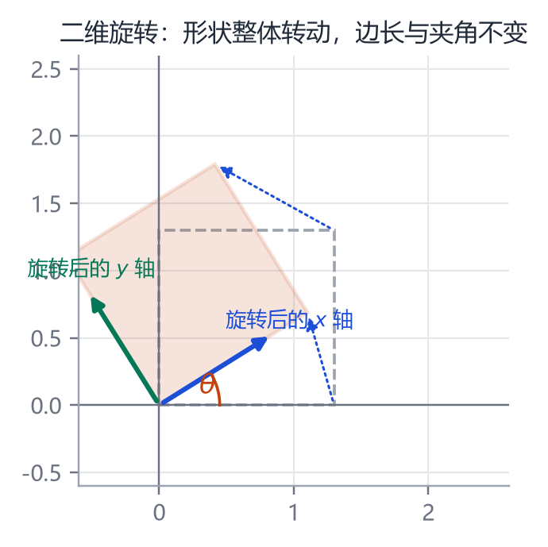
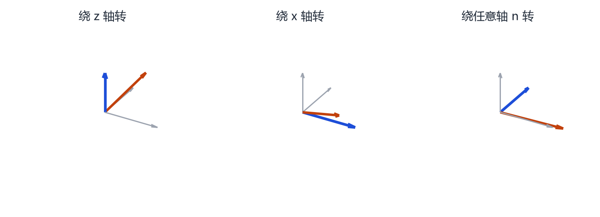
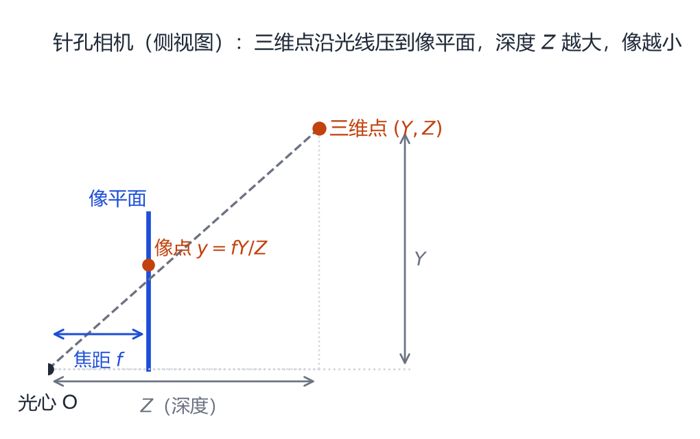
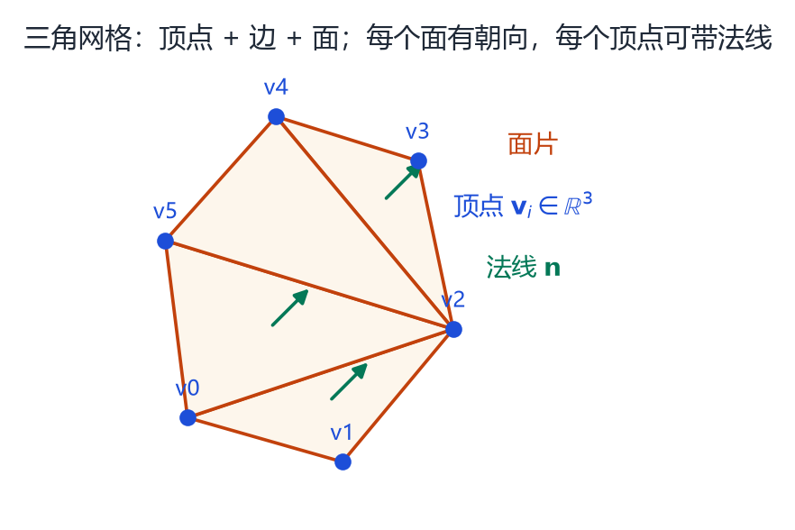

# 第 4 章 三维世界的表示：点、网格、旋转与相机

> **本章导读**：参数化模型生活在三维空间里。要读懂 SMPL 的公式，你必须先知道“一个点如何被旋转、平移、投影到照片上”。本章讲四件事：三维点与坐标系、旋转的四种写法、刚体变换矩阵、针孔相机。最后简单介绍三角网格与可微渲染，为后面的“从图像反推模型”铺路。

## 4.1 三维点与坐标系

一个三维点就是三个数 $(x,y,z)$。但“三个数”本身没有意义，必须先约定**坐标系**：原点在哪、$x/y/z$ 轴指向哪、单位是米还是厘米。

人体模型通常约定：

- 原点在骨盆中心（SMPL 的根关节）；
- $y$ 轴向上（不同实现可能是 $z$ 轴向上，读代码时要先确认）；
- 单位是米；
- 人是面朝 $+z$ 还是 $-z$，不同模型不一样。

这些约定看起来琐碎，却是调试时的头号杀手：模型“躺着”“倒着”“镜像”，十有八九是坐标系约定不一致。

## 4.2 旋转的矩阵写法

<figure class="fig">

<figcaption><b>图 4-1</b>　二维旋转。整个形状绕原点转过 $\theta$，任意两点之间的距离、任意两条边的夹角都不变。旋转矩阵的两列，就是旋转后的 $x$ 轴与 $y$ 轴。</figcaption>
</figure>

二维旋转是最容易看懂的。把点 $(x,y)$ 绕原点逆时针转 $\theta$，得到

$$
\begin{bmatrix}x'\\y'\end{bmatrix}
=
\begin{bmatrix}\cos\theta&-\sin\theta\\ \sin\theta&\cos\theta\end{bmatrix}
\begin{bmatrix}x\\y\end{bmatrix}.
\tag{4.1}
$$

这个 $2\times2$ 矩阵叫旋转矩阵 $\mathbf{R}(\theta)$。它有两个关键性质：

$$
\mathbf{R}^\top\mathbf{R}=\mathbf{I},\qquad \det(\mathbf{R})=1.
\tag{4.2}
$$

第一条说“转回去就是转置”，第二条说“旋转不改变面积、不镜像”。满足这两条的矩阵组成**特殊正交群** $SO(2)$；三维版本叫 $SO(3)$。

三维旋转矩阵是 $3\times3$，同样满足 $\mathbf{R}^\top\mathbf{R}=\mathbf{I}$、$\det\mathbf{R}=1$。它有三列，每一列是旋转后的一个坐标轴方向。把三个轴想象成三根互相垂直的筷子，旋转就是整体转动这三根筷子。

### 4.2.1 绕三个坐标轴的基本旋转

$$
\mathbf{R}_x(\alpha)=
\begin{bmatrix}1&0&0\\0&\cos\alpha&-\sin\alpha\\0&\sin\alpha&\cos\alpha\end{bmatrix},\quad
\mathbf{R}_y(\beta)=
\begin{bmatrix}\cos\beta&0&\sin\beta\\0&1&0\\-\sin\beta&0&\cos\beta\end{bmatrix},
$$
$$
\mathbf{R}_z(\gamma)=
\begin{bmatrix}\cos\gamma&-\sin\gamma&0\\ \sin\gamma&\cos\gamma&0\\0&0&1\end{bmatrix}.
\tag{4.3}
$$

任何旋转都可以写成这三个矩阵的乘积，但**顺序不同，结果不同**。这就是下一节“欧拉角”的麻烦来源。

## 4.3 轴角：更接近直觉的写法

<figure class="fig">

<figcaption><b>图 4-2</b>　绕坐标轴的旋转与绕任意轴的旋转。蓝箭头是旋转轴，橙箭头是被旋转的向量。轴角表示只需要四个数：轴的方向（三个分量）加转角（一个分量）。</figcaption>
</figure>

想象门绕合页转动：转轴是合页，转角是门打开的角度。任何三维旋转都可以这样描述：**绕某个单位轴 $\mathbf{n}$ 转 $\theta$ 角**。

给定轴 $\mathbf{n}=(n_x,n_y,n_z)$（长度为 1）和角 $\theta$，旋转矩阵由 **Rodrigues 公式**给出：

$$
\mathbf{R}(\mathbf{n},\theta)=\mathbf{I}+\sin\theta\,[\mathbf{n}]_\times+(1-\cos\theta)[\mathbf{n}]_\times^2,
\tag{4.4}
$$

其中

$$
[\mathbf{n}]_\times=
\begin{bmatrix}0&-n_z&n_y\\ n_z&0&-n_x\\ -n_y&n_x&0\end{bmatrix}
\tag{4.5}
$$

是“叉乘矩阵”。如果你不熟悉叉乘，可以先把它当成一个固定的记账方式：用它可以把“绕轴转”写成矩阵乘法。

轴角表示有三个数表示方向、一个数表示角度，共四个数，但方向向量长度必须为 1，所以实际自由度是 3，正好与旋转矩阵的自由度一致（$3\times3$ 有 9 个数，但正交约束去掉 6 个自由度）。

**为什么 SMPL 用轴角？** 因为它没有冗余、容易插值、也容易加正则。SMPL 的姿态参数 $\boldsymbol{\theta}\in\mathbb{R}^{72}$ 就是 24 个关节各一个三维轴角向量（根关节另外 3 维是全局朝向）。

### 4.3.1 欧拉角与万向锁

欧拉角把旋转拆成“绕 $x$ 转 $\alpha$、绕 $y$ 转 $\beta$、绕 $z$ 转 $\gamma$”，只需三个数，非常直观。但它有两个致命问题：

1. **不唯一**：$(\alpha,\beta,\gamma)$ 和 $(\alpha+\pi,\pi-\beta,\gamma+\pi)$ 可能表示同一个旋转；
2. **万向锁**（gimbal lock）：当第二个角为 $\pm90^\circ$ 时，第一和第三个轴重合，失去一个自由度，插值会突然“翻跟头”。

所以在需要优化、插值、做动画的系统里，通常用轴角或四元数，只在界面显示时转成欧拉角。

### 4.3.2 四元数：四个数的旋转

四元数是形如 $q=w+x\mathbf{i}+y\mathbf{j}+z\mathbf{k}$ 的数，单位四元数（$w^2+x^2+y^2+z^2=1$）可以表示旋转：

$$
q=\left(\cos\frac{\theta}{2},\ \sin\frac{\theta}{2}\,\mathbf{n}\right).
\tag{4.6}
$$

它没有万向锁，插值平滑（球面线性插值 SLERP），在图形学与机器人里无处不在。你不需要会推四元数乘法，只要知道：**它是轴角的紧凑编码，适合做旋转的插值与组合**。

## 4.4 齐次坐标与刚体变换

旋转之外还有平移。一个刚体变换是“先旋转再平移”：

$$
\mathbf{p}'=\mathbf{R}\mathbf{p}+\mathbf{t}.
\tag{4.7}
$$

这个式子对矩阵乘法不友好（多了一个加法），于是我们给点补一个 1，变成四维齐次坐标 $\tilde{\mathbf{p}}=(x,y,z,1)^\top$，就可以把旋转和平移合并成一个 $4\times4$ 矩阵：

$$
\begin{bmatrix}\mathbf{p}'\\1\end{bmatrix}
=
\begin{bmatrix}\mathbf{R}&\mathbf{t}\\ \mathbf{0}^\top&1\end{bmatrix}
\begin{bmatrix}\mathbf{p}\\1\end{bmatrix}.
\tag{4.8}
$$

这个 $4\times4$ 矩阵就是**刚体变换矩阵**，也是 SMPL 里每个关节的 $\mathbf{G}_k$。它有两个部分：左上 $3\times3$ 是旋转，右上 $3\times1$ 是平移。

多个变换可以连乘：先做 $\mathbf{G}_1$ 再做 $\mathbf{G}_2$，总变换是 $\mathbf{G}_2\mathbf{G}_1$。骨架的父子关系就是这样一串矩阵乘法，第 5 章会详细讲。

## 4.5 相机：三维如何变成二维

<figure class="fig">

<figcaption><b>图 4-3</b>　针孔相机模型（侧视图）。三维点与光心的连线交像平面于一点；由相似三角形可得 $y=fY/Z$。深度 $Z$ 越大，成像越小，这就是“近大远小”。</figcaption>
</figure>

照片是三维世界在二维平面上的投影。最简单的模型是**针孔相机**：所有光线都经过一个点（光心），在光心后方距离 $f$ 处放一张像平面。

由相似三角形：

$$
x=f\frac{X}{Z},\qquad y=f\frac{Y}{Z}.
\tag{4.9}
$$

其中 $(X,Y,Z)$ 是相机坐标系下的三维点，$Z$ 是深度，$f$ 是焦距（像素单位）。写成矩阵：

$$
Z\begin{bmatrix}x\\y\\1\end{bmatrix}
=
\begin{bmatrix}f&0&c_x\\0&f&c_y\\0&0&1\end{bmatrix}
\begin{bmatrix}X\\Y\\Z\end{bmatrix}
=
\mathbf{K}\begin{bmatrix}X\\Y\\Z\end{bmatrix}.
\tag{4.10}
$$

$\mathbf{K}$ 叫**内参矩阵**，$c_x,c_y$ 是主点（通常接近图像中心）。如果三维点在世界坐标系里，还要先乘一个**外参矩阵** $[\mathbf{R}|\mathbf{t}]$ 把它变到相机坐标系：

$$
Z\tilde{\mathbf{x}}=\mathbf{K}\,[\mathbf{R}|\mathbf{t}]\,\tilde{\mathbf{X}}.
\tag{4.11}
$$

这就是完整的投影公式。人体重建里的“重投影误差”，就是比较式 (4.11) 算出的二维点与图像上检测到的二维点：

$$
E_{2D}=\sum_j\|\pi(\mathbf{J}_j)-\mathbf{j}_j^{\text{obs}}\|^2,
\tag{4.12}
$$

其中 $\pi$ 是投影函数，$\mathbf{J}_j$ 是模型的三维关节，$\mathbf{j}_j^{\text{obs}}$ 是图像上检测到的二维关节。第 10 章的 SMPLify 就是围绕这个误差做优化。

> **注意**：式 (4.9) 假设相机没有畸变、像素是正方形。真实手机镜头有径向畸变，广角更明显。做高精度重建时要先标定并去畸变，否则边缘的人体会被拉歪。

## 4.6 三角网格：顶点的连接关系

<figure class="fig">

<figcaption><b>图 4-4</b>　三角网格的组成：顶点、边、面。每个面有一个朝向（法线），用于光照与内外判断；顶点法线通常是相邻面法线的加权平均，用于平滑着色。</figcaption>
</figure>

参数化模型的输出通常是三角网格。一个网格由两部分组成：

- **几何**：$N$ 个顶点的坐标 $\mathbf{V}\in\mathbb{R}^{N\times3}$；
- **拓扑**：$F$ 个三角形，每个三角形记录三个顶点的编号。

拓扑是“连接关系”，它在模型变形时保持不变。这一点非常重要：SMPL 的所有人共享同一套拓扑，所以第 100 号顶点在任何人身上都对应同一个解剖位置，才能做 PCA、做对应、做蒙皮。

法线分两种：

- **面法线**：三角形两条边的叉乘，归一化；垂直于面。
- **顶点法线**：相邻面法线的平均；用于让曲面看起来光滑。

渲染时，光照计算需要法线；做碰撞、判断内外时，也需要法线朝向。法线方向反了，模型会看起来“里外翻转”。

## 4.7 可微渲染：把“渲染”变成可求导的函数

传统渲染器是一段黑箱程序：输入模型与相机，输出图片，但你没法问它“顶点往右移一点，像素会怎么变”。**可微渲染**（differentiable rendering）把渲染写成可导函数，于是可以把图像误差反传回模型参数。

最简单的情况是只渲染关节点：关节三维坐标经过式 (4.11) 得到二维坐标，这一步对三维坐标可导，误差可以直接反传。SMPLify 用的就是这种“稀疏关键点”渲染。

渲染完整网格要复杂得多：需要处理遮挡、光栅化、纹理采样。OpenDR、PyTorch3D、nvdiffrast、Kaolin 等库提供了可微实现。它们让式 (1.2) 的端到端优化成为可能。

> **一句话总结**：参数化模型负责“生成几何”，可微渲染负责“把几何变成图像”，两者接起来，才能从图像反推参数。

## 本章小结

- 三维点必须附带坐标系约定；人体模型通常以骨盆为原点、米为单位。
- 旋转可以用矩阵、欧拉角、轴角、四元数表示；优化与动画常用轴角/四元数，欧拉角只适合显示。
- 齐次坐标把旋转和平移合并成 $4\times4$ 矩阵，多个变换连乘就是骨架的父子链。
- 针孔相机的投影是 $Z\tilde{\mathbf{x}}=\mathbf{K}[\mathbf{R}|\mathbf{t}]\tilde{\mathbf{X}}$，重投影误差是人体拟合的核心监督。
- 网格 = 顶点几何 + 固定拓扑；法线决定光照与内外。
- 可微渲染把“渲染”变成可反传的算子，是模型拟合的桥梁。

## 思考题

1. 一个旋转矩阵的行列式为什么必须是 $+1$？如果等于 $-1$ 会发生什么？
2. 为什么欧拉角会有万向锁，而四元数没有？试着用“三个轴是否独立”来解释。
3. 同一个人离相机远一倍，成像高度会变成多少？如果焦距也增大一倍呢？
4. 如果两个网格顶点数相同但拓扑不同，还能直接做 PCA 吗？
