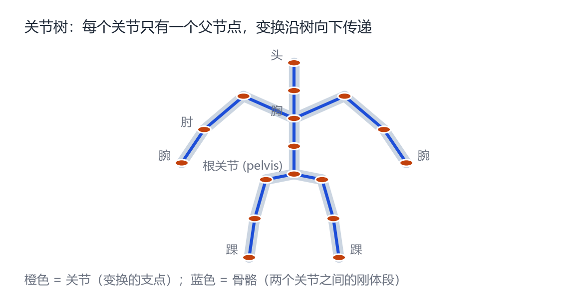
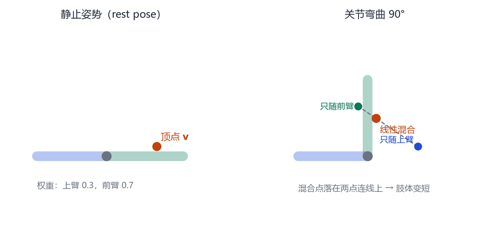
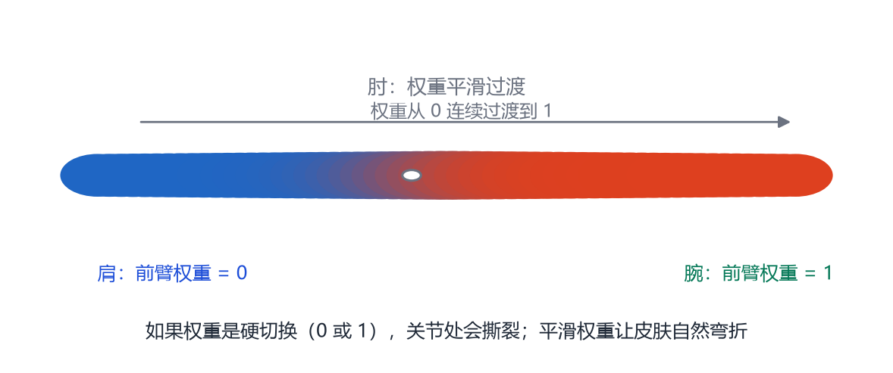
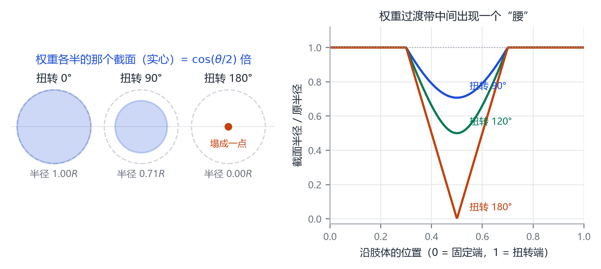
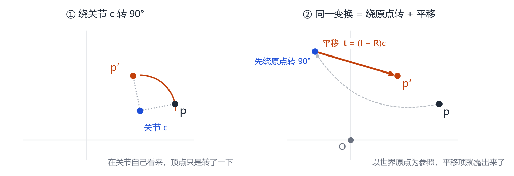

# 第 5 章 骨架、蒙皮与线性混合蒙皮（LBS）

> **本章导读**：有了形状，还要让它动起来。这一章讲清楚“骨架—蒙皮”这套沿用三十年的机制：关节如何组成一棵树、变换如何沿树传递、一个顶点如何同时受多根骨头影响。核心公式只有一个，但每个符号都值得拆开看。读完后，你会明白 SMPL 的 $W(\cdot)$ 到底在算什么，也会知道它为什么会在腋下和膝盖处出问题。

## 5.1 骨架是一棵树

<figure class="fig">

<figcaption><b>图 5-1</b>　人体骨架的树结构。根节点在骨盆，躯干向上分出头和双臂，向下分出双腿。每个关节只有一个父节点；子关节的最终位置，由父关节的变换一路乘下来。</figcaption>
</figure>

骨架（skeleton）由**关节**（joint）和**骨骼**（bone）组成。关节是旋转的支点，骨骼是两个关节之间的刚体段。人体骨架天然是一棵树：

- 根关节：骨盆（pelvis）；
- 骨盆 → 脊柱 → 胸 → 颈 → 头；
- 胸 → 左肩 → 左肘 → 左腕；右侧同理；
- 骨盆 → 左髋 → 左膝 → 左踝；右侧同理。

树结构的好处是：**只要知道每个关节相对父关节的变换，就能算出它在世界坐标里的位置。** 这是一串矩阵乘法：

$$
\mathbf{G}_k=\mathbf{G}_{\text{parent}(k)}\,\mathbf{L}_k,
\tag{5.1}
$$

其中 $\mathbf{G}_k$ 是关节 $k$ 的全局变换，$\mathbf{L}_k$ 是它相对父关节的局部变换。根关节没有父节点，$\mathbf{G}_{\text{root}}=\mathbf{L}_{\text{root}}$。

$\mathbf{L}_k$ 通常由三部分组成：从父关节到自己的固定偏移、绕自己的旋转 $\mathbf{R}(\boldsymbol{\theta}_k)$、以及缩放（人体模型一般不含缩放）。写成 $4\times4$ 矩阵就是

$$
\mathbf{L}_k=
\begin{bmatrix}\mathbf{R}(\boldsymbol{\theta}_k)&\mathbf{J}_k-\mathbf{J}_{\text{parent}(k)}\\ \mathbf{0}^\top&1\end{bmatrix}.
\tag{5.2}
$$

注意偏移量是在**静止姿势**下测量的。人摆出姿势后，关节位置会变，但“父子之间的相对偏移”在局部坐标系里保持不变——这正是树结构能高效计算的原因。

## 5.2 蒙皮：让顶点跟着骨头走

骨架本身只是几根线段，真正要变形的是皮肤。**蒙皮**（skinning）要回答：给定每个关节的变换，每个顶点应该移动到哪里？

最朴素的做法是“刚性绑定”：把每个顶点分配给一根骨头，顶点跟着那根骨头做刚体变换。但这样关节处会裂开——上臂的顶点转 90°，前臂的顶点不动，肘部就出现一条缝。

真实皮肤是连续的：肘部内侧会被挤压，外侧会被拉伸，中间的顶点同时受两根骨头影响。于是有了**线性混合蒙皮**（Linear Blend Skinning, LBS）[@magnenat1988joint]：

$$
\mathbf{t}_i'=\sum_{k=1}^{K} w_{k,i}\,\mathbf{G}_k(\boldsymbol{\theta},\mathbf{J})\,\mathbf{G}_k(\mathbf{0},\mathbf{J})^{-1}\,\mathbf{t}_i.
\tag{5.3}
$$

这个公式信息量很大，我们逐项拆开。

### 5.2.1 每一项在做什么

- $\mathbf{t}_i$：静止姿势下第 $i$ 个顶点的位置（齐次坐标，$4\times1$）。
- $\mathbf{G}_k(\mathbf{0},\mathbf{J})^{-1}$：把顶点从世界坐标“搬回”关节 $k$ 的局部坐标系。可以理解为“这个顶点在骨头 $k$ 看来在哪”。
- $\mathbf{G}_k(\boldsymbol{\theta},\mathbf{J})$：关节 $k$ 在当前姿势下的全局变换，把局部坐标再搬回世界。
- 两者相乘 $\mathbf{G}_k(\boldsymbol{\theta})\mathbf{G}_k(\mathbf{0})^{-1}$，就是一个“只属于骨头 $k$ 的位移”，记作 $\mathbf{G}_k'$。
- $w_{k,i}$：顶点 $i$ 受骨头 $k$ 影响的权重，非负，且对每个顶点满足 $\sum_k w_{k,i}=1$。
- 求和：把所有骨头的“建议位置”按权重加权平均。

用一句话概括：**每个骨头都给出一个“如果只由我控制，这个顶点会在哪”的答案，LBS 把这些答案按权重平均。**

### 5.2.2 一个数值例子

<figure class="fig">

<figcaption><b>图 5-2</b>　LBS 的数值直觉。静止时前臂水平；肘关节弯曲 90° 后，只随上臂的顶点留在原处，只随前臂的顶点转到上方，而权重 0.3/0.7 的混合点落在两点连线上。混合点离关节更近，这就是“体积损失”。</figcaption>
</figure>

设肘关节在 $(0.55,0.30)$，前臂沿 $x$ 轴伸展，某顶点在 $(0.91,0.37)$，到肘的距离约 $0.367$。它受上臂权重 0.3、前臂权重 0.7。

肘弯曲 90° 后：

- 若只随上臂：顶点不动，仍在 $(0.91,0.37)$；
- 若只随前臂：绕肘转 90°，到 $(0.48,0.66)$；
- LBS 混合：$0.3\times(0.91,0.37)+0.7\times(0.48,0.66)=(0.61,0.57)$。

混合点到肘的距离是 $\sqrt{(0.61-0.55)^2+(0.57-0.30)^2}\approx0.28$，比原来的 $0.367$ 短了约 24%。**两个刚体位置的线性平均，落在它们的连线上，而连线穿过关节内侧，所以肢体在弯曲处会变细。** 这就是 LBS 最著名的“捏细”（pinching）现象。

### 5.2.3 权重从哪里来

权重矩阵 $\mathbf{W}\in\mathbb{R}^{N\times K}$ 有两种来源：

1. **手工绘制**：动画师用笔刷在模型上涂权重，效果可控但费时。
2. **自动计算**：根据顶点到骨骼的距离、测地距离或热扩散方程自动生成。热扩散方法（如 bounded biharmonic weights）能得到很平滑的过渡。

SMPL 的权重是**从数据里学出来的**：作者用大量不同姿势的扫描，优化出一套权重，使 LBS 的结果最接近真实扫描。每个顶点最多受 4 根骨头影响，这样既保证质量，又能用 GPU 高效计算。

<figure class="fig">

<figcaption><b>图 5-3</b>　权重沿肢体的平滑过渡。颜色表示“前臂权重”：肩部为 0，腕部为 1，肘部附近连续变化。如果权重是 0/1 硬切换，关节处会撕裂；平滑过渡让皮肤自然弯折。</figcaption>
</figure>

## 5.3 为什么 LBS 会出问题

LBS 的优点是“线性”：计算只是矩阵加权和。缺点也全来自这三个字——**两个刚体变换的线性平均，一般不再是刚体变换。**

具体会坏在三个地方：弯曲时变细、扭转时塌陷、权重不合适时起折痕。前两个可以精确算出来，不是“感觉上有点怪”。

### 5.3.1 捏细：弯曲时截面变小

上一节的数值例子已经看到了：肘弯 90°，一个权重 0.3/0.7 的顶点从离关节 0.367 缩到 0.28，短了 24%。

原因一句话：**两个刚体位置的线性平均落在它们的连线上，而这条连线穿过关节内侧**。弯曲角越大，弧越“抄近路”，缩得越狠。

### 5.3.2 糖纸效应：扭转时截面被“拧细”

“捏细”是弯曲造成的。更严重的一种叫**糖纸效应**（candy wrapper effect）：当前臂绕**自己的长轴**扭转时（手心翻到手背，专业上叫旋前/旋后），中间那段会被拧成一个细脖子——就像拧糖果的包装纸。

它不是“看起来像”，而是可以精确算出来的。考虑两根骨头：一段不转（$\mathbf{R}_1=\mathbf{I}$），另一段绕长轴转 $\theta$（$\mathbf{R}_2=\mathbf{R}_x(\theta)$）：

$$
\mathbf{R}_x(\theta)=
\begin{bmatrix}1&0&0\\ 0&\cos\theta&-\sin\theta\\ 0&\sin\theta&\cos\theta\end{bmatrix}.
$$

权重各一半的截面，LBS 算出来的是矩阵平均

$$
\mathbf{M}=\tfrac12\mathbf{I}+\tfrac12\mathbf{R}_x(\theta)
=\begin{bmatrix}1&0&0\\ 0&\tfrac{1+\cos\theta}{2}&-\tfrac{\sin\theta}{2}\\ 0&\tfrac{\sin\theta}{2}&\tfrac{1+\cos\theta}{2}\end{bmatrix}.
$$

看右下角那个 $2\times2$ 块：它等于“缩放 $\times$ 旋转”，缩放因子是

$$
s=\sqrt{\left(\tfrac{1+\cos\theta}{2}\right)^2+\left(\tfrac{\sin\theta}{2}\right)^2}
=\sqrt{\tfrac{1+\cos\theta}{2}}=\left|\cos\tfrac{\theta}{2}\right| .
\tag{5.4}
$$

也就是说：**扭转 $\theta$ 时，正中间那一圈的半径会变成原来的 $|\cos(\theta/2)|$ 倍。**

| 扭转角 $\theta$ | 半径比 $\cos(\theta/2)$ | 观感 |
|---:|---:|---|
| 0° | 1.00 | 正常 |
| 90° | 0.71 | 明显变细 |
| 120° | 0.50 | 只剩一半 |
| 180° | **0** | **整圈塌到轴线上** |

180° 时半径正好为零：**整圈顶点被压到轴线上**，截面退化成一个点，网格在那里自交、法线翻转——这就是渲染里那些“拧断”的破面。

<figure class="fig">

<figcaption><b>图 5-4</b>　糖纸效应的定量图像。左：扭转 0°、90°、180° 时，权重各半的那个截面是同心圆逐步缩小，180° 时整圈塌到轴线上（半径比 $|\cos(\theta/2)|$）；右：沿肢体方向的半径曲线，权重过渡带中间出现一个“腰”，扭转越大腰越细。</figcaption>
</figure>

> **为什么叫“糖纸”**：拧糖果包装纸时，两端反着转，中间最细的那一段会被拧成一个收腰的“颈”。LBS 的扭转伪影在形状上与它一模一样，于是这个名字就叫开了。

### 5.3.3 折痕与连带：权重的问题

第三类伪影来自权重本身，和角度无关：

- **过渡太窄**：权重在几个顶点内从 0 跳到 1，弯曲时表面会出现一道硬折痕（像纸板折的）。
- **过渡太宽**：不该动的部位被带动，比如抬手臂时胸部被拉起来、转头时肩膀跟着歪。
- **左右串扰**：如果权重不是按解剖距离而是按空间距离算，抬左腿可能让右腿内侧动一点。

这三件事在工业界靠“刷权重”解决：动画师在 3D 软件里手动涂，把过渡带放在关节附近、宽度约等于肢体半径。这很费人力，也是自动蒙皮算法（热扩散、有界双调和权重）要解决的问题。

## 5.4 对偶四元数蒙皮：把“混合”从矩阵换成刚体变换

既然病根是“混合矩阵”，那最直接的药方就是：**别混合矩阵，改混合一种天生只表示刚体变换的东西。**

### 5.4.1 关键直觉：四元数混合不会缩放

单位四元数 $q=w+xi+yj+zk$（$|q|=1$）表示一个三维旋转。所有单位四元数构成四维空间里的一个单位球面，每个旋转对应球面上一个点。

现在要混合两个旋转：$q'=w_1q_1+w_2q_2$。这个结果一般不再是单位四元数（跑到球面里侧去了），但只要**归一化**

$$
q'=\frac{w_1q_1+w_2q_2}{\lVert w_1q_1+w_2q_2\rVert},
$$

它又回到球面上——**又变回一个纯旋转，绝不会带缩放**。这就是四元数能治糖纸效应的全部原因。

对比一下矩阵：$\tfrac12\mathbf{I}+\tfrac12\mathbf{R}_x(180^\circ)$ 算出来是 $\begin{bmatrix}1&0&0\\0&0&0\\0&0&0\end{bmatrix}$，它把 $y,z$ 方向压扁成 0——不再正交，也就不是旋转了。

### 5.4.2 那平移怎么办：对偶四元数

蒙皮变换不只是旋转，还有平移（骨头会挪位置）。普通四元数只能表示旋转，所以引入**对偶四元数**（dual quaternion）：

$$
\hat{q}=q_r+\varepsilon\,q_d,\qquad \varepsilon^2=0 .
$$

- $q_r$：单位四元数，管旋转；
- $q_d=\tfrac12\,t\otimes q_r$：管平移（$t$ 是把平移写成四元数 $(0,t_x,t_y,t_z)$，$\otimes$ 是四元数乘法）；
- $\varepsilon$ 是一个“平方为零”的形式符号，作用只是把两部分分开存，不参与实际计算。

约束是两条：$\lVert q_r\rVert=1$ 且 $q_r\cdot q_d=0$（后者保证 $q_d$ 真的是“沿平移方向”的那部分）。

几何上，一个单位对偶四元数正好描述一个**螺旋运动**：绕某根轴转一个角，同时沿这根轴平移一段。刚体变换都能写成螺旋运动，这正是它比矩阵“更刚体”的原因。

它作用在点上仍然很简单：取 $q_r$ 与平移 $\mathbf{t}$，

$$
\mathbf{p}'=\mathbf{R}(q_r)\,\mathbf{p}+\mathbf{t},
$$

和矩阵形式等价；区别在**混合**那一步。

### 5.4.3 DQS 的五个步骤

对每个顶点，算法是：

1. **算每根骨头的蒙皮变换**：$\mathbf{S}_k=\mathbf{G}_k(\boldsymbol{\theta},\mathbf{J})\,\mathbf{G}_k(\mathbf{0},\mathbf{J})^{-1}$（和 LBS 完全一样）；
2. **转成对偶四元数**：从 $\mathbf{S}_k$ 的旋转部分取出 $q_{r,k}$，从平移部分取 $\mathbf{t}_k$，算 $q_{d,k}=\tfrac12\mathbf{t}_k\otimes q_{r,k}$；
3. **加权混合**：$\hat{q}=\sum_k w_{k,i}\,\hat{q}_k$。注意符号：如果 $\hat{q}_k\cdot\hat{q}_1<0$，先把它整体取反（否则会走“远路”，插值绕一大圈）；
4. **归一化**：$\hat{q}\leftarrow \hat{q}/\lVert\hat{q}\rVert$（对偶四元数的范数由 $q_r$ 决定）；
5. **变换顶点**：把 $\hat{q}$ 转回“旋转 + 平移”，作用到 $\mathbf{t}_i$ 上。

和式 (5.3) 的 LBS 对比：**求和从“矩阵”搬到了“对偶四元数”上**，最后才转回矩阵。就这一处改动，让混合结果始终保持刚体性。

### 5.4.4 效果与代价

<figure class="fig">

<figcaption><b>图 5-5</b>　同一条扭转 180° 的前臂，两种蒙皮的截面半径。LBS（蓝）在中段被压到 0，网格自交；DQS（橙）只把权重过渡带的两端“卷”过去一点，中段基本保持原半径，所以不会出现细颈。</figcaption>
</figure>

DQS 的收益：扭转伪影基本消失，弯曲时的体积损失也明显减轻（因为它不做“直线抄近路”）。

代价与坑：

- **贵一点**：每顶点多做若干次四元数乘法和一次归一化，移动端要算预算；
- **不能表示缩放/剪切**：如果模型本身带非均匀缩放（有些角色的骨骼带缩放动画），DQS 无法直接表达；
- **会“膨胀”**：它保持刚体性，被拉长的地方体积不变，于是看起来更鼓（bulging）。极端姿势下 DQS 的鼓包有时比 LBS 的塌陷更难看；
- **管线支持不齐**：GPU 蒙皮、游戏引擎里 LBS 是标配，DQS 往往要自己写着色器，导出格式（FBX/glTF）也不带 DQS 数据。

原始论文是 Kavan 等的 *Geometric Skinning with Approximate Dual Quaternion Blending* [@kavan2008dqs]，工程实现可参考其中的“DLB（dual quaternion linear blending）”近似。

### 5.4.5 其他四条路

除了 DQS，工业界还有四种常见做法，各自针对不同毛病：

1. **姿势校正 blendshape / PSD**：不改蒙皮，而是“在 LBS 结果上再叠一个随姿势变化的位移”。SMPL 的 207 个 pose blendshape 就是它的线性版；Pose Space Deformation 是这一类方法的源头 [@lewis2000pose]。
2. **辅助关节**（helper joints）：在腋下、肩部插几个虚拟关节，把一个大角度拆成几个小角度，每个关节的扭转都不大，伪影自然小。
3. **体积保持蒙皮**：在 LBS 的基础上加“保持局部体积”的约束，或者用更贵的非线性蒙皮（对数矩阵混合、球面混合）。
4. **学习式蒙皮**：用网络直接预测每个顶点的位移，输入是姿势和邻域信息。它绕开了“线性混合”这个假设，但需要大量数据，也不保证可解释。

> **选型经验**：实时管线优先 LBS + 校正 blendshape（SMPL 就是这么干的）；对手部、肩部这类扭转大的部位，DQS 或辅助关节更省事；离线高质量渲染可以上学习式方法。

## 5.5 SMPL 里的 LBS

SMPL 把上面所有东西打包成一个函数：

$$
M(\boldsymbol{\beta},\boldsymbol{\theta})=W\big(T_P(\boldsymbol{\beta},\boldsymbol{\theta}),\ J(\boldsymbol{\beta}),\ \boldsymbol{\theta},\ \mathcal{W}\big).
\tag{5.5}
$$

右边可以分三步读：

1. $T_P(\boldsymbol{\beta},\boldsymbol{\theta})$：先根据形状参数和姿势，把模板顶点变形到一个“中间形状”；
2. $J(\boldsymbol{\beta})$：从形状回归出关节位置（不同体型的人，关节位置也不同）；
3. $W(\cdot)$：用 LBS 把中间形状蒙皮到最终姿势，$\mathcal{W}$ 是学好的权重。

第 8 章会把这三步展开成完整公式。这里你先记住：**SMPL 不是一个黑箱，它是“形状 blendshape + 关节回归 + LBS + 姿势校正”的组合。**

## 5.6 从 LBS 到动作捕捉

有了骨架和蒙皮，动作捕捉就变成了“求每个关节的旋转”：

$$
\min_{\boldsymbol{\theta}}\ \sum_j \big\|\pi\big(\mathrm{FK}_j(\boldsymbol{\theta})\big)-\mathbf{j}_j^{\text{obs}}\big\|^2,
\tag{5.6}
$$

其中 $\mathrm{FK}$ 是前向运动学（把局部旋转沿树乘成全局位置），$\pi$ 是相机投影。这就是“从 2D 关键点反推 3D 骨架”的基本式。第 10 章会看到，人体重建还要同时优化形状 $\boldsymbol{\beta}$，并加上姿态先验，防止手肘反折。

> **一个容易忽略的点**：LBS 的输入是“每个关节相对父关节的旋转”，而不是“每个关节的全局位置”。前者天然满足骨骼长度不变，后者需要额外约束。这也是为什么动作数据通常存成轴角或四元数序列，而不是关节坐标。

## 本章小结

- 骨架是一棵树，全局变换 = 父变换 × 局部变换。
- 刚体绑定会在关节处撕裂；LBS 用权重把多个刚体变换混合起来。
- LBS 公式：$\mathbf{t}_i'=\sum_k w_{k,i}\mathbf{G}_k(\boldsymbol{\theta})\mathbf{G}_k(\mathbf{0})^{-1}\mathbf{t}_i$。
- 线性混合不是旋转，弯曲处会体积损失；扭转时会出现糖纸效应。
- 校正 blendshape、对偶四元数、辅助关节、学习式蒙皮是常见补救。
- SMPL = 形状 blendshape + 关节回归 + LBS + 姿势校正。

## 思考题

1. 如果某个顶点的权重是 $(0.5,0.5)$，两根骨头相差 180°，这个顶点会到哪里？这说明了什么？
2. 为什么权重必须归一化？如果不归一化，模型会怎样？
3. 关节位置 $J(\boldsymbol{\beta})$ 为什么也依赖形状参数？可以用一个胖子和一个瘦子的肘部位置来想。
4. 对偶四元数蒙皮能完全消除体积损失吗？为什么？
