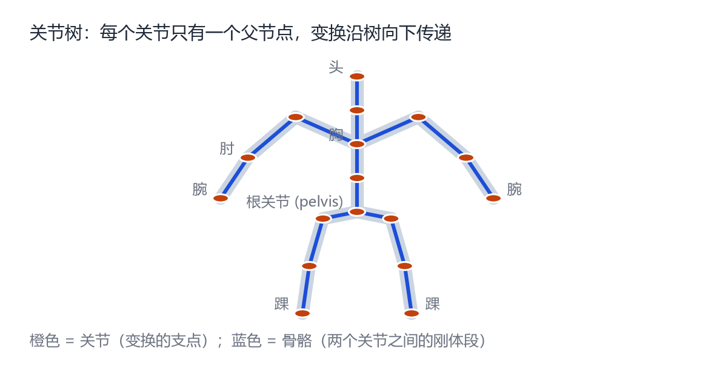
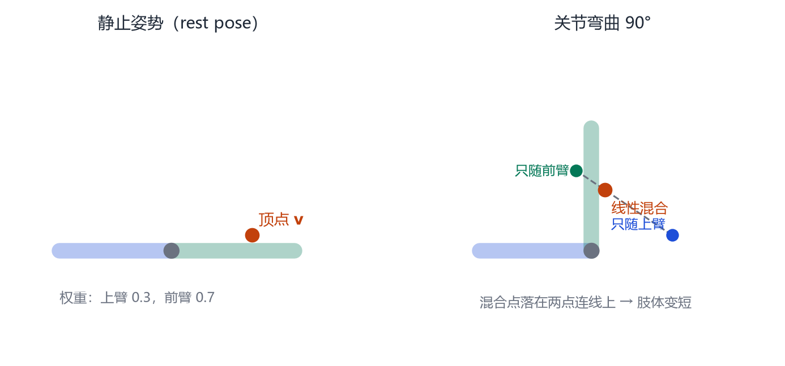
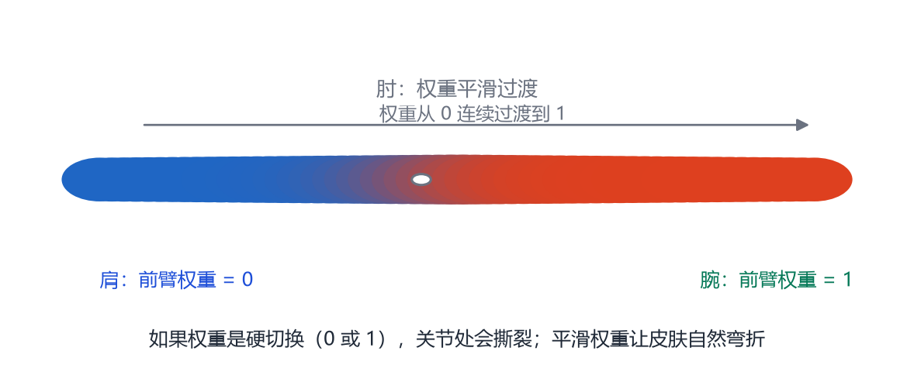

# 第 5 章 骨架、蒙皮与线性混合蒙皮（LBS）

> **本章导读**：有了形状，还要让它动起来。这一章讲清楚“骨架—蒙皮”这套沿用三十年的机制：关节如何组成一棵树、变换如何沿树传递、一个顶点如何同时受多根骨头影响。核心公式只有一个，但每个符号都值得拆开看。读完后，你会明白 SMPL 的 $W(\cdot)$ 到底在算什么，也会知道它为什么会在腋下和膝盖处出问题。

## 5.1 骨架是一棵树

<figure class="fig">

<figcaption><b>图 5-1</b>　人体骨架的树结构。根节点在骨盆，躯干向上分出头和双臂，向下分出双腿。每个关节只有一个父节点；子关节的最终位置，由父关节的变换一路乘下来。</figcaption>
</figure>

骨架（skeleton）由**关节**（joint）和**骨骼**（bone）组成。关节是旋转的支点，骨骼是两个关节之间的刚体段。人体骨架天然是一棵树：

- 根关节：骨盆（pelvis）；
- 骨盆 → 脊柱 → 胸 → 颈 → 头；
- 胸 → 左肩 → 左肘 → 左腕；右侧同理；
- 骨盆 → 左髋 → 左膝 → 左踝；右侧同理。

树结构的好处是：**只要知道每个关节相对父关节的变换，就能算出它在世界坐标里的位置。** 这是一串矩阵乘法：

$$
\mathbf{G}_k=\mathbf{G}_{\text{parent}(k)}\,\mathbf{L}_k,
\tag{5.1}
$$

其中 $\mathbf{G}_k$ 是关节 $k$ 的全局变换，$\mathbf{L}_k$ 是它相对父关节的局部变换。根关节没有父节点，$\mathbf{G}_{\text{root}}=\mathbf{L}_{\text{root}}$。

$\mathbf{L}_k$ 通常由三部分组成：从父关节到自己的固定偏移、绕自己的旋转 $\mathbf{R}(\boldsymbol{\theta}_k)$、以及缩放（人体模型一般不含缩放）。写成 $4\times4$ 矩阵就是

$$
\mathbf{L}_k=
\begin{bmatrix}\mathbf{R}(\boldsymbol{\theta}_k)&\mathbf{J}_k-\mathbf{J}_{\text{parent}(k)}\\ \mathbf{0}^\top&1\end{bmatrix}.
\tag{5.2}
$$

注意偏移量是在**静止姿势**下测量的。人摆出姿势后，关节位置会变，但“父子之间的相对偏移”在局部坐标系里保持不变——这正是树结构能高效计算的原因。

## 5.2 蒙皮：让顶点跟着骨头走

骨架本身只是几根线段，真正要变形的是皮肤。**蒙皮**（skinning）要回答：给定每个关节的变换，每个顶点应该移动到哪里？

最朴素的做法是“刚性绑定”：把每个顶点分配给一根骨头，顶点跟着那根骨头做刚体变换。但这样关节处会裂开——上臂的顶点转 90°，前臂的顶点不动，肘部就出现一条缝。

真实皮肤是连续的：肘部内侧会被挤压，外侧会被拉伸，中间的顶点同时受两根骨头影响。于是有了**线性混合蒙皮**（Linear Blend Skinning, LBS）[@magnenat1988joint]：

$$
\mathbf{t}_i'=\sum_{k=1}^{K} w_{k,i}\,\mathbf{G}_k(\boldsymbol{\theta},\mathbf{J})\,\mathbf{G}_k(\mathbf{0},\mathbf{J})^{-1}\,\mathbf{t}_i.
\tag{5.3}
$$

这个公式信息量很大，我们逐项拆开。

### 5.2.1 每一项在做什么

- $\mathbf{t}_i$：静止姿势下第 $i$ 个顶点的位置（齐次坐标，$4\times1$）。
- $\mathbf{G}_k(\mathbf{0},\mathbf{J})^{-1}$：把顶点从世界坐标“搬回”关节 $k$ 的局部坐标系。可以理解为“这个顶点在骨头 $k$ 看来在哪”。
- $\mathbf{G}_k(\boldsymbol{\theta},\mathbf{J})$：关节 $k$ 在当前姿势下的全局变换，把局部坐标再搬回世界。
- 两者相乘 $\mathbf{G}_k(\boldsymbol{\theta})\mathbf{G}_k(\mathbf{0})^{-1}$，就是一个“只属于骨头 $k$ 的位移”，记作 $\mathbf{G}_k'$。
- $w_{k,i}$：顶点 $i$ 受骨头 $k$ 影响的权重，非负，且对每个顶点满足 $\sum_k w_{k,i}=1$。
- 求和：把所有骨头的“建议位置”按权重加权平均。

用一句话概括：**每个骨头都给出一个“如果只由我控制，这个顶点会在哪”的答案，LBS 把这些答案按权重平均。**

### 5.2.2 一个数值例子

<figure class="fig">

<figcaption><b>图 5-2</b>　LBS 的数值直觉。静止时前臂水平；肘关节弯曲 90° 后，只随上臂的顶点留在原处，只随前臂的顶点转到上方，而权重 0.3/0.7 的混合点落在两点连线上。混合点离关节更近，这就是“体积损失”。</figcaption>
</figure>

设肘关节在 $(0.55,0.30)$，前臂沿 $x$ 轴伸展，某顶点在 $(0.91,0.37)$，到肘的距离约 $0.367$。它受上臂权重 0.3、前臂权重 0.7。

肘弯曲 90° 后：

- 若只随上臂：顶点不动，仍在 $(0.91,0.37)$；
- 若只随前臂：绕肘转 90°，到 $(0.48,0.66)$；
- LBS 混合：$0.3\times(0.91,0.37)+0.7\times(0.48,0.66)=(0.61,0.57)$。

混合点到肘的距离是 $\sqrt{(0.61-0.55)^2+(0.57-0.30)^2}\approx0.28$，比原来的 $0.367$ 短了约 24%。**两个刚体位置的线性平均，落在它们的连线上，而连线穿过关节内侧，所以肢体在弯曲处会变细。** 这就是 LBS 最著名的“捏细”（pinching）现象。

### 5.2.3 权重从哪里来

权重矩阵 $\mathbf{W}\in\mathbb{R}^{N\times K}$ 有两种来源：

1. **手工绘制**：动画师用笔刷在模型上涂权重，效果可控但费时。
2. **自动计算**：根据顶点到骨骼的距离、测地距离或热扩散方程自动生成。热扩散方法（如 bounded biharmonic weights）能得到很平滑的过渡。

SMPL 的权重是**从数据里学出来的**：作者用大量不同姿势的扫描，优化出一套权重，使 LBS 的结果最接近真实扫描。每个顶点最多受 4 根骨头影响，这样既保证质量，又能用 GPU 高效计算。

<figure class="fig">

<figcaption><b>图 5-3</b>　权重沿肢体的平滑过渡。颜色表示“前臂权重”：肩部为 0，腕部为 1，肘部附近连续变化。如果权重是 0/1 硬切换，关节处会撕裂；平滑过渡让皮肤自然弯折。</figcaption>
</figure>

## 5.3 为什么 LBS 会出问题

LBS 的计算是线性的，这在带来高效的同时也带来三类伪影。

**第一，体积损失（volume loss）。** 上一节的例子已经看到：两个旋转的线性平均不是旋转，而是“抄近路”的直线插值。弯曲角度越大，肢体越细。肘、膝、肩都是重灾区。

**第二，糖纸效应（candy wrapper）。** 当前臂绕自己的长轴扭转 180° 时，中间段的顶点被平均到轴心附近，看起来像拧糖纸一样被拧细。

**第三，权重不自然。** 如果权重在空间上变化太剧烈，弯曲时表面会出现折痕；变化太缓，又会让不该动的部分跟着动（比如抬手臂时胸部被拉起来）。

工业界的解决办法有几类：

- **对偶四元数蒙皮**（Dual Quaternion Skinning, DQS）：用四元数插值代替矩阵插值，能保持刚体性，显著缓解糖纸效应，但计算更贵，且在极端姿势下可能产生“膨胀”。
- **校正 blendshape**：在 LBS 结果上叠加一个“姿势修正”，专门补偿弯曲处的体积。SMPL 就用了 207 个 pose blend shape（每侧关节若干方向），这类“姿势相关形变”最早由 Pose Space Deformation 系统化 [@lewis2000pose]。
- **辅助关节**（helper joints）：在腋下、肩部额外插入虚拟关节，把大角度弯曲拆成几个小角度。
- **学习式蒙皮**：用神经网络直接预测每个顶点的位移，绕开 LBS 的线性假设。

## 5.4 SMPL 里的 LBS

SMPL 把上面所有东西打包成一个函数：

$$
M(\boldsymbol{\beta},\boldsymbol{\theta})=W\big(T_P(\boldsymbol{\beta},\boldsymbol{\theta}),\ J(\boldsymbol{\beta}),\ \boldsymbol{\theta},\ \mathcal{W}\big).
\tag{5.4}
$$

右边可以分三步读：

1. $T_P(\boldsymbol{\beta},\boldsymbol{\theta})$：先根据形状参数和姿势，把模板顶点变形到一个“中间形状”；
2. $J(\boldsymbol{\beta})$：从形状回归出关节位置（不同体型的人，关节位置也不同）；
3. $W(\cdot)$：用 LBS 把中间形状蒙皮到最终姿势，$\mathcal{W}$ 是学好的权重。

第 8 章会把这三步展开成完整公式。这里你先记住：**SMPL 不是一个黑箱，它是“形状 blendshape + 关节回归 + LBS + 姿势校正”的组合。**

## 5.5 从 LBS 到动作捕捉

有了骨架和蒙皮，动作捕捉就变成了“求每个关节的旋转”：

$$
\min_{\boldsymbol{\theta}}\ \sum_j \big\|\pi\big(\mathrm{FK}_j(\boldsymbol{\theta})\big)-\mathbf{j}_j^{\text{obs}}\big\|^2,
\tag{5.5}
$$

其中 $\mathrm{FK}$ 是前向运动学（把局部旋转沿树乘成全局位置），$\pi$ 是相机投影。这就是“从 2D 关键点反推 3D 骨架”的基本式。第 10 章会看到，人体重建还要同时优化形状 $\boldsymbol{\beta}$，并加上姿态先验，防止手肘反折。

> **一个容易忽略的点**：LBS 的输入是“每个关节相对父关节的旋转”，而不是“每个关节的全局位置”。前者天然满足骨骼长度不变，后者需要额外约束。这也是为什么动作数据通常存成轴角或四元数序列，而不是关节坐标。

## 本章小结

- 骨架是一棵树，全局变换 = 父变换 × 局部变换。
- 刚体绑定会在关节处撕裂；LBS 用权重把多个刚体变换混合起来。
- LBS 公式：$\mathbf{t}_i'=\sum_k w_{k,i}\mathbf{G}_k(\boldsymbol{\theta})\mathbf{G}_k(\mathbf{0})^{-1}\mathbf{t}_i$。
- 线性混合不是旋转，弯曲处会体积损失；扭转时会出现糖纸效应。
- 校正 blendshape、对偶四元数、辅助关节、学习式蒙皮是常见补救。
- SMPL = 形状 blendshape + 关节回归 + LBS + 姿势校正。

## 思考题

1. 如果某个顶点的权重是 $(0.5,0.5)$，两根骨头相差 180°，这个顶点会到哪里？这说明了什么？
2. 为什么权重必须归一化？如果不归一化，模型会怎样？
3. 关节位置 $J(\boldsymbol{\beta})$ 为什么也依赖形状参数？可以用一个胖子和一个瘦子的肘部位置来想。
4. 对偶四元数蒙皮能完全消除体积损失吗？为什么？
