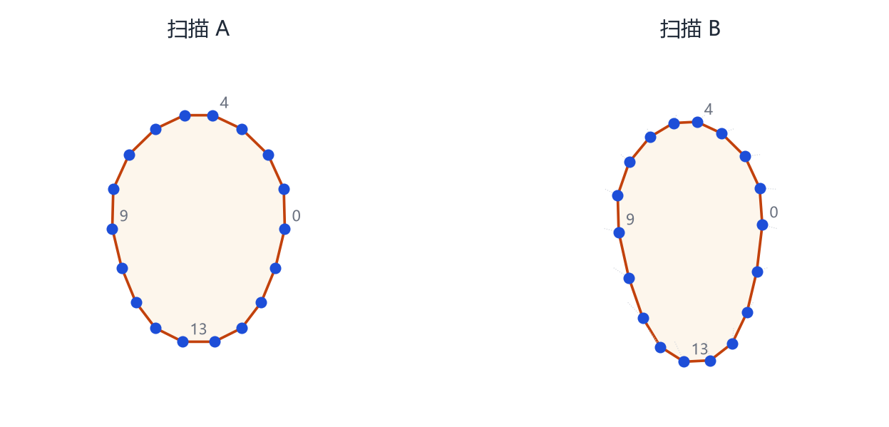
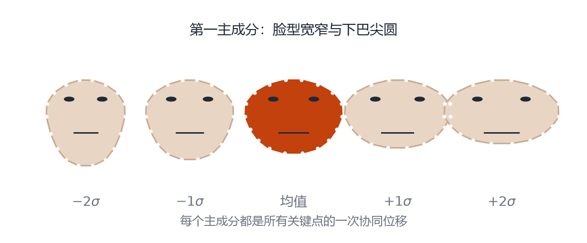
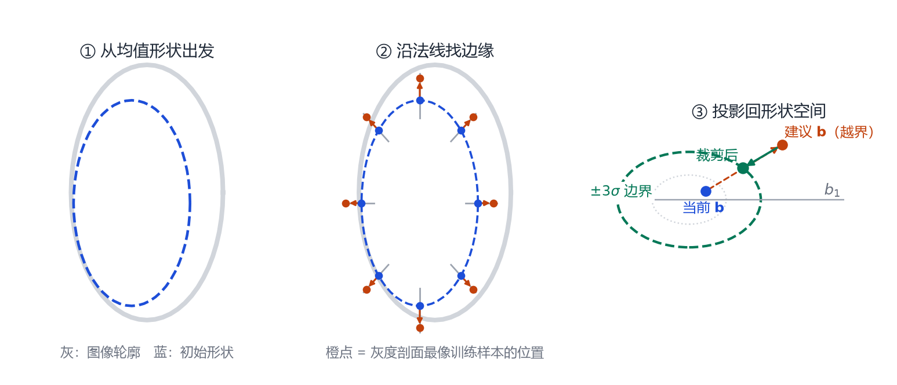
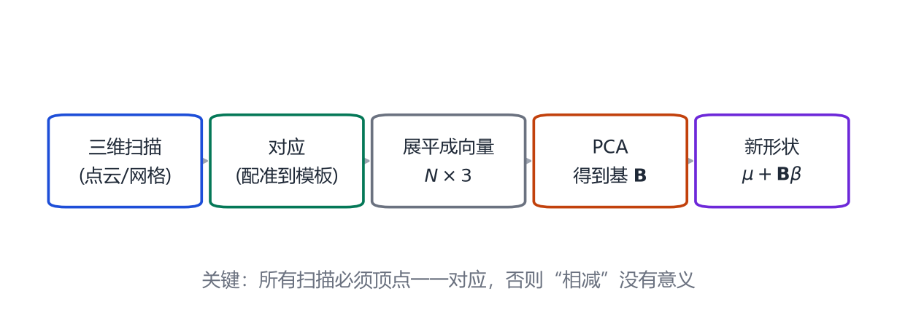

# 第 6 章 统计形状模型：从 ASM 到 3DMM

> **本章导读**：前面三章分别讲了“怎么表示”“怎么降维”“怎么变换”。这一章把它们合起来，回答一个更具体的问题：**如何从一堆扫描数据里，自动学出一个可调节的形状模型？** 这条线索从 1995 年的主动形状模型（ASM）开始，经过主动外观模型（AAM），到 1999 年的三维形变模型（3DMM），构成了今天所有人脸、人体、人手、动物参数化模型的共同祖先。

## 6.1 一个想法：形状是可以“统计”的

1990 年代初，医学图像分析面临一个难题：在 CT 或 MRI 里自动找到器官的轮廓。不同病人的器官形状不一样，但又有共同规律。Cootes、Taylor 等人想到：**如果先把很多样本的轮廓对应起来，再用 PCA 描述它们的变化，就能得到一个“形状的先验”[@cootes1995asm]。** 搜索轮廓时，只在这个先验允许的范围内找，既快又不容易跑偏。

这就是**统计形状模型**（Statistical Shape Model, SSM）的核心。它包含三个要素：

1. 一组已经**对应**好的样本；
2. 一个**均值形状**；
3. 一组**变化模式**（主成分）及其允许范围。

## 6.2 对应：一切的起点

<figure class="fig">

<figcaption><b>图 6-1</b>　对应（correspondence）的含义。两张脸的轮廓都取了 18 个编号一致的点：0 号都在右侧脸颊，4 号都在额头中央，13 号都在下巴。只有编号含义一致，形状向量逐维相减才有意义。</figcaption>
</figure>

假设你有两张人脸网格，一张 5000 个顶点，另一张 5200 个顶点。它们不能直接相减——维度都不一样。即使顶点数相同，如果第 100 号顶点在第一张脸上是鼻尖、在第二张脸上是嘴角，相减得到的数也没有任何解剖意义。

所以统计形状建模的第一步永远是**对应**（correspondence）：把所有样本变形到同一个模板上，使每个顶点在所有样本里都对应同一个解剖位置。常见做法有三类：

- **人工/半自动关键点**：在每个人脸上标 68 个点，再用薄板样条（TPS）把模板 warp 过去。简单，但关键点之外靠插值，细节会糊。
- **非刚性配准**（non-rigid ICP）：以模板为参考，迭代地找最近点、估计形变、最小化能量。Amberg 等人的“最优步长非刚性 ICP”是经典实现。
- **光流/多视角立体**：对纹理清晰的扫描，用光流建立像素级对应，再反投影到三维。

对应质量直接决定模型质量。如果对应有系统性偏差（比如嘴角总是对到偏上 2 毫米），PCA 会把这种偏差当成“形状变化”学进去，模型就会莫名其妙地“歪嘴”。

> **一句话**：统计形状模型的上限，由对应质量决定；后面的 PCA、拟合都是在这个上限内做文章。

## 6.3 ASM：在允许的形状里搜索

<figure class="fig">

<figcaption><b>图 6-2</b>　ASM 的形状空间。把所有样本的关键点展平成向量做 PCA，得到均值（中间）和若干主成分。沿第一主成分从 $-2\sigma$ 走到 $+2\sigma$，脸型从窄长逐渐变宽圆。每个主成分都是所有关键点的一次协同位移。</figcaption>
</figure>

ASM 把形状表示成 $n$ 个关键点的坐标串：

$$
\mathbf{x}=(x_1,y_1,x_2,y_2,\dots,x_n,y_n)^\top\in\mathbb{R}^{2n}.
\tag{6.1}
$$

对所有训练样本做 Procrustes 对齐（去掉平移、旋转、缩放），再跑 PCA：

$$
\mathbf{x}\approx\bar{\mathbf{x}}+\mathbf{P}\mathbf{b},
\qquad
\mathbf{P}=[\mathbf{p}_1,\dots,\mathbf{p}_t].
\tag{6.2}
$$

$\mathbf{b}$ 是形状参数。为了避免生成不合理的形状，通常限制每个参数在 $\pm3\sqrt{\lambda_i}$ 以内（$\lambda_i$ 是对应的特征值），这相当于“只走 3 个标准差”。

搜索时，ASM 做两件事**交替**进行：

1. **局部搜索**：沿每个关键点的法线方向采样灰度，找边缘最强的位置；
2. **模型约束**：把找到的点拟合回式 (6.2) 的形状空间，去掉不符合先验的位移。

这两句话信息密度很高，下面拆成五小节讲：为什么非要“搜索”、两步各在算什么、为什么必须交替、代码长什么样、什么时候会失败。

### 6.3.1 为什么需要“搜索”

先明确目标：给一张**没见过**的图像 $\mathbf{I}$，输出 $n$ 个关键点的位置 $\mathbf{x}$。我们手上只有两样东西：

- **形状空间**（式 6.2）：告诉我们“什么样的形状是合法的”，但它不知道这张图里的人在**哪、多大、什么姿势**；
- **局部外观模型**：对每个关键点，训练时学到了“沿法线方向的灰度长什么样”（比如眼角处灰度先降后升），但它只描述**一个点附近**，不知道全局。

任何一样单独都不够：只用形状空间，你只能画出平均脸，位置完全对不上；只用局部外观，每个点都会跑向离它最近的强边缘，整组点会散架（下巴的点跑到脖子上）。

所以 ASM 选择**迭代**：从初始猜测出发，让图像证据把点“拉”向边缘，再让形状先验把它们“拽”回合法形状，重复到不再移动。**这个过程就是“搜索”**——在形状空间允许的集合里，找让图像证据最好的那组参数。

> 一句话区分两种思路：**搜索/拟合**是“先有模型，再让模型去贴合图像”；**检测/回归**是“直接从图像预测参数”。ASM 属于前者（慢、可控），第 10 章的 HMR 属于后者（快、吃数据）。两者不是替代关系，而是互补：后来的 SPIN 就是把优化器塞进了回归网络。

### 6.3.2 第 1 步（局部）：沿法线找边缘

对每个关键点 $i$：

1. **算法线**：用相邻两个关键点估计切线，再取它的垂线，得到单位法线 $\mathbf{n}_i$（朝向轮廓外侧）。
2. **采样 profile**：在 $\mathbf{x}_i+\delta\,\mathbf{n}_i$ 处取 $2k+1$ 个灰度值（典型 $k=2\sim4$，即 5–9 个像素），得到一条一维灰度曲线 $\mathbf{g}_i(\delta)$。
3. **和训练时学到的 profile 比**：训练集里每个点都有一条平均 profile $\bar{\mathbf{g}}_i$ 和它的协方差 $\mathbf{S}_i$。取**马氏距离**最小的偏移：

$$
\delta_i^{*}=\arg\min_{\delta}\;
\big(\mathbf{g}_i(\delta)-\bar{\mathbf{g}}_i\big)^{\!\top}\,
\mathbf{S}_i^{-1}\,
\big(\mathbf{g}_i(\delta)-\bar{\mathbf{g}}_i\big).
\tag{6.3}
$$

4. **得到建议位置**：$\mathbf{y}_i=\mathbf{x}_i+\delta_i^{*}\mathbf{n}_i$。

三个“为什么”：

- **为什么只沿法线走**：轮廓的移动主要是法向的；沿切线方向滑动几乎不改变轮廓形状，却会让点“滑走”（比如从鼻翼滑到脸颊）。
- **为什么用马氏距离而不是灰度差**：不同部位、不同纹理的灰度对比度差很多。$\mathbf{S}_i^{-1}$ 按训练时的方差归一化——某个点天生对比度低，就自动放宽容差；天生锐利，就严格。这正是“按数据自己的尺度衡量”的意思（第 3 章 3.3.2 讲过）。
- **为什么这条一维曲线够用**：对**轮廓**来说，最有判别力的信息就是“沿法线跨过边界时灰度怎么变”。这就是 ASM 的名字来源：Active **Shape** Model，只有形状，没有纹理。

### 6.3.3 第 2 步（全局）：把结果投影回形状空间

现在我们有了一组“证据位置” $\mathbf{y}$。它们可能根本不成形状：有的点被强边缘拉远了，有的点没动。

于是做一次**最小二乘拟合**，把它们拉回形状空间。因为 $\mathbf{P}$ 的列正交（$\mathbf{P}^\top\mathbf{P}=\mathbf{I}$），解是闭式的：

$$
\mathbf{b}=\mathbf{P}^{\top}\big(\mathbf{y}-\bar{\mathbf{x}}\big),
\qquad
b_i\leftarrow\operatorname{clip}\big(b_i,\,-3\sqrt{\lambda_i},\,+3\sqrt{\lambda_i}\big),
\qquad
\mathbf{x}=\bar{\mathbf{x}}+\mathbf{P}\mathbf{b}.
\tag{6.4}
$$

- 第一式：把“证据位移”投影到前 $t$ 个主成分上——只保留形状空间能解释的部分；
- 第二式：把每个系数裁剪到 $\pm3\sigma$，防止外插出不像人脸的形状；
- 第三式：用裁剪后的参数重建一组新点。

还没完：$\mathbf{y}$ 在图像坐标里，而形状空间是在**对齐后**的坐标系里。所以每轮还要更新相似变换（缩放 $s$、旋转 $\mathbf{R}$、平移 $\mathbf{t}$），用 Procrustes 对齐 $\mathbf{x}$ 与 $\mathbf{y}$：

$$
(s,\mathbf{R},\mathbf{t})=\arg\min\ \sum_i\big\|\,s\mathbf{R}\mathbf{x}_i+\mathbf{t}-\mathbf{y}_i\,\big\|^2 .
$$

然后 $\mathbf{x}\leftarrow s\mathbf{R}\mathbf{x}+\mathbf{t}$。这一步让模型能“变大变小、转一点、挪过去”，否则它永远只能贴合初始位置附近的轮廓。

### 6.3.4 为什么必须交替：证据与先验的拔河

单独做任何一步都会坏：

| 只做局部搜索 | 只做形状约束 |
|---|---|
| 每个点独立跑向最近的强边缘 | 形状始终停在均值附近 |
| 遮挡处、眼镜框、发出的强边缘会把点拉飞 | 永远无法贴合个体差异（脸宽、下巴长短） |
| 整组点散架，不再是“脸” | 图像证据完全没用上 |

交替的结果是两者折中：**局部步负责“贴合这张图”，全局步负责“像一张脸”。** 权重关系由形状空间的维度 $t$ 和 $\pm3\sigma$ 的裁剪共同决定——主成分越少，先验越强，结果越“标准”也越僵。

<figure class="fig">

<figcaption><b>图 6-4</b>　ASM 一轮迭代的三步。① 从均值形状出发；② 每个关键点沿法线采样灰度，找到边缘最强的偏移（箭头），得到一张“建议形状”；③ 把建议形状投影回形状空间，超出 $\pm3\sigma$ 的部分被裁掉，得到合法形状，再进入下一轮。</figcaption>
</figure>

### 6.3.5 伪代码与工程细节

```python
x = init_from_detector(I)          # 人脸框 + 均值形状缩放
for it in range(max_iter):         # 典型 10–30 次
    for i in range(n):
        n_i = normal(x[i-1], x[i+1])          # 由相邻点估法线
        g = sample_profile(I, x[i], n_i, k)   # 2k+1 个灰度
        d = best_offset(g, mean_profile[i], cov[i])   # 式 (6.3)
        y[i] = x[i] + d * n_i                 # 建议位置
    b = P.T @ (y - xbar)                      # 式 (6.4)
    b = clip(b, -3*sd, 3*sd)
    x = xbar + P @ b
    s, R, t = procrustes(x, y)                # 更新位姿
    x = s * R @ x + t
    if max_abs(x - x_prev) < eps: break
```

工程上的几个经验：

- **多分辨率**：先在半分辨率图上跑几轮（profile 更平滑、更稳），再到全分辨率细化。否则细节纹理容易把点带偏。
- **初始化很关键**：用现成的人脸检测器给框，再把均值形状缩放塞进去；初始化偏差太大时，局部搜索会收敛到错误的边缘。
- **每轮都更新相似变换**：只拟合 $\mathbf{b}$ 不更新位姿，模型无法跟随人脸的位移与尺度。
- **收敛判据**：所有点位移的最大值小于阈值（比如 0.5 像素），或达到最大迭代次数。

### 6.3.6 什么时候会失败

- **初始化太远**：大角度侧脸、极端表情，局部搜索一开始就抓错边缘；
- **强边缘干扰**：眼镜框、刘海、胡须、口罩，都会给出比真实轮廓更强的梯度；
- **遮挡**：被挡住的关键点没有证据，只能靠先验“猜”，一猜就可能全错；
- **光照与纹理**：只用一维灰度，光照一变、或者部位本身很平（脸颊），profile 就失效；
- **形状空间覆盖不足**：训练集里没有这种脸型/表情，$3\sigma$ 之外的真值被裁掉，永远拟合不上。

后面几条正是 **AAM** 的动机：与其只看一条法线上的灰度，不如把**整块纹理**都统计进来。

### 6.3.7 AAM：把纹理也统计进来


ASM 只看轮廓，不看五官内部。AAM 把形状和纹理一起建模 [@cootes2001aam]：先把每张脸 warp 到平均形状，得到“形状归一化后的纹理”，再对纹理做 PCA。最终模型同时能生成形状和外观，可以用“分析—合成”的方式拟合：

$$
\min_{\mathbf{b}_s,\mathbf{b}_a}\ \big\|\mathbf{A}(\mathbf{x}(\mathbf{b}_s);\mathbf{b}_a)-\mathbf{I}\big\|^2.
\tag{6.5}
$$

AAM 在约束环境下（正面、光照稳定）非常有效，但一到自然场景就容易崩：纹理受光照、遮挡、表情影响太大。

## 6.4 3DMM：把统计形状搬到三维

1999 年，Blanz 与 Vetter 在 SIGGRAPH 上发表 *A Morphable Model for the Synthesis of 3D Faces*，把 ASM 的思想从二维轮廓搬到三维人脸。这就是 **3D 形变模型**（3D Morphable Model, 3DMM）。

它的形状表示是：

$$
\mathbf{S}=\bar{\mathbf{S}}+\sum_{i=1}^{m}\alpha_i\mathbf{S}_i,
\tag{6.6}
$$

纹理表示是：

$$
\mathbf{T}=\bar{\mathbf{T}}+\sum_{i=1}^{m}\beta_i\mathbf{T}_i,
\tag{6.7}
$$

其中 $\bar{\mathbf{S}}$ 是平均脸，$\mathbf{S}_i$ 是形状主成分，$\alpha_i$ 是形状系数；纹理同理。后来为了处理表情，又加了表情基 $\mathbf{B}_j$：

$$
\mathbf{S}=\bar{\mathbf{S}}+\sum_i\alpha_i\mathbf{S}_i+\sum_j\gamma_j\mathbf{B}_j.
\tag{6.8}
$$

训练流程和 ASM 一样，只是数据换成了三维扫描：

<figure class="fig">

<figcaption><b>图 6-3</b>　统计形状模型的训练流程。扫描 → 配准到统一模板 → 展平成向量 → PCA 得到基 → 用少量系数生成新形状。每一步都可能引入误差，其中“对应”是最关键的一步。</figcaption>
</figure>

Blanz 与 Vetter 当年只用了约 200 个扫描，就得到了能生成逼真人脸、做表情迁移、做姿态校正的模型。这个数字今天看起来很小，但它证明了一件事：**人脸的变化高度集中，少量主成分就能覆盖大部分差异。**

### 6.4.1 3DMM 怎么拟合一张照片

给定一张人脸照片，3DMM 的拟合是一个“分析—合成”循环：

1. 猜一组形状、纹理、姿态、光照参数；
2. 用这些参数渲染出一张图；
3. 比较渲染图与输入图的像素差；
4. 根据差值调整参数，重复。

这就是式 (1.2) 在人脸上的具体化。1999 年的实现用随机梯度下降，速度慢；今天的实现用可微渲染 + 神经网络，可以实时。

拟合的难点在于**身份、表情、姿态、光照纠缠在一起**：同一张脸，换个光照可能被解释成“鼻子变高”。所以后来的模型会显式分离这些因素（第 15、16 章会讲 FLAME 和 DECA 怎么处理）。

## 6.5 从线性到非线性

线性模型有一个根本限制：它只能表示“沿主成分方向的直线变化”。如果真实数据分布是弯曲的，线性模型要么欠拟合，要么在参数空间里产生不存在的“中间形状”。

三类扩展值得知道：

- **核 PCA**：先用核函数把数据映射到高维，再做 PCA。能捕捉非线性，但需要选核、计算量大。
- **自编码器**（autoencoder）：用神经网络学习编码器 $\mathbf{z}=f(\mathbf{x})$ 与解码器 $\hat{\mathbf{x}}=g(\mathbf{z})$。本质上是“学出来的非线性 PCA”。第 25 章会讲它在人体生成里的应用。
- **扩散模型**：直接学习数据分布，用去噪过程生成样本。它不再有“主成分”的概念，但可以以 PCA 模型为条件（例如在 SMPL 参数空间上做扩散）。

即便有了这些非线性工具，线性 PCA 仍然是工业界的主力：它可解释、可求逆、计算快，而且在“形状差异”这种相对平滑的分布上，线性已经够好。

## 6.6 怎么评价一个统计形状模型

评价通常看三个方面：

1. **紧凑性**（compactness）：用多少个主成分能达到给定的重建精度。越少越好。
2. **泛化性**（generalization）：用留出集测试，模型能否重建没见过的形状。常用“留一法”：每次去掉一个样本训练，看对它重建的误差。
3. **特异性**（specificity）：从模型随机采样生成的形状，是否都像“合理的人”。如果生成了外星人，说明参数范围太宽或数据有偏。

这三个指标互相制约：参数越多，紧凑性越差但泛化可能更好；约束越强，特异性好但可能欠拟合。

## 本章小结

- 统计形状模型 = 对应好的样本 + 均值 + 主成分 + 参数范围。
- 对应是前提；没有顶点级对应，就没有可解释的形状向量。
- ASM 用 PCA 约束关键点搜索；AAM 把纹理也纳入统计。
- 3DMM 把同样思想搬到三维人脸：$\mathbf{S}=\bar{\mathbf{S}}+\sum\alpha_i\mathbf{S}_i+\sum\gamma_j\mathbf{B}_j$。
- 线性模型的局限催生了核方法、自编码器和扩散模型，但线性 PCA 仍是工业主力。
- 评价看紧凑性、泛化性、特异性。

## 思考题

1. 如果训练样本没有对齐（有人脸大、有人脸小），PCA 的第一主成分会是什么？
2. 为什么 ASM 要把搜索到的点“投影回”形状空间，而不是直接采用？
3. 3DMM 的形状和纹理分别建模，会丢失什么关联？后来的人脸模型如何弥补？
4. “特异性”差会带来什么实际问题？举一个拟合时的例子。
