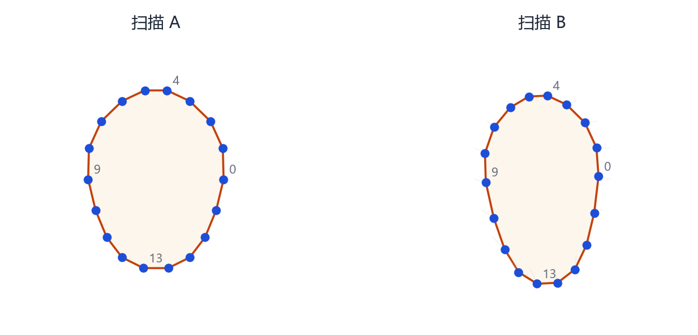
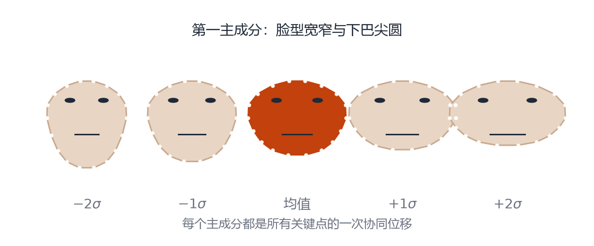
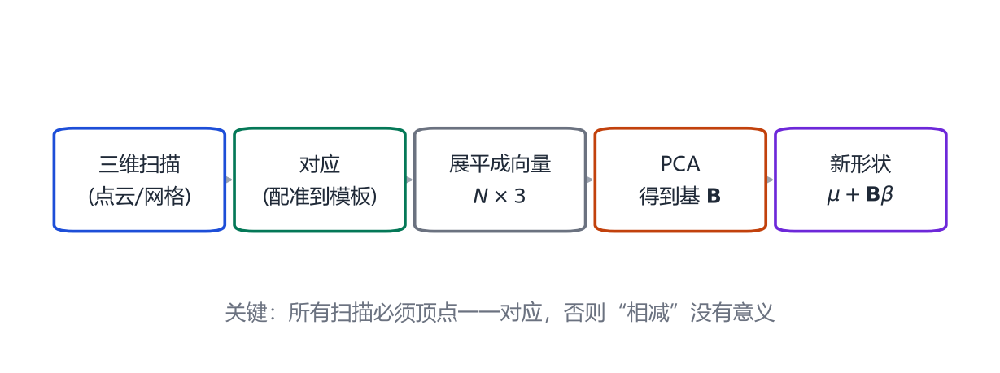

# 第 6 章 统计形状模型：从 ASM 到 3DMM

> **本章导读**：前面三章分别讲了“怎么表示”“怎么降维”“怎么变换”。这一章把它们合起来，回答一个更具体的问题：**如何从一堆扫描数据里，自动学出一个可调节的形状模型？** 这条线索从 1995 年的主动形状模型（ASM）开始，经过主动外观模型（AAM），到 1999 年的三维形变模型（3DMM），构成了今天所有人脸、人体、人手、动物参数化模型的共同祖先。

## 6.1 一个想法：形状是可以“统计”的

1990 年代初，医学图像分析面临一个难题：在 CT 或 MRI 里自动找到器官的轮廓。不同病人的器官形状不一样，但又有共同规律。Cootes、Taylor 等人想到：**如果先把很多样本的轮廓对应起来，再用 PCA 描述它们的变化，就能得到一个“形状的先验”[@cootes1995asm]。** 搜索轮廓时，只在这个先验允许的范围内找，既快又不容易跑偏。

这就是**统计形状模型**（Statistical Shape Model, SSM）的核心。它包含三个要素：

1. 一组已经**对应**好的样本；
2. 一个**均值形状**；
3. 一组**变化模式**（主成分）及其允许范围。

## 6.2 对应：一切的起点

<figure class="fig">

<figcaption><b>图 6-1</b>　对应（correspondence）的含义。两张脸的轮廓都取了 18 个编号一致的点：0 号都在右侧脸颊，4 号都在额头中央，13 号都在下巴。只有编号含义一致，形状向量逐维相减才有意义。</figcaption>
</figure>

假设你有两张人脸网格，一张 5000 个顶点，另一张 5200 个顶点。它们不能直接相减——维度都不一样。即使顶点数相同，如果第 100 号顶点在第一张脸上是鼻尖、在第二张脸上是嘴角，相减得到的数也没有任何解剖意义。

所以统计形状建模的第一步永远是**对应**（correspondence）：把所有样本变形到同一个模板上，使每个顶点在所有样本里都对应同一个解剖位置。常见做法有三类：

- **人工/半自动关键点**：在每个人脸上标 68 个点，再用薄板样条（TPS）把模板 warp 过去。简单，但关键点之外靠插值，细节会糊。
- **非刚性配准**（non-rigid ICP）：以模板为参考，迭代地找最近点、估计形变、最小化能量。Amberg 等人的“最优步长非刚性 ICP”是经典实现。
- **光流/多视角立体**：对纹理清晰的扫描，用光流建立像素级对应，再反投影到三维。

对应质量直接决定模型质量。如果对应有系统性偏差（比如嘴角总是对到偏上 2 毫米），PCA 会把这种偏差当成“形状变化”学进去，模型就会莫名其妙地“歪嘴”。

> **一句话**：统计形状模型的上限，由对应质量决定；后面的 PCA、拟合都是在这个上限内做文章。

## 6.3 ASM：在允许的形状里搜索

<figure class="fig">

<figcaption><b>图 6-2</b>　ASM 的形状空间。把所有样本的关键点展平成向量做 PCA，得到均值（中间）和若干主成分。沿第一主成分从 $-2\sigma$ 走到 $+2\sigma$，脸型从窄长逐渐变宽圆。每个主成分都是所有关键点的一次协同位移。</figcaption>
</figure>

ASM 把形状表示成 $n$ 个关键点的坐标串：

$$
\mathbf{x}=(x_1,y_1,x_2,y_2,\dots,x_n,y_n)^\top\in\mathbb{R}^{2n}.
\tag{6.1}
$$

对所有训练样本做 Procrustes 对齐（去掉平移、旋转、缩放），再跑 PCA：

$$
\mathbf{x}\approx\bar{\mathbf{x}}+\mathbf{P}\mathbf{b},
\qquad
\mathbf{P}=[\mathbf{p}_1,\dots,\mathbf{p}_t].
\tag{6.2}
$$

$\mathbf{b}$ 是形状参数。为了避免生成不合理的形状，通常限制每个参数在 $\pm3\sqrt{\lambda_i}$ 以内（$\lambda_i$ 是对应的特征值），这相当于“只走 3 个标准差”。

搜索时，ASM 做两件事交替进行：

1. **局部搜索**：沿每个关键点的法线方向采样灰度，找边缘最强的位置；
2. **模型约束**：把找到的点拟合回式 (6.2) 的形状空间，去掉不符合先验的位移。

这就像“每次只允许在统计上合理的范围内调整”，比让每个点自由移动稳健得多。

### 6.3.1 AAM：把纹理也统计进来

ASM 只看轮廓，不看五官内部。AAM 把形状和纹理一起建模 [@cootes2001aam]：先把每张脸 warp 到平均形状，得到“形状归一化后的纹理”，再对纹理做 PCA。最终模型同时能生成形状和外观，可以用“分析—合成”的方式拟合：

$$
\min_{\mathbf{b}_s,\mathbf{b}_a}\ \big\|\mathbf{A}(\mathbf{x}(\mathbf{b}_s);\mathbf{b}_a)-\mathbf{I}\big\|^2.
\tag{6.3}
$$

AAM 在约束环境下（正面、光照稳定）非常有效，但一到自然场景就容易崩：纹理受光照、遮挡、表情影响太大。

## 6.4 3DMM：把统计形状搬到三维

1999 年，Blanz 与 Vetter 在 SIGGRAPH 上发表 *A Morphable Model for the Synthesis of 3D Faces*，把 ASM 的思想从二维轮廓搬到三维人脸。这就是 **3D 形变模型**（3D Morphable Model, 3DMM）。

它的形状表示是：

$$
\mathbf{S}=\bar{\mathbf{S}}+\sum_{i=1}^{m}\alpha_i\mathbf{S}_i,
\tag{6.4}
$$

纹理表示是：

$$
\mathbf{T}=\bar{\mathbf{T}}+\sum_{i=1}^{m}\beta_i\mathbf{T}_i,
\tag{6.5}
$$

其中 $\bar{\mathbf{S}}$ 是平均脸，$\mathbf{S}_i$ 是形状主成分，$\alpha_i$ 是形状系数；纹理同理。后来为了处理表情，又加了表情基 $\mathbf{B}_j$：

$$
\mathbf{S}=\bar{\mathbf{S}}+\sum_i\alpha_i\mathbf{S}_i+\sum_j\gamma_j\mathbf{B}_j.
\tag{6.6}
$$

训练流程和 ASM 一样，只是数据换成了三维扫描：

<figure class="fig">

<figcaption><b>图 6-3</b>　统计形状模型的训练流程。扫描 → 配准到统一模板 → 展平成向量 → PCA 得到基 → 用少量系数生成新形状。每一步都可能引入误差，其中“对应”是最关键的一步。</figcaption>
</figure>

Blanz 与 Vetter 当年只用了约 200 个扫描，就得到了能生成逼真人脸、做表情迁移、做姿态校正的模型。这个数字今天看起来很小，但它证明了一件事：**人脸的变化高度集中，少量主成分就能覆盖大部分差异。**

### 6.4.1 3DMM 怎么拟合一张照片

给定一张人脸照片，3DMM 的拟合是一个“分析—合成”循环：

1. 猜一组形状、纹理、姿态、光照参数；
2. 用这些参数渲染出一张图；
3. 比较渲染图与输入图的像素差；
4. 根据差值调整参数，重复。

这就是式 (1.2) 在人脸上的具体化。1999 年的实现用随机梯度下降，速度慢；今天的实现用可微渲染 + 神经网络，可以实时。

拟合的难点在于**身份、表情、姿态、光照纠缠在一起**：同一张脸，换个光照可能被解释成“鼻子变高”。所以后来的模型会显式分离这些因素（第 15、16 章会讲 FLAME 和 DECA 怎么处理）。

## 6.5 从线性到非线性

线性模型有一个根本限制：它只能表示“沿主成分方向的直线变化”。如果真实数据分布是弯曲的，线性模型要么欠拟合，要么在参数空间里产生不存在的“中间形状”。

三类扩展值得知道：

- **核 PCA**：先用核函数把数据映射到高维，再做 PCA。能捕捉非线性，但需要选核、计算量大。
- **自编码器**（autoencoder）：用神经网络学习编码器 $\mathbf{z}=f(\mathbf{x})$ 与解码器 $\hat{\mathbf{x}}=g(\mathbf{z})$。本质上是“学出来的非线性 PCA”。第 25 章会讲它在人体生成里的应用。
- **扩散模型**：直接学习数据分布，用去噪过程生成样本。它不再有“主成分”的概念，但可以以 PCA 模型为条件（例如在 SMPL 参数空间上做扩散）。

即便有了这些非线性工具，线性 PCA 仍然是工业界的主力：它可解释、可求逆、计算快，而且在“形状差异”这种相对平滑的分布上，线性已经够好。

## 6.6 怎么评价一个统计形状模型

评价通常看三个方面：

1. **紧凑性**（compactness）：用多少个主成分能达到给定的重建精度。越少越好。
2. **泛化性**（generalization）：用留出集测试，模型能否重建没见过的形状。常用“留一法”：每次去掉一个样本训练，看对它重建的误差。
3. **特异性**（specificity）：从模型随机采样生成的形状，是否都像“合理的人”。如果生成了外星人，说明参数范围太宽或数据有偏。

这三个指标互相制约：参数越多，紧凑性越差但泛化可能更好；约束越强，特异性好但可能欠拟合。

## 本章小结

- 统计形状模型 = 对应好的样本 + 均值 + 主成分 + 参数范围。
- 对应是前提；没有顶点级对应，就没有可解释的形状向量。
- ASM 用 PCA 约束关键点搜索；AAM 把纹理也纳入统计。
- 3DMM 把同样思想搬到三维人脸：$\mathbf{S}=\bar{\mathbf{S}}+\sum\alpha_i\mathbf{S}_i+\sum\gamma_j\mathbf{B}_j$。
- 线性模型的局限催生了核方法、自编码器和扩散模型，但线性 PCA 仍是工业主力。
- 评价看紧凑性、泛化性、特异性。

## 思考题

1. 如果训练样本没有对齐（有人脸大、有人脸小），PCA 的第一主成分会是什么？
2. 为什么 ASM 要把搜索到的点“投影回”形状空间，而不是直接采用？
3. 3DMM 的形状和纹理分别建模，会丢失什么关联？后来的人脸模型如何弥补？
4. “特异性”差会带来什么实际问题？举一个拟合时的例子。
