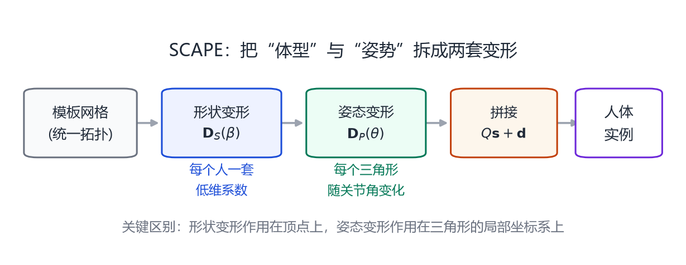
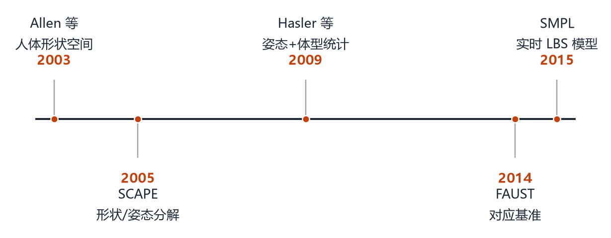

# 第 7 章 SCAPE：把「形状」和「姿态」拆开

> **本章导读**：SMPL 经常被当作人体参数化的起点，但在它之前，SCAPE 才是第一个真正把“体型”和“姿势”分离、并能生成任意体型摆任意姿势的模型。这一章讲清楚 SCAPE 为什么重要、它用了什么技巧、又为什么最终被更简单的 SMPL 取代。读完你会明白：**好的模型不是参数越多越好，而是把不该纠缠的因素分开。**

## 7.1 在 SCAPE 之前：只有“形状”，没有“姿势”

2003 年，Allen、Curless 与 Popović 在 SIGGRAPH 上发表 *The Space of Human Body Shapes*[@allen2003space]。他们用全身扫描仪扫描了大量志愿者，把所有网格配准到同一拓扑，然后对顶点坐标做 PCA，得到一个**人体形状空间**。

这个模型能做什么？给定几个滑块，生成不同身高、胖瘦、肩宽的人。听起来已经很接近今天的 SMPL 了。

但它有一个致命限制：**所有人必须站在同一个姿势**。因为 PCA 是对顶点坐标做的，一旦有人抬手，手臂的顶点就会跑到完全不同的位置，PCA 会把这部分差异误当成“体型差异”学进去。结果就是：你滑动“手臂粗细”滑块，模型可能会同时把手臂抬起来。

要解决这个问题，必须把“姿势”从“形状”里剥离出来。这正是 SCAPE 的贡献。

## 7.2 SCAPE 的核心思想

<figure class="fig">

<figcaption><b>图 7-1</b>　SCAPE 的分解。模板网格先经过形状变形得到某个人的体型，再经过姿态变形摆出姿势。形状变形是顶点级的、低维的；姿态变形是三角形级的、随关节角变化的。</figcaption>
</figure>

2005 年，Anguelov、Srinivasan、Koller、Thrun、Rodgers 与 Davis 提出 SCAPE（Shape Completion and Animation of PEople）[@anguelov2005scape]。它的出发点是：

> **一个人的网格 = 一个模板 + 体型差异 + 姿势引起的变形。**

用公式写就是

$$
\mathbf{V}=F_{\text{shape}}(\boldsymbol{\beta})+F_{\text{pose}}(\boldsymbol{\theta}),
\tag{7.1}
$$

但注意，这里的加号不是简单的逐顶点相加，而是通过三角形的局部变形来实现的。

### 7.2.1 为什么作用在三角形上

如果像 LBS 那样直接对顶点做线性混合，弯曲处会出现第 5 章讲的“捏细”。SCAPE 换了一个思路：**不直接移动顶点，而是规定每个三角形如何变形。**

具体来说，对模板上的每个三角形 $t$，SCAPE 学习一个 $3\times3$ 的变形矩阵 $\mathbf{Q}_t(\boldsymbol{\theta})$，它描述“这个三角形在当前姿势下被旋转、拉伸、剪切成了什么样”。然后，寻找一组顶点位置，使得每个三角形的实际形状尽量接近 $\mathbf{Q}_t$ 规定的形状。

这是一个最小二乘问题：

$$
\min_{\mathbf{V}}\ \sum_{t}\sum_{(i,j)\in t}
\big\|\mathbf{Q}_t(\mathbf{v}_i-\mathbf{v}_j)-\mathbf{D}_t(\mathbf{v}_i^0-\mathbf{v}_j^0)\big\|^2.
\tag{7.2}
$$

其中 $\mathbf{v}_i^0$ 是模板顶点，$\mathbf{D}_t$ 是形状变形。这个式子的意思是：**每个三角形的每条边，都应该按照 $\mathbf{Q}_t\mathbf{D}_t$ 的方式被变换；所有三角形不可能同时完美满足，所以求一个全局最优的顶点位置。**

这类似泊松重建：给定每个面片的形变，反解出全局一致的顶点。好处是三角形不会像 LBS 那样被“平均”到塌陷，弯曲和扭转都更自然。

### 7.2.2 姿态变形从哪里来

$\mathbf{Q}_t(\boldsymbol{\theta})$ 不是手写的，而是**学出来的**。SCAPE 的做法是：

1. 用动作捕捉数据驱动一个骨架，得到大量“模板 + 已知关节角”的配对；
2. 对每个三角形，计算它在每个姿势下相对静止姿势的变形；
3. 把这些变形表示成关节角的函数（论文用线性回归 + 局部坐标）；
4. 对新姿势，插值/回归出每个三角形的 $\mathbf{Q}_t$。

这样，模型就学到了“肘弯 90° 时，肘部外侧的三角形应该拉伸多少、内侧应该压缩多少”。它比 LBS 的刚体假设更贴近真实皮肤。

### 7.2.3 形状变形

形状部分相对简单：把所有扫描配准到模板姿势，对顶点偏移做 PCA，得到低维形状空间。因为姿势已经被“摆正”，PCA 学到的就只剩体型差异。

最终，SCAPE 可以：

- 输入一组形状系数，生成不同体型；
- 输入一组关节角，摆出不同姿势；
- 两者自由组合，生成“这个体型做这个动作”的网格。

### 7.2.4 式 (7.2) 到底怎么解

式 (7.2) 看起来很唬人，但它对未知量 $\mathbf{V}$ 是**二次的**（每一项都是顶点坐标的线性组合再平方），所以解出来就是一个线性方程组。把每个三角形的三组边叠在一起写成矩阵形式：

$$
\min_{\mathbf{V}}\ \big\|\mathbf{A}\,\mathbf{V}-\mathbf{B}\big\|^2
\quad\Longrightarrow\quad
\mathbf{A}^\top\mathbf{A}\,\mathbf{V}=\mathbf{A}^\top\mathbf{B}.
\tag{7.3}
$$

- $\mathbf{A}$ 是一个很大的稀疏矩阵：行对应“三角形的边”，列对应“顶点坐标”；每一行只有两个非零元素（因为一条边只涉及两个顶点）；
- 右边 $\mathbf{B}$ 由 $\mathbf{Q}_t\mathbf{D}_t(\mathbf{v}_i^0-\mathbf{v}_j^0)$ 构成，也就是“每个三角形的边应该变成什么”；
- 求解 $\mathbf{A}^\top\mathbf{A}\mathbf{V}=\mathbf{A}^\top\mathbf{B}$ 用共轭梯度或 Cholesky 分解，顶点越多越慢。

> **为什么不能直接对每个三角形独立地把顶点算出来？** 因为同一个顶点被好几个三角形共用。每个三角形都希望这个顶点在自己那边，但它只能有一个位置——所以必须全局折中，这就是“稀疏线性系统”的来源，也正是 SCAPE “贵”的原因。

把这件事用一句更普通的话说：**SCAPE 把“怎么变形”和“变形后顶点在哪里”分开了**。前者（$\mathbf{Q}_t$）是从数据学的、与姿势有关；后者（$\mathbf{V}$）是一次线性求解。这个拆分思路后来被反复借用：今天的神经形变模型也常常是“先预测每个局部的变换，再解一个全局一致的网格”。

<figure class="fig">

<figcaption><b>图 7-2</b>　分解假设的直观检验。同一体型可以摆不同姿势，同一姿势可以由不同体型完成；如果模型学得好，“换体型”和“换姿势”应该互不干扰。</figcaption>
</figure>

## 7.3 SCAPE 的贡献与代价

SCAPE 在 2005 年是里程碑式的，它确立了三件事：

1. **形状与姿态可以分离**，而且分离后可以自由组合；
2. **形变可以作用在局部（三角形）而不是全局（顶点）**，从而避免线性混合的伪影；
3. **统计模型可以从扫描 + 动作捕捉中联合学习**，不需要手工建模。

但它的代价也很明显：

- **计算贵**：每次生成都要解一个大型最小二乘，难以实时；
- **不可微**：整个流程包含配准、回归、求解，端到端训练困难；
- **依赖骨架和动作数据**：姿态变形的质量取决于动作捕捉数据的覆盖范围；
- **实现复杂**：三角形级变形、局部坐标、形状/姿态耦合，工程门槛高。

这些代价在 2015 年被 SMPL 用一种“更简单但足够好”的方案化解了。

## 7.4 中间十年：Hasler 与 FAUST

在 SCAPE 与 SMPL 之间，还有两项工作值得记住。

**Hasler 等（2009）** 提出 *A Statistical Model of Human Pose and Body Shape*[@hasler2009statistical]：他们把体型参数和姿势参数都做成线性模型，并显式地建模两者的耦合。这篇工作让“用统计模型同时描述形状和姿态”变得更清晰。

**FAUST（2014）** 则提供了第一个被广泛使用的评测基准 [@bogo2014faust]：一批高精度人体扫描，每个扫描都配准到同一拓扑，并带有真实的三维对应。FAUST 让不同方法可以在同一个标准上比较“重建得准不准”，推动了整个领域从“看起来像”走向“量得准”。

<figure class="fig">

<figcaption><b>图 7-3</b>　从人体形状空间到 SMPL 的关键节点。SCAPE 提出了形状/姿态分解，FAUST 提供了评测基准，SMPL 用更简洁的公式把两者结合并做到实时。</figcaption>
</figure>

## 7.5 为什么 SCAPE 最终输给了 SMPL

SCAPE 更“物理”，SMPL 更“工程”。SMPL 赢在三点：

1. **简单**：LBS + 线性 blendshape，一个公式写完，GPU 上实时；
2. **可微**：所有操作都是矩阵乘法和加法，可以直接接神经网络；
3. **够好**：虽然 LBS 有体积损失，但加上姿势校正 blendshape 后，视觉上已经足够逼真，而且更容易大规模训练。

这不是说 SCAPE 的思路错了。恰恰相反，SMPL 的姿势校正 blendshape 本质上就是“用数据学一个简化的 SCAPE 姿态变形”。**SCAPE 提出了问题，SMPL 给出了可规模化的答案。**

## 本章小结

- Allen 2003 建立了人体形状空间，但要求所有人同一姿势。
- SCAPE 把形状与姿态分解：形状作用在顶点上，姿态作用在三角形的局部坐标系上。
- 姿态变形从动作捕捉数据中学习，能表现弯曲、扭转等真实皮肤形变。
- 式 (7.2) 对顶点是二次的，最终化成一次稀疏线性求解；顶点被多个三角形共用，所以必须全局折中。
- SCAPE 计算贵、不可微、实现复杂；SMPL 用 LBS + 校正 blendshape 换取实时与可微。
- FAUST 提供了第一个被广泛采用的对应与重建评测基准。

## 思考题

1. 为什么对顶点坐标直接做 PCA 会把姿势混进形状？
2. SCAPE 的三角形变形与 LBS 的顶点混合，分别在什么情况下更自然？
3. 如果让你用今天的可微渲染工具重新实现 SCAPE，哪些部分可以端到端训练？
4. SMPL 的“姿势校正 blendshape”与 SCAPE 的“姿态变形”有什么本质联系？
