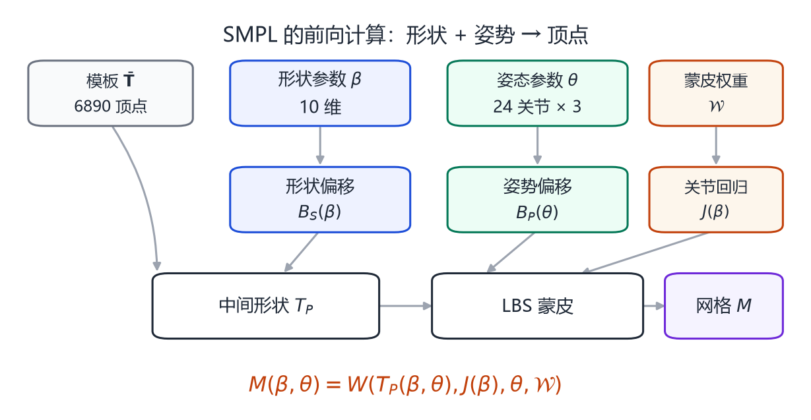
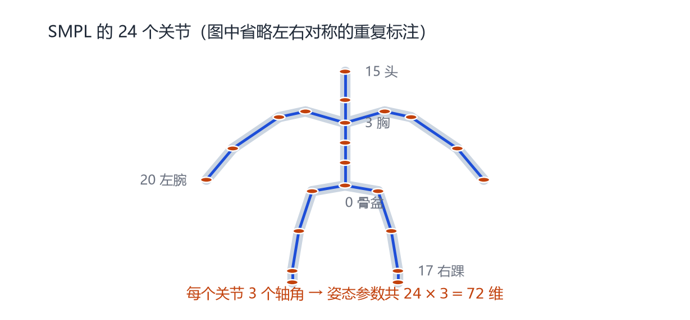
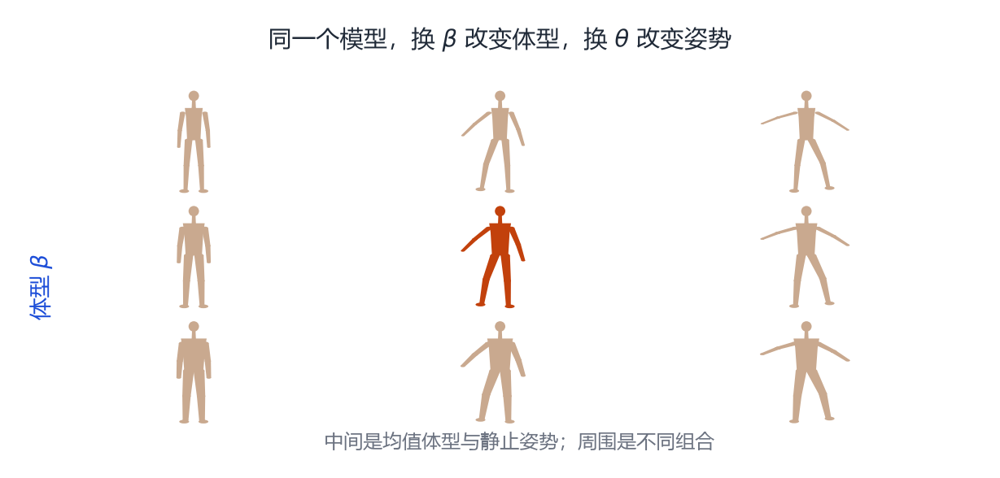

# 第 8 章 SMPL：一个公式统治人体

> **本章导读**：SMPL 是过去十年被引用最多的人体模型，也是几乎所有人体重建、动作生成、数字人系统的底座。这一章把 SMPL 的公式拆成四步，逐项解释每个矩阵的维度和含义，并说明它是怎么被训练出来的。读完你应该能回答：为什么是 6890 个顶点、10 个形状参数、207 个姿势 blendshape？这些数字不是魔法，都是可以解释的选择。

## 8.1 为什么还需要一个新模型

SCAPE 已经能分离形状和姿态，为什么 2015 年还要做 SMPL[@loper2015smpl]？

因为 SCAPE 太“重”了：每次生成要解三角形级的最小二乘，不能实时；整个流程不可微，没法接神经网络；实现复杂，研究者和工程师都难以复现。

SMPL 的目标很明确：**做一个足够简单、足够快、可微、又能被大规模数据训练的人体模型。** 它的答案是把 SCAPE 的“三角形变形”换成“顶点级的线性 blendshape + 标准 LBS”，牺牲一点物理精度，换取工程上的巨大便利。

今天你看到的绝大多数人体重建论文，输出层都是 SMPL 的 10 个 $\beta$ 和 72 个 $\theta$。这不是因为它们只会用 SMPL，而是因为 SMPL 已经成了这个领域的“文件格式”。

## 8.2 输入与输出

<figure class="fig">

<figcaption><b>图 8-1</b>　SMPL 的前向计算流程。模板、形状参数、姿态参数、蒙皮权重、关节回归器共同作用，最终输出一张 6890 个顶点的网格。注意形状偏移与姿势偏移是相加的，LBS 在最后一步。</figcaption>
</figure>

SMPL 的输入只有两组参数：

- **形状参数** $\boldsymbol{\beta}\in\mathbb{R}^{10}$：控制高矮胖瘦；
- **姿态参数** $\boldsymbol{\theta}\in\mathbb{R}^{72}$：24 个关节，每个 3 个轴角。

输出是一张网格：6890 个顶点，每个顶点 3 个坐标，共 20670 个数。此外还有 24 个关节的三维位置，以及每个顶点的蒙皮权重。

整个映射记作

$$
M(\boldsymbol{\beta},\boldsymbol{\theta}):\ \mathbb{R}^{10}\times\mathbb{R}^{72}\to\mathbb{R}^{6890\times3}.
\tag{8.1}
$$

## 8.3 第一步：形状 blendshape

SMPL 有一个**模板** $\bar{\mathbf{T}}$，是一张“平均体型、静止姿势”的网格。形状参数先对模板做一次线性偏移：

$$
\mathbf{T}_S=\bar{\mathbf{T}}+\mathbf{B}_S(\boldsymbol{\beta}),
\qquad
\mathbf{B}_S(\boldsymbol{\beta})=\sum_{n=1}^{10}\beta_n\mathbf{S}_n.
\tag{8.2}
$$

其中每个 $\mathbf{S}_n$ 都是一个 $6890\times3$ 的矩阵，表示“第 $n$ 个形状主成分对应的全身位移”。$\beta_n$ 是系数。

这一步和你在第 3 章学的 PCA 完全一样：$\mathbf{S}_n$ 就是主成分，$\beta_n$ 就是投影坐标。区别只在于，SMPL 的主成分是从**大量已配准的人体扫描**上学的，而不是从二维点云。

> **为什么是 10 维？** 这是精度与鲁棒性的折中。维度太少，无法区分不同体型；维度太多，从单张图反推时容易过拟合，而且参数空间会出现不合理的形状。10 维在实践中已经能覆盖大部分成年人的体型差异。

## 8.4 第二步：从形状回归关节

不同体型的人，关节位置不一样。胖子的髋关节可能更靠外，高个子的膝关节更长。所以 SMPL 不把关节位置写死，而是从形状回归：

$$
\mathbf{J}(\boldsymbol{\beta})=\mathcal{J}\big(\bar{\mathbf{T}}+\mathbf{B}_S(\boldsymbol{\beta})\big).
\tag{8.3}
$$

$\mathcal{J}$ 是一个线性回归器：它取若干个顶点（比如骨盆附近、膝盖附近），用学好的权重加权，得到关节位置。这样，体型一变，关节也跟着动，蒙皮才不会错位。

<figure class="fig">

<figcaption><b>图 8-2</b>　SMPL 的 24 个关节。根节点是骨盆，向上是脊柱、胸、颈、头，向两侧是锁骨、肩、肘、腕，向下是髋、膝、踝、脚。每个关节贡献 3 个轴角，共 72 维。</figcaption>
</figure>

## 8.5 第三步：姿势 blendshape

如果只有 LBS，弯曲肘部时会出现第 5 章讲的体积损失。SMPL 的解决办法是：**在 LBS 之前，先根据姿势加一个修正位移。**

$$
\mathbf{T}_P=\mathbf{T}_S+\mathbf{B}_P(\boldsymbol{\theta}),
\qquad
\mathbf{B}_P(\boldsymbol{\theta})=\sum_{n=1}^{207}\big(R_n(\boldsymbol{\theta})-R_n(\boldsymbol{\theta}^*)\big)\mathbf{P}_n.
\tag{8.4}
$$

这里有三个关键点。

**第一，207 是怎么来的。** SMPL 有 23 个非根关节，每个关节的旋转矩阵是 $3\times3$，展开成 9 个数，$23\times9=207$。所以姿势 blendshape 的“参数”不是角度，而是**旋转矩阵的 9 个元素**。

**第二，为什么用旋转矩阵而不是轴角。** 因为旋转矩阵的元素是角度的正弦/余弦，是光滑有界的；轴角在 0 附近虽然也光滑，但在大角度时会有周期性跳变。用矩阵元素做线性基，能让“姿势 → 位移”的关系更接近线性。

**第三，$\boldsymbol{\theta}^*$ 是静止姿势。** 减去 $R_n(\boldsymbol{\theta}^*)$ 是为了保证“静止姿势下修正量为零”。这样模板本身就代表静止姿势，不会在没摆姿势时被莫名修正。

$\mathbf{P}_n$ 是学出来的 $6890\times3$ 位移基。每个基对应“某个关节的某个旋转分量从 0 变到 1 时，全身应该怎么补偿”。207 个基听起来很多，但它们都是稀疏的：大多数基只影响关节附近的顶点。

## 8.6 第四步：LBS

现在有了中间形状 $\mathbf{T}_P$、关节位置 $\mathbf{J}(\boldsymbol{\beta})$、蒙皮权重 $\mathcal{W}$，就可以做标准的线性混合蒙皮：

$$
\mathbf{t}_i'=\sum_{k=1}^{K}w_{k,i}\,
\mathbf{G}_k(\boldsymbol{\theta},\mathbf{J})\,
\mathbf{G}_k(\mathbf{0},\mathbf{J})^{-1}\,
\mathbf{t}_{P,i}.
\tag{8.5}
$$

$\mathbf{G}_k(\boldsymbol{\theta},\mathbf{J})$ 是关节 $k$ 的全局变换，由式 (5.1) 的父子链算出；$\mathbf{G}_k(\mathbf{0},\mathbf{J})^{-1}$ 把它变回静止姿势的局部坐标。$w_{k,i}$ 是顶点 $i$ 对关节 $k$ 的权重，每个顶点最多 4 个非零权重，且和为 1。

把四步合起来，就是 SMPL 的完整公式：

$$
M(\boldsymbol{\beta},\boldsymbol{\theta})
=
W\Big(
\bar{\mathbf{T}}+\mathbf{B}_S(\boldsymbol{\beta})+\mathbf{B}_P(\boldsymbol{\theta}),
\ \mathbf{J}(\boldsymbol{\beta}),
\ \boldsymbol{\theta},
\ \mathcal{W}
\Big).
\tag{8.6}
$$

如果你在论文里看到 $W(T_P(\boldsymbol{\beta},\boldsymbol{\theta}),J(\boldsymbol{\beta}),\boldsymbol{\theta},\mathcal{W})$，指的就是这个式子。

<figure class="fig">

<figcaption><b>图 8-3</b>　SMPL 的参数网格。横向换 $\boldsymbol{\theta}$ 改变姿势，纵向换 $\boldsymbol{\beta}$ 改变体型，两者可以自由组合。中间橙色是均值体型 + 静止姿势。</figcaption>
</figure>

## 8.7 SMPL 是怎么训练出来的

SMPL 的训练分三步，每一步只优化一部分参数。

**第一步：形状空间。** 用 CAESAR 数据集（数千名受试者的全身扫描），把所有扫描配准到同一拓扑，再对顶点偏移做 PCA，得到 10 个形状主成分 $\mathbf{S}_n$。

**第二步：关节回归器与蒙皮权重。** 用一批“同一个人摆多个姿势”的扫描，优化关节回归矩阵 $\mathcal{J}$ 和蒙皮权重 $\mathcal{W}$，使得 LBS 的输出尽量接近扫描。

**第三步：姿势 blendshape。** 固定形状和蒙皮，优化 207 个姿势基 $\mathbf{P}_n$，专门补偿弯曲、扭转时的偏差。

训练的目标函数大致是

$$
\min\ \sum_{\text{scan}}\Big(
\|\mathbf{V}_{\text{model}}-\mathbf{V}_{\text{scan}}\|^2
+\lambda_{\text{landmark}}\|\mathbf{J}_{\text{model}}-\mathbf{J}_{\text{scan}}\|^2
+\lambda_{\text{reg}}\|\boldsymbol{\beta}\|^2
\Big),
\tag{8.7}
$$

其中关键点项保证关节对齐，正则项防止形状参数爆炸。

> **一个值得注意的细节**：SMPL 的蒙皮权重不是手工画的，而是和姿势基一起从数据里学出来的。这也是它比“手工绑定 + LBS”更自然的原因之一。

## 8.8 使用 SMPL 时最容易踩的坑

**坑一：$\boldsymbol{\beta}$ 的范围。** $\beta$ 的单位是“标准差”，取 $\pm1$ 已经是很明显的体型差异，$\pm3$ 以外基本不是正常人。从单张图回归时，网络经常输出 $\beta=5$ 甚至更大，必须加正则或截断。

**坑二：$\boldsymbol{\theta}$ 的根旋转。** 前 3 维是全局朝向，不是“骨盆关节的弯曲”。如果你的模型“站着但面朝侧面”，先检查这 3 维。

**坑三：坐标系。** 官方 SMPL 是 $y$ 轴向上、面朝 $+z$；但很多代码库会转成 $z$ 轴向上、面朝 $-z$。混用会导致模型躺倒或镜像。加载后先渲染一张图确认。

**坑四：形状与姿态的耦合。** 虽然 SMPL 假设二者可分离，但真实数据里“胖子抬手臂”和“瘦子抬手臂”的皮肤形变并不完全一样。极端体型 + 极端姿势时，SMPL 会出现不自然的褶皱。

**坑五：没有脸和手。** 原始 SMPL 的手是“拳头”状的粗糙网格，脸也没有表情。需要手部细节要用 MANO / SMPL-H，需要表情要用 SMPL-X（第 9 章）。

## 8.9 SMPL 的局限与影响

SMPL 的局限可以列成一串：线性形状空间、LBS 伪影、固定拓扑、没有衣服、没有表情、没有手指、训练数据以欧美成年人为主。但它的影响远远超过这些局限：

- 它统一了人体重建的输出格式，让不同论文可以比较；
- 它可微、可批量、可 GPU 加速，成为神经网络的理想输出层；
- 它的参数空间成为生成模型（VPoser、动作扩散）的坐标系；
- 它的变体覆盖了手（SMPL-H）、脸（SMPL-X）、婴儿、动物（SMAL 借鉴了它的思路）。

可以说，**SMPL 之于人体，就像 JPEG 之于图片：不是最完美的表示，但胜在通用、简单、生态完整。**

## 本章小结

- SMPL 用 10 个形状参数 + 72 个姿态参数生成 6890 个顶点。
- 四步：形状 blendshape → 关节回归 → 姿势 blendshape → LBS。
- 207 个姿势基 = 23 个关节 × 9 个旋转矩阵元素；它补偿 LBS 的体积损失。
- 参数从 CAESAR 扫描与多姿势数据中分阶段训练得到。
- 使用时注意 $\beta$ 范围、根旋转、坐标系、形状/姿态耦合，以及它没有脸和手。

## 思考题

1. 为什么 SMPL 的姿势参数是 72 维，而不是 69 维？
2. 如果去掉姿势 blendshape，只保留 LBS，弯曲手臂时会发生什么？能用第 5 章的公式解释吗？
3. 关节回归器为什么需要“从形状回归”，而不能直接用模板的关节位置？
4. 如果让你把 SMPL 扩展到“带表情”，你会把表情参数加在哪一步？为什么？
