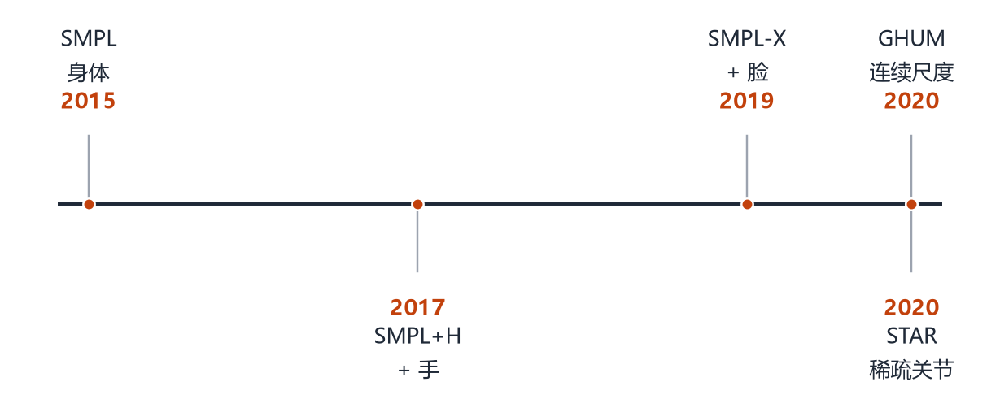
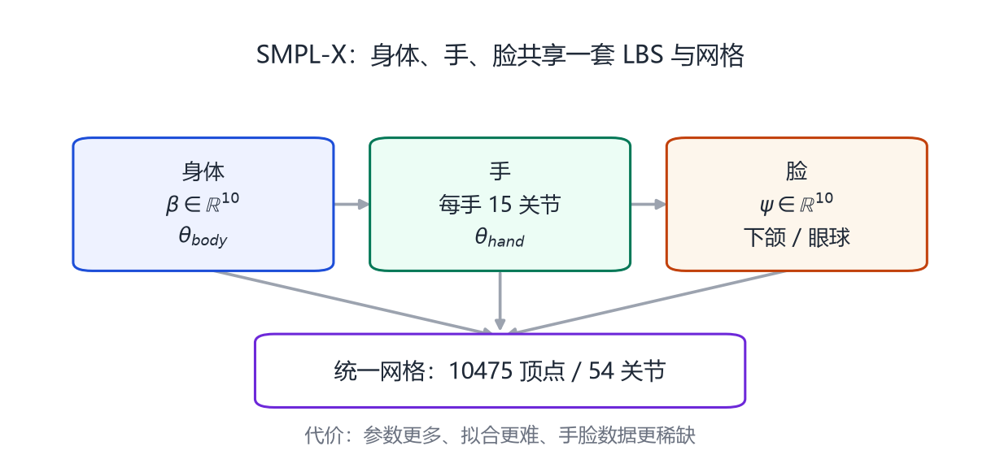
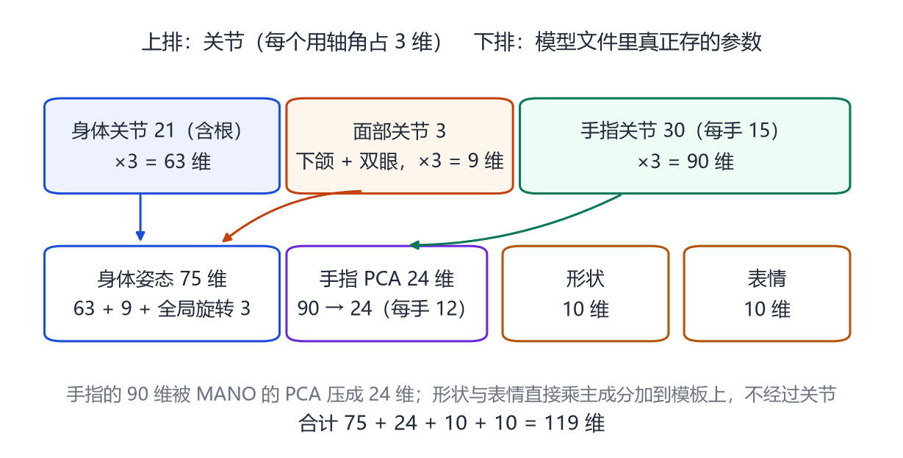

# 第 9 章 SMPL 家族：从身体到手，再到脸

> **本章导读**：SMPL 只解决了“身体”。真实的人还要动手、做表情、说话。这一章按时间顺序讲 SMPL 家族的四次扩展：SMPL+H 加手、SMPL-X 加脸和手、STAR 换一种更稀疏的关节表示、GHUM 走向连续尺度。最后给出一张选型表，告诉你在不同任务里该用哪个模型。

## 9.1 一条家族谱系

<figure class="fig">

<figcaption><b>图 9-1</b>　SMPL 家族的时间线。2015 年的 SMPL 只覆盖身体；2017 年的 SMPL+H 接入 MANO 的手；2019 年的 SMPL-X 把脸和手都并进来；2020 年之后，STAR 与 GHUM 从“关节表示”和“连续尺度”两个方向继续改进。</figcaption>
</figure>

SMPL 的成功带来一个自然的问题：**能不能把身体、手、脸放进同一个模型？** 如果分开建模，手和身体会在手腕处对不上，脸和脖子会在下颌处撕裂，动作捕捉时要分别拟合再拼接，误差会累积。

SMPL 家族的扩展思路是一致的：**保持同一套 LBS 框架，往模板里加顶点、往骨架里加关节、往参数里加维度。**

| 模型 | 顶点数 | 覆盖范围 | 关键新增参数 |
|---|---:|---|---|
| SMPL | 6890 | 身体 | $\boldsymbol{\beta}\in\mathbb{R}^{10}$，$\boldsymbol{\theta}\in\mathbb{R}^{72}$ |
| SMPL+H | 6890 | 身体 + 手 | 每只手 15 个关节（MANO 定义） |
| SMPL-X | 10475 | 身体 + 手 + 脸 | 10 维表情 $\boldsymbol{\psi}$、下颌/眼球关节，共 54 个关节 |
| STAR | 6890 | 身体 | 稀疏关节 + 姿势校正 |
| GHUM | — | 身体 | 连续尺度、层级关节 |

> 表中“—”表示不同实现的顶点数不一致，本书不写没有核对过的数字。

## 9.2 SMPL+H：把手接进来

2017 年，Romero 等人在 *Embodied Hands*[@romero2017mano] 中提出 MANO（第 19 章详述），并把它与 SMPL 拼成 **SMPL+H**。

做法很直接：

1. 保持 SMPL 的身体网格与 24 个关节；
2. 在每只手腕处接上 MANO 的手部网格；
3. 把 MANO 的 15 个手部关节（不含全局朝向）加入骨架；
4. 重新学习手腕附近的蒙皮权重，让手和手臂平滑过渡。

结果是一个能同时表达身体姿态和精细手部动作的模型。它的意义在于：**手不再是“拳头”，而是能单独弯曲每根手指的 15 个关节。** 这对抓取、手势识别、VR 手柄追踪都是必需的。

但 SMPL+H 仍然没有脸。脸的表情、眨眼、说话，需要另一套参数。

## 9.3 SMPL-X：身体、手、脸的统一

<figure class="fig">

<figcaption><b>图 9-2</b>　SMPL-X 的参数划分。身体形状、身体姿态、双手姿态、面部表情各自有参数，但共享同一张网格与同一套 LBS。输出是 10475 个顶点、54 个关节。</figcaption>
</figure>

2019 年，Pavlakos 等人在 *Expressive Body Capture* 中提出 **SMPL-X**（SMPL eXpressive）。它把三件事合并：

- **身体**：沿用 SMPL 的形状与姿态参数；
- **手**：接入 MANO 的双手，每手 15 个关节；
- **脸**：加入 10 维表情参数 $\boldsymbol{\psi}$，以及下颌、眼球、眼睑等关节。

SMPL-X 的输出是 **10475 个顶点、54 个关节**。相比 SMPL，它多了 3585 个顶点（主要在脸和手），也多了表情与手指的自由度。

代价也很明显：

1. **参数更多**：从单张图回归 100 多个参数，比回归 82 个难得多；
2. **数据更稀缺**：同时有身体、手、脸的高质量扫描很少，训练要靠多来源数据拼接；
3. **耦合更强**：手靠近脸时，两者的网格会互相穿插，需要额外的碰撞处理。

SMPL-X 之后，几乎所有“全身重建”论文都把输出定义为 SMPL-X 参数。你在第 10、11 章看到的 SMPLify-X、FrankMocap、PyMAF-X，都是它的下游。

## 9.4 STAR：更稀疏、更会“校正”的身体模型

2020 年，Osman 等人提出 **STAR**（Sparse Trained Articulated Human Body Regressor）[@osman2020star]。它针对 SMPL 的两个痛点：

- **关节太少**：24 个关节无法精细描述肩胛骨、脊柱、脚掌的变形；
- **姿势校正太全局**：SMPL 的 207 个姿势基是全局的，某个关节的修正可能影响到无关部位。

STAR 的做法是：

1. 用**更多、更稀疏的关节**，每个关节只影响局部区域；
2. 为每个关节学习**局部的姿势校正**，而不是全局基；
3. 用稀疏约束让参数数量不爆炸。

结果是：在极端姿势（高举手臂、深蹲）下，STAR 的形变比 SMPL 更自然，而且参数量并没有显著增加。它常被用作“更准的 SMPL 替代品”，但生态不如 SMPL 广。

## 9.5 GHUM：连续尺度与层级结构

同一年，Choutas 等人提出 **GHUM**（Generative Human Shape and Articulated Pose Model）[@choutas2020ghum]。它关注两个被 SMPL 忽略的问题：

- **尺度是连续的**：SMPL 的形状参数能改变高矮，但“身高”不是一个显式、可解释的维度；GHUM 把尺度显式建模，能生成从儿童到成人的连续变化；
- **关节是层级的**：脊柱不是一根刚体，而是多段；GHUM 用层级结构描述这种多段弯曲。

GHUM 还提供了轻量版 GHUML，牺牲一点精度换取速度。它的影响主要体现在“度量准确”的重建任务上：当你需要知道“这个人到底多高”，而不只是“看起来像”，显式的尺度参数就很重要。

## 9.6 怎么选：一张实用表

| 你的任务 | 推荐模型 | 理由 |
|---|---|---|
| 单图/视频人体姿态与体型 | SMPL | 生态最全、预训练模型最多 |
| 需要手指动作 | SMPL+H / SMPL-X | 手部关节与网格 |
| 全身 + 表情 + 手势 | SMPL-X | 统一网格，避免拼接 |
| 极端姿势、更高精度 | STAR | 稀疏关节 + 局部校正 |
| 需要真实身高/儿童 | GHUM | 显式尺度 |
| 动物 | SMAL | 第 22 章 |
| 只做脸 | FLAME | 第 16 章 |
| 只做手 | MANO | 第 19 章 |

选型不是“越新越好”。SMPL-X 参数多、拟合难；如果你的任务只需要身体，用 SMPL 往往更稳。**模型复杂度应该匹配任务需求，而不是追新。**

## 9.7 家族成员的共同点

不管加了多少顶点和关节，它们都遵循同一个模板：

$$
M=W\big(\bar{\mathbf{T}}+\mathbf{B}_S(\boldsymbol{\beta})+\mathbf{B}_P(\boldsymbol{\theta})+\mathbf{B}_E(\boldsymbol{\psi}),\ J(\boldsymbol{\beta}),\ \boldsymbol{\theta},\ \mathcal{W}\big).
\tag{9.1}
$$

区别只在于：

- 模板 $\bar{\mathbf{T}}$ 的顶点数不同；
- 关节数 $K$ 不同；
- 是否多一个表情基 $\mathbf{B}_E$；
- 权重 $\mathcal{W}$ 的稀疏模式不同。

理解了这个统一形式，你再看任何新模型（包括 2024 年之后的工业模型），都能快速判断它“新在哪”：是换了模板、加了关节、改了基，还是换了蒙皮方式。

## 9.8 参数是怎么拼起来的：SMPL-X 的一次完整前向

式 (9.1) 的每一项都可以写成一条显式公式。对 SMPL-X，四项相加就是：

$$
\mathbf{T}_P=\bar{\mathbf{T}}+\sum_{n=1}^{10}\beta_n\mathbf{S}_n+\sum_{n=1}^{10}\psi_n\mathbf{E}_n+\sum_{n=1}^{9K}\big(R_n(\boldsymbol{\theta})-R_n(\boldsymbol{\theta}^{*})\big)\mathbf{P}_n .
\tag{9.2}
$$

逐项看，每个符号都对应一块具体的数组。

- **模板 $\bar{\mathbf{T}}\in\mathbb{R}^{10475\times3}$**：零姿态下的平均人体，10475 行是 10475 个顶点，每行 3 个数是 $x,y,z$ 坐标（米）。它的零姿态是 A-pose，不是 SMPL 的 T-pose，两个模型连模板都不能混用。
- **形状项**：$\boldsymbol{\beta}\in\mathbb{R}^{10}$，每个 $\mathbf{S}_n\in\mathbb{R}^{10475\times3}$ 是一张和模板同样大的“位移图”，$\beta_n$ 决定加多少倍。$\boldsymbol{\beta}=\mathbf{0}$ 就是平均人——这正是第 10 章形状正则的由来。
- **表情项**：形式与形状项一模一样，只是 $\boldsymbol{\psi}\in\mathbb{R}^{10}$ 的主成分借自 FLAME，非零部分集中在脸上。**两项在实现上是同一段代码**，区别只在训练数据：一个来自“不同的人”，一个来自“同一个人的不同表情”。
- **姿态校正项**：关节转动时皮肤不会像刚体那样跟着转，要用 $9K$ 个基补偿。$R(\cdot)$ 把轴角变成 $3\times3$ 矩阵再拉平成 9 个数，所以每个关节贡献 9 个基；减去零姿态的 $R(\boldsymbol{\theta}^{*})$ 是为了让静止时这项为 0。

四项加完只得到“摆好姿势但还没蒙皮”的网格，关节位置还要从**只有形状**的网格回归：$\mathbf{J}(\boldsymbol{\beta})=\mathcal{J}(\bar{\mathbf{T}}+\mathbf{B}_S(\boldsymbol{\beta}))$，$\mathcal{J}\in\mathbb{R}^{54\times10475}$ 的每行只有少数非零——一个关节由附近一小撮顶点加权平均得到。这里**没有**表情项：做表情不改变骨架。

<figure class="fig">

<figcaption><b>图 9-3</b>　SMPL-X 的 54 个关节与 119 个参数怎样对上账。上排是关节数，每个关节用轴角占 3 维；下排是真正存进模型文件的参数：身体 63 + 面部 9 + 全局旋转 3 凑成 75，手指的 90 维压成 24 维，形状与表情各 10 维。箭头表示“合并”与“压缩”。</figcaption>
</figure>

这张图回答一个常被算错的问题：**SMPL-X 一共 119 个参数** = 75（全局旋转与 24 个身体/眼球/下颌关节）+ 24（双手手指 PCA）+ 10（形状）+ 10（表情）[@pavlakos2019smplx]。手指 30 个关节若全用轴角是 90 维，压成 24 维后参数才没有爆炸。**关节数 × 3 不等于姿态维度**：全用轴角时是 $165$ 维，走 PCA 后只剩 99 个数。

## 9.9 换模型时要改哪些代码

从 SMPL 换到 SMPL-X 或 MANO 的改动比想象中小：**公式一行都不变，变的是数组形状与参数名字。**

| 数组 | SMPL | SMPL-X | MANO |
|---|---|---|---|
| 顶点数 $N$ | 6890 | 10475 | 778 |
| 模板 | $(6890,3)$ | $(10475,3)$ | $(778,3)$ |
| 形状主成分 | $(6890,3,10)$ | $(10475,3,10)$ | $(778,3,10)$ |
| 表情主成分 | 无 | $(10475,3,10)$ | 无 |
| 姿态偏移基 | $(6890,3,207)$ | $(10475,3,486)$ | $(778,3,135)$ |
| 蒙皮权重 | $(6890,24)$ | $(10475,54)$ | $(778,16)$ |
| 关节回归器 $\mathcal{J}$ | $(24,6890)$ | $(54,10475)$ | $(16,778)$ |
| 姿态维度 | $72$ | $165$（常拆成 $75+24$） | $48$（可压到 6） |

**表 9-1**　三个模型的数组形状对照。

变化只有三类。**一是尺寸**：硬编码 `6890` 的代码一定出错，应写成 `N = v_template.shape[0]`。**二是参数**：SMPL-X 多了 $\boldsymbol{\psi}$ 与表情主成分，姿态也从 72 维向量变成“身体 75 + 双手 PCA 24”，必须拼成完整 $\boldsymbol{\theta}$ 再送 LBS。**三是关节顺序**：手指按 MANO 顺序排、面部关节夹在中间，“检测器编号 → 模型关节编号”的对应表必须重写。这是最容易**静默出错**的地方——程序不报错，只是把手腕的关键点对到了肘部。

不变的部分比变的多：**蒙皮、投影、优化器、损失函数一行都不用改**——生态能复用，不是因为大家抄了同一份代码，而是因为遵守了同一个接口。

但有一件事改数组解决不了：**参数含义不能跨模型通用。** 两个模型的 $\boldsymbol{\beta}$ 都是 10 维，第一维指向的体型方向却不同。把 SMPL 的 $\boldsymbol{\beta}$ 喂给 SMPL-X，得到的不是“同一个人”，而是形状错乱的人——**参数是相对于模型定义的，不是绝对的物理量。**

## 本章小结

- SMPL+H 在身体上接入手部，SMPL-X 进一步接入脸与表情，输出 10475 顶点 / 54 关节。
- STAR 用稀疏关节与局部姿势校正提升极端姿势精度；GHUM 显式建模连续尺度与层级关节。
- 所有家族成员共享“模板 + blendshape + 关节回归 + LBS”的结构。
- 一次前向可以拆成六步：模板 → 加形状 → 加表情 → 加姿态校正 → 回归关节 → 蒙皮；形状项与表情项在实现上是同一段代码，只差训练数据。
- SMPL-X 的 119 个参数 = 75（全局旋转与 24 个身体/眼球/下颌关节）+ 24（双手手指 PCA）+ 10（形状）+ 10（表情）；54 个关节不等于 162 个姿态数。
- 换模型时变的是数组形状、参数个数与关节顺序，不变的是 LBS 与优化器；但参数含义不能跨模型搬运。
- 选型要看任务：身体用 SMPL，手用 SMPL+H/MANO，全身表情用 SMPL-X。

## 思考题

1. 为什么 SMPL-X 不直接把手和脸做成两个独立模型，再在推理时拼接？
2. STAR 的“稀疏关节”与 SMPL 的“全局姿势基”各有什么优劣？
3. 如果让你设计一个“婴儿人体模型”，你会改 SMPL 的哪几部分？
4. 为什么模型越大，从单张图回归反而可能越不准？
