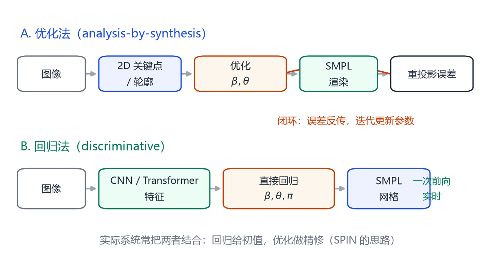
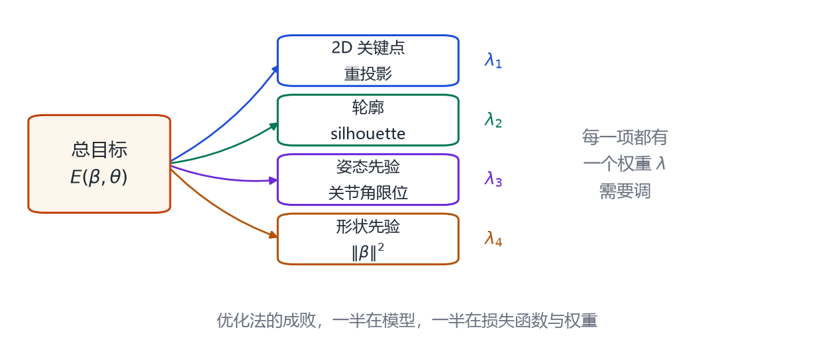
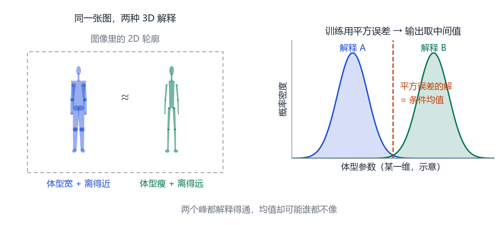

# 第 10 章 从单张图片反推人体：优化法与回归法

> **本章导读**：模型有了，参数也有了，剩下的问题是：给我一张照片，怎么求出 $\boldsymbol{\beta}$ 和 $\boldsymbol{\theta}$？这一章讲两条路线——优化法与回归法——以及它们如何结合。你会看到 SMPLify、HMR、SPIN、GraphCMR 这些名字背后的具体机制，也会明白为什么单图重建至今仍然容易在遮挡、尺度、奇怪姿势上翻车。

## 10.1 问题定义

给定一张 RGB 图像 $\mathbf{I}$，求：

- 形状 $\boldsymbol{\beta}\in\mathbb{R}^{10}$；
- 姿态 $\boldsymbol{\theta}\in\mathbb{R}^{72}$；
- 相机参数 $\boldsymbol{\pi}$（焦距、旋转、平移，或简化为弱透视的缩放与平移）；
- 可选：衣服、纹理、光照。

使得渲染出来的模型与图像“最一致”。这就是式 (1.2) 的具体化。困难在于：

1. **深度歧义**：单张图无法区分“人很小且很近”和“人很大且很远”；
2. **遮挡**：手挡住身体、别人挡住他，关键点会缺失；
3. **姿态歧义**：正面看，手肘向内还是向外，投影几乎一样；
4. **域差异**：训练集是实验室，测试集是网络图片。

## 10.2 路线 A：优化法

<figure class="fig">

<figcaption><b>图 10-1</b>　两条路线。优化法先用 2D 关键点/轮廓构造误差，再反复“渲染—比较—更新”；回归法用网络一次前向输出参数。实际系统常把两者结合。</figcaption>
</figure>

优化法的思路是“分析—合成”：先猜一组参数，渲染出模型，比较渲染结果与图像的差异，再根据差异更新参数。

### 10.2.1 SMPLify

2016 年，Bogo 等人的 **SMPLify** 是第一个把 SMPL 用到单图上的系统 [@bogo2016smplify]。它的输入是 2D 关节点（由 DeepCut 等检测器给出），目标函数是四项之和：

$$
E(\boldsymbol{\beta},\boldsymbol{\theta})=
\lambda_{J}E_{J}+\lambda_{\beta}E_{\beta}+\lambda_{\theta}E_{\theta}+\lambda_{S}E_{S}.
\tag{10.1}
$$

- $E_{J}$：3D 关节投影到 2D 后，与检测到的 2D 关节的距离平方；
- $E_{\beta}$：形状参数的正则，防止体型跑到不合理区域；
- $E_{\theta}$：姿态先验，用高斯混合模型（GMM）在大量动作捕捉数据上学习，惩罚“反关节”的姿势；
- $E_{S}$：自相交惩罚，防止手穿进身体、腿穿进腿。

SMPLify 还做了一个很实用的设计：**按性别选模型**。男性和女性的体型分布不同，用对应的模型可以显著减少歧义。

优化用 OpenDR 提供的可微渲染，配合拟牛顿法（如 L-BFGS）。整个流程在 GPU 上要几十秒到几分钟，不能实时，但精度不错。

### 10.2.2 优化法的优缺点

**优点**：

- 可解释：每一项误差都有明确含义；
- 不需要训练数据：只要有模型和检测器就能跑；
- 容易加约束：物理、接触、关节限位都能写成惩罚项。

**缺点**：

- 慢，且对初值敏感；
- 权重 $\lambda$ 难调，换一个数据集就要重调；
- 2D 关键点错了，优化会“将错就错”；
- 单图深度歧义仍然存在，优化只是在找一个“看起来合理”的解。

<figure class="fig">

<figcaption><b>图 10-2</b>　SMPLify 类方法的损失构成。关键点、轮廓、姿态先验、形状先验各自带一个权重；调参的本质，是在“相信图像”与“相信先验”之间找平衡。</figcaption>
</figure>

## 10.3 路线 B：回归法

2018 年，Kanazawa 等人的 **HMR**（End-to-end Recovery of Human Shape and Pose）[@kanazawa2018hmr] 换了一个思路：用一个神经网络直接从图像回归 SMPL 参数。

网络结构很简洁：

1. 用 ResNet-50 提取图像特征；
2. 接一个迭代回归器，输出 $\boldsymbol{\beta}$、$\boldsymbol{\theta}$、相机 $\boldsymbol{\pi}$；
3. 用可微渲染把模型投影回图像，计算 2D 关键点损失。

训练时没有 3D 真值怎么办？HMR 用了两个技巧：

- **弱监督**：只有 2D 关键点标注时，用重投影损失；
- **对抗先验**：训练一个判别器，区分“真实的 SMPL 参数”和“网络预测的参数”，迫使预测落在合理的姿态分布内。

HMR 的意义在于：**它把人体重建变成了一个标准的“图像 → 参数”回归问题**，可以端到端训练，速度达到实时。之后的绝大多数方法都沿用了这个范式。

### 10.3.1 SPIN：把优化器放进训练循环

HMR 的弱点是对罕见姿势不敏感。**SPIN**（Kolotouros 等，2019）[@kolotouros2019spin] 的想法很巧妙：既然优化法在单张图上更准，那就把优化器放进训练循环。

具体做法：

1. 网络先预测一组参数；
2. 用 SMPLify 以这组参数为初值，针对当前图像做优化；
3. 把优化后的参数当作“伪真值”，监督网络；
4. 同时用一个判别器保证参数合理性。

这样，网络在训练时就“见过”优化器如何修正自己，推理时即使不做优化，也能接近优化后的结果。SPIN 是“回归 + 优化”结合的典范。

### 10.3.2 GraphCMR：不回归参数，直接回归顶点

**GraphCMR**（Kolotouros 等，2019）[@kolotouros2019graphcmr] 走了另一条路：不预测 $\boldsymbol{\beta},\boldsymbol{\theta}$，而是用图卷积直接预测 6890 个顶点的坐标。

好处是：不受参数空间的线性限制，能表达更细的形变。坏处是：输出维度高（20670），需要强的网格先验，而且很难保证骨骼长度一致。后来的方法大多又回到“参数化输出”，因为参数空间更稳、更容易加约束。

## 10.4 两条路线的融合

今天的主流系统通常是混合的：

- 用回归网络给出初值（快、鲁棒）；
- 用优化做精修（准、可加约束）；
- 用时序模型平滑（视频场景）。

例如 FrankMocap 先分别回归身体和手，再用优化对齐；PyMAF 用“金字塔对齐”反复把预测投影回图像特征，实质是一种可学习的迭代优化。

## 10.5 为什么单图重建仍然难

**深度与尺度**：单目图像缺少绝对尺度。模型可以输出“看起来 1.7 米”的人，但如果没有相机内参或场景参照，真实身高无法确定。CameraHMR、NLF 等工作专门解决这个问题（第 11 章）。

**遮挡与截断**：下半身被桌子挡住时，网络只能猜。猜出来的腿可能长度不对、朝向不对。

**罕见姿势**：瑜伽、攀岩、舞蹈，训练集里少，先验会把这些姿势“拉回”常见分布。

**衣服与物体**：SMPL 是裸体模型，穿裙子的人会被拟合成“紧身裤”。手拿包、拄拐杖，也会干扰关键点。

**评估偏差**：很多论文在 3DPW 上报告 MPJPE，但 3DPW 的 3D 真值本身来自优化拟合，存在“用同类方法评估同类方法”的循环。

## 10.6 优化法复盘：把式 (10.1) 拆到原子级

式 (10.1) 把四项压成一行；写进代码后，每项都是一个循环加一个函数。

**（1）关键点项。** 它衡量“模型关节投影到图像上，离检测到的 2D 点多远”：

$$
E_{J}=\sum_{i}w_i\,\rho\Big(\big\|\Pi_{\mathbf K}\big(R_{\boldsymbol\theta}(\mathbf J(\boldsymbol\beta))_i\big)-\mathbf j_i\big\|\Big).
\tag{10.2}
$$

$i$ 遍历 2D 关键点，$\mathbf j_i\in\mathbb{R}^{2}$ 是像素坐标，$\mathbf J(\boldsymbol\beta)$ 是 3D 关节，$R_{\boldsymbol\theta}$ 摆好姿态，$\Pi_{\mathbf K}$ 投影；$w_i$ 是置信度，被遮挡的关节它就该少听。

$\rho$ 是鲁棒函数（Geman–McClure，$\rho(e)=e^{2}/(e^{2}+\sigma^{2})\in[0,1)$）：一个错了的关键点会有几百像素误差，平方会把它放大成天文数字，$\rho$ 让大误差饱和，等于**放弃这个点**，$\sigma$ 是“多大偏差算离谱”的分界。

**（2）形状项。** $E_{\beta}=\|\boldsymbol\beta\|^{2}$ 不是“让体型变小”，而是“让体型靠近 $\mathbf 0$”——零向量正是平均人；各维已按主成分方差缩放过，平方和就近似“标准高斯下的负对数概率”。**证据不足时，是它在决定腿有多长。**

**（3）姿态项。** 一块是数据先验：8 个高斯拟合约 100 万个姿态（100 个被试的动作捕捉，经 MoSh 拟合成 SMPL），取负对数：

$$
E_{\theta}=-\log\sum_{j=1}^{8}g_j\,\mathcal N(\boldsymbol\theta;\boldsymbol\mu_j,\boldsymbol\Sigma_j)
\approx\min_{j}\big(-\log c\,g_j\,\mathcal N(\boldsymbol\theta;\boldsymbol\mu_j,\boldsymbol\Sigma_j)\big).
\tag{10.3}
$$

用最小值近似“求和”是为了可微、算得快，代价是交界处梯度不连续。另一块是解剖约束 $E_a=\sum_i\exp(\theta_i)$，只对膝、肘的**反向**弯曲求和：反关节物理上不可能，要用指数函数压死（式 (10.1) 把它并进了 $E_{\theta}$，原论文其实是五项）。

**（4）自相交项。** SMPLify 用 20 个胶囊（不含手指脚趾）近似身体，再退化成沿轴的一串球，对“不该相交”的球对用高斯乘积的积分近似重叠体积。它只是**惩罚**不是**禁止**：权重小了照样穿模；优化体型时必须关掉，否则优化器会把人体压瘦来躲开。

分工也就清楚了：证据强时 $E_J$ 主导；关节被遮挡时 $E_{\theta}$ 与 $E_a$ 接管，输出“合理但可能不对”；只拍到半身时 $E_{\beta}$ 决定腿脚，腿被猜成平均值；左右手搞反时两者互相拉扯。量级也要匹配：$\rho$ 有界，$E_J$ 最多贡献“关键点个数”量级，而 $\|\boldsymbol\beta\|^{2}$ 无界增长——**$\lambda$ 要按残差量级调。**

### 10.6.1 一次迭代到底在算什么

```text
输入：图像 I，2D 关键点 {(j_i, w_i)}，初值 (β, θ)，性别对应的模型
重复：
  1. 前向：T_P ← 模板 + 形状 + 表情 + 姿态校正；J ← J(β)；V ← LBS
  2. 投影：p_i ← Pi_K( R_θ(J)_i )        # 3D 关节 → 像素
  3. 能量：E ← λ_J·E_J + λ_β·E_β + λ_θ·E_θ + λ_S·E_S
  4. 反传：g ← dE/d(β, θ)                # 自动微分
  5. 更新：(β, θ) ← (β, θ) - α·inv(H)·g   # 拟牛顿（L-BFGS）一步
  6. 判断：|ΔE|/E < 1e-4 或 ||g|| < 1e-3 或达最大迭代数 → 停
输出：(β, θ) 与相机参数
```

第 1、2 步算“模型长什么样”，第 3 步打分，第 4—6 步改参数并判停。**收敛**不能只看能量：$\min$ 近似与自相交项会造出能量平台，参数还在漂，所以同时看参数变化量与梯度范数。**迭代次数**取决于初值：回归给初值时几十次够用，从零姿态起步要多得多；单次优化还会掉进局部极小，常见做法是几组初值各跑一次——这就是“优化法慢”的原因。

## 10.7 回归法的病根：歧义与“平均人”

优化法把歧义写在明面上，回归法把歧义藏进网络权重里。

**（1）尺度与深度可以互相抵消。** 弱透视相机下，3D 点 $(X,Y,Z)$ 投到像素是

$$
\hat{\mathbf x}=s\,(X,Y)+\mathbf t,\qquad s=\frac{f}{Z},
\tag{10.4}
$$

$f$ 是焦距，$s$ 是缩放（越远越小），$\mathbf t$ 是平移。把体型放大 $k$ 倍、同时把人推远 $k$ 倍：$s$ 变成 $s/k$，而 $s\cdot kX=sX$——**投影一个像素都没变**。所以“体型 × 深度”有一整族解；真实世界靠地面接触与透视收敛打破它，裁好的一张图里这些线索往往都不在。

**（2）平方误差的解是“平均”，不是“某个人”。** 设两个解 $\boldsymbol\beta_1,\boldsymbol\beta_2$ 都能解释同一张图，用平方误差训练时网络的最优输出不是其中任何一个，而是**条件均值** $\mathbb E[\boldsymbol\beta\mid\mathbf I]$；两解等概率时就是两者中点。体型参数不是一条直线：两个“都像人”的体型取平均，可能得到“谁都不像”的体型。训练集里越罕见的人（很胖、很瘦、儿童）越容易被拉向均值——这就是“塌成平均人”。

**（3）判别器补的正是这块。** HMR 训练了一组判别器判断“这组参数是不是真人的参数”：形状一个（10 维），每个关节的旋转各一个（$3\times3$ 矩阵拉平），再加一个看整体姿态。分成许多小判别器不是炫技：输入维度低，网络就能很小、训练也稳；而“每个关节一个判别器”在语义上等价于**从数据里学出每个关节的角度限位**。

它与重投影损失互补：前者管“像不像人”，后者管“投影对不对”。HMR 的消融很说明问题——既不用 3D 监督、又去掉判别器时，网络输出“怪物”：2D 误差很小，体型姿势却都不像人。两种失败是镜像的：**先验太强 → 塌成平均人；先验太弱 → 怪物**。SMPLify-X 后来把高斯混合换成变分自编码器（VPoser），因为它更会抓高维姿态流形——思路没变：**给歧义配一个从数据里学来的偏好。**

<figure class="fig">

<figcaption><b>图 10-3</b>　歧义如何变成“平均人”。左：两个 3D 体型投影几乎相同，$E_J$ 分不开；右：平方误差训练的输出落在两峰之间（虚线），那里可能谁都不像。</figcaption>
</figure>

## 本章小结

- 单图重建的输出是 $\boldsymbol{\beta},\boldsymbol{\theta}$ 与相机参数。
- 优化法（SMPLify）用 2D 关键点 + 先验 + 自相交惩罚，准但慢、难调参。
- 回归法（HMR）用网络直接预测参数，快但依赖训练分布；SPIN 把优化器放进训练循环，结合两者优点。
- GraphCMR 直接回归顶点，绕开参数空间，但更难约束。
- 深度歧义、遮挡、罕见姿势、衣服与评估偏差仍是主要难点。
- 把式 (10.1) 拆开：$E_J$ 用有界的鲁棒函数抗错误关键点，$E_{\beta}$ 把体型拉向平均人，$E_{\theta}$ 是 8 个高斯的姿态先验加反关节惩罚，$E_S$ 用胶囊球惩罚自相交——谁的证据强，谁就说话。
- 一次拟合是“前向 → 投影 → 打分 → 反传 → 更新 → 判停”的循环，收敛要同时看能量、参数变化与梯度，单次容易掉进局部极小。
- 回归法的根病是尺度-深度歧义与平方误差的“求平均”，判别器/先验网络把输出拉回人体参数流形：先验太强塌成平均人，太弱则成怪物。

## 思考题

1. 为什么 SMPLify 需要“自相交惩罚”？不加会发生什么？
2. HMR 的对抗先验在训练中扮演什么角色？如果去掉，预测会变成什么样？
3. SPIN 用优化结果监督网络，会不会把优化器的偏差也学进去？
4. 如果给两张同一场景、不同角度的照片，深度歧义能消除吗？为什么？
