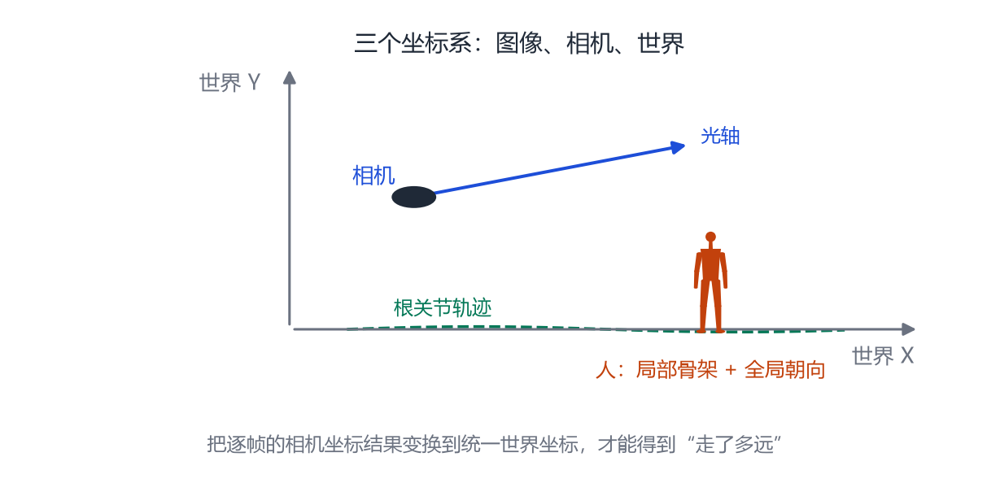
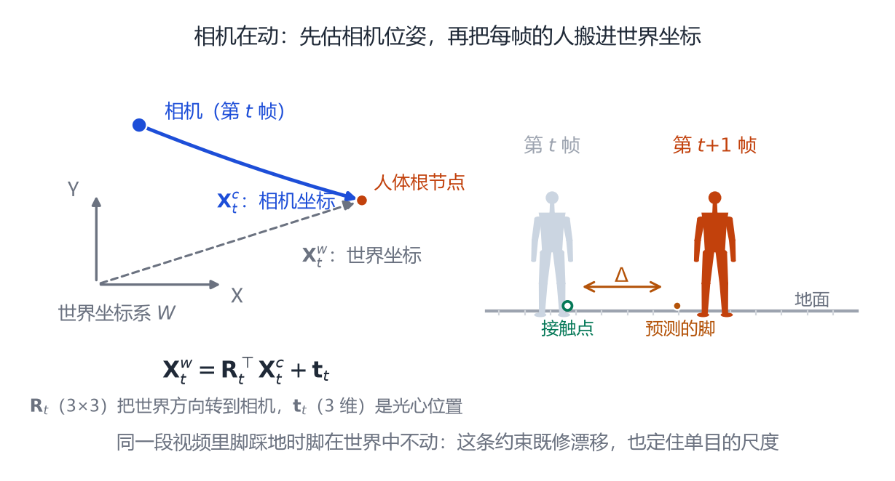

# 第 11 章 视频、多人、全身与度量尺度

> **本章导读**：单张图能猜出一个人，但视频里有时间、有多个人、有相机运动、“人到底走了多远”这些问题。这一章按“从帧到序列、从相机到世界、从单人到多人、从相对到度量”四条线，讲清楚 2019–2024 年的人体重建如何从“摆姿势”走向“理解场景”。

## 11.1 逐帧重建的三个毛病

把第 10 章的方法逐帧跑在视频上，会看到三种明显的问题：

1. **抖动**：相邻帧的参数独立预测，体型、关节角会小幅跳动；
2. **身份漂移**：同一个人在不同帧被预测成不同的 $\boldsymbol{\beta}$，看起来像“每帧换一个人”；
3. **深度跳变**：单帧的深度歧义导致人忽大忽小、忽远忽近。

解决办法是利用时间上的约束：**同一个人的形状应该不变，动作应该连续，相机运动应该平滑。**

<figure class="fig">

<figcaption><b>图 11-1</b>　视频人体重建的典型流程。逐帧提特征，再做时序融合，输出 SMPL 序列，最后变换到世界坐标并估计脚与地面的接触。</figcaption>
</figure>

## 11.2 时序模型：VIBE 与 4D-Humans

**VIBE**（Kocabas 等，2020）[@kocabas2020vibe] 是最早把视频时序引入 SMPL 回归的工作之一。它用 CNN 提取每帧特征，再用 GRU 做时序融合，输出每帧的 $\boldsymbol{\beta},\boldsymbol{\theta}$。训练时用一个**运动判别器**，判断“这段动作序列像不像真实动作捕捉”，从而让预测更平滑、更符合人体动力学。

**4D-Humans**（Goel 等，2023）[@goel2023humans4d] 把更强的单帧模型（HMR 2.0）[@shin2024hmr2] 与跟踪结合：先逐帧检测、再跨帧关联同一个人、最后做平滑。它的工程价值大于理论创新——证明了“强单帧模型 + 简单跟踪 + 平滑”就能得到可用的结果。

这两类方法的共同点是：**它们仍然在相机坐标系里工作**。人往前走，模型看到的是“人变大”，而不是“人走近”。

## 11.3 从相机坐标到世界坐标

<figure class="fig">

<figcaption><b>图 11-2</b>　三个坐标系。图像坐标是像素，相机坐标以光心为原点，世界坐标以重力方向为 $y$ 轴。只有把每帧结果变换到世界坐标，才能得到人的运动轨迹。</figcaption>
</figure>

要把“每帧的人”拼成“一个人在场景里运动”，需要估计相机运动，并把人体变换到统一的世界坐标。这条线在 2023–2024 年成为热点：

- **WHAM**（Shin 等，2024）[@shin2024wham]：用脚与地面的接触作为约束，估计根节点的世界位移；用重力方向对齐 $y$ 轴。
- **TRAM**（Yuan 等，2024）[@yuan2024tram]：在 WHAM 的基础上加入相机轨迹估计，处理移动相机。
- **GVHMR**（Shen 等，2024）[@shen2023gvh]：用“重力-视角对齐”把相机坐标下的人体转换到世界坐标，对相机运动更鲁棒。

这些方法的核心物理约束很朴素：

1. 脚踩在地上时，脚的速度应该接近 0（足部接触）；
2. 重力方向应该与世界 $y$ 轴一致；
3. 人的身高在整段视频里不变。

有了这三条，就能把逐帧的相机坐标结果“拼”成一条连贯的世界轨迹。这也是“人体重建”走向“人体行为理解”的关键一步。

## 11.4 多人：一次前向 vs 先检测再拟合

多人场景有两条路线：

- **自顶向下**（top-down）：先检测每个人的框，再对每个框单独跑单帧模型。简单、准，但速度随人数线性增长，且框重叠时容易出错。
- **单阶段**（one-stage）：一次前向输出所有人的参数。**Multi-HMR**（Baradel 等，2024）[@baradel2024multihmr] 是代表：它用 ViT 提取图像特征，直接回归每个实例的 SMPL-X 参数与位置，能处理相互遮挡、人与人接触的场景。

多人还带来一个新问题：**相对位置**。两个人谁在前、谁在后、相距多远，单目图像很难判断。Multi-HMR 通过预测每个人的根节点深度来缓解，但绝对尺度仍然依赖相机内参或场景先验。

## 11.5 度量尺度：从“看起来”到“量得准”

单目图像的深度歧义，本质上是**尺度歧义**：把人和相机同时放大 2 倍，投影完全一样。要得到真实身高，需要额外的信息：

- **相机内参**：如果知道焦距，且能估计人到相机的距离，就能算出绝对尺度；
- **人体先验**：假设人是正常身高（比如 1.7 米），反推深度；这对儿童、侏儒不成立；
- **场景参照**：地板、门框、已知大小的物体；
- **多视角**：两个视角的三角测量可以消除尺度歧义。

**CameraHMR**（Cho 等，2024）[@cho2024camerahmr] 显式估计透视相机，利用“近大远小”的透视线索恢复度量尺度；**NLF**（Dwivedi 等，2024）[@dwivedi2024nlfs] 则用神经局部场表示人体，能在任意相机下重建，并输出度量尺度。这些工作让“从一张照片量身高”从不可能变成“在受控条件下可行”。

## 11.6 规模化：SMPLer-X

**SMPLer-X**（Cai 等，2023）的思路是“大力出奇迹”：用 32 个数据集、数百万张图训练一个 ViT 大模型，输出 SMPL-X 参数。它证明了**数据规模与模型规模**在人体重建上同样有效：单一模型可以覆盖全身、手、脸，并在多个基准上取得很好的泛化。

它的局限也很明显：训练数据来自不同来源，标注质量参差不齐；模型很大，推理成本高；对罕见姿势仍然会失败。

## 11.7 怎么评价视频方法

视频评估除了单帧的 MPJPE、PVE，还要看：

- **加速度误差**（acceleration error）：关节加速度与真值的差，衡量抖动；
- **世界坐标误差**：整段轨迹的漂移；
- **身份一致性**：同一人的 $\boldsymbol{\beta}$ 在整段视频里的方差；
- **脚滑**（foot sliding）：脚踩地时是否滑动。

这些指标比单帧 MPJPE 更接近实际体验。一个方法可能单帧很准，但抖得没法看；也可能单帧一般，但时序平滑、观感很好。

## 11.8 相机运动怎么估：从光流到世界位移

11.3 节说要“变换到世界坐标”，没讲工程上怎么落地。设视频有 $T$ 帧，第 $t$ 帧已用第 10 章的方法拿到 SMPL 参数，此时关节都还在**相机坐标系**里。

链条有四步：

1. **只让背景参与。** 把每帧里检测到的人抠掉，剩下的像素才是“不动的世界”。不抠人，人一走动就会被当成“相机在后退”。
2. **逐像素找对应。** 在相邻两帧之间估计光流，得到一堆像素的位移量。
3. **解相邻帧的相对位姿。** 用这些对应点解出一个 3 维刚体变换：相机从 $t$ 到 $t+1$ 转了多少、走了多少。
4. **连乘。** 把 $T-1$ 个相对位姿串起来，得到整段视频的相机轨迹 $\mathbf{R}_t,\mathbf{t}_t$。

第 3 步的两个符号要说明：$\mathbf{R}_t$ 是 $3\times3$ 的旋转矩阵，表示第 $t$ 帧相机的朝向；$\mathbf{t}_t$ 是 3 维向量，表示相机光心在世界坐标里的位置。同一个 3 维点有两套坐标：

- $\mathbf{X}^{c}_t$：相机坐标，以光心为原点、$z$ 轴沿光轴向前；
- $\mathbf{X}^{w}$：世界坐标，$y$ 轴朝上（与重力反向）。

它们只差一步变换：

$$
\mathbf{X}^{w}=\mathbf{R}_t^{\top}\mathbf{X}^{c}_t+\mathbf{t}_t
\tag{11.1}
$$

为什么用转置？因为 $\mathbf{R}_t$ 的方向是“世界 → 相机”，反过来用就得取逆，而旋转矩阵的逆恰好等于转置。式 (11.1) 还有个好处：只要变换**根节点**，其余关节会自动跟着走——根节点平移到位、全局朝向与 $\mathbf{R}_t^{\top}$ 复合之后，整副骨架就落进世界坐标了。

<figure class="fig">

<figcaption><b>图 11-3</b>　左：相机坐标与世界坐标的关系，两条向量指向同一个根节点。右：脚接触把误差量出来——第 $t$ 帧的脚踩在接触点上，第 $t+1$ 帧预测的脚却偏了 $\Delta$，把 $\Delta$ 扣回根节点即可修正。</figcaption>
</figure>

**尺度问题就藏在这里。** 式 (11.1) 里的 $\mathbf{t}_t$ 如果来自单目 SLAM，只能恢复到一个未知倍数：$\mathbf{t}_t=s\tilde{\mathbf{t}}_t$，其中 $\tilde{\mathbf{t}}_t$ 是归一化后的轨迹，$s$ 是一个我们还不知道的正数。人、相机、视频同时放大两倍，投影不变——11.5 节的尺度歧义跑到相机轨迹上了。

脚接触能把 $s$ 解出来。设第 $t$ 帧左脚踩在地上、第 $t+1$ 帧还没抬起，这只脚在两帧的世界坐标应相同：

$$
s\tilde{\mathbf{t}}_{t+1}+\mathbf{R}_{t+1}^{\top}\mathbf{x}^{c}_{t+1}=s\tilde{\mathbf{t}}_{t}+\mathbf{R}_{t}^{\top}\mathbf{x}^{c}_{t}
\tag{11.2}
$$

其中 $\mathbf{x}^{c}_t$ 是脚的相机坐标，模型输出直接给。把含 $s$ 的项挪到左边：

$$
s\left(\tilde{\mathbf{t}}_{t+1}-\tilde{\mathbf{t}}_{t}\right)=\mathbf{R}_{t}^{\top}\mathbf{x}^{c}_{t}-\mathbf{R}_{t+1}^{\top}\mathbf{x}^{c}_{t+1}
$$

读法很直白：**左边是相机走了多远，右边是脚在画面里退了多少。** 脚踩地不动，画面里的位移就全部来自相机；量出它即可反推相机步长，解出 $s$。式 (11.2) 有 3 个方程、1 个未知数，把多个接触帧叠起来做最小二乘即可。

失败模式也要记住：接触检测错了（跑、跳、被推着滑），$s$ 会跳变、轨迹跟着抽；人一直坐着吊着，就没有接触帧，尺度无从恢复。所以 WHAM、TRAM、GVHMR 都会顺便输出一个**接触概率**，让下游知道哪几帧可信。

## 11.9 时序平滑：平滑了什么，又抹掉了什么

11.2 节说 VIBE、4D-Humans 会“做平滑”，这话太含糊：**平滑对象不同，副作用完全不同**。

**（一）参数空间平滑。** 直接对模型输出的 $\boldsymbol{\beta}$、$\boldsymbol{\theta}$ 滤波，最简单的是指数滑动平均（EMA）：

$$
\hat{\boldsymbol{\theta}}_t=\alpha\,\boldsymbol{\theta}_t+(1-\alpha)\,\hat{\boldsymbol{\theta}}_{t-1},\qquad 0<\alpha\le1
\tag{11.3}
$$

$\alpha$ 是式 (11.3) 里的平滑系数：$\alpha=1$ 等于不平滑，越小越平滑。它有两个副作用。第一是**滞后**：输出慢半拍，挥手、踢腿的峰值被削平，动作看着“糊”。第二是**旋转不能直接线性平均**：$\boldsymbol{\theta}$ 是轴角，两帧差别大时直接相加再除以 2，得到的朝向和“中间朝向”毫无关系。正确做法是在旋转群上插值（四元数的球面插值），或者干脆让网络自己学平滑。

**（二）输出空间平滑。** 对关节的 3 维轨迹或 2 维重投影滤波。好处是“看到什么就平滑什么”；坏处是它不再保证骨骼长度不变——几个关节各被拉一点，骨头就会被拉长压扁，网格像橡皮人。平滑 2D 重投影的坏处更直接：**滑步**。

滑步的机制值得单独说。脚踩地时，脚在世界里不动，但根节点在动（人往前走）。如果平滑把根节点的位移削掉一部分，脚的位置也跟着被削，于是“脚在地上平移”，视觉上像踩在冰面上。所以正确的顺序是：**先平滑，再做接触修正**。反过来做，平滑会把刚修好的接触又抹掉。

更根本的困难是：**抖动和真实的高频动作长得一样。** 走路时脚落地那一下本来就是高频，固定低通滤波分不清“噪声的高频”与“动作的高频”，切掉噪声的同时也切掉了力度感。VIBE 用运动判别器、4D-Humans 用真实动作训练，本质都是在**学“真实动作的高频该长什么样”**——这才是时序模型相对“逐帧 + 滤波”的优势。

## 本章小结

- 逐帧重建会抖动、漂移、深度跳变；时序融合与运动先验可以缓解。
- VIBE 用 GRU + 运动判别器；4D-Humans 用强单帧模型 + 跟踪。
- 世界坐标重建依靠足部接触、重力对齐、身高不变三条约束（WHAM、TRAM、GVHMR）。
- 多人有自顶向下与单阶段两条路线；Multi-HMR 是单阶段的代表。
- 度量尺度需要相机内参、人体先验、场景参照或多视角。
- SMPLer-X 证明了大规模数据与模型的价值。
- 相机运动可拆成四步：抠掉人 → 估光流 → 解相邻帧相对位姿 → 连乘成轨迹；式 (11.1) 只需变换根节点，其余关节跟着走。
- 单目相机轨迹有尺度歧义，脚接触用“脚在世界中不动”解出比例 $s$（式 11.2）。
- 平滑分两派：参数空间平滑会带来滞后，且旋转不能直接线性平均；输出空间平滑会破坏骨骼长度、容易滑步。正确顺序是“先平滑、再接触修正”。

## 思考题

1. 为什么“脚踩地”能帮助恢复世界位移？如果人一直坐着呢？
2. 单目图像中，人和相机同时放大两倍，投影不变。还有哪些变换不会改变投影？
3. 多人场景里，如何判断两个人是在握手还是前后站立？
4. 如果相机在移动，重力方向还能直接用吗？需要估计什么？
