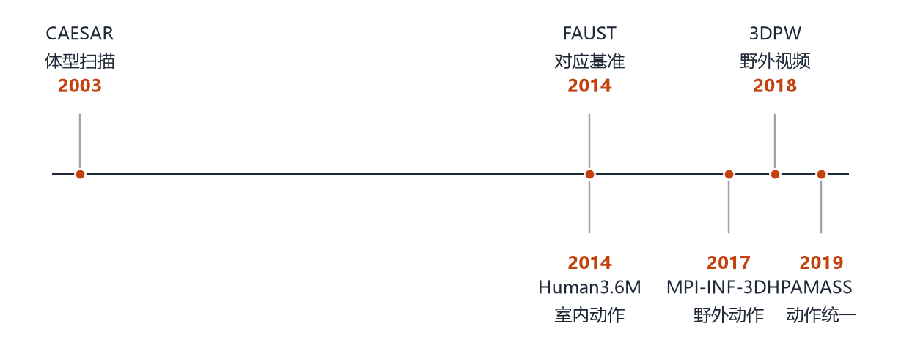
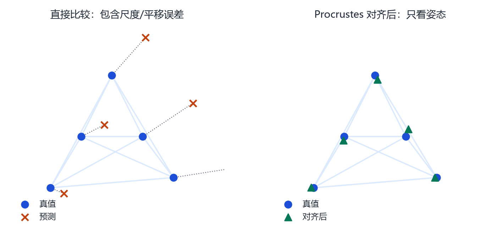
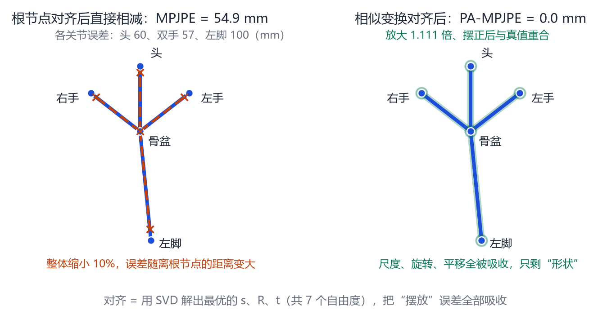

# 第 12 章 数据集、评估指标与常见坑

> **本章导读**：这一章不讲新模型，讲“怎么判断一个模型好不好”。你会看到人体领域常用的数据集、五个核心指标，以及论文里经常被忽略的评估陷阱。读完这一章，你再看到“我们的方法在 3DPW 上降低了 10% 的 MPJPE”时，会先问三个问题：和谁比？怎么对齐？测试集干净吗？

## 12.1 数据集：从实验室到野外

<figure class="fig">

<figcaption><b>图 12-1</b>　人体数据集的关键节点。早期以实验室扫描和动作捕捉为主，2017 年之后逐渐转向野外图像与视频，评估也从“姿态对不对”扩展到“尺度、轨迹、接触”。</figcaption>
</figure>

人体领域的数据集可以按“有没有 3D 真值”和“在室内还是野外”分成四类。

**表 12-1**　常用人体数据集。

| 数据集 | 类型 | 特点 | 主要用途 |
|---|---|---|---|
| CAESAR | 全身扫描 | 静态、多体型 | 形状空间训练 |
| FAUST | 扫描 + 对应 | 高精度、同拓扑 | 配准与重建评估 |
| Human3.6M | 室内视频 + Mocap | 360 万帧、11 人、15 类动作 | 3D 姿态基准 |
| MPI-INF-3DHP | 室内多视角 | 有标记/无标记 | 跨域评估 |
| 3DPW | 野外视频 | 手持相机、自然场景 | 单图/视频泛化 |
| AMASS | 动作捕捉统一 | 统一到 SMPL 参数 | 动作先验、生成 |
| AGORA | 多人 + 场景 | 全身、遮挡、接触 | 多人重建 |
| BEDLAM | 合成 | 大量渲染、精确真值 | 大规模预训练 |

**CAESAR** 是形状模型的“粮食”：数千名受试者的全身扫描，覆盖不同体型。SMPL 的形状空间就是在它上面训练的。

**Human3.6M** 是 3D 姿态的“老基准”：11 名受试者、15 类动作、360 万帧，配有动作捕捉真值。它的缺点是室内、受控、只有 15 类动作，训练出来的模型到野外容易崩。

**3DPW** 是“野外视频”的代表：手持相机拍摄，人体在自然场景里走动、互动。它的 3D 真值不是直接捕捉的，而是用优化方法拟合出来的，所以存在“用同类方法评估同类方法”的偏差。

**AMASS** 把多个动作捕捉数据集统一成 SMPL 参数，是动作先验、动作生成、物理仿真的基础 [@mahmood2019amass]。

**BEDLAM** 是合成的：用图形学渲染大量人体，真值精确、成本低，但存在“合成到真实”的域差异。

> **选数据集的建议**：训练形状用扫描，训练姿态用 Mocap/合成，评估泛化用野外视频。不要只用 Human3.6M 训练然后宣称“野外可用”。

## 12.2 五个核心指标

<figure class="fig">

<figcaption><b>图 12-2</b>　MPJPE 与 PA-MPJPE 的区别。左图直接比较预测与真值，包含尺度、平移、旋转误差；右图先做 Procrustes 对齐（去掉相似变换），只看姿态形状。PA 指标更低，但它会掩盖“人太大/太小/位置不对”的问题。</figcaption>
</figure>

### 12.2.1 MPJPE

**平均关节位置误差**（Mean Per-Joint Position Error）：

$$
\text{MPJPE}=\frac{1}{J}\sum_{j=1}^{J}\big\|\mathbf{p}_j-\mathbf{g}_j\big\|_2,
\tag{12.1}
$$

单位通常是毫米。$\mathbf{p}_j$ 是预测的关节，$\mathbf{g}_j$ 是真值。通常先把根节点平移对齐，再算误差。

### 12.2.2 PA-MPJPE

**Procrustes 对齐后的 MPJPE**：先找一个最优的相似变换（旋转 + 缩放 + 平移），把预测对齐到真值，再算误差。

$$
\min_{s,\mathbf{R},\mathbf{t}}\sum_j\big\|s\mathbf{R}\mathbf{p}_j+\mathbf{t}-\mathbf{g}_j\big\|^2.
\tag{12.2}
$$

PA 指标衡量“姿态形状”而不是“绝对位置与大小”。它更宽容，也更容易被滥用：一个把所有人体型都预测成平均值的方法，PA-MPJPE 可能不难看，但绝对尺度完全错了。

### 12.2.3 PVE / MPVE

**每顶点误差**（Per-Vertex Error）：把预测网格与真值网格的对应顶点相减，取平均。它比关节误差更细，能反映体型、肌肉、衣服的差异。

$$
\text{PVE}=\frac{1}{N}\sum_{i=1}^{N}\|\mathbf{v}_i-\hat{\mathbf{v}}_i\|_2.
\tag{12.3}
$$

### 12.2.4 PCK

**正确关键点比例**（Percentage of Correct Keypoints）：误差小于阈值的关节占比。阈值可以是绝对像素，也可以是“头部长度的比例”。PCK 对阈值很敏感，跨数据集比较时要看清定义。

### 12.2.5 加速度误差

视频方法常用：

$$
\text{Accel}=\frac{1}{T}\sum_t\big\|(\mathbf{p}_{t+1}-\mathbf{p}_t)-(\mathbf{p}_t-\mathbf{p}_{t-1})\big\|_2,
\tag{12.4}
$$

衡量抖动。它不关心“准不准”，只关心“稳不稳”。

## 12.3 论文里常见的评估陷阱

**陷阱一：对齐方式不说明。** MPJPE 前有没有做根节点对齐？有没有做 Procrustes？不同选择能差出 30%。看论文时先找“alignment”这个词。

**陷阱二：在训练集上评估。** 有些数据集（如 Human3.6M）的训练/测试划分很复杂，稍不注意就会把测试帧混进训练。

**陷阱三：用拟合结果当真值。** 3DPW 的 3D 真值来自优化拟合，如果你的方法也是优化拟合，等于“和自己比”。真正干净的真值是 FAUST 这种扫描 + 手动对应。

**陷阱四：只报平均，不报分布。** 平均误差低，可能只是因为大多数简单样本很好，而困难样本（遮挡、罕见姿势）完全崩。要看分位数、失败案例。

**陷阱五：混淆“姿态”与“形状”。** PA-MPJPE 低不代表体型对；PVE 低不代表关节对。两个指标要一起看。

**陷阱六：忽略相机。** 单图方法的尺度误差常常被“弱透视假设”掩盖。真实部署时，相机内参未知，误差会放大。

## 12.4 一个健康的评估习惯

如果你要做一个自己的方法，建议至少报告：

1. 三个数据集：一个室内（Human3.6M）、一个野外（3DPW）、一个扫描（FAUST）；
2. 两个指标：PA-MPJPE（姿态）+ PVE（形状）；
3. 一个效率指标：FPS 或参数量；
4. 一组失败案例：遮挡、多人、极端姿势；
5. 消融实验：去掉某个模块后掉多少。

这比“在单个数据集上刷 0.5 毫米”有意义得多。

## 12.5 指标是怎么算出来的：五个关节走一遍

所有指标都是同一个三步：**对齐 → 相减 → 平均**。差别只在两处：对齐允许用什么变换、相减的是关节还是顶点。下面把数字算一遍。

**表 12-2**　例子里用的五个关节真值（单位：米，$y$ 轴朝上，$z$ 轴朝向镜头）。

| 编号 | 关节 | $x$ | $y$ | $z$ |
|---|---|---|---|---|
| 0 | 骨盆（根节点） | 0.00 | 1.00 | 0.00 |
| 1 | 头 | 0.00 | 1.60 | 0.00 |
| 2 | 左手 | 0.45 | 1.35 | 0.00 |
| 3 | 右手 | $-0.45$ | 1.35 | 0.00 |
| 4 | 左脚 | 0.10 | 0.00 | 0.00 |

这五个点都落在 $z=0$ 平面上，好比一个人正对镜头站着。现在假设某个方法的预测，是把整个人**等比缩小 10%，再平移一点点**——典型的错误：模型把“标准身材”套在了偏矮的人身上。

**第一步，根节点对齐。** 把预测整体平移，让骨盆与真值骨盆重合：只消平移，不消旋转与尺度。

**第二步，逐关节量距离。** 缩小到 0.9 之后，头离骨盆 0.6 米变成 0.54 米，差 60 毫米；双手各差 57 毫米；左脚离骨盆最远（1 米），差 100.5 毫米；骨盆自己是 0。

**第三步，平均。** $(0+60+57+57+100.5)/5=54.9$ 毫米，这就是 MPJPE。注意误差随“离根节点的距离”线性变大，这正是“整体缩小”的指纹。

换 PA-MPJPE：允许“缩放 + 旋转 + 平移”一起去对齐。这个预测本来就是等比缩小，Procrustes 解出 $s=1/0.9=1.111$，把预测放大 1.111 倍，**恰好抵消**，PA-MPJPE $=0.0$ 毫米。图 12-3 是这两步的对比。

<figure class="fig">

<figcaption><b>图 12-3</b>　同一组预测的两种算法。左：只做根节点平移，误差随离根节点的距离变大，MPJPE 为 54.9 毫米。右：允许相似变换对齐后预测与真值完全重合，PA-MPJPE 为 0——“缩小 10%”这类错误被对齐彻底吸收了。</figcaption>
</figure>

所以：**PA-MPJPE 对尺度完全不敏感。** 把所有人都预测成“标准身材缩小 10%”的方法，PA-MPJPE 可以是 0，MPJPE 却是 54.9 毫米，拿去“量身高”会系统性偏矮。

再加一点料：若在上面的预测上再加 10° 旋转、每个坐标再叠 8 毫米随机噪声，同一组点得到 MPJPE $=110.7$、PA-MPJPE $=17.8$ 毫米；**去掉噪声、只留缩小与旋转，PA 又回到 0**。可见这 17.8 毫米几乎全部来自“关节之间的相对位置不对”。

四个指标的分工：

**表 12-3**　四个指标各在比什么。

| 指标 | 对齐方式 | 比的对象 | 对什么敏感 | 掩盖什么 |
|---|---|---|---|---|
| MPJPE | 只平移（常以根节点对齐） | 关节 | 尺度、朝向、位置 | 网格细节 |
| PA-MPJPE | 相似变换（7 自由度） | 关节 | 关节之间的相对位置 | 尺度、朝向、位置 |
| PVE | 与 MPJPE 相同 | 全部顶点 | 体型、软组织、衣服 | 单个关节是否对得上（被平均掉） |
| PVVE | 与 PVE 相同 | 顶点速度 | 动作对不对 | 绝对位置 |

PVVE 是“逐顶点速度误差”：把 PVE 里的位置换成相邻帧的速度差，用于评价视频结果。与式 (12.4) 的加速度误差是一对。

PVE 与 MPJPE 的差别也值得一个例子。假设关节全部落在正确位置，但预测把腰围做粗了 2 厘米：腹部顶点整体外移约 2 厘米，PVE 在腹部多出 20 毫米量级的误差，而 MPJPE 几乎不动——关节是从骨骼内部回归的，软组织变化影响不到它们。**“关节准”和“网格准”是两件事。**

## 12.6 一个可以直接用的评估脚本

真正算数的只有三行，其余全是防坑。输入是两个 $J\times3$ 的数组，单位一致，按米写。

```python
import numpy as np

def mpjpe(pred, gt):
    """pred, gt: (J,3)，第 0 号是根节点；单位一致。"""
    p, g = pred - pred[0], gt - gt[0]              # 根节点对齐：只去平移
    return np.linalg.norm(p - g, axis=1).mean()

def pa_mpjpe(pred, gt):
    """相似变换对齐后算 MPJPE，不允许镜像。"""
    p, g = pred - pred.mean(0), gt - gt.mean(0)     # 两边都先减掉重心
    U, S, Vt = np.linalg.svd(p.T @ g)               # 3×3 的互协方差
    d = np.sign(np.linalg.det(U @ Vt))              # ±1：防止把镜像当成对齐
    R = (U @ np.diag([1, 1, d]) @ Vt).T             # 最优旋转
    s = (S[0] + S[1] + d * S[2]) / (p ** 2).sum()   # 最优缩放
    return np.linalg.norm(s * p @ R.T - g, axis=1).mean()
```

三个要点逐行说。

**为什么两边都要减重心。** Procrustes 找的是“绕重心”的最优旋转与缩放。不先减重心，平移就会混进 SVD 里，解出来的旋转是错的——这是一个不会报错、只会让指标莫名变差的 bug。

**$\det$ 那一行在防什么。** SVD 的最优解可能是一个**镜像**（行列式为 $-1$）：当两组点近似互为镜像时（左右手搞混、或用了镜像增广），不加修正就会得到一个物理上不存在的对齐，误差虚低，而且很隐蔽。乘一个 $\mathrm{diag}(1,1,d)$ 就是把镜像翻回来。

**缩放的分子为什么是 $S_0+S_1+dS_2$。** $S$ 是三个奇异值，衡量预测与真值在三个方向上的相关性；三者相加再除以预测的平方和，恰好是最小二乘意义下的最优缩放。推导略长，但有一个两秒钟的自检：把真值乘 1.7 倍、随便转一下、挪一下，再喂给 `pa_mpjpe`，输出必须是 0，而解出的 $s$ 必须是 1.7。**这个自检一定要写进你的测试。**（本书的这段代码就是这样验证的：误差 0.000000，$s=1.7000$。）

五个常见实现错误：

1. **忘了去根节点。** 症：数值大得离谱，同一个动作换个站位就变，几百毫米很常见。
2. **毫米和米混用。** 症：结果是别人的 1000 倍或 1/1000。算出 4.7 而论文报 47，先查单位。
3. **关节顺序不一致。** 症：MPJPE 还行、PA 异常差，或者左右手误差对调。跨库（SMPL、SMPL-X、OpenPose）时必查。
4. **没做镜像修正。** 症：PA-MPJPE 好得不真实，明显低于同行的报告值。
5. **把没检测到的关节填成 0。** 症：个别样本误差上千毫米，平均值被拉爆。应该用可见性掩码，只对有效关节求平均。

## 本章小结

- 数据集分扫描、室内 Mocap、野外视频、合成四类，各有用途与偏差。
- MPJPE 看绝对误差，PA-MPJPE 看姿态形状，PVE 看网格，PCK 看阈值内比例，Accel 看抖动。
- 对齐方式、真值来源、训练/测试划分、平均 vs 分布，是评估的四大陷阱。
- 健康评估应跨数据集、多指标、带失败案例与消融。
- 所有指标都是“对齐 → 相减 → 平均”：差别只在用什么变换对齐、比关节还是比顶点。
- 同一个“整体缩小 10%”的预测，MPJPE 是 54.9 毫米，PA-MPJPE 是 0.0 毫米——PA 对尺度完全不敏感，它盖不住体型错误。
- PVE 管网格、PVVE 管速度；自己写评估要盯三件事：两边都去重心、防止镜像解、单位一致。

## 思考题

1. 一个方法 PA-MPJPE 很低但 PVE 很高，可能是什么原因？
2. 为什么 3DPW 的真值不能算“绝对干净”？
3. 如果只能选一个指标向非专业用户汇报，你会选哪个？为什么？
4. 合成数据训练、真实数据评估，最大的风险是什么？
