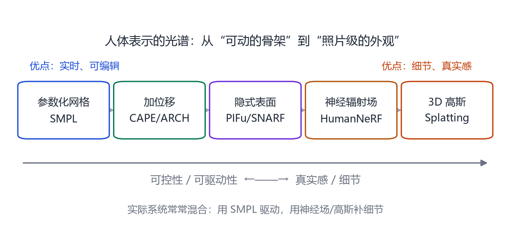

# 第 13 章 着装人体：衣服、头发与神经渲染

> **本章导读**：SMPL 是一个“紧身衣”模型。现实中的人穿裙子、西装、羽绒服，还有头发、胡须、配饰。这一章讲三类补细节的方法：给网格加位移、用隐式场表示表面、用神经渲染表示外观。它们分别对应“可控”“精细”“真实”三个目标，今天最好的系统往往三者混用。

## 13.1 裸体模型的三个不够

SMPL 能描述体型和姿态，但直接拿来用会有三个明显问题：

1. **衣服被当成皮肤**：穿裙子的人会被拟合成“紧身裤”，裙摆的褶皱完全丢失；
2. **头发和配饰缺失**：SMPL 的头顶是光滑的，没有头发；
3. **纹理与光照不分**：模型没有颜色，更没有“这件衣服在阳光下是什么质感”。

要补上这些，必须离开“6890 个顶点 + 固定拓扑”的舒适区。

<figure class="fig">

<figcaption><b>图 13-1</b>　人体表示的光谱。越往左，越可控、越容易驱动；越往右，越真实、细节越多。实际系统通常用左边的参数化模型做“骨架”，用右边的神经表示补“皮肤”。</figcaption>
</figure>

<figure class="fig">

<figcaption><b>图 13-2</b>　着装人体系统的通用管线。输入多视角图像或视频，先用 SMPL 拟合出“人在哪里、摆什么姿势”，再学一层残差/位移表示衣服与头发，然后把纹理与光照分离，最后得到一个可以换装、换姿势、换视角的可驱动 Avatar。整条管线的关键是把“人”与“衣服 / 头发 / 光照”分开建模。</figcaption>
</figure>

## 13.2 路线一：给 SMPL 加位移

最直接的办法是：保持 SMPL 的拓扑，给每个顶点学一个位移，表示“衣服让这个顶点往外鼓了多少”。

**CAPE**（Ma 等，2020）[@ma2020cape] 用 4D 扫描训练一个“衣服位移场”：输入是 SMPL 的体型、姿态、以及一个衣服类别，输出是每个顶点的位移。它能为不同姿势生成合理的褶皱，但只能处理训练过的衣服类型。

**Tex2Shape**（Alldieck 等，2019）[@alldieck2019tex2shape] 走的是另一条路：先把 SMPL 渲染成一张 UV 图，再用图像到图像的翻译网络，从单张照片预测“法线图/位移图”，最后反投影回网格。它不需要 4D 扫描，但细节受限于 UV 分辨率。

**ARCH**（Huang 等，2021）进一步引入“姿态校正”和“图像特征”，能同时生成衣服几何与纹理，并支持换装。

这条路线的优点是：**输出仍是网格，能直接进游戏引擎、能实时驱动**。缺点是：拓扑固定，无法表示裙摆、长发这种“拓扑会变”的结构。

## 13.3 路线二：隐式表面

隐式表示把表面定义成一个函数：给定空间点 $\mathbf{x}$，输出“这个点在表面内还是外”（有符号距离场 SDF），或者“这个点有多大概率在表面附近”（occupancy）。

**PIFu**（Saito 等，2019）[@saito2019pifu] 用像素对齐的隐式函数：对每个三维点，投影到图像上取特征，再判断它是否在表面上。它能从单张图重建高细节的人体，包括衣服褶皱和头发，但输出不是参数化网格，难以驱动。

**SNARF**（Chen 等，2021）[@chen2021snarf] 解决“驱动”问题：它学习一个“前向蒙皮场”，把隐式表面上的任意点绑定到 SMPL 骨骼上。这样，隐式表面也能跟着姿势动。

**SCANimate**（Shao 等，2021）用循环一致性，从没有配准的扫描里学习可驱动的隐式人体。

隐式表示的优点是：**不受拓扑限制，能表示头发、裙摆、配饰**。缺点是：渲染慢、难以实时、难以编辑。

用式子写出来，隐式表面就是函数 $f$ 的零水平集：

$$
\mathcal S=\{\,\mathbf{x}\in\mathbb{R}^3\ \big|\ f_\omega(\mathbf{x};\ \mathbf{z}_{\text{image}},\ \boldsymbol{\beta},\ \boldsymbol{\theta})=0\,\},
\tag{13.1}
$$

其中 $\mathbf{z}_{\text{image}}$ 是图像特征（PIFu 的做法是把 $\mathbf{x}$ 投影到图像上取对应像素的特征），$\omega$ 是网络参数。如果 $f$ 输出的是“在内部的概率”，就把它叫 occupancy；如果输出有符号距离，就是 SDF。两者只差一个单调映射，训练目标不同。

要把“零水平集”变成一张能看的图，必须用体渲染把颜色沿射线积起来：

$$
C(\mathbf{r})=\int_{t_n}^{t_f}T(t)\,\sigma(\mathbf{r}(t))\,\mathbf{c}(\mathbf{r}(t))\,dt,
\qquad T(t)=\exp\Big(-\!\int_{t_n}^{t}\sigma(\mathbf{r}(s))\,ds\Big),
\tag{13.2}
$$

$\mathbf{r}(t)=\mathbf{o}+t\mathbf{d}$ 是一条从相机出发的射线，$\sigma$ 是密度，$\mathbf{c}$ 是颜色，$T(t)$ 是“光线到达 $t$ 时还没被遮住的比例”（透射率）。式 (13.2) 是成百万条射线上的积分，所以慢——这就是隐式/神经渲染“质量高但慢”的根源，与它用不用 NeRF 无关。

> **一个容易搞混的点**：PIFu 类方法**不一定要体渲染**。它可以直接把隐式表面用 marching cubes 抽成网格，然后在网格上渲染。抽成网格的好处是能用常规图形管线、能进引擎；坏处是每次改姿势都要重新抽（拓扑会变）。

## 13.4 路线三：神经渲染

NeRF 把场景表示成“每个空间点的颜色与密度”，用体渲染合成新视角。**HumanNeRF**（Weng 等，2022）[@li2022human] 把人体拆成“标准姿势的 NeRF + 运动场”，用 SMPL 驱动，能从单目视频重建可自由视角观看的人。

**InstantAvatar**（Jiang 等，2023）[@jiang2023instantavatar] 把训练时间从几小时压到几十秒，方法是把 NeRF 放在一个规范空间里，用快速编码 + 少量迭代。

**HumanRF**（Gong 等，2023）[@gong2023humanrf] 用多视角视频重建 4D 人体，能处理快速动作与复杂衣服。

神经渲染的优点是：**照片级真实感**，连毛孔、布料纹理都能学到。缺点是：训练慢、渲染慢、难以编辑、难以直接进引擎。

## 13.5 3D Gaussian Splatting：新的折中

2023 年，3D Gaussian Splatting（3DGS）用一堆带方向的高斯椭球表示场景，渲染速度比 NeRF 快两个数量级。它很快被用到人体上：

**SplattingAvatar**（Moreau 等，2024）[@moreau2024splattingavatar] 把高斯绑定到 SMPL 的三角面上，用重心坐标驱动。人一动，高斯跟着面片动，既保留了 3DGS 的实时渲染，又能被骨架驱动。

**GaussianAvatars**（Qian 等，2024）[@qian2024gaussianavatars] 把高斯绑定到头部的 FLAME 模型上，做照片级人头头像。

这条路线目前最被看好：**实时、可驱动、真实感介于网格与 NeRF 之间**。它的挑战是：高斯的数量、内存、以及“换衣服/换表情”时的泛化。

3DGS 快在哪里？关键是把“射线积分”换成了“把椭球投影到屏幕、排序、逐个混合”这三步。一个三维高斯由中心 $\boldsymbol{\mu}$ 与协方差 $\boldsymbol{\Sigma}$ 描述：

$$
G(\mathbf{x})=\exp\Big(-\tfrac12(\mathbf{x}-\boldsymbol{\mu})^\top\boldsymbol{\Sigma}^{-1}(\mathbf{x}-\boldsymbol{\mu})\Big).
\tag{13.3}
$$

投影到图像平面后，二维协方差可以写成

$$
\boldsymbol{\Sigma}'=\mathbf{J}\,\mathbf{W}\,\boldsymbol{\Sigma}\,\mathbf{W}^\top\mathbf{J}^\top,
\tag{13.4}
$$

$\mathbf{W}$ 是世界到相机的旋转，$\mathbf{J}$ 是透视投影在该点处的雅可比（近似）。屏幕上每个像素的颜色，是把沿视线方向排序后的高斯按 $\alpha$ 混合：

$$
C=\sum_{i\in\mathcal N}\mathbf{c}_i\alpha_i\prod_{j \lt i}(1-\alpha_j),
\tag{13.5}
$$

$\mathcal N$ 是按深度排序后与当前像素重叠的高斯集合。这一步是纯光栅化，不需要网络前向、也不需要沿射线采样，所以能到实时。代价是：**顺序错了就会“穿透”**（前后遮挡错误），所以每帧都要排序；人一动，排序和协方差都要重算——这就是“高斯数量与内存”成为瓶颈的原因。

绑定到人体时（SplattingAvatar 一类），每个高斯记在某个三角面的重心坐标上：

$$
\boldsymbol{\mu}=\sum_{k=1}^{3}b_k\,\mathbf{v}_{f(k)},\qquad b_1+b_2+b_3=1,
\tag{13.6}
$$

$\mathbf{v}_{f(k)}$ 是该三角面的三个顶点，$b_k$ 是重心坐标。顶点一动，高斯中心跟着线性变化，连导数都是现成的，所以能直接套 LBS 驱动。

## 13.6 把“人”和“衣服/光照”分开

无论用哪种表示，一个核心原则是**解耦**：

- 人体几何（SMPL）与衣服（位移/隐式残差）分开；
- 反照率（albedo）与光照分开；
- 身份（形状）与表情/姿势分开。

只有解耦，才能做到“换一件衣服”“换一个光照”“换一个姿势”而不用重新扫描。这也是数字人工业管线的核心：先做一个“裸体 + 骨架”的基础资产，再叠加衣服、头发、材质。

## 13.7 选型：什么时候用哪种表示

三种表示不是“新的一定比旧的好”，而是各自适配不同的约束。把选择标准列成表：

| 需求 | 位移网格 | 隐式/神经场 | 3DGS |
|---|---|---|---|
| 可驱动（进动画管线） | 最好：直接接 LBS | 需额外学蒙皮场（SNARF 类） | 好：绑到面片上 |
| 实时渲染 | 最好 | 差（体渲染） | 好（光栅化） |
| 头发/裙摆/薄片 | 差（拓扑固定） | 好 | 好 |
| 可编辑（改衣服/改脸） | 好（改顶点） | 差（隐式场不可直接操作） | 中（增删高斯） |
| 内存 | 小 | 中 | 大（百万级高斯） |
| 训练成本 | 低 | 高 | 中 |
| 换装泛化 | 只能训练过的衣服类型 | 可外插但不稳 | 需重训 |

实操上的三个常见坑：

1. **把“能重建”当成“能驱动”**。很多方法在论文里渲染得很漂亮，但输出是一个不可驱动的静态网格；要驱动，必须额外有“前向蒙皮场”或“绑到骨架上的高斯”。
2. **忽略衣服与身体的分离**。如果位移场把衣服和皮肤一起学，换姿势时裙摆会跟着大腿走——因为蒙皮权重是从身体继承的。正确做法是给衣服单独一套权重，或者用“身体 + 衣服”两层表示。
3. **在错误的指标上比较**。只看渲染图的 PSNR，会系统性偏好“模糊但平均正确”的方法；要看轮廓、要看侧面视角、要看动作序列的时序稳定性。

## 13.8 评估与难点

着装人体的评估比裸体更难，因为：

- **没有干净的真值**：衣服会动、会皱，扫描本身有噪声；
- **拓扑会变**：裙摆、长发没有固定顶点对应，PVE 用不了；
- **视角依赖**：布料的高光、绒毛，换个角度就不一样。

常用指标包括：几何的 Chamfer 距离、渲染的 PSNR/SSIM/LPIPS、以及人类主观评分。工业界还会看“是否穿模”“是否跟手”“是否能实时”。

## 本章小结

- SMPL 是“紧身衣”模型，补细节有三条路：加位移、用隐式场、用神经渲染（含 3DGS）。
- 隐式表面是函数的零水平集，渲染靠体渲染积分，所以慢；抽成网格能进引擎，但每次改姿势要重抽。
- 3DGS 把体渲染换成“投影—排序—混合”，因此能实时；代价是内存与排序开销，绑到三角面上才能被骨架驱动。
- 核心工程原则是解耦：人 / 衣服 / 光照 / 身份分开建模，才能换装、换光、换姿势。
- 选型看四件事：能不能驱动、要不要实时、有没有薄片结构、要不要可编辑。
- 加位移（CAPE/Tex2Shape/ARCH）保持网格与可驱动性，但拓扑固定；隐式表面（PIFu/SNARF/SCANimate）能表示任意拓扑，但渲染慢、难编辑；神经渲染（HumanNeRF/InstantAvatar/HumanRF）真实感最好，但训练与渲染贵；3DGS（SplattingAvatar/GaussianAvatars）在实时与真实感之间取得新平衡。

## 思考题

1. 为什么“给 SMPL 加位移”无法表示裙摆？隐式表示为什么可以？
2. 3DGS 与 NeRF 的本质区别是什么？为什么 3DGS 更快？
3. 如果要把一个神经化身放进游戏引擎，你会选哪种表示？为什么？
4. “解耦”会带来什么代价？哪些信息在解耦时容易丢失？
