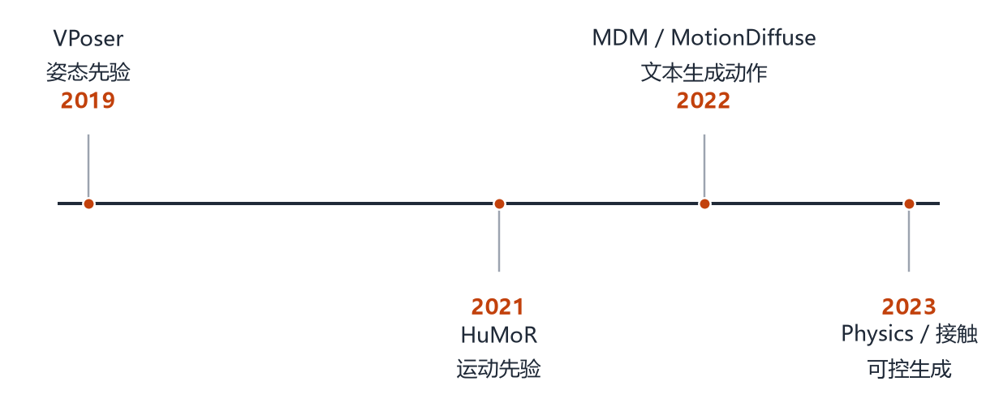

# 第 14 章 人体动作与生成模型

> **本章导读**：前面讲的是“一个人长什么样、摆什么姿势”，这一章讲“人怎么动”。动作是姿态随时间变化的轨迹，比单帧多了速度、加速度、接触、平衡等约束。我们按“先验 → 生成 → 控制”三层来讲，最后讨论为什么“生成动作”比“生成图片”更难评估。

## 14.1 动作的表示

一个动作序列可以写成

$$
\boldsymbol{\Theta}=(\boldsymbol{\theta}_1,\boldsymbol{\theta}_2,\dots,\boldsymbol{\theta}_T),
\tag{14.1}
$$

每帧 $\boldsymbol{\theta}_t\in\mathbb{R}^{72}$ 是 SMPL 的姿态，外加根节点的位移 $\mathbf{r}_t\in\mathbb{R}^3$。所以一个 $T$ 帧的动作大约是 $T\times75$ 个数。

这个表示很紧凑，但直接在上面做生成会遇到两个问题：

1. **关节角有周期性**：$0$ 和 $2\pi$ 是同一个角度，直接用欧拉/轴角做回归会在边界跳变；
2. **物理约束**：脚不能穿地、重心不能悬空、关节不能反折。

所以动作模型通常不是“直接预测角度”，而是先学一个**低维隐空间**，再在隐空间里生成。

<figure class="fig">

<figcaption><b>图 14-1</b>　动作建模的四步。2019 年的 VPoser 把单帧姿态压进隐空间（姿态先验）；2021 年的 HuMoR 把先验从“单帧”扩展到“时序”（运动先验）；2022 年 MDM / MotionDiffuse 把文本条件接进来；2023 年之后开始把接触与物理约束显式加进生成过程。</figcaption>
</figure>

## 14.2 姿态先验：VPoser

**VPoser**（Pavlakos 等，2019，随 SMPL-X 发布）[@pavlakos2019smplx] 是一个变分自编码器（VAE），把 72 维姿态压到一个 32 维的正态分布隐空间。

它的作用有两个：

- **生成**：从隐空间采样，得到合理的姿态；
- **正则**：在拟合图像时，把预测的姿态拉回“像人”的区域，防止反关节。

VPoser 的训练数据是 AMASS 等动作捕捉数据。它学到的隐空间不是均匀的，而是集中在人经常做的动作附近——所以从它采样，不会得到“手肘向后折 180°”的姿势。

把 VAE 的目标写出来，就明白“正则”是怎么起作用的：

$$
\mathcal L_{\text{VAE}}=\underbrace{\mathbb E_{q_\phi(\mathbf z|\boldsymbol\theta)}\big\|\boldsymbol\theta-D_\phi(\mathbf z)\big\|^2}_{\text{能复原：别丢信息}}
+\beta\underbrace{D_{\mathrm{KL}}\big(q_\phi(\mathbf z|\boldsymbol\theta)\,\|\,\mathcal N(\mathbf 0,\mathbf I)\big)}_{\text{隐空间靠拢正态}},
\tag{14.2}
$$

- 第一项逼着编码器 $q_\phi$ 把姿态压成 $\mathbf z$、解码器 $D_\phi$ 再从 $\mathbf z$ 复原姿态；只留这一项，隐空间会“记住”每个训练样本，没有泛化；
- 第二项（KL 散度）逼着隐空间分布接近标准正态，所以“在隐空间里随便取一个点”也能解码出合理姿态——这就是采样能用的原因。

$\beta$ 是权衡系数：太大，隐空间丢掉姿态细节（生成的人“千篇一律”）；太小，隐空间变成一张“样本清单”，插值与采样都会失控。这个取舍在下面的动作生成里会再次出现。

## 14.3 运动先验：HuMoR

单帧姿态先验不知道“动作是否连贯”。**HuMoR**（Rempe 等，2021）[@rempe2021humor] 用条件 VAE 建模“从上一帧到下一帧的变化”，并引入脚与地面的接触状态。

它的生成过程是马尔可夫的：给定当前状态（姿态、速度、接触），预测下一帧的状态分布。这样既能去噪，又能补全被遮挡的帧。

HuMoR 的意义在于：它把“动作”当成一个动态系统，而不是一堆独立的姿态。这为后来的视频重建、动作补全提供了基础。

## 14.4 文本生成动作：MDM 与 MotionDiffuse

2022 年之后，扩散模型被用到动作生成上。

**MDM**（Tevet 等，2022）[@tevet2022mdm] 把一段动作看成一个序列，用 Transformer 做去噪：训练时把真实动作加噪，网络学习“从噪声中恢复动作”；推理时从纯噪声开始，逐步去噪，并用文本编码作为条件。

**MotionDiffuse**（Zhang 等，2022）[@hong2022motiondiffuse] 用类似的思路，但强调“细粒度控制”：不仅能根据文本生成“一个人走路”，还能控制“左手抬高”“速度变慢”。

这类方法的共同点是：**生成的是参数序列，不是像素**。所以生成结果天然带骨架，可以直接驱动 SMPL、可以重定向到不同体型、可以后期编辑。

把扩散模型的两条式子写出来，就抓住了它的全部要点。**前向过程**是逐次加噪声：

$$
\mathbf x_t=\sqrt{\bar\alpha_t}\,\mathbf x_0+\sqrt{1-\bar\alpha_t}\,\boldsymbol\epsilon,\qquad \boldsymbol\epsilon\sim\mathcal N(\mathbf 0,\mathbf I),
\tag{14.3}
$$

$\mathbf x_0$ 是一段真实动作（把 $T$ 帧的 $\boldsymbol\theta,\mathbf r$ 拼成一个大向量），$\bar\alpha_t$ 是预设的“保留多少信号”的表，$t$ 越大噪声越多。**训练目标**是让网络学会猜出被加进去的噪声：

$$
\mathcal L_{\text{diff}}=\mathbb E_{t,\mathbf x_0,\boldsymbol\epsilon}\Big\|\boldsymbol\epsilon-\boldsymbol\epsilon_\theta\big(\mathbf x_t,\ t,\ \mathbf c\big)\Big\|^2,
\tag{14.4}
$$

$\mathbf c$ 是条件（文本编码、音频特征、目标轨迹）。**推理**则是从纯噪声一步步去噪，每一步都做“减去当前预测的噪声”：

$$
\mathbf x_{t-1}=\frac{1}{\sqrt{\alpha_t}}\Big(\mathbf x_t-\frac{1-\alpha_t}{\sqrt{1-\bar\alpha_t}}\,\boldsymbol\epsilon_\theta(\mathbf x_t,t,\mathbf c)\Big)+\sigma_t\mathbf z,
\tag{14.5}
$$

最后一项 $\sigma_t\mathbf z$ （$\mathbf z\sim\mathcal N(\mathbf 0,\mathbf I)$）是模棱两可的噪声——它保证了“同一个文本能生成不同动作”（多样性）。$\sigma_t=0$ 时就是确定性的 DDIM 采样，生成稳定但多样性降低。

> **为什么动作生成特别适合扩散，而不是直接用 GAN？** 动作是长序列（上百帧），每帧又有几十维；GAN 的判别器很难对“整段动作是否合理”给出稳定信号，容易训练崩溃。扩散的目标函数是一道回归题（预测噪声），训练反而更稳；代价是推理需要几十步。

<figure class="fig">

<figcaption><b>图 14-2</b>　文本/音频驱动动作生成的典型管线。条件编码后，扩散或自回归模型生成姿态序列与根轨迹，再经过接触/物理后处理，最后渲染或驱动虚拟人。</figcaption>
</figure>

## 14.5 可控性与物理约束

生成模型最容易被诟病的是“看起来像，但物理不对”：脚在地上滑、人穿进墙、重心飘。

解决办法有三类：

- **接触约束**：显式预测脚与地面的接触，接触时脚的速度为 0；
- **物理仿真**：把生成的动作送进物理引擎，用 PD 控制器跟踪，得到符合动力学的轨迹；
- **后处理**：用逆运动学修正脚的位置，或用优化平滑轨迹。

这些方法能显著提升“可信度”，但也会牺牲多样性：约束越强，生成的动作越保守。

## 14.6 为什么动作生成难评估

图像生成可以用 FID、CLIP Score；动作生成没有这么幸运。先把几个常用指标到底在算什么说清：

- **FID（在动作特征空间）**：把生成动作与真实动作各送进一个预训的动作编码器，得到两组特征；假设两组特征都近似高斯，FID 就是这两个高斯分布的距离：

$$
\mathrm{FID}=\big\|\boldsymbol\mu_g-\boldsymbol\mu_r\big\|^2+\mathrm{Tr}\Big(\boldsymbol\Sigma_g+\boldsymbol\Sigma_r-2(\boldsymbol\Sigma_g\boldsymbol\Sigma_r)^{1/2}\Big).
\tag{14.6}
$$

它只比较“分布像不像”，完全不管“某一句文本对不对”。

- **R-Precision**：从一批真实动作里取出与文本配对的那一个，再让模型给“生成动作与各文本的相似度”排序；配对的文本排进前 $k$ 的比例就是 R-Precision@$k$。它考察文本—动作对应，但依赖另一个预训编码器。
- **多样性 / 多模态距离**：同一文本生成多条，算两两距离（多样性）；再与真实数据集里同一文本的多条比较（多模态距离）。
- **物理指标**：脚滑（着地期位移）、穿地深度、关节超限比例、能量消耗。

问题在于：这些指标没有一个能完全对应“人看起来自不自然”。一个 FID 很低的方法，可能生成的动作僵硬、重复；一个多样性很高的方法，可能生成根本做不到的动作。

所以阅读动作生成论文时，**一定要看视频**，不要只看表格。

## 14.7 从动作到行为

动作生成的下一步是“行为”：不仅要知道“手抬起来了”，还要知道“他在招手”“他在拒绝”。

这需要把动作与场景、物体、语言、意图结合：

- 手物交互（第 21 章）：抓杯子、开门；
- 社交信号：眼神、手势、身体朝向；
- 长时序任务：做饭、组装家具。

今天的大模型可以理解“描述”，但很难生成“物理上可行、社交上合理”的长动作。这是未来几年的核心问题之一。

## 本章小结

- 动作是姿态序列，紧凑但有周期性与物理约束，所以生成通常在低维隐空间里做。
- VPoser 用 VAE 学单帧姿态先验：重建项保信息，KL 项把隐空间拉成正态以便采样。
- HuMoR 把先验从“单帧”扩展到“动态系统”，引入速度与接触状态。
- 文本生成动作的主流是扩散：前向加噪、训练预测噪声、反向逐步去噪；噪声项决定多样性。
- 可控性靠接触约束、物理仿真、后处理三类手段，越强越可信、也越保守。
- 评估指标（FID、R-Precision、多样性、物理量）各有缺口，看论文一定要看视频。
- 直接生成关节角会遇到周期性与物理约束问题，所以主流做法是“参数序列 + 隐空间/扩散”；输出参数而不是顶点，才能重定向与后期编辑。

## 思考题

1. 为什么动作生成通常不直接输出顶点，而输出 SMPL 参数？
2. VPoser 的隐空间为什么能“防止反关节”？它的训练数据起了什么作用？
3. 扩散模型生成动作时，如何保证“脚不滑”？
4. 如果让你评估一段“打招呼”的动作，你会设计哪些指标？
