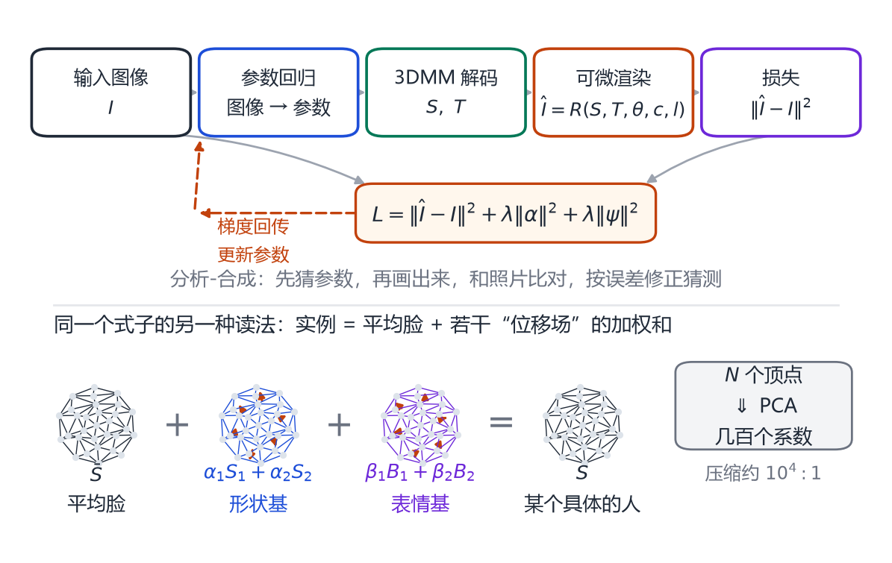
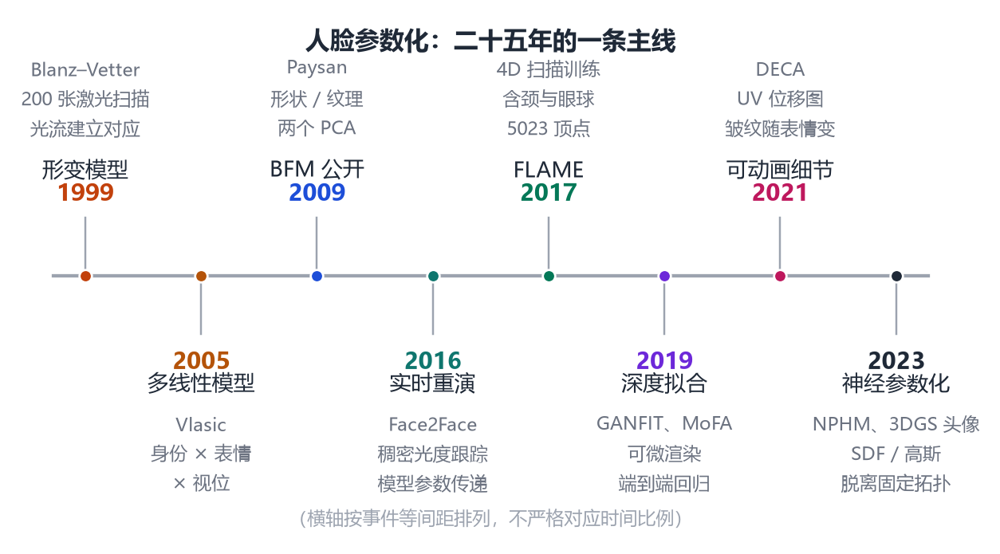
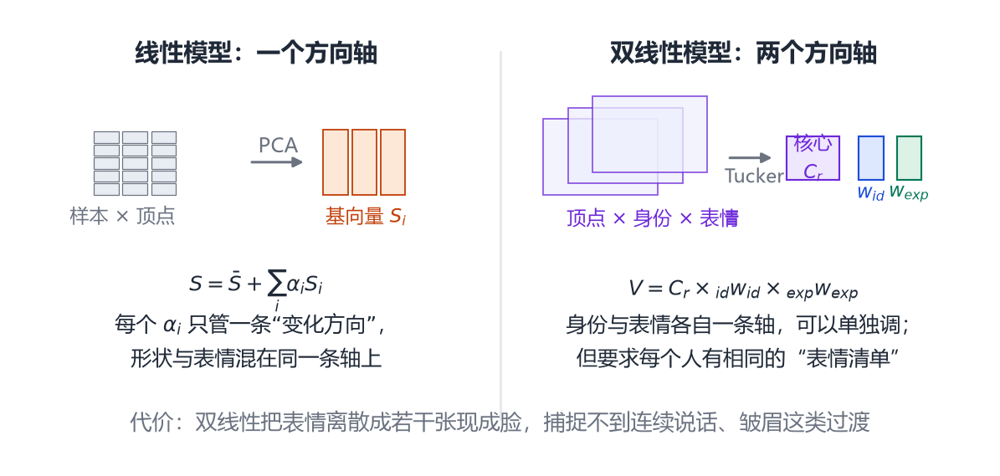

# 第 15 章 3DMM 深入与 Basel Face Model

> **本章导读**：第 3 章讲了 PCA 怎么算，第 8 章讲了 SMPL 怎么把“形状 + 姿态”塞进一个公式。这一章把同样的思路搬回人脸，但重点不在公式，而在三个问题：为什么 1999 年的形变模型能当地基用二十多年？为什么后来大家要去折腾“双线性”？为什么一个只有几百个参数的线性模型，至今仍是几乎所有单图人脸重建系统的骨架？读完这一章，你应该能说清楚 3DMM 的能力边界在哪里，以及这条边界是被什么划出来的。

## 15.1 一张照片，两个世界

1999 年以前，计算机处理人脸主要有两条路。

第一条是**二维统计模型**。1991 年提出的“特征脸”（Eigenface）把一批对齐好的人脸照片拉成向量做 PCA，得到“平均脸 + 若干张明暗图案”，在人脸识别上非常有效。但它有个前提：所有照片得在差不多的姿态和光照下拍。头稍微侧一点、灯换一盏，识别率就往下掉。

第二条是**几何建模**。图形学那边早就能用多边形网格画人脸，电影里的数字替身就是这么做的。可那是艺术家一个顶点一个顶点雕出来的，雕一张脸要几周，而且雕出来的是“某一张脸”，不是“人脸这一类东西”。

布兰兹（Volker Blanz）和维特（Thomas Vetter）在 SIGGRAPH '99 上的论文 [@blanz1999morphable] 做的是把两条路接起来。他们的判断很朴素：

> 姿态和光照引起的变化，在三维里几乎是“免费”的——转一下模型、换一个光源就能算出来；而在二维里，每一种姿态和光照都得单独学一个模型。

既然如此，就把“人与人之间的差异”放到三维里学，把“姿态与光照”交给渲染。分工一定，剩下的事就顺理成章：

1. 用激光扫描仪扫一批人脸，得到三维点集；
2. 把所有扫描对齐到同一个模板上，让第 1000 号顶点在每张脸上都对应“鼻尖偏左 2 毫米”这个位置；
3. 对对齐好的网格做 PCA，得到“平均脸 + 若干位移场”；
4. 想生成新脸，就调几个系数，渲染出来；
5. 想从照片反推，就调系数，直到渲染结果和照片最像。

第 4 步叫**合成**（synthesis），第 5 步叫**分析**（analysis），合起来就是**分析-合成**（analysis-by-synthesis）。这个框架今天听起来理所当然，但在 1999 年，它同时回答了“怎么表示人脸”和“怎么从图像得到人脸”两个问题，所以影响极深。

<figure class="fig">

<figcaption><b>图 15-1</b>　人脸参数化二十五年的主线。注意 2005 与 2009 两个节点：它们不是“更准的模型”，而是补上了 1999 年方案缺失的两块——表情与可复现性。</figcaption>
</figure>

## 15.2 公式：三个子空间，一套加法

先把符号定清楚。设每张人脸网格有 $N$ 个顶点，每个顶点三个坐标。把第 $i$ 个人的网格按“先所有顶点的 $x$，再所有 $y$，再所有 $z$”的顺序拉直，得到一个长度为 $3N$ 的列向量 $\mathbf{s}_i$。**这一步很关键**：只有把网格变成向量，才能对它做第 3 章里的 PCA。

对 $m$ 张脸做 PCA，得到均值 $\bar{\mathbf{s}}$（“平均脸”）和前 $k$ 个主成分 $\mathbf{s}_1,\dots,\mathbf{s}_k$。于是任意一张脸可以写成

$$
\mathbf{s}=\bar{\mathbf{s}}+\sum_{i=1}^{k}\alpha_i\,\mathbf{s}_i .
\tag{15.1}
$$

逐项解释：

- $\bar{\mathbf{s}}$ 是 $3N$ 维向量，就是“平均脸”这个网格拉直的结果。
- $\mathbf{s}_i$ 也是 $3N$ 维向量，但它不是一张脸，而是一张**位移图**：它告诉你“如果第 $i$ 个系数加 1，每个顶点该往哪儿挪多少”。
- $\alpha_i$ 是一个标量，就是第 1 章里说的“滑块”。

纹理同理。把每张脸的彩色纹理展开到一张公共的二维图上（叫 UV 空间），再拉直成向量，做 PCA：

$$
\mathbf{t}=\bar{\mathbf{t}}+\sum_{j=1}^{l}\beta_j\,\mathbf{t}_j .
\tag{15.2}
$$

注意形状和纹理是两个**独立**的 PCA，各有一套系数。布兰兹和维特从一开始就这么设计，理由是形状和颜色可以分开调，拟合时先解形状再解颜色，省事。后来也有人证明联合建模能利用“形状与纹理相关”这条先验，但那是后话 [@egger2020survey]。

第三块是表情。1999 年的模型只扫了中性表情的脸，所以它本身不会笑。论文里给了一个非常朴素的补丁：如果同一个人有中性脸 $\mathbf{c}_{\text{ne}}$ 和表情脸 $\mathbf{c}_{\text{exp}}$，那么差值

$$
\Delta=\mathbf{c}_{\text{exp}}-\mathbf{c}_{\text{ne}}
\tag{15.3}
$$

就是“做这个表情需要每个顶点挪多少”。把这个差值加到**另一个人**的中性脸上，就能让那个人也做出类似的表情。这在当时叫**表情迁移**（expression transfer），是“加法”思想最直接的体现。

<figure class="fig">

<figcaption><b>图 15-2</b>　3DMM 的两半。上半：分析-合成的闭环——先猜参数、渲染出来、和照片比对、按误差修正。下半：式 (15.1) 的几何含义——平均脸加上若干张位移场的加权和。</figcaption>
</figure>

图 15-2 下半部分画的正是式 (15.1)：平均脸，加上几张形状位移场的加权和，再加几张表情位移场的加权和，等于某个具体的人。

这里有个容易被忽略的细节：**加法成立的前提是“位移可以线性叠加”**。小幅度下这没问题——嘴角往斜上方挪 2 毫米，和同时往右 1 毫米、往上 1 毫米，效果几乎一样。但幅度一大就坏了：真实的脸在大笑时，脸颊鼓起、法令纹加深、眼角挤在一起，这些是肌肉一起收缩的耦合效应，不是若干独立位移的简单相加。这个隐患我们留到 15.7 节再说。

### 15.2.1 参数到底有多少个

一个常见的误解是“3DMM 有几十万个参数”。恰恰相反：$N$ 可能是几万，但 $\alpha$ 只有几十到几百个。

以 FLAME 的作者做对比实验时的设置为例：他们用 198 个形状主成分去对齐 BFM（比 BFM 少一个，因为要匹配性别专用模型）[@li2017flame]。也就是说，一张几万顶点的脸，被压缩成了不到两百个数字，压缩比达到四个数量级。

这件事的意义不只是省空间。更重要的是：**参数的维度决定了这个模型能表示什么、不能表示什么**。低维意味着强先验——你几乎不可能生成一张“不像人”的脸，因为所有主成分都是从真人身上学来的；低维也意味着表达力有限——任何不在这 $k$ 个方向上的变化，模型永远画不出来。

## 15.3 最难的一步其实是对应

如果你自己实现一遍 3DMM，会发现 PCA 那五行代码十分钟就写完了，真正花时间的是“把 200 张扫描对齐”。

原因很简单：PCA 的前提是“每一列是同一个量”。如果第一张脸的 1000 号顶点在鼻尖、第二张脸的 1000 号顶点在嘴角，那么把它们相减得到的数字毫无意义，PCA 学到的只会是噪声。

布兰兹和维特的办法是**光流**（optical flow）。他们的扫描仪输出的不是散乱点云，而是一张柱面展开的深度图——把脸“卷”到一个圆柱面上，于是三维配准问题变成了二维图像配准，可以直接套用当时已经成熟的二维光流算法。

这一步技术含量不低，却常被一句“建立稠密对应”带过。[@egger2020survey] 在回顾这段历史时特别指出：原始 3DMM 之所以能在参数化曲面上用光流、多分辨率、插值这些二维算法，是因为扫描仪本身就给了柱面参数化；不少后来者以为这些操作是“三维的”，其实是误会。

有了对应，PCA 才有意义；有了 PCA，才有“滑块”。这条因果链值得记住：**在人脸参数化里，数据与对应的重要性，长期高于模型形式本身**。二十多年里，模型从线性到双线性再到神经网络换了好几代，但“怎么扫、怎么对齐”始终是决定上限的那一环。

## 15.4 Basel Face Model：把论文变成基础设施

1999 年的模型没有公开。真正的转折点是 2009 年，帕伊桑（Pascal Paysan）等人发布了 **Basel Face Model**（BFM）[@paysan2009bfm]。

BFM 的数据基础是 200 位受试者的三维扫描，全部为中性表情 [@egger2020survey]。它提供形状与纹理两套 PCA 基，分男、女等性别版本，以及配套的拟合代码。此后十几年，它成了人脸研究里的公共插座：做人脸识别的拿它做数据增广，做重建的拿它当几何先验，做渲染的拿它当基准模型。

BFM 的意义不在技术，而在**可比性**。在它之前，每篇论文用自己的私有数据、自己的对应方法，别人无法复现，也无法判断“到底谁更好”。在它之后，至少有一件事统一了：大家用的是同一张平均脸、同一套顶点编号。

但公共设施也有代价。

**第一是人口学偏差。** 受试者以年轻欧洲人为主。用它去拟合东亚人、老人、儿童，会系统性地偏离。这不是算法的错，是数据的错，而且很难靠调参补救——模型里根本没有那个方向。

**第二是没有表情。** 全是中性脸，意味着 BFM 天生不会笑、不会皱眉。要加表情，只能另找数据、另建模型，这就是下一节的故事。

**第三是“中性”本身很模糊。** 让人“保持中性表情”其实很难，很多人会不自觉微微抿嘴。这些微小的动作会被当成身份差异学进形状基里，造成身份与表情的轻微纠缠。

BFM 后来有 2017 与 2019 两个版本：前者补了 160 个表情扫描，后者扩展到完整头部与多分辨率 [@egger2020survey]。但影响最大的仍是 2009 版——因为它最简单，也最稳定。

## 15.5 表情：从加法到双线性

加法补丁有个明显的毛病。把 A 的表情差值加到 B 脸上，结果往往像“B 戴了一张 A 的面具”：轮廓是 B 的，表情的走向却是 A 的。原因不复杂——两个人的脸不一样大、肌肉不一样厚，同一句“笑”，需要的位移场本来就不同。

要修这个问题，最直接的办法是：**给每个人都拍同一套表情**。于是数据从“一堆网格”变成了“一张表格”——行是人，列是表情，每个格子里是一个网格。三个维度（顶点、身份、表情）叠起来，就是一个三阶张量。

2005 年，弗拉西奇（Vlasic）等人的 *Face Transfer with Multilinear Models* [@vlasic2005face] 正是这么做的。他们把人脸看成一个张量，沿“身份”“表情”“视位”三个模式做多线性分解。分解之后，新脸可以写成

$$
\mathcal{V}=\mathcal{C}_r\times_{\text{id}}\mathbf{w}_{\text{id}}\times_{\text{exp}}\mathbf{w}_{\text{exp}},
\tag{15.4}
$$

其中 $\mathcal{C}_r$ 是**核心张量**（一个很小的三维数组，存“身份与表情如何组合”的规律），$\mathbf{w}_{\text{id}}$ 与 $\mathbf{w}_{\text{exp}}$ 分别是身份和表情的系数向量，$\times_n$ 表示“沿第 $n$ 个模式相乘”。

不必纠结符号。它的实际含义可以用一句话说清：**先按身份挑一组表情基，再按表情在这组基里插值**。所以它天然支持两件线性模型做不到的事：只换表情不换人，或者只换人不换表情，而且两个方向可以各自连续调节。

<figure class="fig">

<figcaption><b>图 15-3</b>　线性模型与双线性模型的区别。左边只有一个变化方向，身份与表情混在同一条轴上；右边拆成两条轴，于是“这个人做那个表情”可以直接由两组系数组合出来。</figcaption>
</figure>

后来的数据集把这个思路推到更大规模。FaceWarehouse 采集了 150 位受试者、每人 20 个表情 [@egger2020survey]；FaceScape 更彻底，938 位受试者、每人 20 个表情、共 18760 个毛孔级网格，先拟合成每人 52 个 blendshape，再在“26317 顶点 × 52 表情 × 938 身份”的张量上做 Tucker 分解 [@zhu2020facescape]。

但双线性也有它自己的墙。

**第一，它要求“表情清单”对齐。** 每个人都得做同样的 20 个表情，而且这 20 个表情在语义上要能对上。闭嘴的笑和露齿的笑算不算同一个？很难说。数据采集时的一点偏差，会被张量分解放大成“身份差异”。

**第二，它把表情离散化了。** 真实的表情是连续流动的，说话时嘴唇每秒变形好几次；而双线性模型的输入是“第 7 号表情占 0.6、第 12 号表情占 0.4”。中间过渡靠线性插值，容易出现“两张脸叠影”的塑料感。

**第三，它假设身份与表情可分离。** 现实中两者是耦合的：胖的人笑起来法令纹更深，老人皱眉时纹路走向也不同。张量分解强行把它们拆开，就等于假设“表情的位移场与脸型无关”，这个假设只在中等幅度下近似成立。

也正因为如此，2017 年的 FLAME 又退回到“线性形状基 + 线性表情基 + 4D 序列训练”的路线上（见第 16 章）：它放弃了“每个人一套对齐好的表情”这个要求，改用连续的表情空间，用 4D 扫描序列去学“表情如何随时间变化”。这是螺旋上升，不是简单回头。

## 15.6 反解：怎么从一张图得到参数

模型建好之后，剩下的核心问题就是：给定一张照片 $I$，怎么找到那组参数？

答案是最小化“渲染结果与照片的差”：

$$
\min_{\alpha,\beta,\theta,c,l}\ \big\|\,I-R\big(S(\alpha),T(\beta),\theta,c,l\big)\,\big\|^2+\lambda\|\alpha\|^2+\lambda\|\beta\|^2 .
\tag{15.5}
$$

这里 $S(\alpha)$ 是由式 (15.1) 生成的网格，$T(\beta)$ 是纹理，$\theta$ 是头姿态，$c$ 是相机，$l$ 是光照，$R$ 是渲染器。后面两项是正则项，防止系数跑到离谱的地方（第 3 章讲过，外插太远就不是人了）。

1999 年的实现有几个细节很能说明当年的工程处境：

- **不逐像素算。** 全图逐像素比对太慢，他们每次随机挑一小批三角形，按面积决定被选中的概率——面积大的三角形影响大，就多被采样。这在数学上就是随机梯度下降（SGD）。
- **要手动初始化。** 因为式 (15.5) 高度非凸，随便给个初值会掉进局部极小。原始系统需要人工把脸的大致位置、姿态标出来，再开始优化。
- **相机距离固定。** 透视投影里，脸的“大小”同时受真实尺寸和离相机远近影响，两者无法从单张图区分。论文里干脆把距离写死。

这些困难不是当年算力不足造成的，而是问题本身**病态**（ill-posed）。[@egger2020survey] 把这类歧义总结成三对：形状与尺度、相机与焦距、光照与反照率。最后一对最麻烦：一张脸偏暗，可能是因为皮肤黑，也可能是因为背光；模型无法分辨，只能猜。

深度学习进来之后，形式变了，本质没变。有三条典型做法：

**一是把它变成自编码器。** MoFA [@tewari2017mofa] 用一个卷积网络把图像编码成 3DMM 参数，再用一个可微渲染器解码回图像，整个网络用“重建图像是否像输入”来训练，不需要三维真值。这等于把式 (15.5) 的优化从“测试时”搬到了“训练时”。

**二是用判别器代替像素误差。** GANFIT [@gecer2019ganfit] 不再逐像素比，而是训练一个判别器来判断“这张渲染图看起来真不真”，用它当损失。论文里提到，它的重建结果可以用一个 700 维的向量表示——这 700 个数就是形状、纹理、光照、相机参数的总和。

**三是换一个更容易拟合的纹理模型。** Booth 等人的“野外 3DMM” [@booth2018inwild] 指出：形状模型可以用受控条件下扫的数据学，但纹理不行——受控数据里的纹理太“干净”，拟合野外照片时会崩。他们的做法是从野外图片里学一个纹理模型，于是拟合时不必再显式估计光照，少了一大块不确定性。

回头看，这三条路都没有推翻分析-合成，只是把“渲染-比较-修正”这个循环挪到了别处：挪进训练集，挪进判别器，挪进数据先验。

## 15.7 3DMM 的四面墙

讲到这里，可以系统地列出线性 3DMM 的局限了。这四条局限，正好对应第三篇后面三章要解决的问题。

**第一，它是线性的。** 式 (15.1) 只能生成“若干位移场的线性组合”。真实人脸的形状变化是弯的：从瘦到胖不是沿一条直线走，从婴儿到老人更不是。更严重的是细节——皱纹、毛孔这些高频起伏，根本不在前几百个主成分里。第 17 章会专门讲怎么把它们补上。

**第二，表情要么没有，要么很弱。** BFM 只有中性脸；双线性模型有表情但被离散化；线性表情基对极端表情（大笑、惊恐）会失真，因为它假设“表情 = 若干基的加权和”，而真实的极端表情伴随皮肤拉伸、体积变化，不是简单叠加。

**第三，分辨率不够。** 网格顶点数是固定的（BFM 是几万，FLAME 只有 5023），再细的起伏只能靠贴图或位移图“画”上去，而不是真的几何。这在近景渲染时很明显：侧光一打，脸是光滑的。

**第四，身份与表情纠缠。** 这是最隐蔽的一条。同一个人笑与不笑，PCA 把差异摊到了形状基和表情基里，两边都沾一点。结果就是：你想“保持这个人不变，只换表情”，换完之后脸会微微变形。2021 年的 DECA 用一个“细节一致性损失”专门治这个病（见第 17 章），说明它到深度学习时代仍然是个真问题。

还有一条不算“墙”但很要命的缺失：**BFM 没有脖子**。它到下颌就截断了，不能转头，也不能和身体模型对接。这件事听上去像工程细节，实际上直接催生了下一章的主角。

## 本章小结

- 3DMM 的核心分工：差异放三维学，姿态与光照交给渲染；合成靠参数，分析靠优化。
- 主公式 $\mathbf{s}=\bar{\mathbf{s}}+\sum_i\alpha_i\mathbf{s}_i$：平均脸加若干位移场的加权和，几百个系数就能描述几万个顶点。
- 真正难的不是 PCA，是稠密对应；数据与配准的质量决定了模型的上限。
- BFM 2009 的价值在“可比性”：同一张平均脸、同一套顶点编号，让整个领域有了共同基准，代价是人口学偏差与表情缺失。
- 表情的两次尝试：先做“加法迁移”，再做“双线性张量”。后者能分离身份与表情，但要求表情清单对齐，且把连续动作离散化。
- 从图像反解参数是病态问题，三大歧义（形状-尺度、相机-焦距、光照-反照率）至今没有彻底解决；深度学习只是把优化挪进了训练。
- 线性、表情弱、分辨率低、身份-表情纠缠，这四条局限划出了 3DMM 的能力边界。

## 思考题

1. 如果训练集里所有人的鼻子都比平均脸大，那么第一主成分大概会是什么？这会带来什么后果？
2. 式 (15.3) 的“加法表情迁移”在什么情况下会明显失败？请举一个具体例子，并说明失败时的视觉表现。
3. 双线性模型要求每个人都做同样的 20 个表情。如果某个人只做了 18 个，你会怎么处理这个缺失的格子？
4. 为什么“光照-反照率”歧义在单张图上无法消除？如果给你同一个人的两张不同光照照片，情况会好转吗？

