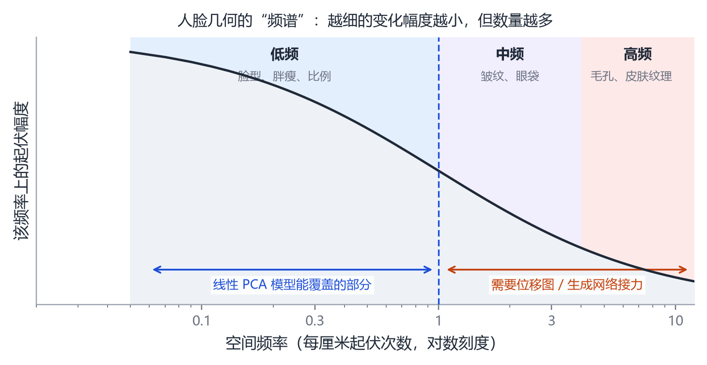
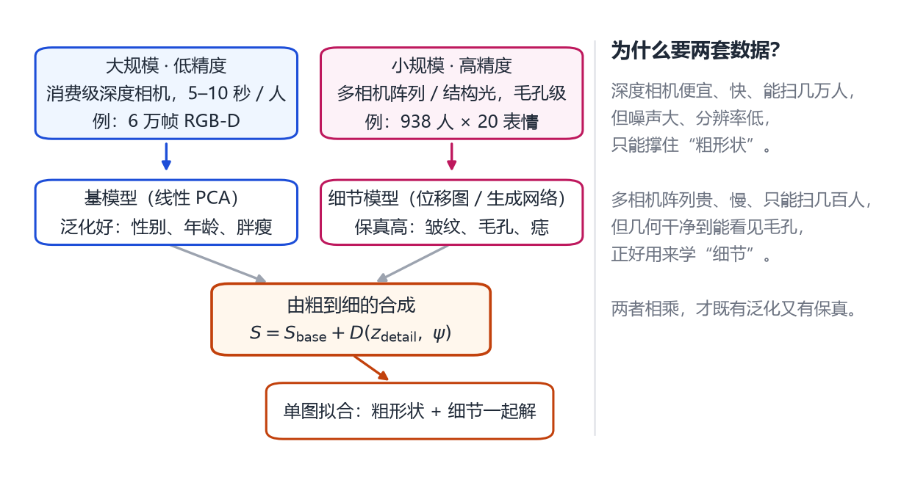
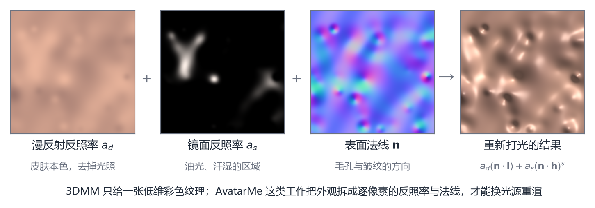

# 第 17 章 高保真人脸：细节、纹理与身份

> **本章导读**：第 15、16 章的两个模型，顶点数分别只有几万和 5023。它们能表示“这是谁”“什么表情”，却始终画不出法令纹里的一道沟、鼻翼上的一颗痣。这一章讲研究者怎么把丢掉的东西一层层补回来：先用“频率”这把尺子说清到底丢了什么，再看两条数据路线（大规模低精度 vs 小规模高精度）、一块被忽视的领域（纹理与反射率），最后讲评估——为什么论文里的“误差 1 毫米”常常不能直接比较。

## 17.1 线性模型到底丢了什么

先把问题量化。一张脸上的起伏，可以按“每隔多远重复一次”来分类，这叫**空间频率**：整体脸型的起伏很慢，跨越十几厘米才一个周期，是低频；法令纹、抬头纹的间距在毫米到厘米之间，是中频；毛孔、皮肤纹理的周期不到一毫米，是高频。

<figure class="fig">

<figcaption><b>图 17-1</b>　人脸几何的频谱示意。越往右频率越高，单个起伏的幅度越小，但数量急剧增多。线性 PCA 模型主要覆盖左侧一段；中高频必须靠位移图、生成网络或纹理来补。</figcaption>
</figure>

图 17-1 是一条示意曲线，不是实测数据，但它反映了真实规律：**幅度随频率下降，数量随频率上升**。低频的起伏少而大（决定脸型），高频的起伏多而小（决定质感）。

现在回想 PCA 在做什么。它按“方差从大到小”排序，前几个主成分对应方差最大的方向——也就是低频的大幅度变化。等你取到第 100 个主成分时，剩下的方差已经很小了，而这些“小方差方向”里，混着大量高频细节。

这就解释了一个反直觉的现象：**用 300 个主成分拟合一张脸，几何误差可以低到零点几毫米，但看起来仍然“不像真人”**。因为误差的平均值被低频主导，而人眼对中频的皱纹极其敏感。误差小 ≠ 观感对，这是高保真人脸的第一个坑。

更麻烦的是，线性基连“皱纹该怎么长”这件事都学不到。皱纹不是随机的凹凸，它跟表情强相关：笑的时候法令纹从鼻翼延伸到嘴角，皱眉的时候是眉间的竖纹。这种“随动作出现、随动作消失”的结构，用一组固定的基向量加权重是表达不出来的——除非你为每个表情单独学一套基，那就回到了第 15 章双线性模型的老路。

所以补细节这件事，本质上要回答两个问题：**细节放在哪里存**（表示），以及**细节怎么随表情变**（驱动）。

## 17.2 两条数据路线：FaceVerse 与 FaceScape

补细节需要数据。而高精度人脸数据有个天然的矛盾：**扫得细的扫不快，扫得快的扫不细**。

多相机阵列加结构光可以扫出毛孔级几何，但一套设备几十万，一个人要站进去几秒到几十秒不能动，一天扫不了多少人。消费级深度相机（比如结构光模组）便宜、快、五到十秒一个人，但噪声大、分辨率低，扫出来的脸像蒙了一层砂纸。

2019 年之后，两个工作给出了几乎相反但都有效的答案。

**FaceScape：把“细”做到极致。** [@zhu2020facescape] 用多相机系统采集了 938 位受试者、每人 20 个指定表情，共 18760 个带纹理的三维人脸，几何细到毛孔级。他们做了一件关键的工程：把所有扫描**拓扑统一**——用一个公共的基网格去非刚性配准每一张扫描，于是每张脸都有相同的 26317 个顶点和相同的连接关系。统一拓扑之后，粗糙形状可以用双线性模型表示，而基网格表达不了的中高频，则存成 UV 空间里的**位移图**（每个像素一个沿法线的偏移量）。

这套“基网格 + 位移图”的两层表示非常高效：论文报告，它只占原始网格数据量的约 2%，而平均绝对误差小于 0.3 毫米 [@zhu2020facescape]。换句话说，用五十分之一的数据，换回几乎一样的几何。

写成公式更清楚。设基网格的第 $i$ 个顶点是 $\bar{\mathbf{v}}_i$，它在 UV 展开图上的坐标是 $(u_i,v_i)$，法线是 $\mathbf{n}_i$，则最终顶点为

$$
\mathbf{v}_i=\bar{\mathbf{v}}_i+\sum_k w_k\,\mathbf{b}_{k,i}+\Delta(u_i,v_i)\,\mathbf{n}_i ,
\tag{17.1}
$$

前两项是“低维骨架”：基网格加上双线性模型的加权形状。第三项是位移图在对应像素上的取值，沿法线方向推出去。注意这一步的妙处：**位移图是在二维 UV 空间里学的**，所以它天然带着“图像”的性质，可以用卷积网络、生成对抗网络去建模；而它作用到三维时，又通过法线 $\mathbf{n}_i$ 自动适配局部朝向。

**FaceVerse：把“广”做到极致。** [@feng2022faceverse] 走的是另一条路。他们用消费级深度相机采集了约 6 万帧融合后的 RGB-D 人脸点云，覆盖东亚人群的不同性别与年龄；另外用多相机系统补采了 2000 个高保真头模。前者保证“泛化”——模型见过各种各样的人；后者保证“保真”——模型知道细节长什么样。

结构上，他们做了一个**由粗到细**的两段式：粗模型是从 6 万帧里学的线性 PCA 基，负责给出一张大致正确的脸；细模型是一个条件 StyleGAN，输入是粗模型展开的 UV 图，输出是加了细节的几何与纹理图。因为是生成式模型，细节是可以“调”的——换一个噪声向量，同一个人的痣和皱纹分布会变，但基本脸型不变。这一点比“一次性预测一张位移图”更进一步。

<figure class="fig">

<figcaption><b>图 17-2</b>　由粗到细的两段式。左侧用便宜设备换覆盖度，右侧用昂贵设备换保真度，最后在参数层面合并。这也是 FaceVerse 与 FaceScape 共享的骨架。</figcaption>
</figure>

两条路线的差别，其实是对“数据不够”这一现实的两种应对：FaceScape 选择“少而精”，靠统一的拓扑与位移图把信息压到极致；FaceVerse 选择“多而杂 + 少而精”，用大规模数据撑泛化、用小规模高精数据撑细节。

而它们的共同点是：**都没有放弃参数化模型**。细节再细，也是挂在一个低维的“骨架”上的。这个骨架提供了对应关系、提供了可驱动性，也提供了“这是同一个人”的一致性。

### 17.2.1 为什么细节必须“可驱动”

一个容易被忽略的要求：细节不只是要“有”，还要“跟着动”。

如果一个人在静态扫描上有一道很深的法令纹，你把这张静态网格贴到一个会笑的表情上，笑容一大，法令纹的位置就错了——因为真实的法令纹是随着嘴角拉开而加深、延长的。静态位移图会把皱纹“钉”在原地，结果就是脸在动、纹不动，观感立刻崩掉。

FaceScape 的做法是学“**表情相关的动态细节**”：用神经网络从大量“同一个人 × 多个表情”的配对里，学出“给定表情，细节图应该怎么变”。DECA（第 16 章）的做法更轻量：把细节写成“身份码 + 表情参数”的函数。两者思路一致——**细节必须被表情调制**。

## 17.3 纹理与反射率：被忽视的一半

到这里我们一直在说几何。但一张渲染图看起来真不真，一半以上取决于**外观**：肤色、油光、血色、毛孔的颜色。

传统的 3DMM 只有一张**反照率贴图**（albedo）——本质上是“把照片上的颜色扒下来贴到模型上”。这样做有两个问题：一是阴影被“烤”进了颜色里，换个光源重渲，阴影还在原地；二是没有镜面反射，皮肤看起来像塑料。

2020 年的 **AvatarMe** [@lattas2020avatarme] 把外观拆成了四张图：漫反射反照率、漫反射法线、镜面反照率、镜面法线。这四张图合起来近似一个空间变化的 BRDF（双向反射分布函数），也就是“每个点多亮、多光滑、朝哪偏”。有了它，就能在任意环境光下重新渲染，还能做出“鼻尖一点高光、额头一片油光”这种细节。

论文里强调的成果是：从一张低分辨率野外照片，重建出 4K × 6K 分辨率、可直接进渲染器的三维人脸 [@lattas2020avatarme]。这个“4K × 6K”不是网格分辨率，是纹理分辨率——换句话说，几何还是那个几何，但皮肤被画到了能看清毛孔的精度。

后续的 **AvatarMe++** [@lattas2021avatarmepp] 把这件事做得更彻底：不只是反照率和法线，而是完整的 BRDF，并且配套一个考虑了自遮挡与次表面散射近似的可微渲染器。次表面散射很重要——真实皮肤不是不透明的，光会渗进去一点再出来，所以耳朵边缘、鼻翼两侧会有一种“透”的红，这是纯漫反射模型永远做不出来的。

<figure class="fig">

<figcaption><b>图 17-3</b>　把外观拆成逐像素的分量（示意图）。左起：漫反射反照率、镜面反照率、表面法线；右端是按“漫反射 + 镜面高光”重新打光的结果。3DMM 只有最左那一张，所以无法重打光。</figcaption>
</figure>

这一节想说的道理是：**参数化的对象不只是形状**。肤色、油光、法线都可以被参数化——AvatarMe 用 PCA 建了反照率与法线的基，FaceVerse 用 StyleGAN 建了纹理的潜空间。识别一个人，纹理的贡献可能比几何更大；这一点在第 17.4 节会再碰到。

## 17.4 身份与度量：不只是“看着像”

到这里，我们已经能让一张脸“又细又真”。但还有一个更基本的问题没回答：**这张脸的尺寸对吗？**

单张照片里，一个鼻子看起来多高，同时取决于三件事：鼻子本身多高、相机离脸多远、镜头焦距多长。这三者从一张图里无法分开——第 15 章提过，在自拍距离（大约半米）下，透视与正交投影的差别大约相当于瞳距的 6% [@egger2020survey]。百分之六听起来不多，但它会直接变成“鼻子高了 2 毫米还是矮了 2 毫米”的错误。

对“看着像”的应用，这无所谓。但对三类应用，它是致命的：

- **医疗与人类学**：需要“下颌宽度是 132 毫米”这种绝对数，而不是“比例尺”。
- **定制穿戴**：眼镜、口罩、头盔要按真实尺寸做，差 3 毫米就戴不上。
- **三维人脸识别**：需要“同一个人在不同照片里重建出的形状彼此接近”，而不同人之间拉开距离。

MICA [@ziqq2022mica] 是这条线上被引用最多的代表。它把“度量准确”（metrically accurate）直接写进标题，意思是：不只要形状对，还要尺寸对。这个目标的难点在于，它要求模型同时做好两件平常被分开处理的事：一是从像素里抽出足够强的身份信息（不能只靠 68 个关键点，那些点几乎不携带“脸有多宽”的信息），二是把这个身份信息映射到一个有绝对尺度的形状空间里，而不是每次重新猜尺度。

这里有一条经常被忽略的因果链：**你用什么样的损失，就会得到什么样的脸**。如果只用关键点重投影误差训练，网络会倾向于输出“平均脸”——因为平均脸的关键点位置最安全，误差最小。要让它敢于输出有棱角的、有个人特征的脸，就必须加一个“识别网络说这俩是同一个人”的损失。这也是第 16 章 EMOCA 的思路（用情绪网络的特征当监督）在身份问题上的翻版：**找一个已经学会了 “什么重要” 的网络，向它看齐**。

还有一点值得提醒：身份不只存在于几何里。 FaceVerse 这类工作之所以要同时建模纹理，就是因为纹理（肤色、痣、眉形、胡须）对“这是谁”的贡献，往往大于几毫米的形状差异。只用几何做识别，等于拸掉了一半信息。

## 17.5 神经参数化头模型：跳出拓扑

前面所有方法都建立在一个共同前提上：有一张固定拓扑的模板网格。这带来了对应、带来了可驱动性，也带来了天花板：你永远画不出比顶点间距更细的东西，也永远长不出头发和牙齿。

2023 年之后，一批工作开始拆这个前提。其中最有代表性的是 **NPHM**（第 16 章已介绍其结构）[@garbin2023nphm]。它的关键设计在于“局部场集合”：不是一个全局的神经场包住整个头，而是在面部的多个锚点周围各放一个小场，每个小场只负责一小块区域。这样做的好处是细节容量随锚点数量增长，而不是被一个全局网络的能力卡住。配合他们自建的 5200 多帧高精度扫描（255 个身份，平均每帧约 350 万个面），模型能重建出接近扫描精度的福皱与皮肤起伏 [@garbin2023nphm]。

**MonoNPHM** [@garbin2024mononphm] 把同一个表示搬到单目视频上：输入一段普通 RGB 视频，通过基于 SDF 的可微体渲染，把几何、表情、外观一起解出来。论文里自拍了 20 段 Kinect 序列做评测，并强调这一步的意义是“让神经参数化模型变得易得”——不再需要专用扫描设备。

但这不等于线性模型要退场。两者分工其实很清楚：

| | 线性参数化（FLAME 类） | 神经参数化（NPHM 类） |
|---|---|---|
| 输出形式 | 直接是网格 | 隐式场，要等值面提取 |
| 驱动方式 | 改参数，实时 | 改潜码，较慢 |
| 细节上限 | 受拓扑限制 | 理论上无限 |
| 工程成本 | 能进引擎、能上手机 | 需要 GPU、需要额外处理 |

所以现实系统常见两种搭配：用线性模型做“实时驱动层”，用神经模型做“离线高清生成层”，两者通过参数或对应关系互通。

## 17.6 评估：为什么“误差 1 毫米”不能直接比

高保真人脸这个领域，论文里的数字最容易让人误读。同一个模型，换一种对齐方式、换一个测试集，平均误差可以相差一倍。下面是最常见的五个坑。

**坑一：对齐协议不同。** 比较两张脸的顶点误差前，必须先对齐。允许平移旋转（刚性对齐）、允许缩放（相似变换）、还是完全不对齐直接算，结果完全不同。前两种都是“形状相似度”，第三种才是“绝对几何”。论文里往往只写“平均顶点误差 X 毫米”，不写对齐方式。

**坑二：尺度归一化。** 很多工作先把重建结果缩放到与真值相同的尺寸，再算误差。这会把“尺寸猜错”这个错误完全抹掉——而尺寸恰恰是最难的那部分（见 17.4）。如果你的应用是定制头盔，这个数字对你毫无意义。

**坑三：测试集同源。** 如果训练集和测试集来自同一台扫描仪、同一个配准流程、同一批受试者，那么误差会系统性偏低。这就是为什么 FLAME 的作者要特意在“不在训练集里的 BU-3DFE 中性扫描”上做身份评估 [@li2017flame]。

**坑四：只看关键点。** 关键点误差小，只说明“眼睛鼻子嘴在大概位置”，完全不能说明中频细节对不对。一道浅一半的法令纹，关键点误差几乎不变。

**坑五：用渲染图验收。** 这是最隐蔽的。渲染图的真实感大部分来自纹理与光照，几何错了一点，纹理能盖住。看到一张“很好看”的渲染图，先问一句：把纹理换成灰色陶土，它还像吗？

那么该怎么看数字？比较推荐的做法是看**累积误差曲线**：横轴是顶点误差阈值，纵轴是“误差小于该阈值的顶点占比”。它比单一平均值信息量大很多。举个例子，FLAME 论文里的数字是：在相同参数量下，FLAME 有 74% 的顶点误差小于 0.5 毫米，而 BFM 是 69%、FaceWarehouse 是 67%；用上全部主成分后，FLAME 是 94%，BFM 是 92% [@li2017flame]。

这几个数字的绝对值都不大，差距也只有几个百分点。但它说明了两件事：一是同类模型之间的差距本来就不悬殊，二是要判断“谁更好”，必须把数据、对齐、参数量都对齐了才有意义。读到“我们的误差降低了 30%”这种说法，第一反应应该是问：分母是什么？

## 本章小结

- 线性模型丢的是**中高频**：幅度小、数量多、方差小，所以 PCA 把它们排在最后，但它们恰恰决定了“像不像真人”。
- 误差小 ≠ 观感对：平均值被低频主导，而人眼对皱纹极其敏感。
- 补细节需要两样东西：一个能存细节的表示（位移图、UV 图、神经场），以及一个能把细节与表情关联起来的机制。
- 两条数据路线：FaceScape 用 938 人 × 20 表情的 18760 个扫描把“细”做到极致（两层表示只占 2% 数据量，误差 < 0.3 毫米）；FaceVerse 用 6 万帧 RGB-D + 2000 个高保真头模把“广”做到极致。
- 外观不只是颜色：AvatarMe 把皮肤拆成漫反射、镜面反照率与法线，才能换光源重渲；AvatarMe++ 进一步做成 BRDF 并考虑次表面散射。
- 度量精度是另一个维度：形状、距离、焦距三重耦合，靠关键点无法解开；MICA 这类工作把“尺寸对”当成首要目标。
- 神经参数化（NPHM、MonoNPHM）换掉了固定拓扑，但没有换掉“身份潜码 + 表情潜码”这个结构。
- 读数字前先问三句：什么数据集？怎么对齐？尺度归一化了吗？

## 思考题

1. 一张脸的扫描有 20 万个顶点，用 26317 顶点的基网格 + 位移图表示，误差小于 0.3 毫米。这 0.3 毫米大概相当于什么尺度的差异？（提示：一根头发大约 0.07 毫米）
2. 如果只用关键点误差训练模型，为什么会得到“平均脸”？用一句关于梯度的话解释。
3. 把重建结果缩放到与真值同尺寸再算误差，会掩盖什么错误？举一个实际会出问题的场景。
4. NPHM 的输出是隐式场而不是网格。如果要把它接到一个现成的游戏引擎里，你需要多做哪几步？每一步会损失什么？

