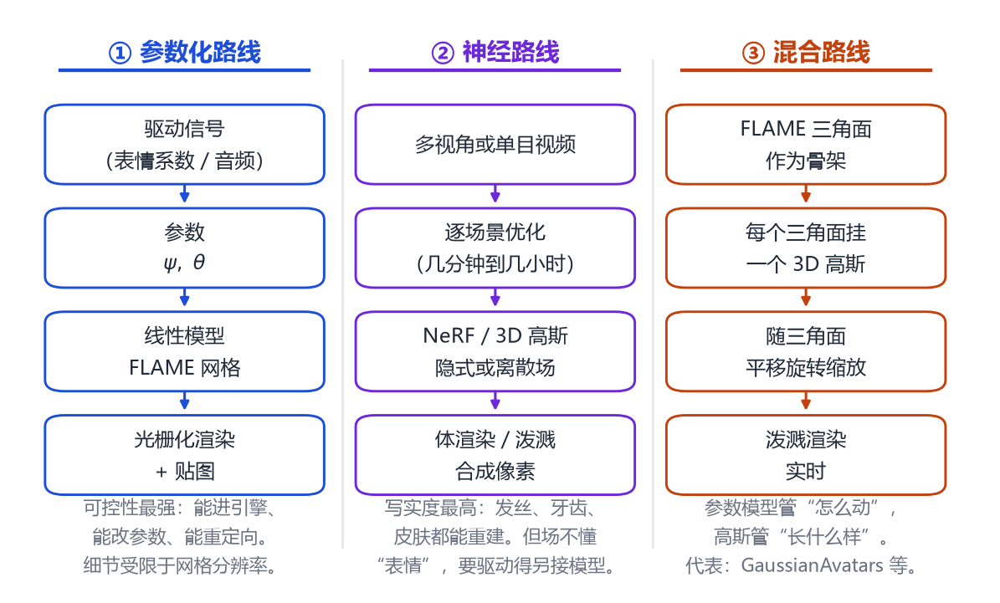
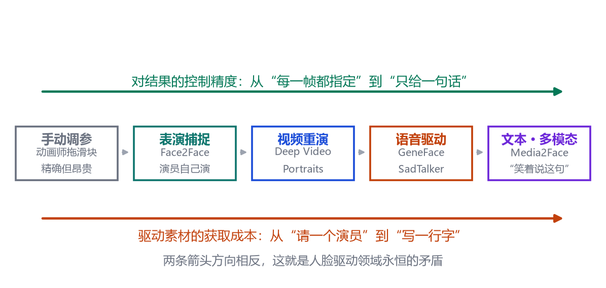
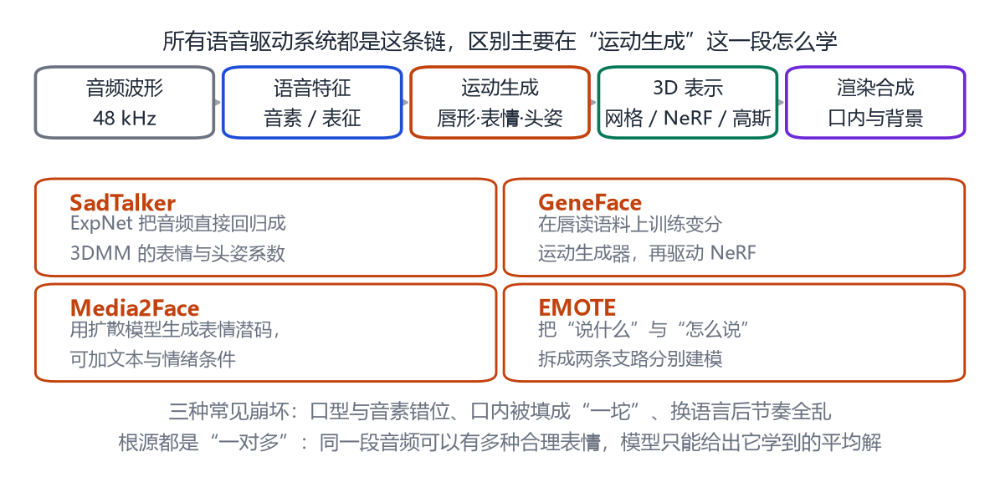

# 第 18 章 人脸驱动与神经头像

> **本章导读**：前面三章讲的是“怎么造一张脸”。这一章讲“怎么让它动起来”：让照片里的人跟你做同样的表情，让一张静止的肖像按你写的句子说话，让一段视频里的人改说另一种语言。这里的技术路线分成三条——参数化、神经渲染、以及两者的混血；而所有方法的共同难题都是一句话：**你给的驱动信号越简单，能控制的东西就越少**。读完这一章，你应该能对着一个“AI 数字人”产品，说出它大概用了哪条路线、卡在哪一步。

## 18.1 三条路线，两种矛盾

给定一个目标人物，要让他“动起来”，问题可以拆成两半：**用什么表示这个人**，以及**用什么信号驱动他**。

第一半有三条路线。

**参数化路线**是最省事的一条。既然第 16 章的 FLAME 已经把脸拆成“身份 + 表情 + 姿态”，那么驱动就等于“给出另一组表情参数”。模型负责几何，贴图负责外观，光栅化负责成像。它的优点是可控性极强——参数可以导出、可以混合、可以重定向到另一个角色；缺点是上限被网格分辨率和贴图分辨率锁死。

**神经路线**放弃参数，直接对“这个人”做逐场景优化：用多视角视频或单目视频，训一个 NeRF 或一组三维高斯，把外观“背”下来。写实度可以高到分不清真假，但它本身不懂“表情”是什么——想让它动，还是得外挂一个参数模型来提供变形场。

**混合路线**是近两年的主流：把神经表示**绑在**参数模型上。三角面怎么动，挂在它上面的高斯就怎么动。这样既有参数级的控制，又有像素级的写实。

<figure class="fig">

<figcaption><b>图 18-1</b>　三条技术路线。注意第二、三条的差别不在“用不用神经网络”，而在“动不动得起来”——纯神经表示要先解决控制问题，混合表示则把控制权直接交给了参数模型。</figcaption>
</figure>

第二半是驱动信号。这就是本章真正的主题，也是整个领域最本质的矛盾。

<figure class="fig">

<figcaption><b>图 18-2</b>　驱动信号的演化谱。越往右，素材越容易获得，但你对结果的控制越弱。两条箭头方向相反，这个矛盾至今没有被真正解决。</figcaption>
</figure>

图 18-2 这条谱值得多看两眼。左边是动画师手动拖滑块：每一帧的每个参数都由人指定，控制精度最高，但成本也最高，一分钟动画可能要几天。往右走，演员自己演（表演捕捉），信号变“自然”了，但你要接受演员的表演；再往右，拿一段现成视频当驱动源（视频重演），连演员都不需要了，但视频里有什么你才能用什么；再往右，只给声音；最右边，只给一句话。

每往右一步，素材成本降一个数量级，可控性也降一个数量级。**所有“AI 数字人”产品的差异，很大程度上就是这个谱上取的位置不同。**

## 18.2 表情与情绪：几何对了还不够

先看一个具体的技术问题：为什么“重建得很准”的脸，看起来却“没有情绪”？

2022 年的 EMOCA 给出了一个很实在的答案 [@danvev2022emoca]。他们检查了当时主流方法的训练损失，发现只有三类：关键点重投影误差（位置对不对）、光度误差（像素像不像）、人脸识别损失（是不是同一个人）。**没有一项在问“表情对不对”**。于是优化器会很自然地找到一个“几何上平均、情绪上模糊”的解——因为微笑的嘴角和面无表情的嘴角，在关键点误差上可能只差几个像素。

他们的补丁是加一条**情绪一致性损失**：拿一个在大规模情绪数据集上训练好的情绪识别网络，把输入图和重建结果的渲染图都送进去，要求两边提取出的特征接近。这一招的本质是**借一个已经学会“什么重要”的网络来做监督**——和第 17 章讲的“用识别特征去约束形状”是同一个套路。

情绪这条线上还有两个值得知道的方向。

一个是 **SPECTRE** [@filntisis2022spectre]。它注意到一个细节：人的表情不只是情绪，还携带**语音信息**——读唇的时候，我们其实是在读表情。所以它把“视觉语音”的感知纳入监督，让重建出来的嘴形在“能读出什么音”这个意义上也是对的。这对语音驱动特别重要：如果重建的嘴形读不出正确的音素，那么用它当训练数据，学出来的说话脸一定口型不对。

另一个是 **EMOTE** [@wu2023emote]。它的标题就点明了思路：“内容与情绪解耦”（content-emotion disentanglement）。同样一句话，可以用平静的语气说，也可以用激动的语气说；嘴形（内容）大体相同，但眉毛、眼角、嘴角的张力（情绪）差别很大。EMOTE 把这两者拆成两条支路，于是你可以“用 A 的情绪说 B 的话”。

为什么情绪这么难？三个原因叠在一起：**标注主观**（同一张脸，不同标注者给出不同情绪标签）、**数据稀少**（大规模情绪数据集多是二维图片，没有三维真值）、**评价困难**（几何误差指标对情绪几乎不敏感，只能靠人来做主观评测）。EMOCA 的论文里就做过这样的实验：让被试看重建结果、判断情绪类别，EMOCA 的一致率明显高于同期方法——而这种“人工打分”恰恰说明，这个任务还没有一个好用的自动指标。

## 18.3 语音驱动：让一张脸说话

语音驱动说话脸（talking face generation）是人脸驱动里最“产品化”的一支。它的管线非常固定：

<figure class="fig">

<figcaption><b>图 18-3</b>　语音驱动的通用管线，以及各方法主要改进的位置。可以看到，大家的差异几乎都集中在“运动生成”这一段——因为其余几段已经是成熟工程。</figcaption>
</figure>

难点不在“把音频变成一串数字”，而在**一对多**：同一段音频，可以有无数种合理的口型与表情。你说“你好”的时候可以点头，也可以歪头；可以笑，也可以面无表情。模型如果只学“平均解”，出来的就是一张嘴在动、脸在飘的“僵尸脸”。

**SadTalker** [@zhang2023sadtalker] 的思路是“别让网络直接从音频画像素，让它先输出三维参数”。他们设计了一个 ExpNet，从音频回归 3DMM 的表情系数，再用一个三维感知的渲染器把参数变成图。这样做的好处是：中间的三维系数是**可解释、可复用**的——同一组系数可以驱动别的角色，也可以手工微调。论文里特别强调，ExpNet 是通过“蒸馏”学出来的：先有三维重建得到的系数作为老师，再让音频去预测它 [@zhang2023sadtalker]。

**GeneFace** [@ye2023geneface] 盯的是另一个问题：泛化。早期基于 NeRF 的说话脸在训练集内的音频上很好看，换一段没见过的音频（比如另一种语言、另一种语速）就崩。原因是训练数据太少，模型把“这段音频对应这个口型”死记硬背下来了。GeneFace 的办法是两步：先在一个**大规模唇读语料**上训练一个变分运动生成器（唇读数据里音频与嘴形是天然配对的，量大且多样），再针对目标人物做域自适应校正；最后用一个以面部动作为条件的 NeRF 渲染。他们还专门设计了“头部感知的躯干 NeRF”，解决头和脖子接缝处的撕裂感 [@ye2023geneface]。

**Media2Face** [@peng2024media2face] 把条件从“音频”扩展到“多模态”。它先训练一个把面部几何与图像映射到统一表情潜空间的变分自编码器（论文里叫 GNPFA），再用它从大量视频里抽出高质量的表情与头姿，构成一个大规模共语数据集；最后在这个潜空间上训扩散模型，条件可以是音频、文本、情绪标签 [@peng2024media2face]。于是“笑着说这句话”这种指令才有可能被表达——因为它把“说什么”和“怎么说”分别条件化了。

把这三家放在一起看，会发现一条清晰的技术演进：**从“直接生成像素”到“生成参数”，再到“生成潜码”**。越往后，中间表示越抽象，能接受的条件越多，但也越依赖大规模数据。

除了算法，语音驱动还有两个工程上的老大难：

**口内与牙齿。** 参数化模型的嘴里是空的。你一开口，观众看到的是一个黑洞。很多方法要额外检索一张口内图像贴上去，或者干脆用生成模型“编”一个。这也是为什么很多说话脸视频只敢拍正脸、不敢用侧光。

**节奏与停顿。** 语音里的停顿、呼吸、重音，在梅尔频谱上几乎是空白，但它们对“像不像真人在说话”影响巨大。这一块目前主要靠后处理与手工规则。

## 18.4 重演与换脸：把 A 的表情装到 B 身上

语音驱动的驱动信号是音频，而**重演**（reenactment）的驱动信号是另一段视频。给定源人物 A 的表演，让目标人物 B 做出同样的表情——这就是 2016 年 Face2Face 做的事 [@thies2016face2face]。

它的技术路线值得细看，因为它几乎把所有能省的地方都省了。

**第一步，跟踪。** 大多数实时人脸跟踪靠关键点（68 个点），但关键点丢掉了大量信息——嘴唇的深度、鼻翼的张开、眼角的细纹。Face2Face 改用**稠密光度一致性**：把模型渲染出来，逐像素和目标画面对比，让“渲染得像”本身成为跟踪目标。这样得到的不只是点的位置，而是整张脸的形变。

**第二步，恢复身份。** 单目视频里的身份是欠定的，他们用“非刚性、基于模型的 bundle 优化”把整段视频的信息集中起来解一个人脸模型，而不是逐帧猜。

**第三步，形变传递。** 源与目标用同一套参数化模型，于是“把 A 的表情参数给 B”就变成了直接的参数传递。这一步之所以能成立，完全依赖于上一章的 FLAME/3DMM 类模型——两个不同的人，用的是同一套“语言”。

**第四步，补口内。** 模型嘴里是空的。他们的办法很实在：在目标视频里找一张嘴形最接近的帧，把它扭到当前口型上贴进去。这是一种“检索 + 形变”的土办法，但效果比当时的生成模型可靠得多。

**第五步，重打光合成。** 把渲染出来的脸按目标视频的光照与肤色融合回原帧，避免“贴了一张面具”的观感。

两年后的 **Deep Video Portraits** [@kim2018deep] 把能传的东西扩大了：不只是表情，还包括**刚性头姿、视线方向、眨眼**。技术上也有一个关键转变：它不再直接输出渲染图，而是先用参数化模型渲染出一张“合成图”，再用一个时空架构的生成网络把这张图“翻译”成目标人物的照片级画面。这一步的妙处在于，网络只需学“如何把已经对齐的合成图变真”，而不必自己学三维几何——任务变简单了，真实感却上去了。

2020 年的 **StyleRig** [@tewari2020stylerig] 则是另一个方向。前两者要的是“一个视频”，StyleRig 要的是“一张由 StyleGAN 生成的图”。问题在于：StyleGAN 能生成极真实的人脸，但它的输入是一个 512 维的“潜码”，没有任何语义——你不知道该改哪一维才能让他笑。StyleRig 训练了一个 RigNet，把 3DMM 的姿态、表情、光照参数映射到 StyleGAN 的输入空间，而且训练是自监督的（不需要人工标注“这张图是什么表情”），StyleGAN 本身完全冻结 [@tewari2020stylerig]。

这三项工作放在一起，恰好是三种“控制 2D 外观”的思路：**用几何驱动图像**（Face2Face）、**用几何引导图像翻译**（DVP）、**用几何操纵生成模型的潜空间**（StyleRig）。它们的共同前提都是：有一个可解释的三维参数空间当“中间人”。

## 18.5 3DGS 头像：把高斯钉在脸上

2023 年，三维高斯泼溅（3D Gaussian Splatting）[@kerbl20233dgs] 给整个神经渲染领域换了一次发动机。它的想法很物理：场景不是一张隐式的辐射场，而是几十万个各向异性的三维高斯，每个有自己的位置、朝向、尺度、颜色和不透明度；渲染就是把它们投影到屏幕上、排个序、混合起来。因为是显式表示，它能实时。

对人脸来说，这套表示有一个天然的优势：**它能被“钉”在网格上**。

**GaussianAvatars** [@kiran2023gaussian] 就是这么做的：在 FLAME 网格的每个三角形中心初始化一个高斯，并把它绑定到这个三角形的局部坐标系。FLAME 一动，三角形怎么平移旋转缩放，高斯就跟着怎么变。这样，你既得到了参数模型的控制能力，又得到了高斯的写实能力。

但绑定会带来一个新问题：想加高斯怎么办？比如头发、牙齿这些网格上没有的东西。他们提出了“绑定继承”策略：从已有高斯“分裂”出新高斯，新高斯继承父级的绑定关系，于是即使高斯数量变化，整张脸仍然可驱动 [@kiran2023gaussian]。这个细节听着很小，实际上是“可控性”能否保住的关键。

**FlashAvatar** [@xu2023flashavatar] 换了一个更轻的思路：不把高斯放在三角面上，而是维持一个**均匀嵌在表面的高斯场**，另外学一组空间偏移，用来覆盖非表面区域（头发、眼镜、牙齿）。因为初始化的高斯数量可以很少（利用几何先验），渲染极快：在 512×512 分辨率、单张 RTX 3090 上达到 300 帧每秒；而重建只需要一段很短的手机视频，几分钟就能完成 [@xu2023flashavatar]。

这里有个值得品味的对比。两年前做同样的事，需要多相机阵列、几小时优化、一张专业显卡实时渲染；现在只需要一部手机、几分钟、一张消费级显卡。 **技术民主化的速度，往往比指标提升的速度更快。**

局限也明显：头发依旧难（尤其是细发丝的动态），口腔内部依旧要额外处理，动态阴影（比如手在脸上投的影）基本没有建模。

## 18.6 伦理与安全：可编辑性的另一面

本章讲的每一项技术，都有正当用途：影视后期、游戏、远程会议、语言无障碍、心理治疗中的虚拟形象、已故亲人的纪念影像。也都有另一面。

需要正视的是，**滥用的成本已经降到很低**。五年前做一段换脸视频需要专业团队和几天时间；现在只需要一张照片、一段音频、一台带显卡的电脑。而且这类技术的产物不再是“一眼假”的抠图感——它继承了目标人物的光照、肤色、发丝、背景，统计痕迹很少。

从技术角度说，有个不太好听的事实：**参数化本身就是可编辑性，而可编辑性就是可滥用性**。一个能把“表情”和“身份”完全分开的模型，天生就能把任何人的表情装到任何人脸上。这不是模型设计者能通过一个开关关掉的能力。

所以防线只能在技术之外：

- **知情同意。** 用谁的脸，必须得到谁的授权；演员去世后的形象使用，应该有遗嘱或家属授权。
- **内容标识。** 国内外的深度合成管理规定都要求对生成内容做显著标识，并在元数据里保留来源。技术上这可以是水印，也可以是隐形指纹。
- **检测与溯源。** 被动检测（看像素痕迹）永远在追赶生成模型；更可靠的是主动方案（生成时就嵌入可验证的签名）。
- **平台与法律。** 发布环节的审核、举报机制、明确的法律责任。

对读者——未来的工程师——有三条建议。第一，在项目立项时就问清楚“如果这段能力被用在别人身上，会发生什么”。第二，把“可识别”当成需求的一部分，而不是上线前才补的补丁。第三，不要把“检测很难”当成“不必检测”的理由。

## 本章小结

- 人脸驱动可以拆成两个问题：用什么表示人（参数化 / 神经 / 混合），用什么信号驱动（手动 / 表演 / 视频 / 语音 / 文本）。
- 驱动信号的谱系上，可控性与易得性方向相反；所有产品的差异，很大程度上是这条谱上的位置差异。
- 情绪是几何之外的一维：关键点与光度损失看不见“情绪对不对”，EMOCA 用情绪网络的特征做一致性监督；SPECTRE 把视觉语音纳入监督；EMOTE 把内容与情绪拆开。
- 语音驱动的通用管线是“音频 → 特征 → 运动 → 3D 表示 → 渲染”，差异集中在运动生成；一对多、口内、域外泛化是三个长期难点。
- 重演的三级跳：Face2Face 用几何直接驱动图像，Deep Video Portraits 用几何引导图像翻译，StyleRig 用几何操纵生成模型的潜空间。
- 3DGS 头像把显式高斯的写实能力与参数模型的控制能力结合起来；GaussianAvatars 靠“绑定到三角面 + 绑定继承”，FlashAvatar 靠“均匀嵌入 + 空间偏移”。
- 可编辑性就是可滥用性。防线在同意、标识、溯源与法律，而不在某一个开关。

## 思考题

1. Face2Face 用“稠密光度一致性”而不是关键点来跟踪，好处是什么？在什么情况下它反而会失败？
2. 语音驱动里“同一段音频可以有多种合理表情”。如果让你设计一个模型来表达这种多样性，你会怎么改扩散模型的条件？
3. GaussianAvatars 把每个高斯绑定到一个三角面。如果高斯数量增加十倍，渲染速度会怎么变？可控性会变吗？
4. 假设你要为一个公益项目做“已故亲人语音复原”的交互系统，你会设置哪些同意与标识机制？请写出三条你认为是底线的规则。

