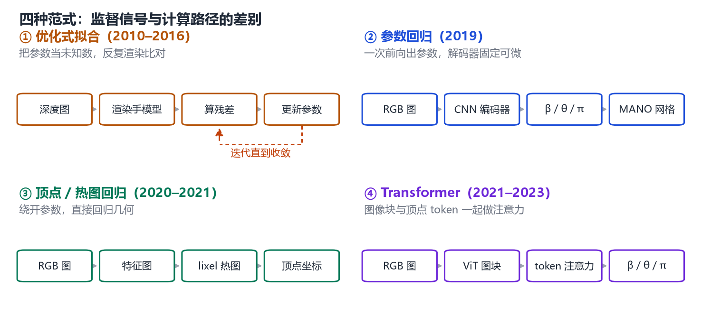
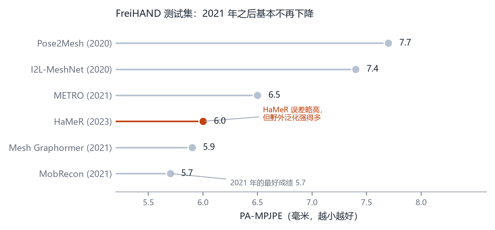

# 第 20 章 单手重建：从优化到 Transformer

> **本章导读**：第 19 章造好了 MANO 这只“可调的假手”，本章要回答：给它一张照片，怎样把参数调出来？这条路走了将近十年，从“在深度图上反复试参数”的优化，到“一次前向就出结果”的回归，再到今天的 Transformer 大模型。我们按时间顺序看四种范式各自解决了什么、又留下了什么，最后落到评估指标和失败模式——这部分比模型结构更有用，因为它告诉你什么时候不该相信结果。

## 20.1 先把问题说清楚

给定一张包含手的图像 $\mathbf{I}$，我们想要一只手的三维网格。用 MANO 的语言，就是求一组参数：

$$
\big(\hat{\boldsymbol{\beta}},\hat{\boldsymbol{\theta}},\hat{\boldsymbol{\pi}}\big)
=\arg\min_{\boldsymbol{\beta},\boldsymbol{\theta},\boldsymbol{\pi}}\ \sum_{i}\Big\|\,\Pi\big(\mathbf{J}_i(\boldsymbol{\beta},\boldsymbol{\theta});\boldsymbol{\pi}\big)-\mathbf{u}_i\,\Big\|^2+\lambda_\beta\|\boldsymbol{\beta}\|^2+\lambda_\theta\|\boldsymbol{\theta}\|^2 ,
\tag{20.1}
$$

其中 $\mathbf{J}_i$ 是第 $i$ 个关节的三维位置，$\Pi(\cdot;\boldsymbol{\pi})$ 是相机投影，$\mathbf{u}_i$ 是图像上的人工标注（或检测器输出的）二维关键点，$\lambda$ 是正则项权重。式 (20.1) 和第 1 章的式 (1.2) 是同一件事：把“像不像”写成一个可以最小化的数。

这个式子看起来很简单，但它有三个天生的麻烦，值得在动手之前想明白。

**第一，投影会丢信息。** 一个三维点投影到图像上只剩两个数，深度没了。手指朝前伸还是朝后弯，在某些视角下投影几乎一样。这就是第 19 章说的深度翻转歧义，它意味着式 (20.1) 的解往往不唯一，必须靠先验（$\lambda_\theta$ 那一项，或者 MANO 的姿态 PCA）来挑一个“最像手”的解。

**第二，手太小。** 一张全身照片里，手可能只有 40×40 像素。网络从这么小的区域里要分辨出“中指第二关节弯曲了 20 度”，本质上是在超分辨率。

**第三，标注很贵。** 三维关键点需要多相机系统或精心设计的手工流程，规模上不去；二维关键点便宜得多，但二维监督不能唯一确定三维。

接下来近十年的方法演化，本质上都是在回答：**用哪种表示、配哪种监督、花多少算力，来对付这三点。**

<figure class="fig">

<figcaption><b>图 20-1</b>　四种范式的管线对比。左上：优化式拟合，在参数空间里反复试，慢但对数据要求低；右上：参数回归，一次前向出参数；左下：顶点/热图回归，绕开参数直接回归几何；右下：Transformer 路线，把图像块与网格顶点放进同一个注意力空间。</figcaption>
</figure>

## 20.2 深度图时代：把拟合当成搜索

2010 年代中期的标准做法，是拿一台深度相机（Kinect、RealSense），把手放在镜头前，然后解式 (20.1) 的一个变体。

那时候还没有 MANO，手模型通常是几何基元的组合：手掌一个长方体，每根手指一串圆柱或球体。Oikonomidis 等人用粒子群优化（PSO）在参数空间里撒一把“粒子”，每个粒子是一组关节角，渲染出来和深度图比对，好的粒子留下来继续撒。这类方法能跑起来，但有两个硬伤：一是慢，一帧要几秒；二是需要好的初始化，手一动快了就跟丢。

后来出现了几种改进：用高斯混合模型代替基元（Sridhar 等），用球-网格（sphere-mesh）把手指做得更光滑（Tkach 等），或者用带蒙皮的三角网格代替基元。MANO 的论文里有一张图专门对比了这十种手部表示 [@romero2017mano]，那是这个阶段的一份“化石记录”。

这个阶段的核心洞察是：**模型先验比图像证据更重要。** 深度图在指缝处经常是空的，算法必须靠“手应该长什么样”把洞补上。这也解释了为什么 MANO 一出现就迅速取代了基元模型——它把“手应该长什么样”用统计的方式学到了极致。

但深度图路线有一个无法回避的限制：它需要专用硬件。手机、网络视频、监控画面里只有彩色图像，没有深度。于是问题变成：**只用一张 RGB 图，能不能做到？**

## 20.3 单张 RGB 的第一步：把模型塞进网络里

2019 年，Boukhayma 等人给出了第一个端到端的答案 [@boukhayma2019hands]。他们的设计非常“教科书”，值得完整看一遍。

网络分成两半：

- **编码器**：一个卷积网络，输入是手部裁剪图（可选再拼上一组二维关键点热图），输出一组参数：形状 $\boldsymbol{\beta}$、姿态 $\boldsymbol{\theta}$、视角 $\boldsymbol{\pi}$。
- **解码器**：完全固定、不参与训练。它做两件事——用 MANO 从参数生成网格和骨架，再用弱透视相机把三维关节点投影回图像。

$$
\mathbf{J}_{2D}=\underbrace{\Pi_{\text{weak}}\big(\mathbf{J}(\boldsymbol{\beta},\boldsymbol{\theta});\,s,\mathbf{t}\big)}_{\text{固定，可微}},\qquad
\mathbf{J}(\boldsymbol{\beta},\boldsymbol{\theta})=\mathcal{J}\big(M(\boldsymbol{\beta},\boldsymbol{\theta})\big).
\tag{20.2}
$$

弱透视相机只有三个参数：缩放 $s$ 和二维平移 $\mathbf{t}=(t_x,t_y)$（并假设主点在图像中心）。它比完整的透视相机少一个焦距，对尺度变化不敏感，在“物体离相机足够远”的假设下够用，也让网络更容易学。

这个设计最妙的地方在于**损失函数**。他们不监督参数——参数没有唯一正确答案（同一个姿态可以由不同的 PCA 系数组合出来），监督参数等于强迫网络模仿标注者的偏好。他们监督的是**投影后的关节点**：

$$
\mathcal{L}=\lambda_{3D}\big\|\mathbf{J}_{3D}-\hat{\mathbf{J}}_{3D}\big\|^2+\lambda_{2D}\big\|\Pi(\mathbf{J}_{3D})-\hat{\mathbf{u}}\big\|^2 .
\tag{20.3}
$$

第一项只在有三维标注的数据上生效，第二项在只有二维标注的数据上生效。这样一份数据可以只提供一半监督，网络照样能训——这就是“弱监督”的含义。论文明确说，正是这一点让他们能用上 MPII+NZSL 这类“在野外”的二维标注数据，从而提升泛化能力。

还有两个细节值得记住，因为它们是后续所有工作的公共常识：

1. **姿态用 PCA 系数，不用 48 维轴角。** 他们取 10 个姿态主成分，形状也取 10 维。理由在第 19 章：48 维过参数化，且噪声数据下容易过拟合。
2. **指尖点要从网格上补。** MANO 的骨架里没有指尖关节，但数据集标注的 21 个点里有指尖。他们的做法是直接从 778 个顶点里挑 5 个指尖顶点拼到关节后面 [@boukhayma2019hands]。你在复现时会遇到同样的问题。

这一代方法的局限也很清楚：监督信号只有关节点，没有像素级对齐。关节对了，手的轮廓可能还是偏的；手指之间的相对位置关系没有被显式约束，容易“挤”在一起。要解决这个，得让网络看见像素。

## 20.4 从参数到像素：热图、图网络与注意力

**I2L-MeshNet（2020）** 提出的问题很尖锐：把图像送进全连接层、直接吐出参数，等于把像素之间的空间关系全部打散了。一个在图像上相邻的关节点，在参数向量里可能隔得很远，网络学起来更吃力。

他们的替代方案是**热图**。人体姿态估计早就用热图了：为每个关节点预测一张二维概率图，取峰值位置作为坐标。这个表示保留了空间结构，也能表达“不确定”（峰值很平时说明网络没把握）。但直接把手部热图推广到三维是不行的：关节只有 20 个左右，而网格顶点有 778 个，为每个顶点预测一个三维体素热图，显存立刻爆炸。

于是他们提出了 **lixel**（line + pixel，线素）：把一维空间离散成格子，为每个顶点坐标预测一条一维热图。名字是类比 voxel（体素）造出来的。显存随热图分辨率线性增长，而不是立方增长，因此可以给到足够的分辨率 [@moon2020i2lmeshnet]。

网络结构是级联的：第一个子网（PoseNet）预测关节的 lixel 热图，第二个（MeshNet）在此基础上预测所有顶点的 lixel 热图。注意这条路线是 **model-free** 的——它不回归 MANO 参数，而是直接输出顶点坐标，关节位置靠 MANO 的关节回归矩阵乘上去。好处是不受参数空间的表达限制，坏处是输出不保证是一只有效的手（可能出现自交、指节塌陷）。

**Mesh Graphormer（2021）** 走了另一条路：既然网格是一个图，就用图卷积捕捉“邻居顶点之间的局部关系”；既然 Transformer 擅长长程依赖，就用自注意力捕捉“手指 A 与手指 B 之间的关系”。他们把两者塞进同一个 Transformer 块（每个块里既有图残差分支，也有自注意力分支），叠 4 层，让关节 token 与顶点 token 互相注意，同时还能注意到图像的网格特征 [@lin2021meshgraphormer]。

这个组合的直觉是：**手既需要局部光滑（图卷积），也需要全局协调（注意力）。** 一根手指弯曲时，相邻手指会不自觉地跟着动一点，这是长程关系；指节处的皮肤褶皱是局部关系。两者缺一不可。

## 20.5 规模化：HaMeR

到 2021 年，手部重建在 FreiHAND 这类受控数据集上的误差已经降到 6 毫米左右，继续在结构上做微调收益越来越小。2023 年的 HaMeR 换了一个思路：**不发明新结构，把数据和模型一起放大** [@pavlakos2023hamer]。

具体做了两件事：

**数据。** 他们把能找到的带手部标注的数据集合起来——包括有三维真值的受控数据集（FreiHAND、HO-3D、InterHand2.6M、DexYCB 等）和只有二维关键点的野外数据集（COCO-WholeBody、Halpe、MPII-NZSL 等），一共约 270 万个训练样本，是 FrankMocap 训练集的四倍。为了让模型在真实场景下站得住，他们还新标注了一个评测集 HInt：从 YouTube 视频和自我中心视频里取图，标了 40400 只手的关键点，其中 86.7% 的手正在与物体接触。

**模型。** 用大规模视觉 Transformer（ViT）做主干，后面接一个 Transformer 解码器，直接回归 MANO 的姿态、形状和相机参数。没有图卷积，没有热图，没有中间几何表示——就是“图块进、参数出”。

结果很有意思：在已经饱和的 FreiHAND 上，它的 PA-MPJPE 是 6.0 毫米，并不比 2020 年的 MobRecon（5.7 毫米）更好；但在 HInt 这类野外数据上，它的 PCK@0.05 比之前的方法高出两到三倍。换句话说，**大模型带来的不是“更准”，而是“更不容易崩”**。

这个结果值得停下来想一想。它说明在受控数据集上刷榜和在真实场景里可用，是两件不同的事。受控数据集的光照、视角、背景、手的姿势分布都被精心设计过，方法之间的差异被压缩了；而真实图像的分布极其杂乱，只有见过足够多数据、容量足够大的模型才能覆盖。

HaMeR 论文里还有一组数字很能说明问题：在 HInt 上，可见关节的 PCK@0.05 是 60.8，遮挡关节只有 27.2——**遮挡让精度直接掉了一半还多**。这不是某个模型的缺陷，而是这个问题本身的难度。

把前面几节提到的方法按时间排一遍，会看得更清楚：两个转折点分别落在 2019 年和 2021 年之后。

<figure class="fig">

<figcaption><b>图 20-2</b>　单手重建的时间线。橙色标注的是本章重点讨论的工作，灰色是同一时期的重要旁支。可以看到两个明显的转折：2019 年前后从“优化”转向“端到端回归”，2021 年之后从“改结构”转向“堆数据与容量”。</figcaption>
</figure>

## 20.6 全身一体化：FrankMocap 与 PyMAF

单手模型假设“图像里只有一只手，而且已经裁好了”。真实应用往往要先在全身图像里找到手。这就引出另一条线：**全身 + 手的一体化估计。**

**FrankMocap（2020/2021）** 的结构可以概括成“先回归，再整合” [@rong2021frankmocap]。它有几个互相独立的模块：一个估身体（SMPL-X 的身体部分），一个估手（MANO），一个估脸。各模块先用回归网络给出初值，再由一个整合模块把三者拼成一个完整的 SMPL-X，并用渲染-比对（render-and-compare）的方式做几步优化，让渲染出来的轮廓和图像对齐。

这个“分而治之”的设计有很实际的考虑：手的训练数据远比身体少，把手单独训一个网络，可以充分利用手部数据集；而整合模块负责处理“手和身体接不上”的问题——比如手腕的位置、朝向、尺度。

**PyMAF（2021）** 解决的是另一个问题：**参数的一点点偏差，会导致网格和图像明显错位** [@pavlakos2021pymaf]。原因是参数到顶点是非线性的，姿态参数差 0.1 弧度，指尖可能就差几厘米。他们的办法是引入一个“网格对齐反馈”回路：先把当前估计的网格投影回图像，在特征金字塔的对应位置上采样特征，再用这些“网格对齐的证据”去修正参数。反复几次，网格就慢慢贴到图像上了。

这个思路和经典的迭代误差反馈（iterative error feedback）很像，区别在于反馈的信号不是“误差图”，而是“在网格投影位置采样到的图像特征”——更直接地和几何对齐挂钩。

把 FrankMocap 和 PyMAF 放在一起看，会发现它们代表了一体化系统的两种取向：一个强调模块化（各部件独立，接口清晰），一个强调闭环（估计—渲染—比对—再估计）。工程上两者经常混用：用模块化拿到初值，用闭环做精修。

## 20.7 数据从哪来：多视角标注与弱监督

第 19 章说过手部数据难采。这一节把这几年真正可行的几条路列清楚，因为**方法的上限基本由数据决定**。

**路线一：多视角 + 联合优化标注。** HOnnotate 是代表 [@hampali2020honnotate]。它用一台或多台 RGB-D 相机拍手抓物体的序列，然后把“手和物体的三维位姿”当成一个整体，在所有帧上同时优化——手用 MANO，物体用已知的 CAD 模型，两者互相提供约束：手不能穿进物体，接触处要贴合。这样即使某一帧里手被物体挡住，也能靠前后帧和物体几何补出来。用这个方法，他们做出了 HO-3D：68 段序列、77558 帧、10 个人、10 个物体。这批数据后来成了手物交互研究的标准训练集之一（第 21 章详述）。

**路线二：合成数据。** 在仿真里摆好手和物体，渲染出图像，标注是免费的。ObMan 是这条路线的代表作，第 21 章会讲它的规模和局限。合成数据的核心问题是“域差异”：渲染图的光照、材质、噪声和真实照片不一样，网络容易学到渲染器的特征。

**路线三：二维弱监督 + 大规模真实图。** 这就是 Boukhayma 和 HaMeR 用的办法：只要有二维关键点，就能约束投影后的手；三维的歧义由 MANO 的先验来消除。这条路能利用互联网规模的图像，是当前最有效的规模化手段。

**路线四：伪标签自训练。** 先用有三维真值的数据训一个模型，拿它去预测无标注图像，把高置信度的预测当标签，再训一轮。这在实践中非常常用，但要注意它会放大模型自身的偏见。

四条路线不是互斥的。今天最强的系统通常是：合成数据预训练 + 三维数据精调 + 二维弱监督扩域 + 伪标签迭代。

## 20.8 评估指标与失败模式

最后讲怎么判断一个方法好不好。手部重建的指标不算多，但每一个都有陷阱。

**PA-MPJPE（Procrustes-Aligned Mean Per-Joint Position Error）。** 先把预测的骨架和真值做一次刚体对齐（允许旋转、平移、缩放），再算关节的平均欧氏距离，单位毫米。加“PA”是因为我们通常不关心绝对位置和朝向上的小差异，只关心姿态本身。代价是：一个把手整体旋转了 30 度但姿态完美的方法，PA-MPJPE 会很好看。

**PA-MPVPE。** 同样的对齐，但算的是网格顶点而不是关节。它比关节指标更严格，因为顶点还反映了形状（胖瘦、指长）。

**F@5 / F@15。** F-score：在 5 毫米（或 15 毫米）阈值内，预测顶点与真值顶点的匹配比例，兼顾 precision 和 recall。它比平均误差更能反映“有多少地方明显错了”。

**PCK（Percentage of Correct Keypoints）。** 二维指标：预测关节点落在真值一定阈值内的比例（阈值常按手部尺度归一化，如 0.05 倍掌宽）。HInt 这类只有二维标注的评测集只能用 PCK。

图 20-3 是 FreiHAND 上的公开结果，数据取自 HaMeR 论文的对比表 [@pavlakos2023hamer]。请注意横轴的范围：只从 5 毫米跨到 8 毫米，从 2020 年的 7.4 到 2021 年的 5.7，两年只降了不到两毫米。

<figure class="fig">

<figcaption><b>图 20-3</b>　FreiHAND 测试集上的 PA-MPJPE（毫米，越小越好），数值取自 HaMeR 论文的对比表 [@pavlakos2023hamer]。注意两个现象：一是 2021 年之后指标基本不再下降，说明这个数据集已接近饱和；二是 HaMeR（6.0）并不比 2020 年的 MobRecon（5.7）更好，但它在野外数据上的泛化能力远远领先——这正是 20.5 节讨论的重点。</figcaption>
</figure>

**失败模式清单。** 下面几条是实践中反复出现的，比指标更能帮你判断“这个结果能不能用”：

1. **遮挡。** 手抓物体、双手交叠、手放在身后。HaMeR 在 HInt 上的数字说明，遮挡关节的精度大约是可见关节的一半。
2. **极端视角。** 正对指尖（“指人”的视角）时，手指全部缩短成一堆点，深度方向几乎没有信息。自我中心视角（第一人称）也常出现这种构图。
3. **尺度歧义。** 单目图像里，一只远处的大手和一只近处的小手投影可以一样大。弱透视相机把尺度吸收进参数 $s$，所以“手的绝对大小”基本不可信，除非有额外的深度或人体上下文。
4. **左右手混淆。** 一只背对镜头的手，与另一只手的镜像，在轮廓上高度相似。网络经常给出“镜像正确、朝向错误”的结果。
5. **时间抖动。** 逐帧独立估计的视频会出现高频抖动，即使每帧的误差都不大。做产品时通常要加时间平滑或时序模型（第 10 章讨论过视频人体重建的同类问题）。
6. **手部与身体的接缝。** 分别估计手和身体，再拼起来时，手腕处常有错位或断裂。这是 FrankMocap 那类系统要专门做“整合”的原因。

## 本章小结

- 单手重建就是把第 1 章的“渲染—比较—调参”落到 MANO 上：求一组参数，使投影后的关节（或轮廓）与图像一致。
- 三条根本困难：投影丢深度导致歧义、手在图中太小、三维标注太贵。
- 演化路线：深度图时代的优化拟合（慢、需初始化、依赖硬件）→ Boukhayma 的端到端回归（固定可微解码器 + 二维/三维关节弱监督）→ 热图与图网络（I2L-MeshNet 的 lixel、Mesh Graphormer 的图卷积 + 注意力）→ 规模化 Transformer（HaMeR，270 万样本，赢在泛化而非榜单）。
- 全身一体化有两条取向：FrankMocap 的模块化 + 整合，PyMAF 的网格对齐反馈闭环。
- 数据决定上限：多视角联合优化标注（HOnnotate/HO-3D）、合成渲染、二维弱监督、伪标签自训练，今天最强的系统往往四者混用。
- 评估要看指标的含义：PA-* 允许刚体对齐，F-score 看“错得多的比例”，PCK 只能评二维。遮挡、极端视角、尺度、左右手、时间抖动、手与身体的接缝是六类典型失败。

## 思考题

1. Boukhayma 的方法不监督 MANO 参数，只监督投影后的关节。如果改成直接监督参数，会发生什么？请从“参数不唯一”这个角度解释。
2. I2L-MeshNet 用一维热图代替直接回归坐标。为什么一维就够了，而不需要像体素那样三维？这样做丢失了什么信息？
3. HaMeR 在 FreiHAND 上没有明显超过 2020 年的方法，但在野外数据上大幅领先。如果让你设计一个新的评测集，你会怎么设计才能区分“刷榜型”和“实用型”方法？
4. 一只手在图像里只占 40×40 像素。假设你把图像放大四倍再送进网络，精度会提升吗？会不会引入新的问题？
