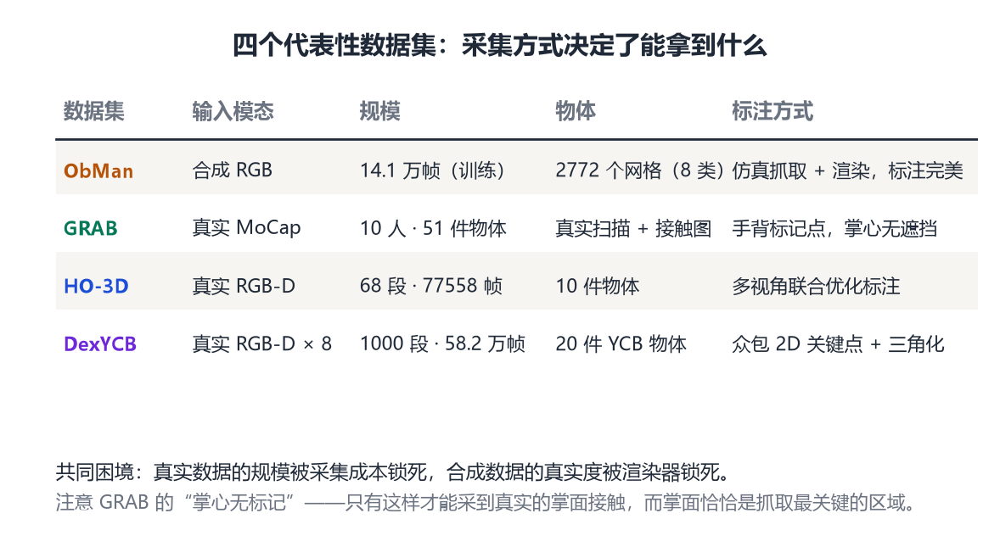
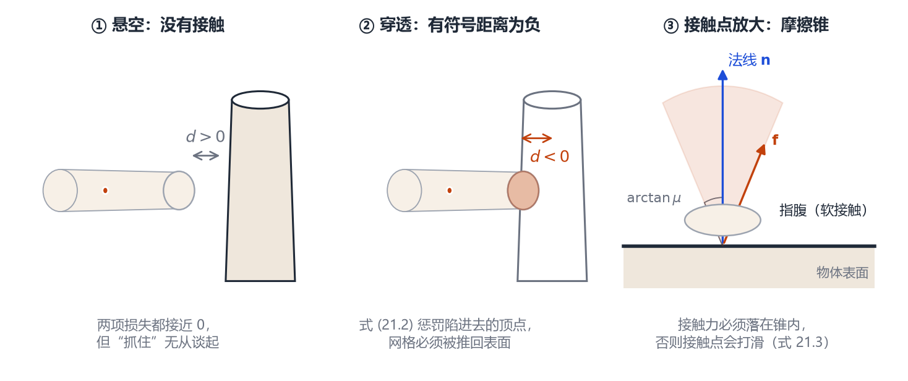
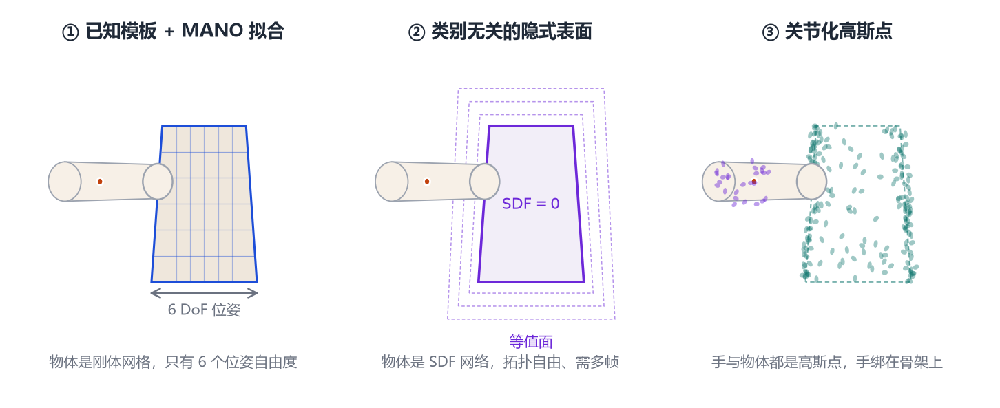

# 第 21 章 手物交互与抓取

> **本章导读**：前面两章的手是“悬在空中”的——没有东西可抓，也没有东西挡着。可手的意义恰恰在于操作物体：握住杯子、拧开瓶盖、捏起一枚硬币。一旦把物体放进来，问题就从“估计一只手”变成了“同时估计手和物体，并且让它们看起来像是真的在接触”。本章讲三件事：为什么必须一起建模、现有数据能提供什么、以及从“模板拟合”到“隐式表达”再到“高斯泼溅”的技术演化。前置知识是第 19 章的 MANO 与第 20 章的重建范式。

## 21.1 为什么手和物体必须一起建模

先做一个思想实验。给你一张照片：一只手握着一个马克杯。你分别跑两个“专家系统”——一个只估手，一个只估物体——然后把结果叠在一起。会发生什么？

**第一，手会被物体“吃掉”一块。** 只估手的模型看不见被杯子挡住的那部分手指，它只能靠 MANO 的先验去猜。猜出来的手指很可能穿过杯壁，或者缩在杯子里面。

**第二，物体会飘。** 单目图像里的物体位姿有尺度和深度歧义，一个 8 厘米的杯子和一个 16 厘米的杯子在图上可以一样大。但如果这只手是标准大小（MANO 有固定的尺度先验），那么“手能握住它”这件事本身就提供了尺度约束。**手是物体的一把尺子。**

**第三，接触关系没人管。** 真实抓取里，手指的指腹贴着物体表面，拇指和其他手指形成对抗。这种“贴住但不穿透”的关系，是判断一个重建结果合不合理的最强证据。分开建模时，没有任何一项损失在管这件事。

所以从 2019 年起，这条线上的工作都建立在同一个判断上：**手和物体是一个系统，必须联合估计。** 而“联合”带来了一个新的问题——**用什么表示物体？**

这个问题比看起来难。人体有 SMPL，手有 MANO，因为人体和手的形状空间相对稳定、可以统计学习。物体呢？世界上有几万种杯子、几万种瓶子，它们的形状没有共同的拓扑，也没法用几十个 PCA 系数概括。于是研究分成了两条路：一条假设“物体模型已知”（CAD 或扫描好的网格），另一条试图“从图像里现场重建物体”。本章会看到，这条分界线决定了方法的全部结构。

## 21.2 数据：四种采集哲学

手物交互的数据集不多，但每一个都代表一种不同的取舍。图 21-2 把它们放在一起对比。

<figure class="fig">

<figcaption><b>图 21-1</b>　四个代表性数据集的逐项对比。注意“标注方式”一列：每个数据集的强项恰好是它的采集方式的直接结果——合成数据标注完美，GRAB 有真实掌面接触，HO-3D 能在遮挡下标注，DexYCB 则胜在规模与统一的任务定义。</figcaption>
</figure>

**ObMan：全部合成。** Hasson 等人从 ShapeNet 里选了 8 类日常物体（瓶子、碗、罐子、刀、手机、相机、遥控器等），共 2772 个网格，用 GraspIt 仿真生成 21000 个抓取，再把 MANO 手摆成抓取姿态、渲染成图像，训练集共 14.1 万张 [@hasson2019joint]。它的好处是完美标注、无限规模；坏处是渲染图和真实照片的分布差异明显，网络容易学到“渲染器的味道”。

**GRAB：全身 + 物体 + 接触。** Taheri 等人请了 10 位被试（5 男 5 女），抓握 51 件日常物体，每个动作都要求全身参与——不只是手，手臂、躯干、甚至另一只手都会配合 [@taheri2020grab]。采集时被试戴着动作捕捉标记，只有手背贴标记，掌心完全空着，这样抓握时掌心能真实接触物体。有了手、身体、物体的三维网格，就可以计算**接触区域**：物体表面哪些点被身体碰到了，碰了多大面积。

这批数据的一个重要贡献是把“抓取”的概念拓宽了：不只是“单手稳稳举起物体”，还包括递、接、换手、使用。这些动作里，物体在手中的位置会变，接触区域也会变。

**HO-3D：多视角 + 联合优化标注。** Hampali 等人用一台或多台 RGB-D 相机拍手抓物体的序列，然后用一个关键技巧做标注：把“手的三维位姿”和“物体的六自由度位姿”放到同一个优化里，在所有帧上同时求解 [@hampali2020honnotate]。手不能穿进物体、接触处要贴合，这两个约束让遮挡帧也能被正确标注。最终得到 68 段序列、77558 帧、10 个人、10 个物体，是第一个无标记的真实手物数据集。

**DexYCB：规模化 + 标准化任务。** Chao 等人把任务限定得很窄：从桌上抓起物体。但把规模做大了——10 位被试、20 个 YCB 物体、8 个视角、1000 段序列、58.2 万帧 RGB-D [@chao2021dexycb]。标注方式是众包人工标二维关键点（手 21 个点、物体若干点），再用多视角三角化和拟合得到三维。它的价值在于**基准**：任务定义清晰、评价协议统一，后来的方法几乎都会在 DexYCB 上报一个数。

把四个数据集并排看，会发现一个共同的困境：**真实数据的规模被采集成本锁死，合成数据的真实度被渲染器锁死。** 这个矛盾直接催生了 21.5 节的在线合成方法。

## 21.3 联合重建：从接触损失到类别无关

**第一代：已知物体 + 接触损失。** Hasson 等人的做法是端到端的：输入一张 RGB 图，网络同时输出 MANO 的手参数和物体的形状、位姿、尺度，然后用一个**接触损失**把两者绑在一起 [@hasson2019joint]。这个损失由两项组成，方向相反：

$$
\mathcal{L}_{\text{contact}}=\underbrace{\sum_{\mathbf{o}\in\mathcal{O}}\min_{\mathbf{v}\in\mathcal{H}}\|\mathbf{o}-\mathbf{v}\|^2}_{\text{吸引：物体表面要靠近手}}+\ \lambda\underbrace{\sum_{\mathbf{v}\in\mathcal{H}}\max\big(0,-d_{\mathcal{O}}(\mathbf{v})\big)^2}_{\text{排斥：手不能陷进物体}} .
\tag{21.1}
$$

$d_{\mathcal{O}}(\mathbf{v})$ 是手部顶点 $\mathbf{v}$ 到物体表面的有符号距离，在物体内部为负。第一项把物体上的每个点拉向最近的手部顶点，第二项把已经陷进去的顶点推出来。

这个写法很聪明，但有一个明显的弱点：**它不区分“该接触的地方”和“不该接触的地方”。** 手背碰到杯子也该被“吸引”吗？论文自己也指出，两项之间的权重平衡非常关键，偏了就会得到“手贴在物体表面但姿态别扭”的结果。

**第二代：类别无关（category-agnostic）。** 第一代方法的隐含前提是“物体有模板”——要么是已知的 CAD 模型，要么是一个学好的物体形状空间。真实场景里，你手里的那支笔可能从来没被扫描过。

HOLD 就是冲着这个前提去的 [@wang2023hold]。它只需要一段单目视频，物体是什么类别完全不管，直接从视频里把手的关节和物体的表面一起重建出来。技术上的关键是**用隐式表示替代模板**：物体不再是“一个已知网格 + 一个位姿”，而是一个由神经网络表示的连续表面（用有符号距离场描述，给一个三维点，网络告诉你它在表面内还是外、离表面多远）。手的表面也用类似的方式表达，两者通过“手与物体不能互相穿透、接触处要贴合”的约束耦合在一起。

隐式表示的好处是拓扑自由——杯子有把手、碗是凹的、剪刀有两个环，都不需要预先规定网格结构；坏处是它需要多视角或多帧的观测才能约束住形状，单帧基本无解。

**第三代：把物体也当成“可优化的高斯点”。** 这是 21.6 节的内容，先按下不表。

还有一条支线是第一视角（egocentric）采集：相机戴在头上，手总在画面里、离镜头近，但视角极端、运动模糊严重、物体经常被手完全挡住。它和第三视角的问题几乎是互补的。

## 21.4 物理约束：穿透、接触与力闭合

上一节的接触损失是“软约束”——它只是让网络倾向于不穿透，并不保证。真正要判断一个抓取是否成立，得回到力学。

**穿透。** 最硬的约束：手和物体的体积不能重叠。实践中很少直接做碰撞检测（太慢且不可微），而是用有符号距离场：

$$
E_{\text{pen}}=\sum_{\mathbf{v}\in\mathcal{H}}\max\big(0,-\mathrm{SDF}_{\mathcal{O}}(\mathbf{v})\big)^2 ,
\tag{21.2}
$$

只惩罚“陷进去”的顶点，深度越大惩罚越重。$\mathrm{SDF}$ 可以来自网格的预计算，也可以来自隐式网络。

**接触。** 光不穿透还不够：手悬在物体上方一毫米，物理上完全合法，但那就不是抓取了。所以还需要一项“该接触的地方要接触”。难点在于**哪些地方该接触**事先不知道，于是实践中常用“双向最近点”(式 21.1) 或者接触图（contact map）来近似——接触图是一张贴在物体表面的概率图，标出每个位置被碰到的可能性。GRAB 就提供了这样的接触标注：给定手和物体的网格，逐顶点算距离，小于阈值的记为接触 [@taheri2020grab]。

**摩擦锥。** 接触点上的力不能任意方向。设接触法线为 $\mathbf{n}$，摩擦力系数为 $\mu$，则接触力 $\mathbf{f}$ 必须满足

$$
\|\mathbf{f}-(\mathbf{f}\cdot\mathbf{n})\mathbf{n}\|\ \le\ \mu\,(\mathbf{f}\cdot\mathbf{n}),
\tag{21.3}
$$

几何上，这约束 $\mathbf{f}$ 落在一个以 $\mathbf{n}$ 为轴、半角为 $\arctan\mu$ 的圆锥里——这就是**摩擦锥**（friction cone）。$\mu\approx0.5$ 时半角约 27 度；$\mu=1$ 时 45 度。手指的指腹是软的，实际能提供的摩擦比刚性接触更大，这也是人为什么能用很小的力捏住光滑的玻璃杯。

**力闭合。** 一个抓取成立的条件是：存在一组满足式 (21.3) 的接触力，能够抵抗任意方向的外力旋量（三个方向的力 + 三个方向的力矩）。这叫**力闭合**（force closure）。直观地说：不管你怎么推、怎么拧这个物体，手指都能顶住。

判断力闭合在数学上是一个凸优化问题（在所有接触点上找一组非负的法向力和切向力，使它们的合力矩为零且能张成整个六维旋量空间）。工程上常用的近似指标有 $\epsilon$ 指标（最差方向上的抵抗能力）和体积指标。这些指标不只用于评价，也被用作训练的损失——让网络生成“力闭合”的抓取，比让它生成“看起来像抓取”的抓取要难得多。

<figure class="fig">

<figcaption><b>图 21-2</b>　接触的三种状态与摩擦锥。左：手悬空，有符号距离 $d>0$，式 (21.1) 的两项都接近 0，但并没有抓住；中：手陷进物体，$d<0$，式 (21.2) 产生惩罚；右：接触点的放大图，接触力 $\mathbf{f}$ 必须落在以法线 $\mathbf{n}$ 为轴、半角为 $\arctan\mu$ 的锥内。</figcaption>
</figure>

## 21.5 生成抓取：先造数据，再学估计

如果真实数据只有几万帧，而物体有上万种，那么“覆盖”是不可能的。生成抓取这条线就是回答：**能不能用算法造出足够多、足够真实的抓取？**

**GANHand：把抓取当成生成问题。** Corona 等人不直接回归一个抓取，而是训练一个条件 GAN：给定场景里物体的几何（点云或体素），生成器输出一组 MANO 手参数，判别器判断“这看起来像不像真实的抓取” [@corona2020ganhand]。判别器是用真实抓取数据训出来的，所以生成器学到的不是“手能贴上去”，而是“手会这样贴上去”。

这一路线的副产品很实用：为了训练和评测，他们对 YCB 物体手工标注了大量 MANO 抓取姿态，形成了后来的 YCBAfford 数据集。这种“为了做方法而顺手做出数据”的模式在这个领域非常常见。

**ArtiBoost：在线合成 + 难度自适应。** ArtiBoost 的出发点是：离线合成的数据是固定的，而训练过程中模型“已经学会了什么”在变，所以应该**边训边造，缺什么补什么** [@yang2022artiboost]。

他们定义了一个三维离散空间，叫 CCV 空间（Composited hand-object Configuration and Viewpoint）：

$$
\mathcal{S}=\big\{\,(n_o,n_p,n_v)\ \big|\ n_o\le N_o,\ n_p\le N_p,\ n_v\le N_v\,\big\},
\tag{21.4}
$$

三个维度分别是物体类型、手部姿态、视角方向。以 DexYCB 的 20 个物体为例，$20\times100\times288=576000$ 个组合。构造方式是：对每个物体做基于接触约束的抓取拟合（每个物体试 300 个初值，人工剔除严重穿透和不自然的，最后保留最多 100 个），再对每个抓取采样视角。

训练时，每个 batch 混入一批从 CCV 空间采样、现场渲染的合成图。采样不是均匀的：每个组合有一个权重，训练损失大的组合权重高——**模型在哪里错得多，就多看哪里的合成数据**。论文的消融实验显示，同样数量的合成抓取，来自 CCV 空间的那批比来自 YCBAfford 的更能提升性能。

这个思路其实很朴素：数据增强的本质是“在模型薄弱的方向上加密采样”。ArtiBoost 只是把它做成了一个闭环。

## 21.6 无标记捕捉与高斯泼溅：MANUS

前面所有方法都在假设“输入是图像，输出是网格”。2023 年之后，三维重建的表示本身变了：3D 高斯泼溅（3D Gaussian Splatting, 3DGS）用一堆带方向、带颜色、带透明度的椭球来表示场景，渲染快、质量高，而且**可以求导**。

MANUS 把 3DGS 用在手物抓取捕捉上 [@fan2024manus]。它的核心想法是：不要一上来就把手和物体压成网格，而是先用高斯点表示整个“手 + 物体”的场景，从多视角视频里优化这些高斯点，然后再把手的高斯点**绑定到 MANO 的骨架上**——手弯曲时，对应的高斯点跟着刚体变换走。这叫“关节化高斯”（articulated Gaussians）。

这样一来，几何不再是固定的，而是可以随姿态变形；同时，物体也不需要事先知道模型，它只是另一组高斯点。输出的结果既包括手部姿态（MANO 参数），也包括物体的表面。

这条路线解决的问题是 21.3 节留下的：**当物体没有模板、图像又有遮挡时，怎么同时拿到手和物体的几何？** 用高斯点表示的好处是它对“部分观测”很宽容——被手挡住的那部分物体，可以从其他帧、其他视角的高斯点补上来；坏处是需要多视角采集，单目视频效果会明显下降。

从更长的历史看，MANUS 代表了一个趋势：**参数化模型从“表示”退到“骨架”**。手仍然用 MANO 描述姿态，但表面细节交给高斯点或隐式场。这和人体那边的神经渲染（第 13、25 章）是同一个走向。

<figure class="fig">

<figcaption><b>图 21-3</b>　手物联合重建的表示演化。左：已知物体模板 + MANO 拟合，物体是刚体网格、只有 6 自由度位姿；中：类别无关的隐式表面，物体由网络表示、拓扑自由；右：关节化高斯点，手与物体都由高斯点表示，手的高斯绑定在 MANO 骨架上。三者对“物体先验”的依赖依次减弱，对“观测数量”的要求依次增强。</figcaption>
</figure>

## 21.7 应用与开放问题

**已经能用的地方。**

- **机器人示教。** 从人的示范视频里恢复手物轨迹，映射到机械手上。这里的难点不是精度而是**可比性**：人手有 21 个自由度、柔软的指腹，机械手可能只有二指夹爪或三指灵巧手，需要做“抓取类型”的抽象。
- **AR/VR 手势与抓取。** 用户徒手在空中比划，系统要判断“他在抓什么”。这里更看重实时性和稳定性，精度要求反而低。
- **动画与游戏。** 让虚拟角色自然地拿起道具。工业界的做法通常是“先检索、再微调”：从抓取库里找最像的一个，再用手部 IK 贴合到具体道具上。
- **手部康复与技能分析。** 精确测量抓握时的接触面积、手指协同模式，用于评估康复进展。

**还没解决的问题。**

1. **接触力无法从图像直接观测。** 我们能重建几何，但力是另一回事。有工作尝试从手的形变反推力的大小（用手指变形的程度），但精度有限。
2. **柔软物体。** 目前几乎所有方法都假设物体是刚体。抓一块布、一团面、一个塑料袋，接触会改变物体的形状，整个“手 vs 物体”的二分法就失效了。
3. **双手与工具使用。** 一只手拿锤子，另一只手拿钉子，物体之间还有约束。多体交互的复杂度是指数增长的。
4. **数据规模与真实度的矛盾。** 21.2 节说的困境仍然存在：合成数据不够真，真实数据不够多。目前的缓解手段（在线合成、伪标签、域适应）都只是缓解。
5. **评价标准不统一。** 手部误差用毫米，物体位姿用度和厘米，接触用面积比例，力闭合用一个无量纲指标。不同论文报不同的数，很难横向比较。这也是为什么 DexYCB 这类“任务定义清晰”的基准特别有价值。

## 本章小结

- 手和物体必须联合建模，原因有三：遮挡让单独估计失效、手为物体提供尺度、接触关系是判断合理性的最强证据。
- 物体的表示是这条线的核心分岔：已知模板（Hasson、GRAB 类）→ 类别无关的隐式表面（HOLD）→ 关节化高斯点（MANUS）。对物体先验的依赖越来越弱，对观测数量的要求越来越强。
- 四个代表性数据集：ObMan（合成 14.1 万帧、2772 个网格）、GRAB（10 人 51 物体，全身 + 接触标注）、HO-3D（68 段序列 77558 帧，多视角联合优化标注）、DexYCB（1000 段序列 58.2 万帧，标准化抓取基准）。
- 接触损失通常是“吸引 + 排斥”两项：把物体拉向手，同时把手推出物体；权重平衡是关键，且它不区分该接触与不该接触的位置。
- 物理上判断抓取是否成立要看摩擦锥（式 21.3）与力闭合；这些指标既用于评价，也可以作为训练损失。
- 数据不够就造数据：GANHand 用条件 GAN 生成抓取，ArtiBoost 在 CCV 空间里边训边采样、按损失加权。
- 开放问题：接触力不可观测、软体、双手与工具、数据规模与真实度的矛盾、评价标准不统一。

## 思考题

1. 式 (21.1) 的吸引项把物体表面每个点都拉向最近的手部顶点。如果一个杯子有把手，而手只握住了杯身，这一项会产生什么错误倾向？你会怎么改？
2. 摩擦系数 $\mu=0.2$（比如沾了油的玻璃）时，摩擦锥的半角是多少度？这对“捏住”这个动作意味着什么？
3. HOLD 用隐式表面替代物体模板，代价是需要多帧观测。如果只有一张图，你会怎么折中？
4. ArtiBoost 按训练损失给合成样本加权。这样做有没有风险？会不会导致模型在某个困难子集上过拟合？
5. 假设你要做一个 AR 应用，让用户用手抓取虚拟物体。你需要的是“几何精确的重建”还是“物理合理的抓取”？两者的技术选型会有什么不同？
