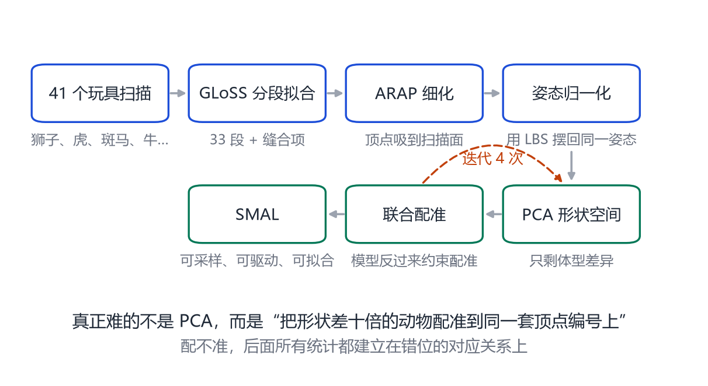
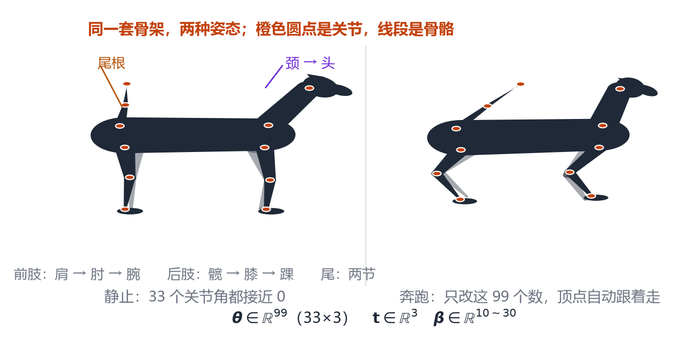
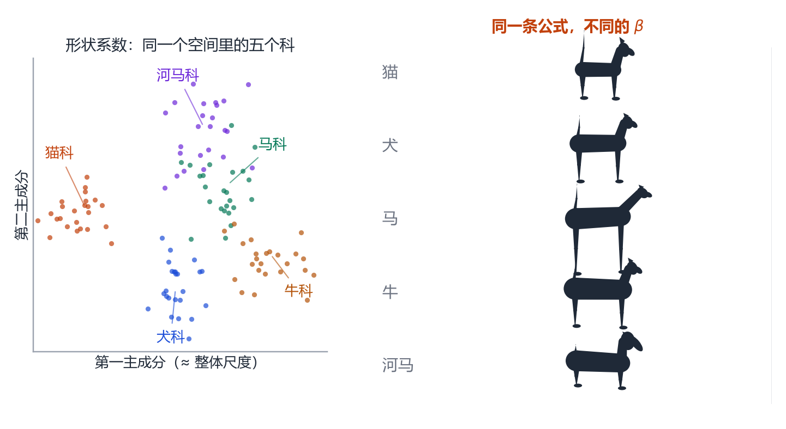
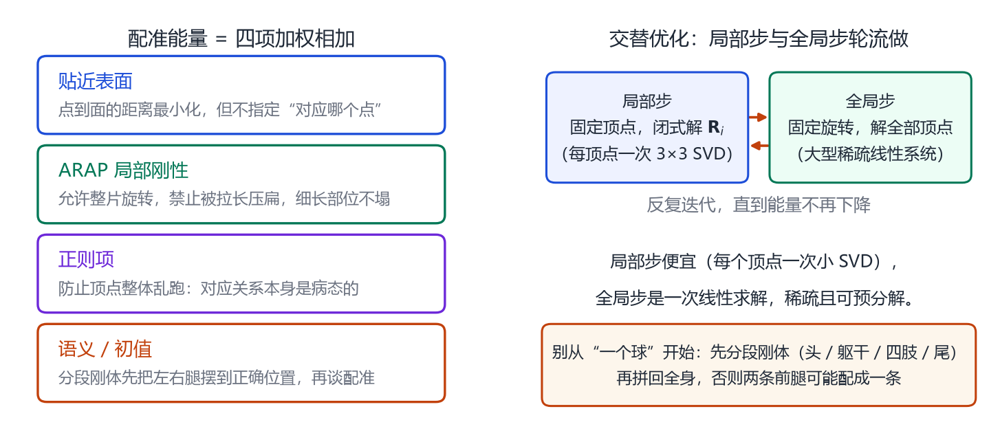

# 第 22 章 SMAL：四足动物的参数化

> **本章导读**：把人体的那套方法搬到动物身上，第一反应是“把 SMPL 的骨架改成四条腿”。但真正的困难不在骨架，而在**数据**：动物不会站着让你扫，物种之间的形状差异又极大。SMAL 的解法很聪明——用玩具模型学习形状空间。这一章讲它怎么把“狮子、老虎、马、河马”装进同一个模型，以及为什么 33 个关节、一套拓扑就能覆盖这么多物种。

## 22.1 为什么不能直接套 SMPL

SMPL 的假设是：所有样本共享同一套拓扑、同一个骨架结构（一个脊柱、两条腿、两条手臂）。动物不满足这个假设：

- **腿的数量与朝向不同**：四足动物的“前肢”对应人的手臂，但关节弯曲方向、脚掌结构完全不同；
- **形状差异巨大**：河马和猎豹的体型差异，远大于人与人之间的差异；
- **没有关键点标注**：人脸有 68 个点，人体有 17 个点，动物没有公认的关键点定义；
- **数据难采集**：活的动物不配合，3D 扫描几乎不可能。

所以，动物参数化必须重新回答三个问题：**用什么模板？用什么骨架？用什么数据训练？**

## 22.2 SMAL 的构建：从玩具到模型

<figure class="fig">

<figcaption><b>图 22-1</b>　SMAL 的构建流程。先扫描一批摆好姿势的玩具动物，用分段刚体拟合 + ARAP 细化建立对应，再把所有扫描摆回同一姿势、做 PCA 得到形状空间，最后用模型反过来约束配准，迭代若干次。</figcaption>
</figure>

2017 年，Zuffi 等人在 *3D Menagerie*[@zuffi2017menagerie] 中提出 **SMAL**（Skinned Multi-Animal Linear model）。它的数据来源非常“土办法”：**41 个玩具动物扫描**，包括狮子、老虎、斑马、马、牛、河马等。

为什么用玩具？因为：

1. 玩具可以摆成任意姿势，便于采集“同一形状、不同姿态”的配对；
2. 玩具表面纹理清晰，配准相对容易；
3. 玩具便宜、可重复购买，数据规模可控。

构建流程分五步：

1. **分段刚体拟合**：把每个玩具的扫描拆成若干刚体段（头、躯干、四条腿、尾巴），用 GLoSS 等方法拟合；
2. **ARAP 细化**：把顶点吸到扫描表面，保持局部刚性，避免配准“糊成一团”；
3. **姿态归一化**：用 LBS 把所有扫描摆回同一个标准姿势；
4. **PCA 形状空间**：对归一化后的顶点做 PCA，得到体型主成分；
5. **联合配准**：用当前的 SMAL 模型反过来约束配准，迭代 4 次左右。

> **最关键的一步是“对应”**：把形状差十倍的动物配准到同一套顶点编号上。配不准，后面的 PCA 全部建立在错位的关系上。

## 22.3 33 个关节与一套拓扑

<figure class="fig">

<figcaption><b>图 22-2</b>　SMAL 的骨架与姿态。33 个关节串成一条脊柱、四条腿、一条两节尾巴；姿态参数 $\boldsymbol{\theta}\in\mathbb{R}^{99}$，形状参数 $\boldsymbol{\beta}$ 控制物种与体型。改变关节角，顶点通过 LBS 自动跟随。</figcaption>
</figure>

SMAL 的骨架有 **33 个关节**，姿态参数是 $33\times3=99$ 维轴角。骨架结构大致是：

- 一条脊柱（从骨盆到颈）；
- 头、下颌；
- 两条前肢（肩 → 肘 → 腕 → 掌）；
- 两条后肢（髋 → 膝 → 踝 → 跖）；
- 一条两节的尾巴。

所有物种共享这一套关节拓扑。狮子、马、河马的区别，主要通过**形状参数** $\boldsymbol{\beta}$ 表达，而不是改骨架。这就把“跨物种”变成了“在同一个形状空间里取不同的点”。

这个设计非常聪明：**它让“狗”和“马”的网格顶点一一对应**，于是可以做形状插值、动作迁移、跨物种的统计比较。你今天看到的“把狗的走路动作迁移到马身上”，底层就是这套对应。

## 22.4 形状空间：物种作为方向

SMAL 的形状空间是在玩具扫描上学的。每个玩具是一个物种、一个姿势，归一化后做 PCA，得到若干主成分。

这些主成分往往对应可解释的解剖差异：

- 第一主成分：体型大小 / 腿长比例；
- 第二主成分：躯干粗细；
- 第三主成分：头骨形状（吻部长短）；
- 后续主成分：耳朵、尾巴、角的细节。

<figure class="fig">

<figcaption><b>图 22-3</b>　形状空间里的物种。左：不同科属的样本在二维主成分平面上的分布（示意）；右：同一套骨架、不同的形状系数，生成猫、犬、马、牛、河马。它们共享拓扑，差异体现在 $\boldsymbol{\beta}$ 上。</figcaption>
</figure>

因为训练数据只有几十个玩具，SMAL 的形状空间维度不高，覆盖的物种也有限。遇到训练集里没有的物种（长颈鹿、大象、鲸），模型只能“外插”，结果往往不像。

## 22.5 配准到底在解什么

前面反复提到“把扫描配准到同一套顶点编号上”。这句话听起来简单，实际上是整条流水线里最难的一步。把它拆开看，配准要同时满足四个互相拉扯的要求：

1. **点到面的距离要小**：每个顶点都应该落在扫描表面上，而不是飘在空气里；
2. **局部形状不能塌**：相邻顶点之间的相对位置要保持，否则会在腿、耳朵这些细长部位“糊成一团”；
3. **顶点不能乱跑**：配准是病态问题（很多种对应方式都能让距离很小），必须加正则；
4. **语义要对齐**：狮子的左前腿必须配到模板的左前腿上，不能让两条腿交换。

写成优化问题，通常是这样一项一项加的：

$$
E(\mathbf{V})=\underbrace{\sum_{i}\big\|\mathbf{v}_i-\Pi_{\mathcal S}(\mathbf{v}_i)\big\|^2}_{\text{贴近表面}}
+\lambda_{\text{arap}}\underbrace{\sum_{(i,j)\in\mathcal E}\big\|(\mathbf{v}_i-\mathbf{v}_j)-\mathbf{R}_i(\bar{\mathbf{v}}_i-\bar{\mathbf{v}}_j)\big\|^2}_{\text{局部刚性}}
+\lambda_{\text{reg}}\underbrace{\big\|\mathbf{V}-\mathbf{V}_0\big\|^2}_{\text{别跑太远}},
\tag{22.1}
$$

其中 $\Pi_{\mathcal S}(\mathbf{v}_i)$ 是“把顶点投影到扫描表面上最近的点”，这一项只要求顶点靠近表面，不要求它落在哪个位置——这正是“对应未定”的来源。$\mathcal E$ 是网格的边集合，$\mathbf{R}_i$ 是第 $i$ 个顶点附近的局部旋转，$\bar{\mathbf v}$ 是模板顶点。

中间那一项叫 **ARAP**（As-Rigid-As-Possible，尽可能刚性）。它的意思是：局部的一小片网格，允许整体旋转，但不允许被拉长、压扁。把 $\mathbf R_i$ 显式写出来，是为了让“旋转”不进入惩罚——如果不允许旋转，弯腿的时候膝盖内侧就会挨罚。

求解方式是**交替优化**（也叫局部-全局迭代）：

1. 固定顶点、解每个顶点的最优旋转 $\mathbf R_i$（这是一个小型的 SVD，闭式解）；
2. 固定旋转、解所有顶点位置（这是一个大型稀疏线性方程组）；
3. 重复，直到能量不再下降。

<figure class="fig">

<figcaption><b>图 22-4</b>　配准为什么难，以及怎么解。左：能量由四项加权相加——贴近表面、ARAP 局部刚性、正则、语义/初值；右：求解采用交替优化，局部步固定顶点解旋转（每顶点一个小 SVD），全局步固定旋转解顶点（一次稀疏线性求解）。</figcaption>
</figure>

> **为什么这一步叫“对应”而不是“拟合”？** 拟合只要求形状像；对应还要求“第 3000 号顶点在狮子上和在马上是同一个解剖位置”。有了这个性质，才能把不同物种的顶点排成一列做 PCA，也才能把狗的动作迁移到马身上。

分段刚体拟合（GLoSS 一类方法）的作用是给 ARAP 一个**好的初值**：先把整只动物拆成头、躯干、四条腿、尾巴这些段，每段单独估一个刚体变换，再拼回全身。直接从“球”开始配准会陷入很差的局部极小值——比如把两条前腿配成一条。

## 22.6 SMAL 的参数与代码接口

如果你要用 SMAL，先要清楚它到底提供哪些数组。和 SMPL 一样，一个 SMAL 模型文件（通常是 `.pkl`）里有五张“表”：

| 字段 | 形状 | 含义 |
|---|---|---|
| `v_template` | $N\times3$ | 模板网格（四足站姿的平均形状） |
| `shapedirs` | $N\times3\times S$ | 形状主成分，每个主成分是一个 $N\times3$ 的位移场 |
| `posedirs` | $N\times3\times 9K$ | 姿态校正场（消除 LBS 的捏细） |
| `J_regressor` | $K\times N$ | 从顶点回归关节位置的稀疏矩阵 |
| `weights` | $N\times K$ | 蒙皮权重，每行和为 1 |

前向计算与第 8 章的 SMPL 完全同构，只是把“人”换成“四足动物”：

$$
M(\boldsymbol{\beta},\boldsymbol{\theta},\mathbf{t})=W\Big(T_P(\boldsymbol{\beta},\boldsymbol{\theta}),\ J(\boldsymbol{\beta}),\ \boldsymbol{\theta},\ \mathcal{W}\Big)+\mathbf{t},
\tag{22.2}
$$

- $\boldsymbol{\beta}$：形状系数，控制物种与体型；
- $\boldsymbol{\theta}\in\mathbb{R}^{99}$：33 个关节各 3 维轴角；
- $\mathbf{t}\in\mathbb{R}^3$：整体平移（很多实现把全局旋转也放进 $\boldsymbol{\theta}$ 的第一个关节）。

**实践上最常犯的三个错**：

1. **忘记姿态是“相对父关节”的**。SMAL 的 $\boldsymbol{\theta}$ 和 SMPL 一样是局部旋转，直接把世界坐标的朝向塞进去，结果会像被拧断。
2. **形状系数超出训练分布**。$\boldsymbol{\beta}$ 的每一维在训练集上有方差，取到 $\pm5\sigma$ 之外的数值，网格会自交、腿部翻面。第 9 章讲 SMPL 时说过的“参数空间先验”，在动物上更严格。
3. **单位与尺度**。SMAL 的模板以米为单位，但网络图片里的动物尺度未知，单图重建时必须把“相机焦距 × 距离”与 $\mathbf t$ 一起估，否则会把大象估成猫。

## 22.7 从玩具到真实动物：域差距

用玩具训练、拿真实动物用，中间隔着三重域差距（domain gap）：

**材质与反照率。** 玩具是塑料的、颜色单一；真实动物有皮毛、鳞片、羽毛，表面反射性质完全不同。基于光度（渲染颜色要像原图）的损失在真实图像上会被材质骗过去。

**姿态分布。** 玩具摆出的姿势受关节阻尼限制，通常是“站、走、低头”这类温和姿态；真实的猫会蜷成球，真实的马会扬蹄。测试时的姿态落在训练分布之外，形状与姿态就会互相污染——这正是第 23 章“用 EM 迭代自修正”要解决的问题。

**遮挡与背景。** 玩具可以放在干净背景上单独拍摄；野生动物照片里，草、树枝、同伴都会挡住身体。轮廓损失在遮挡处会给出错误梯度，必须配合可见性掩码（visibility mask）使用。

> **一个有用的检查方法**：把你重建出来的网格渲染回图像，遮住原图的一半，只让人看另一半，问自己“这一半的轮廓对不对”。动物重建的错误通常集中在腿和尾巴——它们最细、最容易被遮挡、也最容易被轮廓损失忽略。

## 22.8 SMAL 的局限

**第一，只有四足。** 鸟类、鱼类、蛇类的骨架结构完全不同，SMAL 套不上。

**第二，拓扑固定。** 角的形状、象鼻、鲸鳍，这些“多出来”的结构没有对应的顶点。

**第三，训练数据小。** 41 个玩具扫描，覆盖的物种和姿势都有限；对真实动物的皮毛、肌肉，模型一无所知。

**第四，形状与姿态仍有耦合。** 玩具是刚性的，真实动物在奔跑时肌肉会变形，SMAL 的 LBS 无法表现。

尽管有这些局限，SMAL 仍然是动物参数化的起点。第 23 章的所有方法，几乎都以它为骨架或对照。

## 本章小结

- 动物参数化的难点在数据与对应，不在骨架。
- SMAL 用 41 个玩具扫描，经分段拟合、ARAP 细化、姿态归一化、PCA、联合配准构建。
- 配准要同时满足四个要求：贴近表面、局部刚性、不乱跑、语义对齐，标准做法是带 ARAP 项的交替优化。
- 模型文件里有五张表（模板、形状基、姿态校正基、关节回归器、蒙皮权重），前向与 SMPL 同构。
- 33 个关节、一套拓扑，跨物种差异由形状参数表达。
- 玩具到真实动物隔着材质、姿态分布、遮挡三重域差距；SMAL 只覆盖四足，拓扑固定，训练数据小。

## 思考题

1. 为什么用玩具而不是真实动物？这会带来什么偏差？
2. 33 个关节是如何分配的？如果让你加“象鼻”，会加在哪里？
3. 跨物种共享拓扑的好处与坏处各是什么？
4. 如果训练集只有狗和马，模型能生成猫吗？为什么？
