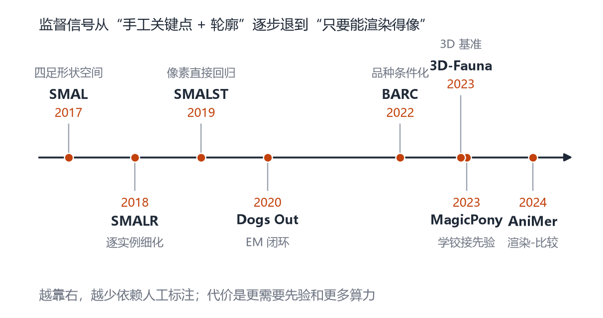
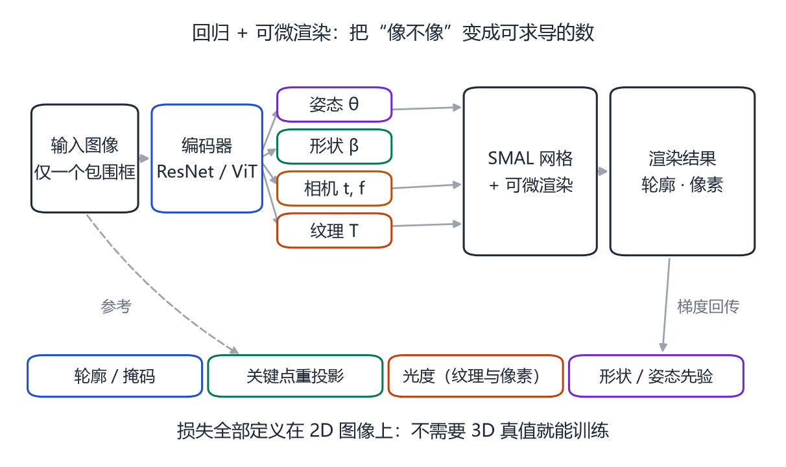
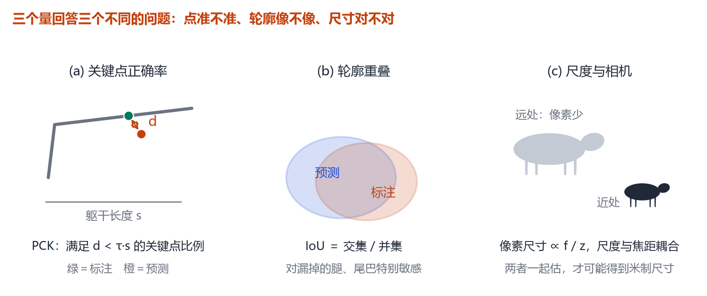
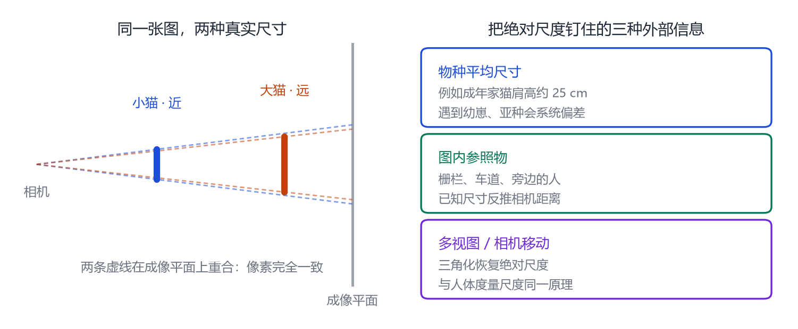

# 第 23 章 动物重建：从 SMALST 到 MagicPony

> **本章导读**：有了 SMAL，下一步是“从一张动物照片反推它的形状与姿态”。这比人体难得多：没有关键点标注、姿态千奇百怪、皮毛还会伪装。这一章按时间讲四代方法：用轮廓和关键点弱监督（SMALST）、用 EM 闭环自我修正（Dogs Out）、用品种分类做先验（BARC）、直接从图片集合学铰接先验（MagicPony）。最后讲评估为什么比人体更棘手。

## 23.1 单图动物的四个难点

**第一，没有关键点。** 人体有 17 个关节的标注规范，动物没有。狮子的肩在哪、马的飞节在哪，不同标注者的定义都可能不同。

**第二，姿态太自由。** 人可以站、坐、走，动物可以跑、跳、飞、游、蜷缩、倒挂。SMAL 的姿态空间覆盖不了这么多。

**第三，纹理伪装。** 斑马条纹、豹纹、鹿的斑点，会让轮廓检测和光流都失效。

**第四，尺度与相机耦合。** 野生动物照片的焦距未知、距离未知，单张图无法确定“这只老虎多大”。

所以，动物重建的方法几乎都依赖**弱监督**：不要求 3D 真值，只用轮廓、2D 关键点、甚至只用“渲染出来像不像”。

<figure class="fig">

<figcaption><b>图 23-1</b>　动物重建的监督信号演化。从 SMAL 的 3D 形状空间，到 SMALST 的轮廓/关键点，到 BARC 的品种分类，再到 MagicPony 的“只要求渲染相似”，人工标注越来越少，对先验与算力的要求越来越高。</figcaption>
</figure>

## 23.2 SMALST：用轮廓和关键点做弱监督

**SMALST**（2019）[@zuffi2021smalst] 是第一代“单图动物”方法。它的输入是一张图和一个包围框，输出 SMAL 的参数。

训练损失全部定义在 2D 上：

- **轮廓损失**：渲染出的剪影与检测到的动物掩码做 IoU；
- **关键点损失**：少量人工标注的 2D 关键点（如鼻尖、耳根、肩、髋）的重投影误差；
- **形状/姿态先验**：限制参数不要跑到不合理的区域；
- **纹理损失**：让渲染的颜色接近原图。

它不需要任何 3D 真值，因此可以用大量网络图片训练。缺点是：轮廓损失对“腿被挡住”“尾巴很细”不敏感，关键点又太少，导致深度和关节角经常估错。

## 23.3 Dogs Out：把拟合放进训练循环

**Who Left the Dogs Out?**（Biggs 等，2020）[@biggs2020dogs] 把 EM 算法用到了动物重建上：

1. **E 步**：用当前网络预测每张图的 SMAL 参数；
2. **M 步**：用这些参数与图像，更新形状/姿态先验；
3. 重复，直到收敛。

它的核心洞察是：**与其手工设计先验，不如让模型从数据里“自己总结”先验。** 在狗的数据上，这个方法能学到不同品种的体型分布，并把姿态估计得更稳。

## 23.4 BARC：品种作为先验

**BARC**（Biggs 等，2022）[@biggs2022barc] 发现：狗的形状差异，很大程度上由**品种**决定。与其让网络从像素里猜“这是柯基还是哈士奇”，不如先做一个品种分类，再把品种信息作为条件输入形状回归。

这就是“Breed-Augmented Regression using Classification”：

- 分类分支预测品种（或品种混合）；
- 回归分支在品种条件下预测形状 $\boldsymbol{\beta}$；
- 两者联合训练，分类的梯度帮助形状分支学到“品种 → 体型”的映射。

结果显示：显式的品种先验能显著改善稀有品种的重建，因为网络不再需要从少量样本里硬记体型。

## 23.5 MagicPony：从图片集合学“怎么动”

**MagicPony**（Wu 等，2023）[@wu2023magicpony] 走得更远：它不需要任何 3D 标注、不需要关键点、不需要相机参数，只用**同一类动物的大量网络图片**，就能学出一个可铰接的 3D 模型。

它的做法大致是：

1. 假设每张图里的动物都是同一个“规范形状”经过关节运动得到的；
2. 用可微渲染，把规范形状渲染到每张图的视角与姿态；
3. 用图像重建损失 + 关节正则，联合优化形状、关节、相机；
4. 训练好后，模型可以“动起来”，也可以迁移到新图片。

<figure class="fig">

<figcaption><b>图 23-2</b>　回归 + 可微渲染的动物重建管线。编码器输出姿态、形状、相机、纹理，渲染后与输入图比较；所有损失都在 2D 上定义，不需要 3D 真值。</figcaption>
</figure>

MagicPony 的意义在于：**它把“动物模型”的构建从“扫描 + 配准”变成了“图片集合 + 优化”**。对于没有玩具、没有扫描的稀有物种，这是唯一可行的路。

## 23.6 数据与评估

动物 3D 数据的规模远小于人体：

- **Animal Kingdom**（2022）[@zhang2022animalkingdom]：大规模动物行为视频数据集，主要用于行为识别，不是 3D。
- **3D-Fauna**（2023）[@li2023fauna]：动物 3D 重建的数据集与基准，提供多物种的 3D 标注。
- **SMAL 的玩具扫描**：仍然是形状空间的主要来源。

评估比人体更棘手，因为“什么算对”没有共识。常用的三个量（图 23-3）：

1. **PCK**：关键点误差小于“躯干长度 × 阈值”的比例；
2. **IoU**：预测剪影与标注掩码的重叠；
3. **尺度误差**：预测的米制尺寸与真实尺寸的差。

<figure class="fig">

<figcaption><b>图 23-3</b>　动物评估的三个侧面。PCK 看关键点准不准，IoU 看轮廓像不像，尺度看“尺寸对不对”。三者经常互相矛盾：轮廓很准的模型，可能把动物估得只有一半大。</figcaption>
</figure>

## 23.7 把这些方法写成同一个优化式

SMALST、Dogs Out、BARC、MagicPony 看起来差别很大，但拆开看，它们解的是同一个问题：

$$
\min_{\boldsymbol{\beta},\boldsymbol{\theta},\mathbf t,\boldsymbol{\pi}}
\underbrace{\lambda_{\text{sil}}E_{\text{sil}}}_{\text{轮廓}}
+\underbrace{\lambda_{\text{kp}}E_{\text{kp}}}_{\text{关键点}}
+\underbrace{\lambda_{\text{tex}}E_{\text{tex}}}_{\text{颜色}}
+\underbrace{\lambda_{\beta}\|\boldsymbol{\beta}\|^2+\lambda_{\theta}\|\boldsymbol{\theta}-\boldsymbol{\theta}_0\|^2}_{\text{先验}},
\tag{23.1}
$$

四项的含义：

- $E_{\text{sil}}$：把网格渲染成剪影，与检测到的动物掩码比较，通常用 IoU 或 Dice；
- $E_{\text{kp}}$：少量 2D 关键点的重投影误差，$\|\pi(\mathbf{J}_k)-\mathbf{j}_k^{\text{obs}}\|^2$；
- $E_{\text{tex}}$：渲染出的颜色与原图的差（只在可见像素上算）；
- 先验：把 $\boldsymbol{\beta},\boldsymbol{\theta}$ 拉回“像动物”的区域。

四个方法的区别，全在**这四项怎么加权、先验从哪里来**：

| 方法 | 主要监督 | 先验从哪来 | 典型失败场景 |
|---|---|---|---|
| SMALST | 轮廓 + 稀疏关键点 | 手工先验（固定权重） | 腿被遮挡时深度错 |
| Dogs Out | 轮廓 + 纹理 | EM 迭代中从数据里学 | 跨物种（先验只对狗好） |
| BARC | 轮廓 + 品种标签 | 品种分类条件化 | 混血品种、无品种标签的物种 |
| MagicPony | 图像重建（无需关键点） | 同类图片集合学出的铰接先验 | 图片太少、姿态分布单一 |

> **一个常被忽略的细节**：$E_{\text{sil}}$ 对“腿在里面还是外面”几乎不敏感，因为剪影只关心像素在不在。这就是为什么动物重建的关节角经常“看上去对、实际上反折”——必须靠 $E_{\text{kp}}$ 和姿态先验把角度约束回来。

## 23.8 尺度与相机：单图只能定到“乘积”

野生动物照片通常没有相机内参，也没有距离。这带来一个原理上的限制，值得单独说清楚。

针孔相机的投影是

$$
u=f\frac{X}{Z},\qquad v=f\frac{Y}{Z}.
\tag{23.2}
$$

如果把动物整体放大 $k$ 倍（$X,Y,Z$ 全部乘以 $k$），同时把 $f$ 乘以 $k$，投影坐标 $u,v$ **完全不变**。这就是单目重建的尺度歧义：

- 你可以得到“$k$ 米大的动物在 $k\cdot Z$ 米处”；
- 但无法区分“一只小猫在两米处”和“一只大猫在四米处”。

工程上的三个解法：

1. **给先验**：假定物种的平均肩高（例如成年家猫约 25 cm），把尺度固定下来；这是最常用也最危险的——遇到幼崽或亚种就会系统性偏大/偏小；
2. **给参照物**：图里有栅栏、车道、人体时，用参照物的已知尺寸反推；
3. **多视图或视频**：相机移动时，三角化能恢复绝对尺度（与第 11 章人体度量尺度完全同一个道理）。

<figure class="fig">

<figcaption><b>图 23-4</b>　尺度歧义。左：小动物在近处与大动物在远处投影到同一张图，像素完全一致；右：真实应用里只能靠“物种平均尺寸、参照物、相机移动”三种外部信息之一把尺度钉住。</figcaption>
</figure>

## 23.9 失败模式

**遮挡**：草丛里的狮子，只露出头，模型会把身体补成“最小可能体积”。

**稀有姿态**：倒挂的蝙蝠、飞翔的鹰，SMAL 的姿态空间里没有。

**纹理伪装**：斑马条纹会让轮廓检测把“条纹”当成“边界”。

**物种外插**：训练集只有四足，遇到长颈鹿、大象、鲸，形状空间只能外插，结果往往比例失调。

**尺度歧义**：没有相机内参，模型只能猜“这是一只小猫还是远处的大猫”。

## 本章小结

- 动物重建依赖弱监督：轮廓、关键点、渲染相似度。
- 四个方法可以写成同一个优化式，区别在权重与先验的来源：SMALST（手工先验）、Dogs Out（EM 学先验）、BARC（品种条件）、MagicPony（图片集合学铰接）。
- 剪影损失对关节角不敏感，必须配关键点与姿态先验，否则会出现“轮廓对、关节反折”。
- 单图存在尺度歧义：只能定到“尺寸 × 距离”的乘积，需要物种先验、参照物或多视图才能钉住绝对尺度。
- 评估看 PCK、IoU、尺度，三者经常矛盾。
- 遮挡、稀有姿态、伪装、物种外插、尺度歧义是主要失败模式。

## 思考题

1. 为什么动物重建很少用 3D 真值？如果要做，成本在哪里？
2. BARC 的“品种分类”会不会引入偏见？比如把混血狗强行归到某个品种。
3. MagicPony 不需要关键点，它靠什么避免“所有动物都塌成同一个形状”？
4. 如果只给你 100 张长颈鹿的图片，你会怎么建模？
