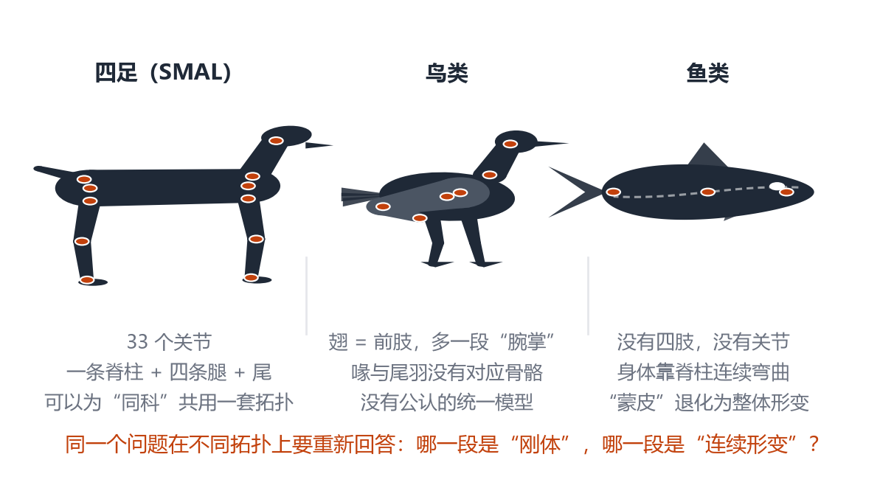
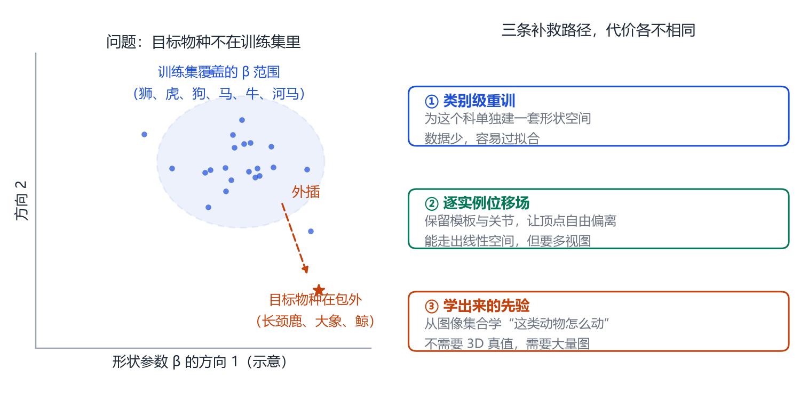
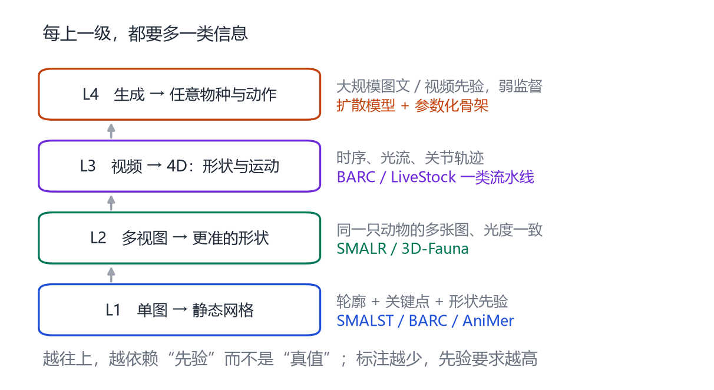
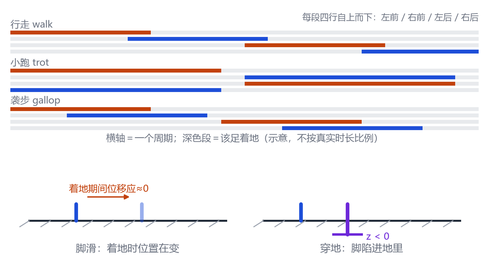

# 第 24 章 跨物种：鸟类、鱼类与动物生成

> **本章导读**：SMAL 只覆盖四足[@zuffi2017menagerie]。世界上还有鸟、鱼、蛇、鲸、昆虫。这一章讨论三件事：不同拓扑的动物如何参数化、跨物种模型如何面对“没见过的物种”、以及生成模型如何被用来“造”动物。最后回到应用与伦理：野生动物保护、畜牧、影视，都需要可信的动物模型。

## 24.1 从四足到鸟类、鱼类

<figure class="fig">

<figcaption><b>图 24-1</b>　三种拓扑。四足（SMAL）有 33 个关节、一条脊柱、四条腿、一条尾巴；鸟类的前肢变成翅膀，多出一段“腕掌”；鱼类没有四肢，身体靠脊柱连续弯曲。拓扑不同，参数化方式必须重新设计。</figcaption>
</figure>

**鸟类**的挑战在于翅膀。鸟的翅膀在解剖上对应前肢，但骨骼数量、关节方向、羽毛结构都不同：

- 翅膀有一段额外的“腕掌骨”，用来折叠；
- 羽毛没有骨骼支撑，却决定了轮廓；
- 喙和尾羽没有对应的骨骼，SMAL 的顶点无处安放。

所以鸟类模型通常需要：一套专门的翅膀骨架、一层“羽毛壳”（用额外的面片/粒子表示），以及一个能处理“非刚体”的形变模型。

**鱼类**的挑战更根本：鱼没有四肢，身体是一整条连续的脊柱。LBS 的“刚体段 + 关节”假设在这里几乎失效：

- 鱼的弯曲是连续的，不是几个关节的旋转；
- 鳍是薄片，会随水流摆动；
- 鳞片、鳃盖的运动，需要更细的形变。

可行的做法是把鱼表示成“脊柱曲线 + 截面放样”：给定一条三维曲线和沿曲线的半径/截面，生成身体表面。这样，“姿态”就是曲线的控制点，“形状”就是截面的参数。

把它写成式子会更清楚。设脊柱曲线为 $\mathbf{c}(s)$（$s\in[0,1]$ 是沿身体的参数），在每一点取三个方向：切向 $\mathbf{t}(s)$、法向 $\mathbf{n}(s)$、副法向 $\mathbf{b}(s)$，它们构成沿曲线的局部坐标系（也叫标架）。若截面在局部坐标下是 $\mathbf{q}(\varphi)=(0,\ r(s)\cos\varphi,\ r(s)\sin\varphi)$，则身体表面为

$$
\mathbf{S}(s,\varphi)=\mathbf{c}(s)+r(s)\cos\varphi\,\mathbf{n}(s)+r(s)\sin\varphi\,\mathbf{b}(s).
\tag{24.1}
$$

这个式子把所有东西拆得很干净：

- **形状**由两个函数决定——中心线 $\mathbf{c}(s)$ 与半径 $r(s)$；
- **姿态**就是改变 $\mathbf{c}(s)$ 的弯曲与扭转；
- 想加鳍、鱼鳍的薄片，就在某些 $s$ 上额外贴一片面片，不需要改整体拓扑。

代价是：截面只能是“一圈圈套在中心线上”的形状，脸部、鳍根这种局部细节表达不了；而且曲线一变，所有顶点的编号就跟着变——这正好丢掉了 SMAL 最宝贵的东西：**跨个体的顶点对应**。所以“曲线参数化”通常只用于单个体重建，不适合建统计形状空间。

> **两条路线的取舍可以总结成一句话**：想要统计（PCA、跨物种插值、动作迁移），就必须固定拓扑、做顶点对应；想要任意拓扑（鱼、蛇、鸟），就只能放弃对应，改用隐式表示。目前还没有同时拿到两者的成熟方案。

## 24.2 跨物种：共享什么，不共享什么

跨物种模型的核心问题是：**哪些东西可以共享，哪些必须分开？**

- **可以共享**：形状空间的统计方法（PCA）、蒙皮的计算框架、可微渲染、关键点定义的部分语义（头、躯干、四肢）。
- **不能共享**：拓扑（顶点数、连接关系）、关节数量与层级、局部解剖结构（角、象鼻、翅膀、鳍）。

SMAL 的选择是“共享拓扑 + 共享骨架”，所以只能覆盖四足。要覆盖鸟类/鱼类，只有三条路：

1. **多套模型**：四足用 SMAL、鸟用 BirdModel、鱼用 FishModel，互不兼容；
2. **超模型**：设计一套“万能拓扑”，用额外的顶点/关节表示物种特有的结构。难度极大；
3. **隐式/神经表示**：不做顶点对应，用隐式场或神经场表示形状，用骨架/曲线控制运动。这是目前最活跃的方向。

<figure class="fig">

<figcaption><b>图 24-2</b>　目标物种不在训练集里时的三条补救路径：类别级重训（数据少、易过拟合）、逐实例位移场（能走出线性空间，但需要多视图）、学出来的先验（不需要 3D 真值，但需要大量图）。</figcaption>
</figure>

## 24.3 任务阶梯：从单图到生成

<figure class="fig">

<figcaption><b>图 24-3</b>　动物任务的四级阶梯。L1 单图静态网格，L2 多视图更准形状，L3 视频 4D，L4 任意物种与动作的生成。越往上，越依赖先验而不是真值。</figcaption>
</figure>

**L1 单图 → 静态网格**：SMALST、BARC、AniMer 这一类[@zuffi2021smalst,@biggs2022barc,@zuffi2024animer]。输入一张图，输出 SMAL 参数。适合“拍一张照片，估个体型”。

**L2 多视图 → 更准形状**：同一只动物的多张图，利用光度一致性约束形状。SMALR、3D-Fauna 属于这一类[@li2023fauna]。

**L3 视频 → 4D**：从视频恢复形状 + 运动。需要时序、光流、关节轨迹。BARC、LiveStock 的流水线可以扩展到视频[@biggs2022barc,@li2024livestock]。

**L4 生成 → 任意物种与动作**：用大规模图文/视频先验，生成没见过的物种、没见过的动作。扩散模型 + 参数化骨架是目前的组合。

## 24.4 生成动物：能做什么，不能做什么

生成模型在动物上的应用有三类：

1. **文本/图像到 3D 动物**：用 SDS 或 3DGS，从文字/图片生成动物模型。适合影视、游戏的概念设计。
2. **动作生成**：给定“一只狗在跑”，生成符合解剖的动作。难点是四足步态、接触、平衡。
3. **物种插值**：在形状空间里插值，生成“狮虎兽”式的混合体。科学上不严谨，但视觉上有用。

不能做的也很明显：

- **解剖正确性**：生成模型不懂“这块骨头应该连到哪里”，容易生成反关节、多余肢体。
- **物理合理性**：脚会滑、身体会穿模。
- **个体识别**：生成的是“一类动物”，不是“这一只”。

## 24.5 应用与伦理

**野生动物保护**：用相机陷阱（camera trap）的图像估计种群数量、体型、健康状况。动物参数化模型可以提供“可比较的体型指标”，比人工测量更客观。

**畜牧**：牛、猪、羊的体重估测、跛行检测、体况评分。LiveStock 这类数据集就是为此准备的。

**影视与游戏**：快速生成可信的动物角色、动作重定向、群集动画。

**伦理风险**：生成逼真的动物视频可能被用于虚假宣传、非法野生动物贸易；相机陷阱数据涉及隐私与地点泄露。技术本身中性，使用需要规范。

## 24.6 四足步态：为什么“会动”比“长得像”更难

形状重建的目标是“静止时像”；而一旦要让它走路，就会碰到一套完全不同的约束。四足动物的步态（gait）本质上是**四条腿的相位关系**：

| 步态 | 相位关系 | 典型速度 | 能量特征 |
|---|---|---|---|
| 行走 walk | 四条腿依次落地，任意时刻至少三足着地 | 慢 | 稳定性最好 |
| 小跑 trot | 对角两足同时落地（左前 + 右后） | 中 | 像弹簧，动能与势能交替 |
| 袭步 gallop | 前腿先后落地，中间有腾空期 | 快 | 背部弯曲储能 |

把步态写成参数，就是给每条腿一个相位偏移 $\phi_i$ 与周期 $T$：

$$
\theta_{\text{leg }i}(t)=\theta_{\text{leg}}\big(2\pi (t/T+\phi_i)\big),\qquad i=1,\dots,4.
\tag{24.2}
$$

小跑时对角腿同相（$\phi_1=\phi_4$，$\phi_2=\phi_3$，两组相差半个周期）；行走时四个相位均匀分布。只要把相位关系定对，即使关节角是从动作捕捉里搬来的，看上去也会“像在跑”而不是“在飘”。

真正难的是**接触**。脚不能穿地、着地时不能滑动、身体重心必须在支撑多边形内（否则就会倒）。这三条约束写进优化里，通常长这样：

$$
E_{\text{contact}}=\sum_{t}\sum_{i}\mathbf{1}[\text{着地}_{i,t}]\Big(\underbrace{\|\mathbf{p}_{i,t}-\mathbf{p}_{i,t+1}\|^2}_{\text{不滑}}
+\underbrace{\max(0,-z_{i,t})^2}_{\text{不穿地}}\Big).
\tag{24.3}
$$

这里 $\mathbf{p}_{i,t}$ 是第 $i$ 只脚在第 $t$ 帧的世界坐标，$z$ 是高度（地面为 0）。$\mathbf{1}[\cdot]$ 是“只对着地的帧算”——所以还得先估一个“哪只脚着地”的开关变量，这又是一个鸡生蛋问题：接触靠动作定，动作又靠接触约束。工程上一般交替优化，或者用一个小的分类头直接从图像/姿态预测接触。

<figure class="fig">

<figcaption><b>图 24-4</b>　步态与接触。上：三种步态的四足着地时序（深色为着地）；下：脚滑与穿地是两类不同错误——前者是“着地时位置在变”，后者是“脚陷进地里”，必须分别约束。</figcaption>
</figure>

## 24.7 把一个新物种接进现有流水线：检查清单

假设你手上已经有一套跑通的四足动物重建代码，现在想支持“长颈鹿”。按下面六步排查，能避开大部分坑：

1. **拓扑能不能用**：长颈鹿的脖子占身体一半，SMAL 的脊柱节数表达不了。要么接受“短脖子四足”的近似，要么换带更长脊柱的模型。
2. **关节数对不对**：新增的颈节意味着 $\boldsymbol{\theta}$ 维度变化，蒙皮权重也得重新学——不能只改关节数不改权重。
3. **形状空间支不支持**：如果新物种在训练集的形状空间里只能“外插”，先检查外插幅度（用 $\boldsymbol{\beta}$ 的先验方差归一化后看多少 $\sigma$）。超过 $4\sigma$ 的结果基本不能信。
4. **关键点语义**：能复用哪些点（肩、髀、膝、蹄）？哪些需要新定义（角、頸背、尾巴分节）？标注规范不一致会让评估全乱。
5. **尺度先验**：给一个物种的平均肩高与体长区间，把单目重建的尺度钉在一个合理范围。
6. **评估集**：至少要 20–30 张图的人工标注（轮廓 + 少量关键点），否则无法判断“是不是变好了”。

> **一个现实建议**：如果你的目标只是“让这个物种看起来能动”，用生成模型或动画重定向会快得多；只有在需要**可比较的体型指标**（保护、畜牧）时，才值得花力气做参数化重建。

## 24.8 开放问题

- **统一拓扑**：能否设计一套“可扩展”的拓扑，让新物种只加顶点、不改连接？
- **少样本**：一个物种只有几十张图，如何学出可信的 3D？
- **运动先验**：四足步态、鸟类振翅、鱼类摆尾，能否用一个统一的动力学模型描述？
- **评估**：没有 3D 真值，如何公平比较不同方法？
- **跨域**：玩具上训练的模型，如何迁移到真实动物？

## 本章小结

- 鸟类、鱼类的拓扑与四足不同，不能直接套 SMAL。
- 连续弯曲的身体可以用“脊柱曲线 + 截面放样”表示，但会丢掉顶点对应，不适合建统计形状空间。
- 跨物种可共享统计方法与渲染框架，但不能共享拓扑与关节。
- 四足“会动”的关键是相位关系与接触约束：不滑、不穿地、重心在支撑多边形内。
- 任务分四级：单图、多视图、视频、生成；越往上越依赖先验。
- 生成动物能用于影视、游戏，但解剖与物理正确性仍不足。
- 保护、畜牧、影视是主要应用，伦理风险需要重视。

## 思考题

1. 如果让你设计一个“鸟类参数化模型”，你会怎么表示羽毛？
2. 鱼类没有关节，LBS 还能用吗？如果不能，替代方案是什么？
3. 少样本物种建模，你会优先加数据还是加先验？为什么？
4. 生成动物的“解剖正确性”可以怎样评估？
