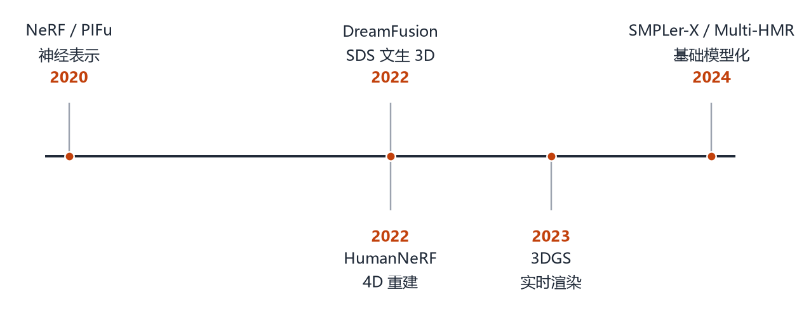
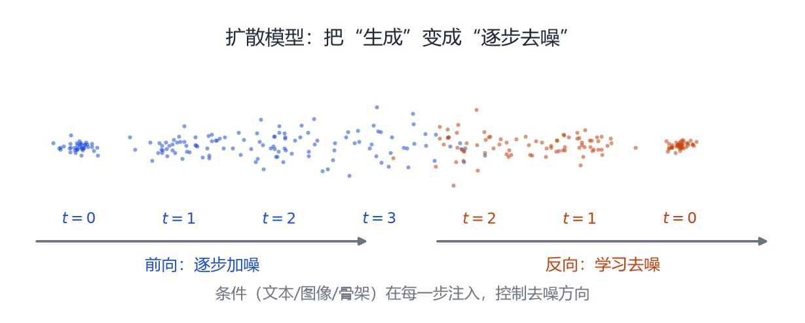
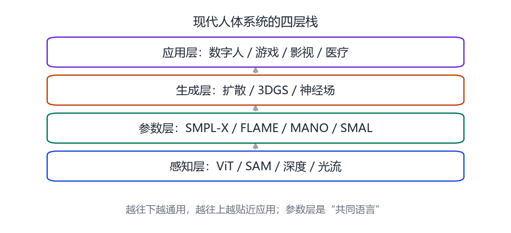

# 第 25 章 生成式人体：从扩散到基础模型

> **本章导读**：2020 年之后，人体领域出现三条新线索：神经渲染让外观达到照片级，扩散模型让“用文字生成人”成为可能，视觉基础模型让“从任意图像提取人体”变得更鲁棒。这一章不追求罗列所有新论文，而是把这三条线索讲清楚，并给出一个“感知—参数—生成—应用”的四层框架。读完你会知道，今天的“人体基础模型”到底由哪些零件拼成。

## 25.1 三条趋势

**趋势一：表示从“网格”走向“神经场/高斯”。** NeRF[@mildenhall2020nerf]、3DGS[@kerbl20233dgs] 能表示头发、布料、皮肤细节，突破了固定拓扑的限制。

**趋势二：生成从“判别”走向“扩散”。** 以前是“给图预测参数”，现在是“从噪声生成参数/外观”，可以无条件生成，也可以用文本、音频、骨架控制。

**趋势三：感知从“专用网络”走向“基础模型”。** SAM 分割[@kirillov2023sam]、DINOv2 特征[@oquab2024dinov2]、深度大模型[@yang2024depthanything]、视觉语言模型，提供了强大的通用先验，人体系统越来越多地“站在巨人的肩膀上”。

<figure class="fig">

<figcaption><b>图 25-1</b>　2020 年之后的关键节点。神经表示、扩散生成、3DGS、基础模型四条线交织，最终汇入“人体基础模型”。</figcaption>
</figure>

## 25.2 扩散模型：零基础版

<figure class="fig">

<figcaption><b>图 25-2</b>　扩散模型的前向与反向过程。前向把数据逐步加噪，直到变成纯高斯噪声；反向学习一个去噪网络，从噪声一步步恢复数据。条件信息在每一步注入。</figcaption>
</figure>

扩散模型的思想可以用一句话概括：**先学会“加噪”，再学会“去噪”。**

**前向过程**：给定一张图（或一组人体参数）$\mathbf{x}_0$，每一步加一点高斯噪声：

$$
\mathbf{x}_t=\sqrt{1-\beta_t}\,\mathbf{x}_{t-1}+\sqrt{\beta_t}\,\boldsymbol{\epsilon},
\qquad \boldsymbol{\epsilon}\sim\mathcal{N}(\mathbf{0},\mathbf{I}).
\tag{25.1}
$$

加 $T$ 步之后，$\mathbf{x}_T$ 几乎就是纯噪声。这个过程没有可学参数，是固定的。

**反向过程**：训练一个网络 $\boldsymbol{\epsilon}_\theta(\mathbf{x}_t,t)$，输入“带噪数据 + 时间步”，输出“这一步加进去的噪声”。损失就是

$$
L=\mathbb{E}_{t,\mathbf{x}_0,\boldsymbol{\epsilon}}\big\|\boldsymbol{\epsilon}-\boldsymbol{\epsilon}_\theta(\mathbf{x}_t,t)\big\|^2.
\tag{25.2}
$$

训练好之后，从纯噪声 $\mathbf{x}_T$ 开始，反复“预测噪声 → 减去一部分 → 加一点点新噪声”，就能生成一张新图。

**条件生成**：如果想“按文本生成”，把文本编码也喂给去噪网络；如果想“按骨架生成”，把骨架作为额外通道。条件的作用是**控制去噪方向**，让最终结果符合要求。

> **为什么扩散模型适合人体？** 因为人体参数空间（SMPL 的 82 维、SMPL-X 的一百多维）比像素空间小得多，扩散模型容易训练；而且生成的是参数，天然可驱动、可重定向。

## 25.3 文本到 3D：SDS 与它的后代

2022 年，DreamFusion[@poole2023dreamfusion] 提出 **Score Distillation Sampling（SDS）**：不需要 3D 训练数据，只用一个预训练的 2D 扩散模型，就能优化一个 3D 表示（NeRF、网格、高斯），使它从任意视角渲染出来都“像文本描述的东西”。

做法是：

1. 随机采一个视角，渲染当前 3D 表示；
2. 把渲染图加噪，喂给 2D 扩散模型；
3. 扩散模型告诉你“这张图应该往哪个方向改”；
4. 把这个梯度反传回 3D 表示，更新它。

SDS 的意义在于：**它把 2D 生成模型的知识“蒸馏”到 3D**。对人体的应用是：用文本描述“一个穿红裙子的女人在跳舞”，生成对应的 3D 人体/动作。但 SDS 容易产生“多面体”伪影，且优化慢。

后来的工作用 3DGS 替代 NeRF、用视频扩散替代图像扩散、用人体参数化模型做先验，逐步改善了质量与速度。

## 25.4 3DGS：实时的照片级化身

3D Gaussian Splatting 用一堆高斯椭球表示场景，每个高斯有位置、协方差、颜色、透明度。渲染时把它们投影到屏幕、排序、混合，速度极快。

在人体上，3DGS 有两种用法：

- **静态重建**：多视角拍摄一个人，重建出可自由视角观看的高斯化身；
- **可驱动化身**：把高斯绑定到 SMPL/FLAME 的面片上，人一动，高斯跟着动（SplattingAvatar、GaussianAvatars）。

它的挑战是：

1. **泛化**：换姿势、换表情时，高斯会拉伸、露洞；
2. **存储**：一个高质量化身可能有几十万到几百万个高斯；
3. **编辑**：想换衣服、换发型，需要重新训练或额外解耦。

## 25.5 基础模型如何改变人体重建

**SAM** 提供“任意物体分割”，可以自动把人从背景里抠出来，减少对检测框的依赖。

**DINOv2** 提供强大的自监督视觉特征，替代 ImageNet 预训练的 ResNet，显著提升跨域泛化。

**深度大模型**（Depth Anything、Metric3D）提供单目深度/度量深度，帮助解决尺度歧义。

**视觉语言模型**（CLIP、LLaVA 等）提供“文本—图像”对齐，用于文本驱动的编辑、检索、生成。

这些模型不是为人体设计的，但它们提供了“通用感知”，让 人体系统可以把精力放在“人体特有的先验”上。

<figure class="fig">

<figcaption><b>图 25-3</b>　现代人体系统的四层栈。感知层提供通用特征，参数层提供人体先验，生成层负责细节与多样性，应用层面向具体场景。参数层是承上启下的“共同语言”。</figcaption>
</figure>

## 25.6 一个正在形成的“人体基础模型”

把上面的线索拼起来，可以看到一个正在成形的架构：

1. **输入**：图像/视频/文本/音频；
2. **感知**：基础模型提取特征、分割、深度；
3. **参数化**：回归 SMPL-X/FLAME/MANO 参数（身体、脸、手）；
4. **生成**：扩散/3DGS 补细节、补外观、补动作；
5. **输出**：可驱动、可编辑、可渲染的化身。

这个架构的关键是**参数层**：它把“千变万化的人”压缩成一组标准参数，让不同模块可以对接。没有参数层，每个模块都要自己定义“人”，系统会碎成一地。

## 25.7 开放问题

**数据**：高质量 4D 人体数据仍然稀缺；合成数据有域差异；网络数据有隐私与版权问题。

**评估**：照片级真实感、物理合理性、身份一致性、可控性，缺少统一指标。

**效率**：扩散模型慢、3DGS 占内存、大模型推理贵；实时数字人仍然需要大量工程优化。

**伦理**：Deepfake、身份盗用、虚假视频；参数化模型让“换脸/换身”变得更容易，监管与检测必须跟上。

**通用性**：儿童、老人、孕妇、残障人士、不同种族，现有模型的覆盖仍然不足。

## 本章小结

- 三条趋势：神经表示、扩散生成、基础模型。
- 扩散模型学习“加噪—去噪”，条件控制生成方向；SDS 把 2D 扩散知识蒸馏到 3D。
- 3DGS 用高斯椭球实现实时渲染，可绑定到参数化模型上做可驱动化身。
- SAM、DINOv2、深度大模型提供通用感知，人体系统越来越“站在巨人肩膀上”。
- 四层栈：感知 → 参数 → 生成 → 应用；参数层是共同语言。
- 数据、评估、效率、伦理、通用性是主要开放问题。

## 思考题

1. 为什么扩散模型在“参数空间”上训练比在“像素空间”上更容易？
2. SDS 的梯度来自 2D 扩散模型，它为什么能让 3D 表示变得“像文本”？
3. 3DGS 化身在换姿势时为什么会露洞？有哪些补救办法？
4. 如果基础模型已经能分割、测深度，参数化人体模型还有存在的必要吗？
