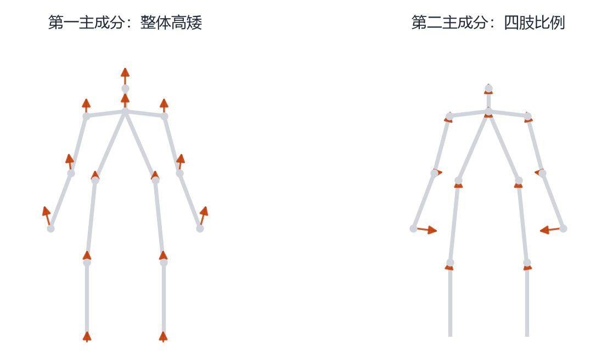
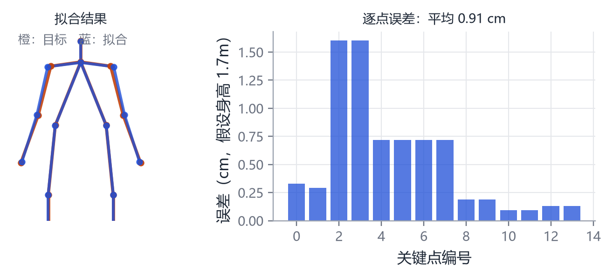

# 第 26 章 动手实践：从 PCA 到拟合

> **本章导读**：这一章把前 25 章的核心公式变成可以运行的代码。我们刻意不依赖 SMPL 模型文件（它需要申请许可），而是用 14 个二维关键点搭一个“迷你人体”，完整走一遍 PCA、蒙皮、拟合。所有代码都在 `scripts/ch26_demo.py` 里，跑一遍只要几秒。读完你应该能自己改参数、加约束、换数据。

## 26.1 环境准备

只需要三样东西：

```bash
python -m pip install numpy matplotlib scipy
```

本书使用的 Python 是 3.12。代码不依赖 GPU，也不依赖任何深度学习框架。

## 26.2 实验一：用 PCA 学一个“迷你形状空间”

先定义一个人：14 个关键点（头、颈、双肩、双肘、双腕、双髋、双膝、双踝），由 7 个参数控制：身高、肩宽、髋宽、臂长、腿长、手臂张开角、腿张开角。

```python
def body(params):
    h, sw, hw, al, ll, pa, pl = params
    ...
    return np.array([head, neck, sh_l, sh_r, el_l, el_r, wr_l, wr_r,
                     hip_l, hip_r, kn_l, kn_r, an_l, an_r])
```

随机采样 300 个人，把每个人展平成 28 维向量，做 PCA：

```python
def pca(X, k=3):
    mu = X.mean(0)                 # 均值
    Xc = X - mu                    # 中心化
    C = Xc.T @ Xc / (len(X) - 1)   # 协方差
    w, V = np.linalg.eigh(C)       # 特征分解
    idx = np.argsort(w)[::-1]
    return mu, V[:, idx][:, :k], w[idx][:k]
```

把第一主成分的位移画出来，就是图 26-1 左边那组箭头：所有关键点一起向上，代表“整体变高”。第二主成分则让手臂和腿的末端向外，代表“四肢比例变长”。

<figure class="fig">

<figcaption><b>图 26-1</b>　从 300 个随机样本里学出的主成分。灰色是均值骨架，橙色箭头是关键点在 $+2\sigma$ 时的位移。左：整体高矮；右：四肢比例。</figcaption>
</figure>

> **你可以改的地方**：把采样标准差从 0.06 改成 0.15，看主成分是否还是“高矮”；把样本数从 300 改成 20，看基向量是否变得杂乱。

## 26.3 实验二：二十行实现 LBS

下面是一个二维、两根骨头的 LBS，足够看清公式的每个部分。

```python
import numpy as np

def rot2(a):
    c, s = np.cos(a), np.sin(a)
    return np.array([[c, -s], [s, c]])

def lbs(points, weights, rotations, pivots):
    """
    points:  (N, 2) 静止顶点
    weights: (N, 2) 每个顶点对两根骨头的权重，行和为 1
    rotations: list of 2 个旋转角（弧度）
    pivots: list of 2 个关节位置 (2,)
    """
    out = np.zeros_like(points)
    for k in range(2):
        R = rot2(rotations[k])
        p = pivots[k]
        # 先把顶点搬到关节局部坐标，旋转，再搬回来
        moved = (points - p) @ R.T + p
        out += weights[:, k:k+1] * moved
    return out
```

注意 `(points - p) @ R.T + p` 就是 $\mathbf{G}_k\mathbf{G}_k(0)^{-1}\mathbf{t}$ 在二维、无平移时的样子：先减去关节位置（进入局部坐标），乘旋转，再加回关节位置。三维版本只是把 $2\times2$ 换成 $4\times4$。

如果你把 `weights` 设成 0/1 硬切换，弯曲处会撕裂；设成 0.5/0.5，弯曲处会变细。这就是第 5 章讲的体积损失。

## 26.4 实验三：从 2D 关键点拟合形状

假设我们观测到一组“目标关键点”，想反推它属于形状空间里的哪个位置。这就是一个最小二乘问题：

```python
from scipy.optimize import least_squares

def fit(target, mu, P, w):
    def resid(z):
        return (mu + P @ z - target.ravel())
    z0 = np.zeros(P.shape[1])
    # 限制在 ±3 个标准差内，防止外插出“外星人”
    bounds = (-3 * np.sqrt(w), 3 * np.sqrt(w))
    sol = least_squares(resid, z0, bounds=bounds)
    return sol.x
```

`P` 是主成分矩阵，`mu` 是均值，`z` 是要求解的系数。`least_squares` 会自动选初值、算雅可比、迭代到收敛。

运行结果见图 26-2：蓝色是拟合结果，橙色是目标，平均误差不到 1 厘米（按身高 1.7 米折算）。误差最大的点在肩膀和手肘，因为这两个位置对“臂长”和“张开角”最敏感，而这两个参数在数据里相关性很强，存在歧义。

<figure class="fig">

<figcaption><b>图 26-2</b>　拟合结果。左：蓝色拟合与橙色目标几乎重合；右：逐点误差，肩、肘处最大。这不是代码写错了，而是参数之间存在歧义——不同的臂长 + 张开角组合可以产生几乎相同的关键点。</figcaption>
</figure>

> **这就是“病态问题”**：数据只能约束某些方向，另一些方向几乎不受约束。解决办法是加先验（正则项）或加更多视角。

## 26.5 换成真实的 SMPL

真实 SMPL 的使用流程与上面完全一样，只是把“14 个关键点”换成“6890 个顶点”，把“7 个参数”换成“10 + 72 个参数”。

### 26.5.1 获取模型

SMPL、SMPL-H、SMPL-X、MANO、FLAME、SMAL 都需要在各自官网注册并同意许可协议，不能随意分发。官方入口：

- SMPL：`smpl.is.tue.mpg.de`
- SMPL-X：`smpl-x.is.tue.mpg.de`
- MANO：`mano.is.tue.mpg.de`
- FLAME：`flame.is.tue.mpg.de`
- SMAL：`smal.is.tue.mpg.de`

下载后会得到 `.pkl` 或 `.npz` 文件，里面包含模板顶点、形状基、姿势基、关节回归器、蒙皮权重。

### 26.5.2 用 smplx 库加载

```python
import smplx, torch

model = smplx.create("models/", model_type="smplx", gender="neutral",
                     use_pca=False, batch_size=1)
out = model(betas=torch.zeros(1, 10),
            expression=torch.zeros(1, 10),
            body_pose=torch.zeros(1, 63),
            global_orient=torch.zeros(1, 3),
            left_hand_pose=torch.zeros(1, 45),
            right_hand_pose=torch.zeros(1, 45))
verts = out.vertices          # (1, 10475, 3)
joints = out.joints           # (1, 54, 3)
```

注意几个坑：

- `body_pose` 是 63 维（21 个关节 × 3），不含根关节；
- `global_orient` 单独给；
- 手部姿态默认是 PCA 空间，`use_pca=False` 时是 45 维轴角；
- 坐标系是 $y$ 向上、面朝 $+z$，渲染前先确认。

### 26.5.3 一个最小的渲染

不想装 PyTorch3D 的话，可以用 matplotlib 的 3D 散点/三角面：

```python
import matplotlib.pyplot as plt
from mpl_toolkits.mplot3d.art3d import Poly3DCollection

V = verts[0].detach().numpy()
F = model.faces
ax = plt.figure(figsize=(6, 8)).add_subplot(projection="3d")
ax.add_collection3d(Poly3DCollection(V[F], alpha=0.3, facecolor="tan"))
ax.set_xlim(V[:,0].min(), V[:,0].max())
ax.set_ylim(V[:,2].min(), V[:,2].max())
ax.set_zlim(V[:,1].min(), V[:,1].max())
ax.view_init(elev=10, azim=-60)
```

这段代码很慢，只适合检查模型是否加载正确。要做实时渲染，用 PyTorch3D、nvdiffrast 或 Blender。

## 26.6 三个可以立刻做的练习

**练习一：把 LBS 改成三维。** 把 `rot2` 换成 `scipy.spatial.transform.Rotation`，把关节位置换成三维，观察弯曲时体积如何变化。

**练习二：给拟合加正则。** 在 `resid` 里加上 `0.1 * z`，看误差和参数范围如何变化。这就是第 2 章的岭回归。

**练习三：加一个“关节限位”。** 给每个角度加 `bounds`，比如肘部只能向一个方向弯，观察拟合结果是否更合理。

## 本章小结

- PCA、LBS、最小二乘都可以用几十行 NumPy 实现。
- 拟合的本质是“在形状空间里找一组系数，使重建关键点与观测最接近”。
- 参数之间存在歧义时，拟合误差会在某些点集中，这不是 bug，是问题的病态性。
- 真实 SMPL 的使用流程相同，只是维度更大、需要申请模型许可。
- 先在小数据上跑通，再换大模型，是学习任何几何库的正确顺序。

## 思考题

1. 把 `least_squares` 的初值从 0 改成 $3\sigma$，结果会变吗？为什么？
2. 如果在 LBS 里把权重之和改成 1.2，模型会发生什么？
3. 为什么真实 SMPL 的 `body_pose` 是 63 维而不是 72 维？
4. 你能设计一个“只看轮廓、不看关键点”的拟合损失吗？
