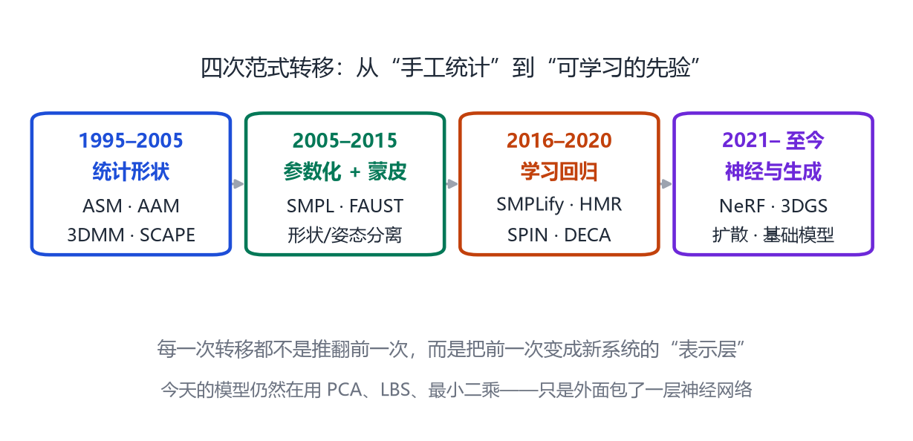

# 第 27 章 研究脉络与未来

> **本章导读**：这是全书的最后一章。我们不再介绍新模型，而是把四条主线放回同一张地图，看看它们从哪里来、现在走到哪、接下来可能往哪走。最后给准备进入这个领域的读者一些具体建议：读什么、怎么读、怎么做出自己的东西。

## 27.1 四次范式转移

<figure class="fig">

<figcaption><b>图 27-1</b>　人体参数化技术的四次范式转移。每一次都把前一次的成果“封装”成新系统的一层，而不是抛弃它。</figcaption>
</figure>

**第一次（1995–2005）：统计形状。** ASM、AAM 证明了“从样本里学形状先验”可行；3DMM 把它带到三维人脸；SCAPE 把形状与姿态分开。这一阶段的关键词是**对应 + PCA**。

**第二次（2005–2015）：参数化 + 蒙皮。** SMPL 用 LBS + blendshape 把模型做得又简单又可微；FAUST 提供了评测基准。这一阶段的关键词是**实时 + 可微 + 标准格式**。

**第三次（2016–2020）：学习回归。** SMPLify 用优化从图像反推参数；HMR 用网络直接回归；SPIN 把两者结合；DECA、FrankMocap 把同样思路带到脸和手。这一阶段的关键词是**图像 → 参数**。

**第四次（2021 至今）：神经与生成。** NeRF、3DGS 把外观做到照片级；扩散模型让生成变得可控；SAM、DINOv2、深度大模型提供通用感知。这一阶段的关键词是**细节 + 生成 + 基础模型**。

值得注意的是：每一次转移都没有让前一次“过时”。今天最先进的系统，内部仍然在跑 PCA、LBS、最小二乘，只是外面包了神经网络和神经渲染。

## 27.2 不变的三角：表示、先验、拟合

把 27 章的内容压缩，你会发现所有方法都在处理同一个三角：

1. **表示**：用什么描述人？网格、参数、隐式场、高斯。
2. **先验**：什么才算“像人”？PCA 的形状空间、姿态先验、物理约束、扩散模型的分布。
3. **拟合**：如何从观测推回表示？优化、回归、或两者的结合。

三者互相制约：

- 表示越灵活，先验越难写，拟合越容易过拟合；
- 先验越强，拟合越稳，但可能生成“平均脸”、丢失个性；
- 拟合越快，通常越依赖前两者的简化。

今天的研究创新，本质上都是在三角的某一条边上做改进：换一个更强的表示（3DGS）、学一个更好的先验（扩散）、设计一个更快的拟合（Transformer）。

## 27.3 未来可能的方向

**统一模型。** 身体、脸、手、动物目前还是四套模型。未来可能出现一个“全物种、全年龄、全表情”的统一参数化模型，用同一套骨架和形状空间覆盖人、猿、狗、鸟。SMAL 已经展示了跨物种的可行性，但离“统一”还很远。

**数据与标注。** 高质量 4D 数据仍然稀缺。合成数据、自监督、视频自标注是三条可能的路。谁能低成本地获得“带对应、带物理、带语义”的数据，谁就能训练出更好的模型。

**物理与接触。** 今天的人体模型大多不懂物理：脚会滑、手会穿模、衣服不会飘。把刚体、软体、布料仿真与参数化模型结合，是数字人走向“可信”的关键。

**交互与行为。** 从“这个人在做什么动作”到“他为什么做、接下来要做什么”，需要把动作、物体、场景、语言结合起来。手物交互是第一步，长时序任务规划是下一步。

**可控与可解释。** 生成模型越强，越需要“可编辑”：改一个属性，不要连带改变其他属性。解耦表示（身份/表情/姿态/光照/衣服）仍是核心难题。

**伦理与安全。** 参数化模型让“换脸、换身、换动作”变得廉价。检测、水印、授权、法规，会和生成技术一起演进。

## 27.4 给读者的建议

**第一，先动手，再读论文。** 把第 26 章的代码跑一遍，改几个参数，比读十篇综述更有用。

**第二，沿着一条主线读。** 不要从 1995 年读到 2025 年，而是选一个对象（比如人脸），把它的 5–8 篇关键论文读透，再横向扩展到其他对象。

**第三，复现一个最小的实验。** 不需要复现 SOTA，复现一个 loss、一个模块、一个小数据集上的结果，就足以理解论文的“手感”。

**第四，关注评估，而不只是模型。** 一个方法的价值，一半在它解决的问题，一半在它如何被证明解决了问题。学会看对齐方式、真值来源、失败案例。

**第五，保持对“人”的理解。** 参数化模型再复杂，描述的还是人的形状与运动。解剖、比例、姿态习惯、文化差异，这些“非技术”的知识，往往决定模型是否可信。

## 27.5 结语

从 1995 年 ASM 的几十个轮廓点，到今天能实时驱动、照片级渲染、用文字生成的人体基础模型，这个领域走了三十年。它的核心思想却异常朴素：

> **用少数参数，描述一个高维的形状；用统计先验，约束不合理的解；用可微的管线，把模型和图像连起来。**

如果你读完了这本书，并且能用自己的话解释这句话，那么你已经具备了进入这个领域的基础。剩下的，就是选一个你真正感兴趣的问题，动手做。

## 本章小结

- 四次范式转移：统计形状 → 参数化蒙皮 → 学习回归 → 神经与生成。
- 所有方法都在处理“表示—先验—拟合”的三角。
- 未来方向：统一模型、数据、物理、交互、可控、伦理。
- 学习建议：动手、沿主线、复现最小实验、重视评估、理解人。

## 思考题

1. 如果让你预测 2030 年的人体模型，它会是什么样？哪些今天的限制会被解决？
2. “统一模型”最大的技术障碍是什么？是数据、架构，还是评估？
3. 为什么“物理约束”在视频里比单帧更重要？
4. 选一个你最感兴趣的应用（游戏、医疗、影视、健身），画出它需要的技术栈。
