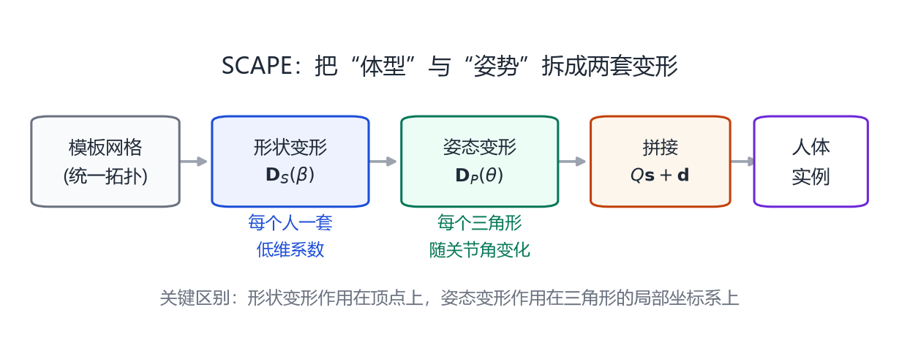
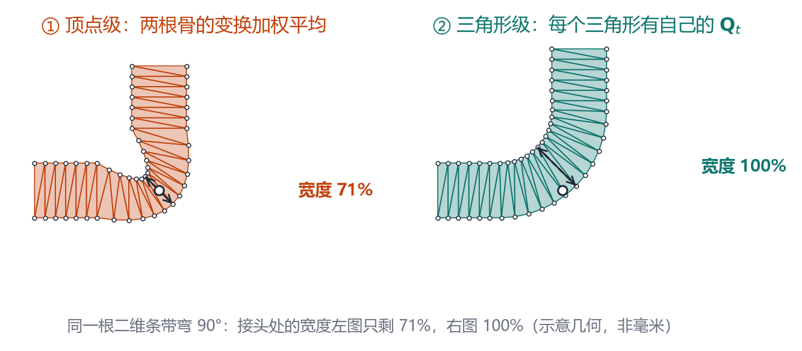
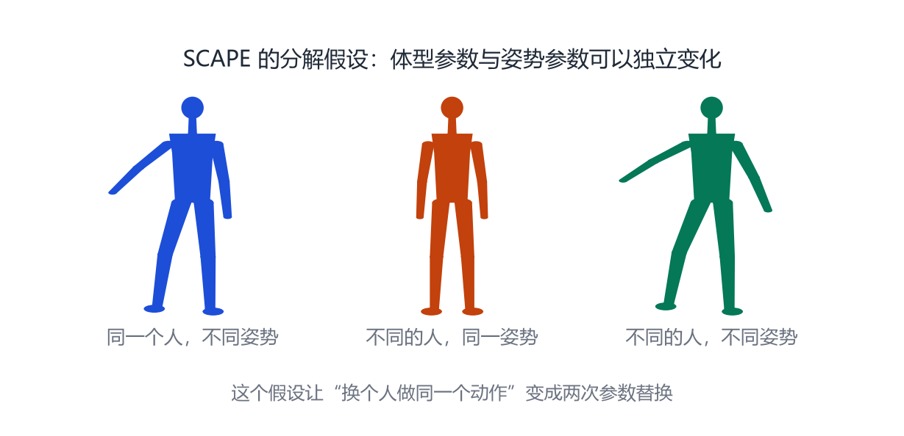
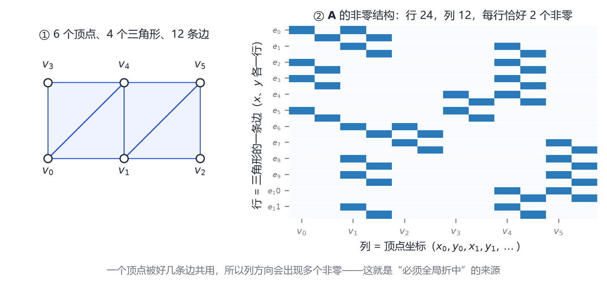
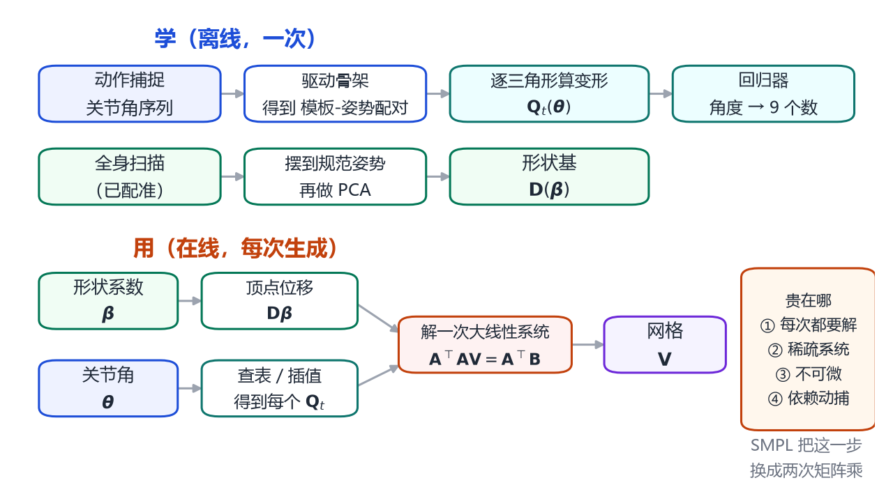
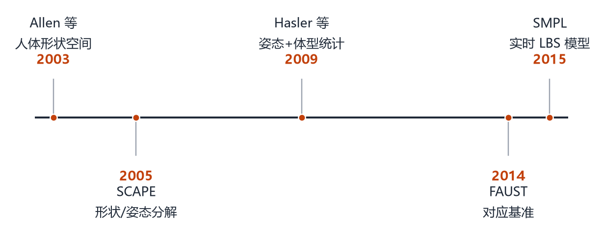

# 第 1 章 SCAPE：把「形状」和「姿态」拆开

> **本章导读**：SMPL 经常被当作人体参数化的起点，但在它之前，SCAPE 才是第一个真正把“体型”和“姿势”分开、并且能生成“任意体型摆任意姿势”的模型。这一章讲清楚三件事：为什么不能像 LBS 那样直接动顶点、三角形级的变形矩阵从哪来、以及这套更“物理”的方案为什么最后输给了更简单的 SMPL。读完你会记住一句话：**好的模型不是参数越多越好，而是把不该纠缠的因素分开。**

## 1.1 在 SCAPE 之前：只有“形状”，没有“姿势”

这一节要回答的问题是：2003 年就已经能用几个滑块生成不同体型的人了，为什么两年后还要造一个新模型。结论是：只对顶点坐标做统计，学到的不是“体型”，而是“体型加姿势”的混合物。

2003 年，Allen、Curless 与 Popović 在 SIGGRAPH 上发表 *The Space of Human Body Shapes*[@allen2003space]。他们的流程今天看依然标准：

1. 用全身扫描仪扫一批志愿者；
2. 把所有扫描**配准**到同一个固定拓扑的模板上（配准的意思见第 4 章 4.1 节：让模板的每个顶点落到扫描上“语义相同”的位置）；
3. 把每个人的 6890 个顶点坐标摊成一个长向量，对这批向量做 PCA。

做完之后，任何一个新人都可以用一组低维系数表示：系数取不同的值，就得到不同身高、胖瘦、肩宽的人。听上去已经很接近今天的参数化模型了。

但它有一个硬限制：**所有样本必须站在同一个姿势**。

原因很具体，值得用数字走一遍。PCA 是在找“这批数据变化最大的方向”。如果数据里一个人站着手垂下、另一个人抬着 45° 的手臂，那么“手臂角度”这个因素带来的顶点位移会**远远大于**“胖瘦”带来的位移。举例（示意值，不是论文数据）：前臂长约 250 毫米，抬 45° 之后肘部顶点要挪动 $250\times 2\sin 22.5^\circ \approx 190$ 毫米；而两个体重差 15 公斤的人，前臂表面顶点的差别只有 8 毫米量级。

PCA 挑方向看的是方差，方差的比值是位移比值的平方：$(190/8)^2\approx 560$。所以第一个主成分一定是“手臂抬起来”，第二个可能是“某人站姿前倾”，胖瘦要排到很后面。

### 1.1.1 为什么“多采点数据”救不了

有人会想：那就多扫一些人，让姿势的影响被平均掉。这个想法在两个地方失效。

**一是姿势是连续自由度。** 24 个关节，每个 3 个转动方向，联合起来是一个 72 维的连续空间。你不可能“平均掉”它，就像不可能靠多拍照片让运动的模糊消失。

**二是姿势与体型会互相伪装。** 一个驼背的人和一个挺直的人微微前倾，从侧面看轮廓几乎一样。PCA 分不清这 200 毫米的位移该记在“体型”账上还是“姿势”账上，于是各记一半，两个主成分都变得不干净。

### 1.1.2 “形状空间”到底是个什么东西

先把名词定清楚。**形状空间**（shape space）指的是：把所有可能的人体网格看作一个高维空间里的点，再用少数几个方向张成一个低维子空间，用这个子空间近似“所有可能的人”。

图景是这样：把每个人的 6890 个顶点、每个顶点 3 个坐标按固定顺序摊成一列，这个人就成了 $20670$ 维空间里的一个点。扫一百个人，就有 100 个点。这 100 个点不会均匀铺满整个 20670 维空间——它们挤在一张很薄的“片”上，因为人跟人的差别有强烈的规律：变胖是一起变，长高是一起长。

PCA 做的就是找到这张片的主方向。取前 10 个方向，就意味着用一个 10 维的平面去近似这张片。

这里有两个边界必须记住。

**一是“线性”的代价。** 线性子空间不能表达约束。真实的体型不允许“膝盖反向弯”，也不允许“腰部转到 180°”，但线性模型里 $\beta$ 取任何实数都合法。系数取到 $\pm4$ 之外，模型就会给出不存在的人——可能是两条腿交叉，可能是肋骨外翻。这不是数值 bug，是模型表达能力的边界。

**二是“解释方差”不是“解释正确”。** 前 10 个方向覆盖了多少方差，是可以算的一个数（第 4 章 4.2.2 节给了定义）；但方差覆盖得多，不代表学到的方向有物理意义。如果一个方向只在腋下有一小片位移，它可能覆盖了不少方差，却是配准错误造成的假体型。

<figure class="fig">

<figcaption><b>图 1-1</b>　SCAPE 的分解。模板网格先经过形状变形得到某个人的体型，再经过姿态变形摆出姿势。形状变形是低维的、与姿势无关；姿态变形是三角形级的、随关节角变化。</figcaption>
</figure>

## 1.2 SCAPE 的核心思想

这一节要解决的问题是：既然姿势会污染形状，那怎么把两者分开。结论是——不要在顶点上分，要在**三角形的局部变形**上分。

2005 年，Anguelov、Srinivasan、Koller、Thrun、Rodgers 与 Davis 提出 SCAPE（Shape Completion and Animation of PEople）[@anguelov2005scape]。它的一句话版本是：

> **一个人的网格 = 一个模板 + 体型带来的变形 + 姿势带来的变形。**

写成式子就是

$$
\mathbf{V}=F_{\text{shape}}(\boldsymbol{\beta})+F_{\text{pose}}(\boldsymbol{\theta}),
\tag{1.1}
$$

其中 $\boldsymbol{\beta}$ 是体型系数（一个远短于顶点数的向量），$\boldsymbol{\theta}$ 是关节角。

如果你把式 (1.1) 读成“逐顶点把两个位移加起来”，那就完全误解了 SCAPE。这里的加号是**两个变形操作的复合**：先按体型把模板的每个三角形拉成某个形状，再按姿势把每个三角形转成某个朝向。顶点位置最后是一次“全局求解”得到的副产品，而不是直接相加的结果。

### 1.2.1 为什么作用在三角形上

先看 LBS（linear blend skinning，线性混合蒙皮）的做法，它是所有游戏引擎里的默认动作系统。对每个顶点，找到它受哪几根骨影响，把这几根骨的变换按权重平均：

$$
\mathbf{v}_i'=\sum_{k}w_{k,i}\,\mathbf{G}_k\,\mathbf{v}_i,
\qquad \sum_k w_{k,i}=1 .
\tag{1.2}
$$

这个式子在“一根骨”的区域完全正确：顶点被刚体变换搬走，形状不变。问题出在**两根骨的交界处**，那里权重是 $0.5$ 对 $0.5$，于是顶点位置变成了“两个刚体变换的平均”。

两个旋转的平均不是旋转。取二维的最简情形：关节绕原点转 $\theta$，权重 $w=\tfrac12$，那么交界处的一个点 $\mathbf{p}$ 被搬到

$$
\mathbf{M}\mathbf{p}=\Big(\tfrac12\mathbf{I}+\tfrac12\mathbf{R}(\theta)\Big)\mathbf{p}.
$$

矩阵 $\mathbf{M}$ 的行列式可以直接算：

$$
\det\mathbf{M}
=\tfrac14\big[(1+\cos\theta)^2+\sin^2\theta\big]
=\tfrac{1+\cos\theta}{2}
=\cos^2\frac{\theta}{2}.
\tag{1.3}
$$

$\theta=90^\circ$ 时 $\det\mathbf{M}=0.5$。二维里两个奇异值都是 $\cos(\theta/2)=0.707$，也就是说交界处**均匀缩到 71%**；三维里绕一根轴弯曲时，轴方向上不缩，垂直于轴的两个方向各缩到 71%，体积缩到 50%。这就是“糖纸”（candy wrapper）这个外号的来源。

<figure class="fig">

<figcaption><b>图 1-4</b>　同一根二维条带弯 90°，两种做法的结果。左图按顶点混合：接头处被捏细，宽度只剩 71%，整条带也缩短了。右图按三角形变形：每个三角形按自己的旋转角刚性搬过去，接头处的宽度保持 100%。数值由本章脚本现场算出，是几何示意，不是毫米。</figcaption>
</figure>

SCAPE 的替代方案很干脆：**不去规定顶点去哪，而是规定每个三角形怎么变。** 对模板上的每个三角形 $t$，学一个 $3\times3$ 的矩阵 $\mathbf{Q}_t(\boldsymbol{\theta})$，它表示“这个三角形在当前姿势下被旋转、拉伸、剪切成了什么样”。然后反过来问：什么样的顶点位置，能让每个三角形的每条边都尽量符合 $\mathbf{Q}_t$ 的要求？

这就是一个最小二乘问题：

$$
\min_{\mathbf{V}}\ \sum_{t}\sum_{(i,j)\in t}
\big\|\mathbf{Q}_t(\boldsymbol{\theta})\,\mathbf{D}_t\,(\mathbf{v}_i^0-\mathbf{v}_j^0)-(\mathbf{v}_i-\mathbf{v}_j)\big\|^2 .
\tag{1.4}
$$

逐项读这个式子：

- $\mathbf{v}_i^0$ 是模板上第 $i$ 个顶点的坐标，长度单位（米），$3\times1$；
- $\mathbf{v}_i^0-\mathbf{v}_j^0$ 是模板的一条边，也就是“这个三角形原来长什么样”；
- $\mathbf{D}_t$ 是这个人的体型对这个三角形的修正，$3\times3$，单位矩阵表示“体型没变”；
- $\mathbf{Q}_t(\boldsymbol{\theta})$ 是姿势对这个三角形的修正，$3\times3$，随关节角变化；
- 两者相乘再作用到边上，得到“这条边应该变成什么向量”；
- 减号右边是未知的、当前解出来的边；两边差的平方和越小，说明解出来的网格越符合“每个三角形各自的要求”。

一句话：**每个三角形都在喊“我要变成这样”，但顶点是共用的，所以只能求一个让所有人都不太失望的折中。**

这个折中的好处是三角形不会被“平均”到塌陷。代价是：它不再是一个显式公式，而是一个需要求解的线性系统。

### 1.2.2 姿态变形从哪里来

$\mathbf{Q}_t(\boldsymbol{\theta})$ 不是手写的，是**学出来的**。SCAPE 的做法分四步。

**第一步，造配对。** 用动作捕捉数据驱动一副骨架，得到大量“模板顶点 + 已知关节角”的组合。这一步不需要扫描，只需要动作数据，所以能有很多很多样本。

**第二步，反解每个三角形的变形。** 对每一个姿势样本，在已知顶点位置的前提下，对每个三角形单独解一个 $3\times3$ 矩阵：什么矩阵能把模板三角形的三条边变成当前三角形的三条边？这是个小最小二乘，每个三角形独立解，很快。

**第三步，把变形写成关节角的函数。** 每个 $\mathbf{Q}_t$ 有 9 个数；每个关节的旋转也贡献 9 个数（旋转矩阵减去单位阵）。于是可以对每个三角形做一次线性回归：9 个输出、$9\times(\text{关节数})$ 个输入。SCAPE 还做了一件事：把变形表达在**相对于父骨的局部坐标系**里。理由是明显的——肘部弯曲 30°，无论上臂整体朝向哪，肘部皮肤的变化都应该一样。把朝向除掉，回归要学的就只剩“相对弯曲”，样本效率高得多。

**第三步的账要算一下。** 如果每个三角形都允许被全部 23 个关节影响，那么输入是 $9	imes23=207$ 个数，输出是 9 个数，一个三角形就要存 $9	imes207=1863$ 个回归系数。模板上一万个三角形，就是 $1.86	imes10^7$ 个数，双精度约 150 MB。这个体积在那个年代是不可接受的。

所以 SCAPE 在每个三角形上做了限制：**只让离它最近的少数几个关节影响它**。手臂外侧的三角形没必要知道脚踝转了多少，把它从输入里去掉，系数立刻降一个量级。这个“按空间邻近裁剪输入”的做法，是它能落地的关键工程手段，也顺带避免了“弯左肘却让右肘动”这类伪相关。

**第四步，用的时候查表。** 给定一组新的关节角，套用第三步学到的系数，得到每个三角形的 $\mathbf{Q}_t$，再解式 (1.4)。

用一句话概括：**SCAPE 学到了“肘弯 90° 时，肘外侧的三角形应该被拉长多少、内侧压缩多少”这类经验，而不是假设皮肤是刚体。**

### 1.2.3 形状变形

形状部分的前提是“姿势已经摆正”。把所有扫描配准到模板、再统一摆到同一个规范姿势之后，每个人的差异就只剩体型。

这里有一个容易搞混的地方，值得说清楚：**SCAPE 的形状变形也是在三角形层面学的，不是顶点层面。** 做法如下。

1. 对每个已摆正的人体网格，反解出每个三角形的 $3\times3$ 变形矩阵 $\mathbf{D}_t$（和姿态那一步是同一套反解）；
2. 把所有人的 $\mathbf{D}_t$ 堆起来做 PCA，得到一组基 $\mathbf{D}^{(1)},\dots,\mathbf{D}^{(n)}$；
3. 任意体型写成

$$
\mathbf{D}_t(\boldsymbol{\beta})
=\bar{\mathbf{D}}_t+\sum_{m=1}^{n}\beta_m\mathbf{D}^{(m)}_t .
\tag{1.5}
$$

和“顶点级 PCA”相比，这个做法的区别在于：三角形级的 $3\times3$ 矩阵能表达**剪切**（一个方向被拉长、另一个方向被压扁，夹角也变了），而顶点级的线性组合只能表达“顶点怎么挪”，剪切要靠相邻顶点配合才勉强凑出来。人体的肩、胯、胸部恰好是剪切很多的地方，所以三角形级在体型建模上更省维度。

工程上也有大量简化实现直接用顶点级 PCA（SMPL 就是这么做的，见第 2 章），因为顶点级 PCA 算起来简单、和 LBS 天然兼容。两种做法都对，只是取舍不同。

最终，SCAPE 可以：

- 输入一组体型系数，得到不同体型；
- 输入一组关节角，摆出不同姿势；
- 两者自由组合，得到“这个体型做这个动作”的网格。

<figure class="fig">

<figcaption><b>图 1-2</b>　分解假设的直观检验。同一体型可以摆不同姿势，同一姿势可以由不同体型完成；如果模型学得好，“换体型”和“换姿势”应该互不干扰。SCAPE 的全部设计都是在保证这件事。</figcaption>
</figure>

### 1.2.4 式 (1.4) 到底怎么解

这是本章最该亲手算一遍的地方。式 (1.4) 看起来很唬人，但它对未知量 $\mathbf{V}$ 是**二次的**：每一项都是顶点坐标的线性组合再平方。二次目标函数求极值，就是解一个线性方程组。

先把“每条边一行”写清楚。三维里一条边有 3 个坐标分量，所以每个三角形贡献 $3\times3=9$ 行。把所有行叠起来：

$$
\min_{\mathbf{V}}\ \big\|\mathbf{A}\,\mathbf{V}-\mathbf{B}\big\|^2
\quad\Longrightarrow\quad
\mathbf{A}^\top\mathbf{A}\,\mathbf{V}=\mathbf{A}^\top\mathbf{B}.
\tag{1.6}
$$

- $\mathbf{A}$ 是一个很大的稀疏矩阵：**行**对应“某个三角形的某条边在某个坐标方向上的约束”，**列**对应“某个顶点的一个坐标”；
- 每一行里只有两个非零元素：$+1$ 和 $-1$，因为一条边只涉及两个顶点，而 $\mathbf{v}_i-\mathbf{v}_j$ 的系数就是这两个；
- 右边 $\mathbf{B}$ 由 $\mathbf{Q}_t\mathbf{D}_t(\mathbf{v}_i^0-\mathbf{v}_j^0)$ 构成，也就是“这条边应该变成的向量”；
- 求解 $\mathbf{A}^\top\mathbf{A}\mathbf{V}=\mathbf{A}^\top\mathbf{B}$ 用共轭梯度，或者先算 $\mathbf{A}^\top\mathbf{A}$ 再 Cholesky 分解。

<figure class="fig">

<figcaption><b>图 1-5</b>　式 (1.6) 里的 $\mathbf{A}$ 长什么样。左边是一个只有 6 个顶点、4 个三角形的小网格，右边是它的 $\mathbf{A}$：行数 = 边数 × 坐标数，列数 = 顶点数 × 坐标数，每行恰好两个非零。真实的网格有上万顶点，但结构完全一样，只是这张图被放大了一千倍。注意每一列几乎都有多个非零——同一个顶点被若干条边共用。</figcaption>
</figure>

**为什么不能对每个三角形独立求解。** 答案就在图 1-5 的列方向上：同一个顶点被好几个三角形共用。每个三角形都希望这个顶点在自己那一侧，但它只能有一个位置。所以必须全局折中，这就是“稀疏线性系统”的来源。

**手算一个最小例子。** 取二维空间里的一个三角形，顶点 $\mathbf{v}_0=(0,0)$、$\mathbf{v}_1=(1,0)$、$\mathbf{v}_2=(0,1)$，假设 $\mathbf{D}=\mathbf{I}$，$\mathbf{Q}$ 是旋转 $90^\circ$：

$$
\mathbf{Q}=\begin{bmatrix}0&-1\\1&0\end{bmatrix}.
$$

三条边的目标分别是 $\mathbf{Q}(\mathbf{v}_1-\mathbf{v}_0)=(0,1)$、$\mathbf{Q}(\mathbf{v}_2-\mathbf{v}_1)=(-1,1)$、$\mathbf{Q}(\mathbf{v}_0-\mathbf{v}_2)=(1,0)$。这三个目标恰好自洽（它们的和是零向量），所以存在精确解。解出来是

$$
\mathbf{v}_0'=(0,0),\quad \mathbf{v}_1'=(0,1),\quad \mathbf{v}_2'=(-1,0),
$$

也就是三角形整体转过去了。但注意：**如果把三个顶点同时加上 $(10,7)$，所有边的差值都不变，误差仍然是零。** 也就是说这个方程组天然缺一个“整体平移”的自由度，$\mathbf{A}$ 的秩至少缺 3（三维里缺 3，二维缺 2）。所以实际实现必须补上约束，通常是把某几个顶点钉住，或者加一项“尽量靠近模板”的正则项。少了这一手，解出来的网格会飘到任意位置。

**量级感。** 假设模板是 5000 顶点、10000 个三角形：

| 量 | 数值 |
|---|---|
| 未知量 $\mathbf{V}$ | $3\times5000=15000$ |
| $\mathbf{A}$ 的行数 | $9\times10000=90000$ |
| $\mathbf{A}$ 每行的非零 | 2 |
| $\mathbf{A}$ 的非零总数 | $1.8\times10^5$ |
| 法方程的阶数 | 15000 |

这个规模在现代机器上用预条件共轭梯度解一次是几十毫秒级。所以“SCAPE 慢”更准确的说法是：**它不能一次矩阵乘法算完，每次生成都要跑一个迭代求解器，而且这条路径不可微、没法放进神经网络的训练循环里。** 在需要每秒 30 帧、每帧上千人的批量场景里，这种串行求解就是灾难。

把这件事用一句话说：**SCAPE 把“怎么变形”和“变形后顶点在哪里”分开了。** 前者（$\mathbf{Q}_t$）是从数据学来的、与姿势有关；后者（$\mathbf{V}$）是一次线性求解。这个拆分后来被反复借用：今天的神经形变模型也常常是“先预测每个局部的变换，再解一个全局一致的网格”。

### 1.2.5 全局折中的代价：一条共享边被“平均”了多少

上一节说“所有三角形求一个折中”，这句话太温和了，得过一遍数字才知道代价在哪。

取四个顶点 $\mathbf{a},\mathbf{b},\mathbf{c},\mathbf{d}$，两个三角形共享边 $\mathbf{ab}$。左边三角形 $(\mathbf{a},\mathbf{b},\mathbf{c})$ 保持不动，右边三角形 $(\mathbf{a},\mathbf{b},\mathbf{d})$ 整体转 $60^\circ$。

两个三角形对共享边 $\mathbf{ab}$ 提出的要求是矛盾的：

- 左边要求 $\mathbf{ab}$ 原地不动（$0^\circ$）；
- 右边要求 $\mathbf{ab}$ 跟着转 $60^\circ$。

最小二乘的答案是“各让一半”——因为两个要求权重相同，最优解就是把这条边转到 $30^\circ$。但同时，**长度也要跟着变**：两边要求的长度都是 $|\mathbf{ab}|$，而解出来的边夹在两者之间，长度最多只能是 $|\mathbf{ab}|\cos 30^\circ=0.866|\mathbf{ab}|$。

也就是说，共享边被缩短了 13%，而且这个缩短无关于材质、只关乎“两个要求打了一架”。

这解释了三个现象：

1. **网格越粗，折中越糟。** 如果一条边跨越了 $90^\circ$ 的弯曲，缩短会到 29%。所以三角形级方法的精度依赖网格密度；SCAPE 的模板有上万顶点，平均边长只有两厘米左右，相邻三角形的旋转差很小，折中才不明显。
2. **折中发生在“边”上，不发生在“整个截面”上。** 这是它和 LBS 的关键区别。LBS 把交界处的**整圈**顶点都缩到 71%（图 1-4 左）；三角形级只让**共享边**缩短，边两侧的宽度不变。截面因此不会被压扁，视觉上自然得多。
3. **矛盾不能靠加基消除。** 加再多的姿态基，也改变不了“共享边的两个要求天然矛盾”这个事实。基只能让矛盾出现在更合理的位置（比如让内侧压缩、外侧拉伸），不能让它消失。

所以 SCAPE 的“全局求解”不是万能药，它只是把误差从“整圈塌陷”挪到了“一条边缩短”，并把误差量级从 30% 降到了几个百分点。

<figure class="fig">

<figcaption><b>图 1-6</b>　SCAPE 的“学”与“用”两条流水线。上半部分是离线的一次性学习：动作捕捉提供姿势样本，扫描提供体型样本，最后得到两样东西——每个三角形的姿态回归系数、以及一组体型基。下半部分是每次生成时要做的事：查表得到 $\mathbf{Q}_t$，然后解一次大线性系统。贵的正是最后这一步。</figcaption>
</figure>

### 1.2.6 每个三角形的 $\mathbf{Q}_t$ 怎么从数据里反解

上一节说“第二步，反解每个三角形的变形”，这句话展开来是一个很小的最小二乘，值得亲手算一遍，因为它解释了为什么 SCAPE 的学习阶段并不慢。

给定模板三角形（顶点 $\mathbf{v}_0^0,\mathbf{v}_1^0,\mathbf{v}_2^0$）和当前姿势下对应的三角形（$\mathbf{v}_0,\mathbf{v}_1,\mathbf{v}_2$），要找 $3\times3$ 的 $\mathbf{M}$ 使

$$
\sum_{(i,j)}\big\|\mathbf{M}(\mathbf{v}_i^0-\mathbf{v}_j^0)-(\mathbf{v}_i-\mathbf{v}_j)\big\|^2
$$

最小。把三条边按列排成两个 $3\times3$ 矩阵：

$$
\mathbf{E}^0=\big[\mathbf{e}^0_{01},\mathbf{e}^0_{12},\mathbf{e}^0_{20}\big],
\qquad
\mathbf{E}=\big[\mathbf{e}_{01},\mathbf{e}_{12},\mathbf{e}_{20}\big],
$$

问题就变成 $\min_{\mathbf{M}}\|\mathbf{M}\mathbf{E}^0-\mathbf{E}\|_F^2$，闭式解是

$$
\mathbf{M}=\mathbf{E}\,(\mathbf{E}^0)^{-1}.
$$

也就是说，**一个三角形的变形矩阵就是“两条边构成的基”的变换**，只需要解一个 $3\times3$ 的逆。上万三角形，每个算一次 $3\times3$ 求逆，在现代机器上不到一毫秒。

数字例子：模板三角形是单位直角三角形 $\mathbf{v}_0^0=(0,0,0)$、$\mathbf{v}_1^0=(1,0,0)$、$\mathbf{v}_2^0=(0,1,0)$；当前三角形是 $\mathbf{v}_0=(0,0,0)$、$\mathbf{v}_1=(1,0,0)$、$\mathbf{v}_2=(0,2,0)$。那么

$$
\mathbf{M}=\begin{bmatrix}1&0&0\\0&2&0\\0&0&1\end{bmatrix},
$$

即“沿 $y$ 拉长一倍”。注意 $\mathbf{M}$ 不是旋转，它含缩放——这正是 SCAPE 想表达的：三角形可以被拉长、压扁、剪切，而不只是转动。

如果算出来的 $\mathbf{M}$ 行列式为负，说明三角形被翻面了（法向朝里）。这种样本要剔掉，否则会污染回归。

## 1.3.1 复现 SCAPE 时最先卡住的三处

这一小节列三个具体的坑，给真要动手的人省时间。

**一，边的方向不一致。** 建模时要给每条边定一个方向（比如“从编号小的顶点指向编号大的”）。如果两个相邻三角形的同一条边方向相反，式 (1.6) 里 $+1$ 和 $-1$ 会错位，解出来的网格会撕裂。症状是网格上沿着某些边出现锯齿。

**二，缺少锚点导致整体漂移。** 前面算过，方程组缺“整体平移”的自由度。不补约束，解出来的网格可能跑到任意位置；加了太强的约束（比如把很多顶点钉死），又会压制变形。工程上常用“把根顶点钉住 + 加一个很小的‘靠近模板’正则项”。

**三，局部坐标系的定义。** 姿态回归要在“相对父骨”的坐标系里做，这个坐标系的朝向必须由骨架统一定义（通常取骨轴为某一根轴）。定义不一致，同一组关节角会算出完全不同的 $\mathbf{Q}_t$，模型训练时表现为“怎么都收敛不了”。

这三处都不是数学问题，是实现约定问题——这也是 SCAPE “实现复杂”这个缺点的具体来源。

## 1.7.1 一个两分钟的自测

读完这一章，用下面三个问题自测。答得出来，说明你真的理解了分解，而不只是记住了公式。

1. 如果我把 $\mathbf{Q}_t$ 全部设成单位矩阵、$\mathbf{D}_t$ 保持学到的值，会发生什么？（答：网格回到规范姿势，体型保留。这说明两个变形确实可以独立关掉。）
2. 如果我把某个三角形的 $\mathbf{Q}_t$ 换成它的转置，网格会怎样？（答：那个三角形会翻面，因为转置不是旋转，行列式可能变号。这说明 $\mathbf{Q}_t$ 必须来自旋转的插值，不能随便取。）
3. 如果我把所有 $\mathbf{Q}_t$ 乘以 2，网格会怎样？（答：整体放大两倍，因为每条边都变长了两倍。这说明“整体尺度”没有被任何约束固定住，必须由锚点或正则控制。）

这三个问题对应三件事：分解是可关的、$\mathbf{Q}_t$ 必须是合法的旋转族、全局尺度必须显式约束。

### 1.2.7 为什么约束写在“边”上

式 (1.4) 逐项累加的是三角形的三条边，不是三个顶点，也不是面的法向。这个选择有原因。

**边是旋转的不变量。** 一个刚体变换保持所有边长和夹角。所以“把模板的边变成当前姿势的边”这个描述，在形状不拉伸时与“刚体”完全等价。用顶点坐标做约束就不行：顶点坐标本身随平移变化。

**边是连接顶点的最小信息。** 每条边只涉及两个顶点，画到矩阵里就是每行两个非零。这让 $\mathbf{A}$ 极度稀疏，求解才可能快。

**三条边能唯一确定三角形。** 三角形有 3 个顶点（6 个坐标），减去整体平移（3 个），剩 3 个自由度；三条边的向量正好 3 组（9 个数），冗余但够用。冗余是好事：最小二乘会自己处理掉不一致。

如果换成“面的法向”做约束，问题会变得非线性（法向是叉积），就不再是一次线性求解了。这是 SCAPE 能用“一个线性系统”解决的核心原因：**它把非线性都藏在 $\mathbf{Q}_t$ 里（离线学的），求解阶段只剩线性。**

## 1.3 SCAPE 的贡献与代价

这一节要回答：SCAPE 到底确立了什么，又付出了什么。结论是：它确立的三个原则今天仍在使用，但它的实现路线已经被淘汰。

SCAPE 在 2005 年是里程碑式的，它确立了三件事。

**第一，形状与姿态可以分离，而且分离之后可以自由组合。** 这一条听起来平淡，但它是所有参数化人体模型的地基。在它之前，“一个人的网格”是一个整体；在它之后，“一个人的网格”被拆成“这个人的参数”加“这个姿势的参数”，两者相乘出结果。今天你下载一个 SMPL 的 `.npz`，里面装的正是这两组数。

**第二，形变可以作用在局部（三角形）而不是全局（顶点）。** 这一条解决的是 LBS 的糖纸问题。它的深层含义是：**先规定“每一小块怎么变”，再反解“整体长什么样”**，而不是直接规定整体。这个思路后来被大量借用，包括布料的有限元模拟、以及今天的神经形变场。

**第三，统计模型可以从扫描加动作捕捉中联合学习。** 体型从扫描来，姿势从动作数据来，两者不需要在同一批人身上同时采集。这个“分头采集、联合训练”的做法让数据成本大幅下降。

代价也很具体，而且每一条都能对应到一个工程问题。

**一，每次生成都要解一个大线性系统。** 这是图 1-6 下半部分那一步。它不是矩阵乘法，是迭代求解，没法用 GPU 的批量矩阵乘吃到好处。

**二，整条链路不可微。** 配准、反解三角形变形、回归、求解——四步里只有回归是光滑的，其余三步要么是离散决策，要么是线性求解器。想把它接进神经网络的训练循环，得写自定义的隐式微分，代价很高。

**三，依赖骨架和动作数据。** $\mathbf{Q}_t$ 的回归输入是关节角，这意味着你必须先有一副“蒙皮蒙对了”的骨架。如果绑定本身有问题（权重在腋下判错），学出来的姿态变形会把错误一起学进去，而且很难发现。

**四，实现复杂。** 三角形级变形、局部坐标、形状与姿态的耦合项、求解器的预条件——四个坑，每个都足以让复现失败。

**五，固定拓扑，且不保证不自交。** 式 (1.4) 只约束边长和夹角，不约束“三角形之间不许穿过彼此”。极端姿势下解出来的网格可能出现自交，需要额外做碰撞处理。这是所有“先解局部再求全局”的方法的通病。

一句总结：**SCAPE 的精度来自“每个三角形有自己的 3×3”，它的成本也来自“每个三角形有自己的 3×3”。**

## 1.4 中间十年：Hasler 与 FAUST

这一节要交代 SCAPE 与 SMPL 之间发生了什么。结论是：这十年里，问题从“能不能分开”变成了“分开之后怎么量化比较”。

**Hasler 等（2009）** 提出 *A Statistical Model of Human Pose and Body Shape*[@hasler2009statistical]。他们的贡献是把体型参数和姿势参数**都**做成线性模型，并且显式地建模两者的耦合项。

“耦合”是什么意思？举个具体例子：同一个身高的人，把手臂抬到水平，肩膀那一带的皮肤会被拉伸。拉伸的幅度不只取决于手臂角度，还取决于这个人肩膀有多厚。也就是说，位移是 $\boldsymbol{\beta}$ 和 $\boldsymbol{\theta}$ 的**双线性**函数，而不只是两者之和。Hasler 把这个交叉项显式写出来，模型能表达“胖子抬手臂”和“瘦子抬手臂”的不同。

这个想法的直觉很好，代价是参数变多、训练数据要求变高：要估交叉项，就需要“同一个人摆很多姿势”的扫描，而这恰恰是最难采的数据。

### 1.4.1 一条更早的支线：人脸的可变形模型

人体形状空间这条线上，还有一个更早、更小的先例值得知道，因为“用几个系数插值出任意个体”这个想法最早是在脸上跑通的。

1999 年，Blanz 与 Vetter 提出三维可变形人脸模型（3D morphable model）[@blanz1999morphable]。他们扫描了 200 个人（100 男、100 女），把每张脸配准到同一拓扑，然后对顶点坐标和纹理同时做 PCA。结果是：一张新脸可以用几十个系数表示，系数可以插值、可以编辑、可以反解。

为什么脸比身体早？因为脸的数据好采：一个人坐好，几秒钟扫完，姿势几乎不变，所以“姿势污染形状”这个问题在脸上几乎不存在。身体不行——全身扫描要么让人站很久，要么用多相机瞬间抓拍，而人总在轻微晃动。

这条支线给后来留下了两个遗产：一是“blendshape”这个词和它的线性组合形式；二是“参数化”这个思路本身——**把一个复杂的对象压缩成几十个数，让下游任务在参数空间里做**。SMPL 的形状项在数学上和 3DMM 是同一件事，只是对象从脸换成了全身。

**FAUST（2014）** 则提供了第一个被广泛使用的评测基准[@bogo2014faust]。它包含 10 名受试者、每人 10 个姿势，共 100 个高精度扫描，全部配准到同一拓扑，并带有人工核对过的三维对应。

FAUST 的价值不在数据量，而在**它让“准不准”变成可计算的数**。在它之前，两篇论文都说自己的模型“更自然”，谁也说服不了谁；在它之后，只要有统一拓扑，就可以直接算“第 3127 号顶点偏了多少毫米”。整个领域从“看起来像”转向“量得准”，这个转变是从这里开始的。

顺带说一个方法论上的教训：**评测基准的出现，往往比算法本身更能推动领域前进。** 因为一旦有了公共的尺子，后来者就知道该往哪儿优化；而没有尺子的时候，大家都在优化“审稿人看着顺眼”。

<figure class="fig">

<figcaption><b>图 1-3</b>　从人体形状空间到 SMPL 的关键节点。SCAPE 提出了形状/姿态分解，Hasler 补上了两者的耦合项，FAUST 提供了评测基准，SMPL 用更简洁的公式把这一切结合并做到实时。</figcaption>
</figure>

### 1.4.2 FAUST 的评测协议长什么样

FAUST 之所以能成为标准，靠的是三件很具体的事。

**一，同一拓扑。** 100 个扫描全部配准到同一张网格，顶点编号一一对应。于是“顶点距离”这个指标才有定义。

**二，人工核对。** 配准算法会犯错，所以关键区域（手指缝、腋下、脚趾）有人工修正。这一步很贵，但决定了基准能不能用十年。

**三，划分明确。** 10 个受试者里，一部分用于训练、一部分用于测试，而且**按人划分**，不是按姿势划分。这避免了“同一个人既在训练集又在测试集”的作弊式高分。

最后一条尤其值得记住。如果按姿势划分，模型在测试集上其实见过这个人的体型，误差会虚低。这个错误在今天的很多论文里仍然存在（第 4 章 4.8.3 节）。

## 1.5 为什么 SCAPE 最终输给了 SMPL

这一节要回答一个略显残酷的问题：技术上更“对”的 SCAPE，为什么在工程上完败。结论是三条——可微、简单、够好——而且第三条比前两条更重要。

### 1.5.1 三条硬差距

**第一条，可微。** 2015 年之后，人体模型的主要用途不是“生成一个人”，而是“作为神经网络的输出层”。一张照片进来，网络要输出参数，然后通过模型算出网格，再和图像比对算损失，梯度要一路传回去。SMPL 的前向是“矩阵乘 + 加法 + 矩阵乘”，梯度随手可得；SCAPE 的前向里有个线性求解器，梯度要么用隐式微分硬推，要么近似，两条路都难受。

把“可微”这件事说具体一点。假设你在训练一个从单张照片回归人体参数的网络，损失是“渲染出来的轮廓和照片里的轮廓差多少”。梯度要从损失传回 $\boldsymbol{\beta}$ 和 $\boldsymbol{\theta}$。SMPL 这条路上，每一步都是矩阵乘，反向传播就是几个矩阵转置相乘，PyTorch 自动就能做。SCAPE 这条路上，中间夹着一个求解 $\mathbf{A}^\top\mathbf{A}\mathbf{V}=\mathbf{A}^\top\mathbf{B}$，要对它求导，得解一个同样规模的线性系统（隐式微分），或者干脆把这一步当成黑盒、用有限差分近似——前者慢，后者不准。

在论文里这只是一句话的差别；在工程上，它是“一个下午能跑通”和“两周还在调梯度”的差别。

**第二条，简单。** SMPL 的完整前向四步就能写完（见第 2 章），一个下午能复现；SCAPE 的四步里每一步都有实现细节。复现成本决定了生态规模，而生态规模决定了后来者用谁。

**第三条，够好。** 这是最关键的一条。SCAPE 的姿态变形更贴近真实皮肤，但差距在视觉上有多大？在肘弯 90° 这种常见姿势下，SMPL 加上 207 个姿态基之后，和 SCAPE 的差别只有几毫米量级。而在极端姿势（肩部大幅上举、手腕扭转）下，SCAPE 确实更自然——但那些姿势在真实数据里本来就少见，而且采集困难。

**工程上的胜负，常常不是由“最好情况下的精度”决定的，而是由“最常见情况下的够用程度 + 使用成本”决定的。**

### 1.5.2 SMPL 到底“偷”了什么懒

SMPL 的核心简化只有一句：**它不做三角形级的变形，改做顶点级的位移。**

- SCAPE 为每个三角形学一个 $3\times3$，能表达剪切；
- SMPL 为每个顶点学一个位移，只能表达平移；
- 那些表达不出来的剪切和体积变化，SMPL 用一个 207 维的“姿态修正位移场”去近似。

所以从数学上看，SMPL 是 SCAPE 的一个**受限版本**：它的姿态变形被限制在“207 个固定方向的线性组合”里。这个限制带来的损失，用更多数据可以补回来；而它带来的好处——一次矩阵乘法、完全可微、GPU 友好——是 SCAPE 的结构给不了的。

还有一个更隐蔽的差异：SCAPE 的姿态回归需要“局部坐标系”，也就是需要知道每根骨在空间中的朝向；SMPL 的 207 个特征只用到**旋转矩阵本身的元素**，不需要显式构造局部坐标系。少一层间接，就少一层出错的地方。

### 1.5.3 两张表看清差别

| | SCAPE（2005） | SMPL（2015） |
|---|---|---|
| 变形层级 | 三角形级，每面一个 $3\times3$ | 顶点级，每点一个位移 |
| 体型参数 | 三角形变形基的系数 | 顶点位移基的系数，10 维 |
| 姿态参数 | 关节角 → 回归出每个 $\mathbf{Q}_t$ | 关节角 → 207 个基的系数 |
| 生成方式 | 解一个稀疏线性系统 | 两次矩阵乘 + 一次蒙皮 |
| 可微 | 否（含求解器） | 是 |
| 实时 | 困难 | 容易，GPU 上是毫秒级 |
| 体积保持 | 好 | 差，靠姿态基补 |
| 极端姿势 | 较自然 | 会外插失控 |
| 生态 | 论文与少量代码 | 数据集、代码、指标全围绕它 |

一句话对照：**SCAPE 提出了问题，SMPL 给出了可规模化的答案。**

### 1.5.4 一个反向问题

问：如果 SMPL 先出现、SCAPE 后出现，SCAPE 还有价值吗？

答：有，但价值会变。

如果 SMPL 先占住了生态，SCAPE 会被当成“一个更准但更贵的替代方案”，只在精度敏感的场景（影视、医学测量）里被使用，不会成为公共接口。这其实就是今天 ATLAS / MHR 的处境：更准，但换不动生态。

这个反向问题说明一件事：**在工程领域，“先到”常常比“更好”更有决定性。** 因为接口一旦形成，迁移成本由所有人分摊，而收益只由迁移者独享。理解这一点，你看技术史就不会只用“谁更先进”这一个维度。

## 1.6 那 SCAPE 的思路今天还有用吗

这一节要回答一个实际问题：既然输了，为什么还要学它。结论是：因为它定义的那套“局部变形 + 全局求解”的语言，正是今天大量方法的底层语法。

三个仍然活跃的用法：

**一是离线高精度场景。** 影视特效里一帧可以算几秒钟，这时体积保持比实时重要，三角形级的变形仍然划算。

**二是作为“更准的参照”。** 当你要判断一个新模型的 LBS 伪影有多严重时，SCAPE 式的解是一个很好的上界参照。

**三是作为“形变场”的原型。** 今天很多方法在做的仍然是“预测每个局部的变换，再解一个全局一致的网格”，只是把“线性回归”换成了神经网络，把“三角形”换成了“每个点周围的小邻域”。骨架没变，材料换了。

所以读 SCAPE 的正确姿势不是“记住它的公式”，而是**记住它的分解方式**：把“每个人不一样”（体型）和“每个人在做什么”（姿势）当成两个独立的旋钮，再用一次全局优化把它们缝起来。

### 1.6.3 一个常见误解

“SCAPE 用三角形，所以它能表达任意形变。”这句话不对，两处都错。

**第一处：三角形级也有上限。** 一个三角形只能被一个 $3\times3$ 矩阵作用，所以它在变形后仍是平面三角形。真实皮肤弯曲时会出现“褶皱”——表面在很小的区域内多次折叠，这不是一个线性变换能表达的。所以极端姿势下 SCAPE 也需要额外处理。

**第二处：形变能力不等于模型表达能力。** $\mathbf{Q}_t$ 是由关节角回归出来的，回归模型能覆盖的范围取决于训练时的动作数据。没见过的动作，回归照样外插出错。所以“三角形级”解决的是“LBS 平均导致塌陷”，不是“任意形变”。

分清“能表达什么”和“能学到什么”，是读所有形变模型时最有用的一条准则。

## 1.7 分解的边界：什么时候会失效

这一节要说清楚 SCAPE 那句“网格 = 模板 + 体型 + 姿势”在什么情况下不成立。结论是：它在“体型中等、姿势常见、不发力、不穿衣服”的范围内成立，出了这个范围，误差会以很快的速度变大。

**情形一，体型与姿势真的耦合。** SCAPE 假设体型变形和姿势变形可以分开做再复合。现实里，同一个人把手臂抬到水平，肩部的位移与“他肩膀有多厚”强相关：一个 50 公斤的人和一个 100 公斤的人抬同样的角度，肩峰处的皮肤位移能差出三成以上（示意值）。式 (1.1) 里两个变形独立作用，表达不了这种交叉项，于是会系统性地低估胖子在抬臂时的肩部鼓起。

这就是 Hasler 2009 想在模型里补上的东西（见 1.4 节）。补的方式是加双线性项，代价是参数变多、数据要求变高。

**情形二，肌肉激活。** 用力握拳时前臂鼓起，这一变化与关节角无关，只与“发力”有关。SCAPE 的输入里没有这个变量，所以无论关节角取什么值都生成不出来。要表达它，必须再加一路输入（肌电信号、或者干脆把“发力程度”也做成一个参数）。

**情形三，拓扑变化。** 手指张开、握拳、张嘴，这些动作改变的是“哪些顶点和哪些顶点相邻”，而不是“顶点在哪”。固定拓扑的模型表达不了，只能让手指表面的顶点挤在一起、互相穿插。这也是为什么带手的模型（第 3 章的 SMPL+H）必须重新设计手部网格，而不是直接在 SMPL 上加关节。

**怎么判断自己的模型踩到了哪一条。** 办法很朴素：把模型在留出数据上的残差按顶点渲染出来，看热区集中在哪。

- 热区在关节**外侧**、随角度增大而增大 → 是折中误差，加基能缓解；
- 热区在**肩、胸、腹**，且与体型参数强相关 → 是耦合项缺失；
- 热区在**前臂、小腿**，且与姿势无关 → 是肌肉激活；
- 热区在**手指缝、腋下**，形状很尖锐 → 多半是配准或拓扑问题。

这四种热区的形状不一样，看多了就能一眼分出来。诊断的价值在于：它告诉你该改模型结构，还是该改数据。

所以，“形状与姿态可分离”是一句**有适用范围的工程假设**，不是物理定律。SCAPE 的贡献不在于证明它永远成立，而在于第一个把它写成了可计算、可训练、可组合的形式。

### 1.6.1 拿到一个新模型，怎么在五分钟内看懂它

有个实用的套路：不管模型多新，先找四个问题的答案。

1. **变形的载体是什么？** 顶点位移、三角形矩阵、还是“每个点周围的小邻域”？
2. **参数怎么进来？** 线性基（blendshape）、还是网络输出、还是解一个优化问题？
3. **全局一致性怎么保证？** 是不是有一个“反解顶点”的求解步骤？如果有，它可不可微？
4. **输出拓扑固定吗？** 固定就要接受“手指不能真张开”，不固定就要接受“对应关系要重新学”。

四个答案一填，模型的性格就出来了：SCAPE 是“三角形矩阵 / 回归 / 有求解器 / 固定”，SMPL 是“顶点位移 / 线性基 / 无求解器 / 固定”，今天很多方法则是“小邻域变换 / 网络 / 有求解器 / 可动”。这张四格表比读十页公式更快。

## 本章小结

- Allen 2003 用“扫描 + 配准 + 顶点 PCA”建立了人体形状空间，但要求所有样本同一姿势，否则 PCA 会把姿势当成体型学进去。
- SCAPE 把变形下放到三角形：形状给每个三角形一个 $\mathbf{D}_t$，姿势给每个三角形一个 $\mathbf{Q}_t$，顶点位置由全局最小二乘反解。
- 顶点级 LBS 在两根骨交界处把旋转“平均”掉，二维里缩到 $\cos(\theta/2)$，90° 时只剩 71%，这就是糖纸效应；三角形级变形不会。
- 式 (1.4) 对顶点是二次的，最终化成一次稀疏线性求解；同一个顶点被多条边共用，所以必须全局折中，而且必须补上“不许整体平移”的约束。
- SCAPE 的代价是不可微、需要迭代求解、依赖骨架与动作数据、实现复杂；SMPL 用“顶点级 blendshape + 207 个姿态基”换到了实时与可微。
- Hasler 2009 补上了体型与姿势的耦合项；FAUST 2014 提供了第一个被广泛采用的对应与重建基准。

## 思考题

1. 假设一批扫描里，每个人都站在同一个姿势，但有一半人手里拿着东西（物体没有被扫描到，只在手掌上留下压痕）。这个压痕会不会被 PCA 学成体型主成分？如果会，它长什么样，该怎么检查？

2. 式 (1.3) 给出 $\det\mathbf{M}=\cos^2(\theta/2)$。请用这个结果算：跪姿时膝弯 120°，膝关节附近的体积还剩原来的百分之多少？再解释为什么现实中的膝盖看起来并没有瘪掉一半。

3. 如果给每个三角形都乘一个补偿因子，让它在弯曲平面内放大 $1/\cos(\theta/2)$ 倍，糖纸效应会消失吗？会不会出现新的问题（想想三角形之间的连续性）？

4. SCAPE 的姿态回归把变形表达在“相对父骨的局部坐标系”里。如果不这么做，而是直接用世界坐标系下的旋转矩阵做输入，会发生什么？请从“需要多少训练样本”的角度解释。

5. 有人说“SMPL 就是 SCAPE 的低秩近似”。这个说法在哪些方面成立，在哪些方面不成立？
