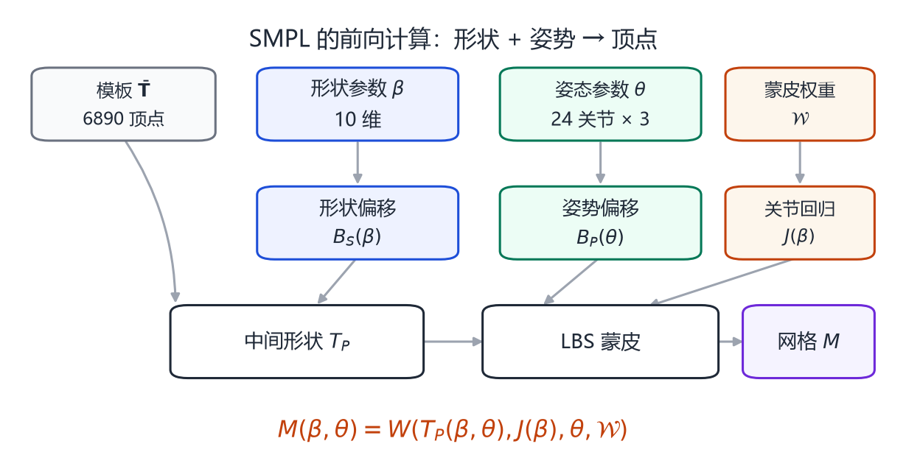
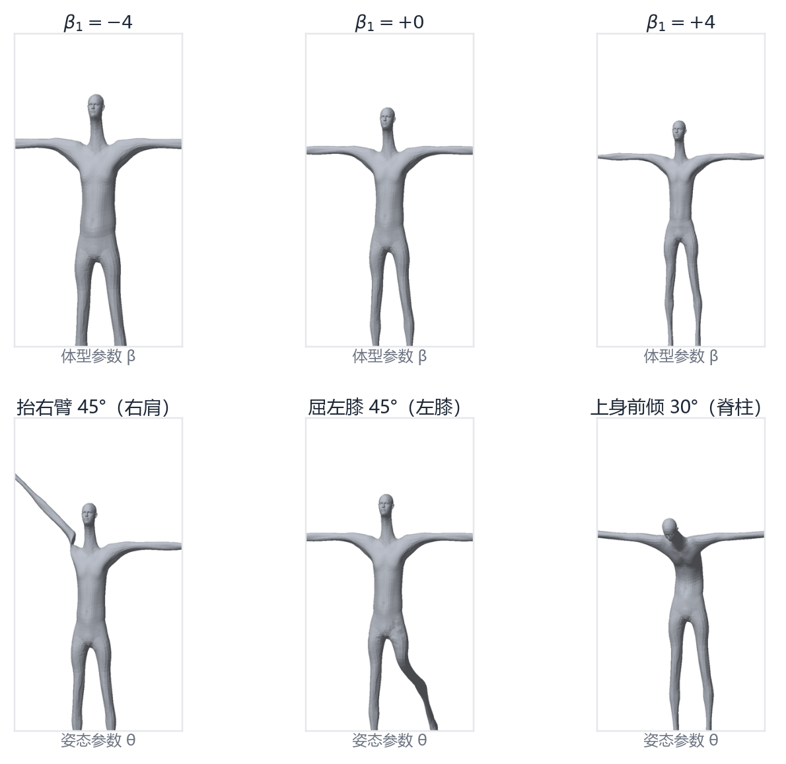
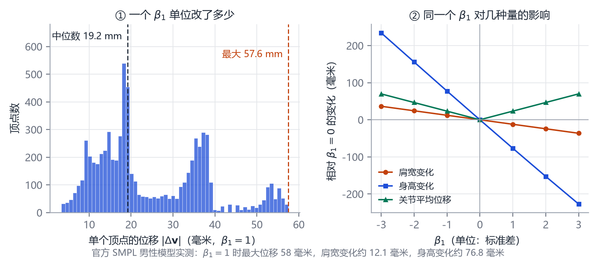
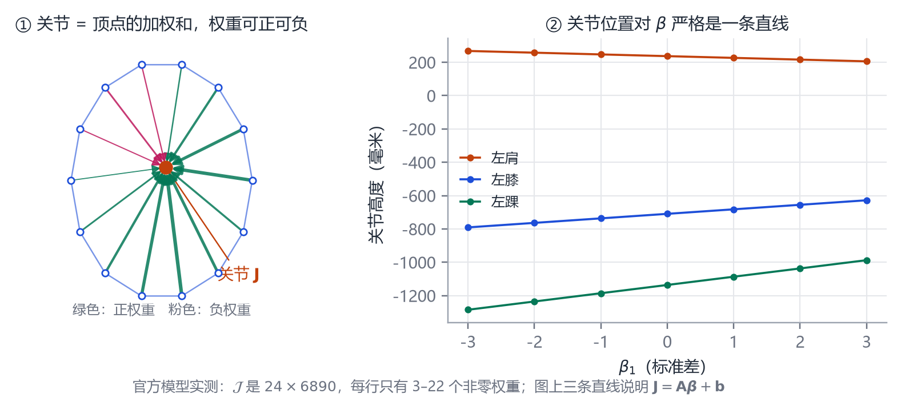
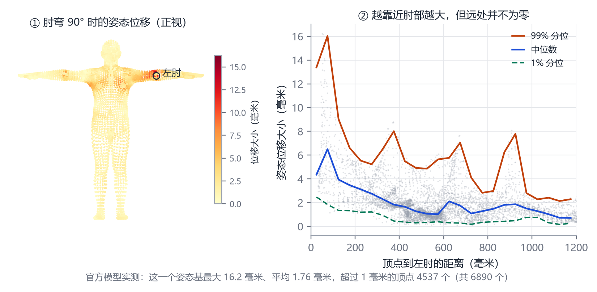
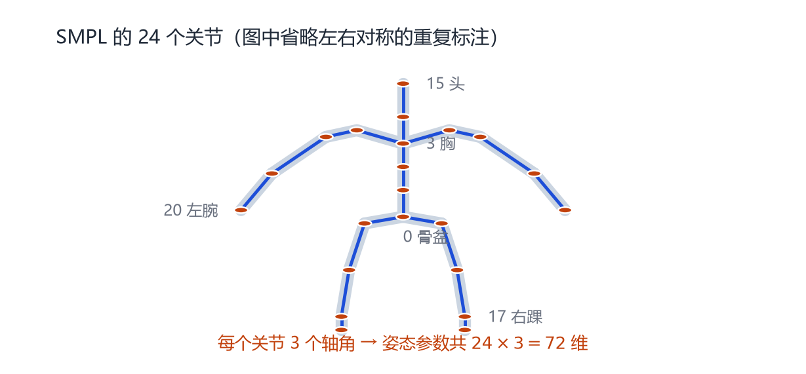

# 第 2 章 SMPL：一个公式统治人体

> **本章导读**：SMPL 是过去十年被引用最多的人体模型，也是几乎所有人体重建、动作生成、数字人系统的底座。这一章把 SMPL 的公式拆成五个部件，逐项解释每个数组的形状和含义，每一项都配一句“去掉它会怎样”。读完你应该能回答三个问题：为什么是 6890 个顶点、10 个形状参数、207 个姿势基？这些数字不是魔法，都是可以解释的选择。

## 2.1 为什么还需要一个新模型

这一节要回答的问题是：SCAPE 已经能分离形状和姿态，2015 年为什么还要重做一个。结论是：SMPL 不比 SCAPE 准，但它便宜到可以当作神经网络的一层。

SCAPE 太“重”了，四件事都卡在工程上：

- 每次生成要解三角形级的最小二乘，不能实时；
- 整条链路不可微，接不上神经网络的训练；
- 实现复杂，研究者和工程师都难以复现；
- 依赖一套“已蒙皮、已绑定”的骨架，骨架错了，姿态基就跟着错。

SMPL 的目标写在论文标题里都很清楚：**做一个足够简单、足够快、可微、又能被大规模数据训练的人体模型**[@loper2015smpl]。

它的答案只有一个动作：**把 SCAPE 的“三角形级变形”降级成“顶点级位移 + 标准 LBS”**。牺牲一点物理精度，换取工程上的巨大便利。具体换了什么：

| | SCAPE | SMPL |
|---|---|---|
| 体型怎么建模 | 每个三角形的 $3\times3$ 变形矩阵 | 每个顶点的一个位移向量 |
| 姿势怎么建模 | 每个三角形回归一个 $3\times3$ | 207 个全身位移基，线性组合 |
| 生成一次 | 解稀疏线性系统 | 两次矩阵乘 + 一次蒙皮 |
| 可微 | 否 | 是 |

今天你看到的绝大多数人体重建论文，输出层都是 SMPL 的 10 个 $\beta$ 和 72 个 $\theta$。这并不说明它们只会用 SMPL，而是说明 SMPL 已经成了这个领域的“文件格式”——就像图片不一定是 JPEG 最好，但所有人都能打开 JPEG。

### 2.1.1 为什么“成为文件格式”比“更准”更重要

这件事在软件史上反复出现。一个东西能不能变成公共接口，取决于三件事：**规格是否稳定、实现是否便宜、生态是否已经存在**。精度只排第四。

SMPL 在这三件事上都赢了：

- **规格稳定**：顶点数、关节顺序、参数含义十年没变。数据集写进去、论文读出来，都不会错位。
- **实现便宜**：一个下午能复现，一个学生能在笔记本上跑。这是它被几千篇论文采用的前提。
- **生态已经存在**：从 AMASS 这样的动作数据集，到 `smplx` 这样的库，到 MPJPE 这样的评价指标，全都以它为中心。后来者就算有更好的模型，也得先“翻译成 SMPL”才能和别人比较。

这也是为什么你在读一篇 2024 年的论文时会发现，它的模型比 SMPL 准得多，但依然要报“在 SMPL 参数空间下的结果”——**比较需要一个公共坐标系，而公共坐标系一旦形成，就有巨大的惯性。**

## 2.2 输入与输出

这一节先把“这个函数吃什么、吐什么”定清楚。结论是：输入 82 个数，输出 20670 个数，中间还藏着三个固定数组。

SMPL 的输入只有两组参数：

- **形状参数** $\boldsymbol{\beta}\in\mathbb{R}^{10}$：控制高矮胖瘦；
- **姿态参数** $\boldsymbol{\theta}\in\mathbb{R}^{72}$：24 个关节，每个 3 个轴角（axis-angle，用一个三维向量表示“绕哪根轴转多少度”）。

输出是一张网格：6890 个顶点，每个顶点 3 个坐标，共 20670 个数。此外还有 24 个关节的三维位置，以及每个顶点的蒙皮权重。

整个映射记作

$$
M(\boldsymbol{\beta},\boldsymbol{\theta}):\ \mathbb{R}^{10}\times\mathbb{R}^{72}\to\mathbb{R}^{6890\times3}.
\tag{2.1}
$$

<figure class="fig">

<figcaption><b>图 2-1</b>　SMPL 的前向计算流程。模板、形状参数、姿态参数、蒙皮权重、关节回归器共同作用，最终输出一张 6890 个顶点的网格。注意形状偏移与姿势偏移是相加的，LBS 在最后一步。</figcaption>
</figure>

### 2.2.1 三个数字的来历

**为什么是 6890 个顶点？** 这不是从解剖学推出来的，而是“配准模板的顶点数”。SMPL 的作者先做了一个中等密度的模板（能表现手指以外的身体细节，又不至于让计算量爆炸），然后所有扫描都配准到这个模板上。这个数字一旦定下来就不能改：换一个模板就是另一个模型，所有训练好的参数都失效，第 3 章的 SMPL-X 就是这样另起炉灶的。

**为什么是 10 维形状？** 这是一个取舍。维度太少区分不出体型；维度太多，从单张图反推时容易过拟合，而且参数空间里会出现畸形的组合。10 维在实践中覆盖大部分成年人差异（第 4 章 4.2.2 节给了“覆盖多少方差”的算法）。

**为什么是 72 维姿态？** $24\times3=72$。24 个关节是“身体”这个层次的合理粒度：脊柱分成 3 段、每只手用 1 个关节（整只手当一个刚体）、每只脚用 2 个。SMPL 的表达能力到此为止，手指和表情要去第 3 章找。

### 2.2.2 这些数字占多大内存

一组具体数字，能建立量级感（以官方模型文件为例，单精度 float32）：

| 数组 | 形状 | 数值个数 | 内存 |
|---|---|---:|---:|
| 模板 $\bar{\mathbf{T}}$ | $6890\times3$ | 20670 | 81 KB |
| 形状基 $\mathbf{S}$ | $6890\times3\times10$ | 206700 | 807 KB |
| 姿态基 $\mathbf{P}$ | $6890\times3\times207$ | 4278690 | 16.3 MB |
| 蒙皮权重 $\mathcal{W}$ | $6890\times24$ | 165360 | 646 KB |
| 关节回归器 $\mathcal{J}$ | $24\times6890$ | 165360 | 646 KB |

总计不到 20 MB，其中 16.3 MB 全是姿态基。**SMPL 模型文件里绝大部分体积就是这个 207。**

这也解释了一个常见困惑：为什么明明显卡显存很大，批量跑 SMPL 还是会爆？因为爆发点不在模型，在“一次前向要为每个样本生成 6890×3 的中间量”。批量 256 个样本时，中间张量就是 $256\times6890\times3\times4$ 字节 ≈ 21 MB，乘上中间步骤的数量才是真正的开销。

### 2.2.3 网格的拓扑：6890 个顶点之外

要判断一个模型文件是否完整，除了顶点数，还得看拓扑。官方 SMPL 的拓扑是：

| 量 | 数值 |
|---|---:|
| 顶点 $V$ | 6890 |
| 三角形 $F$ | 13776 |
| 边 $E$ | 20664 |
| 平均边长 | 16.9 毫米 |
| 欧拉示性数 $V-E+F$ | 2（亏格为零的闭合曲面） |

最后一个数字值得解释：$V-E+F=2$ 说明这是一个“没有洞的封闭曲面”，像球面一样。它意味着：

- 可以算封闭体积（第 4 章 4.8.2 节的体积偏差指标要靠它）；
- 法向可以一致地朝外，光照和碰撞检测才成立；
- 配准时不会遇到“模型自己有洞，配准穿过去”的问题。

换模型时这张表就是检查清单：如果导入后 $V-E+F\ne2$，模型被切开过（做了 UV 展开或者去掉了头部），后面很多算法会失效。

<figure class="fig">

<figcaption><b>图 2-2</b>　β 与 θ 到底长什么样。上排：同一个 T-pose，只把第一个形状参数 $\beta_1$ 分别取 $-4$、$0$、$+4$（相机比例固定，所以体型差异能直接比出来）；下排：同一个体型，只改一个关节的旋转（抬右臂、屈左膝、上身前倾）。图中网格由官方 SMPL 模型渲染，仅用于非商业的学习与研究。</figcaption>
</figure>

一眼就能看出两件事：**β 改的是“这个人是谁”，θ 改的是“他在做什么”。** 上排三个人的姿势完全一样，但肩宽、胸围、腿粗都在变；下排是同一个人，只是某几个关节转了 30–45°。这两组参数互不干扰，正是第 1 章讲的“形状与姿态解耦”在工程上的样子。

### 2.2.4 72 维怎么排

$\boldsymbol{\theta}$ 不是“随便 72 个数”，它有固定顺序，而顺序决定了父子链怎么乘。

官方 SMPL 的排列是：**第 0 个是根关节（骨盆），之后的每一个关节都紧跟在它的父关节后面**。这个“父在子前”的顺序让全局变换可以一次线性扫描算完：算到第 $i$ 个关节时，它的父关节一定已经算好了。

具体到这个 24 关节的骨架（部分）：

| 编号 | 关节 | 父关节 |
|---:|---|---:|
| 0 | 骨盆 | 无 |
| 1 | 左髋 | 0 |
| 2 | 右髋 | 0 |
| 3 | 腰椎 | 0 |
| 4 | 左膝 | 1 |
| 5 | 右膝 | 2 |
| … | … | … |
| 16 | 左肩 | 13 |
| 18 | 左肘 | 16 |
| 20 | 左腕 | 18 |

所以 $\theta[54:57]$ 是左肘的轴角，$\theta[60:63]$ 是左腕的。写代码时**不要凭直觉猜顺序**，从模型文件里读 `kintree_table`（父节点表）最稳。不同实现（教学版、PyTorch3D 版、smplx 版）的关节顺序可能不一样。

一个常见的调试手段：只把第 18 个关节转 30°，看网格哪个部位动了。动的是肘，说明顺序对了；动的是膝盖，说明你把左右搞反了。

## 2.3 第一步：模板与形状 blendshape

这一节要解决的问题是：“高矮胖瘦”这件事怎么变成可计算的数。结论是：把体型差异写成一堆“全身位移图”的线性组合，系数就是 $\beta$。

SMPL 有一个**模板** $\bar{\mathbf{T}}$，是一张“平均体型、静止姿势”的网格。它是几千个人的平均，不是某个真人——这一点后面会反复用到。

形状参数先对模板做一次线性偏移：

$$
\mathbf{T}_S=\bar{\mathbf{T}}+\mathbf{B}_S(\boldsymbol{\beta}),
\qquad
\mathbf{B}_S(\boldsymbol{\beta})=\sum_{n=1}^{10}\beta_n\mathbf{S}_n.
\tag{2.2}
$$

逐项读：

- $\bar{\mathbf{T}}\in\mathbb{R}^{6890\times3}$：模板顶点坐标，单位是米。官方男性模型在 $\beta=\mathbf{0}$ 时身高约 1.79 米。
- $\mathbf{S}_n\in\mathbb{R}^{6890\times3}$：第 $n$ 个形状主成分，可以想成“一张全身位移图”——每个顶点往哪挪、挪多少，都画在这张图上，单位是米每标准差。
- $\beta_n$：这个方向的系数，无量纲。它读作“偏离平均值几个标准差”。
- $\mathbf{T}_S$：加完形状偏移之后、还没摆姿势的网格。

这一步在数学上就是 PCA。$\mathbf{S}_n$ 是把一批已对齐的网格叠成矩阵、做 SVD 得到的右奇异向量；$\beta_n$ 是样本在这个方向上的投影坐标。

### 2.3.1 一个 β 单位到底改多少

“标准差”这个单位很抽象，拿官方男性模型量一下就有感觉了。只把 $\beta_1$ 从 0 调到 1（其他 9 个都不动）：

| 量 | 数值 |
|---|---|
| 单个顶点位移的最大值 | 57.6 毫米（出现在躯干侧后方，顶点 6616） |
| 单顶点位移的中位数 | 19.2 毫米 |
| 肩宽 | 收窄 12.1 毫米 |
| 身高 | 降低 76.8 毫米 |
| 24 个关节的平均位移 | 约 16 毫米 |

<figure class="fig">

<figcaption><b>图 2-3</b>　一个 $\beta_1$ 单位的实际影响（官方男性模型实测）。左图是逐顶点位移的分布：大部分顶点挪 10–20 毫米，肩背和腿侧的顶点能到 40–57 毫米。右图是同一个 $\beta_1$ 对三个可读量的影响：身高变化最敏感（每单位约 −77 毫米），肩宽次之，关节平均位移约 16 毫米。</figcaption>
</figure>

把这些数记住，就能判断参数是否合理。$\beta_1=1$ 意味着“这个人体重偏大、个子偏矮一点”；$\beta_1=3$ 时身高已经降了 230 毫米，也就是一个身高 1.56 米的人——这可能合理，也可能是一个回归网络在乱猜。**$\beta$ 的取值范围不是硬约束，是统计意义上的“合理区间”，超出了模型照样出网格，只是出来的人不像人。**

### 2.3.2 如果没有形状项

去掉 $\mathbf{B}_S$，SMPL 就退化成一个“只有姿势的模型”：所有人共用同一个身体，只能摆不同动作。

这在动画里勉强够用（观众不关心配角的高矮），但在重建里立刻崩：从单张照片估出的人，体型永远是平均值，误差能到十几厘米。更麻烦的是下游任务——服装试穿、人体测量、体型分类，全都依赖 $\beta$ 有物理意义。

### 2.3.3 边界与失败模式

**一是线性空间的极限。** 真实体型不是线性可分的：极度肥胖时，脂肪的堆积方式会改变（腹部下垂、四肢比例变化），线性组合表达不了。$\beta$ 取到 $\pm4$ 之外，网格经常出现自交。

**二是均值不是“标准人”。** $\beta=\mathbf{0}$ 是训练集的平均体型，而训练集以欧美成年人为主。用它代表“标准人”去做亚洲人的重建，会有系统性偏差。

**三是形状项与姿势项的可加性。** 式 (2.2) 的加法假设“体型偏移”与“姿势无关”。真实情况里，胖子和瘦子在同一个姿势下的形状差异并不完全一样（第 1 章 1.7 节讲过这个耦合）。SMPL 用“加”近似“复合”，在极端体型加极端姿势时会露馅。

所以，形状项是 SMPL 里最“统计”、最不“物理”的一块：它不保证产出的人存在，只保证产出的点在数据分布附近。

### 2.3.4 形状参数能拿来做什么

$\beta$ 是一个 10 维的连续空间，一旦有了它，很多任务就变成了“在这个空间里找点”。

**插值。** 两个人 $\boldsymbol{\beta}_A$、$\boldsymbol{\beta}_B$，取 $\boldsymbol{\beta}(t)=(1-t)\boldsymbol{\beta}_A+t\boldsymbol{\beta}_B$，就得到体型的连续过渡。这在游戏里做“捏脸”式体型编辑，在医学里做“随年龄变化的模拟”。

**反解。** 给几张照片，估出 $\beta$。这是所有单图重建任务的核心，也是 $\beta$ 语义不清最要命的地方（第 2.10 节）。

**统计。** 有了几千个人的 $\beta$，可以算人群的体型分布、做异常检测（比如判断一个人是否营养不良）。

**编辑。** 想“只把这个人变高 5 厘米”，可以在 $\beta$ 空间里找一个方向，使得身高增加而其他量变化最小。这是个带约束的线性问题，因为身高对 $\beta$ 近似线性。

### 2.3.5 形状基的“支撑”：哪些顶点动得多

把某个 $\mathbf{S}_n$ 单独画出来，会看到它不是均匀的：有的地方动 50 毫米，有的地方只动 3 毫米。

这个分布有物理含义。真实体型变化从来不是“全身等比放大”，而是有重点的：

- 胖瘦主要改腹部、大腿、上臂的**厚度**；
- 身高主要改**腿长和脊柱长度**；
- 肩宽主要改**锁骨与肩峰的距离**。

所以形状基的“支撑”（哪些顶点非零、多大）本身就是一张体型变化的解剖图。检查一个形状基是否合理，最简单的办法就是**只加它、渲染出来看像不像一个真实的人**。如果它让腰部凹进去同时让脖子变粗，那这个基多半是配准伪影（第 4 章 4.1.3 节）。

这一点在实际工作里很有用：拿到一个来路不明的“改进版 SMPL”，先画出 10 个基，看有没有哪一个长得像伪影。这比跑一遍重建流程快得多。

## 2.4 第二步：从形状回归关节

这一节要解决的问题是：体型变了，关节应该在哪。结论是：关节不是写死的常数，而是“形状网格的加权平均”，权重可以取负值。

不同体型的人，关节位置不一样。胖子的髋关节更靠外，高个子的膝关节离骨盆更远。所以 SMPL 不把关节位置写死，而是从形状网格回归：

$$
\mathbf{J}(\boldsymbol{\beta})=\mathcal{J}\big(\bar{\mathbf{T}}+\mathbf{B}_S(\boldsymbol{\beta})\big).
\tag{2.3}
$$

- $\mathcal{J}\in\mathbb{R}^{24\times6890}$：关节回归器。每一行对应一个关节，行里是 6890 个权重，意思是“这个关节等于所有顶点的一个加权平均”。
- 输出 $\mathbf{J}(\boldsymbol{\beta})\in\mathbb{R}^{24\times3}$：24 个关节的三维坐标，米。

官方模型里，$\mathcal{J}$ 的每一行只有很少几个非零：最少的一行只有 3 个非零，最多的 22 个。

<figure class="fig">

<figcaption><b>图 2-4</b>　关节回归器的工作原理。左图示意：关节是周围一圈顶点的加权平均，权重有正有负（绿色为正、粉色为负），所以关节可以落在顶点的凸包之外、也就是身体内部。右图是实测：把 $\beta_1$ 从 $-3$ 扫到 $+3$，三个关节的高度严格落在一条直线上——因为回归器是线性的，而形状项对 $\beta$ 也是线性的，两个线性复合还是线性。</figcaption>
</figure>

### 2.4.1 为什么不能“把附近的顶点取平均”

一个很自然的替代方案：把膝盖附近的顶点取个算术平均，当作膝关节。省事，不用训练。这个方案有四个问题。

**一是顶点密度不均匀。** 骨盆附近顶点密，小腿外侧稀疏，算术平均会被密度带偏。

**二是有些关节在身体内部。** 髋关节中心在骨头里，表面一个顶点都没有；用表面点平均只能得到浅层的近似，深度方向没有信息。

**三是凸组合不能外推。** 顶点平均的结果一定落在这些顶点的凸包里。踝关节其实略微在网格外面，凸组合永远够不到。

**四是不会随体型自适应。** 这条最要命：髋关节应该随体重向外移，而“取平均”只有在体型接近模板时才准。

允许权重取负值，就一次性解决了前三条：负权重让关节可以落到凸包外，也可以从一圈表面点“伸进”身体内部去。第四条则靠 ${\beta}$ 的线性依赖解决——回归器吃的是已经变形过的 $\mathbf{T}_S$，体重一变，顶点先变，关节跟着动。

### 2.4.2 J 是 β 的仿射函数

这一点值得单独说，因为它让后面所有事都变简单。

形状项对 $\boldsymbol{\beta}$ 是线性的，回归器对顶点是线性的，两个线性复合还是线性。所以

$$
\mathbf{J}(\boldsymbol{\beta})=\mathbf{A}\boldsymbol{\beta}+\mathbf{b},
\tag{2.4}
$$

其中 $\mathbf{A}\in\mathbb{R}^{72\times10}$、$\mathbf{b}\in\mathbb{R}^{72}$ 都可以离线算一次存下来。前向计算时只要一次 $72\times10$ 的乘法——比读一遍顶点便宜得多。

图 2-4 右图就是这个结论的实测：三个关节的高度随 $\beta_1$ 走的是严格直线，没有任何弯曲。

### 2.4.3 如果没有关节回归

假设把 24 个关节的位置硬编码成模板的数值，不考虑体型。会发生什么？

考虑一个 $\beta_1=3$ 的样本：身高降了 230 毫米，肩宽收窄 36 毫米。但关节还停在高个子的位置，于是：

- 肩关节在手臂上面 3 厘米处，LBS 把手臂的顶点往错误的位置拽，腋下出现折叠；
- 膝关节在小腿上方，膝盖的弯曲中心偏了，屈膝时小腿会“脱臼”。

这就是为什么“先有形状、再有骨架”是 SMPL 的顺序，而不是反过来。

### 2.4.4 边界：回归器会继承训练集的偏差

$\mathbf{A}$ 和 $\mathbf{b}$ 是从“带关节标注的扫描”里最小二乘解出来的。训练集里以某一地区、某一年龄段的成年人为主，解出来的关节位置就带上这群人的解剖特征。

后果很隐蔽：顶点误差照样很小，网格照样漂亮，只是骨架系统性偏了。对手部、面部这些精细部位，几毫米的偏差就足以让动画看起来“不对劲”。

### 2.4.5 一个关于回归器的小实验

想知道回归器有多“敏感”，做一件事：把 $\beta$ 全设成零，然后单独把 $\beta_1$ 调到 1，看 24 个关节各移动多少（官方男性模型实测）。

结果是有梯度的：

- 手腕、手、脚这类**远端**关节移动最多（约 20 毫米）；
- 肩、髋这类**近端**关节移动 12–16 毫米；
- 骨盆几乎不动（它靠近模板的原点，形状基在那里接近零）。

这个梯度说明回归器学到了“体型变化沿肢体累积”这件事：个子高一点，脚就会低一点，而骨盆几乎不动。如果某个实现里所有关节移动量都差不多，那它的回归器多半是用“全局平均”初始化之后没怎么优化。

## 2.5 第三步：姿势 blendshape

这一节要解决的问题是：LBS 会把弯曲处捏细，怎么补。结论是：在蒙皮之前，先按姿势往顶点上加一个修正位移。

如果只有 LBS，肘弯 90° 时关节内侧会塌陷、截面变成椭圆，原因是两个刚体变换的加权平均不再是刚体变换（第 1 章 1.2.1 节算过：截面缩到 71%）。SMPL 的解决办法是：**在 LBS 之前，先根据姿势加一个修正位移。**

$$
\mathbf{T}_P=\mathbf{T}_S+\mathbf{B}_P(\boldsymbol{\theta}),
\qquad
\mathbf{B}_P(\boldsymbol{\theta})=\sum_{n=1}^{207}\big(R_n(\boldsymbol{\theta})-R_n(\boldsymbol{\theta}^*)\big)\mathbf{P}_n.
\tag{2.5}
$$

三个关键点。

**第一，207 是怎么来的。** SMPL 有 23 个非根关节（根关节的旋转是全局朝向，不算“姿势”）。每个关节的旋转矩阵是 $3\times3$，展开成 9 个数，$23\times9=207$。所以姿势 blendshape 的“参数”不是角度，而是**旋转矩阵减单位阵之后的 9 个元素**。

**第二，为什么用旋转矩阵而不是轴角。** 因为位移里含有角度的二阶项（$\theta^2$ 那一项），而旋转矩阵的元素恰好是这个二阶项和正弦的组合。用 9 个矩阵元素做线性基，能凑出二阶效应；用 3 个轴角做线性基，凑不出来。第 4 章 4.4.3 节把这件事算到了机器精度。

**第三，$\boldsymbol{\theta}^*$ 是静止姿势。** 减去 $R_n(\boldsymbol{\theta}^*)$ 保证“静止姿势下修正量为零”，模板仍然是模板，不会在没摆姿势时被莫名修正。

$\mathbf{P}_n\in\mathbb{R}^{6890\times3}$ 是学出来的位移基：第 $n$ 个基表示“某个关节的某个旋转分量从 0 变到 1 时，全身应该怎么补偿”。

### 2.5.1 一个姿态基实际干了什么

拿官方模型算一个具体例子：只把左肘弯 90°，看姿态基贡献了多少位移。

| 量 | 数值 |
|---|---|
| 单顶点最大位移 | 16.2 毫米 |
| 平均位移 | 1.76 毫米 |
| 位移超过 1 毫米的顶点 | 4537 个（共 6890） |
| 关掉姿态基之后，最终网格的最大差异 | 12.0 毫米 |

<figure class="fig">

<figcaption><b>图 2-5</b>　一个姿态基到底改了什么（官方模型实测，左肘弯 90°）。左图是正视的位移大小分布，热点集中在肘部。右图按“到左肘的距离”统计：越近越大，肘部 99% 分位能到 16 毫米；但离得再远也不为零，全身还有 1–2 毫米的基线。</figcaption>
</figure>

这里有两点和常见说法不一样，值得记住。

**一点是“局部”只是大致成立。** 很多教材说 207 个基“只在关节附近有值”。实测下来，最大值的确实在关节附近，但全身都有一两个毫米的位移，并不是严格为零。原因是 SMPL 的姿态基是在全部顶点上一起解的，没有加空间支撑集约束。这个细节不影响使用，但影响你对“稀疏性”的判断：想要靠“只算附近几个关节”来加速，得自己做裁剪。

**二是一厘米量级的补偿是相当可观的。** 12 毫米在 1.8 米的人身上看起来很小，但在手肘这种曲率大的地方，正好是“瘪进去”和“圆过来”的差别。

### 2.5.2 如果没有姿态项

去掉 $\mathbf{B}_P$，剩下的是“形状 + LBS”，也就是最朴素的骨骼动画。症状按关节出现：

- 肘、膝弯曲时内侧塌陷，出现“糖纸”；
- 肩膀抬到水平时，腋下出现尖角；
- 手腕、脚踝扭转时，截面拧成麻花。

这些不是“细节不好看”，而是几何上明显错误：在配准里，这些塌陷会让周围顶点集体往关节轴线上靠，进一步污染训练数据。

### 2.5.3 边界：姿态基是线性外插

式 (2.5) 对 $\boldsymbol{\theta}$ 是线性的（通过 $R$ 的元素），所以训练集没见过的角度上，它做的就是**线性外推**。而真实的形变在极端角度下是饱和的（皮肤不可能无限拉长）。

表现为：抬腿到 150°，大腿根部鼓起一个包；手臂举过头顶，肩部翻出尖角。这就是第 4 章 4.9 节要讲的“姿态外插失控”。

### 2.5.4 姿态基和 SCAPE 的姿态变形是什么关系

一句话：**SMPL 的姿态基是 SCAPE 姿态变形的一个受限近似**。

- SCAPE 为每个三角形学一个 $3\times3$，能表达剪切、拉伸、扭转，表达能力强但参数量大、要求解；
- SMPL 把所有顶点的修正写成“207 个固定方向的线性组合”，表达能力弱，但一次矩阵乘就完事。

如果把 SCAPE 的姿态变形场在“207 个方向”上做低秩投影，得到的就是 SMPL 的 $\mathbf{P}_n$。两者差别在表达能力，不在思想：都是“根据关节角，往网格上加一组学出来的位移”。

这也解释了一个现象：SMPL 在肘、膝这种“弯曲为主”的地方表现不错，在肩、胯这种“既要弯又要扭”的地方明显更差——因为扭转需要的剪切，207 个基只能勉强凑。

### 2.5.5 姿态基的编号顺序

$\mathbf{P}$ 的 207 列有固定顺序：第 $k$ 个关节贡献连续的 9 列，从 $(k-1)\times9$ 开始。

要注意三件事。

**一，根关节不算。** 207 对应 23 个非根关节，根关节的旋转已经在 LBS 的全局变换里体现，不再单列。所以“第 18 个关节”对应的列是 $17\times9=153$ 到 $161$。

**二，顺序是 9 个矩阵元素的行优先展开。** 也就是 $R_{00},R_{01},R_{02},R_{10},\dots$。如果你按列优先拼，整个姿态项就全错，症状是“微小的动作导致巨大的形变”。

**三，$\mathbf{P}$ 的列顺序必须和 $\boldsymbol{\theta}$ 的关节顺序一致。** 两个数组来自同一个模型文件，通常是配好的；但如果你自己重新排列了关节（比如为了接某个关键点检测器），必须同时重排 $\mathbf{P}$。忘了这一步，是“模型能跑但姿势很怪”的常见原因。

## 2.6 第四步：LBS

这一节要解决的问题是：有了摆好姿势的网格，怎么把它“绑”到骨架上，让关节转动带动顶点。结论是：每个顶点最多听 4 根骨的话，权重和为 1。

现在有了中间形状 $\mathbf{T}_P$、关节位置 $\mathbf{J}(\boldsymbol{\beta})$、蒙皮权重 $\mathcal{W}$，就可以做标准的线性混合蒙皮：

$$
\mathbf{t}_i'=\sum_{k=1}^{K}w_{k,i}\,
\mathbf{G}_k(\boldsymbol{\theta},\mathbf{J})\,
\mathbf{G}_k(\mathbf{0},\mathbf{J})^{-1}\,
\mathbf{t}_{P,i}.
\tag{2.6}
$$

逐项读：

- $\mathbf{t}_{P,i}$：第 $i$ 个顶点在“摆好姿势但还没蒙皮”的网格上的位置，$3\times1$，米；
- $\mathbf{G}_k(\boldsymbol{\theta},\mathbf{J})$：关节 $k$ 的全局变换，$4\times4$。它不是直接给出来的，而是从根关节开始逐级相乘：每个关节的全局变换 = 父关节的全局变换 × 自己的局部旋转（转轴过自己的关节位置）；
- $\mathbf{G}_k(\mathbf{0},\mathbf{J})^{-1}$：把“在静止姿势下的位置”换算到该关节的局部坐标里。这一步保证“姿势为零时，整个式子退化成恒等变换”；
- $w_{k,i}$：顶点 $i$ 对关节 $k$ 的权重，每个顶点最多 4 个非零，且和为 1。

图 2-6 是 24 个关节的结构：根节点是骨盆，向上是 3 段脊柱、颈、头，向两侧是锁骨、肩、肘、腕，向下是髋、膝、踝、脚。

<figure class="fig">

<figcaption><b>图 2-6</b>　SMPL 的 24 个关节。根节点是骨盆，向上是脊柱、胸、颈、头，向两侧是锁骨、肩、肘、腕，向下是髋、膝、踝、脚。每个关节贡献 3 个轴角，共 72 维。注意“关节”在这里是“旋转中心”，不代表人体解剖上的关节面。</figcaption>
</figure>

### 2.6.1 每个顶点恰好 4 个权重

“最多 4 个”这句在官方模型里其实更强：**每个顶点恰好 4 个非零权重，其余全为零**。这不是凑巧，是刻意的设计，理由有三个。

**一是 GPU 友好。** 每个顶点读一个 `vec4` 权重，正好四次乘加，不需要分支，不需要循环。

**二是与几何相符。** 一个表面顶点不会同时被 4 根以上的骨影响；影响它的通常就是“最近的两根骨 + 次近的两根”。

**三是精度足够。** 从 4 个增加到 8 个，误差的改善远小于计算量的翻倍。人体不是章鱼，肢体不会同时靠近很多根骨。

### 2.6.2 如果没有 LBS

去掉 LBS（也就是权重都是“只属于骨盆”），所有顶点跟着根关节走：整张网格变成一块刚体，摆姿势时人在原地转动，四肢不弯。

这说明 LBS 承担的不是“修饰”，而是“把姿势传下去”。形状项和姿态项都只是位移；**真正让网格动起来的是 LBS**。

### 2.6.3 LBS 的边界

LBS 的问题在第 1 章和第 4 章都出现过，这里只列症状清单：

- **体积损失**：弯曲处截面缩成椭圆（90° 时 71%）；
- **糖纸**：扭转时截面被拧细；
- **权重不连续**：相邻顶点跟不同的骨，弯曲时出现一道硬边（折痕）；
- **极端姿势自交**：大腿抬到胸口，腹部和大腿互相穿透。

前两个由姿态基补，后两个只能靠更好的权重、碰撞处理或者换模型（第 3 章）。

### 2.6.4 手算一次 $\mathbf{G}_k$

式 (2.6) 里的 $\mathbf{G}_k$ 容易看得云里雾里。拿官方模型的关节坐标算一个例子就清楚了。

假设只把右臂从 T-pose 抬到垂直向下，也就是绕右肩关节的 $z$ 轴转 $90^\circ$。右肩关节在 $(-192,\,237,\,-12)$ 毫米，右手腕在 $(-721,\,229,\,-50)$ 毫米。

第一步，把手腕换算到“以肩为原点”的坐标：

$$
\mathbf{p}-\mathbf{J}_{17}=(-529,\,-7.5,\,-37)\ \text{毫米}.
$$

第二步，绕 $z$ 轴转 $90^\circ$：$(x,y)\mapsto(-y,x)$，得到 $(7.5,\,-529,\,-37)$。

第三步，加回肩的位置：$(-184,\,-292,\,-50)$ 毫米。

也就是说，**手腕从“与肩同高”变成了“肩下 529 毫米”**，这个 529 就是上臂加前臂的总长。整个过程中 LBS 做的其实就是这件事，只不过每个顶点要按 4 个关节的权重加权，而且 $4\times4$ 的全局变换是从根关节逐级乘下来的。

注意父子链的作用：手腕的全局变换 = 肩 × 肘 × 腕 三个局部变换连乘。所以肘一弯，手腕跟着走；肘不弯，手腕只受肩影响。**这条链是“姿势能传递”的全部机制。**

### 2.6.5 权重和为 1，到底保证了什么

式 (2.6) 有个约束容易被当成“约定”：$\sum_k w_{k,i}=1$。它保证的是**平移不变性**。

设想整副骨架整体平移 $(100,0,0)$ 毫米。这时每个 $\mathbf{G}_k$ 都右乘了一个平移，于是

$$
\sum_k w_{k,i}\big(\mathbf{G}_k+\mathbf{T}\big)\mathbf{t}=\Big(\sum_k w_{k,i}\mathbf{G}_k\Big)\mathbf{t}+\Big(\sum_k w_{k,i}\Big)\mathbf{T}\mathbf{t}.
$$

第二项的系数是“权重和”。权重和为 1，第二项就正好是 $\mathbf{T}\mathbf{t}$，整个网格跟着平移 100 毫米；权重和为 1.1，网格会被放大 10%；权重和为 0.9，网格会缩水 10%。

这就是为什么“归一化权重”不是可选的清理步骤，而是正确性的一部分。**忘记归一化的模型，症状是“整体缩放”，而且缩放比例随姿势变化**——因为不同顶点的权重和不一样。

顺带说：同一套推导也说明了为什么权重不能为负。负权重会让某些顶点的“有效权重和”虽然还是 1，但它跟随的变换已经跑到了身体的另一侧，顶点会飞出去。

### 2.6.6 权重是从哪来的：测地距离，然后优化

SMPL 的权重不是手画的，分两步得到。

**第一步，初始化。** 算每个顶点到每根骨段的距离，取最近的 4 根，按距离倒数归一化。这里的关键是**用测地距离而不是欧氏距离**。

为什么？因为手臂贴着躯干时，腋下的顶点在欧氏距离上离躯干最近（直线距离 2 厘米），但它显然应该跟着手臂走。沿表面走一圈的测地距离会正确地告诉它“你离手臂更近”（表面距离 8 厘米，到躯干 15 厘米）。

这一步做错，后面怎么优化都救不回来：初始化决定了权重的“盆地”，优化只会在盆地内微调。

**第二步，优化。** 固定形状与姿态基，把权重当未知量，最小化“模型顶点与扫描顶点的距离”。这个问题对权重是双线性的，不凸，所以用带约束的迭代（投影梯度、或者对每个顶点的小规模二次规划）。每轮结束把小于阈值的权重砍掉，把砍掉的量按比例分给剩下的，保证和为 1。

这是整个训练里最慢的一步，也是最“工程”的一步。权重的连续性没法用一条公式保证，只能靠初始化质量加足够多的姿态样本。

## 2.7 一次前向的计算账本

这一节算一下 SMPL 跑一次到底花了多少运算。结论是：五百万次乘加左右，单核毫秒级，这就是它“能实时”的底气。

按前向顺序累加：

| 步骤 | 运算量 | 量级 |
|---|---|---|
| 形状偏移 $\mathbf{B}_S$ | $10\times6890\times3$ | 2.1×10⁵ |
| 关节回归 $\mathbf{J}$ | $24\times6890\times3$ | 5.0×10⁵ |
| 姿态偏移 $\mathbf{B}_P$ | $207\times6890\times3$ | 4.3×10⁶ |
| 关节全局变换 | $24$ 次 $4\times4$ 相乘 | 约 1.4×10³ |
| LBS | $6890\times4$ 次 $4\times4$ 变换 | 3.3×10⁵ |
| 合计 | | 约 5.3×10⁶ |

五百万次乘加在现代 CPU 上不到一毫秒，在 GPU 上批量处理时几乎免费。对比 SCAPE 每次要解一个上万阶的稀疏系统，这就是“能放进训练循环”和“只能离线跑”的分界线。

顺带一个直觉：姿态偏移一项就占了 81% 的运算，因为它要把 207 个基乘以每个顶点的 3 个坐标。这也说明为什么**减少姿态基的个数**是加速 SMPL 最直接的手段（有些实现把 207 压到几十个，误差增加有限）。

### 2.7.1 207 个基能不能压小

可以，而且压得比想象中狠。把官方模型的 207 个姿态基（每个是 20670 维的向量）排成矩阵做 SVD，看前 $k$ 个奇异值占多少能量：

| 基的个数 $k$ | 占总能量 |
|---:|---:|
| 10 | 59.7% |
| 20 | 79.5% |
| 30 | 88.3% |
| 50 | 95.7% |
| 100 | 99.7% |
| 207 | 100% |

也就是说，**50 个基就能覆盖 96% 的能量**。这不是说 SMPL 该改成 50 维（能量占比不等于视觉误差，那些只占 4% 的方向往往正好是“手指、嘴角、腋下”这些细节），但它解释了为什么很多实时实现敢裁基：少的那些方向带来的误差，肉眼在中等分辨率下看不出来。

裁基的代价很具体：极端姿势的补偿会先失效。如果你只做“站立、行走、坐下”这类常见动作，裁到 50 个几乎无损；如果要做舞蹈、格斗，最好别裁。

## 2.8 SMPL 是怎么训练出来的

这一节要回答：那 10 个基、207 个基、蒙皮权重、关节回归器都是从哪来的。结论是：全都从数据里分阶段解出来，没有一个是手工画的。

SMPL 的训练分三步，每一步只优化一部分参数。

**第一步：形状空间。** 用全身扫描数据集（论文用的是 CAESAR，数千名受试者的三维扫描），把所有扫描配准到同一拓扑，再对顶点偏移做 PCA，得到 10 个形状主成分 $\mathbf{S}_n$ 和模板 $\bar{\mathbf{T}}$。

**第二步：关节回归器与蒙皮权重。** 用一批“同一个人摆多个姿势”的扫描，优化 $\mathcal{J}$ 和 $\mathcal{W}$，使得 LBS 的输出尽量接近扫描。这一步最贵，也最需要仔细的初始化（第 4 章 4.6.3 节讲了用测地距离初始化）。

**第三步：姿势 blendshape。** 固定形状和蒙皮，优化 207 个姿态基 $\mathbf{P}_n$，专门补偿弯曲、扭转时的偏差。

训练的目标函数大致是

$$
\min\ \sum_{\text{scan}}\Big(
\|\mathbf{V}_{\text{model}}-\mathbf{V}_{\text{scan}}\|^2
+\lambda_{\text{landmark}}\|\mathbf{J}_{\text{model}}-\mathbf{J}_{\text{scan}}\|^2
+\lambda_{\text{reg}}\|\boldsymbol{\beta}\|^2
\Big),
\tag{2.7}
$$

- 第一项要求“生成出来的网格贴近扫描”，单位是米的平方；
- 第二项要求“关节贴近标注的关节点”，保证骨架不错位；
- 第三项是 $\beta$ 的 $L_2$ 正则，防止为了拟合而把形状参数推到极端。

### 2.8.1 为什么必须分阶段

三个理由。

**一是规模不对等。** 形状基是 $206700$ 个数，姿态基是 $4.28\times10^6$ 个数，蒙皮权重是 $1.65\times10^5$ 个数。它们的量级差几十倍，放在一个优化里，学习率没法设。

**二是数据来源不同。** 形状要“很多人、同一姿势”，姿态要“同一个人、很多姿势”，蒙皮要“带关节标注”。三批数据不是一套，没法同时喂。

**三是解耦本身就是目标。** 如果一起优化，模型完全可以学到“用姿态基去解释体型差异”，结果就是 $\beta$ 和 $\theta$ 互相抢功（第 4 章 4.9 节第七条）。分阶段加上正则，等于强行规定“先解释体型，剩下的才归姿势”。

> **一个容易被忽略的细节**：SMPL 的蒙皮权重不是手工画的，而是和姿势基一起从数据里学出来的。这就是它比“手工绑定 + LBS”更自然的原因——手工绑定靠美术经验，数据驱动靠几千个扫描的统计。

## 2.9 使用 SMPL 时最容易踩的坑

这一节是操作清单。结论是：五个坑，四个和数值约定有关，一个和模型能力有关。

**坑一：$\boldsymbol{\beta}$ 的范围。** $\beta$ 的单位是标准差，$\pm1$ 已经是很明显的体型差异，$\pm3$ 以外基本不是正常人。从单张图回归时，网络经常输出 $\beta=5$ 甚至更大。症状是：网格看起来“还行”，但身高只有 1.4 米、手臂粗得离谱。对策是加正则或截断。

**坑二：$\boldsymbol{\theta}$ 的根旋转。** 前 3 维是全局朝向，不是“骨盆关节的弯曲”。如果你的模型“站着但面朝侧面”，先检查这 3 维。很多代码把根旋转拆出来单独处理（因为要配合相机），这时 $\theta$ 只剩 69 维。

**坑三：坐标系。** 官方 SMPL 是 $y$ 轴向上、面朝 $+z$；但很多代码库会转成 $z$ 轴向上、面朝 $-z$。混用会导致模型躺倒或镜像。加载后先渲染一张图确认——这是最省时间的调试手段。

**坑四：单位。** SMPL 的坐标单位是米，模板身高 1.79 米左右。有些导出会把单位换成厘米或毫米，于是“模型巨大”或“模型是一个点”。

**坑五：形状与姿态的耦合。** 虽然 SMPL 假设二者可分离，但真实数据里“胖子抬手臂”和“瘦子抬手臂”的皮肤形变并不完全一样。极端体型加极端姿势时，SMPL 会出现不自然的褶皱。这不是用法错误，是模型边界。

**坑六：没有脸和手。** 原始 SMPL 的手是“连指手套”式的粗糙网格，脸也没有表情。需要手指要用 SMPL+H，需要表情要用 SMPL-X（下一章）。

### 2.9.1 排查顺序：先看什么

拿到一份“跑不通”的 SMPL 代码，按这个顺序查，通常五分钟内能定位。

1. **渲染一张 $\beta=\mathbf{0},\boldsymbol{\theta}=\mathbf{0}$ 的图。** 应该是标准 T-pose（或 A-pose，取决于模型版本），面朝固定方向，身高 1.7–1.8 米。如果躺倒、镜像、巨大或极小，是坐标系或单位问题（坑三、坑四）。
2. **只改 $\theta$ 的前 3 维。** 整个人应该原地转，四肢不动。如果四肢跟着扭，说明根旋转被当成了骨盆关节（坑二）。
3. **把 $\beta$ 逐个调到 $\pm3$。** 每一维都应该只改体型、不改姿势。如果某一维让手臂抬起来，说明形状基和姿态基混了（坑五的极端版本）。
4. **检查顶点数与拓扑。** $V=6890$、$F=13776$，$V-E+F=2$。不对就是加载了错的模型。
5. **最后才怀疑训练。** 前四步都对，网格仍然“不像人”，才轮到检查参数范围、损失函数、数据预处理。

这个顺序的道理是：**先排除“约定错误”，再排查“算法错误”。** 前者能在一张图上看出，后者要看几百张图。

### 2.9.2 怎么用一张图判断参数是否合理

一个很省时间的习惯：把参数渲染出来，只看三件事。

**一看脚有没有踩在地上。** 如果模型悬空或者陷进地面，多半是根平移或坐标系问题。SMPL 的模板脚底大致在 $-1.2$ 米的 $y$ 处（男性模型），如果渲染出来脚在 $y=0$，说明你漏了坐标系转换。

**二看身高。** 用 $\beta$ 算出的网格，脚底到头顶应该在 1.5–2.0 米之间。超出这个范围，说明 $\beta$ 的尺度被搞错了（比如把“标准差”当成了“米”）。

**三看左右。** 让模型抬右臂，看是画面左边还是右边的手抬起来。如果反了，是坐标系手性或镜像的问题——这个错误极其常见，因为很多渲染库会翻转 $z$ 轴。

三件事三十秒能看完，能省掉后面几小时的困惑。

## 2.10 SMPL 的局限与影响

这一节收一下：SMPL 有哪些硬伤，为什么这些硬伤没有阻止它成为标准。

局限可以列成一串：

- 形状空间是线性的，极端体型表达不了；
- LBS 有体积损失，靠 207 个基补，极端姿势仍会失效；
- 拓扑固定，手指不能真张开，表情不能动；
- 没有衣服、没有头发、没有鞋；
- 训练数据以欧美成年人为主，儿童、老人、其他人群有系统偏差；
- 参数不可解释：$\beta_1$ 不是“体重”，$\beta_2$ 不是“身高”。

但它的影响远远超过这些局限：

- **它统一了输出格式**，让不同论文可以比较；
- **它可微、可批量、可 GPU 加速**，成为神经网络的理想输出层；
- **它的参数空间成了生成模型的坐标系**——动作生成、动作补全、姿态先验，都在 $\theta$ 空间里做；
- **它的变体覆盖了手、脸、婴儿、动物**（第 3 章）。

可以说，**SMPL 之于人体，就像 JPEG 之于图片：不是最完美的表示，但胜在通用、简单、生态完整。**

### 2.10.1 什么时候该换模型

SMPL 不是终点，但也不是所有任务都需要换。三个判断标准。

**要手指吗？** 要就换 SMPL+H 或 SMPL-X。不要就别换——多出来的 90 个手指参数在单图回归里几乎全是噪声。

**要表情吗？** 要就换 SMPL-X（10 维表情）。只要“嘴张开”这一个自由度的话，有些实现用 SMPL-X 的下颌关节就够了，不必上完整表情基。

**需要分开调骨架和体型吗？** 比如“把这个人的肩调窄，但体重不变”。SMPL 做不到，因为关节是顶点回归出来的（第 3 章 3.6 节）。需要这种编辑能力，就得换解耦的模型。

除此之外，“更新”通常不划算：新模型更准，但数据、代码、指标全要重做，而收益往往只在极端姿势上体现。

## 本章小结

- SMPL 用 10 个形状参数 + 72 个姿态参数生成 6890 个顶点的网格；输入 82 个数，输出 20670 个数。
- 五个部件：模板、形状 blendshape、关节回归、姿势 blendshape、LBS。前四个都是线性运算，最后一个也是。
- 207 个姿势基 = 23 个关节 × 9 个旋转矩阵元素；它补偿 LBS 的体积损失，用矩阵元素而不用轴角，是因为要凑出二阶项。
- 关节回归器是 $24\times6890$ 的稀疏矩阵，权重可负，所以关节能落到凸包外；关节位置对 $\beta$ 严格仿射。
- 官方模型实测：$\beta_1=1$ 时单顶点最大位移 57.6 毫米、身高降 76.8 毫米；左肘弯 90° 时姿态基最大贡献 16.2 毫米。
- 一次前向约 5.3×10⁶ 次乘加，其中 81% 花在姿态基上。
- 使用时的坑集中在数值约定：$\beta$ 范围、根旋转、坐标系、单位；能力边界是形状线性、LBS 伪影、没有脸和手。

## 思考题

1. 为什么 SMPL 的姿势参数是 72 维而不是 69 维？如果某个实现只给你 69 维，你能还原出 72 维吗？缺的那 3 维去哪了？

2. 如果去掉姿势 blendshape，只保留 LBS，弯曲手臂时会发生什么？请用“加权平均不再是刚体变换”这一点解释，并估算 90° 屈肘时截面缩到多少。

3. 关节回归器为什么需要“从形状回归”，而不能直接用模板的关节位置？请给出两个具体的失败场景，并说明各自出现在哪个关节。

4. 图 2-5 显示姿态基在远离关节的地方仍有 1–2 毫米的位移。如果要靠“只算附近几个关节”来加速，你会怎么划定范围？按距离还是按权重？

5. 如果让你把 SMPL 扩展到“带表情”，你会把表情参数加在哪一步？为什么不能直接加在 LBS 之后？
