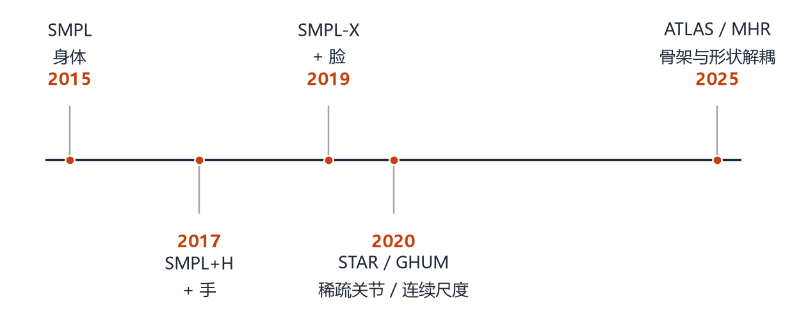
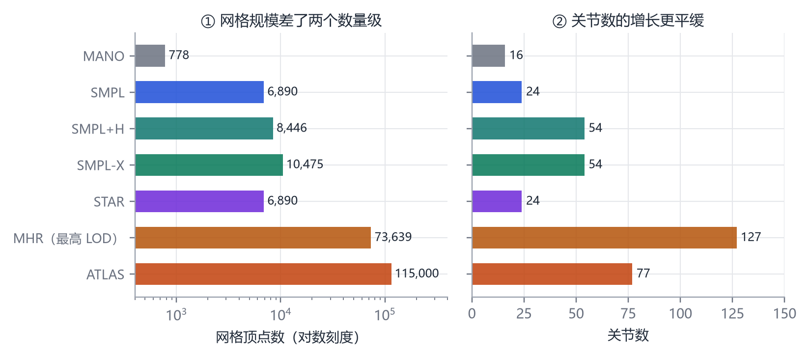
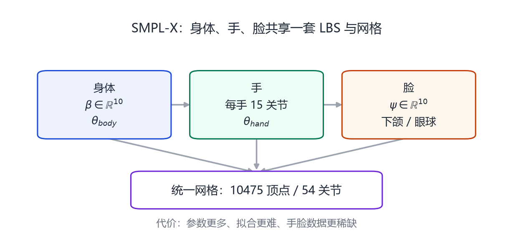
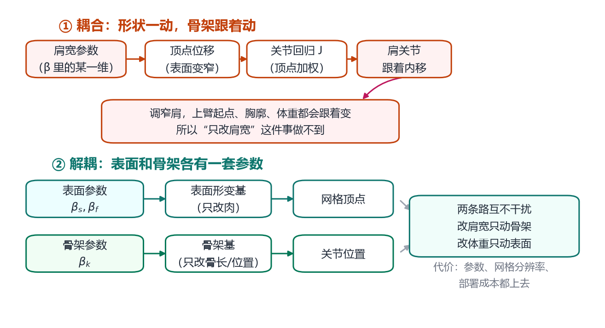
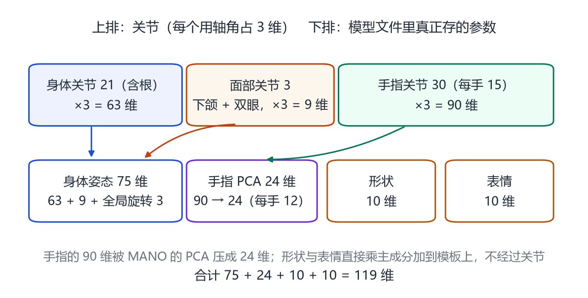

# 第 3 章 SMPL 家族：从身体到手，再到脸

> **本章导读**：SMPL 只解决了“身体”。真实的人还要动手、做表情、说话，还要能被美术改成不同骨长。这一章按时间顺序讲 SMPL 家族的扩展：SMPL+H 加手、SMPL-X 加脸和手、STAR 换一种更稀疏的关节表示、GHUM 走向连续尺度，最后是 2025 年的 ATLAS 与 MHR——它们把“骨架”和“形状”彻底拆开。每一个模型都按同一个套路讲：上一代缺什么、这一代改了什么、代价是什么、规模多大。读完你应该能拿到一个新模型时，五分钟内判断出它“新在哪”。

## 3.1 一条家族谱系

这一节先给全景。结论是：所有扩展都走同一条路——**保持 LBS 框架，往模板里加顶点、往骨架里加关节、往参数里加维度**，区别只在“加在哪”和“加多少”。

<figure class="fig">

<figcaption><b>图 3-1</b>　SMPL 家族的时间线。2015 年的 SMPL 只覆盖身体；2017 年的 SMPL+H 接入 MANO 的手；2019 年的 SMPL-X 把脸和手都并进来；2020 年的 STAR 与 GHUM 分别从“关节表示”和“连续尺度”改进；2025 年的 ATLAS / MHR 则把骨架与形状解耦。</figcaption>
</figure>

SMPL 的成功带来一个自然的问题：**能不能把身体、手、脸放进同一个模型？**

答案不是简单的“能”。如果分开建模，会立刻遇到三个接缝问题：

1. **手和身体在手腕处对不上。** 一个模型的手腕半径 30 毫米，另一个 32 毫米，拼起来就是一圈错位。
2. **脸和脖子在下颌处撕裂。** 张嘴时，脸的下半部分往下走，脖子不动，中间裂开。
3. **动作捕捉要分别拟合再拼接。** 身体一个优化、手一个优化、脸一个优化，误差逐级累积。

所以家族的扩展思路本质上是“**消掉接缝**”：用一张网格、一副骨架、一套 LBS，让手腕和下颌不再是“两个模型的边界”。

扩展的四种方式：

| 扩展方式 | 代表 | 加的是什么 |
|---|---|---|
| 加顶点、加关节 | SMPL+H、SMPL-X | 手部网格、面部关节 |
| 加参数 | SMPL-X | 10 维表情系数 |
| 换关节表示 | STAR、GHUM | 稀疏关节、层级关节、显式尺度 |
| 换参数解耦 | ATLAS、MHR | 骨架参数与表面参数分开 |

规模对照（这张表和后面的图是同一组数）：

| 模型 | 顶点数 | 关节数 | 覆盖范围 |
|---|---:|---:|---|
| SMPL | 6890 | 24 | 身体 |
| SMPL+H | 8446 | 54 | 身体 + 手 |
| SMPL-X | 10475 | 54 | 身体 + 手 + 脸 |
| STAR | 6890 | 24 | 身体 |
| GHUM | — | — | 身体 |
| ATLAS | 115k | 77 | 身体 |
| MHR | 73639–595（多 LOD） | 127 | 身体 + 手 |

> 表中“—”表示不同实现的顶点数不一致，或者论文没有给出可直接对比的数字。本册不写没有核对过的值。

<figure class="fig">

<figcaption><b>图 3-4</b>　各代模型的规模。左边是顶点数（对数刻度）：从 MANO 的 778 到 ATLAS 的 11.5 万，差了两个数量级。右边是关节数：增长平缓得多，从 24 到 127。两组数的对比说明——**加关节便宜，加顶点贵**。</figcaption>
</figure>

“加关节便宜、加顶点贵”这句话值得解释，因为它决定了后面每个模型的取舍。

- 关节的代价是 $K$ 个 $4\times4$ 矩阵，$K=127$ 也只有 127 次小矩阵乘法，可以忽略；
- 顶点的代价是全套：形状基 $N\times3\times10$、姿态基 $N\times3\times207$、权重 $N\times K$、回归器 $K\times N$，每一样都随 $N$ 线性增长。$N$ 从 6890 涨到 115000，姿态基就从 16 MB 涨到 274 MB。

所以你能看到一个规律：**想加“动作能力”，加关节就行，几乎免费；想加“几何细节”（手指、表情、皮肤褶皱），必须加顶点，成本按倍数涨。**

### 3.1.1 统一网格为什么能消掉接缝

“用一张网格”听起来只是实现细节，其实它消掉了三个层次的误差。

**第一层，几何层面。** 接缝处的顶点是共享的：手腕那一圈顶点既属于前臂又属于手掌，它们的坐标只有一个值，不可能“对不上”。

**第二层，参数层面。** 形状参数只有一组 $\boldsymbol{\beta}$。手臂粗的人，手掌也按同一个体型方向加粗——不会出现“手臂按体型 A 生成、手按体型 B 生成”的错配。

**第三层，拟合层面。** 从图像拟合时只有一个优化问题。如果分开拟合，手部的误差和身体误差各自独立，腕部就会累积两边的误差；统一网格里，腕部是同一个残差项的一部分。

代价就是第 3.1 节说的“加顶点贵”：统一网格意味着所有 arrays 都按最大尺寸存，即使你只关心身体。

## 3.2 SMPL+H：把手接进来

这一节要解决的问题是：手怎么接。结论是：接一张 MANO 的网格进来，然后在手腕处重新学蒙皮权重。

### 3.2.1 上一代的缺口：手是一块“连指手套”

原始 SMPL 的手是这样处理的：手腕之后的所有顶点当成一个刚体，只有一个“手”关节（左右各一个）。所以 SMPL 的人：

- 不能张开手指，五指永远并在一起；
- 不能握拳，手掌永远是平的；
- 不能比手势，因为根本没有手指的自由度。

对动作识别、VR 手柄追踪、抓取仿真这些任务，这个限制是致命的：抓取的关键就在“每根手指怎么弯”。

### 3.2.2 这一代改了什么

2017 年，Romero 等人在 *Embodied Hands*[@romero2017mano] 中提出 MANO（一个手部参数化模型），并把它与 SMPL 拼成 **SMPL+H**。做法四步：

1. 保持 SMPL 的身体网格与 24 个关节；
2. 在每只手腕处接上 MANO 的手部网格（778 顶点）；
3. 把 MANO 的 15 个手部关节（不含手腕本身）加入骨架；
4. 重新学习手腕附近的蒙皮权重，让手和手臂平滑过渡。

规模：$6890+2\times778=8446$ 个顶点，$24+2\times15=54$ 个关节。MANO 自己的参数是每只手 45 维姿态（15 个关节 × 3）+ 10 维形状。

<figure class="fig">

<figcaption><b>图 3-2</b>　SMPL-X 的参数划分（SMPL+H 是它的前身，少了表情那一路）。身体形状、身体姿态、双手姿态、面部表情各自有参数，但共享同一张网格与同一套 LBS。输出是 10475 个顶点、54 个关节。</figcaption>
</figure>

### 3.2.3 代价是什么

**一是手腕处必须重新学权重。** 这是整个工作里最费劲的部分。手臂的顶点按“前臂骨 / 上臂骨”分配权重，手的顶点按“掌骨 / 指骨”分配，两套体系在腕部要过渡。过渡不好，转手腕时会出现一圈“绞索”状的褶皱。

**二是拓扑变了，所有以 SMPL 为前提的代码都要改。** 顶点数从 6890 变 8446，形状基、姿态基、权重全部重学。第 3.10 节的表格就是在说这件事。

**三是手的数据很少。** 带手指的高精度扫描比全身扫描贵得多，所以 MANO 的形状空间比 SMPL 窄：它能表达“手大手小”，但表达不了“手指特别长、手掌特别短”这类组合。

**但它仍然没有脸。** 表情、眨眼、说话，需要另一套参数。

### 3.2.4 手腕那一圈权重怎么过渡

SMPL+H 里最微妙的地方在手腕。前后两侧的权重逻辑完全不同：

- 前臂的顶点主要听“前臂骨”的，权重集中在 1–2 个关节；
- 手掌的顶点听“掌骨”的，五指张开时每根手指的骨都要参与。

过渡带通常只有 2–3 圈顶点（每圈间隔 15 毫米左右）。在这 30–45 毫米里，权重要从“前臂 100%”变到“掌骨 100%”。过渡太陡，转腕时出现折痕；过渡太缓，握拳时前臂会跟着手一起动。

一个实用的检查：把腕关节单独转 $90^\circ$（手掌翻过来），看前臂靠近手腕的 5 厘米内有没有出现螺旋状的扭曲。有，就是过渡带没调好。

## 3.3 SMPL-X：身体、手、脸的统一

这一节要解决的问题是：脸也要进来，而脸和手又不能各接一次。结论是：重新做一张包含脸和手的网格，用一套参数控制全部。

### 3.3.1 上一代的缺口：拼接会撕裂

SMPL+H 已经把“手”接进来了，能不能照同样办法把“脸”也接上？技术上可以，但会得到一张补丁摞补丁的网格：手腕一圈接缝、下颌一圈接缝。每一条接缝都可能裂开。

更麻烦的是“脸和手会相遇”：人摸脸的时候，手指要贴着面颊。如果脸和手是两个独立模型的输出，那么在任何“手贴脸”的姿势里，两者都会互相穿插——因为没有任何机制保证它们不撞。

### 3.3.2 这一代改了什么

2019 年，Pavlakos 等人在 *Expressive Body Capture* 中提出 **SMPL-X**（SMPL eXpressive）[@pavlakos2019smplx]。它把三件事合并到一张网格上：

- **身体**：沿用 SMPL 的形状与姿态参数；
- **手**：接入 MANO 的双手，每手 15 个关节；
- **脸**：加入 10 维表情参数 $\boldsymbol{\psi}$，以及下颌、眼球等关节。

规模：**10475 个顶点、54 个关节**。相比 SMPL 多了 3585 个顶点，主要在脸和手；也就是说，多出来的顶点里有相当一部分花在了“让脸能动”上。

三个细节值得注意。

**一是表情基来自 FLAME。** FLAME 是一个专门做“脸加脖子”的模型，它的表情主成分是从大量人脸扫描里学的。SMPL-X 直接借用了这批主成分，所以它的表情空间和 FLAME 是同一套——两者可以在表情参数层面互通。

**二是脚趾没有自由度。** 54 个关节里没有脚趾。这是取舍：脚趾对大多数应用不重要，加了会让参数更多、拟合更难。

**三是零姿态是 A-pose，不是 T-pose。** SMPL-X 的模板手臂是下垂约 45°，SMPL 是水平伸直。两个模型连模板都不能混用，$\beta$ 也不能互换（3.10 节）。

### 3.3.3 代价是什么

**一是参数更多。** SMPL-X 一共 119 个参数（下一节算账），从单张图回归 119 个参数，比回归 82 个难得多：解空间更大、局部极小更多。

**二是数据更稀缺。** 同时有身体、手、脸的高精度扫描极少见。训练只能靠“多来源拼接”：身体数据来自全身扫描，手部数据来自手部扫描，表情数据来自人脸扫描，然后在参数层面拼起来。拼接必然带来分布不一致。

**三是耦合更强。** 手靠近脸时网格会穿插，需要额外的碰撞处理；姿态参数变多之后，“手的位置”和“手臂的角度”之间的一致性也更难保证。

**四是速度。** 10475 个顶点、54 个关节，前向计算量约是 SMPL 的 1.8 倍；如果用完整表情基，还要再加一项。

尽管有这些代价，SMPL-X 之后几乎所有“全身重建”论文都把输出定义为 SMPL-X 参数。你在第 10、11 章看到的 SMPLify-X、FrankMocap、PyMAF-X，都是它的下游。

### 3.3.4 手摸脸：一个具体的穿模例子

假设一个人用右手摸自己的右脸。在 SMPL-X 的参数空间里，这个姿势是合法的：手臂角度、手指弯曲、表情参数都能取到对应值。但网格可能穿模。

原因有三个。

**一是碰撞不在模型里。** SMPL-X 只是一张网，它不知道“手和脸不能重叠”。参数取什么值，它就生成什么网格。

**二是参数之间可以互相补偿。** 手臂抬 5°、手肘弯 5°，或者手臂抬 3°、手肘弯 7°，在图像上可能看起来一样，但在三维里手指的位置差 1 厘米——一个穿进脸里，一个刚碰到。

**三是软组织会变形。** 手指压到面颊时，脸颊会凹下去。SMPL-X 没有这个耦合：脸和手各自按自己的参数变形，谁也不知道对方在哪。

所以从图像拟合“手摸脸”这类姿势时，必须额外加碰撞项，或者用带接触的模型。这也是第 3.3.3 节“耦合更强”的具体含义。

### 3.3.5 119 维在代码里怎么摆

这一小节是给动手的人的。SMPL-X 的参数通常不是一个 119 维向量，而是拆成几个数组：

| 数组 | 维度 | 含义 |
|---|---:|---|
| `betas` | 10 | 形状 |
| `expression` | 10 | 表情 |
| `global_orient` | 3 | 根关节旋转 |
| `body_pose` | 63 | 21 个身体关节 × 3 |
| `jaw_pose` | 3 | 下颌 |
| `leye_pose` / `reye_pose` | 3 + 3 | 眼球 |
| `left_hand_pose` / `right_hand_pose` | 12 + 12 | 手指 PCA 系数 |
| `transl` | 3 | 全局平移 |

加起来：$10+10+3+63+3+3+3+12+12+3=122$。比 119 多 3，因为 `transl` 是平移，不属于“模型参数”，只是摆放位置。所以严格说：**119 个模型参数 + 3 个平移 = 122 个数**。

摆的时候有两条纪律：一是顺序必须和模型文件的 `posedirs` 列顺序一致（否则姿态项全错），二是 `body_pose` 里各关节的次序必须按父在子前的规则排。

## 3.4 STAR：更稀疏、更会“校正”的身体模型

这一节要解决的问题是：SMPL 的两个弱点能不能在不换网格的前提下修掉。结论是：能，办法是换一套关节与校正的表示方式，但代价是生态。

### 3.4.1 上一代的缺口

2020 年，Osman 等人提出 **STAR**（Sparse Trained Articulated Human Body Regressor）[@osman2020star]。它针对 SMPL 的两个痛点。

**痛点一，关节太少。** 24 个关节里，脊柱只有 3 段，肩只有 1 个关节。真实人体的肩胛骨会滑动、脊柱有 24 节椎骨、脚掌有足弓的形变。关节不够，这些地方就只能靠“姿态基”硬凑。

**痛点二，姿势校正太全局。** SMPL 的 207 个基是“全身位移场”，每个基在所有顶点上都有值（第 2 章的图 2-5 已经验证过：远处的顶点也有 1–2 毫米的位移）。结果是：某个关节的修正可能影响到无关部位——抬左手时，右手也会微微变形。

### 3.4.2 这一代改了什么

STAR 的做法三条：

1. **用更多、更稀疏的关节**，每个关节只影响局部区域；
2. **为每个关节学局部的姿势校正**，而不是一组全局基；
3. **用稀疏约束**让参数数量不爆炸。

第三条是关键。“更多关节”听起来会让参数爆炸，但 STAR 让每个关节的校正只覆盖它附近的顶点，于是总参数量反而可控。这和 SCAPE 当年“只让附近几个关节影响这个三角形”是同一个思路（第 1 章 1.2.2 节）。

### 3.4.3 代价与规模

规模仍是 6890 顶点、24 关节——网格没变，这很重要：**它可以直接替换 SMPL，而不用改下游代码**（只要参数含义对得上）。

代价有三条：

- **参数不通用。** STAR 的 $\beta$ 和 $\theta$ 与 SMPL 不是同一套定义，虽然维度相同。把 SMPL 的参数喂给它，得到的是另一个人。
- **生态弱。** 数据集、预训练模型、评价脚本都以 SMPL 为主，STAR 的模型文件少得多。
- **训练更麻烦。** 稀疏约束带来额外的超参数；解不唯一的情况更多。

它在什么场景下值得用？极端姿势（高举手臂、深蹲、格斗）下的形变质量明显更好，做动作生成或者体育分析时是划算的。

### 3.4.4 稀疏关节到底省在哪

“稀疏”这个词容易误解，以为只是“参数变少”。其实它省的是三样东西。

**一是计算。** SMPL 算姿态项要把 207 个基乘一遍每个顶点（第 2 章算过，占前向的 81%）。如果每个顶点只有附近 6 个基非零，就是 6 次乘加，快 30 倍。这在移动端和实时渲染里是数量级的差别。

**二是伪相关。** 全局基的问题是“抬左手会让右手动”。稀疏基把影响限制在局部，右手不在这几个基的支撑集里，就完全不动。

**三是可解释性。** 稀疏之后，“这个基是管左肘的”这句话是真的。全局基没法这么说，因为每个基都在全身有值。

代价是训练更难：稀疏结构要靠正则项或者人工指定的支撑集来强制，而不像稠密基那样“最小二乘一解就出来”。

### 3.4.5 STAR 与 SMPL，动作生成该选谁

动作生成（从一段噪声生成一段动作序列）对模型的要求，和重建不一样。

重建要求“参数能被图像解释”——所以参数越简洁越好，SMPL 的 82 维是优点。

动作生成要求“参数空间平滑、可采样”——因为生成模型是在参数空间里做扩散或采样的。这里 STAR 有两个优势：

- **局部性**：稀疏校正让某个关节的改动不污染全身，采样时不容易出现“改了左手右手跟着抖”；
- **极端姿势质量**：动作数据里高举、深蹲、跨步都很常见，STAR 在这些角度下形变更自然。

代价是数据。动作数据集（AMASS 等）都是 SMPL 参数格式，要用 STAR 必须先做一遍参数重定向——把 SMPL 的 $\theta$ 转到 STAR 的关节定义上。这一步有现成工具，但会引入误差。

所以实际的选择常常是：**研究阶段用 SMPL（数据现成），落地阶段如果发现极端姿势太丑，再考虑换 STAR 并自己做重定向。**

## 3.5 GHUM：连续尺度与层级结构

这一节要解决的问题是：为什么“身高”这个再普通不过的量，在 SMPL 里居然不能直接调。结论是：因为 SMPL 把它藏在了 $\beta$ 的混合里，而 GHUM 把它拎出来做成了显式参数。

### 3.5.1 上一代的缺口

**缺口一，尺度不可解释。** 在 SMPL 里，“身高”不是一个参数，而是 10 个 $\beta$ 共同作用的结果（第 2 章实测：$\beta_1$ 每加 1，身高降 77 毫米）。这让三件事变难：

- 从图像估身高：要先回归 $\beta$，再算网格高度，误差被放大；
- 编辑身高：要在 $\beta$ 空间里找方向，约束很别扭；
- 建模儿童：儿童的体型不是“成年人的缩小版”，比例完全不同（头身比、腿长占比）。

**缺口二，关节没有层级。** SMPL 的脊柱是 3 段刚体，弯腰时是三段折线。真实脊柱是连续弯曲的曲线，segment 之间还有耦合（转胸椎会带动腰椎）。

### 3.5.2 这一代改了什么

2020 年，Choutas 等人提出 **GHUM**（Generative Human Shape and Articulated Pose Model）[@choutas2020ghum]。两个改动：

- **显式尺度**：把“整体大小”做成一个独立的、可解释的参数，能生成从儿童到成人的连续变化；
- **层级关节**：用层级结构描述脊柱的多段弯曲，让“弯腰”是平滑曲线而不是折线。

还有一个更技术性的改动：GHUM 的姿势校正用的是**非线性**模型（小型网络），而不是线性基。这突破了“207 个基只能线性组合”的限制。

### 3.5.3 代价与规模

- **规模**：论文没有给出可直接与 SMPL 对比的顶点数，本册不写未核对的数字。
- **代价一，非线性 = 不能闭式反解。** 线性基可以写成一个矩阵乘，非线性网络不行；要反解参数只能迭代优化，速度慢。
- **代价二，可解释性换来的是复杂度。** 显式尺度听起来美好，但它和形状参数之间仍然耦合（“高”和“瘦”在数据里相关），所以调尺度时还是会带动别的量。
- **代价三，部署成本。** 网络权重比矩阵大，移动端不友好。作者也提供了轻量版 GHUML，牺牲一点精度换速度。

它的影响主要体现在“度量准确”的任务上：当你需要知道“这个人到底多高”，而不只是“看起来像”，显式尺度就很重要。

### 3.5.4 显式尺度的用途：从“像”到“量得准”

判断“像不像”和判断“多高”，是两件不同的事。

- “像”只需要相对比例正确：这个人看起来对不对；
- “量得准”需要绝对尺度正确：这个人 1.72 米还是 1.68 米。

SMPL 的形状空间里，“高”和“胖”是混在一起的，所以从图像估身高时，误差会在这两个方向之间来回窜。GHUM 把尺度拎出来之后，身高变成一个可以直接回归的量，误差不再被形状参数放大。

这在几个场景里很要紧：服装尺码推荐（差 3 厘米就换码）、体育选材、医学生长曲线。反过来，如果只做虚拟人渲染，显式尺度就没那么重要——观众看不出 3 厘米的差别。

## 3.6 2025 之后：ATLAS 与 MHR——把骨架和形状拆开

这一节要解决的问题是：为什么“调肩宽会顺便改体重”这件事在 SMPL 系里无解。结论是：因为关节是从顶点回归出来的，两者在结构上绑死了；要解耦，必须改结构。

### 3.6.1 缺口：骨架和软组织被绑在一起

SMPL 一系的共同假设是：**先有表面，再从表面顶点回归出关节。** 这句话很方便（不用单独标骨架），但留下一个副作用——骨骼与软组织被绑死。

两个真实会遇到的例子：

- 你只想把**肩膀变窄**。在 SMPL-X 里调小肩宽，手臂起点、胸腔、甚至体重读数都跟着变；
- 你只想**增加体重**。结果肩膀又弹回去了一部分（ATLAS 论文的图 1 用的就是这个例子）。

根因就在关节回归器：关节位置是顶点的加权和，**顶点一动，骨架就跟着动**。图 3-5 上半部分画的就是这条链。

<figure class="fig">

<figcaption><b>图 3-5</b>　耦合与解耦。上半部分：SMPL 系里形状参数先改顶点，关节再从顶点回归，所以“改肩宽”一定会改骨架。下半部分：ATLAS / MHR 把表面参数和骨架参数分开，两条路各自有基，互不干扰——代价是参数更多、分辨率更高、部署更重。</figcaption>
</figure>

用数学说清楚这件事：在 SMPL 里，所有量都是从 $\boldsymbol{\beta}$ 出发的，

$$
\mathbf{V}=\bar{\mathbf{T}}+\mathbf{B}_S\boldsymbol{\beta},
\qquad
\mathbf{J}=\mathcal{J}\mathbf{V}=\mathbf{A}\boldsymbol{\beta}+\mathbf{b}.
$$

只有一组 $\boldsymbol{\beta}$，所以“表面形状”和“骨架形状”共用同一个旋钮。想只动一个，做不到。

解耦的做法很直接：**给两套参数**。ATLAS / MHR 的形式可以写成

$$
\mathbf{X}(\boldsymbol{\beta},\boldsymbol{\theta})
=\mathcal{M}\Big(\tilde{\mathbf{X}}(\boldsymbol{\beta}_s,\boldsymbol{\beta}_f,\boldsymbol{\theta}),\ \mathbf{B}_k(\boldsymbol{\beta}_k),\ \boldsymbol{\theta},\ \omega\Big),
\tag{3.1}
$$

其中

$$
\tilde{\mathbf{X}}=\bar{\mathbf{X}}+\mathbf{B}_s(\boldsymbol{\beta}_s)+\mathbf{B}_f(\boldsymbol{\beta}_f)+\mathbf{B}_p(\boldsymbol{\theta}).
$$

逐项读：

- $\boldsymbol{\beta}_s$：控制“表面形变”的参数（胖瘦、肌肉量），只影响 $\tilde{\mathbf{X}}$；
- $\boldsymbol{\beta}_f$：另一组形变参数（MHR 里用来做更细的局部调整），同样只影响表面；
- $\boldsymbol{\beta}_k$：控制**骨架**的参数（骨长、关节位置、甚至骨骼缩放），只通过 $\mathbf{B}_k$ 进入蒙皮函数 $\mathcal{M}$；
- $\boldsymbol{\theta}$：关节角，两路都用；
- $\omega$：蒙皮权重。

关键在 $\mathcal{M}$ 的第二个参数：骨架不再从表面回归，而是**独立算出来**。于是“改肩宽”只动 $\boldsymbol{\beta}_k$，“改体重”只动 $\boldsymbol{\beta}_s$，两者互不牵连。

### 3.6.2 ATLAS：先有骨架，再长肉

**ATLAS**（Park 等，2025，Meta + CMU）[@park2025atlas] 的核心改动就是上面那个解耦。

规模与结构：

- **数据规模**：60 万次高分辨率扫描，由 240 台 4K 相机同步拍摄（数据集体量叫 Goliath）；
- **分辨率**：原生网格 **11.5 万顶点**，骨架 **77 个关节**；
- **对称性**：解剖上左右对称。SMPL-X 的平均网格在肘、脊柱、脚上能看出明显的不对称，根因就是关节是从顶点回归出来的，回归器把数据里的偏差也学了进去；
- **姿势校正**：稀疏 + **非线性**，只作用在被驱动关节附近，避免“弯左肘却让右肘动”这类伪相关。

能干什么：肩宽、身高、四肢长度、体重可以**分别**调；关键点拟合也不再依赖外表面（因为骨架是独立量，不需要先拟合网格再回归关节点）。

用一句话概括：**SMPL 是“用表面近似骨架”，ATLAS 是“先有骨架再长肉”。**

### 3.6.3 MHR：把解耦做成工业级 rig

**MHR**（Momentum Human Rig，Meta，2025 年 11 月）[@ferguson2025mhr] 把 ATLAS 的“骨架/形状解耦”和 Momentum 库的绑定系统、姿势校正系统合成一个模型。目标不是发论文，而是**能直接进 AR/VR 与图形管线**。

规模与结构：

- **127 个关节**、**204 个姿态参数**，其中 68 个是骨架变换参数——不只是轴角，还包含骨长、缩放这类骨架自由度；
- **多级 LOD**：同一模型提供 73639 / 18439 / 10661 / 4899 / 2461 / 971 / 595 顶点等多档分辨率。渲染远处的人不需要全分辨率，这是游戏引擎的常规做法，但在学术模型里很少见；
- **非线性稀疏姿势校正** + 手指关节，能表达“SMPL-X 线性基表达不了”的极端姿势；
- **许可**：论文强调是 industry-friendly 的许可，代码与模型在 `github.com/facebookresearch/MHR`。

> 为什么把这两个放在一起讲：ATLAS 解决“骨架和形状能不能分开”，MHR 解决“分开之后能不能当生产工具用”。前者是方法论，后者是工程化。

### 3.6.4 六代身体模型对照

| 模型 | 年份 | 网格顶点 | 关节 | 训练扫描 | 形状/骨架 | 姿势校正 |
|---|---|---:|---:|---|---|---|
| SMPL | 2015 | 6890 | 24 | 约 1.8k | 共享线性基 | 线性（207） |
| SMPL-X | 2019 | 10475 | 54 | 约 1.8k | 共享线性基 | 线性（9K） |
| STAR | 2020 | 6890 | 24 | 约 1.8k | 稀疏线性 | 稀疏线性 |
| GHUM | 2020 | — | — | 约 60k | 层级 | 非线性网络 |
| ATLAS | 2025 | 115k | 77 | **600k** | **解耦** | 稀疏 + 非线性 |
| MHR | 2025 | 73639–595（多 LOD） | 127 | — | **解耦** | 稀疏 + 非线性 |

（“—”表示论文未给出可直接对比的数字，本册不写没有核对过的值。）

这张表里最该看的是“关节”和“姿势校正”两列：关节从 24 涨到 127，校正从“线性 207 个基”走到“稀疏 + 非线性”。两次变化解决的是同一个问题——**线性基加全局支撑，表达不了局部、非线性的形变**。

### 3.6.5 那为什么还要讲 SMPL

因为**生态**。数据集（AMASS、3DPW 的 SMPL 参数版）、代码（smplx、SMPLify、HMR 系列）、评价指标（MPJPE / PVE 的对齐方式）都以 SMPL 为公共接口。

ATLAS / MHR 更准、更可控，但网格与关节规模大一个量级，训练与部署成本也高。现实中常见的做法是：**用 SMPL 做“公共语言”**（重建、动作、数据集），需要精细编辑（改骨长、改肩宽、做工业绑定）时，再换到 ATLAS / MHR 这类解耦模型上。

这个分工很像“设计稿与交换格式”：你在专业软件里用高精度模型编辑，但交付给别人时导出成通用格式。**通用格式不追求最好，只追求所有人都能读。**

### 3.6.6 解耦之后的新麻烦

解耦解决了“调肩宽会改体重”，但引入了三个新问题。

**一是骨架与表面必须一致。** 骨架独立了，就可能出现“骨架说这个人 1.8 米，表面却按 1.7 米长”的情况。ATLAS / MHR 的做法是在训练时把两者绑在一起优化，再用一个一致性项维持；但这条约束是软的，极端参数下仍会错位。

**二是数据标注要求更高。** SMPL 只需要扫描（骨架可以从表面回归），解耦模型要**单独标注骨架**——骨长、关节中心、甚至骨骼的缩放。这大幅提高了数据成本，也是 60 万扫描这个量级的原因之一。

**三是新模型与前一代不兼容。** 参数不通用、顶点数不同、关节顺序不同。工业界愿意付这个代价，因为它们本来就要重建整条管线；学术界不愿意，因为要和几百篇论文比较。

### 3.6.7 解耦模型的参数为什么这么多

MHR 有 204 个姿态参数，而 SMPL 只有 72。多出来的 132 个从哪来？

拆开看：

| 组成 | SMPL | MHR |
|---|---:|---:|
| 关节旋转 | $24\times3=72$（含根） | 127 个关节的旋转 |
| 骨架自由度（骨长、缩放） | 无 | 68 个 |
| 手部 PCA | 无 | 有 |
| 形状 | 10（$\beta$） | 两组（$\beta_s$、$\beta_f$） |
| 骨架形状 | 无 | $\beta_k$ |

关键在第二行和第五行：**解耦把“骨长”和“骨架位置”变成了可调参数**，而这些在 SMPL 里是被顶点间接决定的。多出来的参数不是“更精细的旋转”，而是“骨骼本身的自由度”。

这带来一个使用上的后果：参数越多，从图像回归越难，但对**编辑**越友好。所以 MHR 的目标用户是“已经知道要什么形状、只想把它摆出来”的动画师，不是“从一张照片猜出参数”的重建算法。

## 3.7 怎么选：一张实用表

这一节给结论，不展开。结论是：选型的依据是“任务需要什么自由度”，不是“模型有多新”。

| 你的任务 | 推荐模型 | 理由 |
|---|---|---|
| 单图/视频人体姿态与体型 | SMPL | 生态最全、预训练模型最多 |
| 需要手指动作 | SMPL+H / SMPL-X | 手部关节与网格 |
| 全身 + 表情 + 手势 | SMPL-X | 统一网格，避免拼接 |
| 极端姿势、更高精度 | STAR | 稀疏关节 + 局部校正 |
| 需要真实身高/儿童 | GHUM | 显式尺度 |
| 要分开调骨架（骨长/肩宽）与体型 | ATLAS / MHR | 骨架与形状解耦 |
| 动物 | SMAL | 四足动物，前向形式相同 |
| 只做脸 | FLAME | 脸颈表情统一参数化 |
| 只做手 | MANO | 16 关节、778 顶点 |

选型不是“越新越好”。三条判断原则。

**原则一：参数越多，拟合越难。** SMPL-X 有 119 个参数，SMPL 有 82 个。多出来的 37 个参数在单图回归里几乎全是噪声——因为图像提供的信息没有那么多。如果你的任务只需要身体，用 SMPL 往往更稳。

**原则二：数据比模型更决定成败。** 一个用 SMPL 训练、数据干净的模型，通常打赢一个用 SMPL-X 训练、数据脏的模型。换模型之前先看数据。

**原则三：先看下游生态。** 你要接的动作数据集是什么格式？你要对比的 baseline 用什么？你要用的评价脚本支持哪个？这些问题比“哪个模型更准”更影响进度。

**模型复杂度应该匹配任务需求，而不是追新。**

### 3.7.1 一次真实的选型

举一个具体的例子，把上面三条原则走一遍。

**需求**：做一个手机 App，用户拍一张全身照，返回“肩宽、腰围、腿长”三个尺寸，误差要求在 2 厘米内。

**第一步，看需要什么自由度。** 只需要身体，不需要手和脸。所以 SMPL 够用。

**第二步，看数据能不能撑住。** 训练数据是自己采的几百张带测量的照片，规模不大。用 SMPL-X（119 参数）必然过拟合，用 SMPL（82 参数）也偏多，实际做法是**只回归部分参数**：固定大部分 $\beta$，只优化与围度相关的几维。

**第三步，看误差来源。** 2 厘米的误差要求里，模型本身的误差（约 1 厘米）不是主要项；主要项是“拍摄距离与焦距未知导致的比例误差”和“衣服遮挡”。所以真正该投入的是标定与分割，不是换更准的模型。

这个例子的结论有点反直觉：**需求越具体，模型越不重要。** 因为一旦知道误差预算花在哪，就会发现模型只占一小块。

## 3.8 家族成员的共同点

这一节把整个家族压缩成一个公式。结论是：不管加了多少顶点和关节，它们都是同一个式子的不同填法。

$$
M=W\big(\bar{\mathbf{T}}+\mathbf{B}_S(\boldsymbol{\beta})+\mathbf{B}_P(\boldsymbol{\theta})+\mathbf{B}_E(\boldsymbol{\psi}),\ J(\boldsymbol{\beta}),\ \boldsymbol{\theta},\ \mathcal{W}\big).
\tag{3.2}
$$

逐项读：

- $\bar{\mathbf{T}}\in\mathbb{R}^{N\times3}$：模板，$N$ 是顶点数（6890 或 10475 或 115000）；
- $\mathbf{B}_S(\boldsymbol{\beta})$：形状项，$\boldsymbol{\beta}$ 通常 10 维；
- $\mathbf{B}_P(\boldsymbol{\theta})$：姿态项，维度是 $9K$（$K$ 是非根关节数）；
- $\mathbf{B}_E(\boldsymbol{\psi})$：表情项，只有 SMPL-X 有，10 维；
- $J(\boldsymbol{\beta})$：关节位置，从“只有形状的网格”回归；
- $\mathcal{W}\in\mathbb{R}^{N\times K}$：蒙皮权重；
- $W(\cdot)$：LBS。

区别只在四处：

1. 模板 $\bar{\mathbf{T}}$ 的顶点数 $N$ 不同；
2. 关节数 $K$ 不同，连带姿态项维度不同；
3. 有没有 $\mathbf{B}_E$ 这一项；
4. 权重 $\mathcal{W}$ 的稀疏模式不同（每顶点几个非零）。

理解了这一点，你再看任何新模型（包括 2024 年之后的工业模型），都能用四个问题快速判断它“新在哪”：

- **模板换了吗？**（顶点数变了就是换模型，参数不通用）
- **关节多了吗？**（多了就是新骨架，权重必须重学）
- **多了哪一项 blendshape？**（表情、肌肉、衣服）
- **换蒙皮方式了吗？**（LBS → 双四元数、非线性蒙皮、解耦骨架）

第 3.6 节的 ATLAS / MHR 就是第四个问题的答案：它们没换模板的思路，也没多加一项 blendshape，而是**换了蒙皮方式**——让骨架独立于表面。

### 3.8.1 用四问法读一个陌生模型：以 MHR 为例

拿 3.8 节的四个问题，对 MHR 走一遍，看能不能在五分钟内搞清它是什么。

**问题一，模板换了吗？** 换了：最高 LOD 73639 顶点，且提供 7 档 LOD。这意味着它的参数与 SMPL 完全不通用。

**问题二，关节多了吗？** 多了：127 个，其中 68 个是骨架变换参数。多到 127 个说明它把手、脚趾、脊柱细分都覆盖了。

**问题三，多了哪一项 blendshape？** 两组：$\boldsymbol{\beta}_s$ 与 $\boldsymbol{\beta}_f$，一个管整体形变、一个管局部细节。

**问题四，换蒙皮方式了吗？** 换了：骨架是独立参数（$\boldsymbol{\beta}_k$），不再从表面回归；姿态校正改成稀疏 + 非线性。

四问法走完，MHR 的“性格”就出来了：**大网格 + 解耦骨架 + 非线性校正 + 多 LOD**，是一个为生产管线设计的模型，不是为论文比对的模型。这个判断会影响你怎么用它：不要指望它和 SMPL 的数据集直接互通，要准备好重新做一遍绑定和重定向。

## 3.9 参数是怎么拼起来的：SMPL-X 的一次完整前向

这一节把 SMPL-X 的账算清楚。结论是：119 个参数，54 个关节，但“关节数 × 3”不等于“姿态维度”。

式 (3.2) 的每一项都可以写成显式公式。对 SMPL-X，四项相加就是：

$$
\mathbf{T}_P=\bar{\mathbf{T}}+\sum_{n=1}^{10}\beta_n\mathbf{S}_n+\sum_{n=1}^{10}\psi_n\mathbf{E}_n+\sum_{n=1}^{9K}\big(R_n(\boldsymbol{\theta})-R_n(\boldsymbol{\theta}^{*})\big)\mathbf{P}_n .
\tag{3.3}
$$

逐项看，每个符号都对应一块具体的数组。

- **模板 $\bar{\mathbf{T}}\in\mathbb{R}^{10475\times3}$**：零姿态下的平均人体，10475 行是 10475 个顶点，每行 3 个数是 $x,y,z$ 坐标（米）。它的零姿态是 A-pose，不是 SMPL 的 T-pose，两个模型连模板都不能混用。
- **形状项**：$\boldsymbol{\beta}\in\mathbb{R}^{10}$，每个 $\mathbf{S}_n\in\mathbb{R}^{10475\times3}$ 是一张和模板同样大的“位移图”，$\beta_n$ 决定加多少倍。$\boldsymbol{\beta}=\mathbf{0}$ 就是平均人——这也正是拟合时给 $\beta$ 加 $L_2$ 正则的由来。
- **表情项**：形式与形状项一模一样，只是 $\boldsymbol{\psi}\in\mathbb{R}^{10}$ 的主成分借自 FLAME，非零部分集中在脸上。**两项在实现上是同一段代码**，区别只在训练数据：一个来自“不同的人”，一个来自“同一个人的不同表情”。
- **姿态校正项**：关节转动时皮肤不会像刚体那样跟着转，要用 $9K$ 个基补偿。$R(\cdot)$ 把轴角变成 $3\times3$ 矩阵再拉平成 9 个数，所以每个关节贡献 9 个基；减去零姿态的 $R(\boldsymbol{\theta}^{*})$ 是为了让静止时这项为 0。

四项加完只得到“摆好姿势但还没蒙皮”的网格，关节位置还要从**只有形状**的网格回归：$\mathbf{J}(\boldsymbol{\beta})=\mathcal{J}(\bar{\mathbf{T}}+\mathbf{B}_S(\boldsymbol{\beta}))$，$\mathcal{J}\in\mathbb{R}^{54\times10475}$ 的每行只有少数非零——一个关节由附近一小撮顶点加权平均得到。这里**没有**表情项：做表情不改变骨架。

<figure class="fig">

<figcaption><b>图 3-3</b>　SMPL-X 的 54 个关节与 119 个参数怎样对上账。上排是关节数，每个关节用轴角占 3 维；下排是真正存进模型文件的参数：身体 63 + 面部 9 + 全局旋转 3 凑成 75，手指的 90 维压成 24 维，形状与表情各 10 维。箭头表示“合并”与“压缩”。</figcaption>
</figure>

这张图回答一个常被算错的问题：**SMPL-X 一共 119 个参数** = 75（全局旋转 3 + 24 个身体/眼球/下颌关节 × 3）+ 24（双手手指 PCA）+ 10（形状）+ 10（表情）[@pavlakos2019smplx]。

验算：$75+24+10+10=119$。而“54 个关节 × 3 = 162” 这个数为什么不对？因为手指的 30 个关节没有用轴角，而是用 PCA 压到了 24 维：$30\times3=90$ 维被压成 24 维，省下来的 66 维就是模型“少掉”的那部分。

**关节数乘以 3 不等于姿态维度。** 记住这句话，读模型文件时才不会对不上账。

### 3.9.1 为什么手指要用 PCA

因为手指的动作高度相关。人弯曲食指时，中指、无名指通常会跟着弯一点，这是解剖结构决定的（手指的屈肌腱连在一起）。

PCA 抓住的正是这种相关性：本来 90 维的“15 个关节各转多少”，真正独立的变化只有 20 多维度。压到 24 维，误差在视觉上几乎看不出，但参数少了一半多。

代价是：**不能单独控制某根手指**。如果你的应用要“只伸食指”（点按、比数字），PCA 空间里未必有精确对应的方向，只能近似。这时候要么解开 PCA 用完整 90 维，要么接受误差。

### 3.9.2 表情项的量级

10 维表情参数听起来很少，能表达多少？给一个量级感（示意值）。

- 微笑：嘴角外移 5–10 毫米，脸颊上抬 3–5 毫米；
- 皱眉：眉心下压 4–6 毫米，眉间出现 2 毫米深的沟；
- 张嘴：下颌下降 20–40 毫米（这个主要靠下颌关节，不是表情基）。

也就是说，**表情基要表达的是毫米级的位移，但集中在脸上几千个顶点上**。这就是为什么它在参数里只占 10 维，却需要 3585 个额外顶点来承载——**分辨率不够，毫米级的变化根本表现不出来**。

反过来说：如果你的应用只需要“张嘴/闭嘴”两态，下颌关节一个自由度就够，不必上完整表情基。这也是很多轻量方案的做法。

## 3.10 换模型时要改哪些代码

这一节是操作指南。结论是：公式一行都不用改，变的是数组形状、参数名字和关节顺序。

| 数组 | SMPL | SMPL-X | MANO |
|---|---|---|---|
| 顶点数 $N$ | 6890 | 10475 | 778 |
| 模板 | $(6890,3)$ | $(10475,3)$ | $(778,3)$ |
| 形状主成分 | $(6890,3,10)$ | $(10475,3,10)$ | $(778,3,10)$ |
| 表情主成分 | 无 | $(10475,3,10)$ | 无 |
| 姿态偏移基 | $(6890,3,207)$ | $(10475,3,486)$ | $(778,3,135)$ |
| 蒙皮权重 | $(6890,24)$ | $(10475,54)$ | $(778,16)$ |
| 关节回归器 $\mathcal{J}$ | $(24,6890)$ | $(54,10475)$ | $(16,778)$ |
| 姿态维度 | $72$ | $165$（常拆成 $75+24$） | $48$（可压到 6） |

**表 3-1**　三个模型的数组形状对照。

变化只有三类。

**一是尺寸。** 硬编码 `6890` 的代码一定出错，应写成 `N = v_template.shape[0]`。同理，`207`、`24` 这些常量都应该从数组形状推出来，而不是写死。

**二是参数。** SMPL-X 多了 $\boldsymbol{\psi}$ 与表情主成分，姿态也从 72 维向量变成“身体 75 + 双手 PCA 24”，必须拼成完整 $\boldsymbol{\theta}$ 再送 LBS。拼接顺序错了，症状是“手和身体错位”。

**三是关节顺序。** 手指按 MANO 顺序排、面部关节夹在中间，“检测器编号 → 模型关节编号”的对应表必须重写。这是最容易**静默出错**的地方——程序不报错，只是把手腕的关键点对到了肘部。

不变的部分比变的多：**蒙皮、投影、优化器、损失函数一行都不用改**——生态能复用，不是因为大家抄了同一份代码，而是因为遵守了同一个接口。

但有一件事改数组解决不了：**参数含义不能跨模型通用。** 两个模型的 $\boldsymbol{\beta}$ 都是 10 维，第一维指向的体型方向却不同。把 SMPL 的 $\boldsymbol{\beta}$ 喂给 SMPL-X，得到的不是“同一个人”，而是形状错乱的人——**参数是相对于模型定义的，不是绝对的物理量。**

### 3.10.1 怎么判断两个模型的参数能不能互换

三个检查，从便宜到贵。

**检查一，看模板。** 同一个模板（同顶点数、同拓扑）才可能共享形状空间。SMPL 和 STAR 都是 6890 顶点，但形状基是各自训练的，不能互换。

**检查二，看零姿态。** T-pose 和 A-pose 的模型不能直接换参数：同一个人，同一个 $\boldsymbol{\theta}=\mathbf{0}$，出来的姿势差 45°。

**检查三，做数值实验。** 取一组 $\boldsymbol{\beta}$，生成两个模型的网格，算顶点距离。如果平均距离在厘米级，说明参数不通用；如果在毫米级，可能只是数值约定不同（缩放、镜像）。

### 3.10.2 一次真实的迁移清单

从 SMPL 迁到 SMPL-X，按这个顺序改，基本不会漏。

1. **读模型文件，打印所有数组形状**，和表 3-1 对照。形状不对就是加载错了。
2. **把硬编码的常量换成推导值**：`N = v_template.shape[0]`、`K = weights.shape[1]`、`np_pose = posedirs.shape[2]`。
3. **重写关节顺序表**。把“检测器输出的 17 个关键点”映射到模型的 54 个关节，逐条核对（尤其是手和脸）。
4. **拼装姿态向量**。身体 75 维 + 双手各 12 维 PCA，按模型要求的顺序拼成完整向量再送 LBS。
5. **加表情参数**。如果不用表情，把它固定为零向量——但要注意 $\boldsymbol{\psi}=\mathbf{0}$ 对应的是“中性表情”，不是“没有脸”。
6. **重新标定相机**。SMPL-X 的模板是 A-pose，重心和朝向与 T-pose 略有不同，旧的相机参数可能差几度。
7. **重跑评估**。换模型之后，之前的误差数字全部失效，必须重测。

第 3 步和第 4 步是最容易“静默出错”的地方：程序不报错，网格也像人，只是手指的位置错了一节。

## 3.11 一条贯穿全家族的规律

这一节收一下，给一条能迁移到新模型的判断法则。

把 3.1 到 3.6 的所有取舍放在一起，会发现它们在解同一个方程：

$$
\text{表达能力} \times \text{数据可得性} \approx \text{常数}.
$$

- SMPL 表达能力强（任何人体都能近似），数据可得性高（扫描多），所以它赢了；
- SMPL-X 表达能力更强（手和脸），但数据稀缺，所以它的“强”只在有数据支撑的部位有效；
- ATLAS 表达能力极强（解耦 + 高分辨率），但 60 万扫描的门槛没人能复制，所以它只能当工业模型，不能当学术基线；
- GHUM 的显式尺度很诱人，但非线性让部署变难，所以它被用在“度量”这一小块。

对工程师的启示：**选模型不是选“最好”，是选“你这个任务的数据能撑住的最高表达力”。** 数据撑不住的表达力，只会变成过拟合和畸形网格。

### 3.11.1 反例：什么时候不该解耦

解耦不是免费的，有三种情况不该用。

**情况一，只有一个固定体型要做动画。** 如果你只需要“同一个角色做各种动作”，骨架和形状根本不需要分开——体型定死，骨架定死，剩下的只是姿势。这时候用 SMPL 甚至手写 LBS 都更省事。

**情况二，只有单图重建任务。** 单图里你能拿到的信息就那么点。解耦模型的参数（表面 + 骨架）加起比 SMPL 多，而单图无法可靠地区分“肩窄”和“手臂内收”，多出来的自由度只会让拟合更不稳。

**情况三，需要与现有数据集互通。** 如果你要用 AMASS 的动作、要用别人训好的 SMPL 参数，解耦模型必须先做一遍重定向，这个成本常常超过它带来的精度收益。

判断标准很朴素：**只有当“分别编辑骨架和体型”本身就是你的核心需求时，解耦才值得。** 否则它只是把你的问题变复杂。

## 本章小结

- SMPL+H 在身体上接入手部（8446 顶点 / 54 关节），SMPL-X 进一步接入脸与表情（10475 顶点 / 54 关节）。
- STAR 用稀疏关节与局部姿势校正提升极端姿势精度；GHUM 显式建模连续尺度、层级关节，并用非线性校正。
- ATLAS 与 MHR 把骨架参数与表面参数分开，解决了“调肩宽会改体重”的结构性问题，代价是规模大一个量级。
- 所有家族成员共享“模板 + blendshape + 关节回归 + LBS”的结构，区别只在模板顶点数、关节数、有没有表情项、权重稀疏模式。
- SMPL-X 的 119 个参数 = 75（全局旋转与 24 个身体/眼球/下颌关节）+ 24（双手手指 PCA）+ 10（形状）+ 10（表情）；54 个关节不等于 162 个姿态数。
- 换模型时变的是数组形状、参数个数与关节顺序，不变的是 LBS 与优化器；但参数含义不能跨模型搬运。
- 选型看任务需要什么自由度，并检查数据能不能撑住这个自由度。

## 思考题

1. 为什么 SMPL-X 不直接把手和脸做成两个独立模型，再在推理时拼接？请举一个“拼接必然失败”的具体姿势。

2. STAR 的“稀疏关节”与 SMPL 的“全局姿势基”各有什么优劣？如果只允许你改一处，你会改关节数还是改校正方式？

3. 图 3-5 的解耦把骨架参数独立出来。这样做之后，“让这个人长高 5 厘米”和“让这个人变重 5 公斤”分别是哪一组参数的事？会不会仍然互相影响？

4. SMPL-X 的手指用 PCA 压到 24 维。如果应用需要“只伸食指”，你会怎么处理？给出两种方案并比较代价。

5. 如果让你设计一个“婴儿人体模型”，你会改 SMPL 的哪几部分？为什么不能直接缩小一个成年人？
