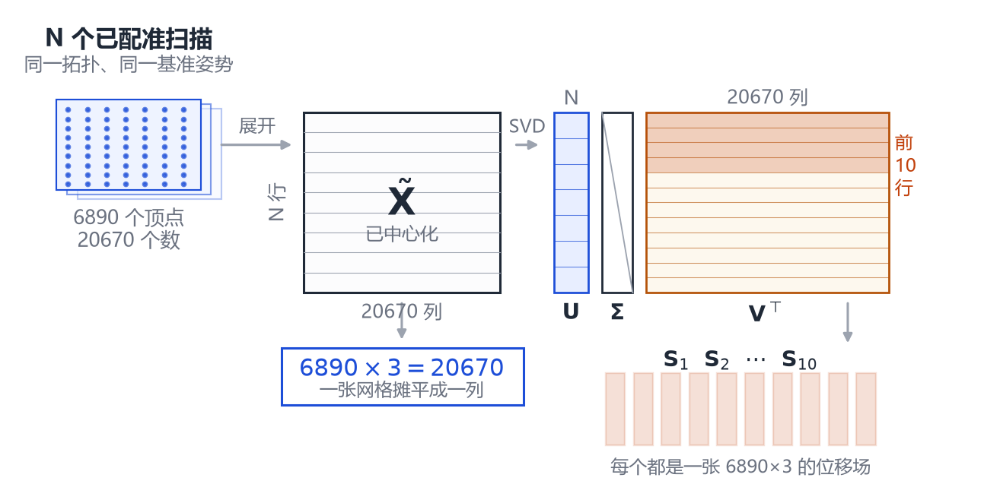
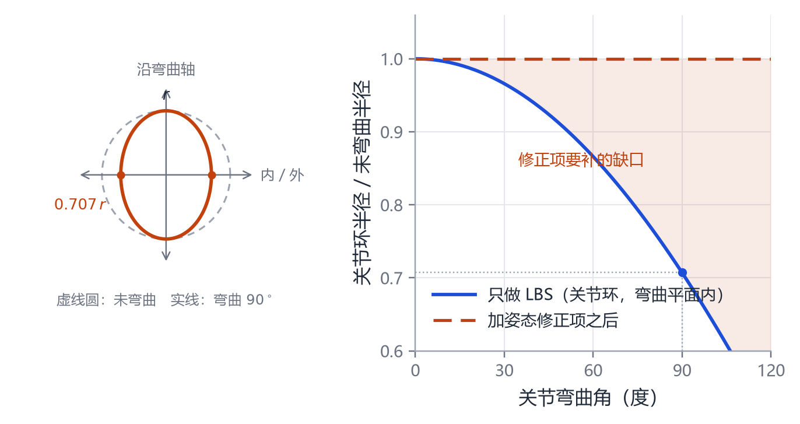
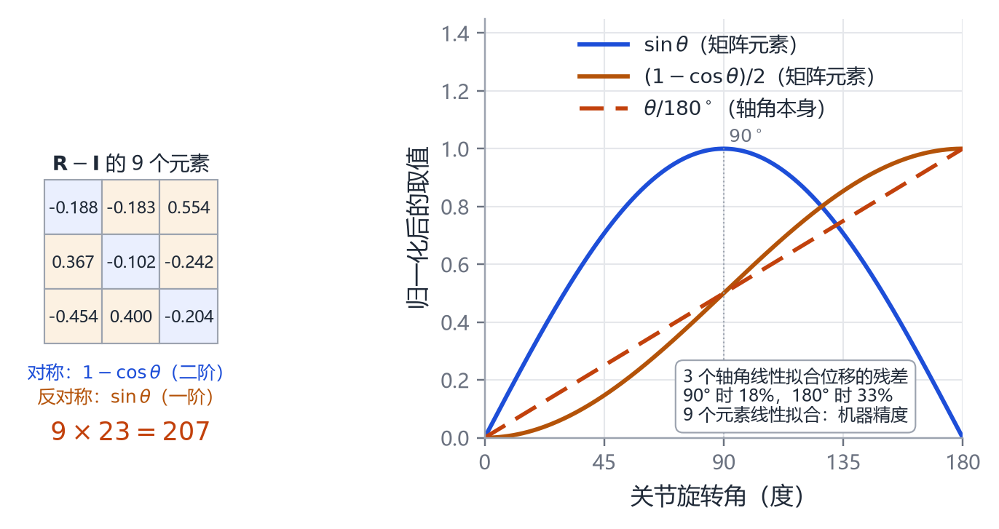
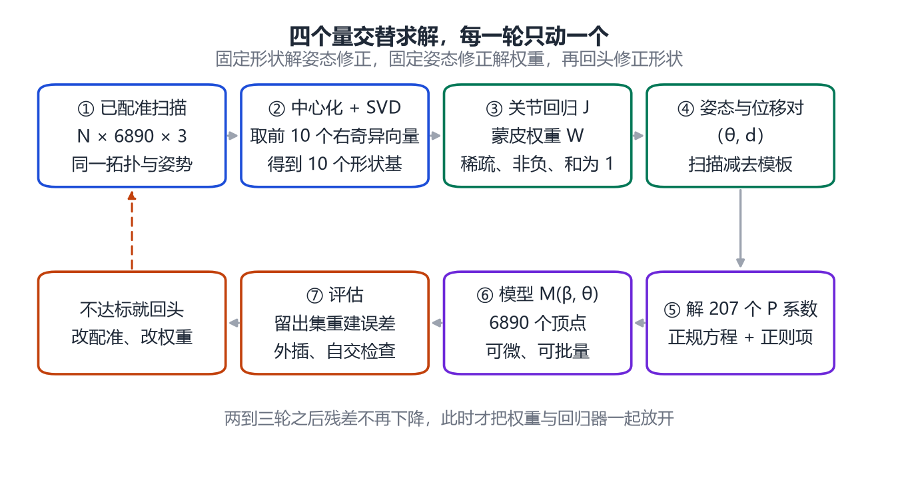

# 第 4 章 SMPL 是怎么训练出来的：目标函数、求解与评估

> **本章导读**：第 2 章把 SMPL 的前向公式拆成了四步，也留下了几个没交代的问题。10 个形状基凭什么就是这 10 个，207 个姿态基里的 207 从哪来，6890 个顶点各自最多 4 个非零蒙皮权重是谁定的。这一章回到训练现场，从一堆已配准的三维扫描开始，把形状空间、姿态修正项、关节回归器、蒙皮权重这四样东西的来历逐个拆开，写成可以求解的最小二乘问题，最后说明评估一个训练好的模型该看哪些指标。

## 4.1 训练数据是一堆长得一模一样的网格

SMPL 不是被设计出来的，是被拟合出来的[@loper2015smpl]。所以理解它的第一步不是看公式，而是看喂进去的数据长什么样。

原始素材是几千个成年人的全身三维扫描。每人一个高密度三角网格，顶点数从十万到上百万不等，姿势也各不相同，有人站着手垂下，有人手臂微张。这些网格既不能逐点比较，也不能直接相减，因为它们的顶点编号之间毫无关系。

中间要过一道**配准**（registration）。配准做的事是：拿一个固定拓扑的模板网格，把它变形到每一个扫描的表面上去，让模板的每个顶点都落在扫描上"语义相同"的位置。变形要保拓扑，也就是不许撕裂、不许穿孔，三角形之间的连接关系从头到尾不变。

具体做法通常是非刚性 ICP 加一层平滑约束。先按刚体把模板大致摆到扫描附近，再让每个顶点去找扫描上的最近点，但约束相邻顶点的位移要接近，否则单靠"找最近点"会把模板撕成碎片。优化目标一般是"点到面的距离和"加上"位移场的光滑度"，再挂一个拉普拉斯项防止局部翻转。迭代几轮之后，模板就贴上了扫描，而且拓扑完好。

这一步的难点不在算法，在语义。几何上最近点并不等于解剖上的对应点，腋下、胯下、手指缝这些地方，几毫米的偏差就会让一侧的顶点跳到另一侧，配准出来的人是"粘住"的。所以工业级的配准流程往往要加人工标志点，或者用一个已经配准好的中等密度网格做中间层，一阶一阶往上贴。

配准完之后，每个样本都是 6890 个顶点、同一套三角形、同一套顶点编号。顶点 3127 在样本 A 里是左肘尖，在样本 B 里也必须是左肘尖。

这句话里的"必须是"是整章的地基，值得多说一句。它不是"空间上最近的点"，而是"配准算法判断的对应点"。一个点在几何上离肘尖最近，配准算法却可能把它判给前臂，因为最近点本身在弯曲处会跳。所以顶点对应的准确性完全取决于配准算法，而配准算法会犯错。这个事实在后面会以"配准误差污染形状空间"的形式回来找麻烦。

### 4.1.1 为什么必须同一拓扑

最直接的理由是数据矩阵。把每个样本的 $6890\times3$ 个坐标按固定顺序摊成一列，$N$ 个样本排成 $N$ 行，就得到

$$
\tilde{\mathbf{X}}\in\mathbb{R}^{N\times 20670},
\qquad 20670=6890\times 3 .
\tag{4.1}
$$

这个矩阵能做减法、能求均值、能做 SVD，全靠"第 $j$ 列在所有行里指的是同一个解剖位置"。如果样本 A 有 6890 个顶点、样本 B 有 12000 个，那么第 7000 列在 A 里不存在，减法没有定义。

有人会想，那把 B 重采样到 A 的拓扑不就行了。可以，但重采样本身又是一次配准，又会引入一次误差。训练流程里不能靠"再配一次"来绕开配准问题，只能把配准做准，或者把配准的误差当作噪声显式建模。

顺带说一个工程上的量级感。若取 $N=3800$，式 (4.1) 的矩阵有 $3800\times20670\approx7.9\times10^{7}$ 个数，双精度存下来约 630 MB。这还只是一个矩阵，所以真实实现不会把整个矩阵读进内存反复乘，而是按块处理，或者干脆只在协方差/格拉姆矩阵的层面工作。

### 4.1.2 为什么必须同一基准姿势

形状空间的前提是"列与列之间的差异只来自体型"。如果样本里有人抬着手、有人弯着腰，那么"肩宽"这一列的方差里就混进了"手臂抬起的角度"，PCA 会把这个混合量当成一个体型主成分。

<figure class="fig">

<figcaption><b>图 4-1</b>　从扫描到形状空间。左边是 $N$ 个已配准的扫描，每个都摊成 20670 维的一列；中间是中心化后的数据矩阵；右边是它的 SVD。$\mathbf{V}^{\top}$ 的前 10 行就是 10 个形状基，每一行折回 $6890\times3$ 就是一张全身位移场。</figcaption>
</figure>

所以训练前要把所有扫描"摆正"到同一个规范姿势。SMPL 用的是先把扫描配准到模板、再把模板连同扫描一起摆到统一姿势的做法。这一步做不干净，最典型的症状是第一个主成分画出来像"手臂从垂下转到微张"，而不是"胖瘦"。看见这种主成分，先怀疑 unposing，不要怀疑数据。

### 4.1.3 配准误差怎么污染形状空间

设第 $i$ 个样本的真实形状是 $\mathbf{x}_i^{\star}$，配准误差是 $\mathbf{e}_i$，观测到的是

$$
\mathbf{x}_i=\mathbf{x}_i^{\star}+\mathbf{e}_i .
$$

中心化只保证残差的均值为零。它把 $\mathbf{e}_i$ 的均值那一部分整体搬走了，但每个样本上的 $\mathbf{e}_i$ 本身一点没少。误差分两类，危害程度完全不同。

**第一类，白噪声型。** $\mathbf{e}_i$ 在样本之间独立、在顶点之间也近似独立。它会把奇异值谱的尾部整体抬起来，表现是：本来第 12 个奇异值应该接近零，现在不接近了。取前 10 个的时候，如果第 9、10 个方向上的信号已经和噪声同量级，取进来的就是噪声。

**第二类，系统型。** 同一套配准算法在相同部位犯同样的错。腋下容易粘连，胯下容易缝死，手指容易并在一起，脚趾几乎必然糊成一团。这些错误在样本之间高度相关，它们的均值部分是一个**非零的位移场**，而这个位移场会作为一个"形状主成分"被学出来。

第二类更危险，因为它看起来很像真的。它解释的方差还不低，因为它在每个样本里都出现。模型于是学到一个不存在的人体特征，而这个特征还会跟着 $\beta$ 传播到所有下游任务里。

判断办法很朴素：把某个主成分单独渲染出来，看它改的是哪块区域。如果它只在腋下那一小片有值、身体其他部位近似为零，那多半是配准伪影，因为真实的体型变化总是弥散的，不会只改一小块。真正的主成分会让肩、胸、腹、腿一起动，只是幅度不同。

## 4.2 形状空间：从 20670 维压到 10 维

有了干净的数据矩阵，剩下的就是标准 PCA：中心化、求协方差（或者直接对数据矩阵做 SVD）、把方差最大的若干方向当作形变基。这里只强调几个 SMPL 特有的约定。

**第一步，中心化。**

$$
\tilde{\mathbf{X}}=\mathbf{X}-\mathbf{1}\boldsymbol{\mu}^{\top},
\qquad
\boldsymbol{\mu}=\frac{1}{N}\sum_{i=1}^{N}\mathbf{x}_i\in\mathbb{R}^{20670}.
\tag{4.2}
$$

$\boldsymbol{\mu}$ 折回 $6890\times3$ 就是模板 $\bar{\mathbf{T}}$。它是所有样本的平均体型，不是某个真人。这一点在使用时很关键，$\beta=\mathbf{0}$ 得到的是"平均人"，不是"标准人"。

**第二步，SVD。**

$$
\tilde{\mathbf{X}}=\mathbf{U}\mathbf{\Sigma}\mathbf{V}^{\top},
\qquad
\mathbf{U}\in\mathbb{R}^{N\times r},\ 
\mathbf{\Sigma}\in\mathbb{R}^{r\times r},\ 
\mathbf{V}\in\mathbb{R}^{20670\times r},
\tag{4.3}
$$

其中 $r=\operatorname{rank}\tilde{\mathbf{X}}\le N-1$。上限是 $N-1$ 而不是 $N$，因为中心化按掉了一个维度：所有样本减去同一个均值之后，它们的向量之和恒为零向量。也就是说，无论 20670 维听起来多吓人，这批数据实际上只占了一个至多 $N-1$ 维的子空间。若 $N=3800$，这个子空间最多 3799 维，压到 10 维仍然是极大的压缩，但"20670 维"从来不是真实自由度。

**第三步，取前 10 个右奇异向量。** $\mathbf{V}$ 的第 $n$ 列 $\mathbf{v}_n$ 是一个 20670 维的单位向量，折回 $6890\times3$ 记作 $\mathbf{S}_n$。于是形状模型是

$$
\mathbf{T}_S(\boldsymbol{\beta})
=\bar{\mathbf{T}}+\sum_{n=1}^{10}\beta_n\mathbf{S}_n
=\bar{\mathbf{T}}+\mathbf{B}\boldsymbol{\beta},
\qquad
\mathbf{B}=\big[\operatorname{vec}\mathbf{S}_1,\dots,\operatorname{vec}\mathbf{S}_{10}\big]\in\mathbb{R}^{20670\times 10}.
\tag{4.4}
$$

写成矩阵乘法只是为了看清结构。真实实现不会去乘一个 $20670\times10$ 的稠密矩阵，而是对每个顶点取它对应的那 3 行，$30$ 次乘加就够了。

### 4.2.1 尺度约定：$\beta$ 的单位是什么

式 (4.4) 里有一个自由度没人管：$\mathbf{S}_n$ 的模长。两种约定都合法，但含义差很远。

**约定一，基是单位向量。** 取 $\mathbf{S}_n=\mathbf{v}_n$，$\|\mathbf{S}_n\|_F=1$。此时 $\beta_n$ 的量纲是长度（米），$\beta_n=0.02$ 表示"沿第 $n$ 个方向移动 2 厘米"。

**约定二，把奇异值折进基。** 取 $\mathbf{S}_n=\mathbf{v}_n\sigma_n/\sqrt{N-1}$，其中 $\sigma_n$ 是第 $n$ 个奇异值。此时 $\beta_n$ 无量纲，它的方差是 1，$\beta_n=2$ 读作"沿第 $n$ 个方向偏离均值两个标准差"。

SMPL 用的是约定二。这就是第 2 章说"$\beta$ 的单位是标准差、$\pm3$ 以外基本不是正常人"的来历。两种约定之间只差一个对角缩放，模型本身完全等价，但混用会让"$\beta=2$ 到底有多胖"这句话彻底失去意义。读到别人的代码时，先确认他用的是哪一种，最省事的办法是看 $\beta=\mathbf{0}$ 时模型的身高是不是平均身高。

### 4.2.2 被丢掉的 20660 维

取前 10 个，意味着丢掉 20660 个方向。这些方向的能量占比是判断"10 维够不够"的第一个数字，通常叫解释方差比：

$$
\eta_{10}=\frac{\sum_{n=1}^{10}\sigma_n^{2}}{\sum_{n=1}^{r}\sigma_n^{2}} .
$$

这个比例在不同数据划分、不同预处理下不一样，本章不给具体数值。要看的是它的**变化趋势**：如果加到第 10 维时曲线还明显没走平，说明 10 维偏少；如果第 5 维之后就已经贴地，说明后面 5 维基本在拟合噪声。

### 4.2.3 为什么必须用 SVD 而不能造协方差矩阵

写公式的时候很容易顺手写成"求协方差矩阵然后特征分解"。在 20670 维上这条路线走不通，原因是内存。

协方差矩阵是 $20670\times20670$，共 $4.27\times10^{8}$ 个元素，双精度存下来约 3.4 GB，而且它是稠密的，没法用稀疏结构省。造它本身也不便宜，代价是 $N\times20670^{2}$；若 $N=3800$，约 $1.6\times10^{12}$ 次浮点运算。

薄 SVD 直接分解 $\tilde{\mathbf{X}}$，代价是 $N^{2}\times20670$，同样取 $N=3800$ 约 $3.0\times10^{11}$ 次，比造协方差便宜五倍，而且只存得下那 630 MB 的原矩阵。也就是说，根本不需要真的把 $20670\times20670$ 的协方差矩阵造出来。

顺带一个实操上的注意：很多实现会先把数据沿样本方向压成格拉姆矩阵 $\tilde{\mathbf{X}}\tilde{\mathbf{X}}^{\top}$，它的尺寸是 $N\times N$，$N=3800$ 时只有 115 MB，然后对这个小矩阵做特征分解，再用 $\mathbf{V}=\tilde{\mathbf{X}}^{\top}\mathbf{U}\mathbf{\Sigma}^{-1}$ 把右奇异向量算回来。这一步在 $N\ll 20670$ 时是标准做法，速度快内存小，代价是最小的几个奇异值精度差一些，而我们要的恰好是最大的 10 个，所以没影响。

## 4.3 只靠 LBS 会捏细

第 2 章说过 LBS 有体积损失，但"有损失"是个定性说法。姿态修正项的整个设计都建立在这个损失的具体形状上，所以这里必须把它算出来。

### 4.3.1 一个能算的模型

取一根圆柱当手臂，关节在原点，上臂沿 $-x$ 方向，前臂沿 $+x$ 方向，弯曲是绕 $z$ 轴转 $\theta$。关节附近蒙皮权重从 0 平滑过渡到 1，过渡带的宽度记作 $h$。

只看关节正中央那一圈，那里的权重恰好是 $w=\tfrac12$。取这圈上一点 $\mathbf{p}$，它在弯曲平面内、到骨轴的距离是 $r$。两根骨的变换分别是 $\mathbf{I}$ 和 $\mathbf{R}_z(\theta)$，LBS 给

$$
\mathbf{q}=(1-w)\,\mathbf{p}+w\,\mathbf{R}\mathbf{p},
\qquad w=\tfrac12\ \Longrightarrow\ 
\mathbf{q}=\frac{\mathbf{p}+\mathbf{R}\mathbf{p}}{2}.
$$

$\mathbf{p}$ 与 $\mathbf{R}\mathbf{p}$ 的长度都是 $r$，夹角是 $\theta$。两个等长向量取平均，结果的模长是 $r\cos(\theta/2)$，这是余弦定理的直接结果，不是近似。

这个模型是刻意简化的，真实手臂有肱骨与桡尺两根骨、有肌肉有脂肪，弯曲时内侧会被挤而外侧会被拉。但捏细的主项就是上面这个几何效应，它跟肌肉无关，只跟"两个旋转取平均"有关。所以拿它来解释姿态修正项为什么必须存在，是够用的。

### 4.3.2 一般权重的公式

把 $w$ 放开，展开 $|\mathbf{q}|^2$：

$$
|\mathbf{q}|^{2}
=r^{2}\Big[1-2w(1-w)\big(1-\cos\theta\big)\Big]
\quad\text{（弯曲平面内的分量）},
\tag{4.5}
$$

而沿弯曲轴方向的坐标完全不变，仍是 $r$。式 (4.5) 有三个可以直接读出来的结论。

**第一，收缩量是确定的。** $w=\tfrac12$ 时 $1-2w(1-w)=1-\tfrac12=\tfrac12$，于是 $|\mathbf{q}|^2=r^2\cos^2(\theta/2)$，回到上一个小节的结论。$\theta=60^\circ$ 时半径是 $0.866\,r$，掉了 $13.4\%$；$\theta=90^\circ$ 时是 $0.707\,r$，掉了 $29.3\%$；$\theta=120^\circ$ 时只剩一半。

**第二，截面变成椭圆。** 弯曲平面内缩了 $\cos(\theta/2)$ 倍，沿弯曲轴方向一点没缩，所以圆环被压成一个长短轴比为 $\cos(\theta/2)$ 的椭圆。这就是"糖纸"这个外号的几何来源。

**第三，内外侧缩得一样多。** 式 (4.5) 里 $w$ 只以 $w(1-w)$ 的形式出现，再把 $\mathbf{p}$ 换成 $-\mathbf{p}$，结果不变。所以内侧和外侧的半径损失完全相同，区别只在于内侧的顶点同时被推向另一根骨，于是内侧先穿过另一根骨，先出现自交和褶皱。外侧没有东西可穿，只是塌下去。

<figure class="fig">

<figcaption><b>图 4-2</b>　LBS 的收缩量。左图是沿骨轴看过去的关节环截面，虚线圆是未弯曲时的样子，实线椭圆是把权重 $\tfrac12$ 分别乘给两根骨、按 $\sum_k w_k\mathbf{G}_k\mathbf{t}$ 算出来的弯曲 $90^\circ$ 之后的样子，弯曲平面内缩到 $0.707\,r$，沿弯曲轴方向仍是 $r$。右图是半径随弯曲角的变化，蓝线按式 (4.5) 算，橙虚线是加上姿态修正项之后的结果，中间那块填充就是要补的量。</figcaption>
</figure>

### 4.3.3 这个缺口为什么必须补

式 (4.5) 里的缺口是 $r\big(1-\cos(\theta/2)\big)$，在 $\theta$ 小时约等于 $r\theta^{2}/8$。它有两个性质决定了后面所有设计。

一是**二阶小量**。$\theta=30^\circ$ 时缺口只有 $3.4\%$，肉眼几乎看不出来；$\theta=90^\circ$ 时是 $29.3\%$，已经非常明显。所以弯曲越厉害，误差越大，而且是超线性的。

二是**完全可预测**。它只依赖 $r$、$w$、$\theta$，不依赖任何个体差异。既然可预测，就可以用一个关于姿势的修正项去抵消它，而不必改 LBS 的框架。SMPL 选择了前者，这是它比 SCAPE 轻得多的根本原因[@anguelov2005scape]。

### 4.3.4 换成毫米算一遍

把数值代进去，量级感就有了。前臂半径取 $r=40$ 毫米，把几个常见弯曲角代进式 (4.5)：

| 弯曲角 | 半径系数 | 半径 | 损失 | 截面长短轴比 |
|---:|---:|---:|---:|---:|
| $0^\circ$ | $1.000$ | 40.0 mm | 0 | $1.00$ |
| $30^\circ$ | $0.966$ | 38.6 mm | 1.4 mm | $0.97$ |
| $60^\circ$ | $0.866$ | 34.6 mm | 5.4 mm | $0.87$ |
| $90^\circ$ | $0.707$ | 28.3 mm | 11.7 mm | $0.71$ |
| $120^\circ$ | $0.500$ | 20.0 mm | 20.0 mm | $0.50$ |

一厘米多的凹陷，在渲染里是一道很明显的棱，在配准时会让周围的顶点集体向关节轴线靠。这也是为什么大角度弯曲的扫描样本对整个训练特别关键：没有它们的约束，模型就不知道这块应该鼓回去。

## 4.4 姿态修正项与 9K 个特征

修正项加在 LBS 之前，直接改顶点位置：

$$
\mathbf{T}_P=\mathbf{T}_S+\sum_{k=1}^{9K}\big(\mathbf{R}_k(\boldsymbol{\theta})-\mathbf{R}_k(\boldsymbol{\theta}^{*})\big)\mathbf{P}_k ,
\tag{4.6}
$$

其中 $K=23$ 是非根关节数，$\mathbf{R}_k$ 是第 $k$ 个关节的局部旋转矩阵，$\boldsymbol{\theta}^{*}$ 是静止姿势，$\mathbf{P}_k$ 是一个 $6890\times3$ 的位移场。

### 4.4.1 为什么改位移而不是改权重

一个有理由的疑问是：既然问题出在权重上，为什么不直接学一组更好的权重？

原因是可控性。权重是全局耦合的，一个顶点改了权重，整条肢体的所有顶点都跟着动，而且权重必须满足"和为 1"，改一个就要改一片。位移修正不一样，每个顶点的位移可以独立给，互不干扰，而且它对 $\boldsymbol{\theta}$ 是线性的，求导、求逆、批量算都简单。

代价是修正项只能表达"加一个位移"，不能表达"换一种混合方式"。所以它对捏细有效，对真正需要改变权重结构的形变（比如肌肉隆起）只能近似。这个取舍在 SMPL-X 里也没变。

### 4.4.2 207 是怎么来的

$9K$ 里的 9 来自一个 $3\times3$ 矩阵的元素个数。对每个非根关节，把它的旋转矩阵减去单位阵，按行摊成 9 个数，作为这个关节对全身位移的"输入特征"。$23$ 个关节串起来就是 $9\times23=207$。

注意这里用的**不是角度**，而是矩阵元素的值。所以式 (4.6) 里的"参数"看着像 $\boldsymbol{\theta}$，实际参与线性组合的是 $R_{k,ij}(\boldsymbol{\theta})-R_{k,ij}(\boldsymbol{\theta}^{*})$ 这 207 个数。

减去静止姿势的那一项不是装饰。它保证 $\boldsymbol{\theta}=\boldsymbol{\theta}^{*}$ 时整个修正量为零，模板仍然是模板。少了这一项，模型在没摆姿势的时候就会莫名其妙地偏移一截。

### 4.4.3 为什么是 9 个元素而不是 3 个角

这是本章最该讲清楚的一点，因为它解释了一个看起来纯粹是"约定"的数字。

旋转矩阵与轴角的关系由 Rodrigues 公式给出：

$$
\mathbf{R}-\mathbf{I}
=\sin\theta\,[\mathbf{a}]_{\times}
+\big(1-\cos\theta\big)[\mathbf{a}]_{\times}^{2},
\qquad \theta=\|\boldsymbol{\theta}\|,\ \mathbf{a}=\boldsymbol{\theta}/\theta .
$$

这个式子里有**两组基**。$\sin\theta\,[\mathbf{a}]_{\times}$ 是反对称的，在 $\theta$ 小时是**一阶**项；$(1-\cos\theta)[\mathbf{a}]_{\times}^{2}$ 是对称的，在 $\theta$ 小时是**二阶**项，量级 $\theta^{2}/2$。

而 4.3 节算出来的缺口恰好是二阶的，$r\big(1-\cos(\theta/2)\big)\approx r\theta^{2}/8$。也就是说，要表达这条收缩曲线，特征里**必须**有二阶项。

9 个矩阵元素里，3 个对角元和 3 个对称的非对角元给出对称部分，负责二阶；另外 3 个反对称元给出一阶。用 3 个轴角当特征，只有一阶信息，无论怎么线性组合都凑不出 $\theta^{2}$ 的项。

这不是定性推测，可以量。取 $\mathbf{p}=(0,r,0)$，$\mathbf{q}=\tfrac12(\mathbf{p}+\mathbf{R}_z\mathbf{p})$，位移 $\mathbf{d}=\mathbf{p}-\mathbf{q}$ 的两个分量分别是 $r\sin\theta/2$ 与 $r(1-\cos\theta)/2$。用特征 $[1,\theta_x,\theta_y,\theta_z]$ 做最小二乘，残差在 $90^\circ$ 时是 $18\%$，在 $180^\circ$ 时是 $33\%$；换成 $[1,(\mathbf{R}-\mathbf{I})\ \text{的 9 个元素}]$，残差掉到 $10^{-16}$，也就是机器精度。

<figure class="fig">

<figcaption><b>图 4-3</b>　9 个元素的来历。左图是一个具体旋转的 $\mathbf{R}-\mathbf{I}$，蓝色格是对称部分（含 $1-\cos\theta$，二阶），橙色格是反对称部分（含 $\sin\theta$，一阶），$9\times23=207$ 就是这么来的。右图把三种量随角度的走势画在一起，$\sin\theta$ 会自己落回来，$(1-\cos\theta)/2$ 单调但有饱和，只有 $\theta$ 本身是一条不回头直线。位移是前两者的组合，不是第三条的线性函数，这就是为什么用 3 个角不够。</figcaption>
</figure>

把这件事落到具体数字上更清楚。取关节绕 $z$ 轴转 $30^\circ$，则

$$
\mathbf{R}-\mathbf{I}=
\begin{bmatrix}
-0.134 & -0.500 & 0\\
\phantom{-}0.500 & -0.134 & 0\\
0 & 0 & 0
\end{bmatrix},
$$

摊成一行就是 $(-0.134,\,-0.5,\,0,\,0.5,\,-0.134,\,0,\,0,\,0,\,0)$。9 个数里只有 4 个非零，而且 $-0.134$ 恰好是 $\cos 30^\circ-1$，$0.5$ 恰好是 $\sin 30^\circ$。这就是设计矩阵 $\mathbf{\Theta}$ 的一行，一行里超过一半是零。207 列里真正起作用的，对单个绕轴旋转的关节来说只有 4 列。

顺带回答一个常见疑惑：既然 9 个数里有 6 条约束（旋转只有 3 个自由度），为什么不干脆只用 3 个数省事。因为在做**回归**的时候，冗余不是负担，是方便。多出来的 6 个方向让线性组合能覆盖二阶效应，而求解时用伪逆或 ridge 就能处理掉相关的列。这一点在下一节会具体看到。

### 4.4.4 207 个基长什么样

把某个 $\mathbf{P}_k$ 单独渲染出来，会看到它只在对应关节附近有值，离关节越远越接近零。这不是人为加的约束，是从数据里解出来就长这样，因为弯曲肘部主要改变肘部附近顶点的位置，手腕那头的位移本来就很小。

这个稀疏性是 SMPL 快的原因之一。真正算的时候，每个顶点的修正量只需要读它附近几个关节的 $\mathbf{P}_k$，不必把 207 个基全部乘一遍。

## 4.5 把 207 个系数解出来

式 (4.6) 给了形式，没给 $\mathbf{P}_k$ 的数值。这一节从数据里把它们解出来。这一步是整章最"标准"的部分，就是一个大规模线性最小二乘，但它解释了为什么姿态基不用迭代优化。

### 4.5.1 两摞数据

需要两样东西。

**第一样，姿态。** 一批摆好姿势的扫描，每个都配上它的 $\boldsymbol{\theta}_i$。$\boldsymbol{\theta}_i$ 从哪来？如果数据是动作捕捉配同步扫描，可以直接读；如果是先拟合再训练，就用当前模型拟合出来。无论哪种来源，它都带着误差，这一点后面再说。

**第二样，位移。** 对每个样本，把"扫描顶点"减去"当时的模板顶点"，得到一个 $6890\times3$ 的位移场。这里要小心减的是谁：如果形状部分还没解出来，就减 $\bar{\mathbf{T}}$；如果形状已经解出来了，就减 $\mathbf{T}_S(\boldsymbol{\beta}_i)$。两种做法对应交替优化的不同轮次。

把位移按样本排成矩阵 $\mathbf{D}\in\mathbb{R}^{N\times 20670}$，把 207 个特征排成设计矩阵

$$
\mathbf{\Theta}\in\mathbb{R}^{N\times 207},
\qquad
\mathbf{\Theta}_{i,(k-1)\cdot 9+n}
=\big[\mathbf{R}_k(\boldsymbol{\theta}_i)-\mathbf{R}_k(\boldsymbol{\theta}^{*})\big]_{n},
\tag{4.7}
$$

其中 $(k-1)\cdot9+n$ 把"第 $k$ 个关节的第 $n$ 个元素"映射到列号。于是式 (4.6) 对所有样本同时成立，写成

$$
\mathbf{D}\approx\mathbf{\Theta}\mathbf{P},
\qquad
\mathbf{P}\in\mathbb{R}^{207\times 20670}.
$$

$\mathbf{P}$ 的第 $n$ 行就是第 $n$ 个姿态基 $\mathbf{P}_n$ 摊平之后的样子，而它的每一列是一个坐标分量对 207 个特征的 207 个系数。**注意这里没有"每个顶点分开解"的循环。** 所有列共享同一个 $\mathbf{\Theta}$，所以可以一次性解完整个矩阵。

### 4.5.2 正规方程

$$
\mathbf{P}=\big(\mathbf{\Theta}^{\top}\mathbf{\Theta}\big)^{-1}\mathbf{\Theta}^{\top}\mathbf{D}.
\tag{4.8}
$$

这个式子的代价小得出人意料。$\mathbf{\Theta}^{\top}\mathbf{\Theta}$ 是 $207\times207$，分解一次是 $207^{3}\approx8.9\times10^{6}$ 次浮点运算，可以忽略；真正贵的是 $\mathbf{\Theta}^{\top}\mathbf{D}$，那是 $207\times N\times20670$ 次乘加。若 $N=3800$，约 $1.6\times10^{10}$ 次，用 BLAS 在普通机器上是分钟级的事。这就是为什么姿态基可以"一次解完"，而不像 SCAPE 那样每个样本解一次三角形级优化。

$\mathbf{P}$ 存下来是 $207\times20670\approx4.3\times10^{6}$ 个数，双精度约 34 MB。这就是 SMPL 模型文件里那两百多个基的实际体积，比很多人想的小。

### 4.5.3 为什么一定要正则化

式 (4.8) 在实际数据上几乎必然出问题，原因很具体。

训练集里的姿态角是有限的。日常动作里肘关节很少超过 $120^\circ$，肩关节的大多数自由度只用到一半。在这个范围内，$\mathbf{R}-\mathbf{I}$ 的 6 个对称元素的值很小（它们是二阶量），对应的 6 列几乎是零列；而 3 个反对称元素在小角度时近似等于角度本身，几列之间高度相关。于是 $\mathbf{\Theta}^{\top}\mathbf{\Theta}$ 有一批接近零的特征值，条件数可以到 $10^{8}$ 以上。

条件数大意味着最小特征值方向上的解会被噪声主导。表现出来是两种症状，一种在训练集上，一种在测试集上。

**训练集上，解会过拟合。** 某些 $\mathbf{P}_n$ 会长出巨大的数值，正负相消，凑出训练样本的位移，但任何一个基单独看都荒谬。

**测试集上，外插会炸。** 换一个训练集里没有的姿态，那 6 个方向上的系数被放大到荒谬的量级，修正量超出合理范围，网格直接飞出去。这就是 4.9 节要讲的"姿态外插失控"。

解决办法是 Tikhonov 正则，也就是 ridge：

$$
\mathbf{P}=\big(\mathbf{\Theta}^{\top}\mathbf{\Theta}+\lambda\mathbf{I}\big)^{-1}\mathbf{\Theta}^{\top}\mathbf{D}.
\tag{4.9}
$$

$\lambda$ 的作用是把解往零拉，等价于给 $\mathbf{P}$ 的每一行加一个零均值高斯先验。$\lambda$ 越大，解越平滑、越保守；$\lambda$ 越小，越贴合训练数据。选法很朴素：在留出集上扫一遍 $\lambda$，画"留出误差随 $\lambda$"的曲线，取曲线开始明显上升之前的那个点。这条曲线通常有个很平的底部平台，平台内的取值差别不大，不必精调。

### 4.5.4 这和 PCA 不是一回事

一个容易混的地方：形状基来自 PCA，姿态基来自回归，两者都产出"一堆位移场"，但性质完全不同。

| | 形状基 $\mathbf{S}_n$ | 姿态基 $\mathbf{P}_k$ |
|---|---|---|
| 怎么来的 | 对中心化数据做 SVD | 对位移做线性回归 |
| 是否正交 | 是，$\mathbf{S}_m^{\top}\mathbf{S}_n=0$ | 否，通常高度相关 |
| 排序依据 | 奇异值从大到小 | 无排序，按关节编号 |
| 系数的含义 | 投影坐标 | 回归系数 |
| 系数是否有先验 | $\beta\sim\mathcal{N}(0,1)$ | 无，靠 ridge 压 |

姿态基之间不正交是常态，也不需要正交。它们的列是"某个关节的某个矩阵元素"，物理意义明确，强行正交化反而会破坏这个意义。真正需要正交性的是形状基，因为要在"用最少维度解释最多方差"的意义下截断。

### 4.5.5 求解一次的具体流程

把式 (4.9) 落到代码里只有五步，值得写出来，因为它比看起来短很多。

1. 把每个样本的位移排成 $\mathbf{D}$ 的一行。这一步最费内存，$\mathbf{D}$ 是 $N\times20670$，$N=3800$ 时约 630 MB。
2. 造 $\mathbf{\Theta}$，$N\times207$。它对每个样本只需要 23 个 $3\times3$ 矩阵，算完就丢，所以实际上可以一边算一边攒 $\mathbf{\Theta}^{\top}\mathbf{D}$，不必把 $\mathbf{\Theta}$ 全部存下来。
3. 算 $207\times207$ 的 $\mathbf{\Theta}^{\top}\mathbf{\Theta}$ 和 $207\times20670$ 的 $\mathbf{\Theta}^{\top}\mathbf{D}$。后一个是大头，但它是两个密集矩阵的乘法，BLAS 能吃满。
4. 对 $\mathbf{\Theta}^{\top}\mathbf{\Theta}+\lambda\mathbf{I}$ 做一次 Cholesky，回代解出 $\mathbf{P}$。这一步的代价可以忽略。
5. 把 $\mathbf{P}$ 的每一行按顶点顺序折回，得到 207 个 $6890\times3$ 的基，存成模型文件。

这里有一个容易被忽略的细节：$\mathbf{D}$ 里的"位移"到底减的是谁。如果减的是 $\bar{\mathbf{T}}$，那么解出来的 $\mathbf{P}$ 会把体型差异也吸收进去，因为胖子和瘦子在同一个姿态下的位移不一样。所以必须在形状已经解出、且每个样本都有了 $\boldsymbol{\beta}_i$ 之后，减 $\mathbf{T}_S(\boldsymbol{\beta}_i)$ 才有意义。这也是交替优化里姿态基必须放在形状之后解的原因。

## 4.6 关节回归器与蒙皮权重

剩下两样东西：关节位置和蒙皮权重。

### 4.6.1 关节回归器是一个仿射映射

第 2 章说 $\mathbf{J}(\boldsymbol{\beta})=\mathcal{J}\big(\bar{\mathbf{T}}+\mathbf{B}_S(\boldsymbol{\beta})\big)$，$\mathcal{J}$ 是线性回归器。把式 (4.4) 代进去，会发现问题比看起来简单：

$$
\mathbf{J}(\boldsymbol{\beta})
=\underbrace{\mathcal{J}(\bar{\mathbf{T}})}_{\mathbf{b}}
+\underbrace{\mathcal{J}(\mathbf{B})}_{\mathbf{A}}\boldsymbol{\beta}
=\mathbf{A}\boldsymbol{\beta}+\mathbf{b},
\qquad
\mathbf{A}\in\mathbb{R}^{3K\times 10},\ \mathbf{b}\in\mathbb{R}^{3K},\quad K=24 .
\tag{4.10}
$$

因为模板顶点是 $\boldsymbol{\beta}$ 的仿射函数，而回归器是顶点的线性函数，两个线性复合还是仿射。所以关节位置对 $\boldsymbol{\beta}$ 的依赖是**严格仿射**的，没有任何高阶项。这一点让 $\mathbf{A}$ 可以离线算一次存起来，前向计算时只要一次 $72\times10$ 的乘法。这里的 $K=24$ 是含根关节的总数，和描述姿态基时的 $K=23$ 差一个根，不要混。

$\mathbf{A}$ 怎么估？如果训练样本都带关节标注（人工点的、或者从动作捕捉的 marker 反推的），那么式 (4.10) 就是 $3K$ 个独立的 10 维最小二乘问题，每个关节解一次。未知数 10 个，样本数几千，方差很小，不容易过拟合。

### 4.6.2 为什么回归器比"取顶点中心"稳

一个诱人的替代方案是：把膝关节附近的顶点取个平均，当作膝关节位置。省事，不用训练。

这个方案有四个问题。

**第一，顶点密度不均匀。** 骨盆附近顶点密集，膝关节周围稀疏。算术平均会被密度带偏，密度高的那一侧权重更大。

**第二，有些关节在网格内部。** 髋关节中心在体内，没有任何顶点在它旁边。用顶点平均只能得到表面上的近似，深度方向没有信息。

**第三，凸组合不能外推。** 顶点平均的结果一定落在这些顶点的凸包内。有些关节（比如踝关节）实际上略在网格外面，凸组合永远够不到。

**第四，不随体型自适应。** 这一条最要命。回归器吃的是 $\boldsymbol{\beta}$，胖子的髋关节自然会被推向外侧；顶点平均只有在"体型和模板接近"时才准。

回归器可以把权重取成负数，于是可以外推到凸包外，也可以从一堆表面顶点回归出体内深处的关节。这些权重是从"扫描 + 标注"里最小二乘解出来的，没有人为干预，所以它能吸收掉标注者的系统性偏好。

代价是它会继承训练集的偏差。如果训练集里全是某一地区、某一年龄段的成年人，回归出的关节位置会带上这个人群的解剖特征，换到别人身上就有系统偏移。这是 4.9 节的第 4 条。

### 4.6.3 蒙皮权重：稀疏、非负、和为 1

$$
w_{k,i}\ge 0,
\qquad
\sum_{k=1}^{K}w_{k,i}=1,
\qquad
\big\|\mathbf{w}_{i}\big\|_{0}\le 4 .
\tag{4.11}
$$

三个约束各有各的理由。

**非负**。负权重在数学上能做插值，在几何上没有意义，一个顶点不可能"反向"跟随某根骨。更要紧的是，负权重会让 LBS 在某些姿态下产生远离所有骨头的顶点，直接飞出去。

**和为 1**。这条保证"整体平移时所有顶点一起平移"，也就是仿射不变性。少了它，模型在根节点平移时会整体缩放。

**最多 4 个非零**。这条是工程约束：GPU 上每个顶点一次读一个 `vec4` 权重，正好四次乘加。它同时也是数据上的事实，一个顶点离 4 根以上的骨都很远，是不合理的。

$\mathbf{W}$ 怎么估？标准流程分两步。

**初始化。** 计算每个顶点到每根骨段的距离，取最近的 4 根，权重按距离的倒数归一化。更讲究的做法用**测地距离**而不是欧氏距离。原因很实际：手臂贴着躯干时，腋下的顶点在欧氏距离上离躯干最近，但它显然应该跟着手臂走；而沿表面走一圈的测地距离会正确地告诉它"你离手臂更近"。这一步做错，后面怎么优化都救不回来。

**优化。** 固定 $\mathbf{S}$、$\mathbf{P}$，把 $\mathbf{W}$ 当未知量，最小化模型顶点与扫描顶点的距离。这个问题对 $\mathbf{W}$ 是双线性的（$\mathbf{W}$ 乘以变换后的顶点），不是凸的，所以用带约束的迭代（投影梯度、或者对每个顶点的小规模二次规划）。每轮结束把小于阈值的权重砍掉，把被砍掉的量按比例分给剩下的几个，保证和为 1。

这一步是整个训练里最慢的部分，也是最能体现"工程活"的部分。$\mathbf{W}$ 的连续性直接决定了弯曲时会不会出现折痕，而 $\mathbf{W}$ 的连续性没法用一条公式保证，只能靠初始化质量加上足够多的姿态样本。

## 4.7 四个量为什么要交替求解

把前面所有东西装进一个目标函数，写成一般形式：

$$
\begin{aligned}
E(\mathbf{S},\mathbf{P},\mathbf{A},\mathbf{W})
=\sum_{i=1}^{N}\Big[
&\omega_{v}\big\|\mathbf{V}(\boldsymbol{\beta}_i,\boldsymbol{\theta}_i)-\hat{\mathbf{S}}_i\big\|^{2}
+\omega_{l}\sum_{j=1}^{K}\big\|\mathbf{J}_j(\boldsymbol{\beta}_i)-\hat{\mathbf{j}}_{ij}\big\|^{2}
+\omega_{n}\,\mathcal{R}_{\text{normal}}\Big]\\
&+\lambda_{S}\|\mathbf{S}\|^{2}+\lambda_{P}\|\mathbf{P}\|^{2}
+\lambda_{W}\,\mathcal{R}(\mathbf{W}),
\end{aligned}
\tag{4.12}
$$

其中 $\hat{\mathbf{S}}_i$ 是第 $i$ 个扫描，$\hat{\mathbf{j}}_{ij}$ 是它的第 $j$ 个关节标注，$\mathcal{R}_{\text{normal}}$ 是表面朝向的一致性项，$\mathcal{R}(\mathbf{W})$ 是式 (4.11) 那三条约束的软化版本。

这个目标函数的具体权重，论文里给的是一组经验值，本章不复制。要看的是它的结构：三项数据、三项正则，每一项都对应一个具体的失败模式。少了 $\omega_l$，关节会飘；少了 $\omega_n$，薄结构（手指、耳朵）会翻面；少了 $\lambda_P$，姿态基会过拟合；少了 $\lambda_W$，权重会出现不连续。

### 4.7.1 为什么不能一次解完

三个理由，从数学到工程。

**第一，它不是任何一个变量的线性函数。** $\mathbf{V}$ 对 $\mathbf{S}$ 是线性的，对 $\mathbf{P}$ 是线性的，对 $\mathbf{W}$ 也是线性的，但三者相乘。固定两个、解第三个是线性最小二乘；三个一起解就是一个双线性问题，非凸。

**第二，顶点对应本身依赖当前模型。** 扫描上的哪个点对应顶点 $i$，是第一轮模型决定的。模型一变，最近点就变，对应关系就该重算。这一层没法写进式 (4.12)，它是个外循环。

**第三，规模完全不对等。** $\mathbf{S}$ 是 $20670\times10$，$\mathbf{P}$ 是 $207\times20670$，$\mathbf{W}$ 是 $6890\times24$，$\mathbf{A}$ 是 $72\times10$。硬凑成一个最小二乘，法方程是二十万阶的，而且 LBS 会把原本稀疏的结构搅乱。分开解，每个子问题的法方程最大也就 $207$ 阶。

### 4.7.2 交替的顺序

<figure class="fig">

<figcaption><b>图 4-4</b>　训练流程。实线是按顺序推进，虚线是评估不达标时的回退。四个量分两批，先定形状与权重，再解姿态修正，然后重算扫描与模型的对应关系，进入下一轮。</figcaption>
</figure>

一个典型的一轮是这样的。

1. 固定 $\mathbf{W}$、$\mathbf{A}$，用当前模型把每个扫描拟合成一个 $(\boldsymbol{\beta}_i,\boldsymbol{\theta}_i)$，同时解 $\mathbf{S}$。这一步是线性的，规模大但结构好。
2. 固定 $\mathbf{S}$、$\mathbf{W}$，用式 (4.9) 解 $\mathbf{P}$。这一步最便宜。
3. 固定 $\mathbf{S}$、$\mathbf{P}$，解 $\mathbf{W}$ 与 $\mathbf{A}$。这一步最贵，也最容易出问题。
4. 用新模型重新计算扫描与顶点的对应关系，回到第 1 步。

### 4.7.3 交替能收敛到什么

每一步都是对式 (4.12) 的精确最小化（在当前固定的其余变量下），所以目标函数单调不增。$E$ 有下界（非负），单调有界序列必收敛。这个结论是干净的。

但它收敛到的是**局部极小**，不是全局。换一个初始化，可能落到另一个解。实践中的两个表现值得知道。

一是**解的次序会影响结果**。先解形状再解姿态，和先解姿态再解形状，最终模型不一样。前者更倾向于把差异归给体型，后者更倾向于归给姿势。SMPL 选择了先形状，因为体型差异比姿势差异更稳定、更容易从数据里辨识。

二是**两三轮回合之后收益很小**。第一轮降得最多，第二轮降一个量级，第三轮往往只有百分之几的改善。再往后基本是在拟合配准噪声。所以没人跑二十轮。

### 4.7.4 四个子问题的规模对比

把它们摆在一起看，就明白为什么要拆。

| 子问题 | 未知量 | 规模 | 解法 |
|---|---|---|---|
| 形状 $\mathbf{S}$ | $20670\times10$ | 大而稀 | 带先验的线性最小二乘 |
| 姿态基 $\mathbf{P}$ | $207\times20670$ | 宽而扁 | 式 (4.9)，一次 Cholesky |
| 回归器 $\mathbf{A}$ | $72\times10$ | 极小 | 闭式解 |
| 蒙皮权重 $\mathbf{W}$ | $6890\times24$ | 带约束 | 投影梯度 / 逐顶点 QP |

四个里只有 $\mathbf{W}$ 是真非线性的（带非负与和为 1 的约束），其余三个都是线性最小二乘。所以交替优化的实际含义是：把唯一的非线性块单独拿出来用迭代解，其他三块用闭式解。这个分工和位姿优化里用 Schur 补消元是同一个思路：块对角、能闭式解的部分先消掉，只迭代真正耦合的那一小块。

$\mathbf{W}$ 那一步还有个可以利用的结构：顶点之间的耦合只通过公共的骨段发生，所以可以先按骨段分组、再组内联合优化，把 $6890\times24$ 的大问题切成几十个小问题。这也是实际实现里能跑得动的原因。

## 4.8 怎么评估一个训练好的模型

训练完不等于做对了。评估要回答四个不同的问题，每个问题对应一组指标。

### 4.8.1 四个问题

**能不能重建。** 给一个没参与训练的扫描，用它自己的 $(\boldsymbol{\beta},\boldsymbol{\theta})$ 生成网格，看和扫描差多远。这是最基本的一关，过不了这一关，后面都不用谈。

**能不能泛化。** 训练集的残差永远好看，因为没有哪个模型会在自己见过的数据上失败。所有数字都必须来自留出集。留出集的划分还要注意：不能把同一个人的不同姿势分到训练和测试两边，否则模型记住了这个人的体型，数字会虚高。

**能不能外插。** 训练集里的姿态是有限的。$150^\circ$ 的屈膝、$90^\circ$ 的肩外旋，模型没见过。姿态修正项在这些区域是线性外推，误差会以超线性的速度增长。这一项必须单独测，因为在训练分布内它看起来完美。

**几何上合不合理。** 顶点误差小，网格仍然可能自交、法向翻转、体积为负。这些错误在数值指标上看不出来，但在渲染时一眼就能看见。

### 4.8.2 一张可复现的表

| 指标 | 定义 | 方向 |
|---|---|---|
| 顶点重建误差 | 留出集上 $\frac{1}{6890}\sum_i\|\mathbf{v}_i^{\text{model}}-\mathbf{v}_i^{\text{scan}}\|_2$ | 越小越好 |
| 关节误差 | 同上，只统计 24 个关节 | 越小越好 |
| 法向一致性 | 对应顶点法向夹角的中位数 | 越小越好 |
| 形状空间残差 | 留出样本投影到前 10 维后的残差能量与总方差之比 | 越小越好 |
| $\boldsymbol{\beta}$ 越界率 | $\lvert\beta_n\rvert>3$ 的样本占比 | 越低越好 |
| 姿态外插比 | 训练范围外 $20\%$ 角度上的误差除以范围内误差 | 越接近 1 越好 |
| 自交三角形数 | 相交三角形对的数量 | 越小越好 |
| 体积偏差 | 闭合网格体积相对扫描的相对误差 | 越接近 0 越好 |

几个使用上的注意事项。

顶点重建误差要按**身高归一化**。不归一化的话，高个子样本的绝对误差天然更大，平均值会被样本构成左右，两篇论文的数字就没法比。

关节误差和顶点误差要分开看。模型完全可能顶点贴得很好但关节偏了，因为关节是回归出来的，不直接受顶点项约束。

姿态外插比这个指标很少有人报，但它最能暴露姿态基的问题。做法是把测试姿态按角度分箱，取训练集里出现频率最低的那一档，算它和常见档的误差比值。健康的模型这个比值应该接近 1，明显大于 1 就说明外插已经不可控，$\lambda_P$ 可能设得太小。

自交检查要用空间哈希或者 BVH，不能两两比较，$13378$ 个三角形两两比是 $9\times10^{7}$ 对，跑不动。

体积偏差只对闭合网格有意义。SMPL 的原始网格在手腕、脚踝处是封闭的，可以算；一旦接了手或者切开做 UV，就不能算了。

> 引用一句实话：SMPL 论文里报的重建误差数字，和后来任何一篇论文报的数字都不可直接比较，因为评价协议（用哪些顶点、怎么归一化、留出集怎么划）从来没有统一过。看数字之前先看协议[@bogo2016smplify]。

### 4.8.3 读别人数字的三个坐标

拿到一张别人报的表，先找三件事，比看具体数值有用得多。

**一是误差的单位和归一化方式。** 绝对值用毫米、厘米还是米，是否除以身高，是直接平均还是先算中位数。同一个模型在两种归一化下能差出一倍。

**二是测试集是不是真的留出。** 很多论文的"测试集"是从同一批扫描里划的，而配准是对整批做的。只要配准算法在训练样本上见过测试样本，数字就不干净。干净的划分要按人划，不能按姿势划。

**三是顶点误差和关节误差是不是同一个量级。** 如果一篇文章只报顶点误差不报关节，很可能因为它的关节不太好；反之亦然。两个都报且量级相当，才值得信任。

还有一件常被忽略的事：重建误差小的模型不一定好用。一个被过拟合到训练分布的模型，在训练分布内可以很低，但 $\beta$ 的分布会很宽，外插时会爆。真正决定可用性的是外插那一列，而不是平均值那一列。

## 4.9 失败模式清单

公式都对，落地仍然会翻车。下面七条是训练 SMPL 这类模型时最先该看的。

**一、拓扑不同，根本没法训练。** 这是最硬的一条。样本必须共享同一套顶点编号，否则式 (4.1) 的矩阵构造不出来。现实中常见的坑是：数据集里混了不同版本的模板（有的 6890 顶点，有的 10475 顶点），或者配准过程中拓扑被悄悄改了（出现了非流形边）。前一种在拼矩阵时报维度错误，很容易发现；后一种不会报错，但会在形状基里留下尖锐的伪影。检查办法是算每个样本的欧拉示性数，全表应该一致。

**二、姿态外插失控。** 训练姿态覆盖不到的角度上，式 (4.6) 是彻头彻尾的线性外推。$207$ 个基里那些在训练集上近似为零的列，在外插时会被放大。表现是：抬腿到 $150^\circ$ 时，大腿根部突然鼓出一个包，或者膝盖内侧翻出去。对策有三条：加大 $\lambda_P$；在训练集里补足大角度样本；或者给 $\boldsymbol{\theta}$ 加一个先验，把解拉回训练分布。

**三、$\boldsymbol{\beta}$ 与 $\boldsymbol{\theta}$ 耦合。** 同一张网格可以由不同的 $(\boldsymbol{\beta},\boldsymbol{\theta})$ 组合产生。一个驼背的人，和一个挺直的人前倾一点，在某些视角下几乎一模一样。这不是模型的缺陷，是参数化本身的**不可辨识性**：形状参数和姿态参数都通过位移场影响顶点，而位移场是可加的，于是存在一组非零的 $(\Delta\boldsymbol{\beta},\Delta\boldsymbol{\theta})$ 使总位移近似为零。后果是从单张图回归时，网络会在两个解释之间跳来跳去。对策是给两者不同的先验强度，或者干脆在训练时固定其中一个。

**四、关节回归器的系统偏差。** $\mathbf{A}$ 是从带标注的扫描上解出来的，它继承了标注者和训练人群的偏差。如果训练集以某一地区、某一年龄段为主，回归出的髋关节位置会带上这个人群的特征。换到儿童或者老人身上，关节位置会系统性偏移，而这种偏移不会被顶点误差暴露出来，因为顶点照样贴得很好，只是骨架错了。对手部、面部这些精细部位，这个偏差尤其致命。

**五、权重不连续导致折痕。** $\mathbf{W}$ 在空间上必须是连续的，否则相邻两个顶点跟随不同的骨，弯曲时中间会出现一道硬边。折痕的成因通常是初始化不好（测地距离算错，或者欧氏距离在腋下判错），或者优化时砍权重的阈值太大。诊断办法是渲染一个 $90^\circ$ 屈肘，看内侧有没有一条直线状的高光断裂；有就是权重不连续。

**六、配准伪影被学成形状基。** 这是 4.1.3 节那条的落地版。如果某个主成分只改一小块区域，而且那块区域恰好是配准的困难部位，基本可以判定是伪影。这类伪影特别阴险，因为它在训练集上的重建误差是降低的（它确实拟合了数据），只有换一个用不同配准流程处理的数据集才会暴露。

**七、形状基与姿态基互相抢功。** $\mathbf{S}_n$ 和 $\mathbf{P}_k$ 都是全身的位移场，一个位移既可以解释成"这个人这里比较厚"，也可以解释成"他的姿势让这里凸起来"。没有约束的话，两部分会同时去拟合同一块残差，结果是 $\beta$ 的分布变得很宽、$\mathbf{P}$ 的基变得很吵，而总误差没什么改善。约束的办法是让两者的**支撑集不同**：$\mathbf{P}_k$ 只允许在关节附近非零（实际解出来就近似如此），$\mathbf{S}_n$ 则没有这个限制；再加上 $\beta$ 的零均值单位方差先验，把"能归形状的归形状"这条规则固化下来。

## 本章小结

- 训练数据是几千个已配准的扫描，同一拓扑、同一基准姿势。矩阵是 $N\times20670$，中心化后秩至多 $N-1$。配准的白噪声抬高谱尾，配准的系统偏差会变成一个假的形状主成分，后者更难发现也更难清除。
- 形状空间就是 PCA。中心化给模板，SVD 给基，取前 10 个右奇异向量折回 $6890\times3$。$\beta$ 的单位取决于是否把奇异值折进基，SMPL 折了，所以 $\beta$ 的单位是标准差。
- LBS 的捏细可以精确算出来。关节环在弯曲平面内的半径缩成 $r\cos(\theta/2)$，$90^\circ$ 时只剩 $0.707$，沿弯曲轴方向不缩，截面变成椭圆。缺口是二阶量，约 $r\theta^{2}/8$。
- 姿态修正是 $207$ 个线性基的加权和，权重是旋转矩阵减单位阵的 9 个元素。用 9 个而不是 3 个，是因为位移里含 $\theta^{2}$ 的二阶项，而 $1-\cos\theta$ 正好提供这组基。系数由 $\mathbf{P}=(\mathbf{\Theta}^{\top}\mathbf{\Theta}+\lambda\mathbf{I})^{-1}\mathbf{\Theta}^{\top}\mathbf{D}$ 一次解出。
- 关节回归器是仿射映射，蒙皮权重稀疏、非负、和为 1，四样量必须交替求解。交替单调收敛到局部极小，两三轮回合之后收益很小。评估要在留出集上分开看重建、泛化、外插与几何合理性。

## 思考题

1. 式 (4.5) 说弯曲平面内的半径缩成 $r\cos(\theta/2)$，沿弯曲轴方向不变。请用这个结论解释：为什么把手臂弯到 $120^\circ$ 时，肘部看起来是"扁"的而不是"细"的；再解释为什么内侧比外侧先出现自交。如果给关节环上每个顶点都乘一个补偿因子 $1/\cos(\theta/2)$，能不能修好？会出现什么新问题？

2. 式 (4.8) 的正规方程里，$\mathbf{\Theta}^{\top}\mathbf{\Theta}$ 是 $207\times207$。假设训练集里所有姿态角都很小（都不超过 $20^\circ$），请估计这个矩阵大概有多少个特征值接近零，并说明它们对应哪几个矩阵元素。如果这时把 $\lambda$ 设成 $0$，解出来的 $\mathbf{P}$ 在外插时会发生什么？

3. 式 (4.12) 的 $\omega_l$ 是关节项的权重。如果把它调得非常大，模型的顶点误差会怎么变，关节误差会怎么变，$\beta$ 的分布会怎么变？请从"两个残差项争夺同一批自由度"的角度解释，并说明为什么实际系统里这个权重通常是靠留出集扫出来的，而不是推导出来的。
