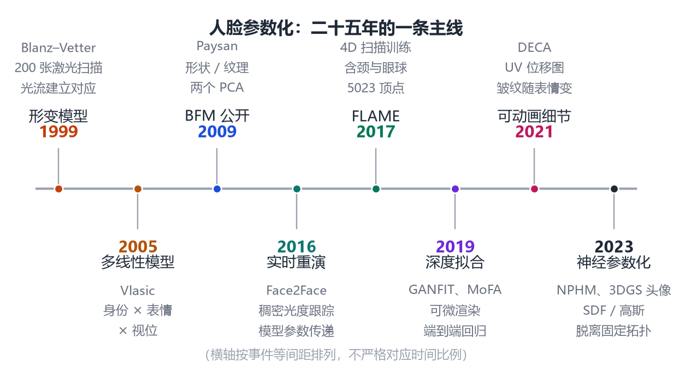
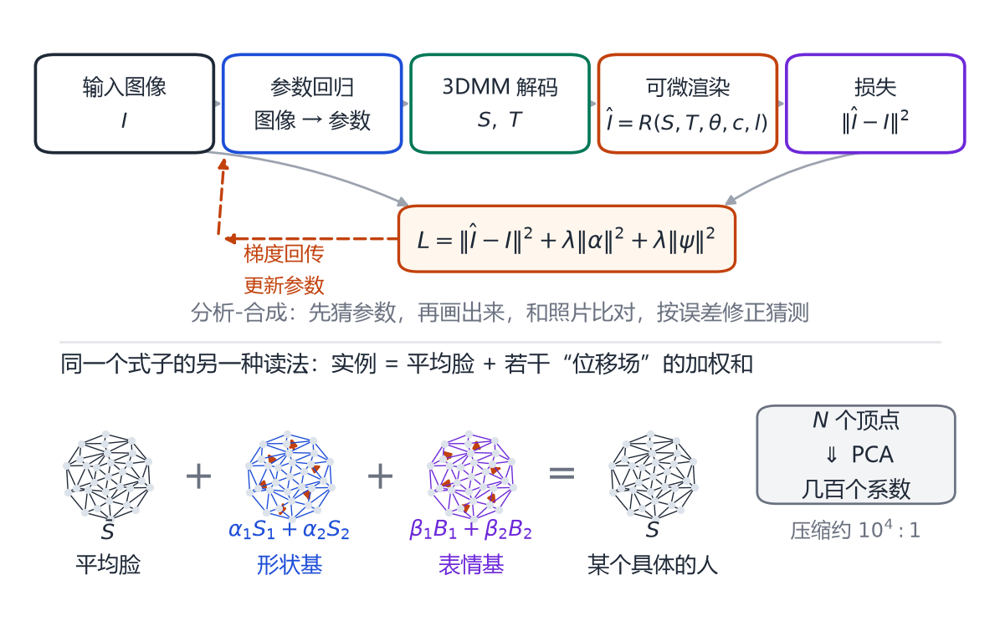
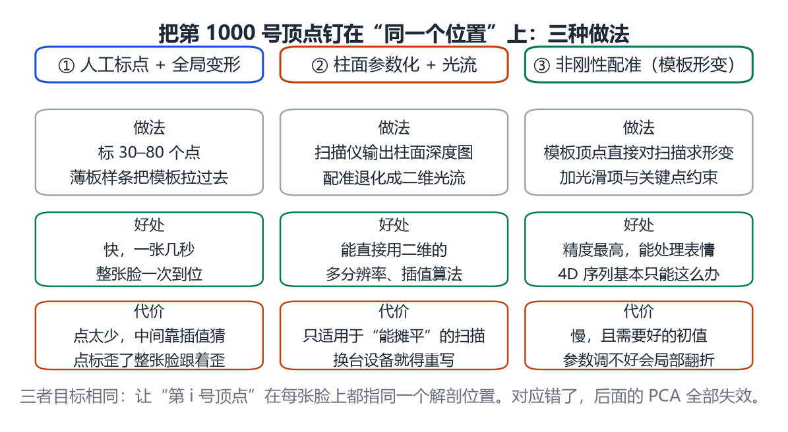
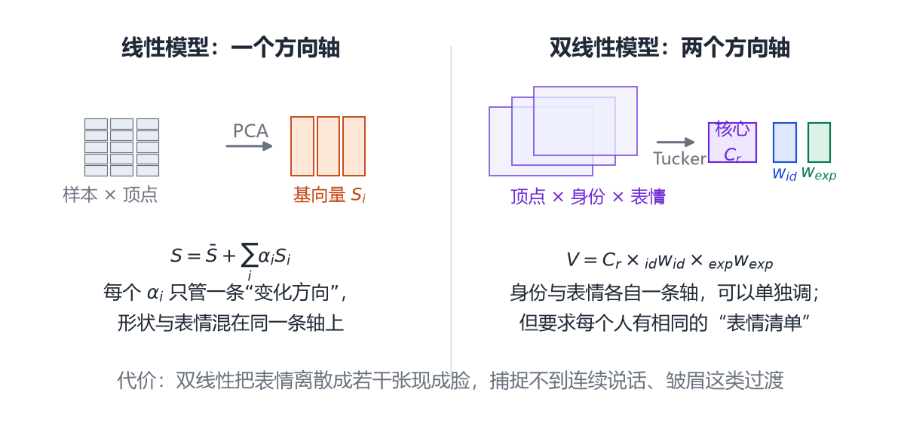
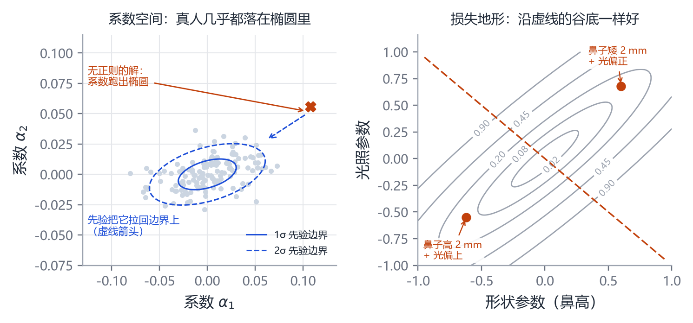

# 第 1 章 3DMM 深入与 Basel Face Model

> **本章导读**：3DMM（3D Morphable Model，三维形变模型）是这个领域的共同起点。它把“人与人之间的差别”学成一个线性空间，把“姿态与光照”交给渲染器去算，于是“造一张脸”和“从照片里读出这张脸”变成同一个参数空间里的两件事。这一章拆开它的三块积木——形状基、纹理基、表情基，算清楚它到底有几个参数，追问数据从哪来、偏差在哪，最后解释反解为什么是一个病态问题。读完这一章，你应该能判断一个新方法到底比 3DMM 强在哪一项，以及这一项是不是真的重要。

## 1.1 一张照片，两个世界

同一张人脸照片里混着两样东西：这个人长什么样，以及这张照片是怎么拍的。3DMM 的全部设计都围绕一句话展开——把前者放进三维去学，把后者交给渲染去算。

这个分工在 1999 年之前并不存在。那时候计算机处理人脸有两条互不相通的路。

第一条是**二维统计模型**。1991 年提出的“特征脸”（Eigenface）把一批对齐好的人脸照片拉成向量做 PCA（主成分分析，找出数据里方差最大的若干方向），得到“平均脸 + 若干张明暗图案”。它在人脸识别上很有效，但有个前提：所有照片得在差不多的姿态和光照下拍。头稍微侧一点、灯换一盏，识别率就往下掉。原因是姿态和光照的变化，在像素空间里是巨大的、非线性的，PCA 只能用掉大量主成分去描述它们，而这些主成分和“这是谁”毫无关系。

第二条是**几何建模**。图形学那边早就能用多边形网格画人脸，电影里的数字替身就是这么做的。可那是艺术家一个顶点一个顶点雕出来的：雕一张脸要几周，雕出来的是“某一张脸”，不是“人脸这一类东西”。你没法把“张三的脸”和“李四的脸”相加，也没法问“把鼻子调高 20% 会怎样”。

布兰兹（Volker Blanz）和维特（Thomas Vetter）在 SIGGRAPH '99 上的论文 [@blanz1999morphable] 做的是把两条路接起来。他们的判断很朴素：姿态和光照引起的变化，在三维里几乎是“免费”的——转一下模型、换一个光源就能算出来；而在二维里，每一种姿态和光照都得单独学一个模型。既然如此，就把“人与人之间的差异”放到三维里学，把“姿态与光照”交给渲染。

<figure class="fig">

<figcaption><b>图 1-1</b>　人脸参数化二十五年的主线。注意 2005 与 2009 两个节点：它们不是“更准的模型”，而是补上了 1999 年方案缺失的两块——表情与可复现性。</figcaption>
</figure>

分工一定，剩下的事就顺理成章：

1. 用激光扫描仪扫一批人脸，得到三维点集；
2. 把所有扫描对齐到同一个模板上，让第 1000 号顶点在每张脸上都对应“鼻尖偏左 2 毫米”这个位置；
3. 对对齐好的网格做 PCA，得到“平均脸 + 若干位移场”；
4. 想生成新脸，就调几个系数，渲染出来（**合成**，synthesis）；
5. 想从照片反推，就调系数，直到渲染结果和照片最像（**分析**，analysis）。

第 4、5 步合起来叫**分析-合成**（analysis-by-synthesis）。这个框架今天听起来理所当然，但在 1999 年，它同时回答了“怎么表示人脸”和“怎么从图像得到人脸”两个问题，所以影响极深。

先把这一章要解决的问题写成任务定义，后面每一节都可以对着它检查。

- **输入**：一张或多张人脸照片 $I$，可选若干二维关键点（68 点是常见约定）。
- **输出**：一组参数——形状系数 $\boldsymbol{\alpha}$、纹理系数 $\boldsymbol{\beta}$、头姿态 $\boldsymbol{\theta}$、相机 $\mathbf{c}$、光照 $\mathbf{l}$。渲染器把参数变成图像。
- **评价**：四个层面各有一套指标。几何层看对齐后的顶点误差（毫米）；图像层看重投影后的像素差；身份层看人脸识别网络提取的特征距离；应用层看人眼打分。四者经常不一致，这一点在第 3 章会展开。

一句话总结这一节：3DMM 把“长什么样”和“怎么拍”分开建模，于是同一套参数既能造脸，也能从照片里解脸。所以它同时是表示方法和求解框架。

## 1.2 公式：三个子空间，一套加法

要把一张脸写成数字，先得决定“一个顶点”在向量里的位置。3DMM 的做法是把整张网格拉直成一个长向量，再对一批这样的向量做 PCA；结论是任何一张脸都能写成“平均脸 + 若干位移场的加权和”，系数只有几十到几百个。

设每张人脸网格有 $N$ 个顶点，每个顶点三个坐标。把第 $i$ 个人的网格按“先所有顶点的 $x$，再所有 $y$，再所有 $z$”的顺序拉直，得到一个长度为 $3N$ 的列向量 $\mathbf{s}_i$。**这一步很关键**：只有把网格变成向量，才能对它做主成分分析，也就是把一批向量叠成矩阵、中心化、再取方差最大的若干方向。

对 $m$ 张脸做 PCA，得到均值 $\bar{\mathbf{s}}$（“平均脸”）和前 $k$ 个主成分 $\mathbf{s}_1,\dots,\mathbf{s}_k$。任意一张脸可以写成

$$
\mathbf{s}=\bar{\mathbf{s}}+\sum_{i=1}^{k}\alpha_i\,\mathbf{s}_i .
\tag{1.1}
$$

逐项读法：

- $\bar{\mathbf{s}}\in\mathbb{R}^{3N}$ 是平均脸拉直后的向量。它不是“抽象的典型脸”，就是一张真实存在的网格，可以把它的顶点坐标打印出来。
- $\mathbf{s}_i\in\mathbb{R}^{3N}$ 是第 $i$ 个主成分。它不是一个网格，而是一张**位移图**：第 $i$ 个系数每加 1，每个顶点该往哪儿挪多少。它的单位是米/单位系数。
- $\alpha_i\in\mathbb{R}$ 是标量系数，相当于界面上可以拖动的那根滑块。

一个示意性的数字例子。设 $N=10000$（示意值，不是某个具体模型的顶点数），则 $3N=30000$，$\bar{\mathbf{s}}$ 与每个 $\mathbf{s}_i$ 都是 30000 维。取 $k=100$，那么一张脸由 100 个数决定，压缩比约 300 : 1。若第一主成分在鼻尖那个顶点上的位移是 3 毫米/单位，那么 $\alpha_1=1.2$ 就意味着这张脸的鼻尖沿该方向前移约 3.6 毫米；同一组系数里 $\alpha_2=-0.8$ 又会让下颌收窄一些。你拖动滑块时看到的正是这种“若干个毫米级位移的叠加”。

纹理同理。把每张脸的彩色纹理展开到一张公共的二维图上（叫 UV 空间，即把三维表面摊平成平面时的坐标），再拉直成向量，做 PCA：

$$
\mathbf{t}=\bar{\mathbf{t}}+\sum_{j=1}^{l}\beta_j\,\mathbf{t}_j .
\tag{1.2}
$$

注意形状和纹理是两个**独立**的 PCA，各有一套系数。布兰兹和维特从一开始就这么设计，理由是形状和颜色可以分开调，拟合时先解形状再解颜色，省事。后来也有人证明联合建模能利用“形状与纹理相关”这条先验，但那是后话 [@egger2020survey]。

第三块是表情。1999 年的模型只扫了中性表情的脸，所以它本身不会笑。论文里给了一个非常朴素的补丁：如果同一个人有中性脸 $\mathbf{c}_{\text{ne}}$ 和表情脸 $\mathbf{c}_{\text{exp}}$，那么差值

$$
\Delta=\mathbf{c}_{\text{exp}}-\mathbf{c}_{\text{ne}}
\tag{1.3}
$$

就是“做这个表情需要每个顶点挪多少”。把这个差值加到**另一个人**的中性脸上，就能让那个人也做出类似的表情。这在当时叫**表情迁移**（expression transfer），是“加法”思想最直接的体现。$\Delta$ 的维度同样是 $3N$：它是一张位移图，不是几个角度。

<figure class="fig">

<figcaption><b>图 1-2</b>　3DMM 的两半。上：分析-合成的闭环——先猜参数、渲染出来、和照片比对、按误差修正。下：式 (1.1) 的几何含义——平均脸加上若干张位移场的加权和。</figcaption>
</figure>

图 1-2 下半部分画的正是式 (1.1)：平均脸，加上几张形状位移场的加权和，再加几张表情位移场的加权和，等于某个具体的人。

这里有个容易被忽略的细节：**加法成立的前提是“位移可以线性叠加”**。小幅度下这没问题——嘴角往斜上方挪 2 毫米，和同时往右 1 毫米、往上 1 毫米，效果几乎一样。但幅度一大就坏了：真实的脸在大笑时，脸颊鼓起、法令纹加深、眼角挤在一起，这些是肌肉一起收缩的耦合效应，不是若干独立位移的简单相加。这个隐患留到 1.7 节。

### 1.2.1 参数到底有多少个

一个常见的误解是“3DMM 有几十万个参数”。恰恰相反：$N$ 可能是几万，但 $\alpha$ 只有几十到几百个。

以 FLAME 的作者做对比实验时的设置为例：他们用 198 个形状主成分去对齐 BFM（比 BFM 少一个，因为要匹配性别专用模型）[@li2017flame]。也就是说，一张几万顶点的脸，被压缩成了不到两百个数字，压缩比达到四个数量级。同一篇论文里还报告，90 个身份主成分已经能解释 98% 的数据变化，加到 300 个基本到 100%。

这件事的意义不只是省空间。更重要的是：**参数的维度决定了这个模型能表示什么、不能表示什么**。低维意味着强先验——你几乎不可能生成一张“不像人”的脸，因为所有主成分都是从真人身上学来的；低维也意味着表达力有限——任何不在这 $k$ 个方向上的变化，模型永远画不出来。

还有一个反直觉的推论：主成分是按方差排序的，而方差大的方向通常是“脸的大小、胖瘦”这类整体量。所以前 10 个系数决定了“这张脸大不大、圆不圆”，最后 10 个系数才管“眼角是不是有点下垂”。误差指标常常被前几个系数主导，观感却主要由后面的小系数决定。这就是为什么“误差 1 毫米”的模型看起来可能比“误差 1.5 毫米”的更假。

所以，参数量的多少不是工程细节，而是能力边界：几百个数字既能保证“像人”，也注定了它“只能像到这个程度”。

## 1.3 最难的一步其实是对应

PCA 那五行代码十分钟就能写完，把两百张扫描对齐却要几个月。原因是主成分分析要求“每一列是同一个量”，顶点编号错了，两个数相减就没有意义。

举个具体的失败：第一张脸的 1000 号顶点在鼻尖，第二张脸的 1000 号顶点在嘴角。把它们相减得到的数字，既不是鼻子的差异也不是嘴的差异，只是两个无关点的坐标差。几百个这样的数字叠起来做 PCA，学到的全是噪声。

布兰兹和维特的办法是**光流**（optical flow，用亮度守恒假设估计两幅图之间逐像素的位移）。他们的扫描仪输出的不是散乱点云，而是一张柱面展开的深度图——把脸“卷”到一个圆柱面上，于是三维配准问题变成了二维图像配准，可以直接套用当时已经成熟的二维光流算法。

<figure class="fig">

<figcaption><b>图 1-3</b>　建立稠密对应的三种做法。三者的目标相同：让同一个顶点编号在每张脸上指同一个解剖位置。精度、速度、对设备的依赖，三者只能取其二。</figcaption>
</figure>

图 1-3 把三种做法并排放。第一种是人工标点加全局变形，几十个点定住大致位置，中间靠薄板样条插值，快但粗糙。第二种依赖扫描仪的柱面参数化，把三维问题降成二维。第三种是非刚性配准：让模板网格自己“爬”到扫描上，同时最小化点到面的距离、形变的光滑程度和关键点的偏差。

这一步技术含量不低，却常被一句“建立稠密对应”带过。[@egger2020survey] 在回顾这段历史时特别指出：原始 3DMM 之所以能在参数化曲面上用光流、多分辨率、插值这些二维算法，是因为扫描仪本身就给了柱面参数化；不少后来者以为这些操作是“三维的”，其实是误会。

对应的失败模式很具体，值得记住三种。

**一是漂移。** 非刚性配准没有唯一解，鼻翼、唇线这些曲率变化剧烈的地方最容易滑。滑一格，这个顶点的语义就变了，PCA 学出来的“第一主成分”可能变成“配准误差的主要方向”。

**二是对称歧义。** 人脸近似左右对称，配准有时会把左脸颊的一个顶点贴到右脸颊。单看几何误差很小，语义却错了。

**三是表情残留。** 如果要求受试者“保持中性”，总会有人微微抿嘴。这点差异会被当成身份差异学进形状基，于是模型里“嘴薄”这个方向混进了“抿嘴”的成分。

有了对应，PCA 才有意义；有了 PCA，才有“滑块”。这条因果链值得记住：**在人脸参数化里，数据与对应的重要性，长期高于模型形式本身**。二十多年里，模型从线性到双线性再到神经网络换了好几代，但“怎么扫、怎么对齐”始终是决定上限的那一环。

所以，看到一篇论文说“我们换了一个更强的先验”，第一个该问的问题是：它的训练数据是用什么流程对齐的？

## 1.4 Basel Face Model：把论文变成基础设施

1999 年的模型没有公开，别人只能照着论文重写。2009 年 BFM 发布之后，这件事第一次有了共同基准：同一张平均脸、同一套顶点编号、同一份拟合代码。

帕伊桑（Pascal Paysan）等人发布的 **Basel Face Model**（BFM）[@paysan2009bfm] 数据基础是 200 位受试者的三维扫描，全部为中性表情 [@egger2020survey]。它提供形状与纹理两套 PCA 基，分男、女等性别版本，以及配套的拟合代码。

此后十几年，它成了人脸研究里的公共插座：做人脸识别的拿它做数据增广，做重建的拿它当几何先验，做渲染的拿它当基准模型。BFM 的意义不在技术，而在**可比性**。在它之前，每篇论文用自己的私有数据、自己的对应方法，别人无法复现，也无法判断“到底谁更好”。在它之后，至少有一件事统一了：大家用的是同一张平均脸、同一套顶点编号。

但公共设施也有代价，而且这些代价会一路传到应用端。

**第一是人口学偏差。** 受试者以年轻欧洲人为主。用它去拟合东亚人、老人、儿童，会系统性地偏离。这不是算法的错，是数据的错，而且很难靠调参补救——模型里根本没有那个方向。一个直观的检验：把一位东亚老人的照片拟合到 BFM，再看残差图，你会看到误差集中在鼻梁高度、眼窝深度、法令纹这三处。

**第二是没有表情。** 全是中性脸，意味着 BFM 天生不会笑、不会皱眉。要加表情，只能另找数据、另建模型，这就是 1.5 节的故事。

**第三是“中性”本身很模糊。** 让人“保持中性表情”其实很难，很多人会不自觉微微抿嘴。这些微小的动作会被当成身份差异学进形状基里，造成身份与表情的轻微纠缠。

**第四是尺度与姿态被固定。** 所有扫描都在受控条件下完成，头的朝向、相机距离、光照都一致。这让模型很“干净”，也让它在野外照片上容易失手：真实照片里的侧脸、逆光、遮挡，都是训练分布之外的东西。

BFM 后来有 2017 与 2019 两个版本：前者补了 160 个表情扫描，后者扩展到完整头部与多分辨率 [@egger2020survey]。但影响最大的仍是 2009 版——因为它最简单，也最稳定。

所以，BFM 的真正贡献是把“人脸”变成了一个可复现的数据格式；而它的局限，几乎全部来自那 200 张受控扫描。

## 1.5 表情：从加法到双线性

式 (1.3) 的加法补丁有个明显的毛病：把 A 的表情差值加到 B 脸上，结果往往像“B 戴了一张 A 的面具”。要修这个问题，最直接的办法是给每个人都拍同一套表情，于是数据从“一堆网格”变成“一张表格”。

毛病出在哪儿？两个人的脸不一样大、肌肉不一样厚，同一句“笑”，需要的位移场本来就不同。A 的法令纹位移是 4 毫米，B 的脸颊更饱满，同样的位移加过去就会把皮肤拱起来。

办法很笨也很有效：**给每个人都拍同一套表情**。于是数据从“一堆网格”变成了“一张表格”——行是人，列是表情，每个格子里是一个网格。三个维度（顶点、身份、表情）叠起来，就是一个三阶张量。

2005 年，弗拉西奇（Vlasic）等人的 *Face Transfer with Multilinear Models* [@vlasic2005face] 正是这么做的。他们把人脸看成一个张量，沿“身份”“表情”“视位”三个模式做多线性分解，分解后的新脸可以写成

$$
\mathcal{V}=\mathcal{C}_r\times_{\text{id}}\mathbf{w}_{\text{id}}\times_{\text{exp}}\mathbf{w}_{\text{exp}},
\tag{1.4}
$$

逐项读法：

- $\mathcal{V}$ 是输出，形状是“顶点 $\times$ 3 个坐标”，也就是一张网格。
- $\mathcal{C}_r$ 是**核心张量**（core tensor），尺寸是 $(3N)\times r_{\text{id}}\times r_{\text{exp}}$，存的是“身份与表情如何组合”的规律。它的元素个数远小于原始数据：若 $r_{\text{id}}=r_{\text{exp}}=50$，核心张量有 $3N\times50\times50$ 个数，听起来很大，但相比“每个身份每个表情各存一整张网格”已经小了两个数量级。
- $\mathbf{w}_{\text{id}}\in\mathbb{R}^{r_{\text{id}}}$、$\mathbf{w}_{\text{exp}}\in\mathbb{R}^{r_{\text{exp}}}$ 分别是身份和表情的系数向量。
- $\times_n$ 表示“沿第 $n$ 个模式相乘”，也就是把参数向量和核心张量在对应维度上做内积，其他维度保持不变。

不必纠结符号。它的实际含义可以用一句话说清：**先按身份挑一组表情基，再按表情在这组基里插值**。所以它天然支持两件线性模型做不到的事：只换表情不换人，或者只换人不换表情，而且两个方向可以各自连续调节。

把式 (1.4) 按顶点模式展平，会看得更清楚。把核心张量摊成矩阵 $\mathbf{C}_{(v)}\in\mathbb{R}^{3N\times r_{\text{id}}r_{\text{exp}}}$，则

$$
\mathbf{v}=\mathbf{C}_{(v)}\big(\mathbf{w}_{\text{id}}\otimes\mathbf{w}_{\text{exp}}\big),
\tag{1.5}
$$

其中 $\otimes$ 是克罗内克积（把两个向量两两相乘、拼成一个长向量）。$r_{\text{id}}=r_{\text{exp}}=50$ 时，$\mathbf{w}_{\text{id}}\otimes\mathbf{w}_{\text{exp}}$ 是 2500 维，$\mathbf{C}_{(v)}$ 是 $3N\times2500$ 的矩阵。这个读法很实用：**双线性模型其实就是一个“输入 2500 维、输出 3N 维”的线性层**，只不过它的权重被强制排成了两个方向的乘积形式。

<figure class="fig">

<figcaption><b>图 1-4</b>　线性模型与双线性模型的区别。左边只有一个变化方向，身份与表情混在同一条轴上；右边拆成两条轴，于是“这个人做那个表情”可以直接由两组系数组合出来。</figcaption>
</figure>

后来的数据集把这个思路推到更大规模。FaceWarehouse 采集了 150 位受试者、每人 20 个表情 [@egger2020survey]；FaceScape 更彻底，938 位受试者、每人 20 个表情、共 18760 个毛孔级网格，先拟合成每人 52 个 blendshape，再在“26317 顶点 × 52 表情 × 938 身份”的张量上做 Tucker 分解 [@zhu2020facescape]。注意 938 × 20 = 18760 正好对上，说明每一格都拍了，没有缺失。

但双线性也有它自己的墙，而且每一堵都很难绕。

**第一，它要求“表情清单”对齐。** 每个人都得做同样的 20 个表情，而且这 20 个表情在语义上要能对上。闭嘴的笑和露齿的笑算不算同一个？很难说。数据采集时的一点偏差，会被张量分解放大成“身份差异”。更麻烦的是缺失：150 人 × 20 表情是理想情况，现实中总有人做不来某个夸张表情，那个格子只能填个近似值。

**第二，它把表情离散化了。** 真实的表情是连续流动的，说话时嘴唇每秒变形好几次；而双线性模型的输入是“第 7 号表情占 0.6、第 12 号表情占 0.4”。中间过渡靠线性插值，容易出现“两张脸叠影”的塑料感。你可以自己验证：取“微笑”和“大笑”两张网格各 0.5，得到的嘴形往往比真实的中等笑容更薄、更扁。

**第三，它假设身份与表情可分离。** 现实中两者是耦合的：胖的人笑起来法令纹更深，老人皱眉时纹路走向也不同。张量分解强行把它们拆开，就等于假设“表情的位移场与脸型无关”，这个假设只在中等幅度下近似成立。

也正因为如此，2017 年的 FLAME 又退回到“线性形状基 + 线性表情基 + 4D 序列训练”的路线上（第 2 章）：它放弃了“每个人一套对齐好的表情”这个要求，改用连续的表情空间，用 4D 扫描序列去学“表情如何随时间变化”。这是螺旋上升，不是简单回头。

所以，双线性用“多拍一套表情”换来了身份与表情的分离，代价是把连续的动作压成了一张有限的清单。

## 1.6 反解：怎么从一张图得到参数

模型建好之后，剩下的核心问题是：给定一张照片 $I$，怎么找到那组参数？答案是把它写成一个最小化问题，让“渲染出来的脸”尽量接近“照片里的脸”。

$$
\min_{\alpha,\beta,\theta,c,l}\ \big\|\,I-R\big(S(\alpha),T(\beta),\theta,c,l\big)\,\big\|^2+\lambda\|\alpha\|^2+\lambda\|\beta\|^2 .
\tag{1.6}
$$

逐项读法：

- $S(\alpha)$ 是式 (1.1) 生成的网格，$T(\beta)$ 是式 (1.2) 生成的纹理，两者的维度分别是 $3N$ 与 UV 图上的像素数。
- $\theta$ 是头姿态，通常写成三个旋转角或一个旋转矩阵，6 个自由度（3 转 3 移）。
- $c$ 是相机，透视投影下是焦距加主点，弱透视下退化成缩放加二维平移。
- $l$ 是光照，最简单的假设是一盏平行光加环境光，约 6 到 9 个数。
- $R$ 是渲染器：它把网格、纹理、姿态、相机、光照变成一张图。整个式子里只有它是“从三维到二维”的那一步。
- 后两项是正则项，防止系数跑到离谱的地方。系数外插得太远，生成的脸就不再像人了。

第二项的权重 $\lambda$ 不是随手设的。它等价于给系数加一个高斯先验：假设真人的系数服从某个分布，那么“偏离分布越远，惩罚越大”。图 1-5 左边画的就是这件事：真人的系数密集落在椭圆里，最优化如果只看图像误差，会把解推到椭圆外的某个点上，正则项负责把它拉回来。

<figure class="fig">

<figcaption><b>图 1-5</b>　左：系数空间里的先验椭圆，以及无正则时的外插解（示意数据）。右：损失地形的一个切片——沿虚线整条谷底的损失几乎一样，所以“图像最像”并不等于“参数唯一”。</figcaption>
</figure>

1999 年的实现有几个细节很能说明当年的工程处境：

- **不逐像素算。** 全图逐像素比对太慢，他们每次随机挑一小批三角形，按面积决定被选中的概率——面积大的三角形影响大，就多被采样。这在数学上就是随机梯度下降（SGD）。举个示意数字：一张 500 × 600 的照片有 30 万像素，而一次只用约 1000 个三角形采样点来估梯度，单步计算量降到千分之一。
- **要手动初始化。** 因为式 (1.6) 高度非凸，随便给个初值会掉进局部极小。原始系统需要人工把脸的大致位置、姿态标出来，再开始优化。
- **相机距离固定。** 透视投影里，脸的“大小”同时受真实尺寸和离相机远近影响，两者无法从单张图区分。论文里干脆把距离写死。

这些困难不是当年算力不足造成的，而是问题本身**病态**（ill-posed，指解不唯一或不连续依赖观测）。[@egger2020survey] 把这类歧义总结成三对：形状与尺度、相机与焦距、光照与反照率。最后一对最麻烦：一张脸偏暗，可能是因为皮肤黑，也可能是因为背光；模型无法分辨，只能猜。图 1-5 右边画的就是这种“谷底”：鼻子高 2 毫米配偏上的光，和鼻子矮 2 毫米配正面的光，渲染出来几乎一样，损失值也几乎一样。优化器在谷底随便走，走到哪算哪。

深度学习进来之后，形式变了，本质没变。下面三条典型做法，改的都是同一个式子的不同零件。

**一是把它变成自编码器。** MoFA [@tewari2017mofa] 用一个卷积网络把图像编码成 3DMM 参数，再用一个可微渲染器解码回图像，整个网络用“重建图像是否像输入”来训练，不需要三维真值。这等于把式 (1.6) 的优化从“测试时”搬到了“训练时”。代价是网络学到的是“平均意义上的最优”，单张图上不再有逐步修正的机会。

**二是用判别器代替像素误差。** GANFIT [@gecer2019ganfit] 不再逐像素比，而是训练一个判别器来判断“这张渲染图看起来真不真”，用它当损失。像素误差偏好模糊的平均解，判别器则偏好“像真的”，这一换让细节明显变锐。论文里提到，它的重建结果可以用一个 700 维的向量表示——这 700 个数就是形状、纹理、光照、相机参数的总和。代价是训练不稳定，判别器和生成器容易此消彼长。

**三是换一个更容易拟合的纹理模型。** Booth 等人的“野外 3DMM” [@booth2018inwild] 指出：形状模型可以用受控条件下扫的数据学，但纹理不行——受控数据里的纹理太“干净”，拟合野外照片时会崩。他们的做法是从野外图片里学一个纹理模型，于是拟合时不必再显式估计光照，少了一大块不确定性。代价是纹理基不再有物理含义，不能直接拿去重新打光。

回头看，这三条路都没有推翻分析-合成，只是把“渲染-比较-修正”这个循环挪到了别处：挪进训练集，挪进判别器，挪进数据先验。

所以，反解的困难从来不是“优化器不够好”，而是“一张图里的信息本来就不够”；所有方法做的都是补信息，而不是变魔术。

## 1.7 3DMM 的四面墙

讲到这里，可以系统地列出线性 3DMM 的局限。这四条局限不是抽象的批评，每一条都有具体的视觉表现，也都对应后来的一条技术路线。

**第一，它是线性的。** 式 (1.1) 只能生成“若干位移场的线性组合”。真实人脸的形状变化是弯的：从瘦到胖不是沿一条直线走，从婴儿到老人更不是。更严重的是细节——皱纹、毛孔这些高频起伏，根本不在前几百个主成分里。把下巴系数从 $-2$ 拉到 $+2$，线性模型给出的是两个端点之间的均匀插值，真实的脸在中段会有软组织堆积，插值结果显得“像气球”。

**第二，表情要么没有，要么很弱。** BFM 只有中性脸；双线性模型有表情但被离散化；线性表情基对极端表情（大笑、惊恐）会失真，因为它假设“表情 = 若干基的加权和”，而真实的极端表情伴随皮肤拉伸、体积变化，不是简单叠加。一个可测的现象：把表情系数推到训练分布之外，嘴会张开，但口腔内壁、牙齿、舌头全都不存在，你看到的是一层贴在脸上的皮。

**第三，分辨率不够。** 网格顶点数是固定的（BFM 是几万，FLAME 只有 5023），再细的起伏只能靠贴图或位移图“画”上去，而不是真的几何。这在近景渲染时很明显：侧光一打，脸是光滑的。按 5023 顶点、头高约 24 厘米估算，顶点间距在厘米量级，而法令纹的宽度只有 1 到 2 毫米——差了一个数量级。

**第四，身份与表情纠缠。** 这是最隐蔽的一条。同一个人笑与不笑，PCA 把差异摊到了形状基和表情基里，两边都沾一点。结果就是：你想“保持这个人不变，只换表情”，换完之后脸会微微变形。2021 年的 DECA 用一个“细节一致性损失”专门治这个病（见第 3 章），说明它到深度学习时代仍然是个真问题。

还有一条不算“墙”但很要命的缺失：**BFM 没有脖子**。它到下颌就截断了，不能转头，也不能和身体模型对接。这件事听上去像工程细节，实际上直接催生了后来带关节的人脸模型。

所以，四面墙划出的边界很清楚：线性、无表情、低分辨率、身份表情纠缠。后面几章的方法，几乎都能对号入座地看作在拆其中一堵墙。

## 1.8 同一件事的四种做法

这一节把 3DMM 与它的三个后继放在一张表里，重点不是谁更强，而是**每一家改了什么、付了什么代价**。

**表 1-1**　四种人脸参数化方案的对照。参数列只写量级，具体数字随实现而变。

| 方案 | 变化轴 | 典型参数量 | 表情 | 数据要求 | 主要代价 |
|---|---|---|---|---|---|
| 线性 3DMM（BFM） | 一组形状基 + 一组纹理基 | 形状数百、纹理数百 | 无（靠外挂） | 200 人中性扫描 | 无表情、无脖子、细节缺失 |
| 双线性（FaceWarehouse、FaceScape） | 身份 × 表情两条轴 | 身份数十、表情数十 | 有，离散清单 | 每人一套对齐表情 | 清单要对齐、过渡塑料感 |
| 带关节的线性模型（FLAME 类） | 形状 + 表情 + 姿态 + 蒙皮 | 300 + 100 + 15 | 连续线性基 | 数千头 + 4D 序列 | 固定拓扑 5023 顶点、无口腔 |
| 神经参数化（NPHM 类） | 身份潜码 + 表情潜码 + 形变场 | 潜码数百 | 连续，细节强 | 数千帧高精度扫描 | 需要 GPU、输出不是网格 |

四种方案有一条共同的底线：都在“身份”和“表情”之间划一条界。差别只在用什么表示这条界两侧的空间——PCA 基、张量、关节加蒙皮，还是神经场。这条底线之所以稳，是因为它对应一个真实需求：换人不换表情、换表情不换人，是所有人脸应用都要做的事。

第二个观察是数据量级在跳。200 人（BFM）、150 人 × 20 表情（FaceWarehouse）、938 人 × 20 表情（FaceScape）、数万次扫描（带关节的模型）——每跳一个量级，能表示的东西就多一类，但采集和标注的成本也跳一个量级。这也是为什么后来的研究越来越依赖“合成数据 + 弱监督”，因为按老办法采数据已经采不起了。

第三个观察是**接口比精度更重要**。BFM 至今还在被用，不是因为它准，而是因为它的顶点编号是公开的、稳定的，所有人都在同一个编号体系上写代码。一个模型如果精度高但接口私有，很难成为基础设施。

所以，选方案时先问三个问题：需不需要表情与姿态、能不能接受固定拓扑、有没有对应的数据。答案定了，模型基本就定了。

## 本章小结

- 3DMM 的核心分工：差异放三维学，姿态与光照交给渲染；合成靠参数，分析靠优化。
- 主公式 $\mathbf{s}=\bar{\mathbf{s}}+\sum_i\alpha_i\mathbf{s}_i$：平均脸加若干位移场的加权和，几百个系数描述几万个顶点。
- 真正难的不是 PCA，是稠密对应；数据与配准的质量决定模型上限，配准的三种典型失败是漂移、对称歧义、表情残留。
- BFM 2009 的价值在“可比性”：同一张平均脸、同一套顶点编号，让整个领域有了共同基准；代价是人口学偏差、表情缺失、中性表情不中性、受控条件过窄。
- 表情的两次尝试：先做“加法迁移”，再做“双线性张量”。后者能分离身份与表情，但要求表情清单对齐，且把连续动作离散化。
- 从图像反解参数是病态问题，三大歧义（形状-尺度、相机-焦距、光照-反照率）至今没有彻底解决；深度学习只是把优化挪进了训练。
- 线性、表情弱、分辨率低、身份-表情纠缠，这四条局限划出了 3DMM 的能力边界；后继方案各自拆其中一堵墙，也各自付了新代价。

## 思考题

1. 如果训练集里所有人的鼻子都比平均脸大，那么第一主成分大概会是什么？这会带来什么后果？
2. 式 (1.3) 的“加法表情迁移”在什么情况下会明显失败？请举一个具体例子，并说明失败时的视觉表现。
3. 双线性模型要求每个人都做同样的 20 个表情。如果某个人只做了 18 个，你会怎么处理这个缺失的格子？
4. 为什么“光照-反照率”歧义在单张图上无法消除？如果给你同一个人的两张不同光照照片，情况会好转吗？
5. 表 1-1 里“接口比精度更重要”这条判断，对一个只做离线影视特效的团队成立吗？请给出你的理由。
