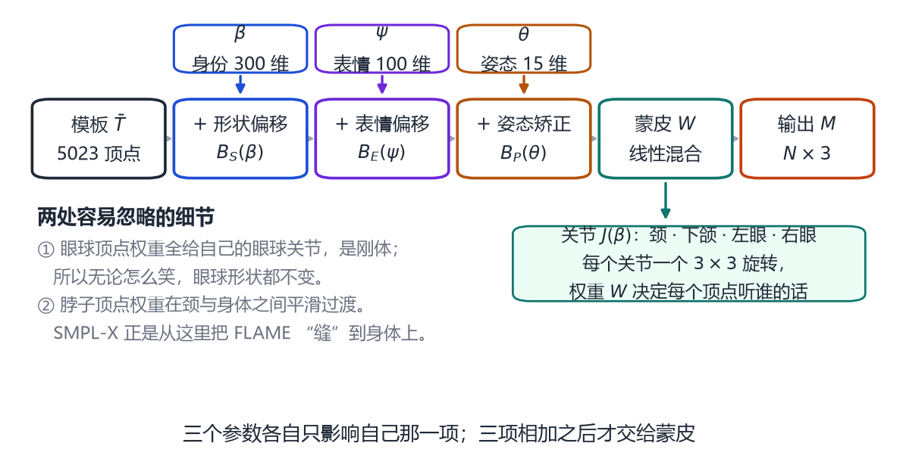
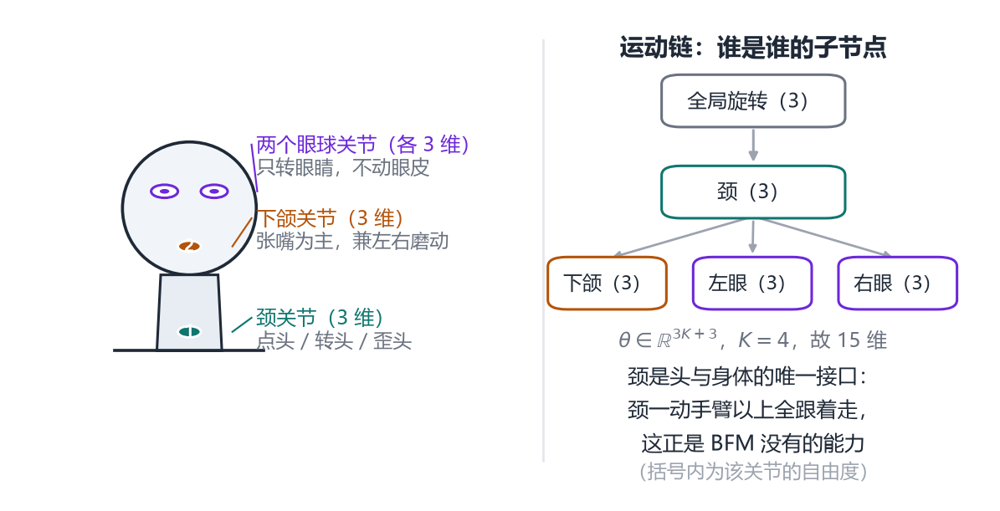
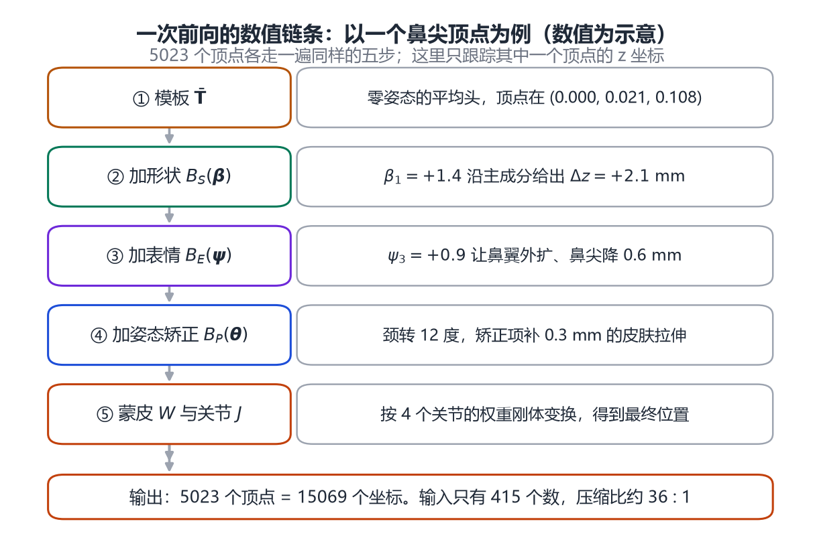
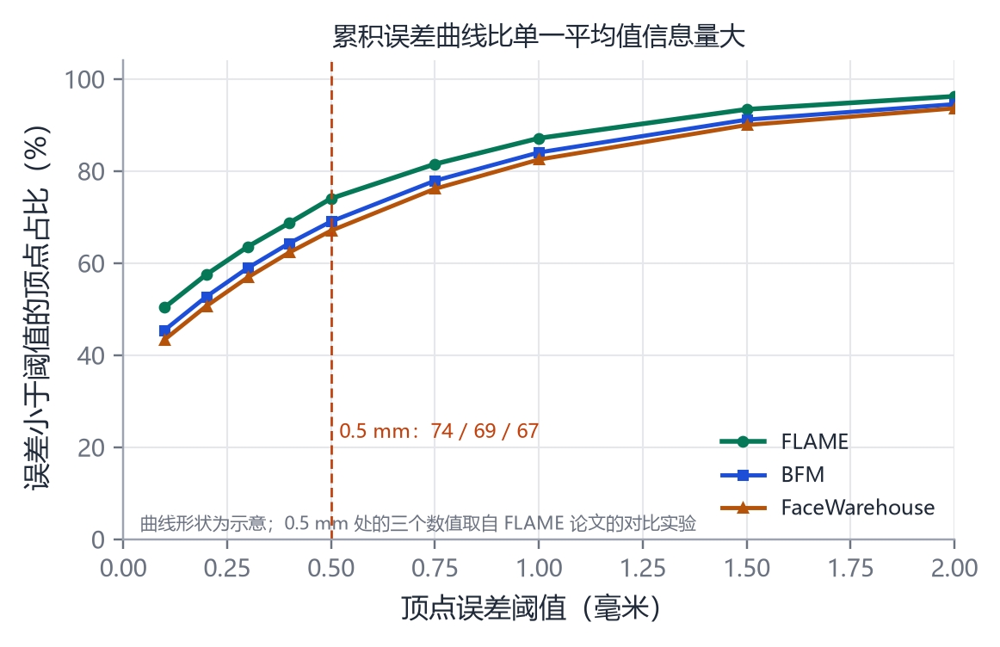
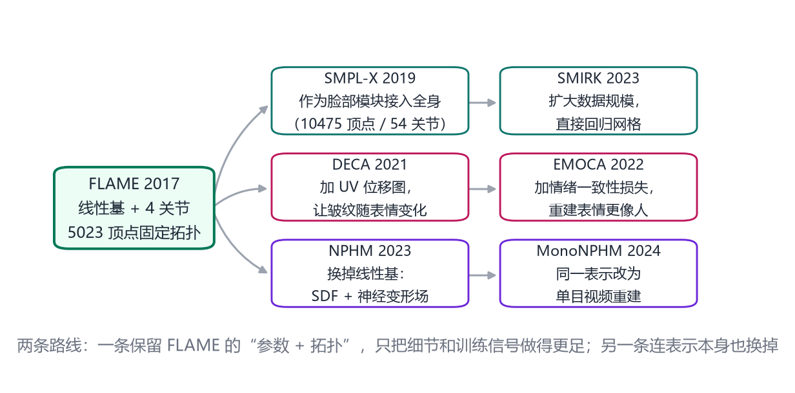

# 第 2 章 FLAME：脸、颈、表情的统一参数化

> **本章导读**：第 1 章的 3DMM 有一个致命缺口——它到下颌就截断了，既不会转头，也没有脖子。而 SMPL 那一类身体模型有骨架、有蒙皮，却不认识表情。2017 年的 FLAME 把这两件事接了起来：它用 5023 个顶点、4 个关节、不到 500 个参数，同时描述“这是谁”“他什么表情”“他头朝哪边”。这一章讲清它的公式、它的数据、它怎么被缝进全身模型，以及它在什么情况下会失败。

## 2.1 BFM 缺的三样东西

拿 2009 年的 BFM 去做一个“数字人直播”，三堵墙会依次撞上：没有脖子、表情靠外挂、三套参数各说各话。FLAME 的解法很干脆——把身体模型那套“模板 + 关节 + 蒙皮 + 姿态矫正”的配方整份搬到头上，再加一个连续的表情空间。

**第一堵墙：没有脖子。** BFM 是一张“面具”，顶点到下颌线就结束了。这意味着两件事做不到。一是转头——转的不是头，是整个面具，看起来像有人在屏幕后面举着一张照片平移。二是接到身体上——脖子是头与躯干的过渡区，没有它，头只能“浮”在肩膀上方，肩一动，头不动，接缝一眼可见。

**第二堵墙：表情是外挂的。** 第 1 章讲过，BFM 本身只有中性脸，表情要靠外部模型“加”上去。加法的问题在于，它只改几何，不改关节——下颌不会真的“张开”，只是下巴附近的顶点被推下去。张开嘴时，上下牙之间的距离、口腔内部的空间，全都没有。你得到的是“一张画着张嘴的脸”，而不是“一个张开的嘴”。

**第三堵墙：不统一。** 形状是一套 PCA，表情是另一套（可能是双线性的、可能是 blendshape），姿态则是旋转矩阵，三套东西各说各话。你想“只改表情不动身份”，得自己保证两套参数不串味；换一个模型，参数的含义全变了，代码要重写。

把这一章要解决的问题写成任务定义，会更清楚。

- **输入**：身份参数 $\boldsymbol{\beta}$、表情参数 $\boldsymbol{\psi}$、姿态参数 $\boldsymbol{\theta}$（含全局旋转与平移）。
- **输出**：一张 5023 顶点的三角网格，外加 4 个关节的位置。网格是固定拓扑的——顶点编号在所有参数下都不变。
- **可选输出**：把 16 个语义关键点映射到网格上，用于和检测器对接。
- **评价**：几何层看对齐后的顶点误差（常报毫米，并用累积误差曲线）；驱动层看“同一组参数换到别的引擎里是否还对”；应用层看张嘴、眨眼、转头这些动作有没有明显破绽。

FLAME 的设计目标就一句话：**用同一个参数空间同时回答“这是谁”“什么表情”“头朝哪边”。** 论文里直接说“我们采用与 SMPL 一致的记号”，并且明确它做的事就是把 SMPL 推广到头部 [@li2017flame]。

所以，理解了 SMPL 就理解了大半 FLAME；真正的新东西只有一项——表情偏移。

## 2.2 公式：模板 + 三种偏移 + 蒙皮

FLAME 的完整定义只有两步：先在一个“零姿态”的模板上叠三种偏移，再用关节把这堆顶点带着走。公式写出来是这样：

$$
M(\boldsymbol{\beta},\boldsymbol{\theta},\boldsymbol{\psi})
=W\Big(T_P(\boldsymbol{\beta},\boldsymbol{\theta},\boldsymbol{\psi}),\,
J(\boldsymbol{\beta}),\,\boldsymbol{\theta},\,\mathcal{W}\Big),
\tag{2.1}
$$

其中

$$
T_P=\bar{\mathbf{T}}+B_S(\boldsymbol{\beta})+B_E(\boldsymbol{\psi})+B_P(\boldsymbol{\theta}).
\tag{2.2}
$$

式 (2.2) 的输入是三组参数，输出是一个 $N\times3$ 的顶点表（$N=5023$），四行分别是模板与三种偏移。逐项读法：

- $\bar{\mathbf{T}}\in\mathbb{R}^{N\times3}$：**模板网格**，处在“零姿态”下。它是所有变化的起点，本身就是一个具体的头。
- $B_S(\boldsymbol{\beta})$：**形状偏移**。$\boldsymbol{\beta}$ 是身份参数，$B_S$ 是一个线性基，负责“这是谁”——脸的长短、眉骨高低、下巴宽窄。它的输出和模板同尺寸。
- $B_E(\boldsymbol{\psi})$：**表情偏移**。$\boldsymbol{\psi}$ 是表情参数。这是 FLAME 相对 SMPL 新增的那一项。
- $B_P(\boldsymbol{\theta})$：**姿态矫正**。$\boldsymbol{\theta}$ 是姿态参数。它修正“纯靠蒙皮转关节”带来的失真，比如脖子扭转时皮肤被拉薄。

三项相加之后才进蒙皮。蒙皮这一步的行话叫**线性混合蒙皮**（linear blend skinning, LBS）：每个顶点按一组权重分配给若干关节，然后每个关节带着它做刚体变换，最后加权求和。式 (2.1) 里的 $W$ 就是这个操作，把它摊开写更直观：

$$
\mathbf{t}_i=\sum_{k=1}^{K}w_{i,k}\,G_k(\boldsymbol{\theta},J)\,\tilde{\mathbf{t}}_i ,
\tag{2.3}
$$

- $\mathbf{t}_i$ 是第 $i$ 个顶点蒙皮后的位置，$\tilde{\mathbf{t}}_i$ 是它在式 (2.2) 里的位置（齐次坐标，补一个 1）。
- $w_{i,k}$ 是顶点 $i$ 对关节 $k$ 的权重，非负，且对 $k$ 求和为 1。整个权重表 $\mathcal{W}\in\mathbb{R}^{N\times K}$ 是训练时学出来的，$5023\times4$ 个数。
- $G_k$ 是关节 $k$ 的全局变换矩阵，由局部旋转沿运动链累乘得到，尺寸 $4\times4$。

关节位置本身也是从形状参数算出来的，做法是一步线性回归：

$$
\mathbf{J}(\boldsymbol{\beta})=\mathbf{R}\,\big(\bar{\mathbf{T}}+B_S(\boldsymbol{\beta})\big),
\tag{2.4}
$$

$\mathbf{R}\in\mathbb{R}^{3K\times3N}$ 是**关节回归矩阵**（joint regressor），训练时用“网格 + 真实关节位置”的配对数据最小二乘解出来。它的作用是：脸变宽，眼球的中心跟着外移，而不是钉死在一个位置。这一步很便宜——一次矩阵乘法，$3K\times3N$ 只有 12 行。

数字例子（示意）：设某个顶点的权重是 $w=(0.02,\,0.86,\,0.06,\,0.06)$，对应颈、下颌、左眼、右眼。这时它几乎是刚性地跟着下颌走，因为 0.86 都给了下颌；而它离眼球很远，却仍分到 0.06——这就是蒙皮的“软”之处，也是嘴唇在张嘴时会被轻微带偏的原因。

<figure class="fig">

<figcaption><b>图 2-1</b>　FLAME 的计算流程。三个参数各自只作用在自己那一项上，三项相加之后才交给蒙皮。眼球顶点是刚体，脖子顶点的权重在颈与身体之间过渡——后者正是它能被“缝”进全身模型的原因。</figcaption>
</figure>

这个结构有个很实际的好处：**可分解**。想换人，只改 $\boldsymbol{\beta}$；想换表情，只改 $\boldsymbol{\psi}$；想转头，只改 $\boldsymbol{\theta}$。三者互不干扰，因为它们在相加之前各占一项。这比“一个大网络吃进所有参数吐出网格”要透明得多，也更容易在游戏引擎里做动画混合——引擎可以把“身份”当静态层，“表情”当动画层，两个层各算各的，最后相加。

### 2.2.1 为什么表情也用线性基

这里有个设计选择值得停一下：FLAME 的表情空间是**线性**的，也就是“表情 = 若干表情基的加权和”，而不是一堆独立的 blendshape 滑块。

论文里专门解释了为什么不走 FACS 那条路 [@li2017flame]。FACS（Facial Action Coding System，面部动作编码系统）把表情拆成几十个“动作单元”（抬眉、皱鼻、嘴角上扬……），每个单元一个滑块。这套体系在动画里很好用，因为动画师能精确控制某一束肌肉；但它有个数学上的毛病：**过完备**。多个不同的滑块组合可以产生同一张脸，于是“给定一张照片，求滑块”这个问题就有无穷多解，很难优化。

FLAME 换成一组**正交**的表情基（就是 PCA 出来的那组），好处是：给一张脸，系数基本唯一；坏处是：系数没有语义，“第 7 个系数是干什么的”说不清。这是一个典型的取舍——为了“能从数据反解”，牺牲了“人能以语义理解”。后来的 DECA、EMOCA 都建在这套正交基上，说明这个取舍是对的。

所以，公式本身没什么玄机，关键在于四个加号项各管一件事；而表情项之所以选正交基而不是滑块，是为了让反解有唯一答案。

## 2.3 5023、4、15：三个数字怎么来的

刚接触 FLAME 的人常常被三个数字绕晕：5023、4、15。它们分别是顶点数、关节数、姿态维度，每一个都是设计取舍的结果。

**5023 是顶点数 $N$。** 这是一个相当低的分辨率——BFM 是几万，FaceScape 的基网格是 26317。FLAME 选这么低，是刻意的：它要能塞进游戏引擎、要能在手机上行用、要能几毫秒算完一次前向。代价是，中频细节（法令纹、眼袋）它画不出来，只能靠后处理加（见第 3 章）。

**4 是关节数 $K$。** 分别是：颈、下颌、左眼、右眼 [@li2017flame]。注意这里没有“头”这个关节——头的整体旋转被当作**全局旋转**单独处理，不算在 $K$ 里。也没有肩、脊柱，因为 FLAME 只管到头为止。

**15 是姿态向量的维度。** 论文给出的定义是 $\boldsymbol{\theta}\in\mathbb{R}^{3K+3}$：$K$ 个关节各一个三维旋转向量（轴角表示：向量方向是转轴，长度是转角），再加一个全局旋转的三维。代入 $K=4$，$3\times4+3=15$。

<figure class="fig">

<figcaption><b>图 2-2</b>　四个关节与它们的父子关系。颈是头与身体的唯一接口：颈一转，它下面所有节点（下颌、双眼）都跟着走。这正是 BFM 完全没有的能力。</figcaption>
</figure>

关节的父子关系（运动链）是：全局 → 颈 → {下颌, 左眼, 右眼}。这个结构决定了运动如何传递：你转脖子，下巴和眼球会一起被带过去；但你转眼睛，脖子不动。树状变换的规则原样适用：每个关节的全局变换等于父关节的全局变换乘上自己的局部旋转。写成式子就是 $G_k=G_{\text{parent}(k)}\,G^{\text{local}}_k$，其中 $G^{\text{local}}_k$ 由轴角 $\boldsymbol{\theta}_k$ 转换成 $4\times4$ 矩阵。

**为什么要把眼球单独建模？** 论文里给的理由很实在：以前的配准流程完全忽略眼睛，于是眼睑被迫去“解释”眼球的噪声几何，眼周的重建质量很差；把眼球作为两个刚体加进模板之后，眼睑有了正确的参照物，配准精度明显提升 [@li2017flame]。这也顺带解决了“眼神”这个动画里极重要的信号——眼睛能转，才有“看”的感觉。

**眼球顶点的一个细节**：它们的蒙皮权重全部给自己那个眼球关节，因此是刚体，不参与表情变形。所以无论模型笑得多厉害，眼球形状都不变。图 2-1 左下角标的正是这一点。

**姿态为什么用轴角而不是欧拉角。** 三个欧拉角（比如先绕 x 转、再绕 y、再绕 z）写起来直观，但有两个毛病：一是同一个旋转有多组欧拉角表示，优化时会在两组之间跳；二是“万向锁”——两个轴转到重合时，少了一个自由度，梯度会变得很奇怪。轴角没有这两个问题：一个方向加一个角度，基本唯一（只在 0 和 $\pi$ 附近需要注意符号）。代价是它在原点附近不连续（转 0 度时方向无意义），所以初始化时要避开全零。这个细节在训练回归网络时很重要：如果直接把轴角当回归目标，网络会在 0 附近学到很大的噪声。

### 2.3.1 参数量总账

把三类参数加起来：

**表 2-1**　FLAME 的参数清单。

| 参数 | 含义 | 维数 | 说明 |
|---|---|---|---|
| $\boldsymbol{\beta}$ | 身份 | 300 | 90 维已解释 98% 的变化 |
| $\boldsymbol{\psi}$ | 表情 | 100 | 100 维解释 98% 的变化 |
| $\boldsymbol{\theta}$ | 姿态 | 15 | 4 关节 × 3 + 全局 3 |
| 合计 | | 415 | 描述一个人 + 一个表情 + 一个姿势 |

300 与 100 这两个数字不是拍脑袋定的。论文里的做法是：画出“紧凑性、泛化性、特异性”三条曲线，看加到多少维之后收益饱和。结论是 90 个身份主成分已经能解释 98% 的数据变化，300 个基本到 100%；表情则取 100 个，同样对应 98% [@li2017flame]。

注意这里有个容易被忽略的点：**“解释 98% 的变化”不等于“看起来像”**。方差大的方向通常是“脸的大小、胖瘦”，这些容易解释；而“眼角的一点点下垂”方差极小，可能排在第 200 个主成分之后。所以实际系统里，追求“像不像本人”时往往要用几百维，追求“跑得快”时才砍到几十维。

另一件事是：415 个数描述 15069 个坐标，压缩比约 36 : 1。这个比例没有 3DMM 那么夸张（那边是四个数量级），因为 FLAME 把一部分信息量让给了“拓扑”——顶点怎么连、谁跟着谁动，这些都固化在模型里，不占参数。

### 2.3.2 一次前向的数值链条

把式 (2.2)(2.3) 串起来走一遍，能看清每一步到底在改什么。图 2-3 跟踪一个鼻尖顶点。

<figure class="fig">

<figcaption><b>图 2-3</b>　一次前向的五个阶段。数值为示意，用于说明“每一步改的是位置，不是拓扑”。真实实现里 5023 个顶点同时走这五步。</figcaption>
</figure>

五步里最容易被低估的是第 ④ 步。姿态矫正项 $B_P(\boldsymbol{\theta})$ 的输入是姿态，输出是顶点位移，看上去和表情项形式一样。区别在于它的训练信号：它是用“有姿态的扫描”减去“蒙皮后的结果”得到的残差学出来的，所以它专门负责修复蒙皮的失真——脖子扭转时的皮肤变薄、下巴张开时颈部的拉伸。把它去掉，模型仍然能转，但转到 30 度以上就会露馅。

所以，5023、4、15 不是随便选的三个数：顶点数决定细节上限，关节数决定能做什么动作，姿态维度决定动作的自由程度。

## 2.4 数据：3800 张头、400 段 4D、33000 次扫描

FLAME 能表示各种脸，靠的是数据量级而不是模型形式。它的训练数据由三块拼起来 [@li2017flame]。

**第一块，身份。** 从 CAESAR 人体数据库里取出约 4000 个人的**头部**扫描。CAESAR 本来是给全身建模用的，但它的扫描包含头部，于是被“顺手”拿来当人脸数据。这块数据的优点是人口学覆盖广（年龄、性别、族裔都有），缺点是分辨率低——全身扫描里的头只有几百个像素大小。

**第二块，表情。** D3DFACS 数据集里 400 多段 4D 序列（4D = 随时间变化的三维序列，也就是“会动的扫描”），加上作者自己用多相机主动立体系统补拍的一批。他们的采集系统由三对立体相机、三台彩色相机、三个散斑投影器和三块白光 LED 面板组成，输出平均 4.5 万顶点的网格，帧率 60 帧/秒 [@li2017flame]。

**第三块，规模。** 论文说模型总共从**超过 33000 次扫描**中学出来。这个数字值得记住：它比 BFM 的 200 张高两个数量级，也是 FLAME 比 BFM“更能表示各种脸”的直接原因。

数据多不等于能用。这里有个技术难点：CAESAR 的头像很低分辨率，D3DFACS 的扫描质量高但没有配套的对齐网格。要让它们共同训练一个模型，必须先解决“对应”。

作者用的办法叫**联合配准**（co-registration）：不是先配准再建模型，而是**一边建模型、一边用模型去配准**。具体说，先拿一个粗糙的初始模型去套每一帧扫描，得到一个初步的对应；用这些对应更新模型；再用更新后的模型重新套扫描；如此迭代。收缩到后面，模型越来越准，配准也越来越准。这个方法解决了一个鸡生蛋的问题：没有好模型就配不准，配不准就建不出好模型。

配准还需要“锚点”来防止漂移。他们用 CMU Intraface 自动检测 49 个二维关键点，并在模板上手工标出对应的 49 个顶点，作为配准时的软约束 [@li2017flame]。49 这个数量不多，但足够把“大致位置”钉住，剩下的交给几何。

### 2.4.1 偏差在哪

数据的偏差会原封不动地变成模型的偏差，而且往往以“某些人永远拟合不准”的形式出现。FLAME 的偏差至少有四处。

**一是年龄与体型的覆盖不均。** CAESAR 的受试者是成年人为主，儿童很少。用 FLAME 去驱动一张儿童的脸，会显得“太成熟”：颅骨比例、鼻梁高度、下颌线都偏大人。

**二是分辨率压制。** 全身扫描里的头只占几百像素，这个尺度上学到的形状基，本质上是低频的。所以 FLAME 的“身份”分辨率天然低于专扫人脸的模型，这一点不是靠加主成分能补的。

**三是表情的表演风格。** D3DFACS 是表演型数据集，受试者按指令做夸张表情。用它训练出来的表情基，对“夸张”覆盖得好，对“微表情”反而弱——一次会议里那种 10% 幅度的抿嘴、挑眉，落在这套基的很小系数范围内，容易被噪声淹没。

**四是“零姿态”的约定。** 模板必须是某个固定姿态，而数据里的平均姿态并不等于这个姿态。这个错位由姿态矫正项吸收，吸收不干净的部分就成了系统误差（见 2.8 节的失败模式）。

所以，FLAME 的 5023 顶点和几百维参数，背后是三个来源不同、精度不同的数据集；它的上限由最差的那一份数据决定。

## 2.5 怎么评价：累积误差曲线

“平均误差 1.2 毫米”这句话几乎没有信息量，因为平均值会被大量容易的顶点主导。判断一个头模型好不好，更可靠的是看**累积误差曲线**：横轴是误差阈值，纵轴是“误差小于该阈值的顶点占比”。

<figure class="fig">

<figcaption><b>图 2-4</b>　累积误差曲线。FLAME 论文报告：相同参数量下，FLAME 有 74% 的顶点误差小于 0.5 毫米，BFM 是 69%，FaceWarehouse 是 67%；用上全部主成分后，FLAME 是 94%、BFM 是 92% [@li2017flame]。曲线形状为示意，只有 0.5 毫米处的数值取自论文。</figcaption>
</figure>

这条曲线能回答平均值回答不了的两个问题：**有多少顶点明显错了**（看曲线左下角的起点），以及**最差的那批错到什么程度**（看曲线右端何时接近 100%）。一个模型可能平均值很好，但有 5% 的顶点错到 5 毫米——那 5% 通常就是鼻子、耳朵、下巴边缘，恰好是人眼最注意的地方。

读这类数字有三个陷阱，和数字本身同样重要。

**陷阱一：对齐协议不同。** 比较前要先对齐。允许旋转平移（刚性对齐）、允许缩放（相似变换）、还是完全不对齐，结果差很多。论文往往只写“平均顶点误差”，不写协议。

**陷阱二：尺度被归一化。** 很多工作先把预测缩放到与真值同尺寸，再算误差。这会把“尺寸猜错”完全抹掉，而尺寸恰恰是很多应用真正关心的（眼镜、口罩、头盔都要按真实毫米做）。

**陷阱三：测试集与训练集同源。** 如果测试扫描来自同一台设备、同一套配准流程，误差会系统性偏低。这就是为什么 FLAME 的作者要特意在“不在训练集里的 BU-3DFE 中性扫描”上做身份评估 [@li2017flame]。

所以，看到“误差 1 毫米”先问三件事：什么数据集、怎么对齐、归一化了没有；三个答案不同，数字就没法比。

## 2.6 FLAME 与 SMPL-X：缝合点在哪里

FLAME 设计脖子不是为了好看，而是为了能被“缝”到身体上。这个用途在 2019 年的 SMPL-X 里变成了现实 [@pavlakos2019smplx]。

SMPL-X 的目标是“一个模型同时描述身体、手、脸”。它的起点是 SMPL+H（带手的身体模型）加上 FLAME（头部），但作者强调：他们**不是**把两个模型直接拼在一起。

这一点值得展开。早先有一个叫 Frank 的模型，做法是“简化版 SMPL + 艺术家设计的手部骨骼 + FaceWarehouse 人脸模型”直接拼接，结果是各部件各自为政，接缝处不自然，而且参数体系不统一 [@pavlakos2019smplx]。SMPL-X 的做法是把拼好的整体再去对齐 5586 个三维扫描，重新学形状基和姿态矫正，让脸、手、身体在数据层面真正“长在一起”。

最终的数字是：10475 个顶点、54 个关节。姿态向量被拆成三块——下颌关节专门用一个三维向量、手指关节共 30 个（对应 90 维原始轴角，实际用降维后的系数）、其余身体关节用 63 维；表情则直接沿用 FLAME 的表情空间 $\boldsymbol{\psi}$ [@pavlakos2019smplx]。

数字背后的意思是：**脸和手在整体模型里都是“局部模块”，但它们共享同一个蒙皮公式。** 所以“摸脸”这个动作可以被一次前向算完，而不是“先算身体、再贴手、再贴头”。

对本章来说，这个例子说明了两件事：

1. **好的接口设计比好的算法更难得。** FLAME 把“脖子顶点权重平滑过渡”这个细节做对了，才使后来的缝合成为可能。如果它当初像 BFM 一样到下颌就截断，SMPL-X 就得另想办法。
2. **参数化的价值在于可组合。** 两个模型能缝，是因为它们用的是同一套语言：模板 + 线性基 + 关节 + 蒙皮。换成一个黑箱网络，这种组合几乎不可能。

所以，FLAME 的成功一半在公式，一半在“脖子”这个接口：它让头从一个独立的模型，变成了身体的一部分。

## 2.7 从 FLAME 到 DECA、EMOCA

FLAME 发布后，很快成为三维人脸重建的默认底座。原因不难理解：它有明确参数、有拓扑、有开源代码，而且“身份 / 表情 / 姿态”已经分好了。但直接用它有两个明显短板：只有 5023 个顶点（细节不够），以及它只关心几何（不关心“这张脸表达了什么情绪”）。接下来的两项工作分别补了这两块。

<figure class="fig">

<figcaption><b>图 2-5</b>　FLAME 之后的两条路线。上、中两条保留了 FLAME 的参数与拓扑，只把细节、数据或训练信号做得更足；下面一条则把表示本身换成了神经场。</figcaption>
</figure>

**DECA：给 FLAME 加一层“可动画的皮”。** [@feng2021deca] 的出发点很直接：FLAME 的分辨率决定了它只能表示低频形状，而人脸上最有说服力的信息恰恰在中频——法令纹、抬头纹、眼袋。他们的办法是在 FLAME 网格上叠一张 **UV 位移图**：把网格展开到二维平面，每个像素存一个沿法线的位移量（论文里的范围是 $-0.01$ 到 $0.01$ 米），渲染时再贴回三维。

关键在于怎么让这层皮“会动”。如果位移图是静态的，那么人一笑，皱纹位置不变，看起来就像戴了一张面具。DECA 的做法是把位移图写成两个东西的函数：一个 128 维的**身份细节码**（记录这个人的痣、毛孔、永久性纹路）和 FLAME 的**表情与下颌参数**（决定现在该在哪长皱纹）。为了让这两者真的分开，他们设计了一个**细节一致性损失**：同一个人两张不同表情的照片，把细节码互换后重建，结果应该仍然像原来那两张。这个损失逼着网络把“静态特征”和“动态皱纹”分开。

粗糙部分用的参数是：前 100 个 FLAME 形状参数、50 个表情参数、50 个反照率参数，加上相机与光照，总共 236 维 [@feng2021deca]。这个数字很像第 1 章那个“700 维”——都是“一张脸可以被几百个数说清”的又一个例证。

**EMOCA：让几何“带情绪”。** [@danvev2022emoca] 发现问题出在损失函数上。当时主流方法用三种损失训练：关键点重投影误差、光度误差、人脸识别损失。这三种都只问“位置对不对”“像不像这个人”，从不问“表情对不对”。结果就是：重建出来的脸几何误差很小，但一看就知道“不是那个情绪”。

他们的解法是加一项**情绪一致性损失**：拿一个在大规模情绪数据集 AffectNet 上训练好的 ResNet-50 情绪网络，把输入照片和重建结果的渲染图分别送进去，要求两者提取出的情绪特征相近。同时，网络还能直接回归 valence（愉快—不愉快）与 arousal（平静—激动）两个连续值，以及基本表情类别。

工程上有个很有意思的细节：EMOCA 只训练表情分支，把 DECA 的身份分支冻住 [@danvev2022emoca]。原因是身份那部分的训练数据与目标不同，动它会把已经很好的身份重建能力弄坏。这种“只改该改的那一块”的做法，在大型系统里非常常见。

除了这两条线，还有一条更简单粗暴的：**SMIRK** [@li2023smirk] 把重点放在规模上，用更大的数据直接回归 FLAME 网格。它没有发明新的表示，而是验证了一个经验：在参数化模型已经足够好的前提下，数据量往往比结构创新更管用。

**表 2-2**　三项后继工作的改动与代价。

| 方法 | 改了什么 | 保留了什么 | 代价 |
|---|---|---|---|
| DECA | 加 UV 位移图与 128 维细节码；细节由表情调制 | FLAME 的身份/表情/姿态参数 | 位移图有幅度上限（±1 cm）；仍无口腔 |
| EMOCA | 加情绪一致性损失；情绪与 valence/arousal 输出 | DECA 的身份分支与几何管线 | 情绪标签本身主观；需要额外网络做监督 |
| SMIRK | 加大数据与模型容量，不换表示 | FLAME 的拓扑与参数含义 | 训练成本高；推理依赖 GPU |

三者的共同点是都没有动 FLAME 的“可分解”结构。变的是“用什么监督”“往哪里加细节”，不变的是“身份、表情、姿态各占一项”。

所以，FLAME 之后的工作大多不是在改公式，而是在同一套参数上追加监督信号和细节层；这也反向证明了那套公式的接口设计是合理的。

## 2.8 四面墙与两个突围方向

FLAME 很强，但它不是终点。它的局限可以归为四类，每一类都有具体的视觉表现。

**一是拓扑固定。** 5023 个顶点是写死的，意味着它永远不能表示头发、牙齿、口腔内部，也不能表示比顶点间距更细的起伏。你想让它“张嘴露齿”，只能另外贴一张牙齿模型上去。这个限制在特写镜头里最明显：牙齿是一块白色片状物，舌头根本不存在。

**二是线性基 + 蒙皮的双重限制。** 线性基假设“表情是若干基的加权和”，蒙皮假设“顶点按权重跟随关节”。前者对极端表情失真（真实的狂笑伴随皮肤拉伸与体积变化），后者对软组织滑动失真（鼓腮、吐舌）。一个可测的现象：把下颌张开角推到 25 度以上，颈部会出现不自然的拉长，因为蒙皮只会把顶点“带着走”，不会“补肉”。

**三是单目拟合的歧义。** 给定一张正脸照，“鼻子高一点 + 光从上方来”与“鼻子矮一点 + 光从正面来”可以产生几乎一样的图像。这个问题第 1 章已经讲过，FLAME 并没有解决它，只是换了一个参数空间。

**四是它只到脖子。** 严格说这是设计选择，不是缺陷，但它意味着“头肩协调”“说话时耸肩”这类动作，FLAME 自己管不了。

**失败模式清单。** 把它落到工程判断上，下面几种情况应该预期结果变差：

1. **大角度侧脸（超过 45 度）。** 可见顶点只剩一半，遮住的那侧靠先验猜，鼻子与下颌线往往偏。
2. **极端表情。** 张嘴、犬笑、惊恐时，嘴唇外翻与牙齿缺失同时出现；轮廓对了，口内是空的。
3. **眼球与眼睑的交互。** 眼球是刚体，眼睑是蒙皮，眨眼到一半时两者容易穿插。
4. **颈部接缝。** 如果下游把 FLAME 的头与另一个身体模型拼接，而没有对齐脖子的权重过渡，转头时会出现一圈折痕。
5. **身份漂移。** 连续视频里逐帧拟合，身份参数会缓慢游走；看起来“每帧都对”，回放时人却在“变脸”。

针对前三类，2023 年之后的突围方向是把“线性基”整个换掉。**NPHM** [@garbin2023nphm] 的做法是：用一个神经隐式场（signed distance field，有向距离场，给一个三维点就能回答“在表面内还是外、离表面多远”）表示“某个人的静态头部”，再用一个神经变形场表示“表情如何把这个静态头变成当前形状”，另外还加了一组围绕面部锚点分布的**局部场**来捕捉细节。它的训练数据是自己扫的 5200 多帧高精度头部扫描，来自 255 个不同身份，平均每帧约 350 万个面 [@garbin2023nphm]。

这套表示的优点是：不再受固定拓扑束缚，理论上可以表达任意细节；缺点是：它不再是一个“网格”，要得到网格得额外做等值面提取（把隐式场的零等值面抽成三角面），而且计算量大得多。

**MonoNPHM** [@garbin2024mononphm] 则把同一套表示用到单目视频上：给一段普通 RGB 视频，通过可微体渲染把几何、表情、外观一起解出来。论文自己拍了 20 段 Kinect 序列做评测，并强调这是“让神经参数化模型变得易得”的一步 [@garbin2024mononphm]。

这里有一条容易被误读的线：NPHM 看起来“推翻了 FLAME”，其实并没有。它保留的恰恰是 FLAME 最重要的思想——**把“身份”和“表情”拆成两个不交的潜空间**。变的只是每个空间用什么表示（线性基 vs 神经场），不变的是“可分解”这个结构。

还有一条经常被提出的想法值得泼一盆冷水：既然 5023 顶点不够细，为什么不直接把它加密到 2 万、5 万？技术上可以——把模板细分、把权重和基向量插值上去就行。但这样做只增加了“顶点的数量”，并没有增加“信息量”：细分出来的顶点位置完全由原顶点插值决定，形状基仍然只能产生原来那些方向的位移。要想真的多出细节，必须有更高分辨率的扫描去重学基，而这一步不是插值能替代的。

所以，FLAME 的四面墙里，前两堵（拓扑、线性）正在被神经表示拆，后两堵（歧义、只到脖子）仍然原样存在；而“可分解”这个结构，反而是最经得住时间的那一部分。

## 本章小结

- FLAME 解决的问题：BFM 没脖子、没关节、表情靠外挂，三套参数各说各话。
- 公式结构：模板 + 形状偏移 + 表情偏移 + 姿态矫正，再交给线性混合蒙皮。四项相加之前互不干扰，这是“可分解”的来源。
- 三个关键数字：5023 个顶点（低分辨率换速度）、4 个关节（颈、下颌、双眼）、15 维姿态（$3K+3$）。
- 表情基选正交 PCA 而不选 FACS，是为了让“从图像反解参数”有唯一解；代价是系数失去语义。
- 数据规模是它与 BFM 的分水岭：约 4000 张头 + 400 多段 4D 序列，总计超过 33000 次扫描；关键是联合配准，一边建模型一边对齐。
- FLAME 的脖子设计让 SMPL-X 的缝合成为可能；SMPL-X 用 5586 个扫描把脸、手、身体重新学到一起。
- DECA 用 UV 位移图 + 128 维细节码补上中频细节，并用细节一致性损失把“静态特征”与“表情皱纹”分开；EMOCA 用情绪一致性损失让几何带上情绪；SMIRK 只是把数据与容量放大。
- 失败模式集中在五处：大角度侧脸、极端表情、眼睑与眼球穿插、颈部接缝、视频里的身份漂移。
- 后续方向（NPHM、MonoNPHM）换的是表示，不换的是“身份与表情分离”这个结构。

## 思考题

1. 如果把 FLAME 的顶点数从 5023 提高到 20000，会带来什么好处和什么代价？为什么作者没有这么做？
2. 眼球被建成两个刚体关节，蒙皮权重全给自己。如果某个顶点的权重一半给眼球、一半给眼皮，会发生什么？
3. DECA 的位移图范围是 $\pm1$ 厘米。如果一个人的法令纹深到需要 1.5 厘米的位移，会发生什么？你能想到两种补救办法吗？
4. NPHM 用神经场替掉了线性基，但仍然保留“身份潜码 + 表情潜码”。为什么这个分解如此重要？如果合并成一个潜码，会丢失什么能力？
5. 表 2-2 中三项工作都没有改 FLAME 的公式。你能想到一个必须改公式才能解决的问题吗？
