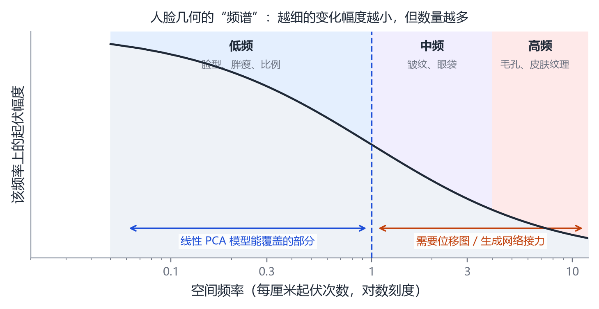
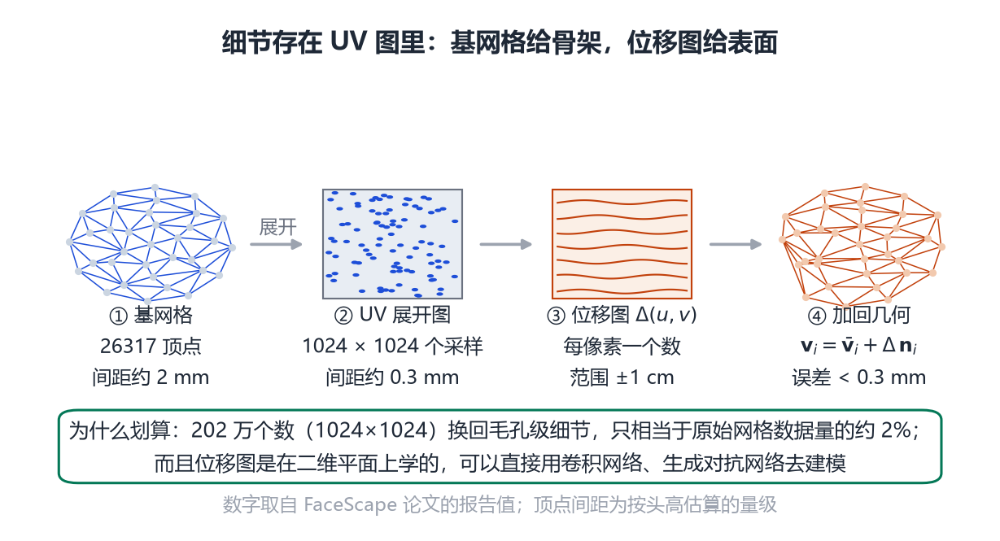
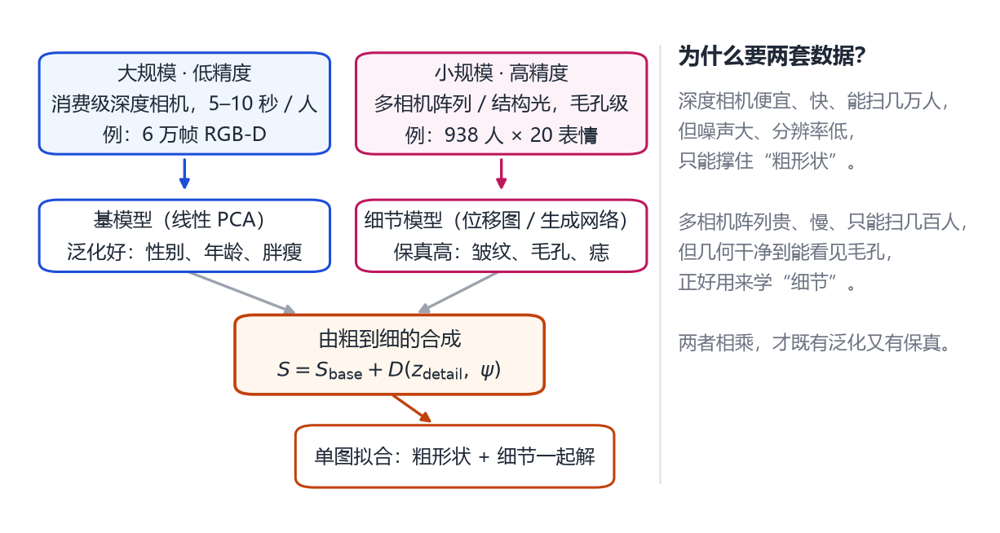
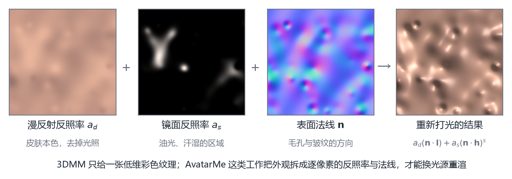

# 第 3 章 高保真人脸：细节、纹理与身份

> **本章导读**：第 1、2 章的两个模型，顶点数分别只有几万和 5023。它们能表示“这是谁”“什么表情”，却始终画不出法令纹里的一道沟、鼻翼上的一颗痣。这一章讲研究者怎么把丢掉的东西一层层补回来：先用“频率”这把尺子说清到底丢了什么，再看两条数据路线（大规模低精度 vs 小规模高精度）、一块被忽视的领域（纹理与反射率），最后讲评估——为什么论文里的“误差 1 毫米”常常不能直接比较。

## 3.1 线性模型到底丢了什么

一张脸上的起伏可以按“每隔多远重复一次”来分类，这个尺度叫**空间频率**；线性 PCA 模型按方差排序，天然只保留了低频那一头，于是细节全丢。这一节要把“丢了多少、丢在哪个频段”说清楚。

整体脸型的起伏很慢，跨越十几厘米才一个周期，是低频；法令纹、抬头纹的间距在毫米到厘米之间，是中频；毛孔、皮肤纹理的周期不到一毫米，是高频。

<figure class="fig">

<figcaption><b>图 3-1</b>　人脸几何的频谱示意。越往右频率越高，单个起伏的幅度越小，但数量急剧增多。线性 PCA 模型主要覆盖左侧一段；中高频必须靠位移图、生成网络或纹理来补。</figcaption>
</figure>

图 3-1 是一条示意曲线，不是实测数据，但它反映了真实规律：**幅度随频率下降，数量随频率上升**。低频的起伏少而大（决定脸型），高频的起伏多而小（决定质感）。

现在回想 PCA 在做什么。它按“方差从大到小”排序，前几个主成分对应方差最大的方向——也就是低频的大幅度变化。等你取到第 100 个主成分时，剩下的方差已经很小了，而这些“小方差方向”里，混着大量高频细节。

这就解释了一个反直觉的现象：**用 300 个主成分拟合一张脸，几何误差可以低到零点几毫米，但看起来仍然“不像真人”**。因为误差的平均值被低频主导，而人眼对中频的皱纹极其敏感。误差小 ≠ 观感对，这是高保真人脸的第一个坑。

给一个具体的量级对比。以头高 24 厘米估算，300 个主成分能表达的细节尺度大致在 5 毫米以上；法向皱纹的宽度 1 到 2 毫米，深度 0.2 到 0.5 毫米；毛孔直径 0.05 毫米量级。也就是说，主成分能画出“脸的形状”，画不出“皮肤的质地”——后者差了至少一个数量级。

更麻烦的是，线性基连“皱纹该怎么长”这件事都学不到。皱纹不是随机的凹凸，它跟表情强相关：笑的时候法令纹从鼻翼延伸到嘴角，皱眉的时候是眉间的竖纹。这种“随动作出现、随动作消失”的结构，用一组固定的基向量加权重是表达不出来的——除非你为每个表情单独学一套基，那就回到了第 1 章双线性模型的老路。

所以补细节这件事，本质上要回答两个问题：**细节放在哪里存**（表示），以及**细节怎么随表情变**（驱动）。这一章的结构就是按这两问展开的。

### 3.1.1 一个尺度估算

用具体数字感受一下“一毫米”到底意味着什么。按成年人头高 24 厘米、周向约 55 厘米估算，26317 个顶点大致均匀分布在约 1300 平方厘米的皮肤上，平均每个顶点占 0.5 平方毫米，相当于边长 0.7 毫米的小方格。而一块 1024 × 1024 的 UV 图对应同样的皮肤面积，每个像素只占 0.0012 平方毫米，间距约 0.035 毫米。两者相差约 20 倍，这就是“网格只能到毫米、位移图能到丝”的算术来源。

这个估算也解释了为什么“拓扑加密”不是好办法：把顶点数从 2.6 万提到 100 万，网格的存储与计算会涨 40 倍，而每顶点仍然需要存一个三维坐标；位移图则只需要存一个标量，且天然适合卷积。在“细节”这件事上，二维标量场的性价比远高于三维顶点。

先把这一章的任务定义写清楚。

- **输入**：一张或多张人脸图像，可选的粗略三维先验（比如第 2 章的模型拟合结果）。
- **输出**：两层几何（低频骨架 + 中高频细节）与一套外观参数（反照率、镜面强度、法线），最好还带绝对尺度。
- **评价**：几何层看累积误差曲线与法向一致性；外观层看换光源重渲后的稳定性；应用层看“近景是否穿帮”“尺寸是否能用于定制”。

所以，线性模型丢的不是“随机的噪声”，而是有结构的、与表情强相关的中高频；补它必须同时解决“存哪儿”和“怎么动”。

## 3.2 两条数据路线：FaceVerse 与 FaceScape

补细节需要数据，而高精度人脸数据有个天然的矛盾：扫得细的扫不快，扫得快的扫不细。这一节看两个工作如何用相反的策略绕开这个矛盾。

多相机阵列加结构光可以扫出毛孔级几何，但一套设备几十万，一个人要站进去几秒到几十秒不能动，一天扫不了多少人。消费级深度相机（比如结构光模组）便宜、快、五到十秒一个人，但噪声大、分辨率低，扫出来的脸像蒙了一层砂纸。

2019 年之后，两个工作给出了几乎相反但都有效的答案。

**FaceScape：把“细”做到极致。** [@zhu2020facescape] 用多相机系统采集了 938 位受试者、每人 20 个指定表情，共 18760 个带纹理的三维人脸，几何细到毛孔级。他们做了一件关键的工程：把所有扫描**拓扑统一**——用一个公共的基网格去非刚性配准每一张扫描，于是每张脸都有相同的 26317 个顶点和相同的连接关系。统一拓扑之后，粗糙形状可以用双线性模型表示，而基网格表达不了的中高频，则存成 UV 空间里的**位移图**（每个像素一个沿法线的偏移量）。

这套“基网格 + 位移图”的两层表示非常高效：论文报告，它只占原始网格数据量的约 2%，而平均绝对误差小于 0.3 毫米 [@zhu2020facescape]。换句话说，用五十分之一的数据，换回几乎一样的几何。

<figure class="fig">

<figcaption><b>图 3-2</b>　两层表示的数据流：基网格提供骨架与对应关系，UV 位移图提供中高频。位移图在二维平面上学，作用到三维时沿法线挤出，于是同一张图能自动适配局部朝向。</figcaption>
</figure>

写成公式更清楚。设基网格的第 $i$ 个顶点是 $\bar{\mathbf{v}}_i$，它在 UV 展开图上的坐标是 $(u_i,v_i)$，法线是 $\mathbf{n}_i$，则最终顶点为

$$
\mathbf{v}_i=\bar{\mathbf{v}}_i+\sum_k w_k\,\mathbf{b}_{k,i}+\Delta(u_i,v_i)\,\mathbf{n}_i ,
\tag{3.1}
$$

逐项读法：

- $\bar{\mathbf{v}}_i\in\mathbb{R}^3$ 是基网格顶点，$i=1,\dots,26317$。
- $\sum_k w_k\mathbf{b}_{k,i}$ 是双线性模型的加权形状，$w_k$ 是身份与表情系数的组合权重，$\mathbf{b}_{k,i}$ 是第 $k$ 个基在第 $i$ 个顶点上的三维位移。这一项负责低频。
- $\Delta(u_i,v_i)\in\mathbb{R}$ 是位移图在对应像素上的取值，单位是米，FaceScape 报告的量级是毫米以下。
- $\mathbf{n}_i$ 是该顶点的法线，单位向量。乘上去之后，位移总是沿表面法向“鼓起”或“凹下”，这与皱纹的物理形态一致。

一个位数感：UV 图 1024 × 1024，有约 100 万个采样点；基网格只有 26317 个顶点。也就是说，一个顶点平均对应 40 个像素，位移图能表达的细节比网格细得多。这也是为什么“误差 0.3 毫米”能成立——0.3 毫米已经小于多数皱纹的深度。

**FaceVerse：把“广”做到极致。** [@feng2022faceverse] 走的是另一条路。他们用消费级深度相机采集了约 6 万帧融合后的 RGB-D 人脸点云，覆盖东亚人群的不同性别与年龄；另外用多相机系统补采了 2000 个高保真头模。前者保证“泛化”——模型见过各种各样的人；后者保证“保真”——模型知道细节长什么样。

结构上，他们做了一个**由粗到细**的两段式：粗模型是从 6 万帧里学的线性 PCA 基，负责给出一张大致正确的脸；细模型是一个条件 StyleGAN，输入是粗模型展开的 UV 图，输出是加了细节的几何与纹理图。因为是生成式模型，细节是可以“调”的——换一个噪声向量，同一个人的痣和皱纹分布会变，但基本脸型不变。这一点比“一次性预测一张位移图”更进一步。

<figure class="fig">

<figcaption><b>图 3-3</b>　由粗到细的两段式。左侧用便宜设备换覆盖度，右侧用昂贵设备换保真度，最后在参数层面合并。这也是 FaceVerse 与 FaceScape 共享的骨架。</figcaption>
</figure>

两条路线的差别，其实是对“数据不够”这一现实的两种应对：FaceScape 选择“少而精”，靠统一的拓扑与位移图把信息压到极致；FaceVerse 选择“多而杂 + 少而精”，用大规模数据撑泛化、用小规模高精数据撑细节。

而它们的共同点是：**都没有放弃参数化模型**。细节再细，也是挂在一个低维的“骨架”上的。这个骨架提供了对应关系、提供了可驱动性，也提供了“这是同一个人”的一致性。

要提醒一句数据偏差：这两套数据的受试者都以某一地区的年轻成年人为主，论文给出的统计是人数与表情数，并没有给出完整的年龄、族裔分布。用到老年人或儿童身上时，皱纹的走向与深度都会偏差——“皱纹模板”本质上是一群特定人的平均。

另两个偏差更隐蔽。一是**表情清单的偏**：FaceScape 每人 20 个指定表情，这 20 个是采集者认为“有代表性”的，不在这张清单上的表情（吹口哨、咀嚼、吐舌）依然只能由插值拼出来。二是**基网格的偏**：统一拓扑意味着所有人都被拉到同一个 26317 顶点的模板上，脸型越偏离模板（特别宽或特别窄），配准时的拉伸就越大，细节会被“拉平”。

### 3.2.1 为什么细节必须“可驱动”

一个容易被忽略的要求：细节不只是要“有”，还要“跟着动”。

如果一个人在静态扫描上有一道很深的法令纹，你把这张静态网格贴到一个会笑的表情上，笑容一大，法令纹的位置就错了——因为真实的法令纹是随着嘴角拉开而加深、延长的。静态位移图会把皱纹“钉”在原地，结果就是脸在动、纹不动，观感立刻崩掉。

更细一层：皱纹有两类。**永久性纹路**（额头的横纹、眼角的鱼尾）在静止时也在；**表情纹**（笑时的法令纹、皱眉时的眉间竖纹）只在动作时出现。把两类混在一张静态图里，等于把表情纹当成了这个人的固定特征。

FaceScape 的做法是学“**表情相关的动态细节**”：用神经网络从大量“同一个人 × 多个表情”的配对里，学出“给定表情，细节图应该怎么变”。DECA（第 2 章）的做法更轻量：把细节写成“身份码 + 表情参数”的函数。写成式子就是

$$
\Delta=\mathcal{D}\big(\mathbf{z}_{\text{id}},\ \boldsymbol{\psi},\ \boldsymbol{\theta}_{\text{jaw}}\big),
\tag{3.2}
$$

其中 $\mathbf{z}_{\text{id}}$ 是身份细节码（DECA 里是 128 维），$\boldsymbol{\psi}$ 是表情参数，$\boldsymbol{\theta}_{\text{jaw}}$ 是下颌张开角，$\mathcal{D}$ 是一个卷积解码器，输出一张与 UV 同尺寸的位移图。三个输入各管一件事：身份码管“这个人的痣和永久纹路”，表情管“现在该在哪加深”，下颌角管“嘴张多大”。

DECA 还专门设计了一个损失来防止两个输入串味：同一个人两张不同表情的照片，把细节码互换后重建，结果应该仍然像原来那两张。如果网络把“笑出来的法令纹”记进了身份码，互换之后就会露馅。这个损失逼着网络把静态特征与动态皱纹分开。

所以，细节的表示与细节的驱动是两件必须一起做的事：只补表示，脸会“动起来像贴了张皮”；只补驱动，皱纹会“长在错误的地方”。

## 3.3 纹理与反射率：被忽视的一半

到此为止我们一直在说几何。但一张渲染图看起来真不真，一半以上取决于**外观**：肤色、油光、血色、毛孔的颜色。这一节讲外观为什么也不能用一张贴图打发。

传统的 3DMM 只有一张**反照率贴图**（albedo）——本质上是“把照片上的颜色扒下来贴到模型上”。这样做有两个问题：一是阴影被“烤”进了颜色里，换个光源重渲，阴影还在原地；二是没有镜面反射，皮肤看起来像塑料。

2020 年的 **AvatarMe** [@lattas2020avatarme] 把外观拆成了四张图：漫反射反照率、漫反射法线、镜面反照率、镜面法线。这四张图合起来近似一个空间变化的 BRDF（bidirectional reflectance distribution function，双向反射分布函数，描述“光从某方向来、往某方向去”时有多少能量被反射），也就是“每个点多亮、多光滑、朝哪偏”。有了它，就能在任意环境光下重新渲染，还能做出“鼻尖一点高光、额头一片油光”这种细节。

<figure class="fig">

<figcaption><b>图 3-4</b>　把外观拆成逐像素的分量（示意图）。左起：漫反射反照率、镜面反照率、表面法线；右端是按“漫反射 + 镜面高光”重新打光的结果。3DMM 只有最左那一张，所以无法重打光。</figcaption>
</figure>

为什么四张而不是一张？因为皮肤的反射由两部分叠加：一部分是光进入皮肤、散射若干次后再出来，带上了皮肤本身的颜色（漫反射）；另一部分是光在表面直接反射，不带颜色，只反映表面的朝向与光滑度（镜面反射）。前者告诉你“这块皮肤是什么颜色”，后者告诉你“这块皮肤有多油”。把两者混在一张贴图里，就没法只改其中一个。

论文里强调的成果是：从一张低分辨率野外照片，重建出 4K × 6K 分辨率、可直接进渲染器的三维人脸 [@lattas2020avatarme]。这个“4K × 6K”不是网格分辨率，是纹理分辨率——换句话说，几何还是那个几何，但皮肤被画到了能看清毛孔的精度。4K × 6K 约 2400 万像素，而 26317 个顶点只有 26317 个采样点，相差三个数量级。

后续的 **AvatarMe++** [@lattas2021avatarmepp] 把这件事做得更彻底：不只是反照率和法线，而是完整的 BRDF，并且配套一个考虑了自遮挡与次表面散射近似的可微渲染器。次表面散射很重要——真实皮肤不是不透明的，光会渗进去一点再出来，所以耳朵边缘、鼻翼两侧会有一种“透”的红，这是纯漫反射模型永远做不出来的。

这一节想说的道理是：**参数化的对象不只是形状**。肤色、油光、法线都可以被参数化——AvatarMe 用 PCA 建了反照率与法线的基，FaceVerse 用 StyleGAN 建了纹理的潜空间。识别一个人，纹理的贡献可能比几何更大；这一点在 3.4 节会再碰到。

工程上判断“光有没有被烤进去”，有个便宜的办法：把重建结果放在两个完全不同的环境光下渲染。如果两次的阴影形状一样、只是亮度变了，就说明阴影在反照率里；如果阴影方向随光变，才算真的分开了。另一个检查是看耳朵和鼻翼——次表面散射没建模时，这两处会显得发灰、发硬，而有散射模型时会有一种“透”的红。

所以，如果只把“人脸参数化”理解成“顶点坐标的参数化”，那就漏掉了一半；另一半是“每个点怎么反光”。

## 3.4 身份与度量：不只是“看着像”

到这里，我们已经能让一张脸“又细又真”。但还有一个更基本的问题没回答：这张脸的尺寸对吗？这一节说明为什么“尺寸”是一个独立的、而且更难的目标。

单张照片里，一个鼻子看起来多高，同时取决于三件事：鼻子本身多高、相机离脸多远、镜头焦距多长。这三者从一张图里无法分开——第 1 章提过，在自拍距离（大约半米）下，透视与正交投影的差别大约相当于瞳距的 6% [@egger2020survey]。百分之六听起来不多，但它会直接变成“鼻子高了 2 毫米还是矮了 2 毫米”的错误。

对“看着像”的应用，这无所谓。但对三类应用，它是致命的：

- **医疗与人类学**：需要“下颌宽度是 132 毫米”这种绝对数，而不是“比例尺”。
- **定制穿戴**：眼镜、口罩、头盔要按真实尺寸做，差 3 毫米就戴不上。
- **三维人脸识别**：需要“同一个人在不同照片里重建出的形状彼此接近”，而不同人之间拉开距离。

MICA [@ziqq2022mica] 是这条线上被引用最多的代表。它把“度量准确”（metrically accurate）直接写进标题，意思是：不只要形状对，还要尺寸对。这个目标的难点在于，它要求模型同时做好两件平常被分开处理的事：一是从像素里抽出足够强的身份信息（不能只靠 68 个关键点，那些点几乎不携带“脸有多宽”的信息），二是把这个身份信息映射到一个有绝对尺度的形状空间里，而不是每次重新猜尺度。

这里有一条经常被忽略的因果链：**你用什么样的损失，就会得到什么样的脸**。如果只用关键点重投影误差训练，网络会倾向于输出“平均脸”——因为平均脸的关键点位置最安全，误差最小。要让它敢于输出有棱角的、有个人特征的脸，就必须加一个“识别网络说这俩是同一个人”的损失。这也是第 2 章 EMOCA 的思路（用情绪网络的特征当监督）在身份问题上的翻版：**找一个已经学会了“什么重要”的网络，向它看齐**。

最后还有一个实用细节：度量模型的训练数据必须带真实尺度，也就是扫描时就记录“这个头有多少毫米”。很多公开数据集为了隐私把脸缩放到了统一尺寸，这种数据训不出带尺度的模型——它连“米”是什么都不知道。

还有一点值得提醒：身份不只存在于几何里。FaceVerse 这类工作之所以要同时建模纹理，就是因为纹理（肤色、痣、眉形、胡须）对“这是谁”的贡献，往往大于几毫米的形状差异。只用几何做识别，等于丢掉了一半信息。

所以，度量精度是一个被“看着像”掩盖的维度；它需要的不只是更好的网络，还需要一个带绝对尺度的形状空间和一种能感知身份损失的训练方式。

## 3.5 神经参数化头模型：跳出拓扑

前面所有方法都建立在一个共同前提上：有一张固定拓扑的模板网格。这带来了对应、带来了可驱动性，也带来了天花板：你永远画不出比顶点间距更细的东西，也永远长不出头发和牙齿。这一节看一批工作如何拆这个前提，以及拆完之后的代偿是什么。

2023 年之后，最有代表性的是 **NPHM**（第 2 章已介绍其结构）[@garbin2023nphm]。它的关键设计在于“局部场集合”：不是一个全局的神经场包住整个头，而是在面部的多个锚点周围各放一个小场，每个小场只负责一小块区域。这样做的好处是细节容量随锚点数量增长，而不是被一个全局网络的能力卡住。配合他们自建的 5200 多帧高精度扫描（255 个身份，平均每帧约 350 万个面），模型能重建出接近扫描精度的皱纹与皮肤起伏 [@garbin2023nphm]。

**MonoNPHM** [@garbin2024mononphm] 把同一个表示搬到单目视频上：输入一段普通 RGB 视频，通过基于 SDF 的可微体渲染，把几何、表情、外观一起解出来。论文里自拍了 20 段 Kinect 序列做评测，并强调这一步的意义是“让神经参数化模型变得易得”——不再需要专用扫描设备。

但这不等于线性模型要退场。两者分工其实很清楚：

| | 线性参数化（FLAME 类） | 神经参数化（NPHM 类） |
|---|---|---|
| 输出形式 | 直接是网格 | 隐式场，要等值面提取 |
| 驱动方式 | 改参数，实时 | 改潜码，较慢 |
| 细节上限 | 受拓扑限制 | 理论上无限 |
| 工程成本 | 能进引擎、能上手机 | 需要 GPU、需要额外处理 |
| 可控性 | 参数有明确含义 | 潜码不可读，靠重定向 |

所以现实系统常见两种搭配：用线性模型做“实时驱动层”，用神经模型做“离线高清生成层”，两者通过参数或对应关系互通。这个“两层”结构在工业界已经相当普遍：直播用前者，电影特写用后者。

一个容易踩的坑是：把隐式场转成网格时，等值面提取的网格密度是人为选的。选得粗，细节全丢；选得细，面片数暴涨，下游引擎带不动。也就是说，“神经表示不受拓扑限制”这句话在工程上不完全成立——拓扑的约束只是从“训练时”挪到了“导出时”。

所以，神经参数化拆掉的是“固定拓扑”这堵墙，换来的代价是“需要 GPU、输出需要转换、潜码不可读”；三个代偿里，最后一项最难补。

## 3.6 评估：为什么“误差 1 毫米”不能直接比

高保真人脸这个领域，论文里的数字最容易让人误读。同一个模型，换一种对齐方式、换一个测试集，平均误差可以相差一倍。这一节把常见的坑列清，并给出一个更可靠的读法。

先把误差定义写开，后面讨论对齐才有依据。设预测顶点为 $\hat{\mathbf{v}}_i$，真值为 $\mathbf{v}_i$，共 $N$ 个，则

$$
E=\frac{1}{N}\sum_{i=1}^{N}\big\|\,T(\hat{\mathbf{v}}_i)-\mathbf{v}_i\,\big\|_2 ,
\tag{3.3}
$$

其中 $T$ 是“对齐变换”。这一步看似无关紧要，实际上是所有争议的来源：

- $T$ 取“平移 + 旋转”（刚性对齐）时，尺度差异算作误差；
- $T$ 取“平移 + 旋转 + 缩放”（相似变换）时，尺度被抹掉；
- $T$ 取恒等时，连整体位置都算误差——这种数字通常很大，只用于“全自动无对齐”系统的自评。

注意 $E$ 的单位是毫米，但它的含义取决于 $T$。同一对网格，刚性对齐下可能是 1.2 毫米，相似变换下只剩 0.9 毫米——两个数都是“对的”，只是回答的问题不同。

**坑一：对齐协议不同。** 论文里往往只写“平均顶点误差 X 毫米”，不写对齐方式。比拼两个方法前先看它们是否用了同一个协议；没写就直接比较，等于拿厘米和英寸比。

**坑二：尺度归一化。** 很多工作先把重建结果缩放到与真值相同的尺寸，再算误差。这会把“尺寸猜错”这个错误完全抹掉——而尺寸恰恰是最难的那部分（见 3.4）。如果你的应用是定制头盔，这个数字对你毫无意义。

**坑三：测试集同源。** 如果训练集和测试集来自同一台扫描仪、同一个配准流程、同一批受试者，那么误差会系统性偏低。这就是为什么 FLAME 的作者要特意在“不在训练集里的 BU-3DFE 中性扫描”上做身份评估 [@li2017flame]。

**坑四：只看关键点。** 关键点误差小，只说明“眼睛鼻子嘴在大概位置”，完全不能说明中频细节对不对。一道浅一半的法令纹，关键点误差几乎不变。

**坑五：用渲染图验收。** 这是最隐蔽的。渲染图的真实感大部分来自纹理与光照，几何错了一点，纹理能盖住。看到一张“很好看”的渲染图，先问一句：把纹理换成灰色陶土，它还像吗？

那么该怎么看数字？比较推荐的做法是看**累积误差曲线**：横轴是顶点误差阈值，纵轴是“误差小于该阈值的顶点占比”。它比单一平均值信息量大很多。举个例子，FLAME 论文里的数字是：在相同参数量下，FLAME 有 74% 的顶点误差小于 0.5 毫米，而 BFM 是 69%、FaceWarehouse 是 67%；用上全部主成分后，FLAME 是 94%，BFM 是 92% [@li2017flame]。

几何指标之外，高保真领域还大量依赖**主观评测**：把两个结果并排给被试看，问“哪个更像真人”，统计偏好比例（常叫 two-alternative forced choice，二选一强制选择）；或者让被试打 1 到 5 分。主观评测的问题是可重复性差、人数量少，但它的好处是能捕捉几何指标完全看不见的东西——皮肤质感、皱纹方向、眼神。一个务实的做法是两套都报：客观指标证明“没变差”，主观评测证明“看起来更好”。

这几个数字的绝对值都不大，差距也只有几个百分点。但它说明了两件事：一是同类模型之间的差距本来就不悬殊，二是要判断“谁更好”，必须把数据、对齐、参数量都对齐了才有意义。读到“我们的误差降低了 30%”这种说法，第一反应应该是问：分母是什么？

所以，评估的问题不是“哪个数字更小”，而是“这个数字在回答哪个问题”；先在三个问题上对齐，再谈比较。

## 3.7 失败模式与横向对比

高保真这条路线的失败很有特征：几何往往“大体对”，但错在最能暴露假的地方。这一节把常见失败收成清单，再把几个代表方法放在一张表里。

**失败一：位移超界。** 位移图的范围是有限的（DECA 是 $\pm1$ 厘米）。遇到极深的法令纹、刀疤、酒窝，网络只能把值截到边界，结果是一条“被压平的沟”——形状还在，深度不对。补救办法是提高振幅上限并重训，或在局部叠一层更高频的残差。

**失败二：UV 接缝。** 位移图定义在展开的平面上，脸的中线、发际线、耳后这些地方在 UV 上是“切口”。训练不充分时，切口两侧的位移不连续，渲染出来就是一道细线。这类错误在静态图上几乎看不出，一转头就现形。

**失败三：遮挡与头发。** 头发遮住额头时，网络对那一块没有任何证据，只能靠先验填。填出来的额头往往太平、太干净，而真实头发边缘有碎发、有阴影。眼镜同理：镜片反光会被当成皮肤的高光。

**失败四：把阴影烤进颜色。** 这是传统 3DMM 的通病，也是最好识别的：把重建结果放到另一个光源下，如果原来脸的左脸阴影“跟着脸走”，说明阴影被写进了反照率。

**失败五：极端表情下的细节错位。** 微笑到最大时，法令纹应该延伸到嘴角外侧；如果只学了“静态皱纹”，纹路会停在原地，于是脸在动、纹不动。

**失败六：尺度漂移。** 相似变换对齐下的数字很好看，但绝对尺寸可能错了 5%。对渲染无影响，对定制穿戴是致命的。

**表 3-1**　五个代表方法的改动与代价。

| 方法 | 主要改动 | 得到什么 | 代价 |
|---|---|---|---|
| FaceScape | 统一拓扑 + UV 位移图 | 毛孔级几何，数据量降到 2%，误差 < 0.3 毫米 | 需要专用多相机阵列；938 人仍有限 |
| FaceVerse | 消费级 RGB-D 大规模采集 + 条件 StyleGAN 细节 | 覆盖面广，细节可采样 | 生成式细节不可控，可能“编”出痣 |
| DECA | 在 FLAME 上叠 UV 位移与 128 维细节码 | 单图即可出中频细节，可动画 | 位移幅度受限；无口腔；依赖 FLAME 拓扑 |
| AvatarMe | 四张逐像素图近似 BRDF | 可换光源重渲，4K × 6K 纹理 | 需要大量多光照数据；单图重建不稳定 |
| NPHM | 神经 SDF + 局部场 + 变形场 | 拓扑自由，细节上限高 | 需 GPU；导出网格时拓扑约束又回来了 |

表里有一条隐含的递进：从“统一拓扑”到“生成式细节”到“隐式场”，每一代都在放宽对“模板”的依赖，但每一代也都把成本从“采集”转移到“算力”。选择哪一种，取决于你的瓶颈是设备、是算力，还是可控性。

所以，高保真的关键不是“把顶点加密”，而是“把细节放到一个能随表情变化、又不超出幅度限制的表示里”；表 3-1 的五个方法，本质上是在回答“放在哪里”。下一步的问题随之而来：这样的细节能不能被稳定地“驱动”起来，这就进入第 4 章。

## 本章小结

- 线性模型丢的是**中高频**：幅度小、数量多、方差小，所以 PCA 把它们排在最后，但它们恰恰决定了“像不像真人”。
- 误差小 ≠ 观感对：平均值被低频主导，而人眼对皱纹极其敏感。
- 补细节需要两样东西：一个能存细节的表示（位移图、UV 图、神经场），以及一个能把细节与表情关联起来的机制；只做前者，脸会“动起来像贴了张皮”。
- 两条数据路线：FaceScape 用 938 人 × 20 表情的 18760 个扫描把“细”做到极致（两层表示只占 2% 数据量，误差 < 0.3 毫米）；FaceVerse 用 6 万帧 RGB-D + 2000 个高保真头模把“广”做到极致。
- 外观不只是颜色：AvatarMe 把皮肤拆成漫反射、镜面反照率与法线，才能换光源重渲；AvatarMe++ 进一步做成 BRDF 并考虑次表面散射。
- 度量精度是另一个维度：形状、距离、焦距三重耦合，靠关键点无法解开；MICA 这类工作把“尺寸对”当成首要目标。
- 神经参数化（NPHM、MonoNPHM）换掉了固定拓扑，但没有换掉“身份潜码 + 表情潜码”这个结构；拓扑约束只是从训练时挪到了导出时。
- 六类典型失败：位移超界、UV 接缝、遮挡与头发、阴影烤进颜色、极端表情下细节错位、尺度漂移。
- 读数字前先问三句：什么数据集？怎么对齐？尺度归一化了吗？

## 思考题

1. 一张脸的扫描有 20 万个顶点，用 26317 顶点的基网格 + 位移图表示，误差小于 0.3 毫米。这 0.3 毫米大概相当于什么尺度的差异？（提示：一根头发大约 0.07 毫米）
2. 如果只用关键点误差训练模型，为什么会得到“平均脸”？用一句关于梯度的话解释。
3. 把重建结果缩放到与真值同尺寸再算误差，会掩盖什么错误？举一个实际会出问题的场景。
4. NPHM 的输出是隐式场而不是网格。如果要把它接到一个现成的游戏引擎里，你需要多做哪几步？每一步会损失什么？
5. 表 3-1 里 FaceVerse 的细节是“生成”的。如果一个应用要求“这颗痣必须在原来那个位置”，你会怎么改这条管线？
