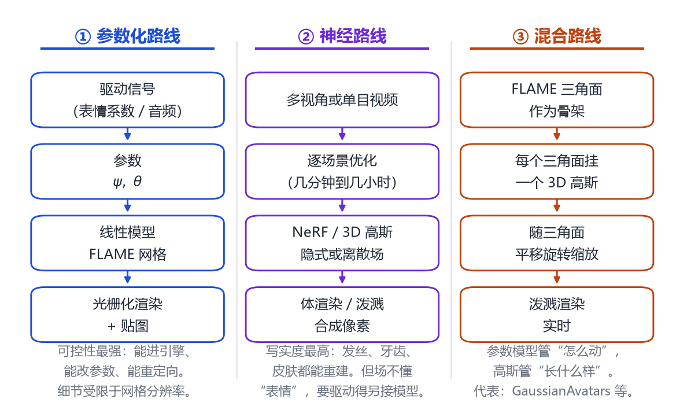
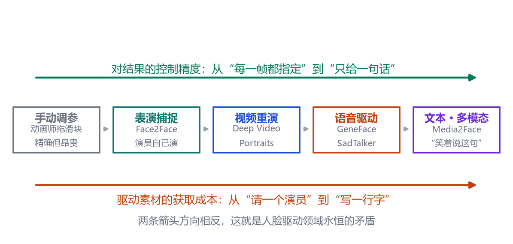
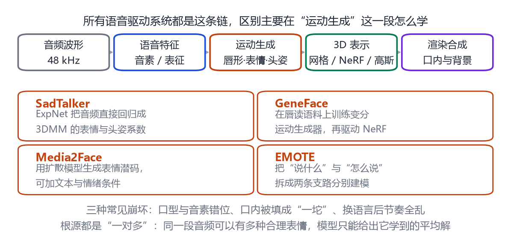
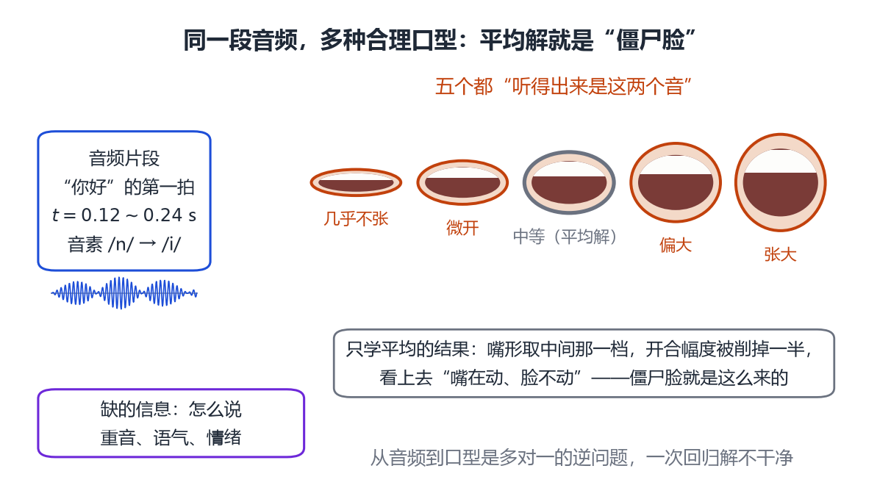

# 第 4 章 人脸驱动与神经头像

> **本章导读**：前面三章讲的是“怎么造一张脸”。这一章讲“怎么让它动起来”：让照片里的人跟你做同样的表情，让一张静止的肖像按你写的句子说话，让一段视频里的人改说另一种语言。技术路线分成三条——参数化、神经渲染、以及两者的混血；而所有方法的共同难题都是一句话：**你给的驱动信号越简单，能控制的东西就越少**。读完这一章，你应该能对着一个“AI 数字人”产品，说出它大概用了哪条路线、卡在哪一步。

## 4.1 三条路线，两种矛盾

给定一个目标人物，要让他“动起来”，问题可以拆成两半：用什么表示这个人，以及用什么信号驱动他。这一节先把这两半的选项摆开，因为后面所有方法都是这两半的组合。

第一半有三条路线。

**参数化路线**是最省事的一条。既然第 2 章的 FLAME 已经把脸拆成“身份 + 表情 + 姿态”，那么驱动就等于“给出另一组表情参数”。模型负责几何，贴图负责外观，光栅化负责成像。它的优点是可控性极强——参数可以导出、可以混合、可以重定向到另一个角色；缺点是上限被网格分辨率和贴图分辨率锁死。

**神经路线**放弃参数，直接对“这个人”做逐场景优化：用多视角视频或单目视频，训一个 NeRF 或一组三维高斯，把外观“背”下来。写实度可以高到分不清真假，但它本身不懂“表情”是什么——想让它动，还是得外挂一个参数模型来提供变形场。

**混合路线**是近两年的主流：把神经表示**绑在**参数模型上。三角面怎么动，挂在它上面的高斯就怎么动。这样既有参数级的控制，又有像素级的写实。

<figure class="fig">

<figcaption><b>图 4-1</b>　三条技术路线。注意第二、三条的差别不在“用不用神经网络”，而在“动不动得起来”——纯神经表示要先解决控制问题，混合表示则把控制权直接交给了参数模型。</figcaption>
</figure>

第二半是驱动信号。这就是本章真正的主题，也是整个领域最本质的矛盾。

<figure class="fig">

<figcaption><b>图 4-2</b>　驱动信号的演化谱。越往右，素材越容易获得，但你对结果的控制越弱。两条箭头方向相反，这个矛盾至今没有被真正解决。</figcaption>
</figure>

图 4-2 这条谱值得多看两眼。左边是动画师手动拖滑块：每一帧的每个参数都由人指定，控制精度最高，但成本也最高，一分钟动画可能要几天。往右走，演员自己演（表演捕捉），信号变“自然”了，但你要接受演员的表演；再往右，拿一段现成视频当驱动源（视频重演），连演员都不需要了，但视频里有什么你才能用什么；再往右，只给声音；最右边，只给一句话。

每往右一步，素材成本降一个数量级，可控性也降一个数量级。**所有“AI 数字人”产品的差异，很大程度上就是这个谱上取的位置不同。**

把任务定义写清楚，后面每一节都可以对着检查。

- **输入**：一个目标人物（一张照片、一段视频，或一组建模参数），加一个驱动信号（参数序列、源视频、音频、文本）。
- **输出**：一段图像序列，通常是 $512\times512$ 或 $1024\times1024$ 的帧，帧率 25 或 30 fps。
- **评价**：身份保持（和本人像不像）、唇音同步（口型和声音对不对得上）、时序稳定（有没有抖、有没有跳）、画质（清晰度、伪影）、可控性（能不能改表情强度、头姿、眼神）。
- **硬约束**：实时性。直播场景要求端到端延迟在几百毫秒内，这一个要求常常直接决定技术选型。

用公式把“参数化驱动”写下来，后面的方法都可以看作它的变体或替代：

$$
\mathbf{I}_t=R\Big(M\big(\boldsymbol{\beta},\ \boldsymbol{\psi}_t,\ \boldsymbol{\theta}_t\big),\,\mathbf{c}\Big),
\qquad \boldsymbol{\psi}_t=E(\mathbf{x}_t),
\tag{4.1}
$$

- $\mathbf{x}_t$ 是第 $t$ 帧的驱动信号（可以是参数、图像、音频特征）。
- $E$ 是“驱动到表情”的映射，输出 $\boldsymbol{\psi}_t$（表情参数）与 $\boldsymbol{\theta}_t$（头姿）。
- $M(\cdot)$ 是第 2 章的参数化模型，输出网格；$R$ 是渲染器，$\mathbf{c}$ 是相机。

这个式子把“驱动”拆成了两件事：**先把信号变成参数，再把参数变成像素**。三条路线的差别就在于第二步用不用参数：参数化路线两步都用参数，神经路线跳过参数，混合路线用参数驱动一个神经表示。

还有一个容易被忽略的工程事实：这三条路线的数据成本差别巨大。参数化路线可以只用几千段带三维标注的视频；纯神经路线需要针对**每个目标人物**单独采集多视角数据（几百到几千帧）；混合路线居中。所以“选哪种”往往不是算法问题，而是“你手上有什么素材”的问题——一次性做十个角色，和为一个明星做一套数字形象，答案完全不同。

所以，选路线本质上是选“控制权放在哪一层”；而控制权的多少，又由驱动信号的信息量决定。

## 4.2 表情与情绪：几何对了还不够

先看一个具体的技术问题：为什么“重建得很准”的脸，看起来却“没有情绪”？这一节说明问题出在损失函数上，而不是几何精度上。

2022 年的 EMOCA 给出了一个很实在的答案 [@danvev2022emoca]。他们检查了当时主流方法的训练损失，发现只有三类：关键点重投影误差（位置对不对）、光度误差（像素像不像）、人脸识别损失（是不是同一个人）。**没有一项在问“表情对不对”**。于是优化器会很自然地找到一个“几何上平均、情绪上模糊”的解——因为微笑的嘴角和面无表情的嘴角，在关键点误差上可能只差几个像素。

他们的补丁是加一条**情绪一致性损失**：拿一个在大规模情绪数据集上训练好的情绪识别网络，把输入图和重建结果的渲染图都送进去，要求两边提取出的特征接近。这一招的本质是**借一个已经学会“什么重要”的网络来做监督**——和第 3 章讲的“用识别特征去约束形状”是同一个套路。

情绪这条线上还有两个值得知道的方向。

一个是 **SPECTRE** [@filntisis2022spectre]。它注意到一个细节：人的表情不只是情绪，还携带**语音信息**——读唇的时候，我们其实是在读表情。所以它把“视觉语音”的感知纳入监督，让重建出来的嘴形在“能读出什么音”这个意义上也是对的。这对语音驱动特别重要：如果重建的嘴形读不出正确的音素，那么用它当训练数据，学出来的说话脸一定口型不对。

另一个是 **EMOTE** [@wu2023emote]。它的标题就点明了思路：“内容与情绪解耦”（content-emotion disentanglement）。同样一句话，可以用平静的语气说，也可以用激动的语气说；嘴形（内容）大体相同，但眉毛、眼角、嘴角的张力（情绪）差别很大。EMOTE 把这两者拆成两条支路，于是你可以“用 A 的情绪说 B 的话”。

为什么情绪这么难？三个原因叠在一起：**标注主观**（同一张脸，不同标注者给出不同情绪标签）、**数据稀少**（大规模情绪数据集多是二维图片，没有三维真值）、**评价困难**（几何误差指标对情绪几乎不敏感，只能靠人来做主观评测）。EMOCA 的论文里就做过这样的实验：让被试看重建结果、判断情绪类别，EMOCA 的一致率明显高于同期方法——而这种“人工打分”恰恰说明，这个任务还没有一个好用的自动指标。

失败模式也很清楚。一是**极端表情**：张嘴到最大、眼睛瞪圆时，线性表情基会失真，嘴角被拉成一条直线。二是**遮挡**：手挡在脸上时，被挡住部分的情绪信号完全丢失，重建结果会“半边有表情、半边没有”。三是**微表情**：0.2 秒的一闪而过，模型采样不到，观众却看得出来。

所以，几何精度与情绪表达是两条独立的轴；想让后者出现，必须在损失里显式地问“表情对不对”。

## 4.3 语音驱动：让一张脸说话

语音驱动说话脸（talking face generation）是人脸驱动里最“产品化”的一支。它的管线极其固定，难点集中在一处：同一段音频可以对应无数种合理口型。

<figure class="fig">

<figcaption><b>图 4-3</b>　语音驱动的通用管线，以及各方法主要改进的位置。可以看到，大家的差异几乎都集中在“运动生成”这一段——因为其余几段已经是成熟工程。</figcaption>
</figure>

管线可以分四段：音频前处理（把波形变成频谱特征）、运动生成（把特征变成表情参数或潜码）、身份渲染（把参数变成这个人的像素）、后处理（补口内、对齐、稳定化）。

为什么第一段要用频谱而不是波形？因为口型与“声音在某个频段有多少能量”相关得多了，与波形的瞬时相位几乎无关。同一句话大声说、小声说、快说、慢说，波形完全不同，频谱形状却很接近。工程上常用的是梅尔频谱（mel-spectrogram，按人耳感知的非线性频率刻度采样的频谱），一段 10 秒音频可以压成几百帧、每帧几十维的矩阵，比原始波形小两个数量级。

先给几个数量级，感受一下“音频到口型”的采样密度。常见做法是 16 kHz 采样、25 毫秒窗、10 毫秒帧移，于是每秒产生 100 帧特征。一段 10 秒的话就是 1000 帧，而每帧的口型都要对上——这意味着模型输出的时间分辨率必须到 10 毫秒级，抖动一帧人眼就能看出“口型迟了”。

难点不在“把音频变成一串数字”，而在**一对多**：同一段音频，可以有无数种合理的口型与表情。你说“你好”的时候可以点头，也可以歪头；可以笑，也可以面无表情。模型如果只学“平均解”，出来的就是一张嘴在动、脸在飘的“僵尸脸”。

<figure class="fig">

<figcaption><b>图 4-4</b>　一对多的示意：同一拍的音频，五种口型都说得通。回归模型倾向于给出中间那个“平均解”，开合幅度被削掉，于是嘴在动、脸不动。灰色标出的是平均解。</figcaption>
</figure>

把这个“一对多”写成概率形式，才知道该往哪里加东西：

$$
p\big(\boldsymbol{\psi}_{1:T}\mid \mathbf{x}_{1:T}\big)
=\int p\big(\boldsymbol{\psi}_{1:T}\mid \mathbf{x}_{1:T},\mathbf{z}\big)\,p(\mathbf{z})\,d\mathbf{z},
\tag{4.2}
$$

其中 $\mathbf{x}_{1:T}$ 是整段音频特征，$\boldsymbol{\psi}_{1:T}$ 是整段表情参数，$\mathbf{z}$ 是一个**潜变量**，代表“怎么说”——语气、重音、情绪、说话人的习惯。积分的意思是：把所有可能的“说法”都考虑进去，得到的是一个分布，而不是一个点。

这就解释了为什么后来的方法都要引入随机性：**点估计只能给平均值，采样才能给多样性。** 扩散模型、变分自编码器、GAN，本质上都在给这个积分找一个可计算的近似。

**SadTalker** [@zhang2023sadtalker] 的思路是“别让网络直接从音频画像素，让它先输出三维参数”。他们设计了一个 ExpNet，从音频回归 3DMM 的表情系数，再用一个三维感知的渲染器把参数变成图。这样做的好处是：中间的三维系数是**可解释、可复用**的——同一组系数可以驱动别的角色，也可以手工微调。论文里特别强调，ExpNet 是通过“蒸馏”学出来的：先有三维重建得到的系数作为老师，再让音频去预测它 [@zhang2023sadtalker]。

**GeneFace** [@ye2023geneface] 盯的是另一个问题：泛化。早期基于 NeRF 的说话脸在训练集内的音频上很好看，换一段没见过的音频（比如另一种语言、另一种语速）就崩。原因是训练数据太少，模型把“这段音频对应这个口型”死记硬背下来了。GeneFace 的办法是两步：先在一个**大规模唇读语料**上训练一个变分运动生成器（唇读数据里音频与嘴形是天然配对的，量大且多样），再针对目标人物做域自适应校正；最后用一个以面部动作为条件的 NeRF 渲染。他们还专门设计了“头部感知的躯干 NeRF”，解决头和脖子接缝处的撕裂感 [@ye2023geneface]。

**Media2Face** [@peng2024media2face] 把条件从“音频”扩展到“多模态”。它先训练一个把面部几何与图像映射到统一表情潜空间的变分自编码器（论文里叫 GNPFA），再用它从大量视频里抽出高质量的表情与头姿，构成一个大规模共语数据集；最后在这个潜空间上训扩散模型，条件可以是音频、文本、情绪标签 [@peng2024media2face]。于是“笑着说这句话”这种指令才有可能被表达——因为它把“说什么”和“怎么说”分别条件化了。

把这三家放在一起看，会发现一条清晰的技术演进：**从“直接生成像素”到“生成参数”，再到“生成潜码”**。越往后，中间表示越抽象，能接受的条件越多，但也越依赖大规模数据。

除了算法，语音驱动还有两个工程上的老大难：

**口内与牙齿。** 参数化模型的嘴里是空的。你一开口，观众看到的是一个黑洞。很多方法要额外检索一张口内图像贴上去，或者干脆用生成模型“编”一个。这也是为什么很多说话脸视频只敢拍正脸、不敢用侧光。

**节奏与停顿。** 语音里的停顿、呼吸、重音，在梅尔频谱上几乎是空白，但它们对“像不像真人在说话”影响巨大。这一块目前主要靠后处理与手工规则。

所以，语音驱动的核心不是“音频转图像”，而是“在信息不足的情况下给出一个合理且有多样性的解”；谁把那个潜变量 $\mathbf{z}$ 建得好，谁的结果就不僵。

## 4.4 重演与换脸：把 A 的表情装到 B 身上

语音驱动的驱动信号是音频，而**重演**（reenactment）的驱动信号是另一段视频。这一节看“把一个人的表演搬到另一个人脸上”这件事需要哪几步，以及每一步的失败模式。

给定源人物 A 的表演，让目标人物 B 做出同样的表情——这就是 2016 年 Face2Face 做的事 [@thies2016face2face]。它的技术路线值得细看，因为它几乎把所有能省的地方都省了。

**第一步，跟踪。** 大多数实时人脸跟踪靠关键点（68 个点），但关键点丢掉了大量信息——嘴唇的深度、鼻翼的张开、眼角的细纹。Face2Face 改用**稠密光度一致性**：把模型渲染出来，逐像素和目标画面对比，让“渲染得像”本身成为跟踪目标。这样得到的不只是点的位置，而是整张脸的形变。

**第二步，恢复身份。** 单目视频里的身份是欠定的，他们用“非刚性、基于模型的 bundle 优化”把整段视频的信息集中起来解一个人脸模型，而不是逐帧猜。

**第三步，形变传递。** 源与目标用同一套参数化模型，于是“把 A 的表情参数给 B”就变成了直接的参数传递：

$$
M_B=M\big(\boldsymbol{\beta}_B,\ \boldsymbol{\psi}_A,\ \boldsymbol{\theta}_A\big).
\tag{4.3}
$$

式子里 $\boldsymbol{\beta}_B$ 是目标人物的身份，$\boldsymbol{\psi}_A$ 与 $\boldsymbol{\theta}_A$ 是源人物的表情与头姿。这个式子能成立，完全依赖于上一章的 FLAME/3DMM 类模型——两个不同的人，用的是同一套“语言”。代价是：一旦两人的脸型差异太大（比如一个圆脸、一个长脸），同一个表情参数在两边对应的肌肉位移就不一样，B 看起来会“用力过猛”或“笑不开”。

**第四步，补口内。** 模型嘴里是空的。他们的办法很实在：在目标视频里找一张嘴形最接近的帧，把它扭到当前口型上贴进去。这是一种“检索 + 形变”的土办法，但效果比当时的生成模型可靠得多。

**第五步，重打光合成。** 把渲染出来的脸按目标视频的光照与肤色融合回原帧，避免“贴了一张面具”的观感。

两年后的 **Deep Video Portraits** [@kim2018deep] 把能传的东西扩大了：不只是表情，还包括**刚性头姿、视线方向、眨眼**。技术上也有一个关键转变：它不再直接输出渲染图，而是先用参数化模型渲染出一张“合成图”，再用一个时空架构的生成网络把这张图“翻译”成目标人物的照片级画面。这一步的妙处在于，网络只需学“如何把已经对齐的合成图变真”，而不必自己学三维几何——任务变简单了，真实感却上去了。

2020 年的 **StyleRig** [@tewari2020stylerig] 则是另一个方向。前两者要的是“一个视频”，StyleRig 要的是“一张由 StyleGAN 生成的图”。问题在于：StyleGAN 能生成极真实的人脸，但它的输入是一个 512 维的“潜码”，没有任何语义——你不知道该改哪一维才能让他笑。StyleRig 训练了一个 RigNet，把 3DMM 的姿态、表情、光照参数映射到 StyleGAN 的输入空间，而且训练是自监督的（不需要人工标注“这张图是什么表情”），StyleGAN 本身完全冻结 [@tewari2020stylerig]。

这三项工作放在一起，恰好是三种“控制 2D 外观”的思路：**用几何驱动图像**（Face2Face）、**用几何引导图像翻译**（DVP）、**用几何操纵生成模型的潜空间**（StyleRig）。它们的共同前提都是：有一个可解释的三维参数空间当“中间人”。

失败模式集中在三处：**大幅度表情的失真**（源人物大笑时，目标人物的脸颊体积不够，嘴角会穿过牙齿）；**视线不自然**（眼球被当成刚体转，但眼睑跟不上，出现“死鱼眼”）；**边界融合**（脸与脖子、头发交界处的光照不一致，出现一圈亮边）。

所以，重演之所以能只靠“传参数”就成立，是因为双方共享一套参数化语言；而它的破绽，也都出在这套语言表达不了的地方。

## 4.5 3DGS 头像：把高斯钉在脸上

2023 年，三维高斯泼溅（3D Gaussian Splatting, 3DGS）[@kerbl20233dgs] 给整个神经渲染领域换了一次发动机。它的想法很物理：场景不是一张隐式的辐射场，而是几十万个各向异性的三维高斯，每个有自己的位置、朝向、尺度、颜色和不透明度；渲染就是把它们投影到屏幕上、排个序、混合起来。因为是显式表示，它能实时。

对人脸来说，这套表示有一个天然的优势：**它能被“钉”在网格上**。

**GaussianAvatars** [@kiran2023gaussian] 就是这么做的：在 FLAME 网格的每个三角形中心初始化一个高斯，并把它绑定到这个三角形的局部坐标系。FLAME 一动，三角形怎么平移旋转缩放，高斯就跟着怎么变。这样，你既得到了参数模型的控制能力，又得到了高斯的写实能力。

但绑定会带来一个新问题：想加高斯怎么办？比如头发、牙齿这些网格上没有的东西。他们提出了“绑定继承”策略：从已有高斯“分裂”出新高斯，新高斯继承父级的绑定关系，于是即使高斯数量变化，整张脸仍然可驱动 [@kiran2023gaussian]。这个细节听着很小，实际上是“可控性”能否保住的关键——如果新高斯不继承绑定，它就成了“贴在空中的一块颜色”，脸一动就脱位。

**FlashAvatar** [@xu2023flashavatar] 换了一个更轻的思路：不把高斯放在三角面上，而是维持一个**均匀嵌在表面的高斯场**，另外学一组空间偏移，用来覆盖非表面区域（头发、眼镜、牙齿）。因为初始化的高斯数量可以很少（利用几何先验），渲染极快：在 512×512 分辨率、单张 RTX 3090 上达到 300 帧每秒；而重建只需要一段很短的手机视频，几分钟就能完成 [@xu2023flashavatar]。

这里有个值得品味的对比。两年前做同样的事，需要多相机阵列、几小时优化、一张专业显卡实时渲染；现在只需要一部手机、几分钟、一张消费级显卡。**技术民主化的速度，往往比指标提升的速度更快。**

局限也明显：头发依旧难（尤其是细发丝的动态），口腔内部依旧要额外处理，动态阴影（比如手在脸上投的影）基本没有建模。

两种绑定策略的差别，可以用一个数字感受：GaussianAvatars 的高斯数随三角面数走（每个面中心一个，几十万个量级），于是“脸怎么动”完全由 FLAME 决定，细节靠每个高斯自己学到的颜色与不透明度；FlashAvatar 的初始高斯数可以很少，靠一组空间偏移“长”出表面之外的区域。前者更“硬”（严格跟随几何），后者更“软”（允许高斯离开表面），代价是后者需要更多的正则来防止高斯乱飘。

所以，3DGS 头像的价值不在于“更真实”，而在于把“参数化的控制”和“显式的写实”放进了同一个表示里；代价是数据要够（多视角或长视频），而且高斯数量一多，显存与排序开销立刻上来。换句话说，它用“采集成本”换来了“可控的写实”，这笔交易对影视和直播都划算，但对手持单张照片的用户还不划算。

## 4.6 怎么评价一段“会动的脸”

一个驱动系统好不好，不能只看单帧截图。这一节把常用的五类指标列清楚，并说明它们各自的盲区。

**身份保持。** 用一个人脸识别网络（比如 ArcFace）分别提取目标人物原图和生成帧的特征，算余弦相似度。0.5 以上通常算“像同一个人”，0.7 以上很好。盲区：识别网络对光照与姿态敏感，一个光照不对但长相正确的结果可能被打低分。

**唇音同步。** 用一个在唇读数据上训过的同步判别器（SyncNet 一类），看音频与口型是否匹配，输出一个置信度。盲区：它只看“大致对得上”，对细微的音素错误不敏感；而且它本身也是训出来的，会继承训练数据的口音偏好。

**图像质量。** FID、LPIPS 这类指标衡量“看起来像不像真实照片”。盲区：它们衡量的是分布距离，不衡量“是不是这个人”。

**时序稳定。** 逐帧算相邻帧的光流或关键点位移，看有没有高频抖动。盲区：过度平滑会被误判为好——一张完全静止的脸最“稳定”。

**主观评测。** 让被试看几秒视频，问“像不像真人在说话”“口型对不对”“有没有恐怖谷感”。这是唯一能捕捉“整体观感”的手段，也是论文里最不敢省的一项。

一个务实的做法是把五类指标一起报，并且明确说明测试集。只报其中一项，几乎总能找到“好看的数字”。

测试集怎么切也很关键。常见三种切法，回答三个不同的问题：**同一人不同句**（训练时见过这个人，换新的台词）测的是“口型泛化”；**不同人同一句**（没见过这个人的脸）测的是“身份泛化”；**不同人不同句**测的是“全部泛化”，也是最接近产品使用场景的一种。很多论文只报第一种，数字自然好看，但拿到新产品上就崩。

所以，评价驱动系统的难点不在算指标，而在承认“没有一个指标能单独说明问题”；身份、同步、画质、稳定、观感是五个不同的维度。

## 4.7 失败模式与横向对比

这一节把前面的方法放到一张表里，并把工程上最常见的失败收成清单。

**表 4-1**　几条代表路线的取舍。

| 方法 | 表示 | 驱动信号 | 强项 | 主要代价 |
|---|---|---|---|---|
| SadTalker | 3DMM 参数 + 渲染 | 音频 | 参数可复用、可手工微调 | 口内缺失；表情幅度偏保守 |
| GeneFace | 潜码 + NeRF | 音频 | 跨语料泛化好 | 训练重；渲染慢 |
| Media2Face | 表情潜空间 + 扩散 | 音频/文本/情绪 | 多模态条件、多样性好 | 依赖大规模共语数据 |
| Face2Face | 3DMM + 图像形变 | 源视频 | 实时、可交互 | 口内靠检索；大表情失真 |
| DVP | 参数渲染 + 图像翻译 | 源视频 | 照片级真实 | 需要目标人物视频；算力高 |
| GaussianAvatars | 绑定高斯 | 参数/视频 | 实时且写实 | 需要多视角采集；显存大 |

**失败模式清单。**

1. **身份漂移。** 视频越长，生成的脸越“平均化”，几十秒后已经不是本人。根因是逐帧独立生成、没有长期身份约束。
2. **口型迟滞。** 音频与画面的延迟超过约 40 毫秒，人就能察觉“配音感”。这类错误在逐帧评测里完全看不出来。
3. **口腔空洞。** 张嘴时看到黑色或糊状区域。参数化路线几乎必然遇到，只能靠贴片或生成补。
4. **牙齿与舌头穿模。** 表情一大，牙齿穿出嘴唇，或舌头从下巴穿出来。
5. **眼神死。** 眼球不转，或转得与头姿不一致。
6. **边界亮边。** 脸与脖子、头发交界处出现一圈不自然的高光或色差。
7. **极端头姿崩坏。** 侧脸超过 60 度、仰头俯头时，纹理被拉伸，耳朵与下颌线出错。

这七条覆盖了绝大多数“看起来不对劲”的情况。实际调系统时，先定位它属于哪一条，比盲目加数据有效得多。

举个定位的例子：如果观众反馈“说话时像机器人”，先看第 2 条（口型迟滞）而非表情幅度——人耳对人声与口型的时间错位极其敏感，40 毫秒的迟滞就足以毁掉“真人在说话”的错觉，而它在一帧一帧的截图里完全看不到。只有把视频逐帧对齐音频播放，才能看出来。

所以，横向比较这些方法时，比“谁的 FID 更低”更有意义的问题是：它在你的驱动信号下，会在上面七条里踩中哪几条。

## 4.8 伦理与安全：可编辑性的另一面

本章讲的每一项技术，都有正当用途：影视后期、游戏、远程会议、语言无障碍、心理治疗中的虚拟形象、已故亲人的纪念影像。也都有另一面。

需要正视的是，**滥用的成本已经降到很低**。五年前做一段换脸视频需要专业团队和几天时间；现在只需要一张照片、一段音频、一台带显卡的电脑。而且这类技术的产物不再是“一眼假”的抠图感——它继承了目标人物的光照、肤色、发丝、背景，统计痕迹很少。

从技术角度说，有个不太好听的事实：**参数化本身就是可编辑性，而可编辑性就是可滥用性**。一个能把“表情”和“身份”完全分开的模型，天生就能把任何人的表情装到任何人脸上。这不是模型设计者能通过一个开关关掉的能力。

所以防线只能在技术之外：

- **知情同意。** 用谁的脸，必须得到谁的授权；演员去世后的形象使用，应该有遗嘱或家属授权。
- **内容标识。** 国内外的深度合成管理规定都要求对生成内容做显著标识，并在元数据里保留来源。技术上这可以是水印，也可以是隐形指纹。
- **检测与溯源。** 被动检测（看像素痕迹）永远在追赶生成模型；更可靠的是主动方案（生成时就嵌入可验证的签名）。
- **平台与法律。** 发布环节的审核、举报机制、明确的法律责任。

对读者——未来的工程师——有三条建议。第一，在项目立项时就问清楚“如果这段能力被用在别人身上，会发生什么”。第二，把“可识别”当成需求的一部分，而不是上线前才补的补丁。第三，不要把“检测很难”当成“不必检测”的理由。

所以，可编辑性是这条路线的副产品，而不是缺陷；能做的不是关掉它，而是在系统设计的第一天就把同意、标识、溯源放进去。

## 本章小结

- 人脸驱动可以拆成两个问题：用什么表示人（参数化 / 神经 / 混合），用什么信号驱动（手动 / 表演 / 视频 / 语音 / 文本）。
- 驱动信号的谱系上，可控性与易得性方向相反；所有产品的差异，很大程度上是这条谱上的位置差异。
- 情绪是几何之外的一维：关键点与光度损失看不见“情绪对不对”，EMOCA 用情绪网络的特征做一致性监督；SPECTRE 把视觉语音纳入监督；EMOTE 把内容与情绪拆开。
- 语音驱动的通用管线是“音频 → 特征 → 运动 → 3D 表示 → 渲染”，差异集中在运动生成；一对多、口内、域外泛化是三个长期难点。
- 一对多的本质是“同一个音频对应一个表情分布”，点估计只能给平均值；扩散与变分方法的作用就是把这个分布采样出来。
- 重演的三级跳：Face2Face 用几何直接驱动图像，Deep Video Portraits 用几何引导图像翻译，StyleRig 用几何操纵生成模型的潜空间。
- 3DGS 头像把显式高斯的写实能力与参数模型的控制能力结合起来；GaussianAvatars 靠“绑定到三角面 + 绑定继承”，FlashAvatar 靠“均匀嵌入 + 空间偏移”。
- 评价要五类指标一起看：身份保持、唇音同步、画质、时序稳定、主观观感；七类典型失败从身份漂移到边界亮边。
- 可编辑性就是可滥用性。防线在同意、标识、溯源与法律，而不在某一个开关。

## 思考题

1. Face2Face 用“稠密光度一致性”而不是关键点来跟踪，好处是什么？在什么情况下它反而会失败？
2. 语音驱动里“同一段音频可以有多种合理表情”。如果让你设计一个模型来表达这种多样性，你会怎么改扩散模型的条件？
3. GaussianAvatars 把每个高斯绑定到一个三角面。如果高斯数量增加十倍，渲染速度会怎么变？可控性会变吗？
4. 表 4-1 里 SadTalker 与 GeneFace 都能“用音频驱动”，它们的取舍差别在哪里？如果你要做实时直播，会选哪个方向？
5. 假设你要为一个公益项目做“已故亲人语音复原”的交互系统，你会设置哪些同意与标识机制？请写出三条你认为是底线的规则。
