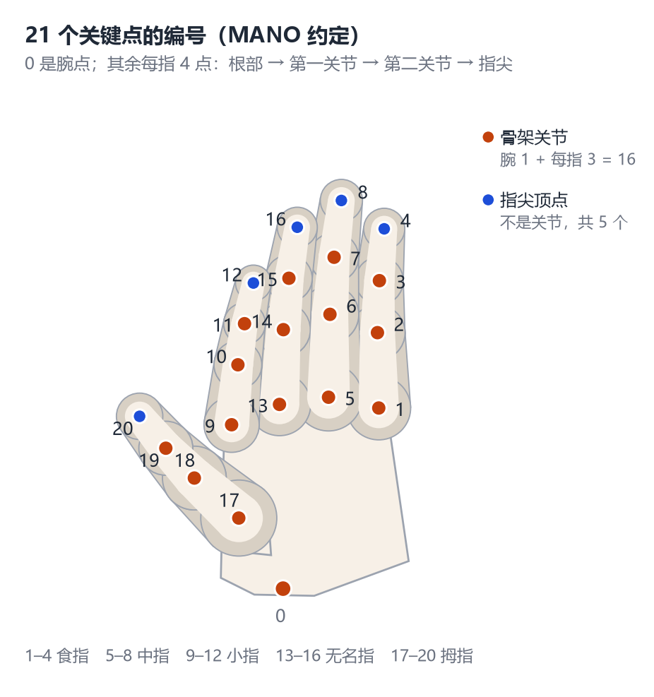
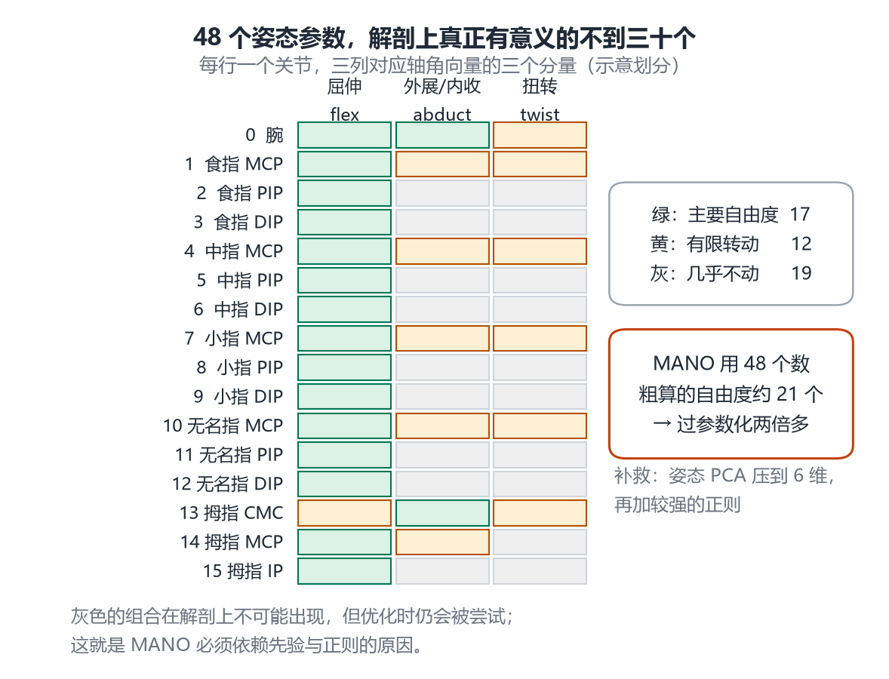
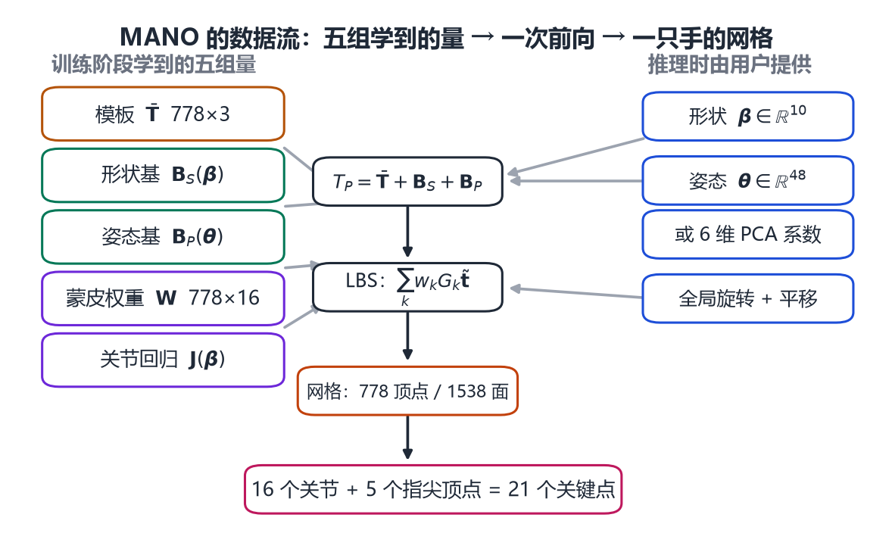

# 第 5 章 手的解剖与 MANO

> **本章导读**：前四章讲的是人脸，用的都是同一个套路：先找到一个“平均形状”，再学会“形状怎么变”和“姿态怎么动”，最后用蒙皮把它们缝在一起。这套套路在人体上叫 SMPL，在脸上叫 FLAME，在手上有一个人人都绕不开的名字：MANO。本章先回答一个问题——为什么手比整个人体还难？然后从腕骨、掌骨、指骨讲到 21 个关键点，再拆开 MANO 的五个部件，看它怎样用 778 个顶点和 16 个关节描述一只手，最后说明它如何并进 SMPL+H 与 SMPL-X。需要的前置知识只有三样：PCA 形状空间、线性混合蒙皮、以及“模板 + 形状 + 姿态”这条公式，本章都随用随讲。

## 5.1 手为什么这么难

如果把人体参数化当成一场考试，人体是必答题，人脸是加分题，手就是那道“看起来简单、实际最容易丢分”的题。这一节先用手上的数字说明它难在哪，再把这一章的任务定义写清楚。

先看数字。一只手的重量不到体重的百分之一，长度不到身高的十分之一，却能做出抓、捏、拧、握、弹、指、写这些动作。它的自由度集中在 5 根手指上：常用的记法是，除拇指外每根手指 4 个自由度（掌指关节 2 个——弯曲与张开，近端指间关节 1 个，远端指间关节 1 个），拇指 5 个，合计 $4\times4+5=21$。作为对比，整个身体的“大关节”通常只用二十几个自由度就够了。也就是说，**一只手和半个人体的自由度差不多，却只占身体面积的百分之几。**

这带来四个具体困难。

<figure class="fig">

<figcaption><b>图 5-1</b>　右手骨骼与 21 个关键点的编号约定。橙点是被模型显式建模的 16 个关节，蓝点是 5 个指尖点，两者合起来是常说的“21 个关键点”。编号用的是 MANO 的顺序（腕、食指、中指、小指、无名指、拇指），实际工程中各库的编号可能不同，加载数据时务必核对。</figcaption>
</figure>

**第一是尺度。** 成年人的手长约 18 厘米，手掌宽约 8 厘米。在全身扫描或全身图像里，手可能只占几十个像素。分辨率不够时，两根相邻的手指在图像上会糊成一片，扫描仪也会在指缝之间生成一层“蹼”状的假面。MANO 的作者在论文里就明确指出：全身扫描仪的分辨率不足，手指分辨不出来，指间会出现这种 webbing 伪影 [@romero2017mano]。

**第二是自遮挡与深度歧义。** 手指太细，一根手指绕到另一根后面时，投影上几乎看不出差别。更麻烦的是“深度翻转”：一只手指向镜头的手，与一只背向镜头但手指弯曲方向相反的手，在某些视角下的二维投影可以非常接近。三维姿态到二维图像的映射天生是多对一的，而手的小尺寸让这个歧义更加严重。

**第三是外观几乎无特征。** 人脸有眼睛、鼻子、嘴这些高对比度的地标，人手没有。五根手指的颜色、纹理、粗细都差不多，网络很难靠局部外观区分“这是食指的第二关节”还是“中指的第二关节”。这一点在 2019 年被明确写进了单图手部重建的论文里 [@boukhayma2019hands]。

**第四是数据难采。** 人体的三维真值可以用多相机扫描或动作捕捉拿到，手不行：标记点太大，贴上去会限制手指活动，还会改变手形；数据手套同样会改变形状，采到的姿态分布也不再自然。所以手部数据长期依赖“合成渲染”或“精心设计的多视角标注流程”——这两条路线会在第 6、7 章反复出现。

把这四点放在一起，就能理解为什么 SMPL 明明在 2015 年就做好了，手却要等到 2017 年才有对应的模型：不是没人想做，而是**没有足够好的数据去学一个统计模型**。

任务定义可以写得很简洁。

- **输入**：形状参数 $\boldsymbol{\beta}$（10 维）、姿态参数 $\boldsymbol{\theta}$（48 维或 PCA 系数）、全局旋转与平移。
- **输出**：778 个顶点、1538 个三角面的右手网格（左手由镜像得到），以及 16 个关节的位置。
- **可选输出**：21 个关键点（16 个关节 + 5 个指尖顶点）。
- **评价**：关节误差（毫米，常做刚体对齐）、顶点误差、F-score（阈值内的顶点比例）、以及“物理合理性”（有没有自交、指节有没有塌陷）。

所以，手难在“小、细、挤、缺数据”四件事叠加；这四件事决定了后面的每一个设计选择。

## 5.2 手部解剖：从腕到指尖

要理解 MANO 的 16 个关节从哪来，得先知道手上有多少块骨头。这一节把骨骼、关节、关键点三者的对应关系理清。

一只手有 27 块骨头，分三组：

- **腕骨 8 块**，排成两排，像一组小石子，负责手腕的灵活转动；
- **掌骨 5 块**，从腕部向指尖方向伸出，构成手掌的骨架；
- **指骨 14 块**，其中拇指 2 块（近节、远节），其余四指各 3 块（近节、中节、远节）。

27 块骨头通过关节串成一条条链。真正被参数化模型显式建模的，是这些链上的**转动中心**：

- 1 个腕关节（手掌相对前臂的转动）；
- 5 个掌指关节（Metacarpophalangeal, MCP），即手指根部与掌骨相连处；
- 拇指 1 个指间关节（Interphalangeal, IP），其余四指各 2 个（近端指间关节 PIP、远端指间关节 DIP）。

数一数：$1+5+1+4\times2=15$。再加上一个控制整只手朝向的根关节，正好 16 个。这就是 MANO 的骨架，也是“16 个关节”这个数字的来源 [@romero2017mano]。

**21 个关键点又是怎么来的？** 关键点（keypoint）是给算法做监督用的语义点，比关节更“贴近表面”。最常见的约定是：1 个手腕点 + 5 根手指各 4 个点（根部、第一关节、第二关节、指尖），共 21 个。它比 16 个关节多了 5 个指尖点——指尖是抓取和触摸时最重要的接触位置，但在 MANO 的骨架里并没有独立的转动中心。所以工程上常见的做法是：**用 16 个关节做骨架，另外从网格上取 5 个指尖顶点补足 21 个关键点**。写成式子就是

$$
\mathbf{K}=\Big[\,\mathbf{J}(\boldsymbol{\beta},\boldsymbol{\theta});\ \mathbf{V}_{\text{tip}}\,\Big]\in\mathbb{R}^{21\times3},
\tag{5.1}
$$

其中 $\mathbf{J}\in\mathbb{R}^{16\times3}$ 是关节位置，$\mathbf{V}_{\text{tip}}\in\mathbb{R}^{5\times3}$ 是 5 个指尖顶点，方括号表示按行拼接。这个拼接顺序必须和标注数据的顺序一致，否则训练时会出现“用食指的预测去对中指的标注”，误差永远降不下去。Boukhayma 等人在 2019 年就是这么做的 [@boukhayma2019hands]，后来的 HaMeR 干脆把输出写成 $K=21$ 个关节 [@pavlakos2023hamer]。

这里有一个容易混淆的地方，值得提前说清楚：**“关节数”和“自由度数”不是一回事。** MANO 把每个关节都当成球关节（ball joint），一个球关节用 3 个数（轴角）描述，于是 16 个关节对应 $16\times3=48$ 个姿态参数。但真实的手指关节大多是铰链，只能弯不能扭，一个手指关节实际只有 1 到 2 个自由度。

<figure class="fig">

<figcaption><b>图 5-2</b>　48 个姿态参数的解剖学分档（示意划分）。绿格是主要自由度，黄格是有限转动，灰格在解剖上几乎不会出现。48 个格子里，真正有意义的不到三十个——这就是 MANO 必须靠姿态 PCA 与强正则的原因。</figcaption>
</figure>

图 5-2 把这件事画成了一张表。可以从两个方向读它：按行看，掌指关节（MCP）有三个方向都还说得过去（屈伸、外展、有点扭转），而近端与远端指间关节（PIP、DIP）几乎只有屈伸；按列看，“屈伸”这一列几乎全绿，“扭转”这一列几乎全灰。

所以 MANO 的姿态表示是**过参数化**的：48 个数里有很多组合在解剖上根本不可能出现。MANO 的论文自己承认了这一点，并用两个办法补救——姿态主成分分析（把 48 维压到 6 维）和更强的正则化。这两件事在 5.3 节展开。

所以，16 个关节、21 个关键点、48 个参数是三个不同层面的数字：关节是骨架的节点，关键点是监督的目标，参数是优化的变量；把三者混着说，是初学阶段最常见的困惑来源。

## 5.3 MANO 的五个部件

MANO 的全名是“带关节与非刚性形变的手部模型”（hand Model with Articulated and Non-rigid defOrmations）。它的结构几乎是 SMPL 的移植：模板、形状基、姿态基、蒙皮权重、关节回归器，一个不少。这一节逐个看这五个部件是怎么学出来的、和 SMPL 有什么不同。

$$
M(\boldsymbol{\beta},\boldsymbol{\theta})=\mathcal{W}\big(T_P(\boldsymbol{\beta},\boldsymbol{\theta}),\,J(\boldsymbol{\beta}),\,\boldsymbol{\theta},\,\mathbf{W}\big),
\tag{5.2}
$$

$$
T_P(\boldsymbol{\beta},\boldsymbol{\theta})=\bar{\mathbf{T}}+\mathbf{B}_S(\boldsymbol{\beta})+\mathbf{B}_P(\boldsymbol{\theta}),
\tag{5.3}
$$

逐项读法：

- $\bar{\mathbf{T}}\in\mathbb{R}^{778\times3}$ 是模板，零姿态下的平均手（五指平伸）。
- $\boldsymbol{\beta}\in\mathbb{R}^{10}$ 是形状参数，控制胖瘦、掌宽、指长比例。
- $\boldsymbol{\theta}\in\mathbb{R}^{48}$ 是姿态参数，16 个关节各一个三维轴角。
- $\mathbf{B}_S(\cdot)$ 与 $\mathbf{B}_P(\cdot)$ 分别是形状偏移与姿态偏移，输出都是 $778\times3$。前者是线性的（10 个基），后者也是线性的（48 个基，每个基对应一个关节的位移模式）。
- $\mathbf{W}\in\mathbb{R}^{778\times16}$ 是蒙皮权重，每行最多几个非零。
- $J(\boldsymbol{\beta})$ 是由顶点线性回归出来的 16 个关节位置，回归矩阵尺寸 $48\times2334$（$3K\times3N$）。

<figure class="fig">

<figcaption><b>图 5-3</b>　MANO 的输入输出与内部数据流。左边是训练阶段学到的五组量，中间是式 (5.2)(5.3) 的计算顺序，右边是推理时真正需要用户提供的三类参数：形状 10 维、姿态 48 维（或 6 维 PCA 系数）、全局朝向与平移。</figcaption>
</figure>

真正值得讲的不是公式，而是**这五个部件各自是怎么学出来的**。

**（一）模板与形状基：2018 次高精度扫描。** MANO 的数据来自一台专门扫手的结构光系统（3dMDhand），它有 5 个扫描单元，被试把手腕搁在支架上，保持腕部固定、手指自由活动。作者一共采集了 31 名被试、最多 51 种姿势，累计 2018 次扫描，覆盖了抓握分类学里的 31 种典型抓法以及一些混合姿势 [@romero2017mano]。为了把左右手的数据合起来用，他们把左手扫描镜像成右手，训出一个统一的右手模型，再镜像回去得到左手模型——**这个技巧把训练数据翻了一倍，也顺便保证了左右手在拓扑上严格对称**。

31 个人、2018 次扫描是什么概念？对比 FLAME 的 33000 次、FaceScape 的 18760 张，这个规模小了一个数量级。原因就是 5.1 节说的：手的数据采不快。所以 MANO 的参数空间天生比人脸窄，它的“泛化”更多依赖形状基的正则，而不是数据覆盖。

**（二）姿态偏移：为什么要“局部化”。** 手的问题在于关节太多、彼此太近。SMPL 训练姿态偏移 $\mathbf{B}_P$ 时对所有元素用同一个正则权重，这在人体上没问题——躯干关节隔得远，一个关节的偏移不会莫名其妙跑到脚上。但手不行：16 个关节挤在 18 厘米的范围里，用同样的权重训出来的偏移会“糊”成一片，弯曲食指时中指根部也跟着鼓起来。

MANO 的解法很直接：给每一对“输入关节—输出顶点”配一个权重，权重正比于两者在模板网格上的**测地距离**（geodesic distance，沿表面走的距离，而不是直线距离）：

$$
\Lambda_P(i,j)=\mathbf{J}_j\,D_{\mathrm{geo}}(\mathbf{t}_i,\bar{\mathbf{T}}),
\tag{5.4}
$$

$D_{\mathrm{geo}}$ 是顶点 $\mathbf{t}_i$ 到其他所有顶点的测地距离向量（长度 $N$），$\mathbf{J}_j$ 是第 $j$ 个关节的回归权重（长度 $N$）。两者相乘得到一个长度 $N$ 的惩罚向量：距离越远，惩罚越重。于是学出来的姿态偏移就自动变成“局部的”。这个改动听起来很小，效果却是肉眼可见的：论文里专门放了一组对比图，说明不做局部化时指关节会出现不自然的凸起 [@romero2017mano]。

数字上更容易理解：食指指尖到中指根部的直线距离可能只有 3 厘米，但沿皮肤表面绕过去要 6 厘米以上。用直线距离做惩罚，两者“看起来很近”，偏移就会串味；用测地距离，串味立刻消失。**这是“几何上近”与“表面上近”的差别，在手这种细长结构上被放大到了关键程度。**

**（三）姿态空间：6 维解释 81% 的方差。** 这是 MANO 最有意思的一部分，也是它继承自神经科学的地方。手的 21 个自由度并不是独立控制的——你很难只弯无名指的第二个关节而不动其他手指。Santello 等人在 1998 年的实验里就发现，抓握姿势的方差主要落在少数几个主成分上。MANO 把这个观察变成了模型的一部分：对训练集里所有姿态（轴角表示）做 PCA，得到一组“姿态协同”（pose synergy）基，用低维系数代替 48 维轴角。

$$
\boldsymbol{\theta}=\bar{\boldsymbol{\theta}}+\sum_{n=1}^{m}\alpha_n\,\mathbf{M}_n ,
\tag{5.5}
$$

其中 $\bar{\boldsymbol{\theta}}\in\mathbb{R}^{48}$ 是平均姿态，$\mathbf{M}_n\in\mathbb{R}^{48}$ 是第 $n$ 个姿态主成分，$\alpha_n$ 是标量系数，$m$ 一般取 6。

论文报告：**每只手取 6 个主成分，可以解释训练姿势约 81% 的方差**，这已经足够描述大多数常见手势 [@romero2017mano]。这个数字很值得记住，因为它解释了一件事：为什么后来很多手部重建网络只回归很少的几个姿态数也能 work——不是网络厉害，而是手的姿态本来就住在一个低维薄片上。

顺便说一句，这里的取舍是有权衡的：主成分越多越精确，但对噪声数据越敏感。论文明确指出，高质量数据可以用很多主成分，噪声数据则要少用，以换取鲁棒性。第 6 章会看到，Boukhayma 的方法取了 10 个姿态主成分 [@boukhayma2019hands]，比 MANO 论文推荐的 6 个多，正是因为它的输入是噪声更大的单张图像。

**（四）零姿态带来的麻烦。** SMPL 的零姿态是 T-pose，手是张开、手指平伸的；MANO 也沿用了“平手”作为零姿态，为的是和 SMPL 兼容。但数据集里的平均姿态并不是平手，而是略微弯曲的自然状态。这就造成一个技术问题：模型先优化模板、后优化姿态偏移，模板会把“从平手到平均姿态”的形变吸收进去，结果是指关节被拉出不自然的凸起。作者的补救办法是给训练样本加权：姿态离零姿态越远，权重越低，在优化模板的第一轮里基本不参与。

**（五）蒙皮。** 权重矩阵 $\mathbf{W}$ 是 $778\times16$，每个顶点最多受少数几个关节影响。手部蒙皮的难点在于指缝：两根手指之间的皮肤同时受两个关节影响，权重过渡不好就会在弯曲时“粘”在一起。这也是 5.1 节说的“数据必须够好”的原因——权重是从配准好的扫描里学出来的，配准错了，权重就错了。

一个具体的失败现象可以帮你在调试时认出它：把食指弯到 90 度，如果中指根部内侧出现一个尖角或一道折痕，说明指缝处的权重过渡太硬；如果两根手指之间的皮肤被拉成一张薄片（像鸭蹼），说明权重过渡太软、两边都沾了。这两种问题的修法完全相反，所以先分辨再动手。

所以，MANO 的五个部件里，真正属于“手的特殊性”的是两处：测地距离正则（因为关节太密）和姿态 PCA（因为手的动作本来就低维）；其余三个是从 SMPL 原样搬来的。

## 5.4 MANO 与 SMPL：同一套机器，不同的调参

把 MANO 和 SMPL 并排放，会发现它们的公式几乎逐字相同。这不是巧合，而是设计目标：**MANO 必须能无缝插进 SMPL**。

**表 5-1**　三个模型的规格对比。数字本身不重要，重要的是它们之间的层级关系。

| 项目 | SMPL [@loper2015smpl] | MANO [@romero2017mano] | SMPL-X [@pavlakos2019smplx] |
|---|---|---|---|
| 顶点数 $N$ | 6890 | 778 | 10475 |
| 关节数 $K$ | 24（含根） | 16（含根） | 54（含手指 30 个） |
| 形状参数 | 10 | 10 | 10 |
| 姿态参数 | $24\times3=72$ | $16\times3=48$，可压到 6 | 全身 75 + 双手 PCA 24 |
| 手部表达 | 无（手是固定的板） | 16 关节 LBS + 姿态偏移 | 复用 MANO 的姿态空间 |

表 5-1 最重要的信息不是数字，而是**层级关系**：SMPL 没有手指，MANO 只有手，SMPL-X 两者都有。这就是 5.5 节要讲的整合故事。

在讲整合之前，先把两者的差异列清楚，因为它们决定了工程中的很多“坑”。

**差异一：正则化的粒度。** SMPL 用全局常数正则，MANO 用测地距离加权的局部正则（式 5.4）。原因是关节密度完全不同。

**差异二：姿态空间的维度。** SMPL 直接优化 72 维姿态，没有人会把它压到 6 维；MANO 必须压，因为 48 维在全身体扫描的低分辨率手部区域里根本优化不动。

**差异三：形状空间的来源。** SMPL 的形状空间来自 CAESAR 人体测量数据库（数千人的全身扫描）。MANO 起初把 CAESAR 当作形状先验的来源，后来发现它在手上的配准存在系统性偏差（姿势、遮挡、扫描技术共同造成），最终改用自己采集的 31 人中性姿态数据来建形状空间 [@romero2017mano]。这是一条很实用的经验：**别人的数据不一定能直接拿来用，哪怕它是“标准数据集”。**

**差异四：坐标与朝向。** MANO 的模板把腕部放在原点附近，手指沿一个固定方向伸展；SMPL 的坐标系则是以骨盆为参考、Y 轴向上。两者对接时必须做一次刚体变换，否则手会“长”在错误的位置、朝向错误的方向。手工对接两个模型时，这一步最容易漏。

所以，把 MANO 看成“SMPL 在手上的特化”比“另一个模型”更准确；它的每一处不同，都是被“关节密、尺度小、数据少”逼出来的。

## 5.5 从 MANO 到 SMPL-X 的手

有了 MANO，接下来要解决的问题是：怎样让一个人既有一副好身体，又有一双会动的手？这一节看这个“缝合”过程以及它的参数预算。

2017 年的答案叫 SMPL+H [@romero2017mano]。做法非常“工程”：把 MANO 里和手指有关的部分——蒙皮权重、姿态偏移、关节回归器——原样搬进 SMPL 的手部区域，手腕及其以外的身体部分继续用 SMPL 的。手部的形状则不再用 MANO 的形状基，而是用 SMPL 的全身形状空间去决定——理由是手的胖瘦和身体的胖瘦是相关的，用同一个形状参数控制更自然。

代价立刻出现了：SMPL 原本有 66 个自由度（不含手），加上两只手各 6 维姿态 PCA，一共 78 维。论文作者自己评价说，这把姿态维度“翻了一倍还多”，而多出来的维度全都集中在身体上最小、数据最差的一块区域，反而让拟合更不稳定。所以他们坚持用 6 维 PCA，而不是 48 维原始轴角。

两年后的 SMPL-X 把这个思路推得更彻底 [@pavlakos2019smplx]。它用一套统一的模型同时表达身体、手、脸：

- 顶点数 $N=10475$，关节数 $K=54$；
- 手指有 30 个关节，对应 90 个原始姿态参数，但通过 MANO 的姿态 PCA 压缩成**每只手 12 维**，两只手共 24 维；
- 参数总数 119：75（全局朝向 + 身体、眼睛、下颏）+ 24（双手 PCA）+ 10（形状）+ 10（表情）。

请注意这里的“12 维”比 MANO 论文推荐的 6 维多。原因还是那个权衡：SMPL-X 的拟合场景（单图、单目视频）比 MANO 的训练场景噪声更大，但需要表达的动作也更复杂，12 维是折中。

从工程角度看，SMPL-X 的手部设计给出了一个很重要的启示：**在一个全身模型里，一只手只值 12 个数。** 这 12 个数就是“接口”：上游的检测器、下游的动画系统、渲染器、物理引擎，全都可以只认这 12 个数，而不必关心 778 个顶点怎么排。这也是为什么第 6 章的手部重建网络大多输出 MANO 参数而不是顶点——参数是通用的，顶点不是。

代价同样明显：12 维不足以表达精细的手部动作（比如弹钢琴时每根手指的独立屈伸）。实践中常见的做法是“两级估计”：先用全身模型拿到大致的手部位置和朝向，把手部区域裁剪放大，再用一个专门的手部网络重新估计 48 维（或更多）的姿态。FrankMocap 就属于这一类系统，我们在第 6 章详细讲 [@rong2021frankmocap]。

<figure class="fig">

<figcaption><b>图 5-4</b>　三个模型的包含关系与参数预算。SMPL 提供身体，MANO 提供手，SMPL+H 把 MANO 的手指部件插进 SMPL，SMPL-X 再并进 FLAME 的脸。注意右侧的参数预算：从全身到单手，可用的数字急剧减少，这正是“细节被压缩”的定量表现。</figcaption>
</figure>

图 5-4 右侧那组柱状图值得多看一眼。全身 82 个数、加上双手 88 个、SMPL-X 全部 119 个，但落到一只手只剩 12 个。如果一只手真的需要 21 个自由度才能自在活动，那么 12 个数字就像用 12 个旋钮去控制 21 个关节——大多数时候够用，弹琴、打字这种精细动作就不够了。

所以，SMPL-X 的做法是“用分辨率换通用性”：它牺牲单手精度，换来“一个模型同时管身体、手、脸”的工程便利；需要精细手部时，只能在它上面再挂一个专门的模块。

## 5.6 参数量、单位与坐标约定

最后把工程上最容易出错的地方集中交代一遍。这些内容在论文里通常一笔带过，但真正写代码时，八成的 bug 都出在这里。

**参数清单。** 一次完整的 MANO 前向需要以下几组数（表 5-2）：

**表 5-2**　一次 MANO 前向所需的参数。

| 名称 | 维度 | 含义 | 常见取值 |
|---|---|---|---|
| `betas` | 10 | 形状（胖瘦、掌宽、指长比例） | 标准正态附近，$\pm2$ 以内 |
| `global_orient` | 3 | 整只手的全局旋转（轴角） | 弧度 |
| `hand_pose` | 48 或 6/10/12 | 16 个关节的相对旋转，或 PCA 系数 | 弧度 / 无量纲系数 |
| `transl` | 3 | 手腕在世界坐标中的平移 | 米 |

**单位是米。** MANO 和 SMPL 一样，模板尺度以米为单位，成年男性手长约 0.18–0.19 米。如果你把模型加载进来发现手有 18 个单位长，那不是模型错了，是你把毫米当成了米。

**旋转用轴角，不是欧拉角。** 轴角（axis-angle）用一个三维向量表示旋转：向量方向是转轴，长度是转角（弧度）。它和四元数可以互相转换，两种表示都只描述旋转、不包含平移。注意轴角的长度超过 $\pi$ 时会出现“绕远路”的等价表示，做插值和优化时要注意把角度归一到 $(-\pi,\pi]$。

**左右手是镜像出来的。** 这一点最容易被忽略。镜像一个网格时，顶点坐标的某个轴取反，但三角形的顶点顺序（绕向）也跟着反了，法线方向会朝里。正确做法是：坐标取反 + 翻转面的索引顺序。如果只做前者，渲染出来的手会是“内外翻转”的，光照完全不对。

**零姿态是平手，不是自然手。** 加载模型后直接渲染，你会得到一只五指笔直伸开的手。想让它看起来自然，必须给一点姿态参数（或者直接用数据集里估计出来的参数）。

**不同库的关节顺序不一样。** MANO 官方模型、PyTorch3D 的封装、SMPL-X 里的手部关节，编号顺序都可能不同；有的库还把指尖点拼在 16 个关节后面凑成 21 个。跨库对比结果之前，先打印一遍关节坐标，确认“第 5 号关节”在两边指的是同一根手指的同一个位置。这不是小题大做——第 6 章的所有评估指标都建立在“关键点一一对应”的前提上。

所以，工程上要盯住六件事：单位是米、旋转是轴角、镜像要翻面、零姿态是平手、关节顺序要核对、PCA 系数与轴角不能混用。

## 5.7 失败模式与横向对比

一个模型好不好，除了跑分，更要看它在什么情况下会崩。这一节把 MANO 的典型失败收成清单，并把它的三种“竞争对手”放在一起比一比。

**失败模式。**

1. **指缝粘连。** 手指并拢或弯到极限时，相邻指腹的顶点挤在一起，渲染出“鸭蹼”；根因是蒙皮权重在指缝处不够硬，或者形状基里混进了“手指粗”的方向。
2. **指节塔陷。** 姿态推到 PCA 分布之外时，指关节内侧会塌进去，像被拮了一指。这是姿态偏移基在外插时失效的表现。
3. **左右手情反。** 一只背对镜头的手与另一只手的镜像，轮廓几乎一样；网络很容易输出“镜像正确、朝向错误”的结果，而轮廓误差指标看不出来。
4. **尺度歧义。** 单目图像里手的大小只能靠先验，弱透视相机把尺度吸收进缩放参数，于是“绝对尺寸”基本不可信。
5. **零姿态残留。** 用数据集里的参数直接渲染时，五指伸得不太自然，像刚做完全身扫描的姿势，而不是放松状态。
6. **手腕接缝。** 把手接到身体上时，腕部的朝向、尺度对不上，出现一圈折痕或肌肉被拉长。

**横向对比。** MANO 不是唯一的选择，工程上实际会遇到四类手部表示（表 5-3）。

**表 5-3**　四类手部表示的取舍。

| 表示 | 自由度 | 优点 | 缺点 | 典型场景 |
|---|---|---|---|---|
| MANO（统计模型） | 48（可压到 6） | 有形状先验，单图即可拟合；参数通用 | 固定拓扑 778 顶点，细节上限低 | 重建、动画、数据标注 |
| 艺术家骨骼 + 手工蒙皮 | 由骨架决定 | 完全可控，能表达非人形（六指、机械手） | 没有形状先验，拟合需手工调 | 游戏、影视角色 |
| 学习式关节（从数据回归） | 由标注决定 | 可以贴合特定数据集的标注习惯 | 不可解释，换数据集就失效 | 特定任务的中间表示 |
| 神经隐式手（SDF 类） | 潜码 | 拓扑自由，可表达细节与物体接触 | 需多视角/多帧，计算量大 | 高保真捕捉、手物交互 |

这张表的读法是：**你要的是“先验”还是“自由”。** MANO 给你强先验，所以能从一张小图里猜出合理的三维手；代价是它只能生成“像人的手”。想要六指、机械手、或带接触变形的软手，就得往表的下面走，同时失去“一张图就能拟合”的能力。

所以，MANO 的失败模式几乎都能归结到两个原因：参数空间太窄（指节塔陷、零姿态残留），或者先验太强（尺度歧义、左右手情反）；前者靠加数据与细节层，后者靠额外观测（深度、时序、身体上下文）。

## 本章小结

- 手难在四点：自由度多（约 21 个）、尺度小、自遮挡严重、外观缺乏特征；四者叠加导致高质量三维数据极难采集。
- 一只手有 27 块骨头；被显式建模的转动中心是 15 个（腕 1 + 掌指 5 + 指间 9），加上根关节共 16 个；21 个关键点 = 16 个关节 + 5 个指尖。
- MANO 沿用 SMPL 的公式，但做了三处关键修改：用测地距离加权让姿态偏移局部化；用 6 维 PCA 压缩姿态空间（解释约 81% 方差）；改用自己采集的 31 人、2018 次扫描来建形状空间。
- MANO 输出 778 个顶点、1538 个三角面，姿态参数 48 维（16 关节 × 3），形状参数 10 维；48 维在解剖上只对应二十来个真自由度，所以必须靠先验与正则。
- SMPL+H 把 MANO 的手指部件插进 SMPL，全身自由度从 66 升到 78；SMPL-X 进一步统一身体、手、脸，用每只手 12 维 PCA 表达手指，总参数 119 个。
- 工程上要盯住六件事：单位是米、旋转是轴角、左右手镜像要翻面、零姿态是平手、不同库的关节顺序可能不同、PCA 系数与轴角不能混用。
- 典型失败六类：指缝粘连、指节塔陷、左右手情反、尺度歧义、零姿态残留、手腕接缝；归因无非“参数空间太窄”或“先验太强”。

## 思考题

1. MANO 把每个手指关节都当成球关节，48 个姿态参数里有很多物理上不可能的组合。为什么作者不直接用铰链关节，把参数减到 21 个？
2. 如果每只手只用 6 个姿态主成分就能解释 81% 的方差，那么剩下的 19% 主要是什么动作？为什么这些动作更难被低维空间捕捉？
3. SMPL-X 给一只手只留 12 维 PCA。请举一个 12 维明显不够用的手部动作，并说明如果要做这个动作的捕捉，你会怎么改系统结构。
4. 假设你拿到一份全身扫描数据，想在上面拟合出带手指的模型。你会先拟合身体再拟合手，还是同时拟合？分别会碰到什么问题？
5. 表 5-3 里的四类表示，如果你要做一个“六指机械手”的抓取数据集，会选哪一种？为什么？
