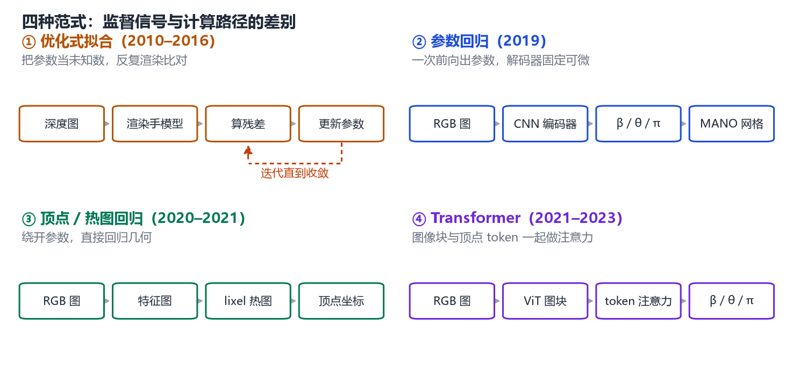
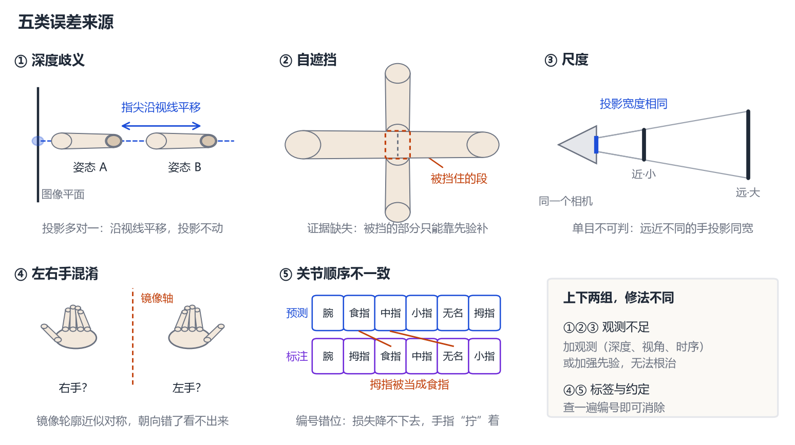
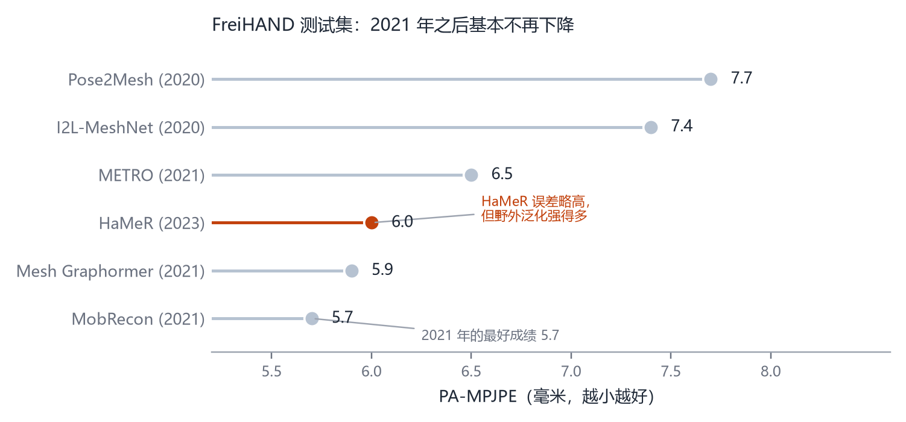

# 第 6 章 单手重建：从优化到 Transformer

> **本章导读**：第 5 章造好了 MANO 这只“可调的假手”，这一章回答：给它一张照片，怎样把参数调出来。十年里出现了三种求解方式——在参数空间里反复试的优化、一次前向就出结果的回归、把两者串起来的精修；三种方式今天都还在用，只是站位不同。比模型结构更值得记住的是它们各自的失败方式，因为那决定了你在什么场景下不该相信结果。

## 6.1 任务是什么，难在哪

这一节把“给一张图求一只手”写成一条能执行的任务，并把输入、输出、评价三件事定清楚。结论是：手部重建的困难主要不在网络结构，而在“观测太少”与“标注太贵”这两条约束上。

### 6.1.1 输入与输出

先把输入形式分清楚，因为同一个算法在裁剪好的小图和整幅照片上，误差可以差出一倍。输出也一样，参数、网格、关节三种输出的用途完全不同，混着说会得出错误结论。

输入有四种常见形态。

- **裁剪图**。手已经被检测框框出来，缩放成网络的固定输入尺寸，常见 224×224。画面里几乎只有手，背景干净。
- **整幅图像**。手只是画面的一角。640×480 的画面里，手可能只占 40×40 到 80×80 像素；1920×1080 的画面里好一些，占 120×120 到 240×240。
- **视频**。30 帧每秒的序列，相邻两帧的位移通常只有几个像素，前一帧的结果可以直接当后一帧的先验。
- **深度图或 RGB-D**。多一个深度通道，指缝处的空洞与深度翻转歧义都会减轻，代价是需要专用相机。

输出有三个层次，数字上差得很远。

- **参数层**。形状 $\boldsymbol{\beta}$ 是 10 个数，姿态 $\boldsymbol{\theta}$ 是 48 个数（或压成 6–12 维 PCA 系数），相机 $\boldsymbol{\pi}$ 是 3 个数（一个缩放加两个平移）。合计 61 个数上下。
- **几何层**。778 个顶点、每个三个坐标，共 2334 个数，外加 1538 个三角面的连接关系。
- **语义层**。16 个关节，或者补上 5 个指尖顶点后的 21 个关键点。

61 与 2334 之间是 38 : 1。大多数方法输出参数层，理由不是参数更准，而是参数是接口：上游的检测、下游的动画、物理引擎、渲染器，全都只认这 61 个数（第 5 章 5.5 节算过这笔账）。

**表 6-1**　输入形态与它带来的问题。

| 输入形态 | 手占像素（示意） | 能拿到什么 | 主要困难 |
|---|---|---|---|
| 裁剪图 224×224 | 手占满画面 | 手指细节 | 丢掉上下文，尺度和朝向只能猜 |
| 整幅 640×480 | 40×40 – 80×80 | 手与身体、物体的关系 | 指缝糊成一片 |
| 整幅 1920×1080 | 120×120 – 240×240 | 上面两项都有 | 检测框的几像素误差被放大 |
| 视频 30 fps | 同上 | 时序约束，遮挡帧可补 | 抖动、跟踪漂移 |
| 深度 / RGB-D | 同上 | 绝对深度 | 硬件限制，指缝空洞 |

表里的像素数是示意，真实占比取决于拍摄距离：3 米外用 640×480 拍一个站着的人，手大约 20×25 像素；手机在 30 厘米处拍，手可以占到 300×300。同一套网络在这两种输入上的表现，不该被当作同一件事来比较。

### 6.1.2 为什么手比身体难

身体重建比手早成熟好几年，原因可以数出来，不必归到“手更复杂”这种空话上。四件事叠在一起，才是差距的来源。

**第一是像素预算。** 全身图像里人体大约占 200×400 像素（示意），一只手在其中只有 40×40。手能用的像素是身体的五十分之一，而它的自由度（21 个）和半个人体差不多。摊到每个自由度上，分不到两个像素。

**第二是关节密度。** 21 个自由度挤在 18 厘米的手长里，相邻关节的间距 2–3 厘米。如果 1 个像素对应 3 毫米（6.1.3 节会算这个换算），2 厘米只有 7 个像素。关节定位差 3 个像素，就是 9 毫米的误差——而 9 毫米已经是不同方法之间的分差。

**第三是外观自相似。** 五根手指的颜色、纹理、粗细几乎一样。人脸有眼睛、鼻子、嘴角这些高对比度的地标，手没有。网络必须靠“这根手指的掌根位置、与邻居的相对长度”来推断身份，这种推断一旦遇到遮挡就崩。

**第四是标注贵。** 三维关键点要靠多相机系统或者精心设计的手工流程。MANO 的训练数据只有 31 名被试、2018 次扫描，比人脸数据小一个数量级（第 5 章）。数据少，参数空间就得窄，窄了就表达不了极端姿态。

这四条与第 5 章那句“小、细、挤、缺数据”是同一件事的两种说法：手处在“高自由度、低像素、弱外观、少标注”的四面夹击里。任何单一方向的改进，都会被另外三个方向抵消。

### 6.1.3 写成优化问题

要把“像不像”变成一个能求最小值的数，就需要一个目标函数。它的输入是图像和一组候选参数，输出是一个标量，越小表示参数越贴合图像。

$$
(\hat{\boldsymbol{\beta}},\hat{\boldsymbol{\theta}},\hat{\boldsymbol{\pi}})
=\arg\min_{\boldsymbol{\beta},\boldsymbol{\theta},\boldsymbol{\pi}}\ \sum_{i=1}^{K}\Big\|\,\Pi\big(\mathbf{J}_i(\boldsymbol{\beta},\boldsymbol{\theta});\boldsymbol{\pi}\big)-\mathbf{u}_i\,\Big\|^2+\lambda_\beta\|\boldsymbol{\beta}\|^2+\lambda_\theta\|\boldsymbol{\theta}\|^2 .
\tag{6.1}
$$

逐项读法：

- $K=21$ 是关键点个数。$\mathbf{J}_i\in\mathbb{R}^{3}$ 是第 $i$ 个关节（或指尖顶点）的三维位置，$\mathbf{u}_i\in\mathbb{R}^{2}$ 是它在图像上的像素坐标。
- $\Pi(\cdot;\boldsymbol{\pi}):\mathbb{R}^{3}\to\mathbb{R}^{2}$ 是相机投影，$\boldsymbol{\pi}$ 是相机参数。投影之后单位是像素，所以第一项的量纲是像素的平方。
- $\lambda_\beta,\lambda_\theta$ 是两个权重，作用是把不同量纲的项拉到同一量级。$\boldsymbol{\beta}$ 无量纲、$\boldsymbol{\theta}$ 是弧度，两者必须分开加权，不能合成一个范数。
- 解出来的 $\hat{\boldsymbol{\beta}}\in\mathbb{R}^{10}$、$\hat{\boldsymbol{\theta}}\in\mathbb{R}^{48}$、$\hat{\boldsymbol{\pi}}\in\mathbb{R}^{3}$ 就是这一次重建的结果。

一个数字例子（示意）。设手的跨度在图上 60 像素，真实手长 18 厘米，于是 1 像素约等于 3 毫米。若 21 个关键点的平均重投影误差是 3 像素，看起来很小，换算过去是 9 毫米。这就是手部指标的尺度感：**图上 1–3 个像素的差别，已经是毫米级的模型差别。**

这个式子有三个天生的麻烦。

第一，投影丢信息。一个三维点投到图像上只剩两个数，深度没了，所以解往往不唯一。第二，先验要参与挑解。$\lambda_\theta$ 那一项的作用不是“防止过拟合”这么笼统，而是**在多个视觉上等价的解里挑一个最像手的**。第三，标注本身带噪。人工标注的关键点在遮挡帧里可能偏出十几个像素，而式 (6.1) 会把这种偏也当成证据。

所以，手部重建是一个“观测不足、靠先验补”的逆问题；后面所有方法的分歧，都发生在先验放在哪里——放进优化目标的正则项、放进网络的训练数据、还是放进一个生成模型。

## 6.2 三条路线：一次拟合、一次回归、回归后再拟合一次

这一节用三条路线把十年里的方法归并，并说清每条路线付出的代价。结论是：三条路线不是替代关系，而是“算力换精度”的三档刻度，今天的系统经常同时用到两档。

### 6.2.1 路线一：把参数当未知数，反复渲染比对

最早的思路不需要训练数据，只需要一个能渲染的模型和一张图。这也是为什么深度图一出现，手部跟踪立刻有了可行方案。

它叫**分析即合成**（analysis-by-synthesis）：先猜一组参数，渲染出图像，和观测比对，按差别改参数，循环到差别够小。系统的核心是一个优化器，不是一个网络。

代价很清楚：

- **慢。** 每次迭代要渲染一次，一帧通常要迭代几百次。
- **需要好的初始化。** 参数空间的局部极小很多，从平手出发往往收敛到“五指平伸”这种平凡解。
- **不可微的环节多。** 早期的深度图比对和轮廓比对用无梯度搜索（粒子群、模拟退火），采样效率低。

好处也很实在：不需要三维标注，换一个新相机、新视角也能用；解是“解释得通”的，每个参数都能指着说它在干什么。

### 6.2.2 路线二：一次前向出结果

训练数据一旦够用，最自然的想法是“把优化器学掉”。输入图像，输出参数，中间不再迭代。

这条路线把问题变成一个**监督学习**问题：需要 $(I,\boldsymbol{\Theta})$ 成对的训练样本，网络学的是“从像素到参数的映射”，先验被压进权重里。

代价转移了：推理变快，但训练要数据；而且**失败是静默的**——网络永远会给出一个答案，不会告诉你“这张图我拟合不上”。优化拟合一失败就看得出（残差降不下去），回归一失败往往要等到看见穿模、或者左右手反了，才发现。

### 6.2.3 路线三：回归给初值，迭代补细节

第三条路线把前两条串起来：网络先给一个粗解，再用几轮迭代把它推到贴合。迭代可以是可微渲染下的梯度下降，也可以是一个专门训练的精修网络。

它买到的是精度和可诊断的残差，付出的是延迟和工程复杂度：两段都要调，两段的失败还会互相掩盖——如果初值把左右手判反了，精修只会让反的那只手更贴合图像。

三条路线的对照写在表 6-2 里。

**表 6-2**　三条路线的取舍。

| | 路线一：优化拟合 | 路线二：直接回归 | 路线三：回归 + 精修 |
|---|---|---|---|
| 需要什么数据 | 几乎不需要标注 | 大量二维/三维标注 | 大量标注 + 可微渲染器 |
| 推理是否迭代 | 是，几百次 | 否，一次前向 | 是，几轮到几十轮 |
| 单帧耗时量级 | 秒 | 十毫秒 | 百毫秒 |
| 典型失败 | 局部极小、跟丢 | 静默给出错解 | 把错误初值锁死 |
| 代表工作 | 粒子群拟合、MANO 拟合 | Boukhayma、HaMeR | PyMAF、FrankMocap 的精修段 |

表里的耗时是量级示意，换一套硬件差一个数量级都正常。真正稳定的是排序：路线二比路线三快，路线三比路线一快。

<figure class="fig">

<figcaption><b>图 6-1</b>　四条管线并排。左上对应路线一：在参数空间里反复试，慢但对数据要求低；右上对应路线二：一次前向出参数；左下是路线二的一个分支，绕开参数直接回归几何（顶点或逐顶点热图）；右下是路线二的规模化版本，把图像块与网格顶点放进同一个注意力空间。</figcaption>
</figure>

图 6-1 的左下与右下值得单独提一句：它们都属于“一次前向”，区别只在输出什么。左下输出几何，右下输出参数。这个区别在 6.4 节展开。

所以，三条路线的分界线只有一个：**推理时是否迭代**。迭代换来精度和可诊断的残差，不迭代换来速度和静默失败的风险。

## 6.3 路线一细看：把拟合写成能量

这一节把路线一的目标函数拆开，看它到底在比什么。结论是：优化拟合的精度上限由“用了哪几种图像证据”决定，速度上限由“迭代多少次”决定，两者都可控，所以它今天主要活在标注工具和精修段里。

2010 年代中期的标准配置是一台深度相机（Kinect、RealSense），手放在镜头前 40–80 厘米。那时的模型还不是 MANO，而是几何基元的组合：手掌一个长方体，每根手指一串圆柱或球体，17–26 个自由度。Oikonomidis 等人用粒子群优化（PSO）在参数空间里撒一把“粒子”，每个粒子是一组关节角，渲染出来和深度图比对，好的粒子留下来继续撒。

目标函数各家写法不同，但结构一样：几种图像证据加权求和，再加一项先验。

$$
E(\boldsymbol{\Theta})=\lambda_{d}\underbrace{\sum_{p\in\Omega}\rho\big(D_{\mathrm{obs}}(p)-D_{\mathrm{ren}}(p;\boldsymbol{\Theta})\big)}_{\text{深度残差}}+\lambda_{s}\underbrace{\big(1-\mathrm{IoU}(S_{\mathrm{obs}},S(\boldsymbol{\Theta}))\big)}_{\text{轮廓残差}}+\lambda_{\ell}\underbrace{\sum_{i}\|\Pi(\mathbf{J}_i)-\mathbf{u}_i\|^{2}}_{\text{关键点残差}}+\lambda_{\theta}\|\boldsymbol{\theta}-\bar{\boldsymbol{\theta}}\|^{2}
\tag{6.2}
$$

逐项读法：

- $\boldsymbol{\Theta}$ 是待求的全部参数：每根手指的关节角、整只手的朝向与平移，有时还有形状。深度图时代通常不显式建模形状，所以维度在 20 上下。
- $\Omega$ 是深度图上的有效像素集合，$D_{\mathrm{obs}}(p)$ 是像素 $p$ 上的观测深度，$D_{\mathrm{ren}}(p;\boldsymbol{\Theta})$ 是把模型渲染成深度图后同一像素上的值。两者单位都是米，相减就是距离残差。
- $\rho(\cdot)$ 是鲁棒损失（如 Huber），作用是压住少数离谱像素的影响。指缝处的深度空洞就是这类离谱像素：它们要么无定义，要么跳变成背景距离。
- $S_{\mathrm{obs}}$ 与 $S(\boldsymbol{\Theta})$ 分别是观测轮廓与渲染轮廓的二值掩膜，$\mathrm{IoU}$ 是交并比，无量纲、取值在 $[0,1]$，所以这一项天然落在 $[0,1]$。
- 关键点项与式 (6.1) 的第一项同形，单位是像素平方。
- $\bar{\boldsymbol{\theta}}$ 是平均姿态，最后一项把解往“自然的手”拉，权重 $\lambda_\theta$ 决定它有多强势。

一个数字例子（示意）。深度图 640×480，手占 200×200 的区域，约 4 万个有效像素。粒子群优化通常撒 100–500 个粒子，迭代 100–300 轮，每轮对每个粒子渲染一次深度图，总渲染次数在几万次量级。这就是“一帧几秒”的来历，也是它必须靠 GPU 加速的原因。

边界与失败模式：

- **指缝空洞。** 深度相机在两根手指靠得很近时测不到深度，残差项在这些像素上没有定义，只能靠轮廓项和先验补。这是“模型先验比图像证据更重要”的直接原因。
- **局部极小。** 一根手指卡在另一根后面时，深度残差对它沿视线方向的位置不敏感，优化会停在“看起来差不多”的地方。
- **快速运动跟丢。** 逐帧独立优化，手快速翻转时相邻帧的初值差得远，容易跳到另一个解。

后来出现了几种改进：用高斯混合模型代替基元（Sridhar 等），用球-网格（sphere-mesh）让手指表面更光滑（Tkach 等），或者直接用带蒙皮的三角网格。MANO 的论文里有一张图专门对比了十种手部表示 [@romero2017mano]，可以看作这个阶段的化石记录。

MANO 出现之后，路线一没有消失，只是换了岗位。今天它主要出现在两个地方：一是**数据标注**，用多视角、多帧联合优化，把标注当成一个大规模的拟合问题来解（第 7 章会讲 HOnnotate 怎么用）；二是**精修段**，回归给出初值，再用可微渲染跑几十轮梯度下降（6.5 节）。

所以，路线一没有过时，它从“在线估计”退到了“离线标注”与“在线精修”两个岗位上；判断它合不合适，看的是你能不能容忍迭代。

## 6.4 路线二细看：从参数回归到规模化

这一节按时间顺序看路线二的三个节点，重点不是结构细节，而是每一代解决了上一代的什么问题。结论是：结构上的改进在 2021 年前后基本收敛，之后的提升主要来自数据规模与模型容量。

### 6.4.1 第一代：把模型塞进网络（2019）

2019 年 Boukhayma 等人给出了第一个端到端的答案 [@boukhayma2019hands]。他们的设计非常“教科书”，值得完整看一遍。

网络分成两半：

- **编码器**：一个卷积网络，输入是手部裁剪图（可选再拼上一组二维关键点热图），输出一组参数：形状 $\boldsymbol{\beta}$、姿态 $\boldsymbol{\theta}$、视角 $\boldsymbol{\pi}$。
- **解码器**：完全固定、不参与训练。它做两件事——用 MANO 从参数生成网格和骨架，再用弱透视相机把三维关节点投影回图像。

$$
\mathbf{J}_{2D}=\underbrace{\Pi_{\text{weak}}\big(\mathbf{J}(\boldsymbol{\beta},\boldsymbol{\theta});\,s,\mathbf{t}\big)}_{\text{固定，可微}},\qquad
\mathbf{J}(\boldsymbol{\beta},\boldsymbol{\theta})=\mathcal{J}\big(M(\boldsymbol{\beta},\boldsymbol{\theta})\big).
\tag{6.3}
$$

逐项读法：

- $M(\cdot)$ 是第 5 章的 MANO 前向，输出 $778\times3$ 的顶点。
- $\mathcal{J}(\cdot)$ 是关节回归矩阵，把顶点映成 $16\times3$ 的关节位置；拼上 5 个指尖顶点后是 $21\times3$。
- $\Pi_{\text{weak}}$ 是弱透视投影，参数只有缩放 $s$（无量纲）和二维平移 $\mathbf{t}=(t_x,t_y)$（像素），输出 $\mathbf{J}_{2D}\in\mathbb{R}^{21\times2}$。

弱透视相机比完整透视相机少一个焦距，对尺度变化不敏感。在“物体离相机足够远”的假设下它够用，也让网络更容易学——少了一个要猜的数。代价是它把真实的尺度信息揉进了 $s$，所以“手有多大”这件事在弱透视下基本不可信（6.6.3 节）。

这个设计最妙的地方在损失函数。他们不监督参数：参数没有唯一正确答案（同一个姿态可以由不同的 PCA 系数组合出来），监督参数等于强迫网络模仿标注者的偏好。他们监督的是投影后的关节点：

$$
\mathcal{L}=\lambda_{3D}\big\|\mathbf{J}_{3D}-\hat{\mathbf{J}}_{3D}\big\|^2+\lambda_{2D}\big\|\Pi(\mathbf{J}_{3D})-\hat{\mathbf{u}}\big\|^2 .
\tag{6.4}
$$

第一项只在有三维标注的数据上生效，单位毫米平方；第二项在只有二维标注的数据上生效，单位像素平方。这样一份数据可以只提供一半监督，网络照样能训——这就是“弱监督”的含义。论文明确说，正是这一点让他们能用上 MPII+NZSL 这类野外的二维标注数据 [@boukhayma2019hands]，从而提升泛化能力。

两个细节值得记住，因为它们是后续所有工作的公共常识：

1. **姿态用 PCA 系数，不用 48 维轴角。** 他们取 10 个姿态主成分，形状也取 10 维。理由在第 5 章：48 维过参数化，噪声数据下容易过拟合。
2. **指尖点要从网格上补。** MANO 的骨架没有指尖关节，但数据集标注的 21 个点里有指尖。他们的做法是从 778 个顶点里挑 5 个指尖顶点拼到关节后面。复现时会遇到同样的问题。

这一代的局限：监督信号只有关节点，没有像素级对齐。关节对了，轮廓可能还是偏的；手指之间的相对位置没有被显式约束，容易“挤”在一起。要解决这个，得让网络看见像素。

### 6.4.2 第二代：让输出保留空间结构（2020–2021）

**I2L-MeshNet（2020）** 提的问题很尖锐：把图像送进全连接层、直接吐出参数，等于把像素之间的空间关系全部打散。图像上相邻的两个关节，在参数向量里可能隔得很远，网络学起来更吃力。

替代方案是**热图**。为每个关节点预测一张二维概率图，取峰值作为坐标。这个表示保留空间结构，也能表达不确定（峰值很平时说明网络没把握）。但直接推广到三维不行：关节只有 20 个左右，网格顶点有 778 个，为每个顶点预测一个三维体素热图，显存立刻爆掉。

于是他们提出 **lixel**（line + pixel，线素）：把一维空间离散成格子，为每个坐标预测一条一维热图。名字是类比 voxel（体素）造出来的。显存随热图分辨率线性增长而不是立方增长，因此可以给到足够的分辨率 [@moon2020i2lmeshnet]。

网络是级联的：第一个子网（PoseNet）预测关节的 lixel 热图，第二个（MeshNet）在此基础上预测所有顶点的 lixel 热图。这条路线是 **model-free** 的——不回归 MANO 参数，直接输出顶点坐标，关节靠回归矩阵乘上去。好处是不受参数空间表达能力的限制，坏处是输出不保证是一只有效的手，可能自交、指节塌陷。

**Mesh Graphormer（2021）** 走另一条路：网格是图，就用图卷积捕捉邻居顶点之间的局部关系；Transformer 擅长长程依赖，就用自注意力捕捉“食指与中指之间”的关系。他们把图残差分支与自注意力分支塞进同一个 Transformer 块，叠 4 层，让关节 token 与顶点 token 互相注意，同时还能注意到图像特征 [@lin2021meshgraphormer]。

这个组合的直觉是：手既需要局部光滑（图卷积），也需要全局协调（注意力）。一根手指弯曲时，相邻手指会不自觉地跟着动一点，这是长程关系；指节处的皮肤褶皱是局部关系。两者缺一不可。

### 6.4.3 第三代：规模化（2023）

到 2021 年，手部重建在 FreiHAND 这类受控数据集上的误差已经降到 6 毫米左右，继续在结构上做微调，收益越来越小。2023 年的 HaMeR 换了思路：不发明新结构，把数据和模型一起放大 [@pavlakos2023hamer]。

具体做了两件事。

**数据。** 把能找到的带手部标注的数据集合起来：有三维真值的受控数据集（FreiHAND、HO-3D、InterHand2.6M、DexYCB 等），加上只有二维关键点的野外数据集（COCO-WholeBody、Halpe、MPII-NZSL 等），一共约 270 万个训练样本，是 FrankMocap 训练集的四倍。为了让模型在真实场景下站得住，他们还新标注了一个评测集 HInt：从 YouTube 视频和自我中心视频里取图，标了 40400 只手的关键点，其中 86.7% 的手正在与物体接触。

**模型。** 用大规模视觉 Transformer（ViT）做主干，接一个 Transformer 解码器，直接回归 MANO 的姿态、形状和相机。没有图卷积，没有热图，没有中间几何表示——图块进，参数出。

结果很有意思：在已经饱和的 FreiHAND 上，它的 PA-MPJPE 是 6.0 毫米，并不比 2020 年的 MobRecon（5.7 毫米）更好；但在 HInt 这类野外数据上，它的 PCK@0.05 比之前的方法高出两到三倍。换句话说，**大模型带来的不是“更准”，而是“更不容易崩”**。

论文里还有一组数字更能说明问题：在 HInt 上，可见关节的 PCK@0.05 是 60.8，遮挡关节只有 27.2。遮挡让精度掉了一半还多。这不是某个模型的缺陷，而是这个问题本身的难度。

所以，路线二的演化可以概括为“从改结构到堆数据”：2019 年靠固定可微解码器解决“能不能训”，2020–2021 年靠热图与图网络解决“表达够不够”，2023 年靠规模解决“崩不崩”。结构创新一旦饱和，剩下的提升只能从数据分布里来。

## 6.5 路线三细看：回归给初值，迭代补细节

这一节看第三条路线怎么把“快”和“准”缝在一起。结论是：精修能明显降低对齐误差，但它只能修正“已经在正确邻域里”的解，方向性的错误（左右手、极端视角）它救不回来。

### 6.5.1 精修回路

回归的误差有系统性的来源：参数到顶点是非线性的，姿态差 0.1 弧度，指尖可能差几厘米。要补这个差，最直接的办法是把当前估计画回图像，看它偏在哪，再改。

**精修**（refinement）就是在推理时多跑几轮“渲染—比对—更新”。它的输入是图像和当前参数，输出是修正量：

$$
\boldsymbol{\Theta}^{(t+1)}=\boldsymbol{\Theta}^{(t)}+\Delta\boldsymbol{\Theta}^{(t)},\qquad
\Delta\boldsymbol{\Theta}^{(t)}=g_{\phi}\Big(\mathbf{I},\ \Pi\big(M(\boldsymbol{\Theta}^{(t)})\big)\Big).
\tag{6.5}
$$

逐项读法：

- $\boldsymbol{\Theta}^{(t)}$ 是第 $t$ 轮的全部参数（$10+48+3$ 个），$t=0$ 是网络给出的初始估计。
- $\Pi(M(\boldsymbol{\Theta}^{(t)}))$ 是把当前网格投影回图像得到的东西：关键点、轮廓掩膜，或者“在网格投影位置采到的图像特征”。它和 $\mathbf{I}$ 是同一个尺度的东西，才能逐一比对。
- $g_\phi$ 是更新函数，$\phi$ 是它的参数。它可以是训练出来的小网络，也可以是高斯-牛顿法的一步——此时没有 $\phi$，$\Delta\boldsymbol{\Theta}$ 由雅可比矩阵和残差直接算出，$\Delta\boldsymbol{\Theta}=-(\mathbf{J}^{\top}\mathbf{J})^{-1}\mathbf{J}^{\top}\mathbf{r}$。
- 迭代 $T$ 轮后输出 $\boldsymbol{\Theta}^{(T)}$，$T$ 常见是 3–10。

2017 年 Zimmermann 与 Brox 把精修做成网络的一部分：网络先预测三维关节，再把关节投影回图像、采样特征、预测一个修正量，几轮之后收敛。PyMAF 用的是同一个骨架，但把“采样”放在特征金字塔的对应层上 [@pavlakos2021pymaf]。原因是手在不同尺度上需要不同的证据：手指的粗细要看高分辨率特征，手腕的朝向要看低分辨率的大范围上下文。Zhang 等人则把精修做成“二维—一维的自适应配准”，用图像上的二维证据反推沿深度方向的一维位置 [@zhang2019endtoend]。Baek 等人走得更远，直接在回路里用神经渲染出图像、和真实图像算光度误差 [@baek2020pushing]。

数字例子（示意）：假设初值的 PA-MPJPE 是 10 毫米，精修 5 轮后降到 7 毫米。收益不是均匀分布的——指尖和拇指根受益最大，手掌中心几乎不变。手掌是刚性的、面积大、容易被图像约束住；指尖细、易遮挡，只能靠迭代一点点贴上。

边界与失败模式：精修有一个前提，初值落在正确的邻域里。如果初值把左右手判反，精修会让这只反手更贴合图像轮廓——残差确实降了，错误却更牢固。这类“优化把错误锁死”的现象在路线三里最常见，因为残差下降给了你一个虚假的安心信号。

### 6.5.2 全身一体化：模块化与闭环

单个手部模型假设“图像里只有一只手，而且已经裁好”。真实应用要先在全身图像里找到手，这就引出另一条线：全身和手一起估计。

**FrankMocap（2020/2021）** 的结构可以概括成“先回归，再整合” [@rong2021frankmocap]。它有几个互相独立的模块：一个估身体（SMPL-X 的身体部分），一个估手（MANO），一个估脸。各模块先用回归网络给出初值，再由一个整合模块把三者拼成完整的 SMPL-X，并用渲染-比对的方式做几步优化，让渲染轮廓和图像对齐。

“分而治之”有很实际的考虑：手的训练数据远比身体少，把手单独训一个网络，可以充分利用手部数据集；整合模块负责处理“手和身体接不上”的问题——手腕的位置、朝向、尺度。

**PyMAF（2021）** 解决的是另一个问题：参数的一点点偏差，会导致网格和图像明显错位 [@pavlakos2021pymaf]。它引入一个“网格对齐反馈”回路：把当前估计的网格投影回图像，在特征金字塔的对应位置采样特征，再用这些证据修正参数。反复几次，网格慢慢贴到图像上。

这个思路和经典的迭代误差反馈（iterative error feedback）很像，区别在于反馈的信号不是“误差图”，而是“在网格投影位置采样到的图像特征”——更直接地和几何对齐挂钩。

把两者放在一起看，它们代表一体化系统的两种取向：一个强调模块化（部件独立、接口清晰），一个强调闭环（估计—渲染—比对—再估计）。工程上经常混用：模块化拿初值，闭环做精修。

<figure class="fig">

<figcaption><b>图 6-2</b>　单手重建的时间线。橙色标注的是本章重点讨论的工作，灰色是同一时期的重要旁支。两个明显的转折：2019 年前后从“优化”转向“端到端回归”，2021 年之后从“改结构”转向“堆数据与容量”。</figcaption>
</figure>

所以，路线三的价值不在“更聪明”，而在“把误差压到毫米级的同时保留诊断能力”：残差降不下去就是降不下去，你至少知道哪里不对。代价是延迟，以及它对初值方向的依赖。

## 6.6 误差从哪来：五种来源

这一节把误差按来源拆成五份，前三种来自观测不足，后两种来自标签与约定。结论是：能定位来源，才知道该加数据、加约束，还是该改代码。

指标只告诉你“错了多少”，不告诉你“为什么错”。同样一个 10 毫米的误差，可能来自完全不同的原因，对应完全不同的修法——加数据、加第二视角、换损失函数，或者只是把一个数组的索引顺序改对。

### 6.6.1 深度歧义

投影是多对一的：三维到二维丢一个维度，反过来就有无穷多个三维解对应同一张投影。手指朝镜头伸、和手指朝后弯但整只手转过身，某些视角下投影几乎一样。

数字例子（示意）：手指长 7 厘米，在图上 25 像素。指尖沿深度方向移动 4 厘米，投影只移动约 2 个像素——落在关键点标注的噪声范围内。也就是说，深度方向 4 厘米的误差，在二维指标上几乎看不出来。

怎么发现：换一个视角重跑，或者看时序。深度歧义会让估计在相邻帧之间“翻转”，表现为突然的尺度或姿态跳变。

怎么缓解：加先验（姿态 PCA 把解限制在低维薄片上）、加第二视角、加深度、加时序。没有哪一个是“解决”，都只是“减少”。第 5 章说过，MANO 的姿态空间只用 6 个主成分就能解释约 81% 的方差——这个低维性既是约束，也是歧义的来源：歧义被压掉了，代价是解不出分布之外的动作。

### 6.6.2 自遮挡

抓握时，掌心一侧的手指被物体或其它手指挡住。这时网络能看到的只有“露出来的指节”，它用先验把被挡的部分补成一个“合理”的姿态。这个补法在统计上是对的，在个体上经常错。

数字上，HaMeR 在 HInt 上可见关节的 PCK@0.05 是 60.8、遮挡关节 27.2，掉了一半还多。拇指尤其容易错：它的姿态空间最大、先验最弱、被挡住的机会最多。

怎么发现：把评测集按“遮挡/可见”分层统计。只看总体数字，遮挡这一块的问题会被可见关节的好成绩平均掉。

### 6.6.3 尺度

单目图像里，一只远处的大手和一只近处的小手投影可以一样大。弱透视相机把尺度吸收进参数 $s$，于是“手的绝对大小”基本不可信，除非有额外的深度或人体上下文。

一个容易踩的坑：如果训练集里手的大小分布很窄（受控数据集多是近距离拍摄），网络会把 $s$ 学成近似常数，于是“离得远”被解释成“手小”。表现是远景图里的手看起来像儿童的手，而关键点位置全对。

怎么发现：拿同一只手在两个距离拍两张，比较估计出的顶点跨度。差得多，就是尺度没解耦。

### 6.6.4 左右手混淆

一只背对镜头的手，与另一只手的镜像，轮廓高度相似。网络经常给出“镜像正确、朝向错误”的结果。

这类错误特别隐蔽，两种情形要分开看。若只是“掌心朝里还是朝外”翻转，它等价于绕手指长轴转 180 度——这是一个合法的旋转，PA-* 对齐会把它吸收掉，指标上完全看不出来。若是把左手模型套到右手上，那是镜像不是旋转，PA-* 会给出很大的误差，但二维 PCK 可能依然满分，因为轮廓是对的。检查办法是看拇指的位置和法线朝向：渲染出来的手如果光照“内外翻转”，或者左手模型硬套在右手上，就是这个问题。

一个相关的坑是镜像的实现。第 5 章交代过，镜像一个网格要同时翻转面的顶点顺序，否则法线朝里。如果只翻转坐标，渲染会看起来像“发光的手”——这属于工程错误，但会让人误判成模型的精度问题。

### 6.6.5 关节顺序与坐标约定

这一类不是统计误差，是工程错误，但它造成的误差往往比前面四种都大。

典型情形：预测的 21 个点按“腕、食指、中指、小指、无名指、拇指”排，标注按“腕、拇指、食指、中指、无名指、小指”排；或者一边含指尖、一边不含指尖。症状很好认：训练损失降不下去，或者损失降下去了但渲染出来的手指“拧”着。

还有一层是坐标与单位约定。MANO 的零姿态是平手、单位是米、左右手由镜像得到，任何一处搞错，误差都会以“奇怪的形状”而不是“数值偏大”的形式出现——比如手有 18 个单位长（毫米当成了米），或者五指伸得笔直（把零姿态当成了自然姿态）。

怎么发现：打印一遍关节坐标，画一次骨架图。这一步两分钟，能省掉几天。

<figure class="fig">

<figcaption><b>图 6-3</b>　五类误差来源。上排三类来自观测不足：深度歧义（投影多对一）、自遮挡（证据缺失）、尺度（单目不可判）；下排两类来自标签与约定：左右手混淆（轮廓近似对称）、关节顺序（编号不一致）。前三种只能靠额外观测或先验缓解，后两种改代码就能消除。</figcaption>
</figure>

所以，误差分解的用处是分流：误差集中在遮挡关节，加数据或加接触先验有用；误差在深度方向，只能加观测；如果整只手“拧”着，先去查编号，不要急着换模型。

## 6.7 数据从哪来

这一节把几条可行的数据路线列清楚，因为方法的上限基本由数据决定。结论是四条路线各有盲区，今天最强的系统都是四条混用。

第 5 章说过手部数据难采。难在哪，可以具体一点：标记点太大，贴上去会限制手指活动；数据手套会改变手形，采到的姿态分布也不再自然；多相机系统能拍，但价格和场地限制了规模。所以剩下的路线都带着妥协。

**路线一：多视角 + 联合优化标注。** HOnnotate 是代表 [@hampali2020honnotate]。它用一台或多台 RGB-D 相机拍手抓物体的序列，然后把“手和物体的三维位姿”当成一个整体，在所有帧上同时优化——手用 MANO，物体用已知的 CAD 模型，两者互相提供约束：手不能穿进物体，接触处要贴合。这样即使某一帧里手被物体挡住，也能靠前后帧和物体几何补出来。用这个方法，他们做出了 HO-3D：68 段序列、77558 帧、10 个人、10 个物体。这批数据后来成了手物交互研究的标准训练集之一（第 7 章详述）。

**路线二：合成数据。** 在仿真里摆好手和物体，渲染出图像，标注是免费的。ObMan 是这条路线的代表，第 7 章会讲它的规模与局限。合成数据的核心问题是域差异：渲染图的光照、材质、噪声和真实照片不一样，网络容易学到渲染器的特征。

**路线三：二维弱监督 + 大规模真实图。** 这就是 Boukhayma 和 HaMeR 用的办法：只要有二维关键点，就能约束投影后的手；三维的歧义由 MANO 的先验来消除。这条路能利用互联网规模的图像，是当前最有效的规模化手段。代价是三维精度上限受先验限制——先验覆盖不到的姿态，二维监督补不上。

**路线四：伪标签自训练。** 先用有三维真值的数据训一个模型，拿它去预测无标注图像，把高置信度的预测当标签，再训一轮。这在实践中很常用，但要小心它会放大模型自身的偏见：模型的错误被写成标签，下一轮学得更牢。

数字上，几条路线的规模差了三个数量级：HO-3D 是 77558 帧，ObMan 训练集 14.1 万张，HaMeR 合起来 270 万个样本。真实采集停在万帧量级，百万级只能靠合成与弱监督。

所以，数据这件事的现状是“百万级靠合成与弱监督，万级靠真实采集，两者互补”；任何声称只用真实数据的系统，规模必然有限，泛化也必然受限。

## 6.8 指标与陷阱

这一节讲怎么判断一个方法好不好，以及每个指标会漏掉什么。结论是：手部误差的单位是毫米、图上只差一两个像素，所以指标必须配阈值看，只报平均值会误判。

先看最常用的两个。**MPJPE**（Mean Per-Joint Position Error，平均关节位置误差）度量预测关节与真值关节的平均欧氏距离，输入是两组三维关节，输出一个毫米数：

$$
\mathrm{MPJPE}=\frac{1}{K}\sum_{k=1}^{K}\big\|\mathbf{J}_k-\hat{\mathbf{J}}_k\big\|_2\quad[\text{mm}]
\tag{6.6}
$$

$K$ 是关节数（16 或 21），$\mathbf{J}_k,\hat{\mathbf{J}}_k\in\mathbb{R}^{3}$ 分别是预测与真值，$\|\cdot\|_2$ 是欧氏范数。它惩罚绝对位置，所以对整体平移和朝向非常敏感——拍得远一点、手转 20 度，这个数就上去了，但姿态可能完全正确。

要只看姿态，就先把相似变换对齐掉：

$$
\mathrm{PA}\text{-}\mathrm{MPJPE}=\min_{s,\mathbf{R},\mathbf{t}}\ \frac{1}{K}\sum_{k=1}^{K}\big\|s\mathbf{R}\mathbf{J}_k+\mathbf{t}-\hat{\mathbf{J}}_k\big\|_2
\tag{6.7}
$$

$s>0$ 是缩放（标量），$\mathbf{R}\in SO(3)$ 是旋转，$\mathbf{t}\in\mathbb{R}^{3}$ 是平移。$s,\mathbf{R},\mathbf{t}$ 都在最小化里被优化掉，这一步叫 Procrustes 对齐。对齐之后，剩下的差别只有形状与姿态。代价是它放过了朝向错误：一个把手整体转了 30 度但姿态完美的方法，PA-MPJPE 会很好看。

第三个是二维指标。**PCK**（Percentage of Correct Keypoints）统计落在阈值内的关节点比例：

$$
\text{PCK@}\alpha=\frac{1}{K}\sum_{k=1}^{K}\mathbf{1}\Big[\big\|\mathbf{u}_k-\hat{\mathbf{u}}_k\big\|_2<\alpha\,s\Big]
\tag{6.8}
$$

$\mathbf{u}_k,\hat{\mathbf{u}}_k\in\mathbb{R}^{2}$ 是像素坐标，$s$ 是归一化尺度（常用手部包围盒的边长或掌宽），$\alpha$ 是比例阈值（0.05、0.1 是常见档位），$\mathbf{1}[\cdot]$ 是指示函数，取 1 表示“对了”。**除以 $s$ 是关键**：手在图上大一点小一点，绝对像素误差会变，相对误差应该稳定。

为什么手部要看阈值而不是平均值：因为误差分布是长尾的。同样 8 毫米的平均误差，可能是“所有关节都差 8 毫米”，也可能是“一半关节差 2 毫米、一半差 14 毫米”。后者在应用里是灾难（指尖捏不住东西），但平均值看不出来。PCK 和 F-score 就是把分布的形状暴露出来。

**表 6-3**　常用指标衡量什么、盲区在哪。

| 指标 | 单位 | 衡量什么 | 盲区 |
|---|---|---|---|
| MPJPE | 毫米 | 绝对位置的关节误差 | 朝向与平移的差别被算成误差 |
| PA-MPJPE | 毫米 | 对齐后的姿态误差 | 放过朝向差别（如掌面翻转） |
| PA-MPVPE | 毫米 | 对齐后的顶点误差 | 同上，但对形状更敏感 |
| F@5 / F@15 | 比例 | 阈值内顶点的匹配率 | 不反映误差方向 |
| PCK@$\alpha$ | 比例 | 二维阈值内的关键点比例 | 只评二维，深度方向无约束 |

**表 6-3** 里 PA-MPVPE 与 F-score 是顶点级指标：前者算对齐后的平均顶点距离，后者算 5 毫米（或 15 毫米）阈值内预测顶点与真值顶点的匹配比例，兼顾 precision 与 recall。顶点指标比关节指标更严格，因为顶点还反映了形状——胖瘦、指长、指节粗细。

图 6-4 是 FreiHAND 上的公开结果，数值取自 HaMeR 论文的对比表 [@pavlakos2023hamer]。注意横轴的范围：只从 5 毫米跨到 8 毫米，从 2020 年的 7.4 到 2021 年的 5.7，两年只降了不到两毫米。

<figure class="fig">

<figcaption><b>图 6-4</b>　FreiHAND 测试集上的 PA-MPJPE（毫米，越小越好），数值取自 HaMeR 论文的对比表 [@pavlakos2023hamer]。两个现象值得注意：2021 年之后指标基本不再下降，说明这个数据集已接近饱和；HaMeR（6.0）并不比 2020 年的 MobRecon（5.7）更好，但它在野外数据上的泛化远远领先——这正是 6.4.3 节的重点。</figcaption>
</figure>

**单帧与视频。** 单帧指标衡量“这一帧对不对”，视频还要多一个维度：帧与帧之间是否连贯。

- 逐帧独立估计的视频会出现高频抖动，即使每帧误差都不大。抖动在数值上表现为“相邻帧的关节位移远大于真实运动”，肉眼一看就明显。
- 加时序平滑能压抖动，但会引入滞后：手快速挥动时，平滑后的结果落后 1–3 帧。抓取动作恰恰是快动作，这个滞后很致命。
- 视频模型不一定更准。它买到的常常是“稳定”，也就是时间上的连贯，而不是单帧精度。有些方法在单帧指标上略有退步，换来视频上的明显改善——评测必须把这两件事分开报，否则结论会互相打架。

所以，读手部指标要记住三件事：毫米与像素的换算（1 像素约 3 毫米）、平均值的盲区（要看阈值内的比例）、以及单帧与视频衡量的是不同的东西。

## 6.9 失败模式清单

这一节把实践中反复出现的六类失败收成清单，并给出各自的诊断办法。结论是：这些失败大部分能在五分钟内看出来，前提是你知道看哪里。

1. **遮挡。** 手抓物体、双手交叠、手放在身后。HaMeR 的数字说明，遮挡关节的精度大约是可见关节的一半。诊断：把评测集按遮挡分层，分开报数。
2. **极端视角。** 正对指尖的“指人”视角下，手指全部缩短成一堆点，深度方向几乎没有信息。自我中心视角常出现这种构图。诊断：看时序里是否出现尺度跳变。
3. **尺度歧义。** 远处的大手和近处的小手投影一样大，弱透视把尺度吃进 $s$，所以绝对大小不可信。诊断：同一只手换距离再拍一次，比顶点跨度。
4. **左右手混淆。** 背对镜头的手与另一只手的镜像轮廓高度相似，网络常给出“镜像正确、朝向错误”的结果。诊断：看拇指位置与渲染的光照。
5. **时间抖动。** 逐帧独立估计的视频有高频抖动，即使每帧误差不大。诊断：把相邻帧的关节位移画成曲线，看有没有尖峰。
6. **手部与身体的接缝。** 分别估计手和身体再拼起来时，手腕处常有错位、折痕或肌肉被拉长。这是 FrankMocap 那类系统要专门做“整合”的原因。诊断：放大手腕看有没有一圈折痕。

所以，失败模式的清单比指标更接近工程现实：指标告诉你平均表现，清单告诉你在什么输入上会崩。上线之前，拿清单当测试用例跑一遍，比盯着榜单有用。

## 本章小结

- 单手重建就是把“渲染—比较—调参”这个循环落到 MANO 上：求一组参数，使投影后的关节（或轮廓）与图像一致；参数层约 61 个数，几何层 2334 个数。
- 三条根本困难：投影丢深度导致歧义、手在图中太小（40×40 像素量级）、三维标注太贵（MANO 只有 31 人、2018 次扫描）。
- 三条路线的分界是“推理时是否迭代”：优化拟合慢、需初始化但不需标注；直接回归快、但失败是静默的；回归加精修折中，代价是延迟与“把错误初值锁死”。
- 演化细节：深度图时代靠粒子群与手工几何（路线一），2019 年 Boukhayma 用固定可微解码器加二维/三维弱监督（路线二），2020–2021 年用 lixel 热图与图卷积加注意力改进表达，2023 年 HaMeR 用 270 万样本与 ViT 赢在野外泛化而非榜单。
- 误差分五源：深度歧义、自遮挡、尺度不可判来自观测不足；左右手混淆、关节顺序与坐标约定来自标签与工程约定。前三种只能靠额外观测或先验缓解，后两种改代码就能消除。
- 指标要看阈值内的比例：MPJPE 惩罚绝对位置，PA-* 放过朝向，PCK 只评二维；遮挡关节的精度大约只有可见关节的一半（60.8 对 27.2）。
- 六类典型失败：遮挡、极端视角、尺度歧义、左右手混淆、时间抖动、手与身体的接缝。

## 思考题

1. Boukhayma 的方法不监督 MANO 参数，只监督投影后的关节。如果改成直接监督参数，会发生什么？请从“参数不唯一”这个角度解释。
2. I2L-MeshNet 用一维热图代替直接回归坐标。为什么一维够用，而不需要像体素那样三维？这样做丢失了什么信息？
3. 精修只能修正正确邻域内的解。如果一只手的初值把左右手判反，你能设计一个检测器把它挑出来吗？需要什么额外信息？
4. 一只手在图像里只占 40×40 像素。把图像放大四倍再送进网络，精度会提升吗？会不会引入新的问题？
5. HaMeR 在 FreiHAND 上没有明显超过 2020 年的方法，但在野外数据上大幅领先。如果让你设计一个新的评测集，你会怎么设计才能区分“刷榜型”和“实用型”方法？
