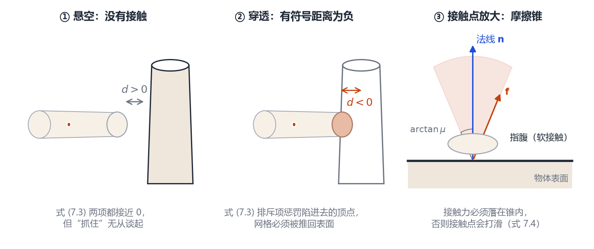
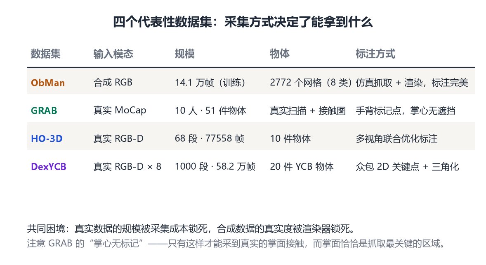
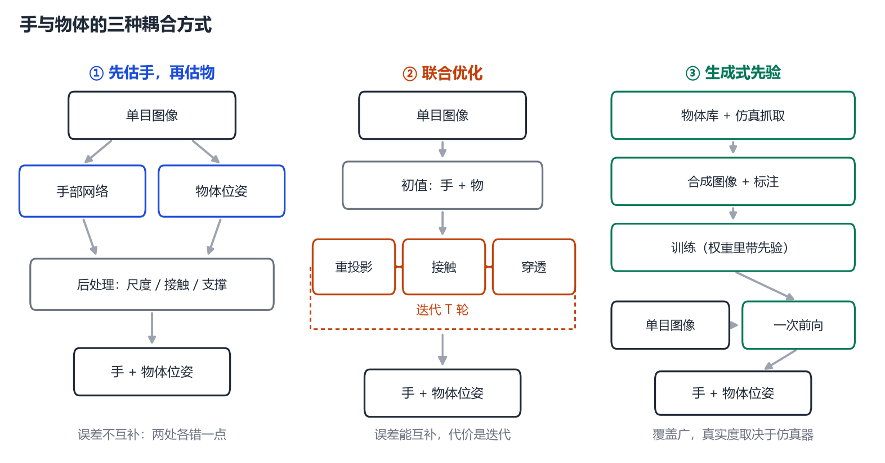
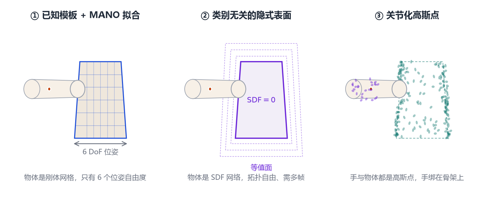

# 第 7 章 手物交互与抓取

> **本章导读**：前两章的手是“悬在空中”的——没有东西可抓，也没有东西挡着。可手的意义恰在于操作物体：握住杯子、拧开瓶盖、捏起硬币。一旦把物体放进来，问题就从“估计一只手”变成“同时估计手和物体，并且让它们看起来像是真的在接触”。本章讲四件事：任务怎么定义、为什么接触是核心难点、数据从哪来、方法谱系怎么分；最后落到失败模式与机器人上的用法。前置知识是第 5 章的 MANO 与第 6 章的重建范式。

## 7.1 任务定义：手、物体、接触

这一节把“手抓东西”写成一条可计算的任务，并把输出拆成四层。结论是：手物交互的输出不是“一个网格”，而是“一组互相约束的量”，缺任何一层，结果都不能用。

### 7.1.1 输入与输出

先把输出分层，因为不同应用要的层次不同，混着说会导致“精度够用却用不了”的争论。输入则比单手重建更苛刻：物体带来遮挡，也带来尺度线索。

输入有四种形态：单张 RGB 图、单目视频、RGB-D、多视角采集。分辨率与前两章相同，但手占的像素往往更少——因为要拍进物体，机位必须退后。一张 640×480 的图里，握着杯子的手大约是 120×90 像素，杯子本身 60×90（示意）；手被物体挡掉的可见面积常在 30%–50%。这个比例是单手重建里不存在的：第 6 章的手最多被自己挡住，这里是被别人挡住。

输出分四层，从“看得见”到“看不见”。

1. **手的参数**。与第 6 章相同：形状 $\boldsymbol{\beta}\in\mathbb{R}^{10}$、姿态 $\boldsymbol{\theta}\in\mathbb{R}^{48}$、相机 $\boldsymbol{\pi}\in\mathbb{R}^{3}$。
2. **物体的位姿**。刚体情形是 6 个自由度：旋转 $\mathbf{R}\in SO(3)$ 与平移 $\mathbf{t}\in\mathbb{R}^{3}$。物体形状未知时，还要加形状参数或一个隐式码。
3. **接触**。最常用的是**接触图**（contact map）：一张贴在物体表面的图，每个位置记录“被碰到的概率”或“被碰到的面积比例”。也有反过来标在手上的版本。
4. **力与稳定性**。摩擦锥、力闭合这类量，几乎无法从图像直接观测，只出现在评价和损失里。

这四层能不能从图像里直接读出来，差别很大。表 7-1 把它们并排放。

**表 7-1**　四层输出与它们的可观测性。

| 层次 | 能否直接观测 | 常用表示 | 谁提供 |
|---|---|---|---|
| 手参数 | 间接（靠关键点与轮廓） | 61 个数 | 手部网络或拟合 |
| 物体位姿 | 间接（靠角点、纹理、轮廓） | 旋转 3 + 平移 3 | 位姿估计或联合优化 |
| 接触 | 部分（遮挡即丢失） | 物体表面上的概率图 | 距离计算，或人工标注 |
| 力 | 不能 | 摩擦锥、力闭合指标 | 物理引擎或优化 |

把手的关节和物体的角点放在同一个观测模型里，就是这一章所有方法的共同起点：

$$
E_{\text{data}}=\sum_{k\in\mathcal{K}_h}\big\|\Pi\big(\mathbf{J}_k(\boldsymbol{\beta},\boldsymbol{\theta});\boldsymbol{\pi}\big)-\mathbf{u}_k\big\|^{2}+\sum_{m\in\mathcal{K}_o}\big\|\Pi\big(\mathbf{R}\mathbf{x}_m+\mathbf{t};\boldsymbol{\pi}\big)-\mathbf{v}_m\big\|^{2}
\tag{7.1}
$$

逐项读法：

- $\mathcal{K}_h$ 是手的关键点集合（21 个），$\mathbf{J}_k\in\mathbb{R}^{3}$ 是关节位置，$\mathbf{u}_k\in\mathbb{R}^{2}$ 是它在图上的像素坐标。
- $\mathcal{K}_o$ 是物体上的标记点集合，$\mathbf{x}_m\in\mathbb{R}^{3}$ 是物体模型坐标系下的点，$\mathbf{R}\mathbf{x}_m+\mathbf{t}$ 把它搬到相机坐标系，$\mathbf{v}_m\in\mathbb{R}^{2}$ 是观测到的像素坐标。
- $\Pi(\cdot;\boldsymbol{\pi})$ 是投影，两项的量纲都是像素平方，可以直接相加。
- 未知量是 $\boldsymbol{\beta},\boldsymbol{\theta},\boldsymbol{\pi},\mathbf{R},\mathbf{t}$，一共 $10+48+3+6$ 个。自由度从单手的 61 涨到 67，而且多了两个需要互相解释的对象。

一个数字例子（示意）：物体位姿的旋转差 1 度，在 20 厘米外造成的点位移约 $200\ \mathrm{mm}\times\tan 1^\circ\approx 3.5$ 毫米。而 3.5 毫米在 640×480 的图上大约 1 个像素。也就是说，**物体位姿的 1 度误差，在图像上几乎看不出来，在物理上却可能让手指穿进去 3 毫米。**

边界与失败模式：物体若接近对称（圆柱形杯子绕轴旋转），那个旋转分量本来就不可判，任何方法都会给出任意的值；无纹理物体上能用的角点很少，重投影项几乎不起作用；小物体在图上只有几十个像素，位姿精度的下限由分辨率决定。

### 7.1.2 抓取的分类：为什么先分类再回归

“抓住”不是一种动作，它是一族动作。把动作分类，是判断“哪些接触该发生”的前提。

抓握分类学（grasp taxonomy）按接触面与手指的用法分组，最常用的一套来自 Cutkosky 在 1989 年的工作。它先把抓取分成两大类：**力量型**（power grasp，掌心与多指包住物体，稳定性来自大面积接触）与**精细型**（precision grasp，只用指尖，稳定性来自对捏）。两大类再往下分：柱形握、球形握、钩握、侧捏（钥匙捏）、指尖捏、三指捏（tripod）。

分类不是学术游戏，它直接决定重建时要约束什么：

- 力量型抓取的关键是**掌心与物体的贴合面积**。重建时，手掌的位置比手指的姿态更重要，因为掌心贡献了大部分接触。
- 精细型抓取的关键是**指尖与拇指的对抗**。重建时，两根手指的相对位置错 5 毫米，抓取就不成立，但整只手的位置错 5 毫米影响不大。
- 侧捏（比如夹住一张卡片）靠的是拇指与食指侧面的摩擦，接触面窄，对姿态误差最敏感。

数字上有一个有意思的对照：人的一只手有 21 个自由度，二指夹爪只有 1 个（开合），三指灵巧手通常有六到十几个。分类学的价值就在于把“21 维的手”抽象成“几类接触模式”，这样人的示范才能映射到机械手上。

**表 7-2**　常见抓取类型与它们对重建的要求。

| 类型 | 主要接触区域 | 对重建最敏感的量 | 机械手对应 |
|---|---|---|---|
| 力量型（柱形握） | 掌心 + 四指 + 拇指 | 手掌位姿、手指包络半径 | 多指手、软体手 |
| 球形握 | 掌心 + 五指张开 | 手指张开角 | 多指手 |
| 精细捏（指尖对捏） | 拇指与食指指腹 | 两指尖的相对位置 | 二指夹爪、三指手 |
| 侧捏（钥匙捏） | 拇指与食指侧面 | 手腕朝向 | 二指夹爪 |
| 钩握（提袋子） | 四指近节背面 | 手指弯曲角、前臂朝向 | 钩形末端 |

表里没有列“递、接、换手、使用工具”。这些动作不属于任何单一类别，物体在手中的位置会变，接触区域也会变——这也是为什么 GRAB 那批数据把“抓取”的概念拓宽到了这些动作（7.4 节）。

所以，任务定义要到“四层输出 + 抓取类型”才算完整；只报一个网格误差，说不清这个重建能不能支撑下游的抓取。

## 7.2 为什么手和物体必须一起估计

这一节用三个具体后果说明“分开估计再拼起来”为什么不行。结论是：手和物体互为证据，分开估计会把彼此的证据都丢掉。

先做一个思想实验。给你一张照片：一只手握着一个马克杯。你分别跑两个“专家系统”——一个只估手，一个只估物体——然后把结果叠在一起。会发生什么？

**第一，手会被物体“吃掉”一块。** 只估手的模型看不见被杯子挡住的那部分手指，它只能靠 MANO 的先验去猜。猜出来的手指很可能穿过杯壁，或者缩在杯子里面。第 6 章说过，遮挡关节的精度大约只有可见关节的一半；在手物场景里，被挡的恰恰是最关键的掌侧手指。

**第二，物体会飘。** 单目图像里的物体位姿有尺度和深度歧义。一个 8 厘米的杯子和一个 16 厘米的杯子在图上可以一样大。但如果这只手是标准大小（MANO 的手长 18 厘米），那么“手能握住它”这件事本身就提供了尺度约束：虎口跨度只有 6–8 厘米，能被这个跨度包住的杯子，直径就被限制在一个窄区间里。**手是物体的一把尺子。**

**第三，接触关系没人管。** 真实抓取里，指腹贴着物体表面，拇指与其它手指形成对抗。这种“贴住但不穿透”的关系，是判断一个重建结果合不合理的最强证据。分开建模时，没有任何一项损失在管这件事。

从 2019 年起，这条线上的工作都建立在同一个判断上：**手和物体是一个系统，必须联合估计。** 而“联合”带来了一个新问题——用什么表示物体？

这个问题比看起来难。人体有 SMPL，手有 MANO，因为人体和手的形状空间相对稳定、可以统计学习。物体呢？世界上有几万种杯子、几万种瓶子，它们的形状没有共同的拓扑，也没法用几十个 PCA 系数概括。于是研究分成了两条路：一条假设“物体模型已知”（CAD 或扫描好的网格），另一条试图“从图像里现场重建物体”。这条分界线决定了方法的全部结构。

所以，“联合”不是把两个网络的输出相加，而是让它们共享同一套几何证据与同一组物理约束；一旦分开，手失去尺度，物体失去支撑，接触失去意义。

## 7.3 接触：距离、穿透与力

这一节把“接触”从一个直觉拆成三个可以计算的东西：距离、穿透、力。结论是：几何层面能算准，力层面只能估——所以所有方法都在“看起来像抓”和“物理上抓得住”之间选边。

### 7.3.1 三种几何状态

接触在几何上只由一件事决定：手部表面与物体表面的相对位置。把它写成有符号距离，三种状态就一目了然。

设 $\mathrm{SDF}_{\mathcal{O}}(\mathbf{x})$ 是点 $\mathbf{x}$ 到物体表面 $\mathcal{O}$ 的**有符号距离场**（Signed Distance Field）：点在物体外部为正，在内部为负，绝对值是到最近表面的距离。单位是米（或毫米）。

- **悬空**：$d>0$。手指与物体之间有空隙。
- **贴合**：$d\approx 0$。表面相接，这是抓取要的状态。
- **穿透**：$d<0$。手指陷进物体。

<figure class="fig">

<figcaption><b>图 7-1</b>　接触的三种状态与摩擦锥。左：手悬空，$d\gt 0$，两项损失都接近 0，但“抓住”无从谈起；中：手陷进物体，$d\lt 0$，式 (7.3) 的排斥项产生惩罚；右：接触点的放大图，接触力 $\mathbf{f}$ 必须落在以法线 $\mathbf{n}$ 为轴、半角为 $\arctan\mu$ 的锥内。</figcaption>
</figure>

把距离阈值化，就得到接触的离散判定，也就是接触图的值：

$$
c(\mathbf{x})=\mathbf{1}\big[\,\big|\mathrm{SDF}_{\mathcal{O}}(\mathbf{x})\big|<\tau\,\big],\qquad
\kappa(\mathcal{O})=\frac{1}{|\mathcal{O}|}\sum_{\mathbf{x}\in\mathcal{O}}c(\mathbf{x})
\tag{7.2}
$$

逐项读法：

- $\mathbf{x}$ 在物体表面附近取点，$\mathrm{SDF}_{\mathcal{O}}(\mathbf{x})=0$ 的地方就是表面本身；$\tau$ 是接触阈值，单位米。GRAB 这类数据集用顶点到表面的距离加阈值来定义接触，阈值在几毫米的量级。
- $|\mathcal{O}|$ 是采样点个数。$c(\mathbf{x})\in\{0,1\}$ 是逐点的接触指示；$\kappa(\mathcal{O})\in[0,1]$ 是整块物体表面的接触面积比例，无量纲，用一个数就能概括“抓得实不实”。
- 实际使用时常把硬阈值换成软的形式（sigmoid 或距离的高斯核），这样对阈值附近的抖动不敏感，也能求导。

一个数字例子（示意）：一只 18 厘米长的手，指尖指腹的接触斑块直径约 1 厘米。五个指腹全接触时，接触面积约 $5\times\pi\times 0.5^2\approx 4$ 平方厘米；一个直径 7 厘米、高 10 厘米的杯子，侧面积约 220 平方厘米。接触比例只有 2% 左右。**抓取是“极少数点承担全部稳定性”的事**，这也解释了为什么几个毫米的穿透在视觉上无所谓，在物理上是致命的。

### 7.3.2 接触损失：吸引与排斥

有了距离，就可以把“该接触的地方要贴上、不该穿的地方要退出来”写成一个损失。它的输入是手部顶点与物体表面，输出一个标量。

$$
\mathcal{L}_{\text{contact}}=\underbrace{\sum_{\mathbf{o}\in\mathcal{O}}\min_{\mathbf{v}\in\mathcal{H}}\|\mathbf{o}-\mathbf{v}\|^{2}}_{\text{吸引：物体表面要靠近手}}+\ \lambda\underbrace{\sum_{\mathbf{v}\in\mathcal{H}}\max\big(0,-\mathrm{SDF}_{\mathcal{O}}(\mathbf{v})\big)^{2}}_{\text{排斥：手不能陷进物体}}
\tag{7.3}
$$

逐项读法：

- $\mathcal{O}$ 是物体表面采样点的集合，$\mathcal{H}$ 是手部顶点集合（778 个，或加密后的采样）。
- 第一项单位是米平方：对物体上每个点，找离它最近的手部顶点，把距离平方累加。
- 第二项只在顶点陷入物体时非零（$\max(0,-\mathrm{SDF})$），深度越大惩罚越重，同样是米平方。
- $\lambda$ 是两项的权重，无量纲，但非常关键：偏大就得到“手退出物体外一截”的结果，偏小就得到“手穿进去一半”的结果。

Hasson 等人用这个损失做了第一个端到端的手物联合重建：输入一张 RGB 图，网络同时输出 MANO 参数与物体的形状、位姿、尺度 [@hasson2019joint]。论文自己也指出，两项之间的平衡很难调。

这个写法有一个明显的弱点：**它不区分“该接触的地方”和“不该接触的地方”。** 手背碰到杯子也该被“吸引”吗？把手掌的吸引和手背的吸引一视同仁，模型就会倾向于“让整只手裹住物体”，得到“贴得很紧但姿态别扭”的解。改法是用接触图或部位标签给吸引项加权——只让指腹、掌心参与吸引。代价是标注：你需要知道哪些顶点“应该”接触，而这恰恰是要估计的东西。

### 7.3.3 摩擦锥与力闭合

几何上贴住了，物理上未必抓得住。接触点能提供的力有方向限制，这个限制就是**摩擦锥**（friction cone）。

设接触点的法线为 $\mathbf{n}$（单位向量），摩擦系数为 $\mu$（无量纲，玻璃与皮肤的干燥组合大约 0.5，沾油后可能降到 0.1–0.2），接触力为 $\mathbf{f}\in\mathbb{R}^{3}$。把力分成法向与切向两部分，$\mathbf{f}=f_n\mathbf{n}+\mathbf{f}_t$，静摩擦的条件是：

$$
\|\mathbf{f}_t\|\ \le\ \mu\,f_n,\qquad f_n\ \ge\ 0
\tag{7.4}
$$

逐项读法：

- $f_n=\mathbf{f}\cdot\mathbf{n}$ 是法向分量（压向物体的那部分），必须非负——手只能推不能拉。
- $\mathbf{f}_t=\mathbf{f}-f_n\mathbf{n}$ 是切向分量，单位都是牛顿。
- 几何上，这条不等式把 $\mathbf{f}$ 约束在一个以 $\mathbf{n}$ 为轴、半角为 $\arctan\mu$ 的圆锥里。$\mu=0.5$ 时半角约 26.6 度，$\mu=0.2$ 时约 11.3 度。
- 一旦切向需求超过 $\mu f_n$，接触点就会**滑动**：指尖在物体表面滑移，抓取姿态被破坏。滑动是所有失败模式里最难从图像上看出来的一种，因为它在单帧里只是一个很小的位移。

**力闭合**（force closure）是判断“这个抓取稳不稳”的经典条件：存在一组接触力，满足式 (7.4)，并且能够抵抗任意方向的外力旋量（三个方向的力加三个方向的力矩）。直观地说，不管你怎么推、怎么拧这个物体，手指都能顶住。

判断力闭合在数学上是一个凸优化问题：在所有接触点上找一组满足摩擦锥的非负法向力，使它们的合力矩为零、且能张成整个六维旋量空间。工程上常用的近似指标是 $\epsilon$ 指标（最差方向上的抵抗能力）和体积指标。这些指标不只用于评价，也被用作训练的损失——让网络生成“力闭合”的抓取，比让它生成“看起来像抓取”的抓取难得多。

所以，接触这件事有三层：距离能算准，穿透能罚住，力只能估。凡是声称“物理上真实”的结果，都要回答一个问题——那个力是从哪来的。

## 7.4 数据从哪来，为什么贵

这一节把采集手段与四套代表性数据摆在一起，看“标注”这件事到底贵在哪。结论是：贵在三件事同时要准——手 48 维姿态、物体 6 自由度位姿、以及两者之间的接触，而遮挡让三件事都无法独立完成。

先看采集手段能拿到什么。手部动作捕捉有四条传统路线，每一条都在某些量上先天缺失。

**表 7-3**　四种采集手段的取舍。

| 手段 | 能采到什么 | 先天缺失 | 代价 |
|---|---|---|---|
| 数据手套 | 关节角度，频率高、无遮挡 | 手形被改变，接触无法采 | 设备贴合度影响姿态分布 |
| 光学标记点 | 手背与关节的三维位置 | 标记点太大，指缝放不下 | 遮挡即丢点，需要后期补 |
| 多视角 RGB-D | 手与物体的几何 | 掌心接触被手自己挡住 | 场地、同步、标定；物体需单独建模 |
| 合成渲染 | 全部量，完美标注 | 真实感（光照、材质、噪声） | 域差异，需大量真实数据校正 |

GRAB 有一个细节值得单独说：采集时被试戴着动作捕捉标记，但**只有手背贴标记，掌心完全空着**。这样抓握时掌心能真实接触物体 [@taheri2020grab]。这是“想要接触数据，就必须放弃一部分手部数据”的典型妥协。

四套数据集代表了四种不同的取舍。图 7-2 把它们并排对比。

<figure class="fig">

<figcaption><b>图 7-2</b>　四个代表性数据集的逐项对比。注意“标注方式”一列：每个数据集的强项恰好是它的采集方式的直接结果——合成数据标注完美，GRAB 有真实掌面接触，HO-3D 能在遮挡下标注，DexYCB 则胜在规模与统一的任务定义。</figcaption>
</figure>

**ObMan：全部合成。** Hasson 等人从 ShapeNet 里选了 8 类日常物体（瓶子、碗、罐子、刀、手机、相机、遥控器等），共 2772 个网格，用 GraspIt 仿真生成 21000 个抓取，再把 MANO 手摆成抓取姿态、渲染成图像，训练集共 14.1 万张 [@hasson2019joint]。好处是标注完美、规模不限；坏处是渲染图和真实照片的分布差异明显，网络容易学到“渲染器的味道”。

**GRAB：全身 + 物体 + 接触。** Taheri 等人请了 10 位被试（5 男 5 女），抓握 51 件日常物体，每个动作都要求全身参与——不只是手，手臂、躯干、甚至另一只手都会配合 [@taheri2020grab]。有了手、身体、物体的三维网格，就可以计算接触区域：物体表面哪些点被身体碰到了，碰了多大面积。这批数据把“抓取”的概念拓宽了：不只是“单手稳稳举起物体”，还包括递、接、换手、使用。这些动作里，物体在手中的位置会变，接触区域也会变。

**HO-3D：多视角 + 联合优化标注。** Hampali 等人用一台或多台 RGB-D 相机拍手抓物体的序列，然后用一个关键技巧做标注：把“手的三维位姿”和“物体的六自由度位姿”放进同一个优化里，在所有帧上同时求解 [@hampali2020honnotate]。手不能穿进物体、接触处要贴合，这两个约束让遮挡帧也能被正确标注。最终得到 68 段序列、77558 帧、10 个人、10 个物体，是第一个无标记的真实手物数据集。

**DexYCB：规模化 + 标准化任务。** Chao 等人把任务限定得很窄：从桌上抓起物体。但把规模做大了——10 位被试、20 个 YCB 物体、8 个视角、1000 段序列、58.2 万帧 RGB-D [@chao2021dexycb]。标注方式是众包人工标二维关键点（手 21 个点、物体若干点），再用多视角三角化和拟合得到三维。它的价值在于基准：任务定义清晰、评价协议统一，后来的方法几乎都会在 DexYCB 上报一个数。

把四个数据集并排看，会发现一个共同的困境：**真实数据的规模被采集成本锁死，合成数据的真实度被渲染器锁死。**

贵在哪，可以逐项摊开：

1. **物体要单独建模。** 每一件物体都要先扫描或找到 CAD 模型，才能谈“位姿”。一个 51 件物体的数据集，背后是 51 个网格。
2. **手与物体要同时标。** 手部 48 维、物体 6 自由度、相机 3 个参数，一起在一个优化里解；解错了很难从数值上发现，只能靠人逐帧看渲染。
3. **遮挡帧没有捷径。** 单帧的两维标注在遮挡帧上没有意义——被挡住的手指根本没有像素。只能靠多视角或前后帧联合推断。
4. **接触是导出量，但导出前要先对齐。** 接触标注本身不需要人工，可它依赖手与物体的网格都对齐到毫米级，前面的误差会全传到接触上。

所以，手物数据的规模停在“万帧”这个量级，而手部重建能到“百万样本”，差别就在物体这一侧——物体没有 MANO 那样的通用模型，每换一件就要重新建模。

## 7.5 方法谱系：三种耦合方式

这一节把方法按“手与物体怎么耦合”分成三类，并说清每类的代价。结论是：解耦的便宜但上限低，联合优化的准但需要物体模型，生成式先验覆盖面广但物理真实性存疑。

### 7.5.1 先估手，再估物

最省事的做法是把两件事分开：先用第 6 章的方法估手，再用一个六自由度位姿估计器估物体，最后用几何关系把两者对齐一遍。

具体的后处理通常有三步：用“手是尺子”修正物体的尺度；用接触检查把明显穿透的物体推开；用物体的支撑关系（比如放在桌面上）修正平移。

这条路线的好处是模块可替换：手部模型升级了，直接换；物体位姿估计换成更强的，也直接换。坏处是误差不互补：手在遮挡下估错、物体在无纹理时估错，两个错叠加起来，接触检查只能发现“明显不合理”，无法指出谁错了。它在工程里很常见（尤其是实时系统），但作为研究方法已经很少单独出现。

### 7.5.2 联合优化：用几何约束耦合

第二类把两者放进同一个优化问题，用接触与穿透作为桥梁。目标函数通常是几项的加权和：

$$
E_{\text{joint}}=\lambda_{d}E_{\text{data}}+\lambda_{c}\mathcal{L}_{\text{contact}}+\lambda_{p}E_{\text{pen}}+\lambda_{s}E_{\text{shape}}+\lambda_{t}E_{\text{temp}}
\tag{7.5}
$$

逐项读法：

- $E_{\text{data}}$ 就是式 (7.1) 的重投影误差，单位像素平方。
- $\mathcal{L}_{\text{contact}}$ 是式 (7.3) 的吸引加排斥，单位米平方。
- $E_{\text{pen}}$ 是单独的穿透惩罚，形式同式 (7.3) 的排斥项，单位米平方。有些实现把它与接触损失合并，有些分开以便分别调权重。
- $E_{\text{shape}}$ 是物体形状的正则：物体网格未知时用平滑项（Laplacian 或法线一致），用隐式场表示时用 Eikonal 项（让梯度模长接近 1）。这一项只在物体形状也要估的时候出现。
- $E_{\text{temp}}$ 是时序项：相邻两帧的参数差，单位是各自参数的单位，所以必须按参数分组加权。
- 五个 $\lambda$ 都是无量纲权重，作用是把不同量纲的项拉到同一量级。这是这类系统最难调的部分：单位不统一，权重就不能共用一套经验值。

代表工作有两条。Hasson 等人的端到端版把 $E_{\text{data}}$ 与 $\mathcal{L}_{\text{contact}}$ 放在同一个网络里联合训练 [@hasson2019joint]。HOnnotate 则是离线版：把式 (7.5) 在整段序列上一起优化，用来生产标注 [@hampali2020honnotate]。同一套数学，一个用在推理，一个用在标注。

联合优化的强项是“互相纠错”：手被挡住时物体的几何提供约束，物体无纹理时手的尺寸提供尺度。弱项是它需要物体模型——没有 CAD 或扫描网格，$\mathrm{SDF}_{\mathcal{O}}$ 就无从计算。

### 7.5.3 生成式先验：先造数据，再学估计

如果真实数据只有几万帧，而物体有上万种，那么“覆盖”是不可能的。这条线回答的是：能不能用算法造出足够多、足够真实的抓取？

**GANHand：把抓取当成生成问题。** Corona 等人不直接回归一个抓取，而是训练一个条件 GAN：给定场景里物体的几何（点云或体素），生成器输出一组 MANO 手参数，判别器判断“这看起来像不像真实的抓取” [@corona2020ganhand]。判别器是用真实抓取数据训出来的，所以生成器学到的不是“手能贴上去”，而是“手会这样贴上去”。这条路线顺手产出了 YCBAfford 数据集：为了训练与评测，他们对 YCB 物体手工标注了大量 MANO 抓取姿态。

**ArtiBoost：在线合成 + 难度自适应。** ArtiBoost 的出发点是：离线合成的数据是固定的，而训练过程中模型“已经学会了什么”在变，所以应该边训边造，缺什么补什么 [@yang2022artiboost]。

他们定义了一个三维离散空间，叫 CCV 空间（Composited hand-object Configuration and Viewpoint）：

$$
\mathcal{S}=\big\{\,(n_o,n_p,n_v)\ \big|\ n_o\le N_o,\ n_p\le N_p,\ n_v\le N_v\,\big\}
\tag{7.6}
$$

三个维度分别是物体类型、手部姿态、视角方向，$N_o,N_p,N_v$ 是各自的取值个数。以 DexYCB 的 20 个物体为例，$20\times100\times288=576000$ 个组合。构造方式是：对每个物体做基于接触约束的抓取拟合（每个物体试 300 个初值，人工剔除严重穿透和不自然的，最后保留最多 100 个），再对每个抓取采样视角。

训练时，每个 batch 混入一批从 CCV 空间采样、现场渲染的合成图。采样不是均匀的：每个组合有一个权重，训练损失大的组合权重高——模型在哪里错得多，就多看哪里的合成数据。论文的消融实验显示，同样数量的合成抓取，来自 CCV 空间的那批比来自 YCBAfford 的更能提升性能。

这个思路其实很朴素：数据增强的本质是“在模型薄弱的方向上加密采样”。ArtiBoost 只是把它做成了一个闭环。

<figure class="fig">

<figcaption><b>图 7-3</b>　三种耦合方式。左：先估手、再估物，靠后处理对齐，模块可替换但误差不互补；中：联合优化，手与物体通过接触与穿透两项互相约束，需要物体模型；右：生成式先验，用仿真与生成模型造出大量抓取，把先验压进网络权重，覆盖面广但物理真实性取决于仿真器。</figcaption>
</figure>

**表 7-4**　三条路线的取舍。

| | 先估手再估物 | 联合优化 | 生成式先验 |
|---|---|---|---|
| 需要物体模型 | 需要（在位姿估计里） | 需要（SDF 或网格） | 合成时需要，推理时常不需要 |
| 推理速度 | 最快（两次前向） | 慢（迭代） | 快（一次前向） |
| 误差能否互补 | 不能 | 能 | 部分（靠先验） |
| 主要风险 | 误差叠加 | 权重难调、初值敏感 | 学到仿真器的痕迹 |
| 代表工作 | 早期流水线 | Hasson、HOnnotate | GANHand、ArtiBoost |

所以，三种耦合方式的差别是“约束放在哪里”：放在后处理里、放在优化目标里、还是放在训练数据里。约束越靠后，越灵活也越弱；越靠前，越强也越难调。

## 7.6 表示的演化：模板、隐式、高斯

这一节看“物体怎么表示”这件事的三种答案，以及它们各自要求多少观测。结论是：表示越自由，需要的观测越多，这是这条线上唯一没有例外的交换。

前面所有方法都有一个隐含前提：物体有模板。要么是已知的 CAD 模型，要么是一个学好的物体形状空间。真实场景里，你手里的那支笔可能从来没被扫描过。

**隐式表面：类别无关的重建。** HOLD 就是冲着这个前提去的 [@wang2023hold]。它只需要一段单目视频，物体是什么类别完全不管，直接从视频里把手的关节和物体的表面一起重建出来。技术上的关键是用隐式表示替代模板：物体不再是“一个已知网格 + 一个位姿”，而是一个由神经网络表示的连续表面（有符号距离场：给一个三维点，网络告诉你它在表面内还是外、离表面多远）。手的表面也用类似的方式表达，两者通过“不能互相穿透、接触处要贴合”的约束耦合在一起。

隐式表示的好处是拓扑自由——杯子有把手、碗是凹的、剪刀有两个环，都不需要预先规定网格结构；坏处是它需要多视角或多帧的观测才能约束住形状，单帧基本无解。原因不难推：一个没有模板的表面，每个点都要靠观测来确定位置，而单帧只给出一条视线。

**关节化高斯：把表面交给点云。** 2023 年之后，三维重建的表示本身变了。3D 高斯泼溅（3D Gaussian Splatting，3DGS）用一堆带方向、带颜色、带透明度的椭球表示场景，渲染快、质量高，而且可以求导 [@kerbl20233dgs]。

MANUS 把 3DGS 用在手物抓取捕捉上 [@fan2024manus]。它的核心想法是：不要一上来就把手和物体压成网格，而是先用高斯点表示整个“手 + 物体”的场景，从多视角视频里优化这些高斯点，然后再把手的高斯点**绑定到 MANO 的骨架上**——手弯曲时，对应的高斯点跟着刚体变换走。这叫“关节化高斯”（articulated Gaussians）。

这样一来，几何不再是固定的，而是可以随姿态变形；同时，物体也不需要事先知道模型，它只是另一组高斯点。输出的结果既包括手部姿态（MANO 参数），也包括物体的表面。

<figure class="fig">

<figcaption><b>图 7-4</b>　手物联合重建的表示演化。左：已知物体模板 + MANO 拟合，物体是刚体网格、只有 6 个位姿自由度；中：类别无关的隐式表面，物体由网络表示、拓扑自由；右：关节化高斯点，手与物体都由高斯点表示，手的高斯绑定在 MANO 骨架上。三者对“物体先验”的依赖依次减弱，对“观测数量”的要求依次增强。</figcaption>
</figure>

图 7-4 的三个格子可以当成一把尺子：左边只需要一幅图加一个模型，中间需要一段多视角视频，右边需要多视角视频加较长的优化时间。

从更长的历史看，这里有一个趋势：**参数化模型从“表示”退到“骨架”。** 手仍然用 MANO 描述姿态，但表面细节交给高斯点或隐式场。姿态由低维参数管，外观由高维表示管，两者分工。这个分工在人体重建里也出现过，代价同样是“需要更多观测”。

所以，物体表示的演化方向是“用观测换自由”：模板最省观测，隐式场次之，高斯点最费观测。选哪一个，取决于你能拍到多少帧、能不能控制视角。

## 7.7 失败模式清单

这一节把工程上最常见的失败收成清单，并给出各自的症状与检查办法。结论是：手物交互的失败大多表现为“看起来对、物理上不对”，肉眼检查必须针对具体症状。

1. **穿模。** 手指陷进物体，或物体的把手穿过手掌。原因通常是穿透惩罚太弱，或者物体模型与实际物体尺寸不符（用 8 厘米的模板去套 9 厘米的杯子）。检查办法：渲染时给手和物体染不同颜色，看有没有交叠；或者逐顶点算有符号距离，报负值的比例。
2. **物体漂移。** 物体在序列里慢慢“游走”，或者绕自身轴旋转。原因是对称性（圆柱绕轴不可判）与纹理缺失（角点约束太弱）。检查办法：把物体位姿的六个分量画成时间曲线，看哪个分量在无规律地飘。
3. **少见物体。** 训练集里没有的类别，形状被强行拉成“像杯子”的样子。原因是方法依赖类别先验或检索库。检查办法：换一件没在训练集里出现的物体，看误差是否突然放大一个量级。
4. **双手协同。** 两只手一起拿一个物体（比如拧瓶盖）时，两只手各自估得不错，但相对位置错，物体被“扯”成两块。原因是两手的联合约束没有显式建模。
5. **接触但无力。** 几何上贴住了，但接触点全在同一侧，没有对抗。这种抓取在图像上完全合理，一动就掉。检查办法：算一下力闭合指标；人工检查接触点是否分布在物体的两侧。
6. **时序跳变。** 手与物体的相对位姿在相邻帧之间突然变化，物体“弹”了一下。原因是逐帧独立估计，且接触约束每帧独立求解。
7. **软体失效。** 抓布、抓塑料袋、捏面团时，物体的形状随接触改变，而所有方法都假设物体是刚体。表现是物体被“抓”成了一个固定形状。

**表 7-5**　失败模式与检查手段。

| 现象 | 最可能的成因 | 五分钟内能做的检查 |
|---|---|---|
| 穿模 | 穿透权重太小、物体尺寸不符 | 统计负距离顶点的比例 |
| 物体漂移 | 对称性、纹理缺失 | 画位姿分量的时间曲线 |
| 少见物体失效 | 依赖类别先验或检索 | 换一件训练集外的物体 |
| 双手错位 | 缺跨手约束 | 检查两手到物体的相对距离 |
| 看似抓住实则不稳 | 接触点分布单侧 | 看接触点的空间分布 |
| 时序跳变 | 逐帧独立求解 | 看相邻帧位姿差的最大值 |

这张表的用法是反过来的：不要先看指标，先按症状定位，再去查对应的成因。指标告诉你“平均差了 8 毫米”，症状告诉你“哪一帧不能用”。

所以，手物交互的失败模式有一个共同点——它们都是“物理上的错误”，而绝大多数指标是“几何上的误差”。要抓住它们，必须用几何之外的检查手段：穿透统计、接触分布、时序连续性。

## 7.8 应用：机器人抓取与遥操作

这一节看这套技术离开论文之后落在哪里，以及它和“纯视觉估计”的目标差在哪。结论是：机器人要的不是“像”，而是“能用”，两者的技术选型几乎在每个环节都不同。

**先看差别。** 纯视觉估计的目标是最小化重投影或几何误差，评价用毫米、度、面积比例。机器人抓取的目标是“抓起来不滑、不放偏、不撞”，评价是一次成功的抓取、一个稳定的位姿。这个差别带来三个直接后果：

- **误差的分布比均值重要。** 8 毫米的平均误差，如果全落在指腹，抓取可能仍然成功；如果落在物体位姿的旋转上，手指就会顶在错误的位置。所以机器人系统更关心“最坏方向上的余量”，而不是平均值。
- **对称性必须处理。** 一个圆柱形杯子的绕轴旋转对视觉指标无所谓，对抓取也无所谓——但对“连续轨迹”有所谓，因为相邻帧的位姿会跳。工程上要么固定一个规范朝向，要么在控制端做等价类处理。
- **实时性与闭环。** 机器人是闭环系统：抓失败了可以重试。这反而降低了对单帧精度的要求，提高了对延迟和一致性的要求。一帧 50 毫秒、误差 10 毫米的闭环系统，常常比一帧 2 秒、误差 5 毫米的开环系统更好用。

**示教与重定向。** 从人的示范视频里恢复手物轨迹，再映射到机械手上，这条路的技术难点不是精度而是**可比性**：人手有 21 个自由度、柔软的指腹，机械手可能只有二指夹爪或三指灵巧手。映射（retargeting）要做的是把“人手的抓取类型”抽象出来（7.1.2 节的分类学在这里派上用场），再在机械手的构型空间里找一个等效的抓取。指尖位置对指尖位置、掌心对掌心，这种对应关系需要人工定义。

**遥操作。** 操作者戴着手部捕捉设备，机械手实时跟随。这里最要紧的是延迟与映射的一致性：人的手转 30 度，机械手要在大约 100 毫秒内跟上，否则操作者会过度修正。力反馈更麻烦——手上的力传感器能测到接触力，视觉估不出这个量（7.3.3 节的摩擦锥只能给出“能不能撑住”，给不出“现在多大”）。

**其他场景。** AR/VR 里，用户徒手抓虚拟物体，系统要判断“他在抓什么”，更看重实时与稳定，精度要求低；动画与游戏里，让虚拟角色自然拿起道具，业界常用“先检索、再微调”——从抓取库里找最像的一个，再用手部 IK 贴合到具体道具上；康复与技能分析里，精确测量抓握时的接触面积、手指协同模式，用于评估进展，这时精度要求最高、实时性最不重要。

所以，同一套几何技术，在不同应用里的取舍完全不同：机器人要闭环与一致性，AR 要实时与稳定，康复要精度与可复现。选型之前先问“失败一次的代价是什么”，比问“误差多少毫米”有用。

## 本章小结

- 手物交互的输出分四层：手参数、物体位姿、接触、力与稳定性；前两层能从图像间接估计，接触只能部分估计，力基本不可观测。
- 抓取要先分类再回归：力量型、精细型、侧捏、钩握，各自对“手掌位姿”还是“指尖相对位置”更敏感；分类是把 21 维的手抽象成可映射到机械手的接触模式。
- 手与物体必须联合估计，理由有三：遮挡让单独估计失效、手为物体提供尺度（虎口跨度 6–8 厘米）、接触关系是判断合理性的最强证据。
- 接触分三层：距离能算准（有符号距离场），穿透能罚住（式 7.3 的排斥项），力只能估（摩擦锥、力闭合）。抓取是“极少数接触点承担全部稳定性”的事——五个指腹的接触面积约占杯子侧面积的 2%。
- 四个代表性数据集：ObMan（合成 14.1 万帧、2772 个网格）、GRAB（10 人 51 物体，全身 + 接触标注）、HO-3D（68 段序列 77558 帧，多视角联合优化标注）、DexYCB（1000 段序列 58.2 万帧，标准化抓取基准）。真实数据停在万帧量级，原因是物体没有 MANO 那样的通用模型。
- 方法谱系按“约束放在哪里”分三类：放后处理（先估手再估物）、放优化目标（联合优化）、放训练数据（生成式先验与在线合成）；物体表示则从模板走到隐式场、再走到关节化高斯，用观测换自由。
- 失败模式的共同点是“看起来对、物理上不对”：穿模、物体漂移、少见物体失效、双手错位、接触单侧、时序跳变、软体失效；检查手段要超出几何误差，转向穿透统计、接触分布与时序连续性。

## 思考题

1. 式 (7.3) 的吸引项把物体表面每个点都拉向最近的手部顶点。如果一个杯子有把手，而手只握住了杯身，这一项会产生什么错误倾向？你会怎么改？
2. 摩擦系数 $\mu=0.2$（比如沾了油的玻璃）时，摩擦锥的半角是多少度？这对“捏住”这个动作意味着什么？
3. HOLD 用隐式表面替代物体模板，代价是需要多帧观测。如果只有一张图，你会怎么折中？
4. ArtiBoost 按训练损失给合成样本加权。这样做有没有风险？会不会导致模型在某个困难子集上过拟合？
5. 假设你要做一个 AR 应用，让用户用手抓取虚拟物体。你需要的是“几何精确的重建”还是“物理合理的抓取”？两者的技术选型会有什么不同？
