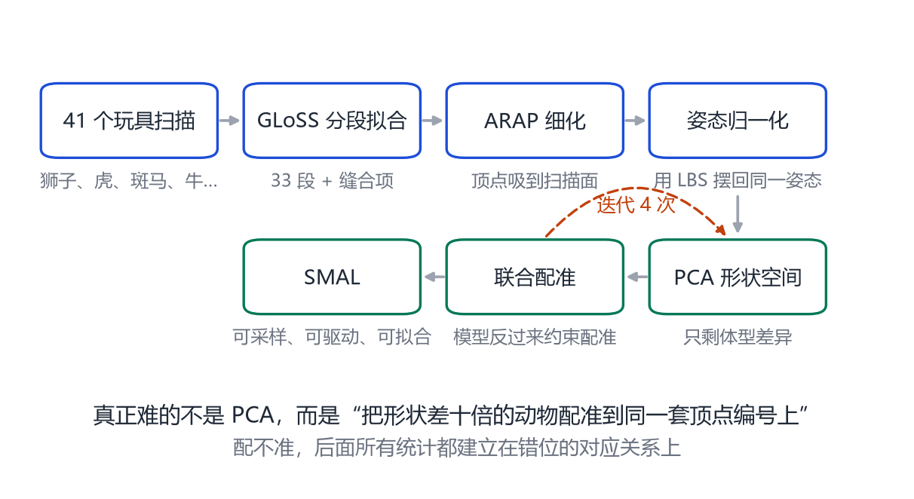
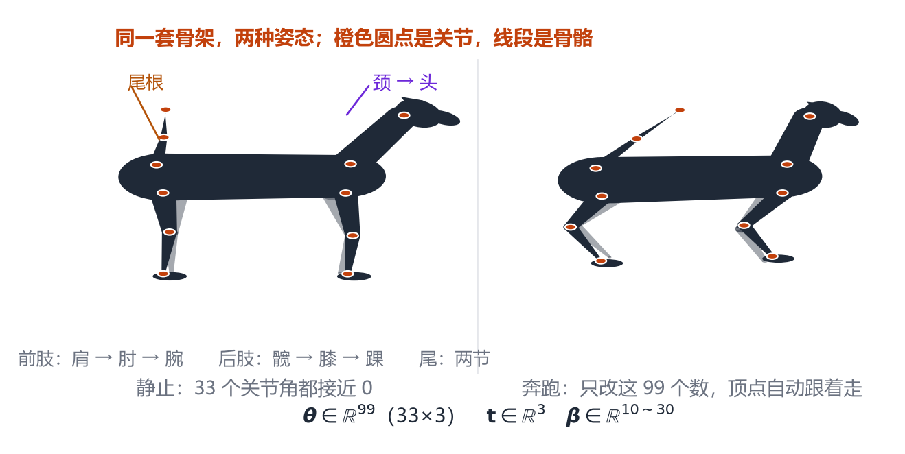
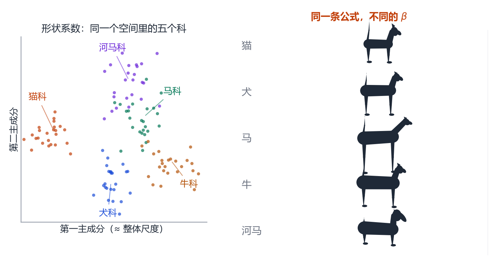
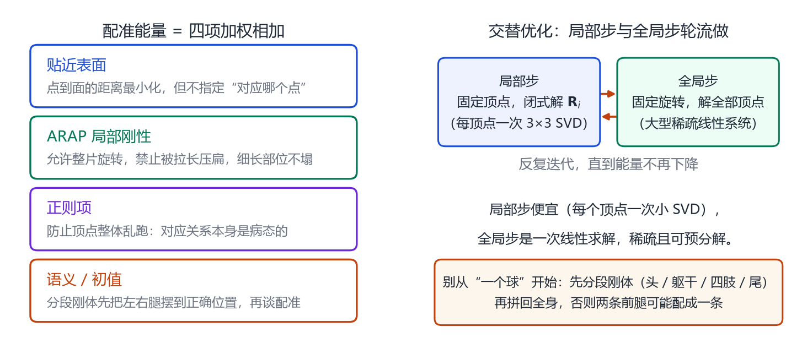

# 第 1 章 SMAL：四足动物的参数化

> **本章导读**：把人体的那套方法搬到动物身上，第一反应是“把 SMPL 的骨架改成四条腿”。但真正的困难不在骨架，而在**数据**：动物不会站着让你扫，物种之间的形状差异又极大。SMAL 的解法很聪明——用玩具模型学习形状空间。这一章讲它怎么把“狮子、老虎、马、河马”装进同一个模型，为什么 33 个关节、一套拓扑就能覆盖这么多物种，以及这套设计在哪里失效。

## 1.1 一个动物参数化模型要交代哪几件事

这一节先把“动物参数化”这件事的边界划清楚：一个模型要做到什么，才算真的把多个物种装进了同一组参数。结论是三条同时成立才算数——顶点有语义对应、参数能驱动形状与姿态、参数能从观测反推。缺任何一条，手里剩下的就只是一个“能摆姿势的网格”。

形式化地写，一个动物参数化模型是一个映射

$$
M:(\boldsymbol{\beta},\boldsymbol{\theta},\mathbf{t})\longmapsto\mathbf{V}\in\mathbb{R}^{N\times3},
\tag{1.1}
$$

输入是一组低维参数，输出是 $N$ 个顶点的网格。$\boldsymbol{\beta}$ 管形状（物种、年龄、胖瘦），$\boldsymbol{\theta}$ 管姿态（关节怎么转），$\mathbf{t}$ 管世界坐标里的位置。这个形式看起来和人体模型完全一样，真正的差别全在“这三个条件能不能满足”上。

**条件一：顶点有语义对应。** 第 3000 号顶点在狮子身上是左前腿的外侧，在河马身上也必须是左前腿的外侧。注意这不是“空间上最近的点”，而是“配准算法判定为同一解剖位置的点”。有了这条，才能把不同个体的顶点排成同一列做统计；没有这条，$\boldsymbol{\beta}$ 的每一维都失去意义，改一个系数得到的是“噪声”。

**条件二：参数可驱动。** 改 $\beta_1$ 应该稳定地改腿长，改 $\theta_{7}$ 应该稳定地弯某一个关节，而且改完之后网格不能自交、不能翻面。这条听起来平淡，实际是形状先验存在的理由：参数空间的合法区域只是 $\mathbb{R}^{d}$ 里很小的一块，跑到外面去几何就崩了。

**条件三：参数可反推。** 给定一张照片、一段视频或一个扫描，要能求出对应的 $\boldsymbol{\beta},\boldsymbol{\theta},\mathbf{t}$。这条决定了模型能不能用在视觉任务上：不能反推的模型只能做动画，不能做重建。

三条要求各自失效时的症状差别很大，值得列成一张表，因为排查时最先要判断的是“我遇到的到底是哪一类”。

| 要求 | 失效时的症状 | 成因 | 一分钟检查法 |
|---|---|---|---|
| 顶点对应 | 换一个个体，同一个 $\beta$ 维改的位置全变 | 配准把左右腿、内外侧弄混了 | 把某个形状基单独渲染成位移场，看它是否只改一小块 |
| 参数可驱动 | 参数在合法范围内，网格仍然自交、腿部翻面 | 形状空间没有先验，或 $\beta$ 跑到训练分布外 | 扫一个 $\beta$ 维，从 $-3\sigma$ 到 $+3\sigma$ 逐格渲染 |
| 参数可反推 | 从图像拟合出的 $\theta$ 与目视姿态不符 | 监督信号太弱，或尺度与相机没解耦 | 把重建结果投影回原图，遮一半看另一半 |

**那为什么不直接把 SMPL 改一改？** 这是最自然的想法，也是最先失败的想法。SMPL 的假设是“所有样本共享同一套拓扑、同一个骨架结构”：一条脊柱、两条腿、两条手臂、24 个关节、72 维姿态。动物不满足这个假设，而且是四个方向同时不满足。

- **肢体的数量与朝向不同。** 四足动物的前肢对应人的手臂，但关节弯曲方向、脚掌结构完全不同。人的肘向后弯，马的前肢在腕部几乎不弯，靠肩和肘完成大部分行程。把人的关节树直接搬到马上，弯曲方向是反的。
- **形状差异的量级不同。** 人与人之间的体型差异，大致可以用“高矮、胖瘦”两个方向概括；河马和猎豹的差异包括腿长比例、躯干长宽比、头骨形状、颈部长度，量级上差着好几倍。用一个从人体数据学出的形状空间去覆盖它们，等于要求线性模型外插到训练分布之外很远的地方。
- **没有公认的关键点。** 人体有相对统一的关节定义（肩、肘、腕、髋、膝、踝），人脸有一套 68 点规范。动物没有：狮子的肩在哪、马的飞节算不算一个关键点、尾巴要标几节，不同标注者的定义都不一样。评估和弱监督都失去共同的坐标系。
- **数据采不到。** 活体动物不配合摆姿势，三维扫描仪要求对象静止十几秒，野生动物连靠近都难。这四条里，前三条都可以靠“换模型结构”绕过，只有这一条绕不过去。

于是“把 SMPL 搬到动物”这件事，可以拆成三个必须重答的问题：**用什么模板、用什么骨架、用什么数据训练**。前两个是设计问题，第三个是资源问题。SMAL 的贡献里，最容易被低估的恰恰是第三个：它用一个近乎取巧的办法把“数据”这一项解决了，前两项才有机会被验证。

所以，动物参数化的门槛不在网络结构和损失函数，而在“用什么数据把顶点对应学出来”。理解 SMAL 要先理解它怎么绕开这个门槛。

## 1.2 用玩具把数据问题绕过去

这一节回答一个问题：既然真实动物的三维数据几乎不可能采，那用什么数据训练形状空间？结论是用一批摆好姿势的玩具动物扫描替代真实动物——把“扫不到”换成“扫得准”，代价是玩具与真动物之间留下三重域差距，后面每一代方法都在填这个坑。

2017 年，Zuffi 等人在 *3D Menagerie*[@zuffi2017menagerie] 中提出 **SMAL**（Skinned Multi-Animal Linear model，多动物线性蒙皮模型）。它的训练数据是 **41 个玩具动物扫描**，涵盖狮子、老虎、斑马、马、牛、河马等常见四足。这个数字放在人体领域显得可笑——SMPL 用的是几千个真人扫描——但它足以撑起一个可用的形状空间，原因在下一页。

### 1.2.1 为什么是玩具

玩具替代真动物，是四条理由叠在一起的结果。

**第一，姿态可以摆。** 玩具的关节是球铰或阻尼铰，可以固定在任意姿势上。这一点直接决定了几何处理能否进行：要把一堆网格摆回同一姿态，每个网格都得有“当时的关节角”这个标签；活体动物做不到“摆成同一个姿势再扫一遍”，玩具可以。

**第二，表面配准相对容易。** 玩具是塑料的，表面光洁、颜色单一、反光规律，扫描点云噪声小。真动物有皮毛、鳞片、羽毛，扫描仪的光会被吸收或散射，点云在毛发边缘是一团雾。

**第三，成本可控。** 玩具可以买、可以寄、可以重复购买同款。同一款玩具买两只，一只摆站姿、一只摆跑姿，就得到一个“同形状、不同姿态”的配对样本，这正是学习“形状与姿态分离”最需要的样本类型。

**第四，尺度已知。** 玩具可以用卡尺量，扫描结果天然带米制尺度。真动物照片没有这个信息，这一点在第 2 章会变成一条硬约束。

代价同样是四条，而且都不轻：

| 代价 | 具体表现 | 后果 |
|---|---|---|
| 材质不同 | 塑料 vs 皮毛、鳞片、羽毛 | 基于渲染颜色相似的光度损失会被材质骗 |
| 姿态分布窄 | 玩具摆不出蜷缩、腾空、倒挂 | 测试姿态落在训练分布外，形状与姿态互相污染 |
| 形状离散 | 41 个样本代表几十个物种，每个物种只有一两只 | 物种之间只能线性插值，没有种内变异 |
| 尺度固定 | 玩具的尺寸与真动物无关 | 模型学不到“这个物种该多大”，尺度必须外部给 |

其中最要命的是第三条。样本数决定了形状空间的维数上限，这一点值得单独算一遍，放在 1.4 节。

### 1.2.2 五步流水线

从 41 个扫描到可用的模型，中间有五步。每一步的产物都是下一步的输入，顺序不能换。

**第一步，分段刚体拟合。** 把每个扫描拆成若干刚体段——头、躯干、四条腿、尾巴——每段单独估一个刚体变换，段与段之间加一个“缝合”约束让连接处不至于错开。这一类方法在人体上叫 GLoSS，它的作用不是得到精确形状，而是给出一个拓扑上正确、语义上正确的粗配准。为什么必须分段：直接从一整只动物开始做非刚性配准，很容易把两条前腿配成一条，因为两只前腿在几何上离得很近，而“哪个是左、哪个是右”这件事几何完全不知道。

**第二步，ARAP 细化。** 在粗配准的基础上，把模板顶点一个个吸到扫描表面上，同时惩罚相邻顶点的相对位移被拉长或压扁。这一步的细节在 1.5 节展开，这里只记住它的角色：把“大致对”变成“贴住表面且不塌”。ARAP 是 As-Rigid-As-Possible 的缩写，直译是“尽可能刚性”。

**第三步，姿态归一化。** 用当前的关节角把每个扫描摆回同一个标准姿势（四足站姿，腿伸直，尾平举）。这一步用线性混合蒙皮（LBS，Linear Blend Skinning）完成。归一化之后，样本之间的差异就只剩形状，PCA 才能学到“体型”而不是“姿势”。

**第四步，PCA 形状空间。** 对归一化后的顶点坐标做 PCA，取前若干主成分作为形状基。41 个样本意味着最多 40 个非平凡方向，实际只取前几个，因为后面的方向基本在拟合配准噪声。

**第五步，联合配准。** 用刚学出的 SMAL 模型反过来约束配准：模型告诉你“这个物种这一块应该长什么样”，配准结果偏离模型太远就被拉回来。然后用新的配准结果重做 PCA。论文里这个循环迭代 4 次左右，每一轮配准都比上一轮更准，形状空间也比上一轮更干净。

<figure class="fig">

<figcaption><b>图 1-1</b>　SMAL 的构建流程。先扫描一批摆好姿势的玩具动物，用分段刚体拟合 + ARAP 细化建立对应，再把所有扫描摆回同一姿势、做 PCA 得到形状空间，最后用模型反过来约束配准，迭代若干次。</figcaption>
</figure>

五步里最反直觉的是第五步：模型与数据互为约束。单看任何一半都不够——只靠配准，细长部位会糊；只靠模型，模型会把新物种强行拉成平均值。联合迭代让两者互相纠错，这也是后来所有动物模型构建流程的标准套路。

### 1.2.3 关节限位：最容易被忽略的一项

SMAL 里有一个不显眼但很关键的部件：每个关节的旋转范围有上下限。人定的，按解剖常识给，比如膝关节只能往一个方向弯，肘关节的反向角度接近零。

它解决的是配准阶段的语义问题。分段刚体拟合给出了“这条腿大概在这”，但没有任何约束保证它符合解剖——优化器完全可以把马的前腿拧到背后，只要点到面的距离更小。加上关节限位之后，这类解被直接排除在可行域外。

代价也很直接：限位是人按常见物种定的。用在一只关节结构特殊的动物上（比如某些鸟类的跗间关节，或者大象那种几乎不能弯曲的膝），限位本身就成了误差源。后来的工作里，凡是处理“训练集外的物种”，第一件要重估的东西就是这个限位表。

> **一句话总结这一步的设计哲学**：能用先验挡住的错误，就不要留给优化器去试。限位是把“解剖知识”写进可行域的最便宜方式，比在损失函数里加一项要稳得多。

所以，玩具数据解决的是“有没有数据”，五步流水线解决的是“数据能不能对齐”，关节限位解决的是“对齐过程会不会跑偏”。三件事叠起来，才有了一个能覆盖几十个物种的模型。

## 1.3 33 个关节与一套拓扑

这一节要回答的是：为什么用同一套骨架覆盖几十个物种，而不是每个物种做一套？结论是共享骨架把“跨物种”变成“形状空间里取不同的点”，代价是物种特有的结构无处安放。

<figure class="fig">

<figcaption><b>图 1-2</b>　SMAL 的骨架与姿态。33 个关节串成一条脊柱、四条腿、一条两节尾巴；姿态参数 $\boldsymbol{\theta}\in\mathbb{R}^{99}$，形状参数 $\boldsymbol{\beta}$ 控制物种与体型。改变关节角，顶点通过 LBS 自动跟随。</figcaption>
</figure>

SMAL 的骨架有 **33 个关节**，姿态参数是 $33\times3=99$ 维轴角，和 SMPL 的 24 关节、72 维形成对照。关节按功能分成几组：

| 部位 | 关节角色 | 对应人体的哪一段 |
|---|---|---|
| 根与脊柱 | 骨盆根 + 若干脊柱节 | 骨盆到胸椎 |
| 颈与头 | 颈、头、下颌 | 颈、头、下颌 |
| 前肢（两条） | 肩、肘、腕、掌 | 肩、肘、腕、手 |
| 后肢（两条） | 髋、膝、踝、跖 | 髋、膝、踝、足 |
| 尾巴 | 两节 | 无对应 |

33 这个数字不是凑出来的，是“四足比人多的部分”加出来的：人多两条腿的位置换成了四条腿（前肢 + 后肢），尾巴多了两节，下颌单独算一个关节。分配到各组的精确节数以论文附图和模型文件为准，本节只强调结构：**四条腿是四条独立的链，挂在同一条脊柱上**。

### 1.3.1 关节数是表达力与数据量的交换

一个自然的疑问是：为什么不给每条腿多加几个关节，让动作更细腻？比如把马的腕部拆成三节，把象鼻拆成二十节。

答案在数据量。每多一个关节，$\boldsymbol{\theta}$ 多 3 维，而每个维度都要靠训练样本约束。SMPL 的 72 维姿态已经是“每维几千个样本”撑起来的；SMAL 只有 41 个形状样本（姿态样本多一些，来自玩具的不同摆法），99 维已经偏紧。再加关节，等于在有限的样本上解更多未知数，结果是姿态估计在测试时抖动。

这个取舍和人体模型的做法一致：SMPL 用手 15 个关节、脸 3 个关节，加起来 24 个；SMPL-X 把手指、脸、身体拼在一起，参数涨到一百多维，代价是需要多得多的训练数据。表达力和可估性是一根绳的两头。

### 1.3.2 共享骨架换来了什么

所有物种共享同一套关节拓扑，这件事的好处比看上去大。

**第一，顶点一一对应，可以做统计。** 狮子第 3000 号顶点与马第 3000 号顶点是同一解剖位置，于是可以把所有样本排成矩阵做 PCA、做插值、做显著性检验。没有这一条，“动物形状的统计模型”这个说法不成立。

**第二，动作可以迁移。** “把狗的走路动作迁移到马身上”听起来是深度学习的事，机制却朴素：两个模型共享骨架与关节顺序，只要把 $\boldsymbol{\theta}$ 从狗的位置搬到马的位置，再按腿长比例调一下步幅，就能得到一条看上去合理的走路序列。剩下的修正是接触与平衡，那属于物理层，见第 3 章。

**第三，跨物种可以插值。** 在形状空间里取两个物种的中点，得到一个中间形态。这个形态不一定对应真实存在的动物，但它让“物种之间的连续过渡”变成一次线性运算。这一点在生成侧很有用：想要一个“介于猫与狗之间”的角色，不需要额外数据。

代价是表达上限：角的形状、象鼻、鲸鳍、鸟的翅膀，这些“多出来或少掉”的结构没有对应顶点。模型只能把它们近似成“头部隆起”或“前肢变扁”，看上去像，解剖上不对。第 3 章会讲三条绕过这条限制的路线。

所以，33 个关节不是技术缺陷，是一个明确的交换：用“少一点表达力”，换“多物种共享同一套对应关系”。

## 1.4 形状空间：物种作为一个方向

这一节回答：SMAL 怎么把“物种”这件事塞进一组连续参数里？结论是物种差异被 PCA 压成少数几个方向，所以可以插值；也正因为是线性外插，遇到训练集里没有的物种就会失真。

先写清楚形状空间的定义。给定模板 $\bar{\mathbf{T}}\in\mathbb{R}^{N\times3}$ 与若干形状基 $\mathbf{S}_s$，形状模型是

$$
\mathbf{T}_S(\boldsymbol{\beta})=\bar{\mathbf{T}}+\sum_{s=1}^{|\boldsymbol{\beta}|}\beta_s\,\mathbf{S}_s,
\qquad \mathbf{S}_s\in\mathbb{R}^{N\times3},\quad \beta_s\sim\mathcal{N}(0,\sigma_s^{2}).
\tag{1.2}
$$

读法：$\bar{\mathbf{T}}$ 是平均形状，每个 $\mathbf{S}_s$ 是一张“全身位移场”，$\beta_s$ 是这张位移场的强度。$\beta=\mathbf{0}$ 得到平均动物，不是某个具体物种。$\sigma_s^{2}$ 是这一维在训练集上的方差，所以 $\beta_s=+2$ 读作“沿第 $s$ 个方向偏离均值两个标准差”，与 SMPL 的 $\beta$ 约定完全一致。

### 1.4.1 41 个样本能撑起多少维

先把维数上限算清楚。$N$ 个样本中心化之后，它们的向量之和恒为零，所以数据实际躺在一个至多 $N-1$ 维的子空间里。取 $N=41$，上限就是 40 维。

40 维听起来够用，但要注意样本的分布很不均匀：几十个物种分 41 个样本，平均每个物种一到两个。这意味着**物种之间的方向由一两个样本决定**。PCA 会忠实地把“狮子和老虎的差别”当成一个主方向，可这个方向只由两个样本支撑，换一批玩具，方向就会变。

这是小样本 PCA 的通病，具体表现有三种：

- **主成分不稳定。** 换掉一个样本，前几个主成分的方向明显转动。
- **主成分混叠。** 一个主成分里同时混着“腿长”和“颈部长度”，因为这两个变化在样本里总是同时出现。只有 41 个样本时，这种混杂无法拆开。
- **尾部主成分拟合噪声。** 第 15 个以后的主成分解释的方差已经和配准误差同量级，取进来就是把误差当信号。

工程上的处理与人体模型一样：取到解释方差足够比例为止，剩下的截断；再对每个 $\beta$ 维加标准正态先验，把解拉回训练分布内。

### 1.4.2 主成分怎么读

把某个主成分单独渲染成位移场，就能读出它的解剖含义。一个典型的读法（以下含义为常见模式，具体到每一维以模型文件为准）：

| 主成分 | 常见含义 | 位移场落在哪 |
|---|---|---|
| 第 1 维 | 整体尺度、腿长比例 | 全身，四肢沿轴向 |
| 第 2 维 | 躯干粗细与长宽比 | 胸腹，沿径向 |
| 第 3 维 | 头骨形状、吻部长短 | 头部前段 |
| 后续 | 耳朵、尾巴、角的细节 | 局部小片 |

这个读法有一个实用价值：**区分真信号与配准伪影**。真实的体型变化是弥散的，肩、胸、腹、腿一起动，只是幅度不同；配准伪影是局部的，只在腋下、胯下、耳根这几个容易粘连的地方有值。看到“只改一小块”的主成分，先怀疑配准，不要怀疑数据。

<figure class="fig">

<figcaption><b>图 1-3</b>　形状空间里的物种。左：不同科属的样本在二维主成分平面上的分布（示意，点的位置只表示相对关系）；右：同一套骨架、不同的形状系数，生成猫、犬、马、牛、河马。它们共享拓扑，差异体现在 $\boldsymbol{\beta}$ 上。</figcaption>
</figure>

### 1.4.3 外插为什么会崩

线性模型的外插有一个几何后果，值得用一句话说清楚：**主成分之间是正交的，真实形状的合法区域不是**。训练集只覆盖了合法区域里的一块，出了这块，几个主成分的线性叠加可以凑出任何东西，包括自交、翻面、腿长超过体长。

一个示意性的算法：取某一维 $\beta_1$ 从 $-3\sigma$ 扫到 $+3\sigma$，每 0.5σ 渲染一格。在 $\pm2\sigma$ 内通常还能看，到 $\pm3\sigma$ 开始出现脚掌翻面，到 $\pm4\sigma$ 基本不可用。这个阈值在不同维度上不一样，但“3σ 附近开始坏”是可以依赖的经验。

判断方法只有一个：**渲染出来看**。参数空间的数字不会告诉你网格已经自交。

所以，形状空间把“物种”变成了一组连续坐标，这是 SMAL 最有用的性质；同时也把“没见过就编出来”变成了默认行为，这是它最危险的性质。下一章所有方法的先验设计，本质上都在给这条线性外插加刹车。

## 1.5 配准到底在解什么

这一节的问题很具体：把形状差十倍的动物配到同一套顶点编号上，优化目标里到底有几股力在互相拉扯？结论是四股，标准解法是带 ARAP 项的交替优化，而初值决定成败——从“一个球”开始配准，一定失败。

### 1.5.1 四股互相拉扯的力

“把扫描配准到同一套顶点编号上”这句话听起来简单，实际上是整条流水线里最难的一步。把它拆开看，配准要同时满足四个要求，而这四个要求在优化里互相拆台：

1. **点到面的距离要小**：每个顶点都应该落在扫描表面上，而不是飘在空气里；
2. **局部形状不能塌**：相邻顶点之间的相对位置要保持，否则会在腿、耳朵这些细长部位“糊成一团”；
3. **顶点不能乱跑**：配准是病态问题（很多种对应方式都能让距离很小），必须加正则；
4. **语义要对齐**：狮子的左前腿必须配到模板的左前腿上，不能让两条腿交换。

第一条和第三条直接冲突：把顶点全压到扫描上，距离最小，但这是一个“吸附”过程，顶点会沿着表面滑到彼此重叠；加正则把顶点拉回模板，距离又变大。第二条和第一条也冲突：贴住表面的同时保持局部刚性，在弯曲很硬的部位（膝、肘内侧）不可能同时做到，只能折中。

### 1.5.2 能量函数

把上面四条写成一项一项相加的优化问题：

$$
E(\mathbf{V})=\underbrace{\sum_{i}\big\|\mathbf{v}_i-\Pi_{\mathcal S}(\mathbf{v}_i)\big\|^2}_{\text{贴近表面}}
+\lambda_{\text{arap}}\underbrace{\sum_{(i,j)\in\mathcal E}\big\|(\mathbf{v}_i-\mathbf{v}_j)-\mathbf{R}_i(\bar{\mathbf{v}}_i-\bar{\mathbf{v}}_j)\big\|^2}_{\text{局部刚性}}
+\lambda_{\text{reg}}\underbrace{\big\|\mathbf{V}-\mathbf{V}_0\big\|^2}_{\text{别跑太远}},
\tag{1.3}
$$

逐项读法：

- $\Pi_{\mathcal S}(\mathbf{v}_i)$ 是“把顶点投影到扫描表面上最近的点”。这一项只要求顶点靠近表面，不要求它落在哪个位置——这正是“对应未定”的来源。沿着表面切向滑动的方向，这一项给不出任何梯度，这就是病态性的几何解释。
- $\mathcal E$ 是网格的边集合，$\mathbf{R}_i$ 是第 $i$ 个顶点附近的局部旋转，$\bar{\mathbf v}$ 是模板顶点。
- 中间那一项叫 **ARAP**（As-Rigid-As-Possible，尽可能刚性）。它的意思是：局部的一小片网格，允许整体旋转，但不允许被拉长、压扁。把 $\mathbf R_i$ 显式写出来，是为了让“旋转”不进入惩罚——如果不允许旋转，弯腿的时候膝盖内侧就会挨罚。
- 最后一项把顶点往初始位置拉，防止在切向零空间里漂走。$\lambda_{\text{arap}}$ 与 $\lambda_{\text{reg}}$ 的比值决定“贴得紧”还是“保形好”，实际取多少要看扫描噪声：噪声大，正则要重。

语义这一条（第四条）没有写进式 (1.3)，因为它不是能写成二次型的项。它靠两件事保证：初值（分段刚体把左右腿先摆对）和迭代过程中的硬约束（关节限位、顶点不许跨过对称面）。这也解释了为什么“配准”在工程上从来不是一个纯优化问题。

<figure class="fig">

<figcaption><b>图 1-4</b>　配准为什么难，以及怎么解。左：能量由四项加权相加——贴近表面、ARAP 局部刚性、正则、语义/初值；右：求解采用交替优化，局部步固定顶点解旋转（每顶点一个小 SVD），全局步固定旋转解顶点（一次稀疏线性求解）。</figcaption>
</figure>

### 1.5.3 交替优化：两个便宜的步骤轮流做

式 (1.3) 里 $\mathbf{R}_i$ 是隐变量，一旦固定它，整个能量对顶点就是二次型。所以求解方式是**交替优化**（也叫局部-全局迭代）：

1. 固定顶点、解每个顶点的最优旋转 $\mathbf R_i$（这是一个小型的 SVD，闭式解）；
2. 固定旋转、解所有顶点位置（这是一个大型稀疏线性方程组）；
3. 重复，直到能量不再下降。

两步的代价差别很大。局部步是 $N$ 次 $3\times3$ 的 SVD，$N$ 取几万时也就是毫秒到十几毫秒的量级，而且可以并行。全局步是一次稀疏线性求解，规模是 $3N\times3N$；但对一个固定拓扑，系统矩阵只随 ARAP 的权重变化，不随顶点位置变化，所以大部分轮次可以复用同一次 Cholesky 分解，只是回代。

收敛判据通常取两条之一：能量的相对下降小于 $10^{-4}$，或者顶点位移的均方根小于体长的 $0.1\%$。后者更有物理意义——网格已经不动了，再迭代只是让数字好看。

### 1.5.4 初值为什么决定成败

式 (1.3) 是非凸的，局部极小值很多。最典型的一个是“两条前腿配成一条”：模板的两条前腿都往扫描的同一条腿上贴，另一条腿空着。这个解的贴合项很小（顶点确实都在表面上），正则项也不大（模板没怎么动），所以能量看起来不错。

分段刚体拟合（GLoSS 一类方法）的作用就是给 ARAP 一个**好的初值**：先把整只动物拆成头、躯干、四条腿、尾巴这些段，每段单独估一个刚体变换，再拼回全身。刚体变换是全局的，四条腿各自对到最近的扫描腿，就不容易挤到一起。

> **为什么这一步叫“对应”而不是“拟合”？** 拟合只要求形状像；对应还要求“第 3000 号顶点在狮子上和在马上是同一个解剖位置”。有了这个性质，才能把不同物种的顶点排成一列做 PCA，也才能把狗的动作迁移到马身上。

所以，配准的四条要求不可能在一个二次型里同时满足，只能靠“分阶段 + 交替优化 + 硬约束”三件事配合。这也意味着配准的精度不由算法决定，而由初值和约束的质量决定——这是动物数据比人体数据更依赖人工经验的地方。

## 1.6 SMAL 的参数与代码接口

这一节的问题很实用：拿到一个 SMAL 模型文件，里面到底有什么、前向怎么算、什么地方最容易写错？结论是五张表加一个与 SMPL 同构的前向式，而绝大多数 bug 集中在三处——局部旋转的参考系、$beta$ 的取值范围、尺度与相机。

一个 SMAL 模型文件（通常是 `.pkl`）里有五张“表”：

| 字段 | 形状 | 含义 |
|---|---|---|
| `v_template` | $N\times3$ | 模板网格（四足站姿的平均形状） |
| `shapedirs` | $N\times3\times S$ | 形状主成分，每个主成分是一个 $N\times3$ 的位移场 |
| `posedirs` | $N\times3\times 9K$ | 姿态校正场（消除 LBS 的捏细） |
| `J_regressor` | $K\times N$ | 从顶点回归关节位置的稀疏矩阵 |
| `weights` | $N\times K$ | 蒙皮权重，每行和为 1 |

前向计算与 SMPL 完全同构（模板 + 形状 blendshape + 姿态修正 + 蒙皮），只是把“人”换成“四足动物”：

$$
M(\boldsymbol{\beta},\boldsymbol{\theta},\mathbf{t})=W\Big(T_P(\boldsymbol{\beta},\boldsymbol{\theta}),\ J(\boldsymbol{\beta}),\ \boldsymbol{\theta},\ \mathcal{W}\Big)+\mathbf{t},
\tag{1.4}
$$

逐项读法：$T_P$ 是“摆好姿势之前的网格”，等于模板加形状位移、再加姿态修正位移；$J(\boldsymbol{\beta})=J_{\text{reg}}\,T_S(\boldsymbol{\beta})$ 是关节位置，随体型变化；$W$ 是蒙皮函数，用 $\mathcal W$（权重矩阵）把每个顶点按关节变换加权；$\mathbf t$ 最后加，是整体平移。

- $\boldsymbol{\beta}$：形状系数，控制物种与体型；
- $\boldsymbol{\theta}\in\mathbb{R}^{99}$：33 个关节各 3 维轴角；
- $\mathbf{t}\in\mathbb{R}^3$：整体平移（很多实现把全局旋转也放进 $\boldsymbol{\theta}$ 的第一个关节）。

写成伪代码只有六行，值得贴出来，因为结构比文字描述清楚：

```python
V = v_template                                     # N×3，平均四足
V = V + np.einsum('ncs,s->nc', shapedirs, beta)     # 形状：加位移场
J = J_regressor @ V                                # K×3，关节随体型走
R = rodrigues(theta.reshape(-1, 3))                 # K×3×3，局部旋转
feat = (R - R_rest).reshape(-1)                     # 9K 维特征
V = V + np.einsum('nck,k->nc', posedirs, feat)      # 姿态修正
V = lbs(V, J, R, weights) + t                       # 蒙皮 + 平移
```

**实践上最常犯的三个错**：

1. **忘记姿态是“相对父关节”的**。SMAL 的 $\boldsymbol{\theta}$ 和 SMPL 一样是局部旋转，直接把世界坐标的朝向塞进去，结果会像被拧断。判断方法：让所有关节角为 0，网格应该保持模板姿势不动；如果一动，说明参考系用错了。
2. **形状系数超出训练分布**。$\boldsymbol{\beta}$ 的每一维在训练集上有方差，取到 $\pm5\sigma$ 之外的数值，网格会自交、腿部翻面。这就是为什么“参数空间先验”是必需的，在动物数据上比在人体上更严格——样本更少，分布更薄。
3. **单位与尺度**。SMAL 的模板以米为单位，但网络图片里的动物尺度未知，单图重建时必须把“相机焦距 × 距离”与 $\mathbf t$ 一起估，否则会把大象估成猫。这个问题的原理在第 2 章展开。

所以，SMAL 在接口层面几乎不需要学习成本——会和 SMPL 就会用它。真正需要重新建立直觉的是“$beta$ 的含义变宽了”：在人体上它是胖瘦高矮，在动物上它同时承担了“这是哪个物种”。

## 1.7 从玩具到真实动物：域差距

这一节回答：为什么在玩具上训练得好好的模型，换到真实照片上会系统性出错？结论是三重域差距（材质、姿态分布、遮挡），每一重都有可辨认的症状，也都有对应的诊断实验。

**材质与反照率。** 玩具是塑料的、颜色单一；真实动物有皮毛、鳞片、羽毛，表面反射性质完全不同。基于光度（渲染颜色要像原图）的损失在真实图像上会被材质骗过去：网络发现“把这些区域涂成深色”就能降低损失，于是纹理分支吸收了本该属于几何的误差。症状是几何看起来偏瘦或偏胖，但纹理重建得很漂亮。

**姿态分布。** 玩具摆出的姿势受关节阻尼限制，通常是“站、走、低头”这类温和姿态；真实的猫会蜷成球，真实的马会扬蹄。测试时的姿态落在训练分布之外，形状与姿态就会互相污染——网络用“把身体压扁”去解释一个它没有见过的蜷缩姿态。症状是“姿势对了但体型明显偏小”。

**遮挡与背景。** 玩具可以放在干净背景上单独拍摄；野生动物照片里，草、树枝、同伴都会挡住身体。轮廓损失在遮挡处会给出错误梯度，必须配合可见性掩码（visibility mask）使用。症状是腿被“截短”，尾巴消失。

三者可以用一个实验区分开：**遮挡重渲染**。把你重建出来的网格渲染回图像，遮住原图的一半，只让人看另一半，问自己“这一半的轮廓对不对”。如果错误集中在腿和尾巴——最细、最容易被遮挡、也最容易被轮廓损失忽略的部位——那多半是遮挡与姿态分布的问题；如果整个身体都偏胖一圈，先查材质引起的纹理—几何串扰。

| 症状 | 最可能的原因 | 验证方法 |
|---|---|---|
| 整体偏胖或偏瘦一圈 | 纹理与几何串扰 | 关掉纹理损失重训一轮，看几何是否变化 |
| 体型明显小于实际 | 姿态外插，用压扁解释弯曲 | 换一个训练分布内的姿态重测 |
| 腿短、尾巴消失 | 遮挡导致轮廓误导 | 加可见性掩码后重测 |
| 腿部扭曲、脚掌翻面 | $\beta$ 超出训练分布 | 把 $\beta$ 的 $\sigma$ 数打印出来 |

所以，玩具训练与真实使用之间的差距，不是“精度差一点”，而是“误差来源换了一批”。诊断的关键是把症状和成因对上，而不是盲目加数据。

## 1.8 SMAL 的局限与它的位置

这一节收尾：SMAL 这套设计在哪些地方必然失效，以及后来者各自接手了哪一条。结论是四条局限分属两类——一类是数据太少，一类是表达力封顶；前者可以靠换监督信号缓解，后者只能靠换表示解决。

**第一，只有四足。** 鸟类、鱼类、蛇类的骨架结构完全不同，SMAL 套不上。鸟的前肢折成翅膀，多出一段腕掌骨；鱼没有四肢，身体是一整条连续脊柱。这两类要重新设计拓扑（第 3 章）。

**第二，拓扑固定。** 角的形状、象鼻、鲸鳍，这些“多出来”的结构没有对应的顶点。模型只能用“局部鼓起来”近似，解剖上不对。

**第三，训练数据小。** 41 个玩具扫描，覆盖的物种和姿势都有限。形状空间的维数上限只有 40，每个物种只有一两个样本，物种方向的估计极不稳定。

**第四，形状与姿态仍有耦合。** 玩具是刚性的，真实动物在奔跑时肌肉会变形、皮毛会抖动，SMAL 的 LBS 无法表现。这一条不是精度问题，是表达能力的天花板。

五条局限里，前三条各自引出了一条后续路线：数据小 → 用网络图片做弱监督、自学习先验（第 2 章）；拓扑固定、只有四足 → 换表示（第 3 章）；表达能力上限 → 用神经表示与生成模型补（第 3、4 章）。SMAL 本身没有被取代，它成了这些方法的“参数层”和对照基线。

<figure class="fig">

<figcaption><b>图 1-5</b>　三类失败与对应的检查方法。左列是不满足条件时看到的症状，中间是成因，右列是用一次实验就能验证的检查手段。三类失败经常同时出现，但根因不同：一类错在配准，一类错在先验，一类错在监督信号太弱。</figcaption>
</figure>

所以，SMAL 的价值不在于它多准，而在于它把一个“没有数据”的问题，改造成了一个“数据有偏差”的问题——前者无解，后者可以修。

## 本章小结

- 一个动物参数化模型要同时满足三条：顶点有语义对应、参数可驱动、参数可反推。缺一条就退化成单个网格。
- SMAL 用 41 个玩具动物扫描绕开“采不到真实数据”的门槛，经分段刚体拟合、ARAP 细化、姿态归一化、PCA、联合配准五步构建，联合迭代 4 轮左右。
- 关节限位是 SMAL 里最容易被忽略的部件：它把解剖知识写进可行域，防止配准把腿拧到背后。
- 33 个关节、一套拓扑，跨物种差异由形状参数表达；共享拓扑换来顶点对应与动作迁移，代价是物种特有结构无处安放。
- 配准要同时满足四个要求：贴近表面、局部刚性、不乱跑、语义对齐，标准做法是带 ARAP 项的交替优化。初值决定成败。
- 模型文件里有五张表（模板、形状基、姿态校正基、关节回归器、蒙皮权重），前向与 SMPL 同构。
- 玩具到真实动物隔着材质、姿态分布、遮挡三重域差距；SMAL 只覆盖四足，拓扑固定，训练数据小。

## 思考题

1. 为什么用玩具而不是真实动物？这会带来什么偏差，其中哪一条最难消除？
2. 33 个关节是如何分配到脊柱、四肢、尾巴上的？如果让你加“象鼻”，关节数和蒙皮权重各自要改什么？
3. 跨物种共享拓扑的好处与坏处各是什么？有没有可能既保留对应、又表达物种特有结构？
4. 如果训练集只有狗和马，模型能生成猫吗？从形状空间的维数和先验两个角度回答。
5. 式 (1.3) 里如果把 $\lambda_{\text{arap}}$ 调得很大，配准会出什么症状？调得很小又会怎样？

