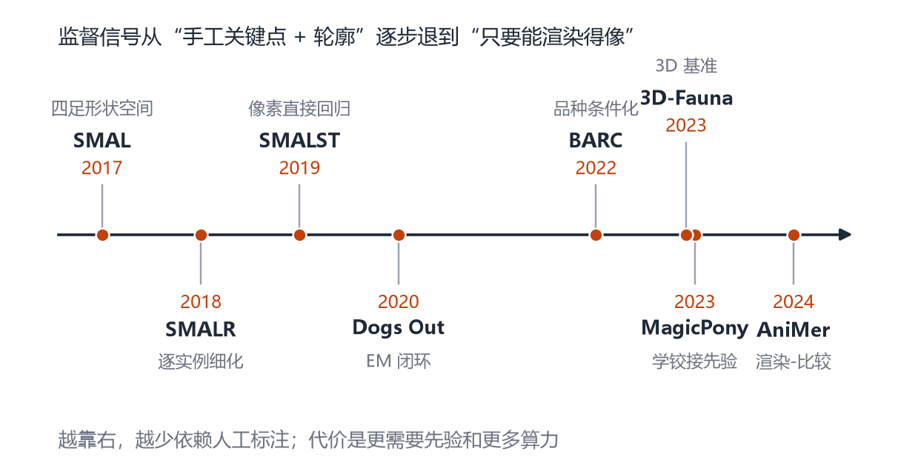
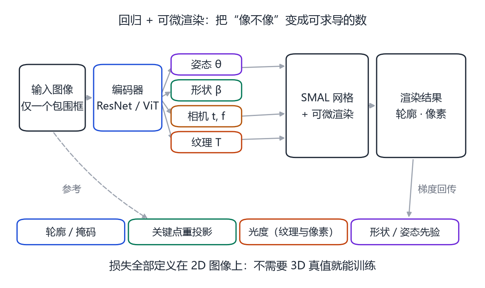
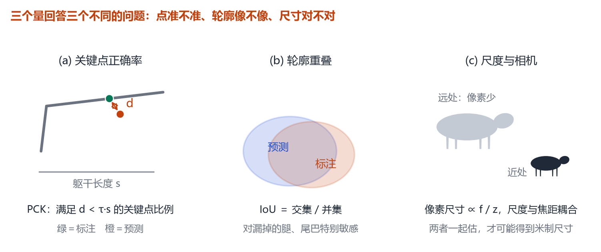
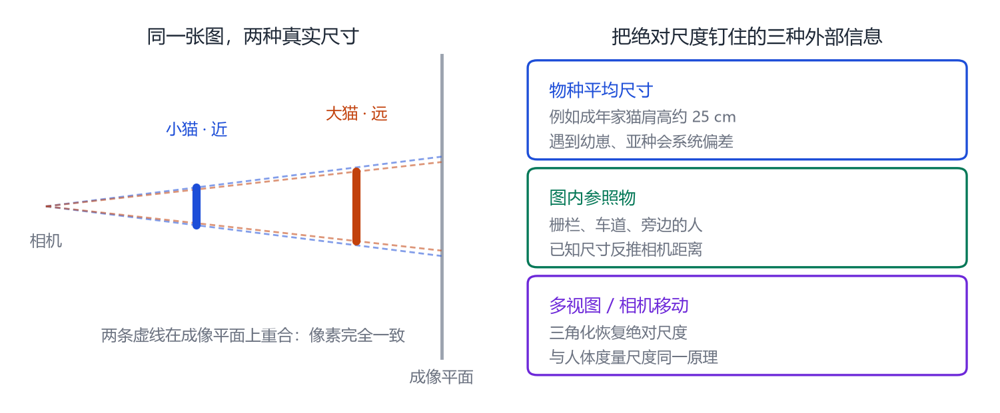
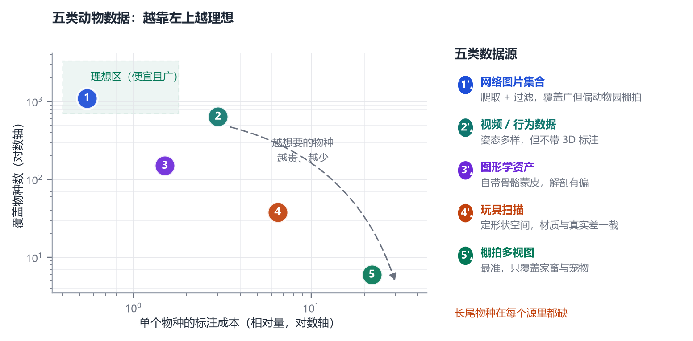

# 第 2 章 动物重建：从 SMALST 到 MagicPony

> **本章导读**：有了 SMAL，下一步是“从一张动物照片反推它的形状与姿态”。这比人体难得多：没有关键点标注、姿态千奇百怪、皮毛还会伪装。这一章按时间讲四代方法：用轮廓和关键点弱监督（SMALST）、用闭环自修正（Dogs Out）、用品种分类做先验（BARC）、直接从图片集合学铰接（MagicPony）。每一代都写清“上一代的缺口在哪、这一代改了什么、代价是什么”，最后讲评估与失败模式。

## 2.1 单图动物重建要交代什么

这一节先把任务本身钉住：给定一张动物照片，要求模型输出什么，用什么衡量对错，以及为什么这件事比人体难一个档。结论是任务定义和人体几乎一样，但四个困难同时发作，使得“弱监督”从可选项变成了唯一选项。

任务定义写清楚是三步。**输入**：一张 RGB 图，通常只附带一个检测框；有时额外给一个掩码或少量 2D 关键点。**输出**：SMAL 的形状参数 $\boldsymbol{\beta}$、姿态参数 $\boldsymbol{\theta}\in\mathbb{R}^{99}$、平移 $\mathbf{t}$，以及相机内参（焦距 $f$ 至少一个数）。**评价**：形状与姿态的误差、轮廓的重叠度、米制尺度是否对。

和人体重建比，差别不在输出格式，而在四个困难同时出现：

**第一，没有关键点定义。** 人体有相对统一的 17 点或 25 点标注规范，动物没有。狮子的肩在哪、马的飞节算几个点、尾巴要标几节，不同标注者的定义都不一样。更麻烦的是，即使有定义，动物身上的关键点也很难在图上精确定位——大部分关节在皮毛之下，没有可见的骨性标志。

**第二，姿态太自由。** 人可以站、坐、走，动作幅度有限；动物可以跑、跳、飞、游、蜷缩、倒挂、攀爬。SMAL 的姿态空间（33 个关节、99 维）远不足以覆盖这些。

**第三，纹理伪装。** 斑马条纹、豹纹、鹿的斑点，会让轮廓检测和光流同时失效：轮廓检测把条纹当成边界，光流把条纹的运动当成身体的运动。

**第四，尺度与相机耦合。** 野生动物照片的焦距未知、距离未知，单张图无法确定“这只老虎多大”。这一条在 2.8 节单独展开，它是原理性的限制，不是精度问题。

四条困难指向同一个结论：**动物重建几乎不可能拿到 3D 真值监督**。活体动物扫不了，标本与玩具又有材质差距。于是这一领域的所有方法都建立在弱监督上——不要求 3D 真值，只用轮廓、少量 2D 关键点、甚至只要求“渲染出来像不像”。

<figure class="fig">

<figcaption><b>图 2-1</b>　动物重建的监督信号演化。从 SMAL 的 3D 形状空间，到 SMALST 的轮廓/关键点，到 BARC 的品种分类，再到 MagicPony 的“只要求渲染相似”，人工标注越来越少，对先验与算力的要求越来越高。</figcaption>
</figure>

图 2-1 的时间线值得先看一眼全貌：横轴是年份，纵轴位置表示监督信号的强弱。越往右，人工标注越少，但每一代都额外引入了一样东西来补——要么是更强的先验，要么是更长的优化，要么是更多未标注图片。这个“少标注换多计算”的交换，是整章的主线。

## 2.2 第一代：SMALST，用轮廓和关键点做弱监督

这一节回答：完全不使用 3D 真值，能不能从一批野生动物照片里学出 SMAL 参数？结论是能，而且做法相当直接——把 SMAL 网格渲染成剪影与彩色图，与图像比较，梯度直接回传到参数；代价是深度与关节角的估计极不稳定。

**SMALST**（2019，也常被引作 *Three-D Safari*）[@zuffi2019safari,@zuffi2021smalst] 是第一代“单图动物”方法，最初的实验对象是斑马。它的输入是一张图和一个包围框，输出 SMAL 的形状、姿态、相机和一套纹理（texture）。

训练损失全部定义在 2D 上，四部分：

- **轮廓损失**：把网格渲染成二值剪影，与检测到的动物掩码比较，用 IoU 或 Dice 做可微近似；
- **关键点损失**：一小批人工标注的 2D 关键点（如鼻尖、耳根、肩、髋）的重投影误差；
- **形状/姿态先验**：把 $\boldsymbol{\beta},\boldsymbol{\theta}$ 拉向训练分布，防止解跑到不合理的区域；
- **纹理损失**：让渲染的颜色接近原图，同时把图像上的颜色反投影回模板的 UV 空间。

它不需要任何 3D 真值，因此可以用大量网络图片训练——这是它最重要的贡献，而不是精度。上一代的做法（SMALR 一类）是“对每一只动物做多视图拟合”，需要同一只动物的多张照片；SMALST 把这件事变成了一次前向加一次渲染比较。

代价有三条，都要记住，因为后面每一代都在补其中一条：

1. **深度歧义不会被轮廓消掉。** 剪影只关心像素在不在，不关心它离相机多远。一条前后腿重叠的腿，剪影上是同一条，模型可以把前面的腿估成后面的、把侧身估成正身。
2. **关节角会反折。** 剪影对“膝盖向前还是向后弯”几乎没有梯度，因为两种姿态的轮廓几乎一样。这类错误在视觉上极刺眼（腿像被折断），但在损失上很便宜。
3. **纹理与几何互相串扰。** 纹理分支能解释掉一部分像素误差，于是几何分支的解可以更松。表现是“重建图很好看，但网格偏瘦”。

所以，第一代方法把“能不能做”这个问题解决了，把“准不准”留给了下一代。

### 2.2.1 纹理分支为什么必要

一个自然的疑问是：既然只要几何，为什么要花力气重建纹理？三个理由。

**第一，光度损失需要它。** 如果模型只有几何、没有颜色，就只能比轮廓；而轮廓对“腿在里面还是外面”不敏感。有了纹理，才能算“这个顶点在图上应该是什么颜色”，才能给出与深度相关的梯度。

**第二，它是“免费”的监督。** 网络图片里的颜色信息本来就存在，不用就浪费了。把图像颜色反投影回模板的 UV 空间，等于每张图都带来一次“表面属性”的标注。

**第三，它能暴露几何错误。** 如果几何错了，纹理就会在 UV 空间里被“抹开”——斑马的条纹会在体侧变成一片模糊。所以纹理重建得好不好，反过来是几何是否对齐的一个指示器。

代价是串扰：纹理分支能解释掉一部分像素误差，于是几何分支的解可以更松（见 1.7 节的表）。所以纹理项的权重不能给太大，宁可他模糊一点，也不要让几何“躲”到纹理后面去。

## 2.3 第二代：把拟合放进训练循环

这一节回答：既然手工设计的强弱先验都不理想，能不能让模型从数据里自己总结先验？结论是能，而且这一步把姿态估计的稳定性提高了一个档；代价是先验会向“已有解”收缩，稀有姿态更难学到。

先补上一条中间路线。**SMALR**（2018，狮子、老虎、熊）用同一只动物的多张图片做逐实例细化：先用 SMAL 拟合出一个粗略结果，再用光度一致性（同一个顶点在不同视角下颜色应一致）做非刚性修正。它能走出形状空间的线性限制，把个体特有的细节补回来——狮子鬃毛的体积、老虎的肩部隆起。代价是需要同一只动物的多视图，或者至少一段视频，这在野生动物场景里往往拿不到。

**Dogs Out**（Biggs 等，2020）[@biggs2020dogs] 走的是另一条：把 EM 算法用到了动物重建上，让“拟合”和“学先验”互相喂。

1. **E 步**：用当前模型对每张图预测 SMAL 参数；
2. **M 步**：用这些参数（以及它们在图像上是否解释得好）去更新形状/姿态先验；
3. 重复，直到收敛。

它的核心洞察是：**与其手工设计先验，不如让模型从数据里自己总结先验。** 手工先验的典型形式是“$\beta$ 服从标准正态”，这对任何物种都一样，几乎没有信息量。而从几千张狗的照片里攒出来的姿态分布，会告诉你“狗的后腿在这些角度附近出现得最多”，这比一个球状先验强得多。

为什么这件事会有效，可以从梯度的角度理解。下一节式 (2.1) 里的先验项一旦收紧，姿态参数就被限制在一个低维流形附近，剪影损失无法区分的那些“反折解”被直接排除。所以在狗的测试集上，同样的轮廓损失，加了学出来的先验之后姿态误差明显下降。

代价有三条：

- **先验只对训练物种有效。** 在狗身上学出的姿态分布，套到马身上是错的（马的前肢几乎不弯腕）。跨物种时，这一项会变成有害的先验。
- **EM 会自我强化。** 如果 M 步只用当前模型给出的“高置信”预测去更新先验，先验会越来越窄，最终把稀有姿态永久排除在可行域外。工程上要留一部分样本按图像损失筛，或对先验加熵正则，避免塌缩。
- **训练不稳定。** E 步与 M 步互为输入，学习率稍大就会震荡。

所以，第二代的关键词是“闭环”：不再把先验当超参数，而是把它当被优化的变量。

## 2.4 第三代：把品种变成先验

这一节回答：能不能用一个更好标注、信息量更大的中间量，替代“从像素直接猜体型”？结论是能——品种就是这样一个量；代价是它只在“有品种体系”的物种上成立。

**BARC**（Biggs 等，2022）[@biggs2022barc] 发现：狗的形状差异，很大程度上由**品种**决定。与其让网络从像素里猜“这是柯基还是哈士奇”，不如先做一个品种分类，再把品种信息作为条件输入形状回归。

名字就是做法：**Breed-Augmented Regression using Classification**（用分类增强的回归）：

- 分类分支预测品种（或多个品种的混合比例）；
- 回归分支在品种条件下预测形状 $\boldsymbol{\beta}$，即 $\boldsymbol{\beta}=g(\text{图像特征},\text{品种后验})$；
- 两者联合训练，分类的梯度帮助形状分支学到“品种 → 体型”的映射。

为什么这一招有效，可以直接算。成年犬的肩高跨度大约从二十几厘米（小型犬）到八十厘米上下（大型犬），差异接近四倍；而同一品种内部的身高差异通常只有百分之十几。也就是说，“品种”这一个离散变量，解释了体型方差里的一大半。让网络去猜一个连续量，不如先猜一个离散量，再查表修正——后者在样本少的时候稳得多。

结果也符合这个判断：显式的品种先验能显著改善稀有品种的重建，因为网络不再需要从少量样本里硬记体型。

代价同样清楚：

- **混血品种**。真实世界里大量狗是混血，品种分类的后验是分散的，条件化之后反而变成一个“平均体型”，比不条件化还差。
- **无品种体系的物种**。野生动物没有“品种”这个概念，狮子的亚种、地区差异都没有可靠的标注体系。这一招没法搬到斑马、长颈鹿上。
- **标注偏差**。品种标签来自人，人对“这只是不是纯种”的判断本身有噪声，而且不同数据集的定义不一致。

所以，第三代的关键词是“条件化”：把难估的连续量，拆成“好估的离散量 + 查表”。这个思路后来被反复借用，比如用“年龄段”“性别”“服装类型”做条件。

## 2.5 第四代：从图片集合里学“怎么动”

这一节回答：如果一个物种既没有 3D 数据、也没有关键点、连相机参数都不知道，还能不能建出可驱动的模型？结论是能，只要这个物种的图片足够多、姿态足够多样；代价是需要大量算力，而且模型只对该物种成立。

**MagicPony**（Wu 等，2023）[@wu2023magicpony] 走得更远：它不需要任何 3D 标注、不需要关键点、不需要相机参数，只用**同一类动物的大量网络图片**，就能学出一个可铰接的 3D 模型。

它的做法是“分析与合成”（analysis by synthesis）的极致版本：

1. 假设每张图里的动物都是同一个“规范形状”经过一组关节变换得到的；
2. 用可微渲染，把规范形状渲染到每张图估计出的视角与姿态；
3. 用图像重建损失 + 关节正则，联合优化规范形状、关节位置、蒙皮、每张图的姿态与相机；
4. 训练完成后，模型可以“动起来”，也可以迁移到新图片。

这里有一个内在的歧义，值得单独说：**分解不唯一**。给定一堆图片，可能的解释有无穷多组——把动物估得很小、放到很远，和估得很大、放到很近，渲染结果可以完全一致（2.8 节会给出证明）。同理，“关节在这里”与“关节在那里”可以通过调整形状来补偿。所以这类方法必须靠正则把解钉住：形状要对称、关节数要固定、蒙皮要稀疏、姿态不要离初始值太远。这些正则不是技巧，是让问题变得可解的必要条件。

**AniMer**（CVPR 2024）[@zuffi2024animer] 处理的是另一头的问题：SMAL 的 99 维姿态对“回归网络”来说太大了。它的做法是**模型降维**——先用动物姿态数据学一个低维子空间，网络只回归这个子空间的系数，再映射回 99 维。好处是回归的未知数少了，训练更稳；代价是子空间覆盖不到的姿态（比如倒挂、腾空）表达不出来，因为那些姿态在训练数据里没有出现过。

**SATR**（ICCV 2023）[@wang2023satr] 则从标注侧减负：用稀疏的、少量关键点加上 Transformer 的结构先验，减少对关键点数量的依赖。这一路线的共同点是“把人工标注换成结构先验”。

把四代放在一张表里，缺口与代价的对应关系就清楚了：

| 方法 | 年份 | 监督信号 | 补上了上一代的什么缺口 | 代价 |
|---|---|---|---|---|
| SMALR | 2018 | 多视图光度一致 | 线性的形状空间太死板 | 需要同一只动物的多视图 |
| SMALST | 2019 | 轮廓 + 少量关键点 + 纹理 | 不再需要多视图与 3D 真值 | 深度与关节角不稳，纹理与几何串扰 |
| Dogs Out | 2020 | 轮廓 + 纹理，EM 闭环 | 手工先验太弱 | 先验只对该物种有效，可能塌缩 |
| BARC | 2022 | 轮廓 + 品种标签 | 稀有品种样本太少 | 混血、无品种体系、标签噪声 |
| MagicPony | 2023 | 只要求渲染相似 | 完全不需要关键点与相机 | 算力大，物种内姿态需足够多样 |
| AniMer | 2024 | 图像 + 姿态先验子空间 | 99 维姿态对回归太大 | 子空间覆盖不到稀有姿态 |

所以，四代方法不是互相替代，而是在同一个优化式里换不同的项：有人换监督信号，有人换先验来源，有人换参数化维度。下一节把这件事写成公式。

## 2.6 把这些方法写成同一个优化式

这一节要回答：上面四个方法看起来差别很大，它们真的在解同一个问题吗？结论是同一个——都在最小化“图像上像不像”加“参数像不像动物”，区别只在权重与先验的来源。

写成公式：

$$
\min_{\boldsymbol{\beta},\boldsymbol{\theta},\mathbf t,\boldsymbol{\pi}}
\underbrace{\lambda_{\text{sil}}E_{\text{sil}}}_{\text{轮廓}}
+\underbrace{\lambda_{\text{kp}}E_{\text{kp}}}_{\text{关键点}}
+\underbrace{\lambda_{\text{tex}}E_{\text{tex}}}_{\text{颜色}}
+\underbrace{\lambda_{\beta}\|\boldsymbol{\beta}\|^2+\lambda_{\theta}\|\boldsymbol{\theta}-\boldsymbol{\theta}_0\|^2}_{\text{先验}},
\tag{2.1}
$$

逐项读法：

- $E_{\text{sil}}$：把网格渲染成剪影，与检测到的动物掩码比较，通常用 IoU 或 Dice。它约束的是“整体的形状与姿态在轮廓上一致”。
- $E_{\text{kp}}$：少量 2D 关键点的重投影误差，$\|\pi(\mathbf{J}_k)-\mathbf{j}_k^{\text{obs}}\|^2$，其中 $\pi$ 是带相机参数的投影，$\mathbf{J}_k$ 是第 $k$ 个关节的三维位置。它约束的是“关节对上了”。
- $E_{\text{tex}}$：渲染出的颜色与原图的差，只在可见像素上算。它约束的是“纹理与反照率”。
- 先验：把 $\boldsymbol{\beta},\boldsymbol{\theta}$ 拉回“像动物”的区域。$\boldsymbol{\theta}_0$ 是参考姿态，可以是静止姿态，也可以是一批姿态样本的均值。
- $\boldsymbol{\pi}$ 是相机参数（焦距、旋转、平移），常被一起优化，因为没有它就无法把 3D 投影到 2D。

四个方法的区别，全在**这四项怎么加权、先验从哪里来**：

| 方法 | 主要监督 | 先验从哪来 | 典型失败场景 |
|---|---|---|---|
| SMALST | 轮廓 + 稀疏关键点 | 手工先验（固定权重） | 腿被遮挡时深度错 |
| Dogs Out | 轮廓 + 纹理 | EM 迭代中从数据里学 | 跨物种（先验只对狗好） |
| BARC | 轮廓 + 品种标签 | 品种分类条件化 | 混血品种、无品种标签的物种 |
| MagicPony | 图像重建（无需关键点） | 同类图片集合学出的铰接先验 | 图片太少、姿态分布单一 |

> **一个常被忽略的细节**：$E_{\text{sil}}$ 对“腿在里面还是外面”几乎不敏感，因为剪影只关心像素在不在。这就是为什么动物重建的关节角经常“看上去对、实际上反折”——必须靠 $E_{\text{kp}}$ 和姿态先验把角度约束回来。

还有一项没写进式 (2.1)，但工程上必须加：**正则的形式决定了方法的能力边界**。如果把先验写成 $\|\boldsymbol{\theta}-\boldsymbol{\theta}_0\|^2$，它只能把一个解拉近参考点；写成“$\boldsymbol{\theta}$ 属于训练集姿态分布的高密度区”，它才能排除反折解。前一种是各向同性的，后一种是有形状的。这个差别比调 $\lambda$ 重要得多。

<figure class="fig">

<figcaption><b>图 2-2</b>　回归 + 可微渲染的动物重建管线。编码器输出姿态、形状、相机、纹理，渲染后与输入图比较；所有损失都在 2D 上定义，不需要 3D 真值。</figcaption>
</figure>

图 2-2 里有一条容易看漏的回路：梯度不是从“渲染结果”回到“像素”，而是回到参数。这意味着渲染必须可微，蒙皮、投影、光栅化每一步都要能求导。可微渲染的代价是显存与速度，这也是为什么这类方法的训练成本比纯回归高一个量级。

所以，四代方法的差异可以用一句话概括：**同样的框架，不同的先验**。看懂式 (2.1)，再看新论文时就只需要问三件事——它加了哪一项、它的先验是什么形状、它把哪一项的权重调小了。

## 2.7 评估为什么比人体更棘手

这一节回答：动物重建该用什么指标衡量，为什么这些指标经常互相矛盾？结论是三个常用量各看一个侧面，而且“真值”本身往往是拟合出来的，评估因此带有方法偏置。

先看三个量。

**PCK**（Percentage of Correct Keypoints，关键点正确率）：若预测关节与标注关节的距离小于“躯干长度 × 阈值”，就算对。

$$
\text{PCK}(\tau)=\frac{1}{|\mathcal K|}\sum_{k\in\mathcal K}\mathbf{1}\Big[\,\frac{\|\hat{\mathbf{j}}_k-\mathbf{j}_k\|}{s}\le\tau\,\Big],
\tag{2.2}
$$

读法：$\hat{\mathbf{j}}_k$ 与 $\mathbf{j}_k$ 是预测与标注的 2D 关键点，$s$ 是归一化尺度（常用躯干长度，避免大动物占便宜），$\tau$ 一般取 0.05–0.1。用比例而不是绝对像素，是因为同一种动物的照片距离差很远。

**IoU**（Intersection over Union，交并比）：预测剪影与标注掩码的交集除以并集。

$$
\text{IoU}=\frac{|\mathcal S_{\text{pred}}\cap\mathcal S_{\text{gt}}|}{|\mathcal S_{\text{pred}}\cup\mathcal S_{\text{gt}}|}.
\tag{2.3}
$$

**尺度误差**：预测的米制尺寸（肩高、体长）与真实尺寸的差。这一个最难得到，因为它需要相机内参与距离。

三者经常矛盾，原因是它们各自对“错在哪”敏感度不同：

| 错误类型 | PCK | IoU | 尺度误差 |
|---|---|---|---|
| 关节角度错、体型对 | 明显下降 | 轻微下降 | 不变 |
| 体型整体偏大 20% | 基本不变 | 轻微上升 | 直接暴露 |
| 一条腿被截短 | 一个点下降 | 明显下降 | 轻微 |
| 深度方向估错（前后腿互换） | 2D 上几乎不变 | 几乎不变 | 可能变大 |

最后一行是最危险的：**深度错误在 2D 指标上不可见**。一张侧面照里，把前腿估成后腿，投影完全一致，所有指标都好看，但网格是错的。这也是为什么只看 2D 指标的论文结论要打折扣。

<figure class="fig">

<figcaption><b>图 2-3</b>　动物评估的三个侧面。PCK 看关键点准不准，IoU 看轮廓像不像，尺度看“尺寸对不对”。三者经常互相矛盾：轮廓很准的模型，可能把动物估得只有一半大。</figcaption>
</figure>

比指标更根本的问题是“真值从哪来”。动物几乎不存在人工标注的 3D 真值，公开基准（如 3D-Fauna[@li2023fauna]）里的 3D 标注，很多是半自动拟合产生的：先人工标 2D 关键点和轮廓，再用一个参数化模型拟合出 3D。这意味着**基准的“真值”本身就带着某个模型与某套先验的偏置**。用 A 类方法拟合出的真值去评 B 类方法，B 天然吃亏。

这不是在否定基准的价值，而是说读结果时要多看一眼：真值是怎么来的、由谁拟合、用了什么模型。一个简单可靠的补充做法是“留出物种”评估——训练集里完全没有某个物种，测试时只用 2D 指标加人工目检。它衡量的是泛化，而不是拟合精度。

所以，动物评估没有单一答案，只有“三个量加上真值来源的说明”。论文只报一个指标时，先怀疑它选的是对自己最有利的那个。

### 2.7.1 一个说明“指标不敏感”的算例

把上面那张表变成一个具体数（以下为示意，只为说明数量级）。设一只成年犬肩高约 60 厘米，在图中占 300 像素，则 1 像素约对应 2 毫米。假设模型把它的肩高估成 54 厘米（小了 10%）：

- 尺度误差：直接暴露为 $-6$ 厘米，一目了然。
- PCK：关键点位置变动约 30 像素。若阀值取“躯干长度 × 0.05”，而躯干长度在图上约 600 像素，阀值是 30 像素——刚好卡在边界上，PCK 可能从 0.70 掉到 0.62，也可能几乎不变，取决于具体哪个点。
- IoU：面积变化约 $1-0.9^2\approx 19\%$，但因为预测与真值的中心差不多，交集也大，IoU 往往只掉几个点。

结论很直接：**仅仅 10% 的尺度错误，在 PCK 与 IoU 上都可能被“稀释”到看不出来，只有尺度误差能直接暴露。** 所以评价动物重建，不能只报 PCK 或 IoU。

## 2.8 尺度与相机：单图只能定到“乘积”

这一节回答：为什么单张照片无法确定动物的真实大小？结论是尺度与距离在投影里只以乘积形式出现，这是几何上的不可辨识，不是算法不够好。

针孔相机的投影是

$$
u=f\frac{X}{Z},\qquad v=f\frac{Y}{Z}.
\tag{2.4}
$$

读法：$X,Y,Z$ 是相机坐标系下的三维点，$f$ 是焦距（像素单位），$u,v$ 是成像平面上的像素坐标。注意 $X$ 与 $Z$ 只以比值出现。

如果把动物整体放大 $k$ 倍（$X,Y,Z$ 全部乘以 $k$），同时把 $f$ 乘以 $k$，投影坐标 $u,v$ **完全不变**。这就是单目重建的尺度歧义：

- 你可以得到“$k$ 米大的动物在 $k\cdot Z$ 米处”；
- 但无法区分“一只小猫在两米处”和“一只大猫在四米处”。

给一个示意性的数：设焦距 $f=1000$ 像素，动物在 $Z=10$ 米处，图上高 240 像素。那么真实高度是 $H=240\times10/1000=2.4$ 米。如果把 $Z$ 猜成 20 米，$H$ 就变成 4.8 米；两个解在像素上完全一样。也就是说，单张图能定住的只是“高度 × 距离”这个乘积，误差在一倍以内是常态。

工程上的三个解法：

1. **给先验**：假定物种的平均肩高（例如成年家猫约 25 cm），把尺度固定下来；这是最常用也最危险的——遇到幼崽或亚种就会系统性偏大/偏小；
2. **给参照物**：图里有栅栏、车道、人体时，用参照物的已知尺寸反推；
3. **多视图或视频**：相机移动时，三角化能恢复绝对尺度（人体重建里恢复绝对尺度用的是同一个道理）。

值得补一句：近年的单目深度大模型（度量深度）给了一条新路——它们从大规模数据里学到了“室内场景的绝对尺度感”，可以直接给出米制深度。但对野生动物，这条路的可靠性还没被验证，因为训练数据里大多是室内与街道场景。

<figure class="fig">

<figcaption><b>图 2-4</b>　尺度歧义。左：小动物在近处与大动物在远处投影到同一张图，像素完全一致；右：真实应用里只能靠“物种平均尺寸、参照物、相机移动”三种外部信息之一把尺度钉住。</figcaption>
</figure>

所以，凡是声称“从单张野生动物照片恢复米制尺寸”的方法，都在某处偷偷用了一个先验。找出来它是哪一个，就知道它的失效条件是什么。

## 2.9 数据从哪来，为什么这类数据特别难

这一节回答：训练这些方法的数据究竟从哪来，为什么动物的数据比人体数据难一个量级？结论是有五类数据源，各有各的偏，而长尾物种在所有源里都缺。

**第一类，玩具扫描。** 只有 SMAL 那 41 个，用来定形状空间。它的问题上一章说过：材质与真动物不同，物种稀疏。

**第二类，多视图棚拍。** 把动物（多为家畜、宠物）放进多相机阵列里拍，得到同步多视图，用轮廓雕刻（visual hull）加光度细化得到几何。这类数据质量最高，代价是物种极有限——能进棚的只有牛、羊、猪、狗、马。畜牧方向的基准（如 LiveStock[@li2024livestock]）走的就是这条路。

**第三类，网络图片集合。** 用搜索引擎按物种名抓图，再人工或半自动过滤。SMALST、Dogs Out、BARC、MagicPony 都依赖这一类。它的优点是覆盖物种多，缺点是偏——搜“狮子”得到的多半是动物园里的、侧身、白天的照片，真正的野外行为几乎没有。

**第四类，视频与行为数据集。** 大规模动物视频（如 Animal Kingdom[@zhang2022animalkingdom]）主要服务于行为识别，提供的是类别与动作标签，不是 3D。但它们是“姿态多样性”的重要来源：同一物种在不同行为下的姿态，比静态图库丰富得多。

**第五类，图形学资产与合成数据。** 游戏与影视里的动物模型，带骨骼、带蒙皮、带材质。它们的几何可信（美术做的），但与真实动物的解剖仍有差距，而且分布很窄。

<figure class="fig">

<figcaption><b>图 2-5</b>　五类动物数据的分布（示意）。横轴是“单个物种需要的标注成本”，纵轴是“能覆盖的物种数”。玩具扫描与棚拍落在右下：贵但准；网络图片落在左上：便宜但偏；视频与合成数据在中间。长尾物种在所有源里都缺，只能靠先验补。</figcaption>
</figure>

为什么这类数据特别难，三条原因值得单独写：

**动物不会配合。** 这句话不是玩笑，它直接决定了采集协议。人体数据可以“请受试者站直、双手下垂”，动物数据只能“等着它自己走到合适的位置”。一台相机阵列对着牛栏拍一天，能用的同步帧可能只有几百帧。

**物种差异大，标注规范无法统一。** 人体的 17 点规范能用三十年，因为它对应一套共识的解剖结构。动物的关键点定义随物种而变：四足有蹄、有爪、有掌行与趾行之别，鸟有翅、有尾羽，鱼连“腿”都没有。每加一个物种，就要重做一次标注规范。

**长尾。** 常见物种（狗、猫、马、牛、羊、狮、虎、象）占据了绝大部分数据；世界上有几万个脊椎物种，绝大多数连一张带标注的图都没有。而保护生物学最关心的恰恰是这些长尾物种。这一条是第 3 章“跨物种”的出发点。

所以，动物数据的困难不是“量不够”，而是“偏”——常见物种过曝、稀有物种缺席，标注规范每物种一套。任何方法的效果上限，都被这个分布形状限制住。

### 2.9.1 标注协议：比算法更影响结果的东西

在动物项目里，最容易出错的不是网络，是标注协议。三件事必须在开工前定下，而且必须写成文档：

1. **关键点的几何定义。** 不能写“肩”，要写“肩胛骨最高点对应的体表位置，从侧面看位于前肢与躯干交界处的上缘”。最好配一张图，标出容差范围。
2. **遮挡时的规则。** 关节被遮住时，是标“推测位置”还是标“可见点”？两种做法都可以，但不能混着用；混用会让误差分布变成双峰，评估彻底失真。
3. **一致性的度量。** 让两位标注者各标 30 张，算他们之间的平均距离。若平均相差超过“躯干长度 × 0.05”，那么这个数据集的精度上限就被这个噪声钉住了，模型误差再降也看不出来。

这三件事听起来像管理而不是技术，但它们决定了数据集能否用来做比较。很多号称“方法提升”的结果，背后只是两批标注的规范不一样。

## 2.10 失败模式清单

这一节把前面散落的错误集中成一张清单，用来对照排查。结论是大多数失败可以归到五类，每一类都有可辨认的症状。

| 失败 | 症状 | 成因 | 缓解 |
|---|---|---|---|
| 遮挡填充 | 草丛里的狮子被补成“最小体积” | 轮廓在遮挡处给出错误梯度 | 可见性掩码 + 置信度加权 |
| 深度互换 | 前后腿重叠时前后颠倒 | 剪影不含深度信息 | 加关键点、加姿态先验、多视图 |
| 关节反折 | 膝盖朝反方向弯，视觉上像折断 | 轮廓对弯曲方向不敏感 | 关节限位 + 学出来的姿态先验 |
| 纹理伪装 | 斑马的条纹被当成边界 | 轮廓/光流在条纹上失效 | 用分割模型的掩码，而不是传统轮廓 |
| 物种外插 | 长颈鹿、大象比例失调 | 形状空间在训练集外只能线性外插 | 类别级重训、或换表示（第 3 章） |
| 尺度歧义 | 同一只动物被估成一半或两倍大 | 单目投影的尺度不可辨识 | 物种先验、参照物、多视图 |

这六条里，前四条是“监督信号不足”，后两条是“模型表达不足”。区分它们很重要：前者加数据或加先验就可能好转，后者无论怎么加数据都不会好，必须换表示。

所以，动物重建的失败大多不是网络不够大，而是某个信息在原理上不在输入里——深度不在单张剪影里，尺度不在单目投影里，长尾物种不在训练集里。把这三件事认清，比换一个 backbone 有用得多。

### 2.10.1 排查顺序

把清单变成流程，顺序很重要，因为前一步的结果会改变后一步的判断：

1. **先看 $\boldsymbol{\beta}$ 的 $\sigma$ 数**。如果超过 4，后面的误差都是它引起的，先解决这个。
2. **再看投影对齐**。把重建网格叠加到原图上，看轮廓差在哪里。若是腿部整体偏移，是姿态问题；若是体型整体缩放不对，是尺度问题。
3. **再遮住一半看另一半**。这一步区分“拟合到了遮挡”与“猜出来的形状”。
4. **最后换物种测**。同一个模型在另一个物种上的表现，是判断“先验是否只对训练物种有效”的唯一办法。

这个顺序的好处是每一步都能否掉一个假设，而不是同时改三件事然后不知道哪个起了作用。

## 本章小结

- 单图动物重建的输出与人体相同（形状、姿态、相机、尺度），但四个困难同时发作：没有关键点、姿态自由、纹理伪装、尺度耦合。
- 四代方法的演化是“换先验”而不是“换网络”：SMALST（手工先验 + 轮廓）、Dogs Out（EM 学先验）、BARC（品种条件化）、MagicPony（图片集合学铰接）。
- 它们可以写成同一个优化式：轮廓 + 关键点 + 颜色 + 先验，区别在权重与先验的形状。
- 剪影损失对关节弯曲方向与深度都不敏感，必须配关键点与姿态先验，否则出现“轮廓对、关节反折”。
- 单图存在尺度歧义：只能定到“尺寸 × 距离”的乘积，需要物种先验、参照物或多视图才能钉住绝对尺度。
- 评估看 PCK、IoU、尺度，三者经常矛盾；而且 3D 真值本身多是拟合出来的，基准带方法偏置。
- 动物数据有五类来源，各有各的偏；长尾物种在所有源里都缺，这是跨物种方法必须面对的现实。

## 思考题

1. 为什么动物重建很少用 3D 真值？如果要做，成本在哪里，误差会从哪里进来？
2. BARC 的“品种分类”会不会引入偏见？混血狗被强行归到某个品种时，会出现什么症状？
3. MagicPony 不需要关键点，它靠什么避免“所有动物都塌成同一个形状”？请从正则项的角度回答。
4. 如果只给你 100 张长颈鹿的图片，你会怎么建模？会优先补数据还是补先验？
5. 式 (2.1) 里把 $\lambda_{\text{tex}}$ 设为 0，会发生什么？设为很大又会怎样？

