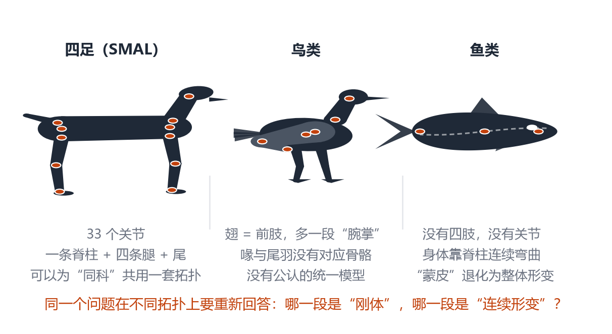
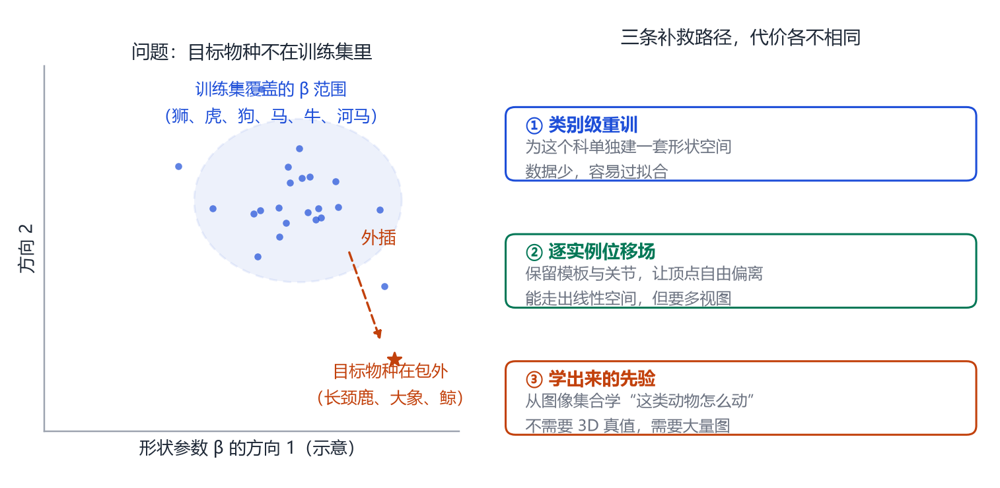
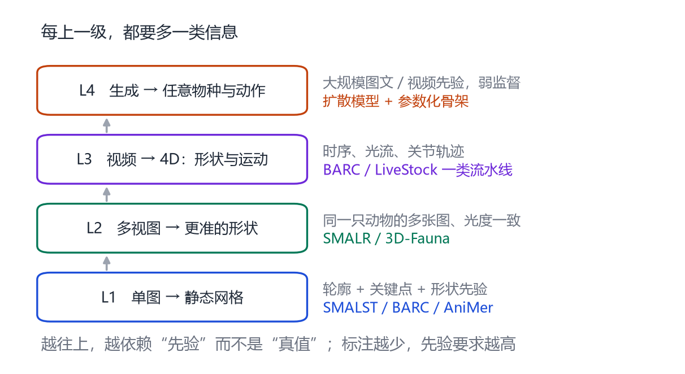
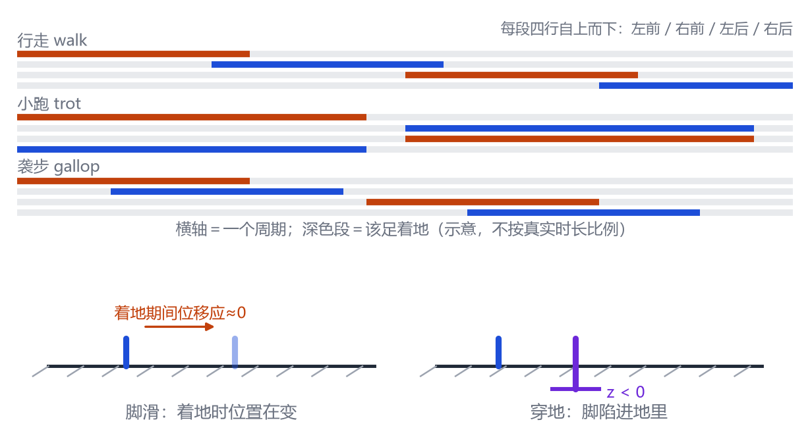
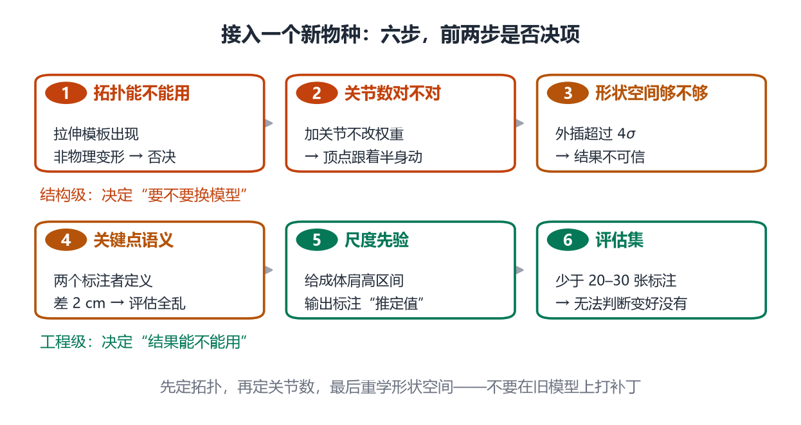

# 第 3 章 跨物种：鸟类、鱼类与动物生成

> **本章导读**：SMAL 只覆盖四足[@zuffi2017menagerie]。世界上还有鸟、鱼、蛇、鲸、昆虫，它们的骨架结构完全不同。这一章讨论三件事：不同拓扑的动物如何参数化、跨物种模型如何面对“没见过的物种”、以及生成模型如何被用来“造”动物。最后回到应用与伦理：野生动物保护、畜牧、影视，都需要可信的动物模型，而它们的需求并不一样。

## 3.1 跨物种要解决的三个不同问题

这一节先把“跨物种”这个词拆开，因为它经常被当成一件事，实际是三件。结论是：同一个物种内的个体差异、不同物种之间的形状差异、以及结构（拓扑）差异，需要用三种不同的工具处理，混在一起谈就会得出错误的方案。

**第一层，种内差异。** 同一物种的两个个体，骨架相同、拓扑相同，差别只在比例与体积。这是 SMAL 的形状空间解决的那一层：$\boldsymbol{\beta}$ 在那两个物种各自的样本邻域内变化，模型是线性可用的。

**第二层，种间形状差异。** 两个物种共享同一套拓扑假设（都是四足、骨骼节数相同），但比例差得远。这仍然是形状空间的事，只是要外插到训练样本之间或之外的中点上。1.4 节说过，这一步在 3σ 之内还算稳。

**第三层，结构差异。** 鸟的翅膀、鱼的身体、蛇的整条身体、象的鼻，这些结构在四足骨架里没有对应物。这一层不是参数值的问题，是“参数量纲”变了：关节数不同、顶点数不同、拓扑连接不同。任何把它当“形状差异”处理的尝试都会失败，因为不存在“第 3000 号顶点”这样的公共索引。

三层的技术后果完全不同：

| 层级 | 差异来源 | 现有工具 | 失败时的症状 |
|---|---|---|---|
| 种内 | 比例、体积 | 线性形状空间（PCA） | 体型估偏，但姿态正常 |
| 种间（同拓扑） | 比例、局部凸起 | 同一形状空间外插/插值 | 比例失调，腿长与体长不匹配 |
| 结构 | 关节数、拓扑、有无某器官 | 换表示或换模型 | 长颈鹿被拉成“短脖子四足” |

任务定义也因此分档。**输入**可能是一张图、一段视频、或一个物种名加若干图片；**输出**是一个网格加骨架，且要求它能被驱动（有关节、有蒙皮）；**评价**至少要看三件事：形状是否像这个物种、关节是否在解剖上可能、动作是否在物理上成立。三者难度递增，第三件事在 3.5 节展开。

所以，跨物种方法的第一步不是选网络，而是判断手上的差异落在哪一层。落错了层，后面所有设计都在解一个错误的问题。

## 3.2 三种拓扑，三种表示

这一节回答：鸟和鱼到底哪里不能用 SMAL，替代方案是什么？结论是鸟可以沿用“关节 + 蒙皮”的框架但要补一层羽毛壳，鱼则必须放弃关节模型，改用“脊柱曲线 + 截面放样”；而后者会丢掉顶点对应。

<figure class="fig">

<figcaption><b>图 3-1</b>　三种拓扑。四足（SMAL）有 33 个关节、一条脊柱、四条腿、一条尾巴；鸟类的前肢变成翅膀，多出一段“腕掌”；鱼类没有四肢，身体靠脊柱连续弯曲。拓扑不同，参数化方式必须重新设计。</figcaption>
</figure>

**鸟类的挑战在翅膀。** 鸟的翅膀在解剖上对应前肢，但骨骼数量、关节方向、羽毛结构都不同：

- 翅膀有一段额外的“腕掌骨”，用来把翅膀折叠贴在身体上。折叠与展开是两套完全不同的骨链构型，中间的过程不能只靠一个关节角描述；
- 羽毛没有骨骼支撑，却决定了轮廓。一只收起翅膀的鸟，其剪影的 60% 以上是羽毛，不是身体；
- 喙和尾羽也没有对应的骨骼，SMAL 的顶点无处安放。

所以鸟类模型通常需要三样东西叠起来：一套专门的翅膀骨架（比四足的腿多一节）、一层“羽毛壳”（用额外的面片或粒子表示，随翅膀开合而变形）、以及一个能处理非刚体形变的模型。工程上常见的折中是“身体用参数化网格 + 羽毛用壳层”，壳层的形状由几个全局参数（展开角、羽毛长度、蓬松度）控制，而不是逐根羽毛建模。

**鱼类的挑战更根本。** 鱼没有四肢，身体是一整条连续的脊柱。LBS 的“刚体段 + 关节”假设在这里几乎失效：

- 鱼的弯曲是连续的，不是几个关节的旋转。一条鳗鱼的身体曲线接近正弦波，用 5 个关节逼近会出现明显的折线；
- 鳍是薄片，会随水流摆动，与身体的形变不是同一套机制；
- 鳞片、鳃盖的运动，需要比“整块蒙皮”更细的形变。

可行的做法是把鱼表示成“脊柱曲线 + 截面放样”（lofting）：给定一条三维曲线和沿曲线的半径/截面，生成身体表面。把它写成式子更清楚。设脊柱曲线为 $\mathbf{c}(s)$（$s\in[0,1]$ 是沿身体的参数），在每一点取三个方向：切向 $\mathbf{t}(s)$、法向 $\mathbf{n}(s)$、副法向 $\mathbf{b}(s)$，它们构成沿曲线的局部坐标系（也叫标架）。若截面在局部坐标下是圆，则身体表面为

$$
\mathbf{S}(s,\varphi)=\mathbf{c}(s)+r(s)\cos\varphi\,\mathbf{n}(s)+r(s)\sin\varphi\,\mathbf{b}(s),
\qquad s\in[0,1],\ \varphi\in[0,2\pi).
\tag{3.1}
$$

读法：$s$ 是“沿身体走到哪”（0 是吻端，1 是尾柄），$\varphi$ 是“绕身体转到哪一圈”，$r(s)$ 是那一圈的半径，$\mathbf{c}(s)$ 是那一圈的中心。给定这两个函数，表面就完全确定了。

这个式子把所有东西拆得很干净：

- **形状**由两个函数决定——中心线 $\mathbf{c}(s)$ 与半径 $r(s)$。要一条更胖的鱼，放大 $r$；要一条更长的鱼，拉长 $s$ 的映射；
- **姿态**就是改变 $\mathbf{c}(s)$ 的弯曲与扭转，不需要关节；
- 想加鳍，就在某些 $s$ 上额外贴一片面片，整体拓扑不用改。

代价有两个，第二个更致命。

**第一个代价，表达上限。** 截面只能是“一圈圈套在中心线上”的形状，脸部、鳍根、鳃盖这种局部细节表达不了。真实的鱼身截面也不是圆，是扁的、侧扁的、甚至带棱的，需要把 $r$ 写成 $r(s,\varphi)$ 才能表达。

**第二个代价，丢掉顶点对应。** 曲线一变，所有顶点的编号就跟着变——这正好丢掉了 SMAL 最宝贵的东西：跨个体的顶点对应。没有对应，就不能做 PCA，不能插值，不能动作迁移。所以“曲线参数化”通常只用于单个体重建，不适合建统计形状空间。

有人会问：能不能用足够多的关节去逼近连续弯曲？可以，但代价在参数维度上。一条鳗鱼的身体如果要用 20 节脊柱逼近，姿态参数就是 60 维，再加上四条（或零条）肢体的关节，参数总量和样本量完全不成比例。这就是为什么“连续弯曲”用曲线表示、而不是用密集关节表示。

> **两条路线的取舍可以总结成一句话**：想要统计（PCA、跨物种插值、动作迁移），就必须固定拓扑、做顶点对应；想要任意拓扑（鱼、蛇、鸟），就只能放弃对应，改用隐式表示或曲线表示。目前还没有同时拿到两者的成熟方案。

所以，三种拓扑对应三种表示，而不是三种“参数取值”。这一点决定了跨物种不能靠一个模型通吃——除非换到一种“不对应也能算”的表示。

### 3.2.1 蛇与鳗：没有肢体时的极限情形

再看一个更极端的情形，能把“表示”这件事的边界试出来。蛇没有四肢、没有头颈分界明显的关节链，身体是几十到几百节脊椎的连续弯曲。两种自然做法：

**做法一，密集关节。** 把身体当成 30–60 个关节的链，每个关节绕两个轴转。优点是能直接套现有的蒙皮与动画工具；缺点是参数量激增（每关节 6 个自由度就是两百多到三百多维），而每个物种可用的样本只有几张图，根本解不出来。

**做法二，曲线。** 用式 (3.1) 的曲线 + 半径表示，"姿态"是曲线的控制点（几条控制点就能描出一个 S 形）。优点是参数少、能表达任意弯曲；缺点是没有关节、没有顶点对应，不能直接做统计。

真实系统往往取中间：脊柱用十几节的链（保留关节语义与统计能力），头部单独处理，尾尖用连续曲线补。这个“分区域选择表示”的做法在自然界里很常见：结构复杂且需要统计的部分用参数化，结构简单且长得夸张的部分用曲线。

## 3.3 共享什么，不共享什么

这一节回答：做一个跨物种系统时，哪些部件可以复用，哪些必须重写？结论是统计方法与渲染框架可以共享，拓扑与关节不能；围绕这条界线，只有三条可行路径，各有明确的代价。

先划界。

- **可以共享**：形状空间的统计方法（PCA、先验建模）、蒙皮的计算框架、可微渲染、优化与拟合的流程、以及关键点定义中的部分语义（头、躯干、前肢、后肢）。这些是“方法”，与物种无关。
- **不能共享**：拓扑（顶点数、连接关系）、关节数量与层级、局部解剖结构（角、象鼻、翅膀、鳍）。这些是“数据”，每个物种一套。

SMAL 的选择是“共享拓扑 + 共享骨架”，所以只能覆盖四足。要覆盖鸟类/鱼类，只有三条路：

1. **多套模型**：四足用 SMAL、鸟用鸟的模型、鱼用鱼的模型，互不兼容。这是现实中最常见的做法——工程上简单，代价是物种之间不能互相帮忙，每个新物种都要重新收集数据、重新训练。
2. **超模型**：设计一套“万能拓扑”，用额外的顶点/关节表示物种特有的结构。理论上最优雅，实践上最难：拓扑一旦扩展，配准、蒙皮、形状空间都要重做；而且“额外结构”在训练集里往往只出现一两次，PCA 学不出来。
3. **隐式/神经表示**：不做顶点对应，用隐式场或神经场表示形状，用骨架/曲线控制运动。这是目前最活跃的方向，优点是任意拓扑都能表达，缺点是没有显式的顶点对应（所以不能直接做 PCA）、网格要从场里提取（分辨率与拓扑噪声）、而且驱动要靠“形变场”而不是关节。

<figure class="fig">

<figcaption><b>图 3-2</b>　目标物种不在训练集里时的三条补救路径：类别级重训（数据少、易过拟合）、逐实例位移场（能走出线性空间，但需要多视图）、学出来的先验（不需要 3D 真值，但需要大量图）。</figcaption>
</figure>

三条路可以摆在同一张坐标上看：横轴是“结构自由度”，纵轴是“是否保留顶点对应”。

| 路线 | 结构自由度 | 顶点对应 | 适合什么 | 主要代价 |
|---|---|---|---|---|
| 多套模型 | 低（每个模型固定） | 保留 | 常见物种、要统计 | 物种间无法互帮，每物种重来 |
| 超模型 | 中 | 保留（但需额外标注） | 近缘物种（犬科、猫科） | 稀有结构学不出来 |
| 隐式/神经 | 高 | 不保留 | 长尾物种、任意拓扑 | 无统计、提取噪声、驱动复杂 |

这张表解释了一个常见的困惑：为什么“统一的动物模型”喊了很多年还是没有。不是没人做，而是三条路各拿走一半好处，谁也没能同时拿到两半。

补一个关于“超模型”的具体做法。超模型的思路是“共享主体、扩展局部”：先把所有物种的共同部分（躯干、四条腿、头）定义成一套主拓扑，再为每组物种加一组“可选部件”（角、长颈、翅膀、鳍）。在训练时，不同的样本激活不同的部件子集。这种做法在近缘物种之间（如犬科内）已经可用，因为部件总是那几个；但一旦跨越目、纲（哺乳到鸟），可选部件的数量与样本量就完全不成比例：每个部件只有两个样本，PCA 学出来的是噪声。

所以，跨物种的现实答案是分层的：**常见物种用参数化模型（要统计、要驱动），稀有物种用隐式表示（要像、不要统计）**，中间靠“从参数化模型蒸馏先验”连接起来。

## 3.4 任务阶梯：从单图到生成

这一节回答：动物任务到底有几种，它们之间是什么关系？结论是可以排成四级阶梯，越往上越依赖先验而不是真值，而每一级的评价指标都不一样。

<figure class="fig">

<figcaption><b>图 3-3</b>　动物任务的四级阶梯。L1 单图静态网格，L2 多视图更准形状，L3 视频 4D，L4 任意物种与动作的生成。越往上，越依赖先验而不是真值。</figcaption>
</figure>

**L1 单图 → 静态网格**：输入一张图，输出 SMAL 参数。SMALST、BARC、AniMer 属于这一类[@zuffi2021smalst,@biggs2022barc,@zuffi2024animer]。评价看形状误差与轮廓重叠。适合“拍一张照片，估个体型”。

**L2 多视图 → 更准形状**：同一只动物的多张图，利用光度一致性约束形状。这一级的关键是“同一只”，所以它同时解决了尺度问题（3.8 节会回到这一点）。3D-Fauna 一类基准提供了这类评估[@li2023fauna]。

**L3 视频 → 4D**：从视频恢复形状 + 运动。多了一维时间，评价指标里必须包含“动作是否物理合理”，而不只是每帧的形状误差。畜牧方向的流水线（如 LiveStock[@li2024livestock]）正在往这一级走。

**L4 生成 → 任意物种与动作**：用大规模图文/视频先验，生成没见过的物种、没见过的动作。评价最难，因为“不存在的动物”没有真值，只能看合理性——关节不反折、脚不滑、体型与物种描述一致。

阶梯的实用价值在于“选级”。如果你的目标是“给相机陷阱的照片估体型”，那停在 L1 + 尺度先验就够；如果目标是“做一段可信的动物动画”，直接上 L4 反而更省事。**越级做事是这一领域最常见的浪费**：用 L3 的流水线去解 L1 的问题，成本高十倍，效果不一定好。

所以，任务分级不是为了分类，而是为了让人知道“现在该停在哪一级”。评价指标必须与级别匹配，否则会出现“指标很好但用处不大”。

## 3.5 从“长得像”到“会动”：步态与接触

这一节回答：形状重建已经很难，为什么让它走路更难？结论是运动的约束来自物理而不是几何——相位、接触、平衡三者必须同时满足，而这三者在单帧里完全看不见。

形状重建的目标是“静止时像”。一旦要让它走路，就会碰到一套完全不同的约束。四足动物的步态（gait）本质上是**四条腿的相位关系**：

| 步态 | 相位关系 | 典型速度 | 能量特征 |
|---|---|---|---|
| 行走 walk | 四条腿依次落地，任意时刻至少三足着地 | 慢 | 稳定性最好 |
| 小跑 trot | 对角两足同时落地（左前 + 右后） | 中 | 像弹簧，动能与势能交替 |
| 袭步 gallop | 前腿先后落地，中间有腾空期 | 快 | 背部弯曲储能 |

把步态写成参数，就是给每条腿一个相位偏移 $\phi_i$ 与周期 $T$：

$$
\theta_{\text{leg }i}(t)=\theta_{\text{leg}}\big(2\pi (t/T+\phi_i)\big),\qquad i=1,\dots,4.
\tag{3.2}
$$

读法：$\theta_{\text{leg}}$ 是一个“单腿摆动周期”的模板函数（给出一个周期内髋、膝、踝的角度曲线），$t/T+\phi_i$ 把时间折算成这一条腿在自己周期里的相位。小跑时对角腿同相（$\phi_1=\phi_4$，$\phi_2=\phi_3$，两组相差半个周期）；行走时四个相位均匀分布，间隔四分之一周期。

这个式子的作用不是生成逼真的动作，而是**保证“看起来在跑”而不是“在飘”**。只要相位关系对，即使关节角是从别的动作捕捉里搬来的，观感也会立刻正确——这是动作重定向最便宜的技巧。

真正难的是**接触**。脚不能穿地、着地时不能滑动、身体重心必须落在支撑多边形内。前两条写进优化里通常长这样：

$$
E_{\text{contact}}=\sum_{t}\sum_{i}\mathbf{1}[\text{着地}_{i,t}]\Big(\underbrace{\|\mathbf{p}_{i,t}-\mathbf{p}_{i,t+1}\|^2}_{\text{不滑}}
+\underbrace{\max(0,-z_{i,t})^2}_{\text{不穿地}}\Big).
\tag{3.3}
$$

读法：$\mathbf{p}_{i,t}$ 是第 $i$ 只脚在第 $t$ 帧的世界坐标，$z$ 是高度（地面为 0）。第一项罚“着地时脚还在动”，第二项罚“脚陷进地里”。$\mathbf{1}[\cdot]$ 表示只对着地的帧算——所以还得先估一个“哪只脚着地”的开关变量。这又是一个鸡生蛋问题：接触靠动作定，动作又靠接触约束。工程上一般交替优化，或者用一个小的分类头直接从图像/姿态预测接触。

第三条约束（重心在支撑多边形内）可以写成一个更几何的量。设 $t$ 时刻着地的脚构成点集 $\mathcal F_t$，支撑多边形是它们在水平面上的凸包；重心投影到地面的点记为 $\mathbf{g}_t$；稳定裕度定义为

$$
m_t=\operatorname{dist}\big(\mathbf{g}_t,\ \partial\operatorname{conv}\{\mathbf{p}_{i,t}\}_{i\in\mathcal F_t}\big),
\tag{3.4}
$$

也就是“重心到支撑多边形边界的最短距离”。$m_t>0$ 表示站得住，$m_t<0$ 表示重心已经出界，必须靠惯性维持（奔跑时确实如此，所以这个判据只对慢速步态严格成立）。读法上要注意 $\partial$ 是边界，$\operatorname{conv}$ 是凸包：静态稳定要求 $m_t$ 有一定余量，动态稳定允许短时间为负。

<figure class="fig">

<figcaption><b>图 3-4</b>　步态与接触。上：三种步态的四足着地时序（深色为着地）；下：脚滑与穿地是两类不同错误——前者是“着地时位置在变”，后者是“脚陷进地里”，必须分别约束。</figcaption>
</figure>

还有一个约束在单帧里完全看不见：**冲量与肌肉**。真实的马在袭步时背部会弯曲储能，落地时前肢承受的峰值力可以达到体重的两倍以上。参数化模型里没有肌肉，只能用“关节角的时序平滑性”去近似——罚关节角的高阶差分，避免抽搐。这是妥协，不是解决。

所以，“会动”的门槛不在几何，而在物理约束的三件套：相位、接触、平衡。它们都不能从单张图里读出来，必须由先验、物理仿真或动作捕捉提供。

### 3.5.1 动作重定向：把一套动作搬到另一个物种

把狗的走路搬到不同体型的狗身上，比搬到马上简单得多，因为骨骼比例接近。所以重定向（retargeting）的第一步永远是“处理比例”，第二步才是“处理接触”。

**比例。** 若只有关节角，腿长差一倍时，脚的位置会差一倍，步幅与步频都得改。常见的做法是把关节角按“杠杆比”缩放：把长骨的长度比记作 $\ell_{\text{src}}/\ell_{\text{dst}}$，则肘、膝的弯曲角按这个比值调整，而不是直接复制。这是一个粗糙但有效的近似。

**接触。** 比例改完之后，脚往往悬空或陷入地面。这一步得靠 3.5 节的接触约束事后修正：先把每只脚的目标位置从源物种按比例映射过来，再解一个小优化，让脚不滑、不穿地。

**相位。** 步频与速度的关系随体型变：小动物的步频高、大动物的步频低。直接把小跑的相位在人小动物上播放，看起来像“快进”。通常按体重的平方根做缩放（这是一个常见的工程近似，不是精确定律）。

这三步里，比例与相位都是“看起来对”的部分，接触才是“真的对”的部分。所以评估重定向结果，不要看单帧渲染，要看“脚是否滑”——仪器上就是着地点的位移。

## 3.6 生成动物：能做什么，不能做什么

这一节回答：扩散模型与神经渲染能把动物“造”出来，那么哪些事情它真能替代重建，哪些不能？结论是它在“造出合理的、新的东西”上已经可用，在“把一个具体个体变准”上还不行。

生成模型在动物上的应用有三类。

**第一类，文本/图像到 3D 动物。** 用 SDS（分数蒸馏采样）或 3D 高斯，从文字/图片生成动物模型。适合影视、游戏的概念设计。优点是输入门槛极低，缺点是不可控：文字里写“一只長头的鹿”，模型可能给你一个角很小的版本。

**第二类，动作生成。** 给定“一只狗在跑”，生成符合解剖的动作。这一类的关键技术是把参数化骨架作为中间表示：先在关节空间生成——人体上这类方法已经相对成熟（如运动扩散模型[@tevet2022mdm]），动物上的做法类似，只是需要重新学一套四足步态先验。

**第三类，物种插值。** 在形状空间里插值，生成“中”形态。这一类最容易被误用：两个物种的几何中点在数学上存在，但在生物学上不存在。它适合做设计，不适合做科学图景。

不能做的也很明显，而且每一条都有对应的检测办法：

| 做不到 | 具体表现 | 可检测的量 |
|---|---|---|
| 解剖正确性 | 生成反关节、多余肢体 | 关节限位违反率 |
| 物理合理性 | 脚滑、身体穿模 | 接触滑移量、穿插体积 |
| 个体一致性 | 生成的是“一类”，不是“这一只” | 同一输入多次采样的形状方差 |
| 尺度 | 尺寸无约束 | 与物种尺寸先验的偏差 |

第一条值得展开。生成模型不懂“这块骨头应该连到哪里”，它只懂“这样的像素组合在训练集里出现过”。所以它会在三种地方出错：关节反折（在训练图里几乎见不到，所以没有被排除）、肢体重数（前腿多出一条的“第三前肢”）、结构混合（把鸟的翅与四条腿拼在一起）。

一个实用的判断法是：**用参数化模型检查生成结果**。把生成的网格拟合回 SMAL 那样的参数化模型，看残差与关节角是否越界：残差大说明形状在参数空间外，关节越界说明解剖不合理。这个“生成 + 校验”的两段式，比单纯堆生成质量有用。

所以，生成模型补的是“没见过的物种与动作”，而不是“更准的个体”。把它当“灵感来源 + 粗细模”用，而不是当重建工具用，预期就对了。

## 3.7 把一个新物种接进现有流水线

这一节回答：手上已有一套跑通的四足重建代码，现在要支持一个新物种，按什么顺序排查？结论是六步，其中第一步和第三步是“否决项”：拓扑不对或外插太远，后面五步都是白做。

<figure class="fig">

<figcaption><b>图 3-5</b>　新物种接入的六步检查单。前两步是“结构”级的否决项（拓扑能不能用、关节数对不对），中间两步是“数值”级的（形状空间支不支持、关键点语义能不能复用），后两步是“工程”级的（尺度先验、评估集）。</figcaption>
</figure>

1. **拓扑能不能用**。长颈鹿的脖子占身体一半，SMAL 的脊柱节数表达不了。要么接受“短脖子四足”的近似，要么换带更长脊柱的模型。判断标准：把模板拉伸到这个物种的体型，看哪些部位出现非物理变形。
2. **关节数对不对**。新增颈节意味着 $\boldsymbol{\theta}$ 维度变化，蒙皮权重也得重新学——不能只改关节数不改权重，否则新关节附近的顶点会“跟着半个身体动”。
3. **形状空间支不支持**。如果新物种在训练集的形状空间里只能“外插”，先检查外插幅度：用 $\boldsymbol{\beta}$ 的先验方差归一化，看多少 $\sigma$。超过 $4\sigma$ 的结果基本不能信，这时需要类别级重训，而不是硬拟合。
4. **关键点语义**。能复用哪些点（肩、髀、膝、蹄）？哪些需要新定义（角、頸背、尾巴分节）？标注规范不一致会让评估全乱——两个标注者对“肩”的定义差两厘米，在小型动物上就是十几个百分点的误差。
5. **尺度先验**。给一个物种的平均肩高与体长区间，把单目重建的尺度钉在一个合理范围。这个区间要按成体给，并在输出时标注“这个尺寸是推定值”。
6. **评估集**。至少要 20–30 张图的人工标注（轮廓 + 少量关键点），否则无法判断“是不是变好了”。评估集要包含遮挡样本与稀有姿态，否则指标会系统性偏高。

这六步里，第一步与第二、三步互相牵制。换拓扑会改变关节数，改关节数会改变形状空间的维度，三者是一个整体。工程上的经验是先定拓扑，再定关节数，最后重新学形状空间——而不是在旧模型上打补丁。

> **一个现实建议**：如果你的目标只是“让这个物种看起来能动”，用生成模型或动作重定向会快得多；只有在需要**可比较的体型指标**（保护、畜牧）时，才值得花力气做参数化重建。

所以，新物种接入的成败在第一步就定了：先看拓扑能不能支撑这个物种的解剖，而不是先调学习率。

## 3.8 应用与伦理：三种需求，三种精度

这一节回答：动物参数化到底被谁用，他们对“准”的定义是否相同？结论是三类应用对精度的需求差别很大，混着做会把工程做偏。

**野生动物保护**。用相机陷阱（camera trap）的图像估计种群数量、体型、健康状况。参数化模型在这里提供的是“可比较的体型指标”：同一个相机、不同时间、不同个体，估出的肩高与体况可以排序。这一需求的关键不是绝对精度，而是**一致性**——系统偏差可以标定，随机误差不行。

**畜牧**。牛、猪、羊的体重估测、跛行检测、体况评分。这里的需求变成了**绝对精度 + 可重复性**，因为要接生产系统：体重估测误差超过几个百分点就没有经济价值。所以这一路线更依赖棚拍多视图与已知尺度（如地面标尺、固定相机），而不是单张网络图。

**影视与游戏**。快速生成可信的动物角色、动作重定向、群集动画。这一类的“准”是观感上的：解剖差不多、动作不抽搠、接触不穿帮。参数化模型在这里的主要作用是提供一个可驱动的中间表示。

三类需求的差别可以列成一张表：

| 需求 | 关键指标 | 可接受的误差 | 主要数据源 |
|---|---|---|---|
| 保护 | 一致性（相对排序） | 绝对误差大也行 | 相机陷阱 |
| 畜牧 | 绝对精度、可重复 | 几个百分点 | 棚拍、固定相机 |
| 影视 | 观感、可驱动性 | 器官比例大体对 | 手工建模 + 生成 |

**伦理风险**三条，都值得写清：

一是**伪造**。生成逼真的动物视频可以被用于虚假宣传（“野生白虎在自家后院”）、非法野生动物贸易的展示、甚至伪造保护项目的成果。动物视频的核验比人脸难得多，因为它没有身份认证体系。

二是**隐私与地点泄露**。相机陷阱的元数据包含坐标，公开数据集可能暴露濒危物种的确切位置，引来盗猎。这是真实发生过的风险，所以公开数据时通常要模糊坐标。

三是**样本偏差影响决策**。如果模型只在动物园照片上训练，它在野外图像上的体型估计会系统性偏大（动物园个体普遍超重）。用这种估计去做种群健康判断，会得出错误结论。

所以，同样一个模型，在保护场景里要的是“同一个尺子量到底”，在畜牧场景里要的是“与真实体重对得上”。先想清楚要哪一种，再决定花力气在哪一步。

## 3.9 开放问题

这一节列出还没有答案的问题，每条都说明它卡在哪里，而不是泛泛说“有待研究”。

**可扩展的拓扑。** 能否设计一套“可扩展”的拓扑，让新物种只加顶点、不改连接？卡点在配准：新顶点往哪里长、长出来之后与旧顶点的对应关系怎么定义，目前没有廉价方案。

**少样本物种。** 一个物种只有几十张图，如何学出可信的 3D？卡点在先验的迁移：从近缘物种迁移过来的先验，在结构差异大的时候会变成负资产。

**统一的运动先验。** 四足步态、鸟类振翅、鱼类摆尾，能否用一个统一的动力学模型描述？卡点在接触：四足靠地面反作用力，鸟靠空气，鱼靠水，三者的约束形式不同。

**评估。** 没有 3D 真值时，如何公平比较不同方法？卡点在真值来源（2.7 节说过，拟合出来的真值带方法偏置）。一个可能的方向是“可复现的实验协议”，而不是“更大的基准”。

**跨域。** 玩具上训练的模型，如何迁移到真实动物？卡在材质与姿态分布双重差异，而且两者会互相伪装（用压扁解释蜷缩，用变黑解释阴影）。

**长尾物种的驱动。** 隐身表示的模型没有关节，如何被“驱动”？目前的办法是从场里提骨架、或者学一个从骨架到场量的变形场，两者都会引入额外误差。

所以，这些问题看起来分散，实际上都指回同一个矛盾：**要对应就没有拓扑自由，要拓扑自由就没有对应**。谁能在两者之间找到一个可用的中间态，谁就解决了一大类问题。

## 本章小结

- “跨物种”包含三层：种内差异、种间形状差异、结构（拓扑）差异。前两层用形状空间，第三层必须换表示。
- 鸟类可以沿用“关节 + 蒙皮”框架，但要多一层羽毛壳；鱼类要改用“脊柱曲线 + 截面放样”，代价是丢掉顶点对应。
- 跨物种可以共享统计方法与渲染框架，不能共享拓扑与关节；围绕这条界线只有三条路：多套模型、超模型、隐式表示。
- 任务分四级：单图、多视图、视频、生成；越往上越依赖先验而不是真值，评价指标必须与级别匹配。
- “会动”的关键是相位关系与接触约束：不滑、不穿地、重心在支撑多边形内（稳定裕度为正）。
- 生成动物能用于影视、游戏与概念设计，但解剖与物理正确性不足，最容易的做法是“生成 + 参数化校验”。
- 保护、畜牧、影视三种应用对“准”的定义不同：一致性、绝对精度、观感。伦理风险包括伪造、地点泄露、样本偏差。

## 思考题

1. 如果让你设计一个“鸟类参数化模型”，你会怎么表示羽毛？壳层与逐羽建模各自的代价是什么？
2. 鱼类没有关节，LBS 还能用吗？如果不能用，替代方案是什么，代价在哪里？
3. 少样本物种建模，你会优先加数据还是加先验？为什么？如果只能选一个，选哪个？
4. 生成动物的“解剖正确性”可以怎样评估？请给出至少两个可计算的指标。
5. 式 (3.3) 里的指示函数 $\mathbf{1}[\text{着地}]$ 如果估错了，会出现什么现象？怎么从渲染结果里看出来？

