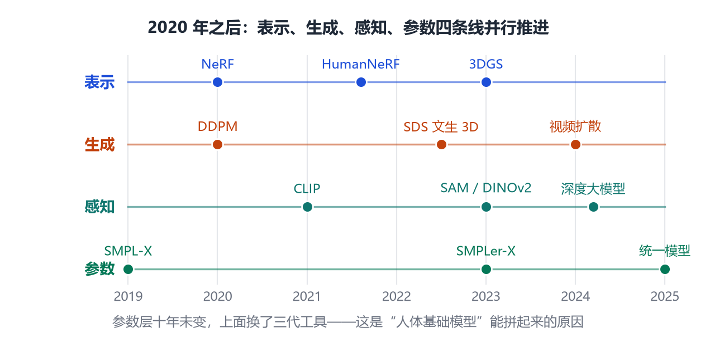
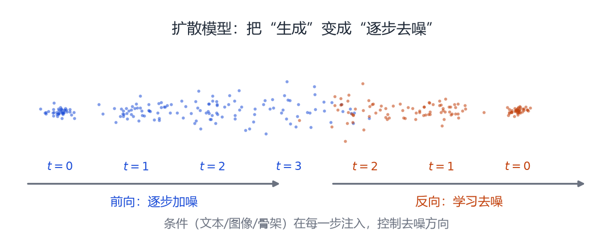
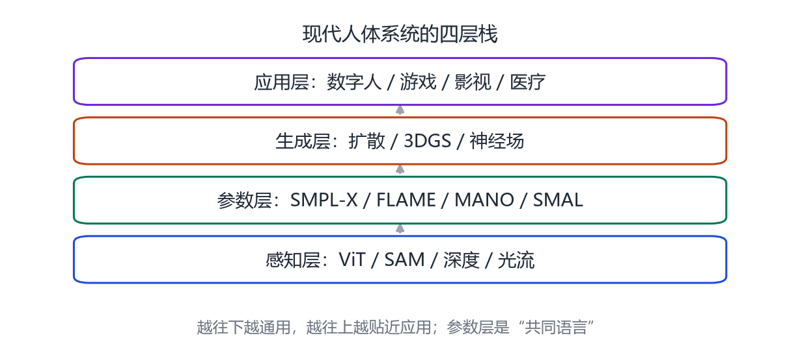
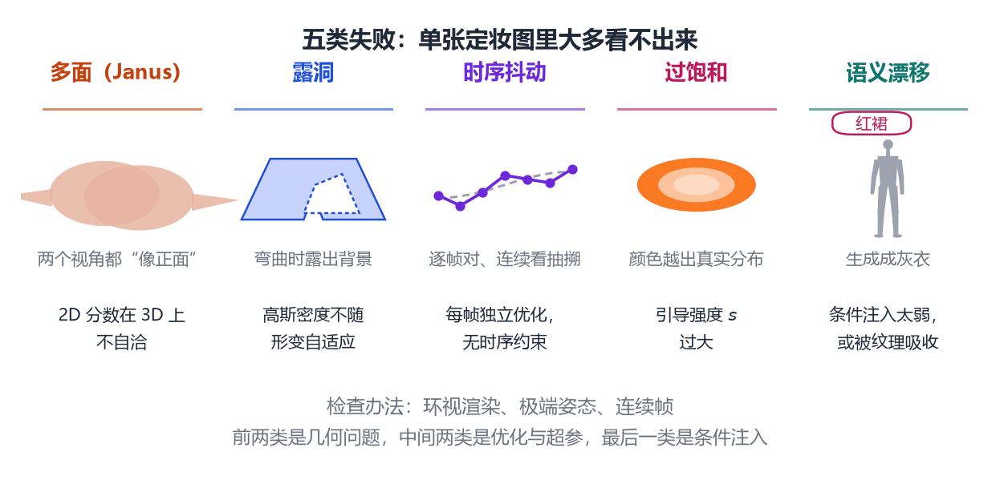

# 第 4 章 生成式人体：从扩散到基础模型

> **本章导读**：2020 年之后，人体领域出现三条新线索：神经渲染让外观达到照片级，扩散模型让“用文字生成人”成为可能，视觉基础模型让“从任意图像提取人体”变得更鲁棒。这一章不罗列论文，而是把三条线索讲清楚：每一个新工具解决了什么旧问题、代价落在哪里、以及它们如何被拼成“感知—参数—生成—应用”的四层结构。读完你会知道，今天所谓的人体基础模型，到底由哪些零件组成。

## 4.1 三条趋势

这一节先把 2020 年之后的变化压成三条线，说明它们各自在替换什么。结论是三条线都在做同一件事——把“人体知识”从手工设计搬到数据里，代价是每一层都更难解释、更难评估。

**趋势一：表示从“网格”走向“神经场/高斯”。** NeRF[@mildenhall2020nerf] 用多层感知机把空间点映射到颜色与密度，3D Gaussian Splatting[@kerbl20233dgs] 用一堆椭球做显式表示。它们能表示头发、布料、皮肤细节，突破了固定拓扑的限制。代价是表示不再有“第 3000 号顶点”这个概念，因此不能直接套参数化模型的驱动方式——必须再做一次绑定。

**趋势二：生成从“判别”走向“扩散”。** 以前是“给图预测参数”（判别式回归），现在是“从噪声生成参数或外观”（生成式采样）。前者只能输出“最像的一个”，后者能输出一个分布，因此可以无条件生成，也可以用文本、音频、骨架控制。代价是采样慢、可控性依赖条件注入的方式。

**趋势三：感知从“专用网络”走向“基础模型”。** SAM[@kirillov2023sam] 提供任意物体分割，DINOv2[@oquab2024dinov2] 提供通用视觉特征，深度大模型[@yang2024depthanything,@yin2023metric3d] 提供单目深度，视觉语言模型提供文本—图像对齐。人体系统越来越多地“站在巨人的肩膀上”，把精力放在人体特有的先验上。代价是依赖外部模型的域偏移与推理成本。

<figure class="fig">

<figcaption><b>图 4-1</b>　2020 年之后的关键节点。神经表示、扩散生成、3DGS、基础模型四条线交织，最终汇入“人体基础模型”。时间点只标到年，具体的先后顺序与论文发表时间不完全一致。</figcaption>
</figure>

三条线有一个共同点，值得单独指出：它们都不是“为人设计的”。NeRF 面向场景、扩散面向图像、SAM 面向通用分割。人体领域做的事情是把这些通用工具**接到参数化模型上**，用参数层吸收通用工具的粗糙。这也解释了为什么第四章的标题里“参数化”三个字仍然在：工具换了三代，接口没换。

## 4.2 扩散模型：零基础版

这一节回答：扩散模型到底在学什么，为什么它能生成“没见过的人”？结论是它学的是“每一步该去掉多少噪声”，也就是数据分布的对数梯度；理解了这一点，条件控制与后续的 SDS 都能一句话说清。

<figure class="fig">

<figcaption><b>图 4-2</b>　扩散模型的前向与反向过程。前向把数据逐步加噪，直到变成纯高斯噪声；反向学习一个去噪网络，从噪声一步步恢复数据。条件信息在每一步注入。</figcaption>
</figure>

扩散模型的思想可以用一句话概括：**先学会“加噪”，再学会“去噪”。**

**前向过程**：给定一张图（或一组人体参数）$\mathbf{x}_0$，每一步加一点高斯噪声：

$$
\mathbf{x}_t=\sqrt{1-\beta_t}\,\mathbf{x}_{t-1}+\sqrt{\beta_t}\,\boldsymbol{\epsilon},
\qquad \boldsymbol{\epsilon}\sim\mathcal{N}(\mathbf{0},\mathbf{I}).
\tag{4.1}
$$

读法：$\beta_t\in(0,1)$ 是第 $t$ 步的噪声比例，$\sqrt{1-\beta_t}$ 让方差大致守恒（否则加几步数值就爆了）。加 $T$ 步之后，$\mathbf{x}_T$ 几乎就是纯噪声。这个过程没有可学参数，是固定的。常用配置是 $T=1000$，噪声从很小线性或余弦地增到接近 1。

式 (4.1) 有一个重要的闭式解：不用一步步加，可以直接写出任意步的结果

$$
\mathbf{x}_t=\sqrt{\bar\alpha_t}\,\mathbf{x}_0+\sqrt{1-\bar\alpha_t}\,\boldsymbol{\epsilon},
\qquad \bar\alpha_t=\prod_{s=1}^{t}(1-\beta_s).
$$

这个式子说明增噪是“按比例缩放 + 加噪”，$\bar\alpha_t$ 是“原始信号还剩多少”。训练时正是靠它一步跳到任意 $t$，不必模拟整条链。

**反向过程**：训练一个网络 $\boldsymbol{\epsilon}_\theta(\mathbf{x}_t,t)$，输入“带噪数据 + 时间步”，输出“这一步加进去的噪声”。损失就是

$$
L=\mathbb{E}_{t,\mathbf{x}_0,\boldsymbol{\epsilon}}\big\|\boldsymbol{\epsilon}-\boldsymbol{\epsilon}_\theta(\mathbf{x}_t,t)\big\|^2.
\tag{4.2}
$$

读法：$\boldsymbol{\epsilon}$ 是真实加进去的噪声，$\boldsymbol{\epsilon}_\theta$ 是网络猜的噪声，两者越接近越好。这个损失看起来像“去噪自编码器”，但它在数学上等价于“学习数据分布的对数梯度”（score）。这就是为什么从纯噪声出发反复去噪，最后能落到数据分布上——每一步都在朝“更像数据”的方向走一小步。

训练好之后，从纯噪声 $\mathbf{x}_T$ 开始，反复“预测噪声 → 减去一部分 → 加一点点新噪声”，就能生成一张新图。步数可以少于训练时的 $T$：采样器（如 DDIM 一类）能用几千步乃至几十步逼近千步的结果，代价是每步更贵、细节略差。以参数空间为例：生成一百维的姿态只需要一个小网络，一次采样几十步就到毫秒级；而同样几十步在像素空间里就是几十次大图前向，开销差出两个量级。这直接决定了“能不能实时”。

**条件生成**：如果想“按文本生成”，把文本编码也喂给去噪网络；如果想“按骨架生成”，把骨架作为额外通道。最常用的增强手段是无分类器引导（classifier-free guidance，CFG）：同时训练“有条件”和“无条件”两种预测，采样时把两者外插，

$$
\hat{\boldsymbol{\epsilon}}=\boldsymbol{\epsilon}_\theta(\mathbf{x}_t,t,\varnothing)
+s\,\big(\boldsymbol{\epsilon}_\theta(\mathbf{x}_t,t,\mathbf{c})-\boldsymbol{\epsilon}_\theta(\mathbf{x}_t,t,\varnothing)\big).
\tag{4.3}
$$

读法：$\mathbf{c}$ 是条件（文本嵌入），$\varnothing$ 是空条件，$s$ 是引导强度。$s=1$ 退化成普通条件生成；$s>1$ 把“有条件与无条件的差”放大，结果更贴合文本但更不自然。$s$ 太大时会出现过饱和、色彩失真，这是扩散模型的典型病。

> **为什么扩散模型适合人体？** 因为人体参数空间比像素空间小得多：SMPL 是 72 维姿态加 10 维形状，一共 82 维；SMPL-X 加上手与表情，也只有一百多维。而一张 $512\times512$ 的 RGB 图是 78 万维。在低维空间里，扩散模型容易训练，采样也快；而且生成的是参数，天然可驱动、可重定向。

所以，扩散模型给人体领域带来的不是“更好的图”，而是“一个可以采样的分布”。有了分布，就能做“给定文本采样一个动作”“给定前两秒补全后面”这类以前做不到的事。

## 4.3 在参数空间生成，与在像素空间生成有什么不同

这一节回答：既然扩散能在像素上画人，为什么还要在参数空间生成？结论是两者回答的问题不同——像素空间管“长什么样”，参数空间管“怎么动”；而参数空间有一个像素空间没有的麻烦：坏解不是模糊，是几何崩掉。

**第一，维数与数据量。** 参数是几十到一百多维，像素是几十万维。在同样的数据量下，低维空间的分布更容易被覆盖。这就是为什么“文本到动作”这类任务几乎都在参数空间做，而“照片级化身”在像素/高斯空间做。

**第二，坏解的性质不同。** 像素空间里的坏解是模糊、色偏、多指；参数空间里的坏解是自交、翻面、关节反折。前者只是难看，后者是“物理上不可能”。所以参数空间的扩散模型必须配一个可行域约束——要么在采样时把越界的参数投影回来，要么在训练数据里就把不可能的样本剔掉。

**第三，可驱动性。** 参数天然带语义（这个数是肘关节角），所以生成结果可以直接重定向、可以和其他动作拼接、可以接物理仿真。像素/高斯表示要先做绑定，才能被驱动。

**第四，可控性的入口不同。** 像素空间的条件是“文本/参考图”，控制的是外观；参数空间的条件可以是“骨架序列/接触标签/物理约束”，控制的是运动。这也是为什么近年的“可控生成”工作大多在参数空间定义控制信号，再渲染成图。

代价也很明确：参数空间的表达上限就是参数化模型的上限。衣服的褶皱、头发的丝、手指的细微弯曲，在 SMPL 的 6890 个顶点上根本没有对应的自由度。所以纯参数生成的结果看起来“像个塑料人体模型”，要补细节必须回到像素/高斯空间。

一个具体例子能把分工说清。文本到动作的典型管线是：文本 → 文本编码器 → 扩散模型在参数空间采样一段动作（几十到上百帧） → 解码成关节角与根轨迹 → 物理修正（脚不滑） → 重定向到目标体型 → 渲染。每一步都在参数空间，整条管线里没有一张图。如果换成“在像素空间生成”，同样的任务就变成“先生成一段视频”，不仅贵，而且无法保证动作与骨架对应得上。

把两者的量级摆在一起会更清楚。SMPL 的参数是 82 维，一张 $512\times512$ 的 RGB 图是 $512\times512\times3=786432$ 维，两者差四个数量级。经验上，一个低维分布要处得准，需要的样本量随维数大致指数增长（这是一个粗略的量级说法，不是严格定理）；所以“参数空间需要几万条动作、像素空间需要百万张图”这个差别不是工程偏好，而是维数决定的。

所以，两条路不是替代关系，而是分工：参数空间负责“结构与运动正确”，像素/高斯空间负责“外观真实”。第 4.7 节的四层栈，本质就是把这两件事拆开。

## 4.4 文本到 3D：SDS 与它的后代

这一节回答：没有 3D 训练数据，怎么用 2D 扩散模型“蒸馏”出一个 3D 物体？结论是靠分数蒸馏采样（SDS）把 2D 的“该往哪改”变成 3D 参数的梯度；代价是优化慢，而且会产生多面、过饱和这类特有伪影。

2022 年，DreamFusion[@poole2023dreamfusion] 提出 **Score Distillation Sampling（SDS）**：不需要 3D 训练数据，只用一个预训练的 2D 扩散模型，就能优化一个 3D 表示（NeRF、网格、高斯），使它从任意视角渲染出来都“像文本描述的东西”。

做法是四步：

1. 随机采一个视角，渲染当前 3D 表示；
2. 把渲染图加噪，喂给 2D 扩散模型；
3. 扩散模型告诉你“这张图应该往哪个方向改”；
4. 把这个梯度反传回 3D 表示，更新它。

写成式子更清楚。设渲染图为 $\mathbf{x}=g(\phi)$（$\phi$ 是 3D 表示参数），加噪后为 $\mathbf{x}_t$，则 SDS 用的梯度是

$$
\nabla_\phi L_{\text{SDS}}
=\mathbb{E}_{t,\boldsymbol{\epsilon}}\Big[w(t)\big(\boldsymbol{\epsilon}_\theta(\mathbf{x}_t,t,\mathbf{c})-\boldsymbol{\epsilon}\big)\frac{\partial\mathbf{x}}{\partial\phi}\Big],
\tag{4.4}
$$

读法：$\boldsymbol{\epsilon}_\theta(\mathbf{x}_t,t,\mathbf{c})-\boldsymbol{\epsilon}$ 是“扩散模型认为这张图多出来的噪声”，它指向“更符合文本”的方向；$\partial\mathbf{x}/\partial\phi$ 把这个像素方向的修正翻译成 3D 参数的修正；$w(t)$ 是按噪声等级给的权重。关键点是：**扩散模型的参数不更新**，只有 3D 表示在更新。

SDS 的意义在于：**它把 2D 生成模型的知识“蒸馏”到 3D**。对人体的应用是：用文本描述“一个穿红裙子的女人在跳舞”，生成对应的 3D 人体/动作。

但它有三个结构性缺陷，且都源于同一个原因——2D 分数在 3D 上不自洽：

- **多面（Janus 问题）**。2D 扩散模型只看单张图，它不知道“背面是什么”。于是优化器会把“正面朝前”的解释同时贴到前后两个视角上，得到一个有两个脸的物体。
- **过饱和与过平滑**。$w(t)$ 的取法会让高噪声步主导，结果偏向“平均的、饱和的”外观，细节被磨掉。
- **优化慢**。每次更新都要渲染 + 前向 + 反传，一个模型要几十分钟到几小时。

后来的工作沿三条线改善：用 3DGS 替代 NeRF（渲染快一个量级）、用视频扩散替代图像扩散（时序一致性天然约束了多面问题）、用人体参数化模型做先验（把“人”的形状限制在 SMPL 的流形上，多面问题直接消失）。第三条对人体的意义最大：一旦把 3D 表示换成“SMPL 网格 + 外观场”，Janus 问题就不再是问题，因为 SMPL 只有一个正面。

所以，SDS 是“用一个不够懂 3D 的老师教 3D”，教学质量靠额外的结构性先验来补。在人体的场景里，这个先验恰好是现成的。

### 4.4.1 为什么换成参数化模型，多面就消失了

多面的根源是“同一个 3D 物体在不同视角下被独立评估，而 2D 模型不知道它们同属一个物体”。换成 SMPL 加外观场之后，这件事发生了三层变化：

1. **形状被锁在流形上。** 优化变量从“空间中的任意密度场”变成“几十维参数 + 一个外观场”。一个有两个正面的形状在 SMPL 的流形上根本不存在，所以不能被表达。
2. **视角之间的关系统一了。** 所有视角都是同一个网格渲染出来的，背面与正面的关系由几何决定，而不是由优化器分别拟合。
3. **先验可以逐项加。** “关节不能反折”“肩宽不能是负数”这些约束在参数上是一行代码，而在隐式场上是一个很难写的东西。

代价是另一个方向的：多面消失了，但“参数层盖不住的东西”也表达不了了。比如一条拖到地上的长裙，或者一个把头砸到膝盖后面的动作——前者不在形状空间里，后者不在姿态先验里。所以“加先验”不是免费的，它把一类错误换成了另一类。

## 4.5 3DGS：实时的照片级化身

这一节回答：3D 高斯泼溅为什么能实时渲染，它做人体化身时的瓶颈在哪？结论是它把“渲染”变成了“排序 + 混合”，因此极快；瓶颈在驱动时的露洞与存储，两者都源于“高斯是绑在面片上的”。

3D Gaussian Splatting 用一堆高斯椭球表示场景，每个高斯有五组属性：位置（3 个数）、协方差（用 3 个缩放 + 4 元四元数表示朝向，共 7 个数）、不透明度（1 个数）、颜色（用球谐系数表示视角相关颜色，三阶球谐是 16 个系数 × 3 通道 = 48 个数）。渲染时把它们投影到屏幕、按深度排序、按 $\alpha$ 混合，速度极快。

在人体上，3DGS 有两种用法：

- **静态重建**：多视角拍摄一个人，重建出可自由视角观看的高斯化身；
- **可驱动化身**：把高斯绑定到 SMPL/FLAME 的面片上，人一动，高斯跟着动（如 GaussianAvatars[@qian2024gaussianavatars]、SplattingAvatar[@moreau2024splattingavatar]）。

它的挑战是三条：

**第一，泛化（换姿势露洞）。** 高斯绑在面片上，面片被拉伸时高斯跟着拉伸。拉伸过大时，原本被遮住的区域会空出来——因为那部分根本没有高斯。这不是分辨率问题，是“采样密度随形变变化”的问题。

**第二，存储。** 算一笔账：一个高斯按上式需要 $3+3+4+1+48=59$ 个浮点数，单精度约 236 字节。一个高质量化身常有几十万到上百万个高斯，那么

$$
\text{存储}\approx N_g\times 236\ \text{字节},
\qquad N_g=10^{6}\ \Longrightarrow\ \approx 236\ \text{MB}.
\tag{4.5}
$$

读法：$N_g$ 是高斯数量。这个量级听起来还能接受，但要注意它是单个化身；一个应用里若有上千个化身，或者需要放到移动端，就必须压缩——量化、剪枝、或者把球谐降到零阶（只用漫反射颜色，能省 48 个数里的大部分）。

**第三，编辑。** 想换衣服、换发型，需要重新训练或额外解耦。因为高斯没有语义，它不知道“这些高斯属于裙子”。这也是为什么后来的工作要把高斯绑到参数化模型的面片上——绑上去之后，至少有了“这块是左小腿”的语义。

压缩的三个常用手段值得记一下：**量化**（把浮点数降到 8 位或 16 位，体积减半到四分之三，基本无损）、**剪枝**（删去透明度低于阈值的基元，常见能减两到三成）、**降阶**（球谐从三阶降到零阶，只保留漫反射颜色，体积直接降一半以上，代价是高光消失）。三者叠起来，一个两百多 MB 的化身可以压到几十 MB，代价是“远处看一样、近处看发糊”。

这三条瓶颈指向同一个结论：**3DGS 的强项是“渲染”，弱项是“结构”**。所以它在人体上的正确位置是“最后一层”——参数层给出结构与驱动，3DGS 给出外观与细节。

### 4.5.1 两种绑定方式，两种露洞方式

“把高斯绑到人体上”有两种常见做法，它们的失效方式不一样，值得分清。

**第一种，绑到面片。** 每个高斯记录“属于哪个三角形 + 在这个三角形里的重心坐标”。三角形一动，高斯跟着做同样的仿射变换（如 GaussianAvatars[@qian2024gaussianavatars] 这类做法）。优点是简单、与网格严格同步；缺点是三角形被拉长时，高斯跟着被拉长，于是一个圆跳变成一根细条，视觉上就是“抽丝”。

**第二种，嵌入网格外表。** 每个高斯记录“在网格表面的哪个位置 + 沿法向偏移多少”。优点是高斯不会跟着面片被压扁，形状更稳；缺点是当两个面片拉开时（比如肘部弯曲），原本被遮住的表面露出来，而那里没有高斯——这就是“露洞”的直接机制。

两种方式各自的问题都不是“精度不够”，而是“采样密度与形变不匹配”。所以改进方向也很一致：让高斯的数量或尺度随形变自适应，或者在训练时就注入大幅弯曲的样本，让模型见过“拉开后的样子”。

所以，3DGS 不是参数化模型的替代品，而是它的“皮肤”。理解这一点，就能理解 4.7 节那个四层栈为什么把参数层放在中间。

## 4.6 基础模型如何改变人体重建

这一节回答：一批“不为人体设计”的大模型，为何让人体重建的鲁棒性上一个台阶？结论是它们把“感知”这一层商品化了，于是研究者可以把精力全部放在“人体特有的先验”上；代价是多了一层不可控的外部依赖。

先说清“基础模型”这个词指的是什么。它通常同时含三个特征：在极大规模数据上预训练、在多个下游任务上零样本可用、以及带一个可适配的通用表示（特征、分割、深度）。按这三个标准，人体领域用到的有四类：

**分割。** SAM[@kirillov2023sam] 用“提示 + 分割”的范式，把任意对象从背景里抠出来。它在 1100 万张图、约 11 亿个掩码上训练，所以对“动物、人、乐器”这类常见概念零样本可用。对人体系统的作用很直接：不再依赖一个脆弱的检测框，掩码边缘可以直接进轮廓损失。

**视觉特征。** DINOv2[@oquab2024dinov2] 用自监督学到的特征，替代 ImageNet 预训练的 ResNet。它最大的价值是跨域泛化：在室内人像上训的网络，拿到野外人物照片上，特征分布不会碎。很多人体重建工作的鲁棒性提升，主要就来自把 backbone 换成它。工程上最常见的改法是“只换特征提取器、其他不动”，因为特征一变，后面的回归头需要重新调，而这一调往往就能拿到几个点的提升。

**深度。** Depth Anything[@yang2024depthanything] 与 Metric3D[@yin2023metric3d] 提供单目深度或度量深度。前者给相对深度（形状对、尺度不对），后者试图直接给米制深度。它们对 2.8 节那个“尺度与焦距只能定到乘积”的老问题给出了新的可能。

**视觉语言。** CLIP 一类模型提供“文本—图像”对齐，用于文本驱动的编辑、检索与生成；也是 4.2 节 CFG 的基础。

这四类模型的共同作用，可以用一句话概括：**它们把“从图里取信息”变成了一个 API**。以前处理一张野生动物照片，要自己写轮廓检测、自己训关键点检测；现在先跑分割、再跑深度、再跑特征，人只需要负责“人形/动物形”的先验部分。

但代价也要说清，而且不是小事：

- **域偏移转移了，而不是消失了**。SAM 在相机陷阱图像（夜视、低对比度、动物只露出半个身子）上的掩码质量会明显下降；深度大模型在长焦野生动物上也不可靠。错的分割比没有分割更坑，因为它错得很自信。
- **推理成本与延迟**。一个实时系统里再塞进三个大模型，帧率就没了。工程上常见做法是“离线预处理 + 在线小模型”，或者蒸馏成小模型。
- **许可与可复现性**。基础模型多为“权重开放、数据不开”，复现别人的结果时，你无法确认他用的到底是哪个版本。

<figure class="fig">

<figcaption><b>图 4-3</b>　现代人体系统的四层栈。感知层提供通用特征，参数层提供人体先验，生成层负责细节与多样性，应用层面向具体场景。参数层是承上启下的“共同语言”。</figcaption>
</figure>

所以，基础模型的贡献不是“替代参数化模型”，而是把参数化模型从“什么都自己干”里解放出来，让它专心做“结构”这一件事。

## 4.7 一个正在形成的“人体基础模型”

这一节回答：把这些零件拼起来，今天的“人体基础模型”长什么样，它的接口在哪里？结论是四层结构，而参数层是接口：所有模块用同一套参数交交。

四层是这样的：

1. **输入**：图像/视频/文本/音频；
2. **感知**：基础模型提取特征、分割、深度、光流；
3. **参数化**：回归 SMPL-X/FLAME/MANO 参数（身体、脸、手）；
4. **生成**：扩散/3DGS 补细节、补外观、补动作；
5. **输出**：可驱动、可编辑、可渲染的化身。

虽说是“四层”，实际数下来是五个环节，中间那个“参数化”就是接口。为什么一定是它，而不是“直接用隐式表示做接口”？三个理由：

**第一，维度低且语义明确。** SMPL-X 是 10475 个顶点、55 个关节；FLAME 是 5023 个顶点；MANO 是 778 个顶点。这些数字背后是一套被共同体接受的定义：“这个角是腑关节”。有了它，不同模块的开发者可以不相往来。

**第二，可驱动。** 参数可以直接接动画、接动作捕捉、接物理仿真，不需要重新训练。隐式表示做不到这一点，它得靠变形场，而变形场本身又要靠参数化模型提供监督。

**第三，可评估。** 有了参数，就能算“关节角误差”“形状参数误差”，而不是只能看图。评估是工程化的前提。

代价也必须写清：**参数层就是表达上限**。衣服的褶皱、头发的丝、肌肉的隆起，在 SMPL 的固定拓扑上没有自由度。这就是为什么四层栈里“生成层”必须存在：它负责参数层表达不了的东西。

一个具体的例子能说明分工。要做一个“穿裙子的女人跳舞”的可驱动化身，管线是：参数层给出身体与动作（可驱动、可重定向）；生成层把裙子做成绑定在身体上的高斯或粒子（外观真实）；感知层从视频里追踪人体（不需要动捕）；应用层把三者拼成实时渲染。任意一层缺失，系统都会在某个维度上失效。

所以，人体基础模型的“基础”不在于模型大，而在于**接口稳定**。参数层稳定了十年，上面换了三代工具，系统仍然能拼起来。

但这个接口也有一个现实麻烦：版本。SMPL、SMPL-X、以及后来各种扩展（不同的手部细节、不同的脸部自由度）之间并不完全兼容，“同一个 82 维向量”在不同版本里可能指不同东西。工程上的对策是两层：内部统一用一个版本，对外做一层转换；转换层要带测试，因为参数空间的错误不会报错，只会默默变差。

## 4.8 从“能生成”到“能信”：失败模式

这一节回答：生成式人体系统在哪些地方会以“看着像、实际错”的方式失败？结论是五类，各自的检查手段不同，而最危险的是那些在单帧里看不出来的错误。

<figure class="fig">

<figcaption><b>图 4-4</b>　五类典型失败。多面（同一个体从两个视角都“像正面”）、露洞（换姿势时拉伸过度）、抖动（时序不连续）、过饱和（引导强度过大）、语义漂移（生成结果不跟随条件）。前两类是几何问题，中间两类是优化问题，最后一类是条件注入问题。</figcaption>
</figure>

| 失败 | 症状 | 成因 | 检查 |
|---|---|---|---|
| 多面（Janus） | 转一圈发现两个正面 | 2D 分数在 3D 上不自洽 | 环视渲染，看背面是否也是正面 |
| 露洞 | 大幅弯曲时关节处空出一块 | 高斯密度不随形变自适应 | 极端姿态下统计空洞面积 |
| 时序抖动 | 逐帧看都对，连续看抽搠 | 每帧独立优化，无时序约束 | 算相邻帧顶点的加速度 |
| 过饱和 | 颜色过鲜、皮肤像塑料 | 引导强度 $s$ 过大或噪声权重失衡 | 扫 $s$，看分布是否偏离真实图 |
| 语义漂移 | 文本说“红裙”，结果是灰衣 | 条件注入弱，或 CFG 太小 | 同一文本多次采样，看方差 |

这五类里，前两类是“几何”，第三四类属于“优化与超参”，最后一类是“条件”。它们对应的修法完全不同：多面要靠多视图/视频先验；露洞要靠密度自适应或重采样；抖动要靠时序损失或后处理平滑；过饱和要调 $s$ 与噪声调度；语义漂移要加强对齐或换更强的文本编码器。

值得单独说的是**这些错误在单帧里大多看不出来**。多面、露洞、抖动，三者都是“换一个视角、换一个姿态、换一段时间”才暴露。所以评估生成式人体系统，必须至少看三样东西：环视渲染、极端姿态、连续帧。只看一张漂亮的定妆图，等于没评。

还有一个更隐蔽的问题：**参数层会把错误吸收成“合理的形状”**。因为网格只能表达合法形状，网络会把一个错的 3D 理解投影成一个“看着没错”的参数。这类错误无法从网格上看出，只能从“拟合残差”上看出：如果渲染结果与输入图像对不上，但网格看起来正常，那就是参数层在“圆谎”。

所以，生成式人体的可信度不是“渲染得更真”能解决的，而是三件事叠起来：几何自洽（环视）、物理自洽（接触与穿模）、时序自洽（连续帧）。

### 4.8.1 三查的操作顺序

把上面三件事变成可执行的检查，顺序建议如下：

1. **环视。** 把结果放在一个转盘上，每 45 度渲一张，共 8 张。看两件事：背面是不是另一个正面；身体两侧的细节是否对称。
2. **极端姿态。** 把关节角推到训练分布的 $\pm2\sigma$（或者直接把肘、膝弯到最大），看关节内侧是否穿模、外侧是否露洞。
3. **连续帧。** 渲染一段 3 秒的动作，把顶点轨迹的二阶差分算出来。若最大值是其他帧的几倍，就是抖动。

三步都过，才能说“可以用了”。这三步加起来不到半小时，但能拦掉大部分“单张图很好看”的问题。

## 4.9 开放问题

这一节把尚未解决的问题按四类列出，每条都指出卡在哪里。

**数据。** 高质量 4D 人体数据仍然稀缺——多相机阵列 + 同步扫描的设备全球也没几套。合成数据有域差异（皮肤、布料、光照都不对）；网络数据有隐私与版权问题。一条可能的路是用生成模型造数据，但那又回到了“生成的东西能不能当监督”的循环。

**评估。** 照片级真实感、物理合理性、身份一致性、可控性，四个维度没有统一指标。更麻烦的是它们互相牵制：把真实感指标推高，往往会牺牲可控性。

**效率。** 扩散模型慢、3DGS 占内存、大模型推理贵。实时数字人仍然需要大量工程优化：蒸馏、量化、缓存、分层渲染。

**伦理。** Deepfake、身份盗用、虚假视频；参数化模型让“换脸/换身”变得更容易，而检测方法总是滞后一代。这里的难点不是技术，而是“生成与检测在同一套工具上赛跑”。

**通用性。** 儿童、老人、孕妇、残障人士、不同种族，现有模型的覆盖仍然不足。这不是数据量问题，而是“平均化”的系统性后果：形状空间的前几个主成分永远在描述“最常见的差异”。

所以，这四个问题都不是“再大一点的模型”能解决的。它们分别卡在采集、度量、算力与治理上，这也是为什么人体基础模型会以“分层”的形态长期存在。

## 本章小结

- 三条趋势：神经表示（NeRF/3DGS）、扩散生成、基础模型；它们都从通用领域来，接到人体的参数层上。
- 扩散模型学的是“每步去多少噪”，等价于数据分布的对数梯度；条件注入靠拼接/交叉注意力，引导靠 CFG，引导强度过大会过饱和。
- 在参数空间生成与在像素空间生成分工不同：前者管结构与运动，后者管外观；参数空间的坏解是几何崩掉，必须配可行域约束。
- SDS 把 2D 扩散的“该往哪改”变成 3D 参数的梯度，代价是慢与多面伪影；加了人体参数先验，多面问题自然消失。
- 3DGS 用高斯椭球实现实时渲染，可绑定到参数化模型上做可驱动化身；瓶颈是露洞与存储（百万高斯约两百多 MB）。
- SAM、DINOv2、深度大模型提供通用感知，把“从图里取信息”变成 API；代价是域偏移转移与推理成本。
- 四层栈：感知 → 参数 → 生成 → 应用；参数层是共同语言，同时也是表达上限。
- 五类失败（多面、露洞、抖动、过饱和、语义漂移）在单帧里大多看不出来，评估必须看环视、极端姿态、连续帧。

## 思考题

1. 为什么扩散模型在“参数空间”上训练比在“像素空间”上更容易？从维数与坏解的性质两方面回答。
2. SDS 的梯度来自 2D 扩散模型，它为什么能让 3D 表示变得“像文本”？它又为什么会造出多面？
3. 3DGS 化身在换姿势时为什么会露洞？有哪些补救办法，各自的代价是什么？
4. 如果基础模型已经能分割、测深度，参数化人体模型还有存在的必要吗？请从可控性、评估、驱动三个角度回答。
5. 式 (4.3) 里的引导强度 $s$ 取很大时，会出现哪两类相反的错误？

