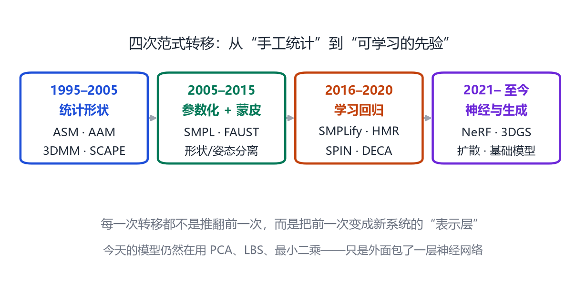
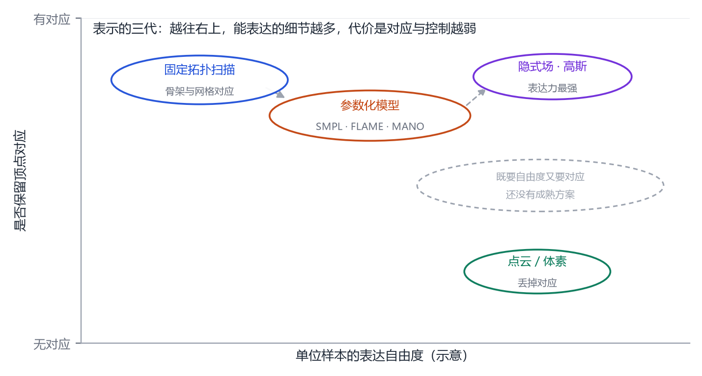
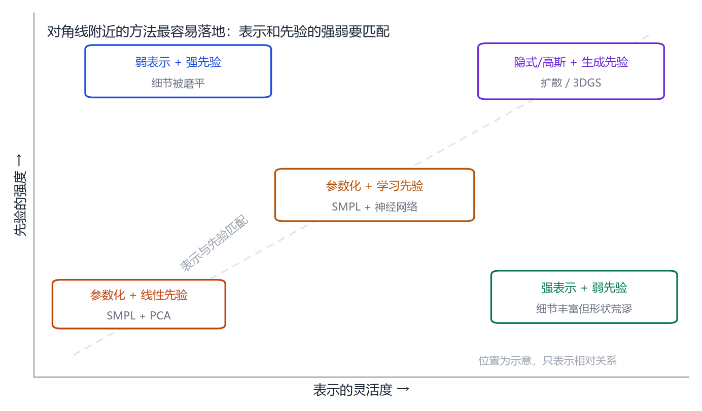

# 第 5 章 研究脉络与未来

> **本章导读**：这一章不再介绍新模型，而是把前面讲过的所有方法放回同一张地图，给出一个能用来判断新论文的框架。读完本章，你应该能做到三件事：看到一个新方法，能立刻说出它在哪一条线上动了手；能判断它付出的代价落在哪里；能说出它留下的问题是什么。最后给出若干开放问题与阅读建议。

## 5.1 一个能装下所有方法的式子

这一节先把整本书里的方法压成一个式子，后面四条线都围绕它展开。结论是：所有参数化人体/动物方法都在解同一个问题——在“数据项”和“先验项”之间分配信任，而每一次范式转移只是换了其中一项的写法。

设表示（representation）把参数 $\boldsymbol{\theta}$ 映射到一个可渲染、可比较的对象 $\mathcal R(\boldsymbol{\theta})$，观测是 $\mathbf x$（图像、扫描、点云），那么几乎所有方法都是

$$
\hat{\boldsymbol{\theta}}
=\arg\min_{\boldsymbol{\theta}}\ \underbrace{E_{\text{data}}\big(\mathbf x;\ \mathcal R(\boldsymbol{\theta})\big)}_{\text{信观测}}
+\underbrace{\lambda\,E_{\text{prior}}(\boldsymbol{\theta})}_{\text{信先验}} .
\tag{5.1}
$$

读法：$\mathcal R$ 是表示（网格 + 蒙皮、隐式场、高斯集合），$E_{\text{data}}$ 是“渲染/比较”的误差（轮廓、像素、点到面距离、特征距离），$E_{\text{prior}}$ 是“什么才算合理”的度量（PCA 方差、关节限位、姿态分布、扩散模型的对数密度），$\lambda$ 是两者的兑换率。

这个式子本身不新，新的是每一代都在换其中一项的写法：

- 换 $\mathcal R$：从网格换成隐式场、高斯、或者“网格 + 外观场”；
- 换 $E_{\text{data}}$：从点到面距离换成轮廓 IoU、光度误差、特征距离、甚至“2D 扩散模型的分数”；
- 换 $E_{\text{prior}}$：从线性方差换成关节限位、混合模型、扩散先验、大模型特征空间里的距离；
- 换求解器：从梯度下降换成回归网络、交替优化、闭环 EM。

所以，读一篇新论文时，第一件事不是看它用了什么网络，而是问：**它换了上面四项里的哪一项？** 这一问几乎总能立刻定位它的贡献。

举两个例子试试。SMPLify[@bogo2016smplify] 换的是 $E_{\text{prior}}$ 与求解器：它第一次把“胶囊体碰撞 + 关节限位”写成可微的惩罚项，用优化把 SMPL 拟合到 2D 关键点上。MagicPony[@wu2023magicpony] 换的是 $\mathcal R$ 与 $E_{\text{data}}$：表示从固定网格换成“可学习的规范形状 + 关节”，数据项从轮廓换成图像重建，求解器仍是最小化，但未知数里多了每张图的相机与姿态。两者都不是“新网络”，而是换了式子里的某一块。

## 5.2 四次范式转移

这一节回答：这个领域大体上分几段，每一段解决上一段的什么缺口？结论是四段，而每一段都没有让上一段“过时”——前一段的方法被封装进新系统的一层。

<figure class="fig">

<figcaption><b>图 5-1</b>　参数化人体/动物技术的四次范式转移。每一次都把前一次的成果“封装”成新系统的一层，而不是抛弃它。</figcaption>
</figure>

**第一次（1995–2005）：统计形状。** ASM、AAM 证明了“从样本里学形状先验”可行[@cootes1995asm,@cootes2001aam]；3DMM 把它带到三维人脸[@blanz1999morphable]；SCAPE 把形状与姿态分开[@anguelov2005scape]。这一阶段的关键词是**对应 + PCA**。缺口是：模型只能描述“已经见过的形状”，不能处理姿态带来的形变。

**第二次（2005–2015）：参数化 + 蒙皮。** SMPL 用 LBS 加 blendshape 把模型做得又简单又可微[@loper2015smpl]；FAUST 提供了评测基准[@bogo2014faust]。这一阶段的关键词是**实时 + 可微 + 标准格式**。缺口是：模型有了，但怎么从图像反推参数没人做。

**第三次（2016–2020）：学习回归。** SMPLify 用优化从图像反推参数[@bogo2016smplify]；HMR 用网络直接回归[@kanazawa2018hmr]；SPIN 把两者结合，用优化结果当监督[@kolotouros2019spin]。这一阶段的关键词是**图像 → 参数**。缺口是：回归太依赖 2D 标注，且外观细节（衣服、头发）表达不了。

**第四次（2021 至今）：神经与生成。** NeRF、3DGS 把外观做到照片级[@mildenhall2020nerf,@kerbl20233dgs]；扩散模型让生成变得可控[@ho2020ddpm]；SAM、DINOv2、深度大模型提供通用感知[@kirillov2023sam,@oquab2024dinov2]。这一阶段的关键词是**细节 + 生成 + 基础模型**。缺口是：真实感上去了，但物理与可控性还没跟上。

值得注意的是：每一次转移都没有让前一次“过时”。今天最先进的系统，内部仍然在跑 PCA、LBS、最小二乘，只是外面包了神经网络和神经渲染。判断一个方法是“新范式”还是“旧范式加壳”，看它内部有没有真的换掉那四项之一。

所以，四段历史的价值不在于记年份，而在于认出一个规律：**每一次进步都是“把某一项从手工换成数据”**——手工对应换成学习对应，手工先验换成学出来的分布，手工特征换成自监督特征。这个规律也预告了下一次转移大概会发生在哪。

还有一个实用的判据：一次“真正的转移”之后，旧方法的产物会变成新方法的输入。PCA 的形状空间变成了网络的训练目标，SMPL 的网格变成了渲染的载体，动作库变成了生成模型的训练数据。如果你看到一篇论文只是把两套旧工具拼在一起、彼此的输入输出关系没变，那它更可能是“工程改进”而不是“范式转移”。

## 5.3 表示线：从顶点到隐式再到高斯

这一节回答：表示这一条线经过了几代，每一代的自由度与代价是什么？结论是三代：固定拓扑网格 → 参数化模型 → 隐式/高斯；自由度递增，**顶点对应**递减，而“能不能做统计”恰好吃在对应上。

<figure class="fig">

<figcaption><b>图 5-2</b>　表示线的三代。横轴是“单位样本的表达自由度”，纵轴是“是否保留顶点对应”。固定拓扑网格（扫描）在右下，参数化模型在中间，隐式场与高斯在左上。虚线是“既要自由度又要对应”的空位，目前没有成熟方案。</figcaption>
</figure>

**第一代，固定拓扑网格。** 每个样本是 $N$ 个顶点、同一套连接。优点是顶点一一对应，可以直接做 PCA、做插值、做形变迁移；缺点是 $N$ 一旦定下，能表达的形状就被拓扑锁死，手指并指、张嘴这些都需要专门的拓扑设计。

**第二代，参数化模型。** 把 $N$ 个顶点压成几十维参数：SMPL 是 6890 顶点 + 24 关节，SMPL-X 是 10475 顶点 + 55 关节，FLAME 是 5023 顶点，MANO 是 778 顶点。优点是维数低、可驱动、可微、格式统一；缺点是表达上限就是这套参数的上限——布料、头发、肌肉隆起都不在参数里。

**第三代，隐式与高斯。** 隐式场（SDF、NeRF 一类）用一个函数定义“空间每一点是不是在体内/是什么颜色”，高斯集合用一堆椭球拼出外观。优点是任意拓扑、细节丰富；缺点是没有显式顶点，也就没有“对应”——不能直接做 PCA，不能直接算“同一个解剖点在两个个体之间的位移”。

隐式表示还有两个常被低估的工程代价。**一是提取网格。** 要从场里拿到可用的网格，得在体素网格上采样再跑等值面提取（如 marching cubes），分辨率取 256³ 就是 1600 多万个体素，每点算一次网络，耗时与显存都不小；分辨率降低又会把手指、耳朵这种细结构抹掉。**二是拓扑噪声。** 提取出来的网格经常带小孔、小浮岛，必须做后处理（去除非连通分量、平滑、重网格化），每步都会改几何。相比之下，参数化模型的 6890 个顶点是“天生干净”的，这也是它在工业流水线里仍然占主位的原因。

三代的替换关系可以写成一张表，代价一眼可见：

| 表示 | 自由度 | 顶点对应 | 可驱动 | 典型用途 |
|---|---|---|---|---|
| 固定拓扑网格 | 低（受拓扑限制） | 有 | 需骨架 | 统计形状、数据集 |
| 参数化模型 | 低（几十维） | 有 | 直接 | 重建、动画、生成 |
| 隐式场 | 高（连续） | 无 | 需形变场 | 细节重建、单物体 |
| 高斯集合 | 高（百万级基元） | 无 | 需绑定 | 实时渲染、化身 |

值得强调的一点：**“对应”不是一个抽象的美德，而是三件具体能力的入口**——统计（PCA/回归）、迁移（动作重定向）、评估（顶点级误差）。丢掉对应，这三件事都要换成别的做法：统计换成“在特征空间做”，迁移换成“形变场”，评估换成“渲染相似度”。换过来的做法都能用，但都更贵、更不稳。

所以，表示线的历史不是“越来越自由”，而是“自由度与对应在互相交换”。每一次进步都拿走了更多自由度，也付出了一部分可统计性。今天最活跃的方向（混合表示：参数化骨架 + 神经外观）本质上是在试着把两者重新拼起来。

混合表示值得单独说一句，因为它代表了一种“不追求单一表示”的思路。把“驱动”交给参数化骨架（有对应、可统计、可重定向），把“外观”交给神经场或高斯（高自由度），中间用一个变形场相连。这样做的确能同时拿到两边的大部分好处，但丢了一个隐形的能力：**外观本身不能做统计**。你不能问“这两个人裙子的平均形状”，因为裙子在神经外观里，没有顶点。这个代价在应用里往往可以接受，在研究里则意味着“混合表示不适合研究衣服的统计形状”。

## 5.4 先验线：从方差到分布

这一节回答：先验这一条线换了几次写法，每次换的是什么？结论是四次：手工规则 → 线性高斯 → 学出来的分布 → 大规模数据隐式给出的分布；每一次都让“合理”的定义更贴近真实，也让“为什么不合理”更难解释。

**第一次，手工规则。** 关节限位、骨骼长度比例、左右对称。它们的特点是“硬”——违反就直接判死，不需要调权重。优点是极其稳，缺点是覆盖不全：真实动作里确实存在超出“常见范围”的姿态。

**第二次，线性高斯。** PCA 的形状空间配上 $\beta\sim\mathcal N(0,\sigma^2)$，本质是“假设形状分布在均值附近是椭球”。优点是有一个统一的、可计算的“多少 σ”，并且能直接和最小二乘拼起来；缺点是这个椭球很粗，它不能表达“腿长和脖子长是相关的”这类结构（除非这些相关性恰好落在主成分方向里）。

**第三次，学出来的分布。** 姿态先验用混合模型、VAE、归一化流，把“合理姿态”写成一个真正的分布而不是一个椭球（如 HuMoR 一类方法[@rempe2021humor]）。优点是能表达多峰、能表达相关性；缺点是需要大量数据，而且“分布外”与“不合理”不再是同一件事。

**第四次，数据隐式给出的分布。** 扩散模型与大规模预训练模型把先验藏进了网络权重。你不再能写出 $E_{\text{prior}}$ 的解析形式，只能通过采样或梯度访问它。优点是极强——它知道“一张真实照片该长什么样”；缺点是**不可解释、不可局部编辑**：想只改“姿态”而不动“身份”，就必须额外做解耦。

四次的共同趋势是：**先验越来越强，越来越难说清**。这在工程上有一个直接后果——调试方式变了。线性高斯时代，出问题就看“σ 是不是太大”；扩散时代，出问题只能靠采样若干次、看分布、找偏置。

所以，先验线的选择本质上是一个交易：用“可解释性”换“覆盖度”。这也是为什么在高可靠场景（医疗、工业测量）里，人们仍然偏好线性先验加硬约束，而不是最强的生成先验。

判断一个系统的先验到底有多强，有一个简单的实验：**故意输入一个明显错误的观测，看它能否拒绕。** 把图像里人的腿遮掉一半，强先验会“把腿补出来”（形状先验的直接体现）；弱先验会把腿估短。再推一步：把两张不同人的照片拼成一张，强先验会把它们拉成一个“平均人”，弱先验会得到一张扭曲的网格。两个结果都不对，但你由此知道了先验的“硬度”。

动物领域把这个问题放大了。人体先验可以从几万个真人样本里学（如 AMASS 那类动作库[@mahmood2019amass]）；动物没有这种规模的数据库，所以只能“按物种分别学”或者“跨物种迁移先验”。前者样本少、容易过拟合；后者会引入错误——把四足的步态先验搬到鸟类上，翅膀的控制完全不对。这也是为什么动物重建里“先验只对某个物种好”是一个反复出现的问题（见第 2 章）。

## 5.5 拟合线：优化、回归、闭环

这一节回答：从观测到参数这一步，方法只变过三次，变的到底是什么？结论是三次：纯优化、纯回归、以及两者闭环；而每一次都是在“精度”与“速度/鲁棒性”之间换位置。

把三种形态写成式子，差别就一目了然：

$$
\hat{\boldsymbol{\theta}}=\begin{cases}
\arg\min_{\boldsymbol{\theta}}\ E_{\text{data}}\big(\mathbf x;\mathcal R(\boldsymbol{\theta})\big)+\lambda E_{\text{prior}}(\boldsymbol{\theta}) & \text{优化（慢、准、每帧重算）}\\[4pt]
f_{\phi}(\mathbf x) & \text{回归（快、粗、一次前向）}\\[4pt]
\arg\min_{\boldsymbol{\theta}}\ E_{\text{data}}\big(\mathbf x;\mathcal R(\boldsymbol{\theta})\big)+\lambda\big\|\boldsymbol{\theta}-f_{\phi}(\mathbf x)\big\|^2 & \text{闭环（回归给初值/先验）}
\end{cases}
\tag{5.2}
$$

读法：第一行是拟合（SMPLify 那一代[@bogo2016smplify]），每张图都解一个优化问题，所以准，但慢且依赖初值；第二行是回归（HMR 那一代[@kanazawa2018hmr]），一次前向出结果，但只能给出“最近邻式”的解，稀有姿态容易错；第三行是闭环（SPIN 那一代[@kolotouros2019spin]），把回归的输出当作优化问题的先验中心，既保留了优化的精度，又用回归提供了好的初值。

三者的取舍不只在速度上，还在“谁负责错误”上：

| 形态 | 时间成本 | 典型失败 | 修正手段 |
|---|---|---|---|
| 纯优化 | 秒级到分钟级 | 陷入局部极小（关节反折） | 换初值、加先验 |
| 纯回归 | 毫秒级 | 系统性偏差（永远估成“平均体型”） | 加数据、换分布 |
| 闭环 | 百毫秒级 | 两者混合，难归因 | 分开评估两个阶段 |

闭环的问题恰恰是它最强的地方：它把两种错误混在一起，于是很难说“到底是回归不好还是优化没收敛”。工程上的解法是把两个阶段分开测：先用合成数据测回归的误差，再固定回归输出测优化的收敛性。

第四个形态正在成形：**用基础模型的特征做拟合**。即把 $f_\phi$ 换成一个在超大图上预训的编码器（如 DINOv2 的特征），不再为每个任务铺专门的回归头。它的好处是泛化好、迁移容易；坏处是特征没有“人体语义”，要靠后面的拟合把它“翻译”成参数。这一点在第 4 章已经展开过。

所以，拟合线的三次变化都是在回答同一个问题：**先验该多硬、拟合该多快**。而今天的主流答案是“两者都要”：先用一个便宜的先验把解拽到大致的坑里，再用一个贵的拟合把细节磨准。

## 5.6 表示—先验—拟合：三者如何互相制约

这一节回答：为什么“只把一条线推到头”往往得不到好结果？结论是三条线互相制约，任何一条跑得太前，另外两条会以“不可用”的形式把它拉回来。

三条制约关系可以用三句话概括：

**表示越灵活，先验越难写。** 网格上的“不许自交”是一个可以逐三角形检查的几何条件；隐式场里的“不许自交”根本没有定义（场不自交，提不出表面就可能自交）。所以表示一变灵活，先验就得从“几何约束”退成“渲染相似 + 平滑正则”，而后者更弱。

**先验越强，拟合越稳但越趋向平均。** 强的先验（例如一个很窄的姿态分布）会把稀有姿态拉回常见姿态。这个现象在动物上尤其明显：一条狗倒在地上、向上仰躺，姿态先验会把它拉成“站着但变形”。

**拟合越快，越依赖前两者的简化。** 一个毫秒级的前向回归，能做的事只有“把特征映射到参数”。它不可能在内部做几十步迭代，所以它表达的能力完全取决于先验（训练分布）的形状。

<figure class="fig">

<figcaption><b>图 5-3</b>　把代表工作放到“表示灵活度 × 先验强度”平面上（位置为示意，只表示相对关系）。左下是参数化模型 + 线性先验，右上是隐式/高斯 + 生成先验。对角线附近的方法最容易落地：表示与先验的强弱匹配。</figcaption>
</figure>

图 5-3 里有一个经验规律：**表示与先验的强弱要匹配**。弱表示（参数化网格）配强先验（扩散），结果是“细节被磨平”；强表示（隐式场）配弱先验（只有平滑正则），结果是“细节丰富但形状荒谬”。这两种组合都能发论文，但都在产品里难用。

一个具体的例子：用扩散先验去生成动物，但表示仍然是 SMAL 网格。结果是比例奇奇怪怪的猫与狗——因为扩散模型知道“动物看起来该是什么样”，但网格只能表达“四足拓扑下的形状”，两者的自由度不匹配，先验只能把解推到网格流形的边界上（那里恰好是比例失调的区域）。反过来，用隐式场做动物重建而不加物种先验，又会把长颈鹿的脖子拉得比真实长一倍。

所以，判断一个方法能不能落地，不看它单点的指标，而看它三条线的匹配度。匹配的方法往往在指标上不是最强的，但在失败模式上最可控。

## 5.7 怎么读一篇新论文：五个问题

这一节回答：面对一篇新论文，怎样才能在十分钟内判断它改了什么、值不值得读下去？结论是五个问题，按顺序问，每个问题对应一条线。

**问题一：它的表示换了吗？** 看输入输出与中间量的形式。如果输出是“一组顶点”，表示没变；如果输出是“场/高斯/隐式特征”，表示变了。表示变了，就要问图 5-2 那张表：自由度涨了多少，顶点对应丢没丢。

**问题二：它的先验从哪来？** 把损失函数里的正则项圈出来，分类到四类：手工规则、线性高斯、学出来的分布、网络隐式给出。这一步最难也最关键，因为很多论文把先验藏在“损失设计”里，不写在显眼的地方。

**问题三：它的拟合是什么形态？** 一次前向？一个优化问题？还是两者闭环？如果是闭环，还要看两阶段怎么互相监督（谁是监督、谁是被监督）。

**问题四：它付出了什么代价？** 三个维度必看：需要多少数据、推理多贵、失效条件是什么。一篇只报“在基准上提高了多少”的论文，信息量很小；一篇能说清“在什么条件下会变差”的，信息量大。

**问题五：它的评估可比吗？** 真值从哪来（人工标注还是拟合出来的）、用什么指标、有没有留出物种/人物。这一条在动物领域尤其重要——用拟合出来的“真值”去比，很容易变成比“谁和真值的生成方法更像”。

拿一个具体例子演示。AniMer[@zuffi2024animer] 处理动物的姿态与形状估计：用五问拆——表示没换（还是 SMAL 网格），换的是**拟合**（把 99 维姿态降到低维子空间再回归，即“模型降维”），先验仍是训练分布，代价是子空间外的姿态表达不出来，评估用常规指标。所以它的贡献可以一句话概括为“把回归的未知数变少”，而不是“提出了新表示”。这句话足以让人判断：如果你的应用里有大量稀有姿态，这个方法要慎用。

把十个代表工作按三线定位，表格就会长成这样（每格只写它“换的那一项”）：

| 工作 | 表示 | 先验 | 拟合 | 一句话贡献 |
|---|---|---|---|---|
| 3DMM | 网格 + PCA | 线性高斯 | 优化 | 把人脸写成主成分 |
| SCAPE | 网格 + 形变模型 | 手工规则 | 优化 | 形状与姿态分离 |
| SMPL | 参数化蒙皮 | 线性高斯 | 闭式/最小二乘 | 可微、实时、标准格式 |
| SMPLify | 同 SMPL | 限位 + 碰撞 | 纯优化 | 把图像变成参数 |
| HMR | 同 SMPL | 无（隐式） | 纯回归 | 一次前向出参数 |
| SPIN | 同 SMPL | 同 SMPL | 闭环 | 用优化结果监督回归 |
| SMAL | 动物网格 | 限位 + 线性 | 联合配准 | 跨物种共享拓扑 |
| SMALST | 同 SMAL | 手工 + 纹理 | 回归 + 渲染 | 不要 3D 真值 |
| MagicPony | 学出来的铰接模型 | 关节/刚性正则 | 逐图优化 | 从图片集合学“怎么动” |
| 3DGS 化身 | 高斯 + 面片绑定 | 绑定约束 | 重建 | 实时照片级渲染 |

这张表的价值在于：看完它，任何新方法都可以往里插一行，而插进去的那一刻，你就知道它站在哪里了。

五个问题问完，一篇论文的“骨架”就出来了：它站在哪条线上、改了什么、代价在哪。剩下的细节（网络结构、损失权重、超参）才值得花时间读。

### 5.7.1 五问的常见误判

用五问拆论文时，有三个反复出现的误判，值得提前知道。

**一，把“手段”当“贡献”。** 很多摘要写“我们引入了 Transformer / 扩散 / 高斯”，这是手段，不是贡献。真正的贡献是“因为它，哪条线发生了可测量的改变”。如果一句话说不出来，这篇论文的贡献大概就是“在某个基准上多了几个点”。

**二，把“先验变强”当成“拟合变强”。** 一个方法在遮挡严重的数据集上提升明显，很可能只是把姿态先验收紧了，而不是求逆变好。区分办法：在完整可观测的样本上看它的表现——如果提升变小甚至消失，那它的贡献就在先验上。

**三，把“评估变了”当成“方法变了”。** 换了一套真值、换了一个指标、换了一批测试物种，都可能造成提升。读的时候先看“实验设置有没有变”，再看“方法有没有变”。

这三个误判对应三种读错方式：读错了贡献、读错了归因、读错了可比性。五问能拦住前两个，第三个靠一条习惯：先把实验设置表看完，再读方法。

所以，读论文的效率不取决于读得多快，而取决于有没有一个稳定的坐标系。五个问题就是这个坐标系。

## 5.8 开放问题

这一节把尚未解决的问题按三条线排开，每条都说明卡在哪里，而不是泛泛说“有待研究”。

**表示线。** 能不能有一种表示，同时拿到高自由度与顶点对应？目前的两条思路都有明显短板：混合表示（参数化骨架 + 神经外观）能把外观做好，但“外观”仍不可统计；可微拓扑（让网格自己长出新顶点）能加结构，但配准与蒙皮要重做。

**先验线。** 能不能把扩散先验“局部化”——只约束姿态、不动身份？目前的做法靠解耦与条件注入，但解耦不彻底时会出现“改姿态顺带改了脸”。另一个问题是“分布外”与“不合理”的区分：一个真实但罕见的姿态应该被允许，而一个几何上不可能的姿态应该被禁止，现有先验很少能把两者分开。

**拟合线。** 能不能在毫秒级完成“优化级”的精度？目前的路是把优化展开成网络（展开优化），但步数一多就退化成普通网络，先验的约束力就丢了。另一条路是让回归网络自己学会“在哪一步该多迭代”，这是元学习的老问题。

**交叉问题。** 跨物种的统一表示（第 3 章）、物理与接触（第 3 章的步态）、评估的可比性（第 2 章的真值来源）——它们都属于“三条线一起动”才能解决的问题，也因此进展最慢。

**评估本身**也成了一个开放问题，而且不是“指标不够多”的问题。以一个具体例子：两个方法在同一个基准上差了 2 个点的 PCK，看上去第二个更好。但这个差距是否真实，取决于标注噪声（同一个关节两位标注者能差多少像素）、真值来源（拟合出来的真值偏向哪个模型）、以及测试集的物种构成（常见物种多则分数容易高）。三者任何一个不控，2 个点的差距都在噪声里。所以评估的下一步不是新指标，而是“误差棒与消融报告的标准”。

所以，开放问题的分布本身就是一张地图：单条线上的问题往往有明确的技术路线，交叉处的问题往往需要重新定义任务。

## 5.9 给读者的建议

这一节把方法建议压成五条，每条都是“少走弯路的做法”而不是“应该学什么”。

**第一，先动手，再读论文。** 亲手把 PCA、蒙皮、拟合各写一个最小实现，改几个参数看结果怎么变，比读十篇综述有用。最小实现的价值在于“手感”：你会知道 σ 调大一点会怎样、权重和不为 1 会怎样。

**第二，沿着一条主线读。** 不要从 1995 年读到 2025 年，而是选一个对象（人脸、手、动物），把它的 5–8 篇关键论文读透，再横向扩展到其他对象。纵向读能建立坐标系，横向读能看出哪些是“对象特有的”，哪些是“方法通用的”。

**第三，复现一个最小的实验。** 不需要复现 SOTA，复现一个损失、一个模块、一个小数据集上的结果，就足以理解论文的“手感”。复现失败也是一种收获：你会知道论文里哪些细节没写。

**第四，关注评估，而不只是模型。** 一个方法的价值，一半在它解决的问题，一半在它如何被证明解决了问题。学会看对齐方式、真值来源、失败案例。

**第五，保持对“对象”的理解。** 参数化模型描述的是人或动物的形状与运动。解剖、比例、姿态习惯、文化差异，这些“非技术”的知识，往往决定模型是否可信。一个不懂四足步态的人，很难看出“狗的走路”哪一帧是错的。

所以，这五条合起来是一句话：把时间花在“能验证的小事”上，而不是“看起来很大的事”上。

再加一条时间分配上的建议：如果你只有三个月，建议把两周花在读三篇“开山论文”（它们定义了坐标系），两周花在跑通一个开源实现（它们告诉你真实的坑在哪里），剩下两个月花在自己的小实验上。反过来做（先读二十篇再动手）几乎总是失败，因为没有具体问题作锚，读过的内容会互相覆盖。

## 5.10 结语

从 1995 年 ASM 的几十个轮廓点，到今天能实时驱动、照片级渲染、用文字生成的人体与动物模型，这个领域走了三十年。它的核心思想却异常朴素：

> **用少数参数，描述一个高维的形状；用统计先验，约束不合理的解；用可微的管线，把模型和图像连起来。**

三十年里换的是工具，不变的是这个三角。如果你能用自己的话解释这句话，并且能举出一个例子说明“换掉三角形的某一条边会发生什么”，那么你已经具备了进入这个领域的基础。剩下的，就是选一个你真正感兴趣的问题，动手做。

## 本章小结

- 所有方法都可以写成“数据项 + 先验项”的优化式（式 5.1），创新点是换表示、换数据项、换先验、换求解器中的一项。
- 四次范式转移：统计形状 → 参数化蒙皮 → 学习回归 → 神经与生成；每次都不是推翻，而是把上一代封装成新系统的一层。
- 表示线三代：固定拓扑网格 → 参数化模型 → 隐式/高斯；自由度递增，顶点对应递减，而统计、迁移、评估都吃在对应上。
- 先验线四次：手工规则 → 线性高斯 → 学出来的分布 → 网络隐式给出；越来越强，越来越难解释。
- 拟合线三次：纯优化、纯回归、闭环；取舍在于精度、速度与“谁负责错误”。
- 只看单条线容易把方法做死；表示与先验的强弱要匹配，否则不是磨平细节就是形状荒谬。
- 读论文五问：表示换了吗、先验从哪来、拟合什么形态、代价是什么、评估可比吗。

## 思考题

1. 用式 (5.1) 拆解一个你熟悉的模型（SMPLify、HMR、MagicPony 任选其一），分别写出它的 $\mathcal R$、$E_{\text{data}}$、$E_{\text{prior}}$ 与求解器。
2. “表示越灵活，先验越难写”——请用一个具体例子说明这句话。如果把隐式场换成网格，先验能多出哪些形式？
3. 为什么闭环拟合（回归 + 优化）比两种纯方案都难调？你会怎么分开评估它的两个阶段？
4. 选一个你最感兴趣的应用（游戏、医疗、影视、健身），画出它需要的技术栈，并说明哪一层是它的瓶颈。
5. 如果只能用一句话向别人解释这一章，你会说什么？再用一句话解释“为什么这句话能用来判断新论文”。

