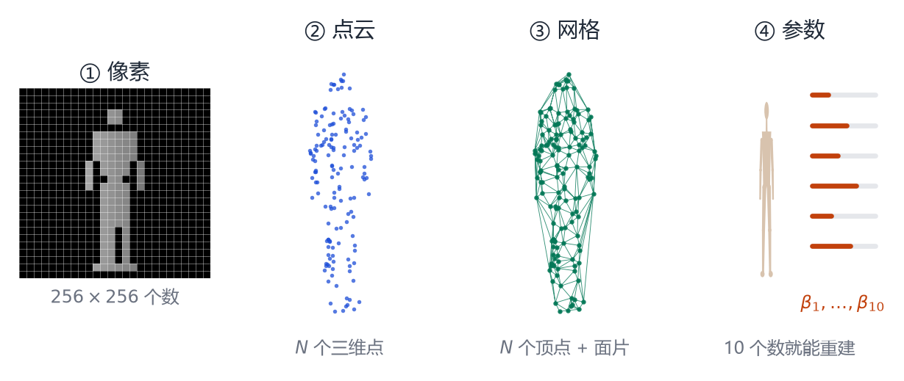
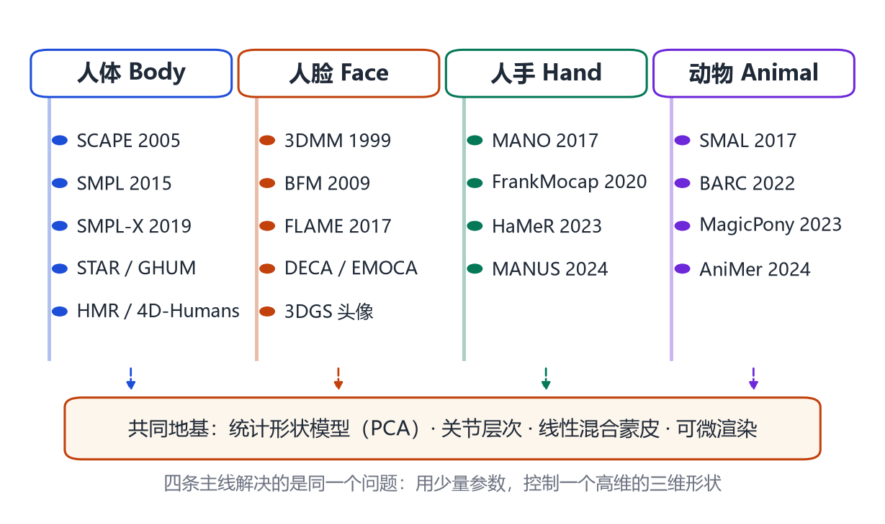

# 第 1 章 什么是「参数化人体」

> **本章导读**：这一章不写公式，只回答三个问题：为什么计算机需要一个“人体模型”？“参数化”到底是什么意思？人体、人脸、人手、动物这四条看似不同的路线，为什么能装进同一个系列？读完这一章，你会得到一张全局地图，后面的册都是在往地图上填细节。

## 1.1 一个看似简单的问题

这一节先让你感受一下，让计算机“处理一个人”究竟难在哪。结论有点反直觉：难的不是认出这是个人，而是让计算机自己造出一个人，并且随时改得动。

请先看一个任务：给你一张普通的生活照，要求你算出照片里这个人的身高、肩宽、腿长，并且让他在电脑里做一个“转身”的动作。

对人来说，这件事平平无奇。看一眼，你就知道这个人高、肩宽、腿不短，转身之后背面长什么样也大致能想象。对计算机来说，它几乎无从下手。

因为照片在计算机眼里只是一个数字表格，比如 1920 行、1080 列，每个格子记录红绿蓝三个亮度值。它既不知道什么是“人”，也不知道什么是“肩膀”。你要它算肩宽，它连肩膀在哪都没看见。

这些需求不是实验室里的假设。手机上的试衣应用要这么做：你举着手机转一圈，它得知道你的围度，才能把外套套在你身上。直播平台要这么做：主播只对着镜头动，屏幕上那个虚拟形象要跟着动。医院里看步态的门诊要这么做：病人走几步，医生关心的是左右腿是否对称、膝盖有没有内扣。游戏美术也要这么做：一个角色换十套衣服，每套都得贴合身体。

“转身”更麻烦。正面照里没有背面的信息，计算机只能猜。而真实的三维扫描仪能扫出背面，代价是一套设备几十万元，还得让人站进一个布满相机的棚子里，几十分之一秒内不能动。

于是研究者换了一个思路：**与其每次从零重建一个人，不如事先学好“人”这件事，把它压缩成一组可以调节的旋钮。** 这就是参数化人体（parametric human model）的核心思想。

转向之后，“算出身高肩宽”不再是量一张照片，而是从照片里读出那组旋钮的刻度。读出刻度，身高体重围度就都在里面了；读出刻度，转身之后的姿态也能算出来。

所以这一节要记住的不是任何技术细节，而是一个思路的转变：从“每次重建一个人”，变成“事先学好人这件事”。后面七章，都是这个转变的展开。

## 1.2 计算机眼里的“人”：四种表示

这一节回答一个问题：同一个人，计算机可以用哪几种方式“记住”他？结论是四种常见表示，从像素到参数，数字的个数一路减少，可控性一路增加，而参数化人体选的是最后一种。

<figure class="fig">

<figcaption><b>图 1-1</b>　同一个人的四种表示。从左到右，自由度越来越低，可控性越来越强：像素有几十万个数，点云有几千个点，网格有固定的顶点与面片，而参数模型只需要十几个数。</figcaption>
</figure>

图 1-1 展示了四种常见表示，我们逐一来看。

**第一种是像素。** 一张 256×256 的灰度图有 65536 个数。它能很好地“看”，却不方便“改”：想让人长高 5 厘米，应该改哪些像素？没人说得清。所以像素的主场是“认”——人脸检测、人体抠图、找关节位置，这些任务要的正是让机器看图，而不是改图。

**第二种是点云**（point cloud）。用深度相机或激光扫描，可以得到人体表面的一堆三维点，每个点有三个坐标。点云很忠实，但它没有“表面”的概念：点与点之间没有连接关系，也就无法直接计算面积、法线，更不能驱动动画。它的主场是“量”和“存”——测围度、做存档、比对两次扫描有没有变化。

**第三种是网格**（mesh）。把点用三角形连接起来，就得到一张“皮”。网格的顶点数通常是固定的，SMPL 是 6890 个；每个顶点有三维坐标，可以整体做变换、做变形。这是目前工业界最通用的表示：游戏、影视、VR 都用网格。它的主场是“画”和“动”——渲染、动画、3D 打印，都要一张有面的皮。

**第四种是参数。** 图 1-1 最右边画了几根小滑块。滑动它们，人体的高矮、胖瘦、肩宽、腿长会一起变化。10 个数当然不可能精确描述一个人的每一个细节，但它抓住了**主要矛盾**：绝大多数人的身材差异，可以被少数几个方向解释。它的主场是“改”“驱动”“检索”：试衣应用要改围度，动画要驱动骨骼，素材库要按体型找相似的人。

<figure class="fig">

<figcaption><b>图 1-2</b>　四种表示各自的主场。每张卡片写两件事：它最擅长干什么，以及想改的时候卡在哪。读的时候可以留意，四种表示里只有参数是“改一次只动一个数”，也只有它表达不了细节。</figcaption>
</figure>

用一句话概括这四种表示的分工，就是表 1-1。

**表 1-1**　四种表示各自擅长什么、干不了什么。

| 表示 | 一份数据有多少个数 | 擅长 | 不擅长 |
|---|---|---|---|
| 像素 | 一张 256×256 灰度图 65536 个 | 识别、抠图、找关节 | 直接改体型 |
| 点云 | 一次全身扫描几十万个点 | 测量、存档、前后比对 | 渲染、动画、物理 |
| 网格 | 6890 个顶点，约 1.4 万个三角形 | 渲染、动画、3D 打印 | 用少量旋钮控制 |
| 参数 | 十几个到几十个数 | 编辑、驱动、检索、压缩 | 极端个体与细节 |

从 65536 个数，到 6890 个顶点，再到 10 个参数，这条“降维”的路就是整个系列要讲的故事。

所以四种表示没有优劣，只有分工。参数化人体不是要取代网格，而是给网格加一层“旋钮”，让你不必动手雕顶点。

## 1.3 “参数”到底是什么

这一节要把“参数”这个词本身讲清楚。结论是：参数不是数据的压缩包，而是一组有含义的旋钮，每个旋钮负责一个方向的变化。

先抛开人体，看一个更简单的例子。

假设你要描述一个圆。你可以列出圆周上 1000 个点的坐标，也可以只写三个数：圆心横坐标、圆心纵坐标、半径。后一种写法就是“参数化”：用少数几个有明确含义的量，生成任意多的点。半径变大，整圈点一起往外走；圆心移动，整圈点一起平移。每个数管一件事，改起来心里有数。

再换一个场景。乐队演出时，调音师面前有一排推子：人声一根、贝斯一根、鼓一根。观众觉得人声太闷，他推一根推子就行，不用把整首歌重录一遍。参数化的思路就是这样：把“整首歌”换成“一排推子”，把修改变成拨动某个确定的开关。

人体当然不是圆。人的形状太复杂，找不到一个像“半径”那样简单的几何量。但研究者发现了一件重要的事：

> **如果把很多很多人的三维扫描对齐、叠放在一起，那么“人与人之间的差异”其实集中在一个很小的子空间里。**

这句话是整个系列的技术核心，值得慢慢解释。

想象你收集了 1000 个成年人的三维网格，每个网格都有 6890 个顶点，于是每个人可以写成一个长度为 20670 的向量（三个坐标乘上顶点数）。1000 个人就是 1000 个 20670 维的向量。听起来维度高得吓人，但它们并不是杂乱无章的：身高、胖瘦、骨架比例这些因素彼此关联，导致这 1000 个向量其实挤在一个低维的“薄片”上。

这个“薄片”，数学上叫**子空间**（subspace）。找到它的方法叫**主成分分析**（Principal Component Analysis，PCA），它的做法不复杂：先算一个平均数，再找出方差最大的几个方向。第 2 章就从这里讲起。

找到子空间之后，每个人就可以写成：

$$
\mathbf{x} \approx \boldsymbol{\mu} + b_1\mathbf{p}_1 + b_2\mathbf{p}_2 + \cdots + b_{10}\mathbf{p}_{10},
\tag{1.1}
$$

其中 $\boldsymbol{\mu}$ 是“平均人”，$\mathbf{p}_1,\dots,\mathbf{p}_{10}$ 是十个“变化方向”（第一主成分、第二主成分……），$b_1,\dots,b_{10}$ 是每个人在这十个方向上的“刻度”。这十个刻度就是图 1-1 里的滑块。

这条式子的作用只有一句：**从平均人出发，沿着十个方向各走一段，就走出一个具体的人。** 不需要推导，看它长什么样就够了：一个起点，加上若干次“按倍数挪动”。

顺便说一句：式 (1.1) 里的加号是向量加法，$b_1\mathbf{p}_1$ 是数乘向量。如果你现在还不知道这两个词，完全没关系，先把它理解成“按位置相加”和“按倍数放大”就行。真正要动手算的时候，这些都会在第 2 章之后补上。

所以参数化的本质是一个翻译：把“这个人长什么样”翻译成“十个刻度分别是多少”。翻译完成了，比较、修改、检索、驱动才有地方落脚。

## 1.4 参数化带来的四件事

这一节说清为什么大家愿意花力气做这件事。结论是四件能力：压缩、可控、可反演、可生成，其中第三件最难也最关键。

**第一，压缩。** 一组参数只有几十个浮点数，几百字节；一次原始扫描动辄几十 MB。同样一段动作，按顶点存和按关节角存，体积差两三个数量级。传输、存储、做数据集都方便得多。做素材库的人对此最有体会：十万个角色如果都存网格，硬盘先受不了，检索更无从谈起；存成参数，一次比对只是几十个数的距离。

**第二，可控。** 想让人物“长高一点”“壮一点”“笑一下”，只需要改对应的参数，而不是去手工雕刻几千个顶点。这件事对三类人特别有用。动画师要的是“这个角色再胖一点，但脸别变”；医生要的是“把这个病人的骨盆宽度调准，用来做假肢取型”；产品经理要的是“让用户在手机上把腰围调大两厘米，看看衣服会不会紧”。

**第三，可反演。** 这是最关键的一点。给定一张照片，我们可以反过来问：哪一组参数，渲染出来最像这张照片？于是问题变成了一个优化问题：

$$
\min_{\boldsymbol{\beta},\boldsymbol{\theta}}\ \big\|\,\text{Render}(\text{Model}(\boldsymbol{\beta},\boldsymbol{\theta}))-\text{Image}\,\big\|^2 .
\tag{1.2}
$$

这条式子说的是“试出一组参数，让渲染出来的图尽量贴近照片”。只要模型可微、渲染可微，就能用梯度下降一点点试出来。2015 年之后的单图人体重建（HMR、SMPLify）、人脸重建（DECA、EMOCA），本质上都在解式 (1.2) 的各种变体。

没有这一步，前面两件能力只能服务“已经有三维数据的人”。有了这一步，手机里的一张自拍就能变成一组参数——试衣、虚拟主播、体态评估，入口全在这里。

**第四，可生成。** 有了低维参数空间，就可以在这个空间里采样、插值、做统计，甚至训练扩散模型。游戏公司要一千个路人角色，不必雕一千个模型，在参数空间里撒点就行。今天文生 3D 人体、动作生成、数字人直播，底层几乎都站着一个参数化模型。

所以这四件事其实是同一个能力的不同侧面：一旦人变成一组数，你就能存它、改它、从图里反推它、凭空生成它。

## 1.5 四条主线，一个地基

这一节要说清一件事：为什么人体、人脸、人手、动物要分成四支来做，而不是做一个大模型。结论是它们的对象和约束不同，但方法是同一套，所以能装进同一个系列。

<figure class="fig">

<figcaption><b>图 1-3</b>　四条技术主线。它们看起来分属不同应用，但共享同一套地基：用 PCA 建立形状空间、用关节层次描述姿态、用线性混合蒙皮把两者合起来、用可微渲染把模型和图像连起来。</figcaption>
</figure>

整个系列讲四个对象：**人体、人脸、人手、动物**。它们各自有一批代表性模型：

- 人体：SCAPE（2005）→ SMPL（2015）→ SMPL-X（2019）→ STAR / GHUM（2020）→ ATLAS / MHR（2025，骨架与形状解耦）→ 单图与视频重建；
- 人脸：3DMM（1999）→ Basel Face Model（2009）→ FLAME（2017）→ DECA / EMOCA → 神经头像；
- 人手：MANO（2017）→ FrankMocap（2020）→ HaMeR（2023）→ 手物交互；
- 动物：SMAL（2017）→ SMALST / BARC → MagicPony（2023）→ AniMer（2024）。

如果你只记住一件事，请记住：**它们不是四套互不相干的技术，而是同一套数学在四种对象上的四次落地。**

那差别到底在哪？差别不在方法，在“约束”和“要求”。

**人体这支的难点是尺度与自由度。** 一个成年人从一米五到两米，差别巨大；身体有二十几个关节，每个关节都要能转。更难的是姿势一变，关节处的皮肤就要跟着变形，弯肘、抬手、蹲下，每一处都可能塌陷或被捏细。所以身体模型花了十年解决的问题，是“如何在体型差别很大、姿势变化很大的情况下，仍然稳定地生成一张像人的皮”。

**人脸这支的难点是精度。** 一张脸在画面里可能只占几十个像素，但人眼对脸的敏感度高得离谱：差几毫米，你就不觉得是这个人了。脸还有一处和身体完全不同：它几乎不需要“骨架”的概念，变化集中在软组织和表情上。所以脸的模型把重点放在两件事上——身份（这是谁）和表情（他什么心情），而不是关节和骨长。

**人手这支的难点是遮挡和细节密度。** 手只有身体面积的百分之几，关节却要十几个，一个小指头就要好几个转动中心。手还是自遮挡最严重的部位之一：握拳时，一半的手指被另一半挡住。所以手部模型宁可顶点少、关节细，也要保证每根手指能单独弯。

**动物这支的难点是数据。** 动物不会站着让你扫，物种之间的形状差别又极大。所以它的突破口不是精度，而是“对应”：让狗和马共用一套顶点编号，才能做形状插值、动作迁移、跨物种比较。

这也解释了这个系列的编排：入门册建立概念，数学册与人体册把地基打牢，再分别进入重建、脸手、前沿三个方向。

所以四支的分工不是人为切开的，是被各自的对象逼出来的。学会其中一支的写法，换到另外三支，需要换的只是数字和约束。

## 1.6 一条简短的历史线

这一节给你一个时间感：这门技术不是一次发明出来的，而是四段积累。结论是四段各有各的中心问题，换了问题，模型就换代。

**第一段：统计形状的诞生（1990s）。** Cootes 等人提出主动形状模型（Active Shape Model，ASM），第一次用 PCA 描述一组轮廓的形状变化 [@cootes1995asm]；Blanz 与 Vetter 在 1999 年把同样的思想搬到三维人脸，做出三维形变模型（3D Morphable Model，3DMM）[@blanz1999morphable]。这两项工作确立了“平均形状 + 主成分”的范式。今天所有参数化模型，骨子里还是这个范式。

**第二段：把形状和姿态分开（2005–2015）。** Allen 等人建立了人体形状空间 [@allen2003space]，Anguelov 等人的 SCAPE 第一次把“体型”和“姿势”拆成两套参数 [@anguelov2005scape]，并用三角变形处理关节处的皮肤褶皱。十年后，SMPL 用更简洁的线性混合蒙皮取代 SCAPE 的复杂变形，把模型做到了实时、可微、工业可用 [@loper2015smpl]。这一段要解决的问题很清楚：如果形状和姿态混在一起，每换一个动作都要重新估一遍体型，谁也受不了。

**第三段：从模型到图像（2016–2020）。** SMPLify 用二维关节点反推三维人体 [@bogo2016smplify]，HMR 用神经网络直接回归参数 [@kanazawa2018hmr]，SPIN 把两者结合 [@kolotouros2019spin]。人脸有 DECA，手有 FrankMocap，动物有 SMALST [@zuffi2021smalst]。参数化模型从“表示工具”变成了“视觉系统的输出层”。这一段之后，模型不再只是美术用的资产，它成了从照片里读人的接口。

**第四段：神经化与生成化（2020 至今）。** NeRF、三维高斯泼溅（3D Gaussian Splatting，3DGS）把外观细节推到照片级；扩散模型让“用文字生成人体或动作”成为可能；视觉基础模型（SAM、DINOv2、深度大模型）又反过来提升了参数估计的鲁棒性。参数化模型没有被取代，反而成了神经渲染的“骨架”和生成模型的“接口”。

这条线在每一册里都会重新展开，这里你只需要有一个时间感：最早是“怎么描述形状”，然后是“怎么把形状和动作分开”，接着是“怎么从图里读出来”，最后是“怎么把细节和生成接上去”。

所以看到一个新模型的名字时，可以先问它在回答哪一段的问题。位置清楚了，它为什么长成那样也就清楚了。

## 1.7 这个系列怎么读

这一节说明本书的结构和阅读顺序。结论是：本册只求全貌，不推导公式；有明确目标的人可以跳读。

<figure class="fig">

<figcaption><b>图 1-4</b>　三条阅读路线。最上面是零基础通读的完整顺序，下面两条给已经有明确目标的人用：只做人体的把前四册读完即可，只做脸或手的人先把 PCA 与蒙皮这两样打底就够。</figcaption>
</figure>

整套书分六册。本册是入门册，共八章，读完大概一个下午。它不推导公式，只求把这门技术的全貌摊开：在做什么、参数怎么来、怎么动、怎么从图像反推、有哪些模型、2020 年之后发生了什么、被谁用、怎么上手。

- **入门册（第 1–8 章）**：也就是你手上这本。
- **数学册**：向量与矩阵、最小二乘、概率与 PCA/SVD、三维表示与旋转、骨架与蒙皮、统计形状模型、位姿优化。五个专业篇里的所有公式，都在这一册交代清楚。
- **人体册**：SCAPE 怎么把形状和姿态拆开，SMPL 的每一项怎么来，之后的 STAR、ATLAS、MHR 又改了什么。
- **重建册**：单图与视频、多人、数据集与评估、着装与神经渲染、动作生成。
- **脸手册**：3DMM 与 Basel Face Model、FLAME、高保真细节、驱动与头像，以及 MANO、单手重建、手物交互。
- **前沿册**：SMAL 与动物重建、跨物种、扩散模型与三维高斯、人体基础模型、研究脉络。

每一章的开头有一段导读，结尾有“本章小结”和几道思考题。思考题不需要写代码，但如果你能用自己的话回答，说明这一章真的读懂了。

本册不写任何推导。想动手的读者可以直接跳到数学册；想马上看到 SMPL 的完整公式，去人体册。

所以读这本册子的方式可以很松：先一口气看完，建立地图；以后遇到具体问题，再回到对应章节查那张图、那句结论。

## 本章小结

- 参数化人体用少量参数描述高维的三维形状，核心是“平均形状 + 若干形变方向”的线性模型。
- 四种表示各有主场：像素能看不好改，点云能量不好动，网格能画能改但改得慢，参数改得快但表达不了细节。
- 它带来四个能力：压缩、可控、可反演（从图像推参数）、可生成。
- 人体、人脸、人手、动物共享同一套地基：PCA 形状空间、关节层次、线性混合蒙皮、可微渲染；四支的差别在对象和约束。
- 技术史可以分成统计形状、形状/姿态分离、模型与图像结合、神经化与生成化四段。

## 思考题

1. 如果一个模型只有 3 个形状参数，它能描述哪些差异？会丢失哪些差异？
2. 为什么“可微”对从图像反推参数如此重要？如果一个环节不可微，还有什么办法？
3. 人脸和人手都比人体小得多，为什么反而需要更多参数？
