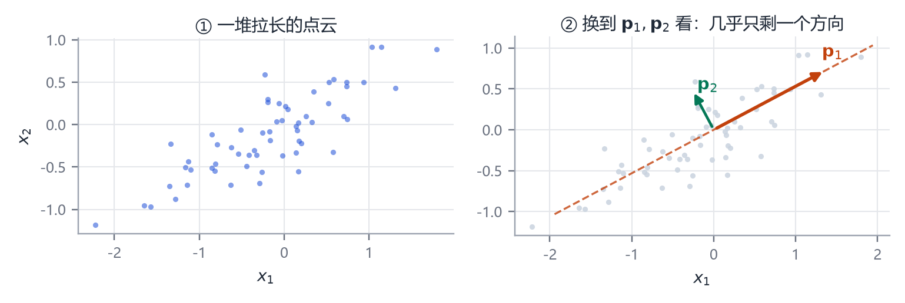

# 第 2 章 参数从哪里来

上一章反复用了一个说法：把很多人扫进电脑，对齐、叠起来，人跟人的差异就集中在一个很小的子空间里。这句话说完就放下了，这一章补上它省掉的中间步骤。

参数不会凭空出现。它不是谁设计出来的，而是**从数据里量出来的**。要量，得先有三样东西：一批形状、一套对应关系、一个衡量“差异”的办法。

## 2.1 第一步：拿到一批形状

最直接的办法是三维扫描。让人站在一圈相机中间，几十分之一秒内同时拍摄，再把这些照片拼成一张带颜色的三维表面。设备的价格从几万到几百万不等，精度也差得远，但原理是一样的。

扫描有它绕不过去的麻烦。头发扫不出来，衣服的褶皱每次都不一样，腋下、胯下这些地方会被遮挡。所以做统计模型时，通常要求被拍的人穿紧身衣、摆同一个姿势、头发扎起来。这些要求听着琐碎，却直接决定了后面参数的质量：如果一百个人的扫描里，有人站歪了五度，这五度就会被当成“体型差异”学进模型里。

扫描得到的是一堆顶点。一个人可能有几十万个点，人与人的点数还不一样。这种数据没法直接比较，得先把它变成“可比较”的形式。

## 2.2 第二步：让每个人“对齐”

假设现在有两个人，一个高一个矮。哪一部分差异是“高”，哪一部分是“腿长”？光看两团点云是分不出来的，因为点与点之间没有对应关系。张三的左手第 300 号顶点，和李四的左手第 300 号顶点，可能压根不在同一个位置。

所以要建立**对应**（correspondence）：规定每个人身上的同一个解剖位置，编号相同。这件事叫配准（registration），做法是先拿一个模板网格，把每个人的扫描都变形贴合到模板上，贴完之后，所有人的第 300 号顶点都在鼻尖，第 2000 号顶点都在左肘。

配准这一步的误差会一路传下去。如果某一批数据的配准偏了，学出来的主成分里就会混进“配准偏差”这个方向，而且它看起来像一种体型差异，非常难查。这是从业者公认的坑，也是为什么数据集的质量比数量更重要。

有了对应，一个人就变成一个长长的数字列表：先把所有顶点的 $x$ 排成一列，再排所有 $y$，再排所有 $z$。6890 个顶点就是 $6890\times3=20670$ 个数。这一步看着笨，但它把“形状”变成了一个向量，从此可以用线性代数的工具处理。

## 2.3 第三步：先算一个“平均人”

有了对应，平均就有意义了：把 $N$ 个人同一个编号的顶点坐标各自求平均，得到一个新的网格。这个网格不一定是真实存在的某个人，但它是这批数据在最小二乘意义下的中心。

$$
\bar{\mathbf{T}}=\frac{1}{N}\sum_{i=1}^{N}\mathbf{T}_i .
\tag{2.1}
$$

平均人有一个很有用的性质：它已经把“这一批人共有的一切”都吸收了。后面要描述的任何一个人，都可以写成“平均人 + 一点偏移”，而不必从零开始描述全部 20670 个数。

## 2.4 第四步：看偏移量的分布

把每个人的形状减去平均人，得到偏移 $\Delta\mathbf{T}_i=\mathbf{T}_i-\bar{\mathbf{T}}$。这些偏移量就是真正的“个体差异”。接下来的问题是：这些偏移量有没有规律？

有，而且规律强得让人意外。因为在真实人群里，身高、肩宽、胖瘦、骨架粗细这些因素彼此高度相关：个子高的人通常腿也更长，胖的人通常腰围更大。参数之间一相关，所有样本的偏移量就不会均匀地铺满 20670 维空间，而是挤在一张很薄的“片”上。

<figure class="fig">

<figcaption><b>图 2-1</b>　“挤在薄片上”在二维里是什么样。左图是一堆拉长的点云：看起来有两个方向的抖动，但右边的箭头标出主方向之后能看出，沿 $\mathbf{p}_2$ 的厚度其实很小。真实的人体数据是同一个现象，只是维度从 2 变成 20670，而有效厚度可能只有十来个方向。</figcaption>
</figure>

二维的图能直接看；20670 维看不出。所以要有一个算法，能自动找出“哪几个方向上的抖动最大”。这个算法就是主成分分析（PCA）。

PCA 做的事情可以一句话说清：**在这团偏移量里，找出若干个互相垂直的方向，让数据在这些方向上的方差尽可能大，然后按方差从大到小排队。** 方差越大，说明这个方向上的个体差异越显著，越值得保留。

## 2.5 第五步：留下几个方向

排完队之后，会得到一个“每个方向解释了多少差异”的列表。人体数据上，这个列表通常衰减得很快：前一个方向可能解释了 30% 的差异，前十来个方向加起来能到 80% 以上，剩下的几千个方向各解释千分之几，基本是噪声。

<figure class="fig">

<figcaption><b>图 2-2</b>　参数的含义。左边是不动的平均人，中间是几个方向上的刻度（也就是参数），右边是算出来的具体的人。界面上看到的那几根滑块，本质上就是这几个刻度；拖动滑块，等于沿着某个主成分方向前后移动。</figcaption>
</figure>

保留多少方向是一个工程判断。留得多，模型能表达的差异更细，但参数变多、更容易过拟合、也更容易被噪声带偏；留得少，模型更稳、更像“人”，但表达力受限。工业上常见的做法是按累计解释方差定一个阈值（比如 95% 或 99%），再根据实际效果微调。SMPL 选了 10 个，SMPL-X 的身体部分也是 10 个，FLAME 的身份部分是 300 个，MANO 是 10 个。数字不是理论推出来的，是效果和成本折中的结果。

## 2.6 参数到底是什么单位

这是初学者最容易含糊的地方。参数 $\beta_n$ 没有物理单位，它不是“身高多少厘米”，而是“沿着第 $n$ 个主成分方向走多少步”。

不过它仍然可以解释，因为主成分方向和真实的人体差异是对应的。做得好的模型里，第一主成分常常和整体胖瘦或体量有关，第二主成分常常和身高比例有关，后面的主成分可能对应肩宽、肌肉量、骨盆形状。这些是观察出来的规律，不是设计出来的，换一批数据，顺序可能就变了。

还有一个必须记住的细节：**参数有合理的取值范围**。在训练数据里出现过的范围之外，模型还能继续外推，但推得越远越不像人。如果一个 $\beta$ 取到训练集里最大值的三倍，生成的网格会出现奇怪的鼓包和尖角。这也是为什么几乎所有拟合方法都要给参数加一个“别跑太远”的正则项。

## 2.7 这套做法的边界

参数化的好处和它的局限，来自同一个地方：**它只能用训练数据里出现过的模式来描述人。**

一个截了肢的人、一个体重远超数据集范围的人、一个骨骼结构特殊的人，模型都描述不好，因为这些情况在训练数据里没有出现过。这不是算法不够聪明，而是统计模型的本质：它学的是“这批人的共同规律”，规律之外的部分它没有词。

同理，参数的可解释性也是一种近似。说“第一主成分是胖瘦”只是一种方便的概括，严格讲它是“在这个数据集上，方差最大、并且恰好和胖瘦相关的一个方向”。如果数据集换了，这个说法就得重新检验。

明白了这一点，后面看到任何新模型时，都可以先问三个问题：它用什么数据训练的？参数代表什么方向？这些参数在什么范围之外会坏？这三个问题的答案，往往比公式本身更能说明一个模型的适用范围。

## 本章小结

- 参数是从一批对齐好的形状里量出来的，不是设计出来的。
- 关键前提是“对应”：同一个解剖位置在所有样本里编号相同，否则无法比较。
- 平均人吸收了公共部分，个体差异变成偏移量；偏移量高度相关，所以挤在低维子空间里。
- PCA 找出方差最大的若干正交方向，按方差排序，前十个左右往往就能解释大部分差异。
- 参数没有物理单位，是“沿某个方向走多少步”，并且只在训练数据覆盖的范围内可信。

## 思考题

1. 如果一批扫描里有三分之一的人站姿歪了，学出来的主成分会变成什么样？
2. 为什么 SMPL 只留 10 个形状参数，而 FLAME 的身份参数有 300 个？光从“人脸比身体简单”这个角度能解释吗？
3. 你能想出一个人体形状的差异，是 10 个线性主成分几乎无法表达的吗？
