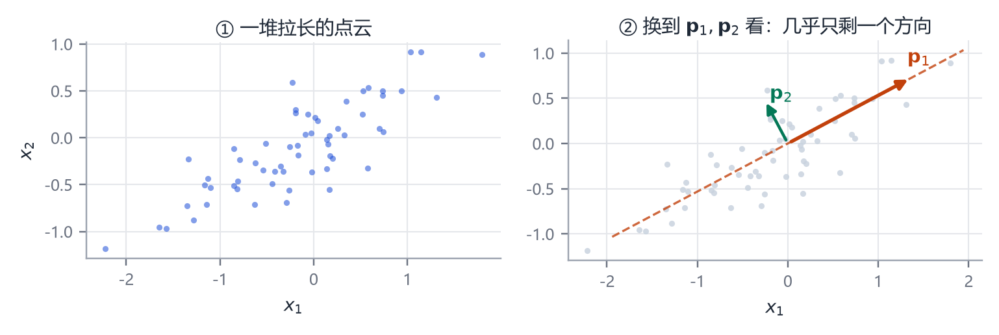
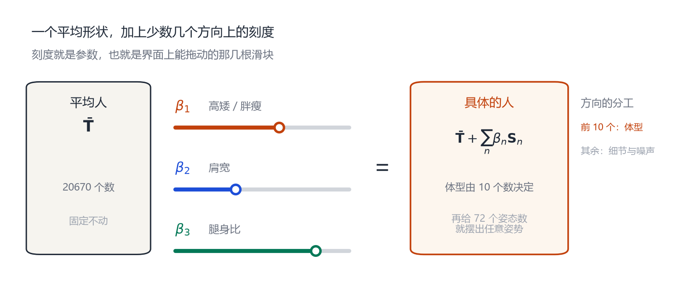
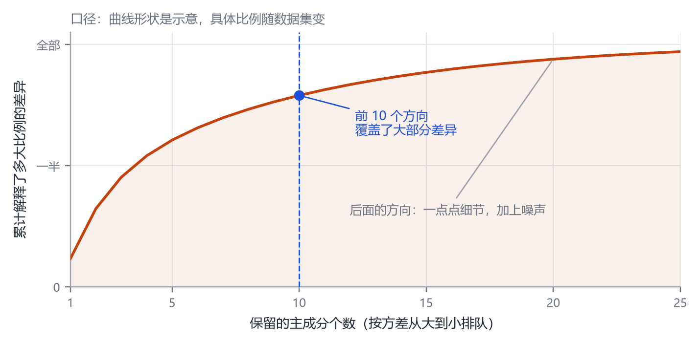

# 第 2 章 参数从哪里来

> **本章导读**：上一章反复用了一个说法——把很多人扫进电脑，对齐、叠起来，人跟人的差异就集中在一个很小的子空间里。这句话省掉了中间的五步。这一章把那五步补上，每一步都只回答一个问题：它在做什么、为什么非做不可、做坏了会长什么样。

参数不会凭空出现。它不是谁设计出来的，而是**从数据里量出来的**。要量，得先有三样东西：一批形状、一套对应关系、一个衡量“差异”的办法。

## 2.1 第一步：拿到一批形状

这一节说清数据是怎么来的。结论是：扫描本身不难，难的是让所有样本“条件一致”，因为任何不一致都会被当成体型差异学进模型里。

最直接的办法是三维扫描。让人站在一圈相机中间，几十分之一秒内同时拍摄，再把这些照片拼成一张带颜色的三维表面。也有用结构光或者激光的做法，原理不同，得到的东西一样：一张表面，带着每个点的位置。

“同时”这两个字是关键。人只要动一下，二十台相机拍到的就不是同一个瞬间，拼出来的表面会带着一层皱。所以设备要能同步快门，被拍的人要能站稳几秒钟。

扫描有它绕不过去的麻烦。头发扫不出来，因为发丝太细、太会反光；衣服的褶皱每次都不一样；腋下、胯下、下巴底下这些地方会被遮挡。所以做统计模型时，通常要求被拍的人穿紧身衣、摆同一个姿势、头发扎起来，地上还要贴几个定位点。

这些要求听着琐碎，却直接决定了后面参数的质量。如果一百个人的扫描里，有人站歪了五度，这五度就会被当成“体型差异”学进模型里。模型从此会认为“有一部分人是歪着长的”，而你完全看不出它错在哪。

这件事可以类比成一次全班合影。如果有人歪着头，事后你只看照片，会以为他的脖子天生就是歪的。数据不会替你分辨“这是他本来的样子”还是“这是他当时的样子”。

扫描得到的是一堆顶点。一个人可能有几十万个点，人与人的点数还不一样。这种数据没法直接比较，得先把它变成“可比较”的形式。

所以第一步的产物不是“一百个人”，而是“一百份条件尽量一致的表面”。一致性比数量重要，这句话后面还会出现很多次。

## 2.2 第二步：让每个人“对齐”

这一节讲整条流水线里最容易出错的一步。结论是：必须先给所有人建立一套统一的顶点编号，否则“比较两个人”这件事根本无从谈起。

假设现在有两个人，一个高一个矮。哪一部分差异是“高”，哪一部分是“腿长”？光看两团点云是分不出来的，因为点与点之间没有对应关系。张三的左手第 300 号顶点，和李四的左手第 300 号顶点，可能压根不在同一个位置。

所以要建立**对应**（correspondence）：规定每个人身上的同一个解剖位置，编号相同。这件事叫配准（registration），做法是先拿一个模板网格，把每个人的扫描都变形贴合到模板上。贴完之后，所有人的第 300 号顶点都在鼻尖，第 2000 号顶点都在左肘。

<figure class="fig">

<figcaption><b>图 2-1</b>　对应关系决定“相减”有没有意义。左边两个体型的编号一致，连线整齐，逐点相减得到的是真实的胖瘦；右边编号错位，连线互相交叉，相减得到的只是噪声。配准要做的，就是让右边变成左边。</figcaption>
</figure>

图 2-1 值得多看两眼。左边那种情况，两个人的每个编号都能一一对上，把它们相减，得到的差就是“这个人比那个人胖在哪里、高在哪里”。右边那种情况，编号乱套了，相减出来的数字看着也不小，但它跟体型毫无关系——它只是“谁碰巧被编成了几号”。

配准一般分两步走。第一步是**刚性对齐**：把人整体摆正、缩放到同一大小、放到同一位置，就像把两张纸叠在一起之前先对齐边角。第二步是**非刚性变形**：允许表面局部伸缩，让每一块皮肤都贴到模板的对应位置，就像把一张保鲜膜按在凹凸不平的表面上。

这一步的误差会一路传下去。如果某一批数据配准偏了，学出来的主成分里就会混进“配准偏差”这个方向，而且它看起来像一种体型差异，非常难查。这是从业者公认的坑，也是为什么数据集的质量比数量更重要。

拿到对应之后，一个人就变成一个长长的数字列表：先把所有顶点的横坐标排成一列，再排纵坐标，再排竖坐标。6890 个顶点就是 20670 个数。这一步看着笨，但它把“形状”变成了一个向量，从此可以用线性代数的工具处理。

所以这一步的成败，决定了后面所有步骤有没有意义。对应错了，后面算得再精确，也只是在精确地算错。

## 2.3 第三步：先算一个“平均人”

这一节讲“平均”这个词在形状上怎么定义。结论是：只要有了对应，形状就可以逐点求平均，得到的那个网格就是整批数据的中心。

有了对应，平均就有意义了：把每个人同一个编号的顶点坐标各自求平均，得到一个新的网格。这个网格不一定是真实存在的某个人，但它是这批数据在最小二乘意义下的中心。

$$
\bar{\mathbf{T}}=\frac{1}{N}\sum_{i=1}^{N}\mathbf{T}_i .
\tag{2.1}
$$

这条式子说的是“每个编号各自求平均”，没有别的意思。它可以类比成一张合成照片：把一百张同一个人的照片对齐后叠加曝光，得到的是一张五官清楚、细节模糊的脸。平均人也是这样，它把所有人的共同部分留下来，把个体差异抹平了。

平均人有一个很有用的性质：它已经把“这一批人共有的一切”都吸收了。后面要描述的任何一个人，都可以写成“平均人 + 一点偏移”，而不必从零开始描述全部 20670 个数。这就像一个班的身高统计，你只需要记住“平均一米七”，然后记每个人差几厘米，不用把每个人的绝对身高都背下来。

所以平均人是整套参数的“原点”。所有参数都是相对它来说的，它一动，所有参数的含义都跟着动。这也是为什么换了数据集、换了模板，参数就不能直接对比的原因。

## 2.4 第四步：看偏移量的分布

这一节讲“个体差异”到底长什么样。结论是：差异并不是杂乱无章的，它挤在少数几个方向上，这正是参数化能成立的原因。

把每个人的形状减去平均人，得到偏移量。这些偏移量就是真正的“个体差异”。接下来的问题是：这些偏移量有没有规律？

有，而且规律强得让人意外。因为在真实人群里，身高、肩宽、胖瘦、骨架粗细这些因素彼此高度相关：个子高的人通常腿也更长，胖的人通常腰围更大。参数之间一相关，所有样本的偏移量就不会均匀地铺满 20670 维空间，而是挤在一张很薄的“片”上。

<figure class="fig">

<figcaption><b>图 2-2</b>　“挤在薄片上”在二维里是什么样。左图是一堆拉长的点云：看起来有两个方向的抖动，但标出主方向之后能看出，沿 $\mathbf{p}_2$ 的厚度其实很小。真实的人体数据是同一个现象，只是维度从 2 变成 20670，而有效厚度可能只有十来个方向。</figcaption>
</figure>

这张“薄片”可以想象成一团被拉长的云。云很长，说明有一个方向变化很大；云很薄，说明别的方向几乎不变。人体的差异就是这样：整体体量、身高比例这些“大方向”变化很大，而某个具体小区域的凹凸几乎不变化。

二维的图能直接看；20670 维看不出。所以要有一个算法，能自动找出“哪几个方向上的抖动最大”。这个算法就是主成分分析（PCA）。

PCA 做的事情可以一句话说清：**在这团偏移量里，找出若干个互相垂直的方向，让数据在这些方向上的方差尽可能大，然后按方差从大到小排队。** 方差越大，说明这个方向上的个体差异越显著，越值得保留。

打个比方：你手里有一团形状像橄榄的云，要找它的“长轴”。做法不是随便指一个方向，而是转着手电筒，找到让投影最长的那一条；找到之后，再在垂直于它的平面里找第二长的。PCA 做的就是这件事，只不过是在两万维的空间里转手电筒。

所以偏移量不是一堆散乱的数字，而是有结构的。参数化要做的，就是把这层结构找出来，用少数几个方向概括它。

## 2.5 第五步：留下几个方向

这一节回答一个实际问题：到底该留几个方向？结论是十来个通常就够了，理由是数据本身低维，而多留的方向大多只是噪声和细节。

排完队之后，会得到一个“每个方向解释了多少差异”的列表。人体数据上，这个列表通常衰减得很快：第一个方向可能解释了相当大的一块差异，前十来个方向加起来能到八成以上，剩下的几千个方向各解释千分之几，基本是噪声。

<figure class="fig">

<figcaption><b>图 2-3</b>　参数的含义。左边是不动的平均人，中间是几个方向上的刻度（也就是参数），右边是算出来的具体的人。界面上看到的那几根滑块，本质上就是这几个刻度；拖动滑块，等于沿着某个主成分方向前后移动。</figcaption>
</figure>

图 2-3 里那几根滑块，就是一般人第一次接触参数化模型时看到的东西。界面上写着“胖瘦”“肩宽”“腿身比”，但它真正的含义是“沿着第几个主成分方向走了多远”。名字是后来贴上去的标签，方向本身是算法找出来的。

<figure class="fig">

<figcaption><b>图 2-4</b>　保留多少个方向，是一笔买卖。横轴是保留的主成分个数，纵轴是这些方向一共解释了多少差异。曲线前段陡、后段平，说明头几个方向最值钱，往后加方向，收益越来越小。曲线的具体形状随数据集变化，这里只示意趋势。</figcaption>
</figure>

### 2.5.1 为什么 10 个方向就够

这是外行最容易觉得不可思议的地方：一个人有那么多细节，怎么十个数字就概括了？

有三个原因，缺一不可。

**第一，人的体型不是随便长的。** 你不能同时要“一米五的身高”和“两米的腿长”，也不能要“极瘦的腰”和“极厚的背”。骨骼、肌肉、脂肪之间有生理约束，这些约束把可能的体型限制在一条窄带上。数据里没有的体型，模型也长不出来。

**第二，差异的能量集中在少数方向。** 图 2-4 的曲线就是证据：头几个方向吃掉了一大半差异，后面几百个方向加起来还不如第一个。这就像一段音乐的主要信息在旋律里，而不在每一个采样点的微小抖动里。

**第三，参数越多，用起来越难。** 这一点在从图像反推时最明显。参数一多，同一张照片能对应上无数种体型组合，估计器很容易被噪声带到一个奇怪的地方。十来个参数是一个折中：够表达主要差异，又不至于无从下手。

保留多少方向是工程判断，不是理论结论。留得多，模型能表达的差异更细，但参数变多、更容易过拟合、也更容易被噪声带偏；留得少，模型更稳、更像“人”，但表达力受限。工业上常见的做法是按累计解释的差异定一个阈值，再根据实际效果微调。

数字也确实是折中出来的。SMPL 的身体形状用 10 个参数，SMPL-X 的身体部分也是 10 个，MANO 的手部形状是 10 个。人脸的 FLAME 却用了 300 个身份参数，差了三十倍。这不是矛盾，而是任务不同：身体主要要“看起来是这个体型”，脸要做到“一眼认出是谁”，差几毫米就不像，所以必须留更多方向。同一个模型里，身份方向多、表情方向少（FLAME 的表情是 100 个），也说明“区分人”比“区分表情”更难。

所以“十个够不够”这个问题没有统一答案，要看你用它做什么。要区分体型，十个够；要区分人脸，三百个还嫌少。

## 2.6 参数到底是什么单位

这一节澄清一个最常见的误会。结论是：参数没有物理单位，它量的是“沿着某个方向走了多远”，而不是厘米或公斤。

初学者最容易在这里含糊。参数本身没有单位，它不是“身高多少厘米”，而是“沿着第几个主成分方向走多少步”。

不过它仍然可以解释，因为主成分方向和真实的人体差异是对应的。做得好的模型里，第一主成分常常和整体胖瘦或体量有关，第二主成分常常和身高比例有关，后面的主成分可能对应肩宽、肌肉量、骨盆形状。这些是观察出来的规律，不是设计出来的。换一批数据，顺序可能就变了。

还有一个必须记住的细节：**参数有合理的取值范围**。在训练数据里出现过的范围之外，模型还能继续外推，但推得越远越不像人。如果一个参数取到训练集里最大值的三倍，生成的网格会出现奇怪的鼓包和尖角。这也是为什么几乎所有拟合方法都要给参数加一个“别跑太远”的惩罚项。

这个现象可以类比成拉伸一张照片：拉一点点，人还是那个人；拉到十倍，边缘开始出现条纹和糊块。模型也一样，它在“见过的范围”里最可靠，出了范围就开始编。

所以看到一组参数时，除了数值本身，还要问一句：它在训练数据的范围内吗？超出多少？这句话比参数的具体数值更能说明结果可不可信。

## 2.7 这套做法的边界

这一节说清这套方法的局限。结论是：它只能用训练数据里出现过的模式来描述人，规律之外的部分它没有词。

参数化的好处和它的局限，来自同一个地方：**它只能用训练数据里出现过的模式来描述人。**

一个截了肢的人、一个体重远超数据集范围的人、一个骨骼结构特殊的人，模型都描述不好，因为这些情况在训练数据里没有出现过。这不是算法不够聪明，而是统计模型的本质：它学的是“这批人的共同规律”，规律之外的部分它没有词。

这也解释了一个常见的误解：模型“生成”出来的人，其实是在已知范围里重新组合，而不是凭空创造。它能造出一万个不同的人，但这一万个人都长在同一个“体型家族”里。

同理，参数的可解释性也是一种近似。说“第一主成分是胖瘦”只是一种方便的概括。严格讲，它是“在这个数据集上，方差最大、并且恰好和胖瘦相关的一个方向”。如果数据集换了，这个说法就得重新检验。

明白了这一点，后面看到任何新模型时，都可以先问三个问题：它用什么数据训练的？参数代表什么方向？这些参数在什么范围之外会坏？这三个问题的答案，往往比公式本身更能说明一个模型的适用范围。

所以这一章的五步，说到底是在做一件事：把“人”变成一张有坐标的地图。地图好用，但地图之外的地方它没有画。知道边界在哪，才不会在边界外乱走。

## 本章小结

- 参数是从一批对齐好的形状里量出来的，不是设计出来的；五个步骤是扫描、配准、求平均、看偏移、留方向。
- 关键前提是“对应”：同一个解剖位置在所有样本里编号相同，否则相减得到的只是噪声。
- 平均人吸收了公共部分，个体差异变成偏移量；偏移量高度相关，所以挤在低维子空间里。
- PCA 找出方差最大的若干正交方向，按方差排序，前十个左右往往就能解释大部分差异；留几个是工程折中。
- 参数没有物理单位，是“沿某个方向走多少步”，并且只在训练数据覆盖的范围内可信。

## 思考题

1. 如果一批扫描里有三分之一的人站姿歪了，学出来的主成分会变成什么样？
2. 为什么 SMPL 只留 10 个形状参数，而 FLAME 的身份参数有 300 个？光从“人脸比身体简单”这个角度能解释吗？
3. 你能想出一个人体形状的差异，是 10 个线性主成分几乎无法表达的吗？
