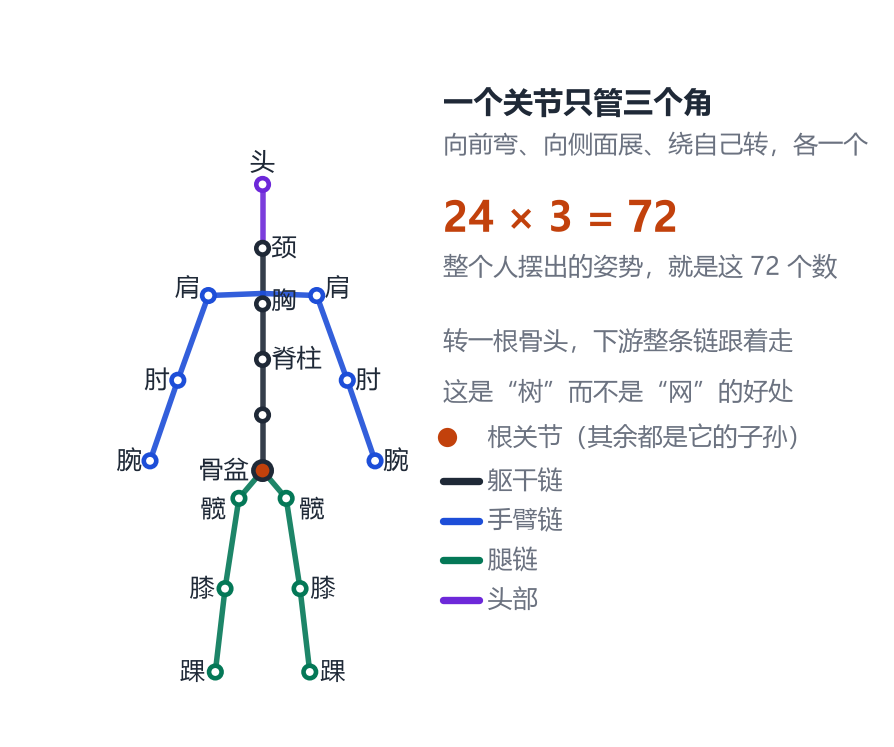
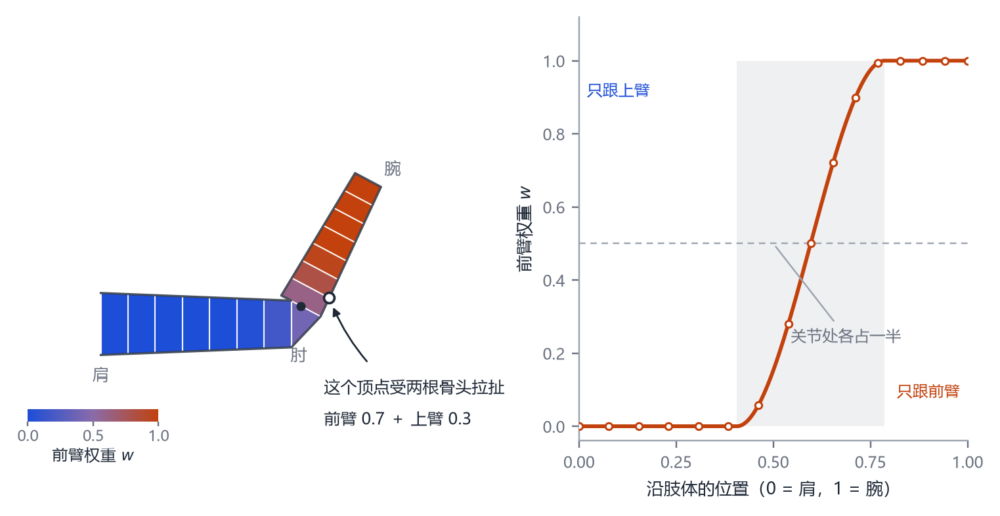
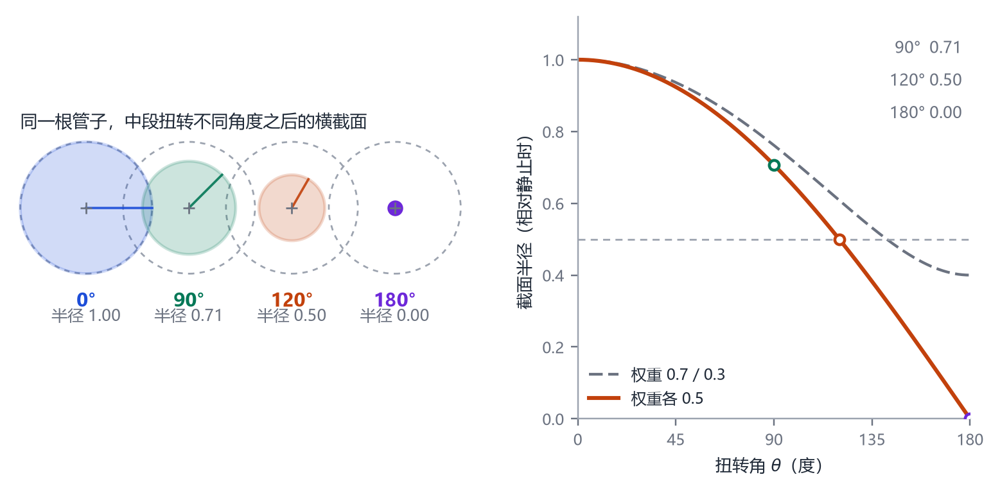

# 第 3 章 人是怎样动起来的

> **本章导读**：前两章解决的是“长什么样”，这一章解决“怎么摆”。不推导矩阵，只把三件事的图景建立起来：骨架为什么是一棵树，蒙皮为什么需要权重，以及弯曲和扭转时那些塌陷为什么躲不掉。

## 3.1 形状和姿势是两件事

前面说过 SMPL（Skinned Multi-Person Linear model）用两组参数描述一个人，$\boldsymbol{\beta}$ 管体型，$\boldsymbol{\theta}$ 管姿势。这句话值得再拆一次。

很多人第一次听到会疑惑，为什么不能直接用一组参数把“一个高个子在跑步”这件事一次说完。原因在于这两件事的变化节奏完全不同。体型是一个人身上相对固定的东西，量一次能用很久；姿势每秒都在变，走路一秒钟就要换几十个。如果把两者混在一起，每换一个动作都得重新估一遍身高体重，这显然荒唐。

更本质的理由是，它们互相独立。同一个 $\boldsymbol{\beta}$ 可以配任意多个 $\boldsymbol{\theta}$，同一个人能站着、坐着、跑着；同一个 $\boldsymbol{\theta}$ 也可以套到任意 $\boldsymbol{\beta}$ 上，同一个动作让高矮胖瘦的人都做一遍。这种“可以自由组合”的性质，正是参数化模型能同时做“换人”和“换动作”的原因。

所以模型被切成两半。一半回答“这张皮长什么样”，是一个静止的、没有姿势的形状；另一半回答“这张皮被怎么摆弄”，是一组关节角度。前者是形状参数，后者是姿势参数。

这个切法还有一个副作用，值得提前说一下。既然形状是“没有姿势的形状”，那它必须约定一个基准姿势，所有人的形状参数都在同一个基准上比较。基准一变，整套参数的含义跟着变，所以不同模型之间的体型参数不能直接拿来对比。这件事本身不复杂，但它解释了一个常见困惑：为什么把人从一个模型搬到另一个模型时，看上去总会胖一点或矮一点。

## 3.2 骨架是一棵树

<figure class="fig">

<figcaption><b>图 3-1</b>　人体骨架的树结构。根关节在骨盆，沿脊柱向上分出颈和头，从胸部分出两条手臂，从骨盆分出两条腿。每个关节只有一个父关节，所以整个人体只是一棵有分叉的树，而不是一张互相牵连的网。</figcaption>
</figure>

图 3-1 把这棵树画了出来。骨架由两种东西组成。**关节**是旋转的支点，**骨骼**是两个关节之间的刚性段。

人体的关节连接关系天然是一棵树，根在骨盆，脊柱往上，四肢从躯干分叉出去，手指和脚趾再往下细分。之所以是树而不是网，是因为每块骨头只有一个“上游”，你不会找到一条路径从左手绕回右脚。父子关系是这种结构唯一的组织方式，父关节动，子关节跟着走。

这个结构带来一个直接的好处，**转动一个关节，只有它的下游会动**。抬起肩，整条手臂跟着走；转动手腕，只有手掌变。上游的躯干和另一条手臂完全不理会。计算上，这意味着每个关节的位置只需要沿着从根到自己的一条路径累乘，不必考虑整棵树的其他部分。

举个具体的例子。我抬起右肩的时候，右肘、右腕、右手掌全都被带着走，左手、两条腿、头都无动于衷；接着我再把右肘弯起来，只有右前臂和右手掌继续动，肩以上的部分反而定住了。这个“只影响下游”的性质，让每一步计算都可以局部进行。

沿树累乘这件事，用一句大白话说就是“我相对我爸在哪，我爸相对我爷爷在哪，一层层攒起来就是我相对地面的位置”。所以只要知道了每个关节相对父关节转了多少，整副骨架在世界里的位置就唯一确定了。这个从角度推位置的过程叫**前向运动学**（forward kinematics），名字听着唬人，做的其实就是这件事。

那么一个关节需要几个数才能描述？三个。

一个关节能做的动作可以拆成三个互相垂直方向上的转动，向前弯、向侧面展、绕自己转。再多也不必要，因为骨骼是刚体，它不能自己变长变短，也不能被拧成麻花。这三样东西在解剖学里叫屈伸、内收外展、内旋外旋，但对建模来说只是三个角度。

于是姿势参数的规模就算出来了。SMPL 的骨架有 24 个关节，每个关节 3 个角，一共 72 个数。这 72 个数加上一只手能数完的形状参数，就决定了整个人的样子。**一个活人在计算机里被压成了不到一百个数字。**

顺带说清一件事，这 72 个数里没有“手长多少”这样的量。骨骼长度被写死在模型里，属于形状那一半。姿势只负责转动，不负责拉长。这也是为什么动作数据总是存成一串旋转，而不是一串关节坐标：坐标会漂，旋转不会，因为旋转天生保证骨骼长度不变。

## 3.3 蒙皮：一个顶点被几根骨头拉扯

骨架本身只是几根线段，真正要动的是那层皮。把骨架的变换传给皮肤，这件事叫**蒙皮**（skinning）。

最朴素的做法是给每个顶点指定一根骨头，让它跟着那根骨头硬邦邦地转。这么做立刻会出问题。上臂的顶点转了 90 度，前臂的顶点原地不动，肘部就裂开一条缝，模型像被人从中间掰断。

真实的手臂不会裂。肘弯起来的时候，关节外侧的皮肤被拉长，内侧被挤出一堆褶，中间那圈皮肤是连续过渡的。也就是说，**关节附近的顶点并不“属于”某一根骨头，它同时被两根骨头拉扯。**

<figure class="fig">

<figcaption><b>图 3-2</b>　蒙皮权重沿肢体的过渡。左边是弯起的手臂，颜色是“前臂权重”，靠肩一端是表示 0 的蓝色，靠腕一端是表示 1 的橙色，肘部附近从 0 平滑升到 1；换成上臂权重看，就是沿肢体从 1 平滑降到 0。右边把这条曲线画了出来，横轴是沿肢体的位置。</figcaption>
</figure>

图 3-2 左边的手臂弯了大约六十度。靠近肩膀的那一段是纯蓝，说明那里的前臂权重是 0，顶点只认上臂，前臂怎么转它都不动。靠近手腕的那一段是纯橙，前臂权重是 1，只认前臂。

真正有意思的是肘部附近那几个环。它们的颜色从蓝过渡到橙，每个顶点身上都挂着两个权重，加起来等于 1。这个“等于 1”不是随便规定的。权重的作用是“按比例分配”，如果加起来小于 1，顶点就会往轴心缩；大于 1，就会被往外推。两种都会让模型平白地变形。

拿其中一个具体算一遍。设某个顶点受上臂影响 0.3，受前臂影响 0.7。肘弯 90 度以后，如果只跟上臂，它还在原地，记作 $\mathbf{p}_{\text{上臂}}$；如果只跟前臂，它会被带着绕肘转过去，记作 $\mathbf{p}_{\text{前臂}}$。最终位置取两者的加权平均

$$
\mathbf{p}' = 0.3\,\mathbf{p}_{\text{上臂}} + 0.7\,\mathbf{p}_{\text{前臂}} .
\tag{3.1}
$$

这就是**线性混合蒙皮**（Linear Blend Skinning，LBS）的全部思想。每根骨头都给出一个“如果只听我的，这个顶点该在哪”的答案，然后把所有答案按权重平均一次 [@loper2015smpl]。

权重从哪里来？可以是动画师一笔一笔刷出来的，也可以按顶点到骨骼的距离自动算。SMPL 的做法是从大量不同姿势的扫描里学出一套，效果最接近真人。工业上一个顶点最多留四根骨头，多出来的权重太小，不值得为它多算一次矩阵。

图 3-2 右边那条曲线还透露了一件事。权重从 1 掉到 0 的那段过渡带，宽度和肢体的粗细是同一个量级。过渡带太窄，弯曲时会出现一道硬折痕，像纸板折的；太宽，不该动的地方被带动，抬手臂的时候胸口会跟着被拉起来。所以过渡区放在哪、铺多宽，直接决定了模型弯起来好不好看，这也是自动蒙皮算法真正在调的东西。

## 3.4 弯下去为什么会瘪

式 (3.1) 看着很温和，问题就藏在“平均”这两个字里。

两个位置做加权平均，结果一定落在这两点的连线上。而肘部的两个候选点，一个是没转的，一个是转过去的，它们的连线正好从关节内侧穿过。于是关节附近的顶点全都往内侧收，肢体在弯折处被捏细，弯得越狠收得越厉害。

这个现象叫**捏细**（pinching）。它不是软件的 bug，是加权平均的几何后果，换哪个实现都一样。

扭转更严重。前臂绕自己的长轴转，手心翻到手背，这叫旋前和旋后。这时两端的骨头朝向差很多，中间那段皮肤的权重一半给这边一半给那边，平均出来的位置几乎贴在轴线上。

这件事可以精确算。假设一段管子的中段两根骨头权重各占一半，一端不转，另一端绕管子长轴转了角 $\theta$。把管壁上的点用式 (3.1) 搬过去，再量它到轴线的距离，得到的半径是原来的

$$
\frac{r(\theta)}{r(0)} = \left|\cos\frac{\theta}{2}\right| .
\tag{3.2}
$$

<figure class="fig">

<figcaption><b>图 3-3</b>　扭转带来的截面收缩。左边是同一根管子中段扭转不同角度后的横截面，虚线圈是扭转前的原始大小；右边是半径比随扭转角变化的曲线，权重各半的那条从 1 一路掉到 0，权重 0.7/0.3 的那条中途还有一点残值。</figcaption>
</figure>

按式 (3.2) 代进去，90 度时半径剩 0.71，120 度时正好剩一半，180 度时半径是 0，整个截面塌到轴线上。网格在那里自交、法线翻转，渲染出来就是一团破面。右侧那条橙线把式 (3.2) 画了出来，从 1 一路落到 0。

为什么塌陷发生在 180 度而不是 90 度？因为式 (3.2) 里是 $\theta/2$，不是 $\theta$。两端各占一半，真正被“对折”的是这个半角；半角到 90 度时整个余弦才归零，而那时两端已经差了 180 度。同理，120 度对应的半角是 60 度，$\cos 60^\circ$ 正好是 0.5，所以“只剩一半”刚好落在 120 度上。

图 3-3 里还有一条虚线，是权重 0.7/0.3 的情形。它好一些，但也没有好到哪里去，到 180 度时仍然只剩 0.4。这说明把权重调偏只是把问题往后推，推不掉。

这种扭转伪影有个形象的名字，叫**糖纸效应**（candy wrapper effect）。拧糖果包装纸的时候两端反着转，中间最细的那一段会被拧出一个收腰的颈，形状和模型上出现的一模一样。

一句话总结这一节。**两个刚体变换做线性平均，平均出来的东西不再是刚体变换，它带着收缩。** 角度小的时候收缩可以忽略，角度一大就藏不住了。

## 3.5 后来的几种补救

知道病根，药方就有方向。

第一种思路是接受收缩，但把它修正回来。既然真实皮肤在弯折处本来就有褶皱和鼓起，那就额外学一个“随姿势变化的位移”，加到 LBS 的结果上。SMPL 里有 207 个这样的位移方向，按姿势参数加权叠加，专门补偿腋下、肘、膝这些地方。

这种做法的好处是它不改蒙皮本身，只是往上贴一层修正，所以什么管线都能加上去，代价也小，只需要多存几十万个浮点数。几乎所有的实时管线都用它。

第二种思路是换一种混合方式。既然病根是“混合矩阵”，那就别混矩阵，改混合一种天生只表示旋转和平移的东西，也就是四元数。这种做法叫**对偶四元数蒙皮**（Dual Quaternion Skinning，DQS）。混合出来再归一化，结果一定是刚体变换，扭转时的细颈基本消失 [@kavan2008dqs]。

它的代价是每个顶点多几次四元数乘法和一次归一化，算得贵一些；骨骼一旦带缩放就用不了；导出格式和引擎的支持也不齐，很多时候得自己写着色器。

第三种思路是从骨架上想办法。在腋下、肩部这些转角特别大的地方插几根虚拟骨头，把一个大角度拆成几个小角度。

为什么拆开就有效？因为式 (3.2) 不是线性的。一次扭 120 度，关节处缩到 0.5；改成两个关节各担 60 度，过渡带不重叠的话，每一处只需要应付 60 度的差，各缩到 $|\cos 30^\circ|\approx 0.87$，远好过 0.5。这在游戏里叫辅助关节，代价是骨架变复杂，动画师要多调几根骨头。

三条路可以叠加使用，工业上的高端角色往往是三条都上。

## 3.6 还剩一个问题没答

到这里，一个人能站、能坐、能挥手，看上去已经“对”了。但只要换个问法，就会发现这套东西只解决了一半。

模型能生成任何一个姿势，却不能告诉你照片里那个人是哪个姿势。它是一台“参数进、模型出”的机器，方向是单向的。而绝大多数真实需求是反的：给一张照片，要参数。

这两件事难度的差别很大。正向是确定的，给定参数，结果唯一；反向是不确定的，给定照片，可能有无数组合适的参数。下一章就讲怎么把这个方向反过来。

## 本章小结

- 形状和姿势必须分开，因为一个长期不变、一个每秒都在变，而且两者可以自由组合。
- 骨架是一棵树，根在骨盆，一个关节三个角，24 个关节就是 72 个数；转一个关节只影响它的下游。
- 顶点不专属于一根骨头，而是被多根骨头按权重共同拉动，上臂权重沿肢体从 1 平滑降到 0，前臂权重从 0 平滑升到 1。
- 线性混合是对刚体变换做平均，弯曲时会捏细，扭转时半径按 $|\cos(\theta/2)|$ 收缩，180 度时彻底塌陷。
- 姿势修正位移、对偶四元数、辅助关节是三条常见补救路线，各有代价。

## 思考题

1. 如果某个顶点把权重全部给了前臂，肘弯 90 度时它会怎样移动？如果全部给上臂呢？这两个极端各自会让模型坏在哪里？
2. 为什么式 (3.2) 里的半径比掉到零发生在 180 度，而不是 90 度？试着从“两个方向相反的东西平均之后是什么”这个角度回答。
3. 辅助关节是把一个大角度拆成两个小角度。既然总转角没变，为什么伪影会减轻？用式 (3.2) 的非线性解释。
