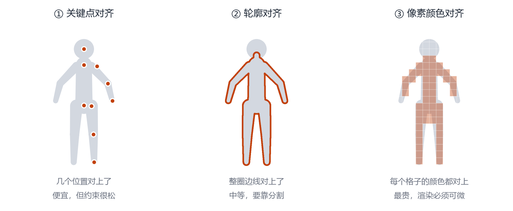
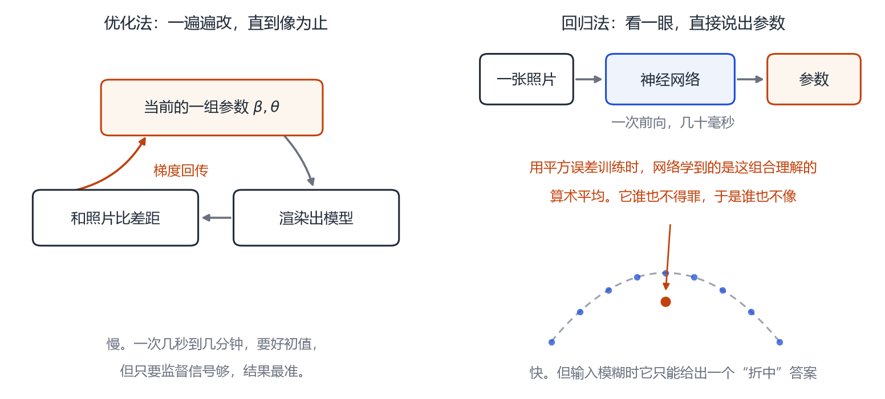

# 第 4 章 怎样从一张照片反推

> **本章导读**：前两章都在讲“给定参数，人能长成什么样”。这一章把方向反过来。给你一张照片，怎么找出一组参数，让模型看起来就是照片里那个人。这一章不写求解器，只讲清三件事：什么叫“看起来像”，为什么有两条路，以及可微为什么是这一切的前提。

## 4.1 把问题写成一句话

问题可以压成一句话，**找一组参数，让渲染出来的模型和这张照片最像。**

这句话里每个词都有分量。“渲染出来”说明中间要过一个成像过程，模型在三维空间里，照片是二维的，中间隔着相机和投影。“最像”是一个还没定义的东西，下面单独说。“参数”是我们前面反复打交道的那些数，体型加上姿势，再加相机的位置和朝向。

用数学写出来，就是

$$
\min_{\boldsymbol{\beta},\boldsymbol{\theta},\boldsymbol{\pi}}\ \Big\|\,\mathcal{R}\big(M(\boldsymbol{\beta},\boldsymbol{\theta});\boldsymbol{\pi}\big)-\mathbf{I}\,\Big\|^{2} .
$$

这里 $M$ 是模型，输入体型和姿势，输出一张三维网格；$\mathcal{R}$ 是渲染器，输入网格和相机 $\boldsymbol{\pi}$，输出一张图像；$\mathbf{I}$ 是输入的照片。整个式子的意思是“把渲染结果和照片逐点比，差得越小越好”。

这个式子和第 1 章里那个式 (1.2) 是同一件事，只是这里把相机也放进了待求的量。多加一项不是小事，因为相机决定了模型在画面里有多大、在哪，后面讲尺度歧义时会看到它有多麻烦。

值得注意的是，这个式子里没有任何“人”的知识。它不知道关节不能反折，不知道人不会悬空，不知道两个人在同一张图里应该分开。所有关于“人”的常识，都得靠额外的东西补进去，这也是这一章后半部分的主题。

还有一点容易忽略。粗略一数，未知数只有几十个，像素却有上百万个，看上去约束多得用不完。实际情况相反，照片里真正有用的信息往往比像素数少得多：背景是白墙，衣服是纯色，大片区域没有任何梯度，能被模型利用的，可能就只有轮廓上那几百个边缘像素。未知数多、有效约束少，这才是反推问题难的根本原因。

所以反推从来不是“解一个方程”，而是“在无数个都说得通的答案里挑一个”。挑哪一个，取决于你额外加了多少先验。

## 4.2 什么叫“最像”

“像”可以有很多种定义，每一种对应一类监督信号。常用的有三种，从弱到强。

<figure class="fig">

<figcaption><b>图 4-1</b>　三种监督。左：只在若干关键点上比对，比如肩、肘、腕、膝的位置。中：在整个人体轮廓上比对。右：逐像素比对颜色，落满网格的区域都要参与比对。从弱到强，代价也从便宜涨到最贵。</figcaption>
</figure>

图 4-1 把三种监督摆在一起。**第一种是关键点。** 在照片上标出十几个关节的位置，在渲染结果上也找出同样十几个关节的位置，让它们对齐。这最便宜，标注也最省事，现在已经有很多自动的关键点检测器。但它给出的约束很松，十几个点只能限定大概的位置，撑不起细节。手肘的位置对了，手臂是粗是细它管不了。

**第二种是轮廓。** 把人体在图像里占据的那一片区域抠出来，让渲染出来的模型投影出同样的边界。这个信号强得多，因为它约束的是整圈边界，粗细、胖瘦、姿态的细微差别都会反映在轮廓上。代价是需要一张能分出人和背景的分割图，边界上偶尔会有毛刺。

**第三种是像素颜色。** 让渲染出来的每一个像素和照片的对应位置颜色接近。这是最强的信号，它连衣服的褶皱、光影的方向都能约束。代价也最大：渲染必须对参数可导，纹理和光照也要建模，训练和求解都贵得多。

工程上几乎不会只用一种。常见的搭配是关键点给大方向，轮廓给细节，像素给质感，三项各配一个权重加起来。

$$
\mathcal{L} = \lambda_{\text{kp}}\,\mathcal{L}_{\text{kp}} + \lambda_{\text{si}}\,\mathcal{L}_{\text{si}} + \lambda_{\text{px}}\,\mathcal{L}_{\text{px}} .
\tag{4.1}
$$

其中三个 $\mathcal{L}$ 分别是三种监督各自的误差，$\lambda$ 是它们的分量。权重怎么定没有普适答案，靠经验调，这也是这类系统调起来比较费劲的原因之一。

三种监督的差别，用一句话概括就是“它们各自告诉你多少个约束”。关键点只说“这块皮肤的中心在哪”，十几个位置加起来也就几十个约束；轮廓说的是“这条边界要贴住”，一整圈下来是几百上千个；像素则连轮廓里面每一块的颜色都要对上，数量级一下子到了十万以上。

约束越多不一定越好。像素级监督需要纹理和光照模型，一旦衣服和皮肤的颜色估错，梯度会把形状往错误的方向推。所以早期系统宁可只用关键点，稳当、好调、不容易被外观骗。

## 4.3 两条路：慢慢改，还是看一眼

有了目标函数，剩下的问题是怎么求最小值。这里有两条完全不同的路。

<figure class="fig">

<figcaption><b>图 4-2</b>　两条路线。左：优化法，从一组初值出发反复渲染、比对、回传梯度，直到误差降不下去。右：回归法，训练一个网络，看一次照片直接吐出参数。回归法在输入模糊时容易输出“平均人”，因为平方误差的最优解就是多个合理解的平均。</figcaption>
</figure>

**优化法**的思路最直接。随便给一组初值，渲染一次，和照片比，算出误差，再算出“往哪个方向改能让误差变小”，改一点点，再渲染，如此往复。这叫迭代求解，慢的时候要几分钟。它的好处是只要监督信号足够，结果可以非常准，因为它是针对这一张照片反复调整的，不存在“见过的样本不够”这种问题 [@bogo2016smplify]。

它的软肋是初值。这类问题通常有很多局部最优，初值给得不好就会卡在一个明显不对的姿势上，比如两条腿缠在一起、手臂穿进躯干。所以实用的系统都会先给一个像样的初值，或者干脆跑好几次取最好的。

**回归法**走另一条路。收集大量“照片配参数”的成对数据，训练一个神经网络，让它学会从照片直接说出参数。用的时候只做一次前向，几十毫秒就出结果，特别适合视频和大批量处理 [@kanazawa2018hmr]。

它把难题换了个位置。优化法要在测试时解一个复杂的非凸问题，回归法把这件事提到了训练时，用海量数据把“怎么解”预先烧进网络权重里。所以它的速度不是白来的，是用训练成本换的。

它的软肋是数据。照片和真实的三维参数很难同时拿到，通常只有带标注的合成数据，或者用优化法的结果当标签，两个来源都带着自己的偏差。

两条路并不是对立的。现在主流的做法是把它们串起来，先用回归法几十毫秒给一个不错的初值，再用优化法在这张照片上迭代几十步把细节磨准。前一步解决了初值问题，后一步解决了精度问题，两边都用到。

### 为什么回归法容易输出“平均人”

这一点值得单独说，因为它太常见了，几乎是这类方法的通病。

假设一张照片其实对应好几个都说得通的姿势，比如手臂被身体挡住、侧躺的姿势、光线很差的情况。人在看的时候会凭常识挑一个，但训练时的损失函数不会。用平方误差做损失时（也就是常说的 L2 损失），如果几个答案都同样合理，那么让损失最小的那个答案，恰好是它们的算术平均。

图 4-2 右边那组点就是这个意思。蓝色点是几个都说得通的答案，橙色点是它们的平均。这个平均数可能根本不是一个合理的姿势，但它在数值上确实离所有答案都最近。

所以训练得越久、拟合得越好，网络越倾向于输出那个“折中”的答案。表现到画面上，就是重建出来的人身材中等、姿势温和、没有任何鲜明的特征。业内把这个叫回归到均值，它是平方误差这个损失的数学性质，不是网络不够大。

对抗的办法有几类。换损失函数，比如对多个模态分别建模；把优化法接在回归后面做微调；或者干脆让网络输出一个分布而不是一个点。这三种做法各有代价：换损失函数要重新建模，微调要求整条链路可导，输出分布则多出采样这一步。

## 4.4 可微是这一切的前提

前面反复提到“回传梯度”，这里补一句它为什么能成立。

渲染这个过程，从参数到像素，中间经过一串运算：参数变成关节角度，角度沿骨架乘出一串变换，变换作用到几千个顶点上，顶点投影到图像平面，最后填成像素颜色。这一串里每一步都是可导的，于是整个链条就可导。求导的办法是链式法则，把每一步的导数一个接一个乘起来，就像把一串齿轮的传动比乘起来。

它的实际含义很直接，**误差可以精确地告诉每一个参数“你该往哪边挪一点”**。如果中间某一环不可导，比如渲染时做了硬性的遮挡判断、或者用了不可导的量化，梯度就断在那里，后面的参数就收不到任何信息，只能靠猜。

这也是为什么“可微渲染”在 2019 年之后成了热点。不是渲染本身变了，而是大家意识到，只要渲染可微，前面那个优化式子就能真的解，而且能用上最强的像素级监督。

反过来说，如果只有关键点和轮廓，渲染其实不需要完全可微。关键点可以直接从三维坐标投影到二维，轮廓可以近似成一组可微的软边界，这两条路都不必走完整的渲染管线。所以“可微渲染值不值得”这个问题，答案取决于你用哪种监督。想要像素级，就必须可微；只要几何对齐，可以绕开。

## 4.5 现实里的麻烦

理论上的式子很干净，真实照片上处处是坑。下面几个是最常遇到的。

**遮挡。** 手臂挡在身前、包挡住胯、头发挡住肩膀。被挡住的部分在照片上没有证据，模型只能靠先验猜。猜错了，重建出来的手可能穿进肚子里。

**深度歧义。** 一张照片是二维的，远近关系被压掉了。同一个小小的人形，可以是“一个小孩站在近处”，也可以是“一个大人站在远处”。在没有其他线索的情况下，这两种解释给出的图像几乎一样。这就是为什么相机参数必须一起估，不能事后补。

**尺度歧义。** 和上一条同源。把所有尺寸和距离同时放大同一个倍数，投影结果不变。所以单张照片永远定不出绝对身高，只能定出比例。

想要一个具体数字，就得额外找参考。地上的一块砖、门的高度、身后扶手的间距，这些在图像里能识别的绝对尺度，才能把倍数定死。没有这些，任何声称从单图测出身高的系统，背后都藏着一个假设。

**数据集偏差。** 训练数据里如果多是年轻人、正面、短袖、室内光照，模型在老年人、侧后方、长袍、逆光上就会明显变差。这个问题的根子在数据，不在算法。它也是很多论文报告的指标和实际体验对不上的主要原因。

**多人。** 一张合影里有五个人，谁是谁的关节？如果检测器把两个人挨着的手腕对错了，优化出来的结果会是一个姿势诡异的连体人。

还有一类麻烦不常被提起，但真实场景里到处都是，那就是衣服。模型是赤体的，照片里的人穿着宽松的衬衫。把赤体模型硬往一件宽松衣服的轮廓上套，得到的体型会偏胖一圈。这不是优化失败，是模型本身表达不了衣服。

这些麻烦没有一个是靠“把网络做大”能解决的，它们各自需要专门的设计。这也是为什么单图重建至今仍然是一个活跃的研究方向，而不是一个已经做完的工程问题。

把这几条放在一起看，会发现它们的性质并不相同。遮挡是“信息真的不在”，图像里没有任何关于被遮住部位的证据，只能靠先验。深度和尺度歧义是“信息在但不够”，图像本身不包含那个维度，得靠其他线索推断。数据偏差是“信息在但样本里没有”，属于训练集覆盖不全。多人则是“信息在且足，但需要先分类”。

这四种麻烦分别需要四种手法，先验、额外线索、数据扩充、实例分离。一套系统能不能在实际场景里用，往往不取决于它的主算法多漂亮，而取决于这四种麻烦处理得好不好。

最后说一句关于评估的事。既然反推没有唯一正确答案，那“重建得对不对”本身就需要定义。这也是为什么这个领域的论文除了看重建误差，还要看下游任务的表现，比如动作识别准不准、虚拟试衣合不合理。数字好看但下游一用就露馅的情况并不少见，原因往往就是前面说的回归到均值。

## 4.6 再往深处走

这一章从头到尾只做了一件事，把反推问题写成一句话，然后说明这句话里的每一块（目标、监督、求解、难点）大致是什么形状。真正的公式一个都没写。

这些内容每一块都够写一章：参数怎么从数据里学出来、优化目标怎么加先验、骨架树上的导数怎么算、回归网络怎么设计、多人场景怎么分实例。本册只到“知道它们在做什么”为止。

如果只记一件事，就记这句。**反推不是把照片“变成”模型，而是在参数空间里找一个能解释这张照片的点，而找得好不好，取决于你约束得够不够。**

## 本章小结

- 反推问题可以写成一句话，找一组参数让渲染结果和照片最像。参数少、有效约束更少，所以答案不唯一。
- 监督信号从弱到强有三种，关键点、轮廓、像素颜色，约束一个比一个多，代价也一级比一级高。
- 优化法慢而准，靠反复渲染迭代，怕坏初值；回归法快，把难题提到了训练时，容易输出“平均人”。
- 可微是整条链路能连通的前提，链式法则把像素上的误差一路传回每一个参数。
- 遮挡、深度与尺度歧义、数据偏差、多人，四种麻烦需要四种手法，主算法漂亮不代表能落地。

## 思考题

1. 只用关键点监督时，模型能把一个人的胖瘦估准吗？为什么？如果把关键点从 14 个加到 100 个，情况会改善多少？
2. 一张照片里两个人体型差别很大，但它们离相机的距离不同，投影出来却差不多大。需要什么额外信息才能把这两件事分开？
3. 如果把损失从平方误差换成绝对值误差，回归到均值的现象会变成什么？试着从“中位数和平均数的区别”这个角度想。
